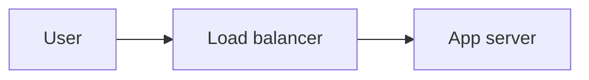

# Contributing to Architecture Atlas

Thank you for helping build a free, visual, rigorous learning resource for architects.
This guide covers running the site, writing pages, drawing diagrams, adding labs, citing sources,
and license rules. The full project specification lives in [`MASTER_PROMPT.md`](MASTER_PROMPT.md).

## 1. Run the site locally

Requirements: Python 3.12 or newer, Git. Node.js is optional (only for Markdown linting).

```bash
git clone https://github.com/vinay9354/architecture-atlas.git
cd architecture-atlas
python3 -m venv .venv
source .venv/bin/activate          # Windows: .venv\Scripts\activate
pip install -r requirements.txt
mkdocs serve                       # http://127.0.0.1:8000/
```

Or run `scripts/build-local.sh serve`, which does all of the above.

Before opening a pull request:

```bash
python scripts/validate-content.py        # metadata, links, mermaid types, coverage consistency
python scripts/build-coverage.py          # regenerate coverage matrix after editing coverage.yaml
python scripts/check-assets.py            # every asset is attributed
mkdocs build --strict                     # warnings fail the build
npx markdownlint-cli2                     # optional, needs Node.js
python -m unittest discover -s tests      # smoke tests
```

## 2. Propose a topic

1. Check [`curriculum/coverage.yaml`](curriculum/coverage.yaml) and the
   [coverage matrix](docs/appendices/coverage-matrix.md). Most topics already have an ID and a
   planned destination path.
2. Open a **New topic** issue (or comment on an existing one) so two people do not write the same page.
3. Use the planned destination path unless there is a good reason to change it, and update the
   YAML entry's `status` when you write the page.

## 3. Write a page

Copy [`templates/topic-template.md`](templates/topic-template.md) and keep its section order.
Short pages may drop sections that genuinely do not apply; say so in the page's review notes.

Rules that reviewers check:

- **Front matter** is complete: `title`, `description`, `domain`, `level`, `status`,
  `estimated_time`, `last_verified`, `prerequisites`, `tags`. The validator enforces the keys and
  the date format. See [ADR-0004](docs/appendices/adr/adr-0004-content-metadata-and-taxonomy.md).
- **Status honesty.** `Draft` means written but unreviewed. `Reviewed` means a second person checked
  accuracy, diagrams, references, and exercises. A page that renders is not "Reviewed".
- **Levels.** Mark sections or pages Level 1 (Understand), Level 2 (Apply), Level 3 (Architect) so a
  beginner can stop before the advanced material. Link prerequisites.
- **Original wording.** Explain in your own words; link to sources. No copied passages from books,
  courses, blogs, or vendor docs. No exam dumps.
- **Trade-offs, not dogma.** Every recommendation states the workload assumptions it depends on.
- **No invented numbers.** Benchmarks, limits, prices, and guarantees need a primary source and a
  checked date, or they stay out.
- **Examples are consistent.** If the example has 100,000 daily users, the request rates, storage
  estimates, and architecture must match that scale.
- **Glossary consistency.** Use terms as defined in [the glossary](docs/start-here/glossary.md). Add
  new terms there rather than redefining them per page.

## 4. Draw diagrams

Default to Mermaid inside a fenced block:

````markdown

````

Every diagram needs: a caption (bold line above or below), a legend when shapes or line styles
carry meaning, consistent names with the surrounding text, flow direction, trust or failure
boundaries where relevant, and a short prose explanation next to it. Keep diagrams small; split
complex architectures into several. Do not rely on color alone.

If Mermaid cannot express the visual, create an original SVG under `docs/assets/diagrams/`, keep it
editable, list it in `ASSET_ATTRIBUTION.md` under "Original assets", and give it alt text.
Never commit a screenshot of a diagram as the only source. See
[ADR-0003](docs/appendices/adr/adr-0003-diagram-format.md).

## 5. Add a lab

Use [`templates/lab-template.md`](templates/lab-template.md). Labs must run locally with free
tools where at all possible, state any cloud/GPU/API-key requirement up front, include cleanup
steps, and never ask learners to expose credentials, grant broad permissions, run destructive
commands, or upload private data. Lab code lives under `labs/`, the lab page under `docs/labs/`,
and solutions under `labs/solutions/`. See
[ADR-0005](docs/appendices/adr/adr-0005-lab-execution-strategy.md).

## 6. Cite sources

Each substantial page ends with a **References** section listing title, organization or author,
URL, source type (standard, official documentation, paper, book, blog), and the date checked for
anything version-sensitive. Prefer standards, specifications, and official documentation. Link;
do not mirror. Short quotes only, in quotation marks, with attribution.

## 7. Licenses and assets

- Your text and diagrams are contributed under **CC BY 4.0**; your code under **MIT**
  (see [`LICENSE`](LICENSE) and [`LICENSE-DOCS.md`](LICENSE-DOCS.md)). By opening a pull request
  you confirm you have the right to contribute the material under these terms.
- Third-party assets are the exception, not the rule. Before adding one, answer the eight questions
  in `MASTER_PROMPT.md` Section 6.8. Record it in `ASSET_ATTRIBUTION.md` **and** next to where it
  is used. No NC, ND, ShareAlike, or unknown-license assets without maintainer approval.
- No vendor logos or official icon packs unless the brand terms have been checked and recorded.
- No secrets, tokens, account IDs, customer data, or personal data anywhere, including in
  screenshots and sample data.

## 8. Pull request checklist

The pull request template lists what reviewers look for: summary, motivation, affected coverage
IDs, sources, diagram changes, checks run, and the license/asset confirmation. Keep pull requests
focused: one topic page, one lab, or one coherent set of fixes per pull request.

## 9. Code of conduct

Participation is governed by [`CODE_OF_CONDUCT.md`](CODE_OF_CONDUCT.md).
