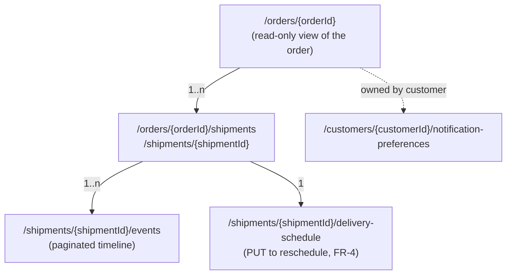
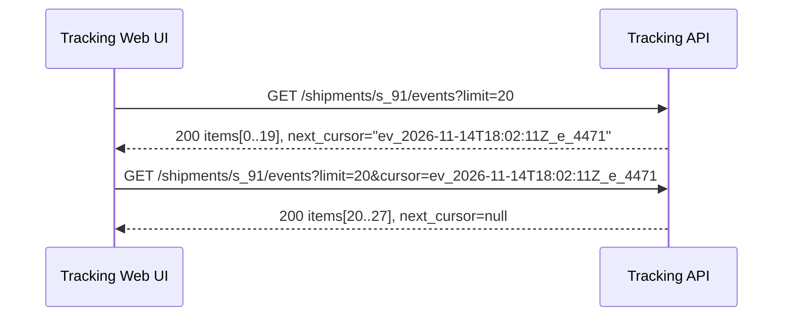
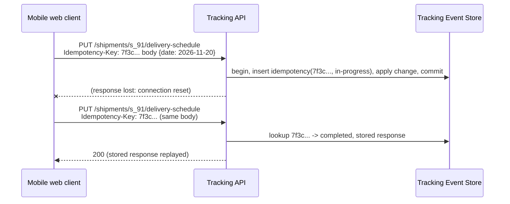
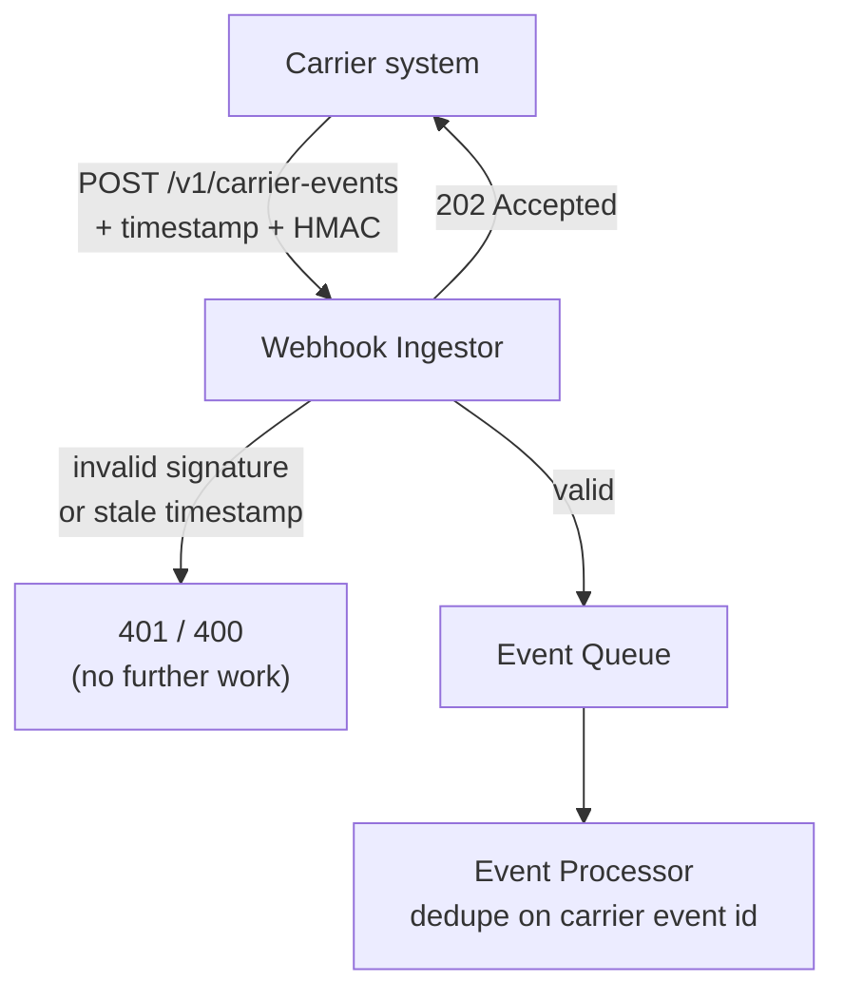

# API design: REST, GraphQL, gRPC, and async APIs

> An API is a promise to people you will never meet. Its design decides how cheaply the system
> behind it can change, how safely clients can retry, and how long you will carry mistakes.

!!! abstract "Page facts"
    **Level:** Mixed (styles and contracts are Level 1-2; versioning, idempotency, and rate limiting
    are Level 3) · **Status:** Draft · **Time:** 60-75 minutes · **Last verified:** 2026-11-15

## Learning objectives

After this page you should be able to:

- Explain what an API contract is and why it is designed before it is implemented.
- Choose between REST, GraphQL, gRPC, WebSockets, Server-Sent Events, and webhooks for a given
  consumer and workload, and state the trade-off you accepted.
- Design resources, responses, errors, pagination, filtering, and sorting that stay consistent across
  an API.
- Make unsafe operations safe to retry with idempotency keys.
- Version an API, keep backward compatibility, and run a deprecation that consumers can plan around.
- Apply authentication, authorization, rate limiting, quotas, and caching at the API edge.
- Describe how an API is documented, tested, observed, and managed over its lifecycle.

## Prerequisites

- [Functional vs non-functional requirements](../architecture-fundamentals/functional-vs-non-functional-requirements.md)
  — the Tracking API below implements FR-1 to FR-5 under NFR-1 to NFR-8.
- [The C4 model](../architecture-fundamentals/c4-model.md) — the Tracking API is the container whose
  interface this page designs.
- [Transport and application protocols](../networking/transport-and-application-protocols.md) —
  HTTP semantics, HTTP/2 streams, and TLS are assumed, not explained, here.

## The problem this solves

Every system boundary is an interface, and most interfaces are built by accident: a developer exposes
whatever the first screen needs, the next team copies the shape, and within a year the "API" is a
set of habits nobody dares change. The costs show up later as clients that break on every release,
duplicated writes after a timeout, pagination that skips records, and a mobile app that cannot be
updated as fast as the server. Deliberate API design front-loads a small amount of thinking about
resources, errors, change, and failure so that the interface can outlive several implementations
behind it.

## What it is

An **API (Application Programming Interface)** is the set of operations, data shapes, and rules by
which one program uses another. In this page the term covers network APIs between services, between
a frontend and a backend, and between organizations. An **API contract** is the written, machine-
readable description of that interface (for HTTP APIs usually an OpenAPI document; for gRPC a
Protocol Buffers definition; for GraphQL a schema). The contract is the thing consumers depend on; the
implementation behind it is free to change as long as the contract holds.

API **styles** differ in how they frame the interaction:

| Style | Interaction model | Typical transport |
|---|---|---|
| REST | Resources identified by URLs, manipulated with standard HTTP methods | HTTP/1.1, HTTP/2 |
| GraphQL | Client sends a query describing exactly the fields it wants; one endpoint | HTTP (usually POST) |
| gRPC | Typed remote procedure calls defined in Protocol Buffers; streaming in both directions | HTTP/2 |
| SOAP | XML messages described by WSDL; mostly found in legacy and B2B integration | HTTP, sometimes message queues |
| WebSocket | Long-lived bidirectional channel after an HTTP upgrade | TCP via HTTP upgrade |
| Server-Sent Events (SSE) | Server pushes a stream of text events over one HTTP response | HTTP |
| Webhooks | The provider calls a URL the consumer registered when something happens | HTTP (provider is the client) |
| Asynchronous (message) APIs | Messages on topics or queues; described with AsyncAPI-style contracts | Broker protocols |

None is "modern" or "legacy" in itself; each fits some consumers and workloads and not others.

## Mental model

Think of an API as the counter at a government office. The forms (request shapes) are standard; the
clerk (the service) does not care who you are as long as the form is valid and you are entitled to the
service. Each form has a number (the operation), rules for what fields are mandatory (validation), a
receipt with a reference number (the response and its identifier), and a queue ticket that lets you
come back without losing your place (pagination). If you lose your receipt and submit the same form
twice, a well-run office checks the reference number and does not process it twice (idempotency).
When a form changes, the old version is accepted for a published period (deprecation).

**Where the analogy breaks:** the office serves one person at a time; an API serves thousands of
concurrent callers, some of them hostile or broken, so it needs rate limits, timeouts, and defensive
validation that an office never does. And office forms change once a decade; APIs change monthly,
which is why versioning policy matters more than any single design choice.

## Key terms

| Term | Meaning on this page |
|---|---|
| Resource | A named thing the API exposes, identified by a URL (an order, a shipment, an event) |
| Contract | The machine-readable description consumers depend on (OpenAPI, Protobuf, GraphQL schema) |
| Backward compatibility | A change after which every existing valid client request still works and means the same thing |
| Idempotent operation | An operation that has the same effect whether performed once or several times |
| Idempotency key | A client-chosen unique token sent with a request so the server can detect and deduplicate retries |
| Pagination | Returning a large collection in pages, with a token or offset to fetch the next one |
| Rate limiting | Rejecting requests above a rate per client; throttling slows them instead; a quota caps a longer period |
| Deprecation | Announcing that an operation or version will be removed on a stated date, while it still works |
| Webhook | An HTTP callback from a provider to a consumer-registered URL when an event occurs |

## How it works

### Step 1 — Model resources from the domain, not from screens

Start from the nouns in the functional requirements. For order tracking the nouns are orders,
shipments (an order can ship in several parcels), and scan events (the timeline of a shipment). The
relationships become the URL structure; the operations become HTTP methods with their standard
semantics (safe `GET`, idempotent `PUT` and `DELETE`, non-idempotent `POST`, partial `PATCH`).
Operations that are not naturally a resource change (for example "reschedule delivery") are modelled
either as a sub-resource (`/shipments/{id}/delivery-schedule`) or as an explicit action resource
(`/shipments/{id}/reschedule-requests`), never as a verb in the URL with `GET`.

**Figure 1 — Resource model for the Tracking API.** Orders own shipments; shipments own events.
Collections are plural; a single item is addressed by its identifier.



How to read it: each box is a resource path; arrows show ownership. A client that knows an order
identifier can discover everything else by following links in responses.

### Step 2 — Write the contract before the code

An **OpenAPI** document describes paths, operations, parameters, request and response schemas,
status codes, and security schemes for an HTTP API. Writing it first lets frontend and backend teams
work in parallel against a mock, lets reviewers argue about names before they are frozen, and gives
you generated client libraries, documentation, and contract tests for free. For gRPC the equivalent
is the `.proto` file; for GraphQL the schema definition language. The contract is reviewed like code
and versioned with the service.

### Step 3 — Design responses and errors once, then reuse them

- **Envelope or not.** Return the resource directly as the body for single items; for collections
  return an object with `items` plus pagination fields, so that metadata can be added later without
  breaking clients.
- **Identifiers** are opaque strings, never database integers that leak ordering and size.
- **Timestamps** are ISO 8601 in UTC with an explicit offset; money is an integer minor unit plus a
  currency code; never floating point.
- **Errors** use the right status class (4xx the client can fix; 5xx the client cannot) and a
  consistent body. The Problem Details format standardized in RFC 9457 gives a `type`, `title`,
  `status`, `detail`, and `instance` field, and lets you add domain-specific fields such as a
  validation error list.
- **Validation** happens at the edge against the contract: unknown fields are rejected or ignored by
  policy (state which), sizes are bounded, and every rejection says which field failed and why.

### Step 4 — Pagination, filtering, and sorting

Collections grow. Offset pagination (`?offset=200&limit=50`) is simple but skips or repeats rows when
items are inserted between pages and becomes slow for deep offsets. **Cursor (keyset) pagination**
returns an opaque token that encodes the position of the last item (for example the last event's
timestamp and identifier); the next request continues from there. It is stable under inserts and
cheap for the database. Filtering uses query parameters with a documented operator set; sorting
accepts a whitelist of fields. Always put a maximum page size in the contract and return the
default when none is requested.

**Figure 2 — Cursor pagination over the event timeline.** Each response carries the cursor for the
next page; the client never computes positions.



How to read it: the cursor is opaque to the client (shown here readable only for illustration); a
null cursor means the end of the collection.

### Step 5 — Make retries safe with idempotency keys

Networks fail after the server has acted but before the client sees the response. A client that
retries a `POST` then creates a duplicate. The fix is an **idempotency key**: the client generates a
unique token (a UUID) per logical operation and sends it in a header; the server stores the key with
the result of the first execution and returns the stored result for any repeat within a retention
window. The IETF HTTP API working group's `Idempotency-Key` header draft describes this header; the
semantics (store the first response, replay it, reject reuse with a different body) are the API's
responsibility. `PUT` and `DELETE` are idempotent by definition when implemented correctly and do not
need a key.

**Figure 3 — Idempotent reschedule request.** The second request carries the same key; the server
replays the original result instead of creating a second change.



How to read it: the key is recorded in the same transaction as the change, so a crash between the
two cannot leave the key without the change or the change without the key.

### Step 6 — Version, keep compatibility, deprecate

The cheapest version is the one you never need. **Additive changes** (new optional fields, new
endpoints, new enum values the client is told to ignore when unknown) are backward compatible and
need no version. **Breaking changes** (renaming or removing a field, changing a type, changing the
meaning of a status code, tightening validation) need either a new major version or a transformation
layer. Common policies:

| Policy | How | Favor when |
|---|---|---|
| URL major version (`/v1/`, `/v2/`) | Separate routes, often separate deployments | Public APIs with many unknown consumers |
| Header or media-type version | `Accept: application/vnd.atlasmart.tracking.v2+json` | Internal APIs where clients are known; keeps URLs stable |
| Date-based version | Client pins a date; the server applies transformations between dates | Providers that change often and want gradual migration |
| No explicit version, additive only | Strict compatibility rules; never break | Internal event and service APIs under one team's control |

A **deprecation** states what is going away, when, and what replaces it. RFC 9745 standardizes a
`Deprecation` response header and RFC 8594 a `Sunset` header giving the removal date; both let
clients and monitoring detect calls to deprecated operations. Measure who still calls the old
version before you remove it, and publish the policy (for example "a major version is supported for
at least 12 months after its successor ships") so consumers can plan.

### Step 7 — Protect the API: authentication, authorization, rate limits, quotas

- **Authentication** establishes who is calling: a bearer token from the identity provider for users,
  mutual TLS or signed requests for partner systems, an API key only for low-risk identification.
- **Authorization** decides what the caller may do, enforced in the service for every request (the
  Tracking API checks that the order belongs to the authenticated customer; NFR-5). Never rely on the
  client not asking.
- **Rate limiting** rejects requests above a per-client rate with `429 Too Many Requests` and a
  `Retry-After` header; **throttling** slows rather than rejects; a **quota** caps a longer period
  (per day, per billing cycle) and is the basis for **monetization** tiers. The IETF `RateLimit`
  header fields draft standardizes how the remaining allowance is reported to clients.
- **Caching** of safe responses with `Cache-Control`, `ETag`, and conditional requests (RFC 9111)
  takes load off the service for data that changes slowly; the tracking status changes at most a
  few times a day per shipment, so a short cache lifetime is safe and valuable.

### Step 8 — Document, test, observe, manage

The contract generates reference documentation; the human part is a getting-started guide, examples
for each operation, and an explicit changelog. **Contract tests** check that the implementation
matches the document (request and response schemas, status codes); **consumer-driven contract tests**
let each consumer state the subset it depends on, so the provider knows which changes break whom.
**Observability** per operation means request rate, error rate by status, latency percentiles,
and, for rate-limited APIs, rejections per client. **Lifecycle management** is the set of decisions
from design review through publication, versioning, deprecation, and retirement, usually run through
an API gateway and a catalog.

### Choosing a style

| Style | Favor when | Avoid when |
|---|---|---|
| REST over HTTP/JSON | Many diverse consumers; resource-shaped domain; HTTP caching and tooling matter | Chatty screens need many related resources per view and bandwidth is tight |
| GraphQL | Multiple frontends need different field sets from the same graph; one endpoint for a product team | Simple CRUD, heavy write workloads, or when per-field authorization and query cost control are not in place |
| gRPC | Service-to-service calls where latency, typed contracts, and streaming matter; polyglot teams | Browser clients without a proxy; public partner APIs where HTTP/JSON tooling is expected |
| SOAP | A partner or regulator mandates it; existing WSDL-based integrations | Any new consumer-facing API |
| WebSockets | Bidirectional, low-latency interaction (collaboration, chat, live control) | One-directional updates (use SSE); stateless scaling is a priority |
| Server-Sent Events | Server-to-client updates over plain HTTP, easy to proxy and reconnect | The client must send a high volume of messages |
| Webhooks | Notify other systems of events without them polling | Consumers cannot run a public endpoint; delivery guarantees stronger than at-least-once are required |
| Async message API | Decoupling producers from consumers; buffering bursts; multiple consumers of one event | The caller needs an immediate answer to proceed |

## Worked example: the AtlasMart Tracking API

The Tracking API is the container from the [C4 example](../architecture-fundamentals/c4-model.md)
that serves the Tracking Web UI and the support agent view. The design below satisfies FR-1 to FR-5
and NFR-1 to NFR-8.

### Contract sketch

The following is an abbreviated OpenAPI-style sketch. It is illustrative: it omits schemas and
security details that a real document would include and is not meant to be executed.

```yaml
openapi: 3.1.0
info:
  title: AtlasMart Tracking API
  version: 1.3.0            # semantic version of the contract; the URL carries only the major
paths:
  /v1/orders/{orderId}:
    get:
      summary: Tracking view of one order (FR-1)
      security: [{ customerToken: [] }, { agentToken: [] }]
      responses:
        "200": { description: Order with its shipments and current status }
        "404": { description: Not found or not owned by the caller (same response for both, NFR-5) }
  /v1/shipments/{shipmentId}/events:
    get:
      summary: Paginated scan-event timeline (FR-1, FR-5)
      parameters:
        - { name: limit, in: query, schema: { type: integer, maximum: 100, default: 20 } }
        - { name: cursor, in: query, schema: { type: string } }
      responses:
        "200": { description: items plus next_cursor }
  /v1/shipments/{shipmentId}/delivery-schedule:
    put:
      summary: Reschedule delivery before hub departure (FR-4)
      parameters:
        - { name: Idempotency-Key, in: header, required: true, schema: { type: string, format: uuid } }
      responses:
        "200": { description: Schedule updated (or replayed for a repeated key) }
        "409": { description: Shipment already departed; problem+json body explains }
        "422": { description: Validation failed; problem+json lists field errors }
```

### Decisions and why

| Decision | Reason |
|---|---|
| REST over HTTP/JSON for the web UI and agents | Diverse clients (SPA, agent tooling, future partners); HTTP caching fits the 2.5 : 1 read-heavy mix |
| `404` for both "missing" and "not yours" | Prevents enumeration of other customers' order identifiers (NFR-5) |
| Cursor pagination on events, max 100 | A shipment has about 8 events, but agent tooling lists events across many shipments; cursors stay correct as events arrive |
| Idempotency key required on reschedule | Mobile networks (70% of orders) drop responses; a duplicate reschedule would be visible to the customer and the carrier |
| `Cache-Control: private, max-age=30` on the order view | NFR-1 allows 60 s of staleness; the Status Cache and client caching together keep p95 under 300 ms (NFR-3) |
| Per-customer limit of 10 requests per second, burst 20; per-agent 50/s | At 400,000 DAU the design peak is 210 reads/s in total; a single client approaching the whole system's peak is a scraper or a bug |
| URL major version, additive changes only within a major, 12-month overlap | Partner carriers will consume the API later; they cannot redeploy on AtlasMart's schedule |

Rate limit numbers are AtlasMart assumptions chosen so that legitimate use (a customer refreshing a
page a few times a minute) is never limited while enumeration is.

### The carrier webhook contract (inbound)

AtlasMart publishes a webhook contract that carriers implement: `POST /v1/carrier-events` with a
JSON body (carrier identifier, carrier shipment reference, event type, carrier timestamp, location
text, an event identifier unique per carrier) and two headers: a timestamp and an HMAC signature of
the timestamp plus body computed with a per-carrier shared secret. The Webhook Ingestor verifies the
signature before parsing anything else (NFR-5), rejects timestamps outside a short window to blunt
replay, acknowledges with `202 Accepted` after enqueuing, and deduplicates on the carrier event
identifier downstream (FR-2 acceptance: 1,000 replayed events yield 1,000 stored events). Delivery is
at-least-once: carriers retry on anything other than a 2xx, so the contract document states the
retry schedule AtlasMart expects and the deduplication rule it applies.

**Figure 4 — Inbound webhook handling.** Verification is cheap and happens first; the expensive work
happens after the acknowledgement.



How to read it: left to right is time; the only synchronous work before the `202` is signature
verification, schema validation, and the enqueue.

## Real-world architecture example

In production the Tracking API sits behind an **API gateway** that terminates TLS, validates tokens
with the Identity Provider, applies the rate limits and quotas, emits per-operation metrics, and
routes `/v1/` and a future `/v2/` to different deployments. The contract document is published in an
internal API catalog; a contract test runs in the Tracking API's pipeline against the document, and
the Tracking Web UI's consumer-driven contract test runs against every provider change. Deprecation
headers are logged by the gateway so the team can see, per client, who still calls a sunset
operation. For partner carriers the same gateway exposes the webhook endpoint on a separate hostname
with its own rate limit, keeping a flood of carrier traffic from affecting customer traffic.

## Design choices and trade-offs

| Choice | Favor when | Avoid when |
|---|---|---|
| Contract-first (write OpenAPI/Protobuf first) | More than one team or client; long-lived API | A throwaway prototype owned by one developer |
| Strict validation (reject unknown fields) | Security-sensitive inputs; you want to catch client bugs early | You want clients to be able to send new fields before the server understands them (then ignore unknowns, documented) |
| Cursor pagination | Collections that change while being read; deep pages | Small, static collections where offset is simpler and random access is wanted |
| Idempotency keys on all unsafe operations | Any client over an unreliable network; financial or customer-visible side effects | Purely internal calls that are already idempotent by design |
| Gateway-enforced rate limits | Many clients; need per-client visibility | A single trusted internal caller; then limit in the service only |
| Fine-grained GraphQL for product frontends | Many screens, many devices, one product team owning both sides | Public partner access where query cost is hard to bound |
| Webhooks to notify partners | Partners run servers and want push | Partners are browsers or mobile apps (use SSE or push notifications) |

**Assumption behind all of this:** the API has consumers you do not control. If every consumer is
in the same repository and deploys with the service, most of the ceremony (versioning, deprecation
headers, catalogs) can be replaced by a compiler and a shared test suite.

## Failure modes and anti-patterns

- **Screen-shaped endpoints.** `/getOrderPageData` returns whatever one screen needs; the second
  screen gets a second endpoint; nothing composes. Detect: endpoints named after UI. Prevent: resource
  model first (Step 1).
- **Leaking the database.** Table names and integer primary keys in URLs; every schema change is an
  API change. Prevent: opaque identifiers; contract separate from storage.
- **Retry storms creating duplicates.** Clients retry `POST` after timeouts; duplicates appear in
  production. Prevent: idempotency keys and documented retry guidance.
- **Silent breaking changes.** A field renamed in a "minor" release breaks the mobile app that cannot
  be force-updated. Detect: consumer-driven contract tests fail. Prevent: compatibility rules and a
  review step for contract diffs.
- **Unbounded responses.** No page-size maximum; one request returns 50,000 events. Prevent: maximum
  in the contract; enforce at the edge.
- **Error bodies that differ per endpoint.** Clients write per-endpoint parsing. Prevent: one problem
  format (RFC 9457) everywhere.
- **Authorization in the client.** The UI hides buttons; the API does not check. Prevent: the service
  checks ownership on every call.
- **Deprecation by surprise.** An operation disappears with no header, no date, no metric. Prevent:
  deprecation policy, `Deprecation` and `Sunset` headers, usage measurement.

## Security considerations

- Authenticate every request and authorize at the resource level; return the same response for
  "does not exist" and "not yours" to avoid enumeration.
- Validate inputs against the contract with bounded sizes; reject oversized bodies before parsing.
- Verify webhook signatures and timestamps before any other processing; keep per-partner secrets in a
  secret store and rotate them with an overlap period during which two secrets are accepted.
- Rate limit by authenticated identity, not only by IP address, and apply a stricter limit to
  unauthenticated endpoints.
- Do not put secrets, tokens, or personal data in URLs; they end up in logs and browser history.
- Log request identifiers, not request bodies; tracking responses contain personal data (NFR-6
  already keeps delivery addresses out of this service).

## Performance, reliability, and cost

- **Performance:** response size and round trips dominate perceived latency. Return only what the
  view needs (field selection or sparse fieldsets for REST; precise queries for GraphQL), compress
  responses, and use HTTP/2 so the SPA can fetch several resources in parallel on one connection. The
  tracking order view at 4 KB is small; the event timeline is paginated so it stays small.
- **Reliability:** timeouts on the server side protect the service from slow clients; idempotency
  keys make client retries safe; `Retry-After` on `429` and `503` turns a failure into a scheduled
  retry instead of a retry storm.
- **Cost:** every unnecessary request costs compute and egress. Client caching with `ETag` and short
  `max-age`, plus the Status Cache behind the API, means most tracking reads never reach the
  database. Rate limits and quotas are also the cost control for public APIs.

## Hands-on lab: write the contract before the code

1. Pick a small domain you know (library loans, a to-do list with sharing, parcel tracking).
2. List the nouns and draw the resource tree as in Figure 1, with one owner per resource.
3. Write an OpenAPI 3.1 document by hand for four operations: list (paginated with a cursor), get,
   create (with `Idempotency-Key`), and one domain action modelled as a sub-resource. Use the
   RFC 9457 problem format for every 4xx.
4. Load the document into any OpenAPI viewer or linter (several free, local ones exist; any will do)
   and fix what it reports.
5. Make one breaking change and one additive change to the document. Write the deprecation notice
   for the breaking one: what, when, replacement, and which headers you would send.
6. Write down the rate limit you would apply per client and the one number it is derived from.

??? question "Hint: what counts as breaking?"
    Removing or renaming a field, changing a type, making an optional field required, narrowing an
    enum, changing a status code's meaning, or tightening validation on existing input. Adding an
    optional field, a new endpoint, or a new enum value (if clients are told to ignore unknowns) is
    additive.

## Knowledge check

1. A client times out on `POST /payments` and retries. What design prevents a double charge, and
   what must the server store?
2. Why does offset pagination skip or repeat items when the collection changes, and how does cursor
   pagination avoid it?
3. Name three changes that are backward compatible and three that are not.
4. A partner wants to be told when a shipment is delivered. Compare webhooks, SSE, and polling for
   this partner, who runs a server-side system.
5. Why does the Tracking API return `404` rather than `403` for an order owned by another customer?

??? success "Answers"
    1. An idempotency key sent by the client; the server stores the key with the first outcome (in the
       same transaction as the side effect) and replays the stored response for repeats.
    2. Offsets count positions, and inserts or deletes before the offset shift every position. A cursor
       records the last item seen (its sort key and identifier), so the next page starts after that
       item regardless of what was inserted elsewhere.
    3. Compatible: new optional field, new endpoint, new optional query parameter. Breaking: removing a
       field, changing a field's type, making an optional input required.
    4. Webhooks: push, simple for a server-side partner, at-least-once with retries, partner must
       expose an endpoint. SSE: push but the partner must hold a long-lived connection per stream;
       better for browsers. Polling: simplest, but wastes requests and adds latency. Webhooks fit this
       partner best.
    5. Returning `403` confirms the order exists, which lets an attacker enumerate valid identifiers;
       `404` for both cases reveals nothing (NFR-5).

## Architecture discussion questions

1. The mobile team asks for GraphQL so they can shape responses per screen; the partner team asks for
   REST so carriers can integrate with standard tooling. Would you run both over the same domain
   model? What does that cost, and who owns the schema?
2. AtlasMart wants to sell tracking data access to third-party logistics dashboards. Design the
   quota and monetization tiers, and explain which rate-limiting and authentication choices change
   when callers are paying customers.
3. A breaking change is unavoidable (shipment identifiers must become globally unique). Plan the
   migration for the SPA (deploys daily), the agent tooling (deploys monthly), and two carriers
   (deploy quarterly).

## Summary

An API is a contract designed before it is built: resources from the domain, operations with
standard semantics, one error format, bounded and cursor-based pagination, idempotency keys for
unsafe operations, and a versioning and deprecation policy consumers can plan around. REST, GraphQL,
gRPC, WebSockets, SSE, webhooks, and message APIs each fit different consumers and workloads; the
choice is a trade-off, not a fashion. Authentication, authorization, rate limits, quotas, and
caching belong at the edge and in the service, and the API's documentation, tests, metrics, and
lifecycle are part of the design, not afterthoughts.

## Related topics

- **Before:** [Functional vs non-functional requirements](../architecture-fundamentals/functional-vs-non-functional-requirements.md);
  [Transport and application protocols](../networking/transport-and-application-protocols.md)
- **Alongside:** [Integration architecture](integration-architecture.md) — APIs are one integration
  style among several; [Message queues and brokers](../messaging-and-streaming/message-queues-and-brokers.md)
  — the asynchronous side of the webhook example; [Caching architecture](../databases-and-storage/caching-architecture.md)
  — the Status Cache and HTTP caching together.
- **Planned:** application architecture for web, mobile, and SaaS (D05-T01); API security and OAuth
  in depth (D11); API gateway and service mesh patterns (D03); event-driven architecture (D08-T02).

## References

| Source | Type | Checked |
|---|---|---|
| [RFC 9110: HTTP Semantics](https://www.rfc-editor.org/rfc/rfc9110) — IETF | Standard (methods, status codes, idempotency of methods) | 2026-11-15 |
| [RFC 9457: Problem Details for HTTP APIs](https://www.rfc-editor.org/rfc/rfc9457) — IETF | Standard (error format) | 2026-11-15 |
| [RFC 9111: HTTP Caching](https://www.rfc-editor.org/rfc/rfc9111) — IETF | Standard | 2026-11-15 |
| [RFC 9745: The Deprecation HTTP Response Header Field](https://www.rfc-editor.org/rfc/rfc9745) and [RFC 8594: The Sunset HTTP Header Field](https://www.rfc-editor.org/rfc/rfc8594) — IETF | Standards (deprecation signalling) | 2026-11-15 |
| [The Idempotency-Key HTTP Header Field](https://datatracker.ietf.org/doc/draft-ietf-httpapi-idempotency-key-header/) — IETF HTTP API working group | Internet-Draft (not yet an RFC; check current status) | 2026-11-15 |
| [RateLimit header fields for HTTP](https://datatracker.ietf.org/doc/draft-ietf-httpapi-ratelimit-headers/) — IETF HTTP API working group | Internet-Draft (not yet an RFC; check current status) | 2026-11-15 |
| [OpenAPI Specification](https://spec.openapis.org/oas/latest.html) — OpenAPI Initiative | Specification | 2026-11-15 |
| [GraphQL Specification](https://spec.graphql.org/) — GraphQL Foundation | Specification | 2026-11-15 |
| [Introduction to gRPC](https://grpc.io/docs/what-is-grpc/introduction/) — gRPC project | Official documentation | 2026-11-15 |
| [RFC 6455: The WebSocket Protocol](https://www.rfc-editor.org/rfc/rfc6455) — IETF; [Server-sent events](https://html.spec.whatwg.org/multipage/server-sent-events.html) — WHATWG HTML Living Standard | Standards | 2026-11-15 |
| Roy T. Fielding, [Architectural Styles and the Design of Network-based Software Architectures, chapter 5](https://ics.uci.edu/~fielding/pubs/dissertation/rest_arch_style.htm), 2000 | Dissertation (origin of REST) | 2026-11-15 |

## Review notes

- Canonical page for D05-T02. Every inventory item is defined; SOAP, monetization, and API testing
  are covered by definition and a short paragraph only and deserve their own depth later (API
  security in D11; testing strategy in D15).
- The OpenAPI sketch is deliberately incomplete and labelled illustrative; a reviewer should confirm
  it does not mislead readers into thinking it is a valid document (it omits `components`).
- Rate limit figures (10/s per customer, 50/s per agent) are AtlasMart assumptions introduced on this
  page; they do not appear on earlier pages.
- Two references are IETF Internet-Drafts; a reviewer should check whether they have been published
  as RFCs and update the links and wording.
