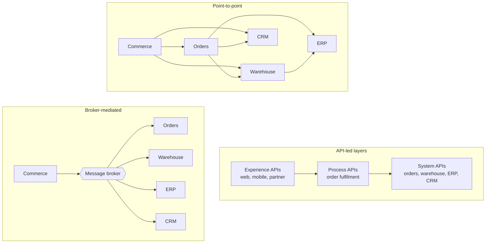
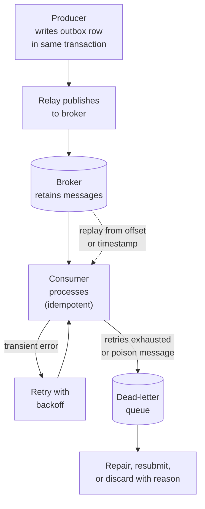
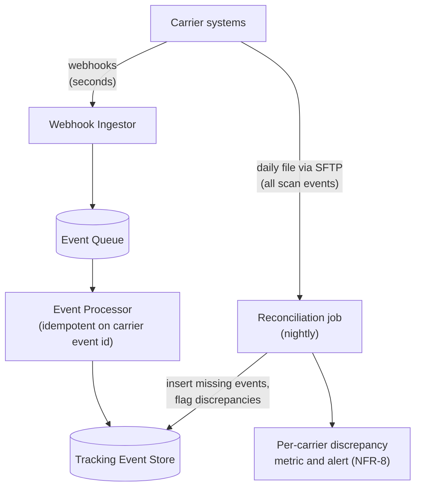

# Integration architecture

> Integration is the discipline of making systems that were built separately behave as one, without
> letting the failure, schedule, or data model of any one of them become everyone's problem.

!!! abstract "Page facts"
    **Level:** Mixed (styles are Level 1-2; replay, reconciliation, and governance are Level 3) ·
    **Status:** Draft · **Time:** 60-75 minutes · **Last verified:** 2026-11-15

## Learning objectives

After this page you should be able to:

- Name the main integration styles (point-to-point, file, shared database, messaging, API-led, ESB,
  iPaaS) and the coupling each one creates.
- Choose an integration style for a given pair of systems and justify it by latency, volume,
  ownership, and failure behavior.
- Design the error handling, retry, replay, and reconciliation that make an integration trustworthy.
- Manage schemas and contracts across teams and organizations, including versioning and
  compatibility.
- Explain the special cases: legacy systems, third-party SaaS, ERP and CRM, EDI, master data, and
  identity federation.

## Prerequisites

- [API design](api-design-rest-graphql-grpc-and-async-apis.md) — synchronous APIs and webhooks are
  two of the styles compared here.
- [The C4 model](../architecture-fundamentals/c4-model.md) — the external systems on the context
  diagram are exactly the integrations this page designs.

## The problem this solves

An organization of any age runs dozens of systems: a commerce platform, an order management system,
a warehouse system, an ERP for finance, a CRM, a payroll provider, carriers, payment processors. Each
was built or bought at a different time by different people with different data models and uptime.
Business processes cut across all of them: an order placed in one system must be picked in a second,
shipped by a third, invoiced in a fourth, and shown to the customer by a fifth. Integration
architecture is how those hand-offs happen without a web of fragile connections, without one
system's outage stopping all the others, and without the same customer existing in five slightly
different versions.

## What it is

**Integration architecture** is the set of decisions about how systems exchange data and trigger
each other's behavior: which style, which contracts, which middleware, who owns what, and what
happens when something fails. The styles, roughly in order of appearance:

| Style | How data moves | Coupling it creates |
|---|---|---|
| Point-to-point | System A calls System B's API or writes to its interface directly | Each pair is a dependency; N systems can need N×(N−1)/2 links |
| File-based (batch) | A writes a file; B picks it up on a schedule (often via SFTP) | Loose in time, tight on file format; latency of the schedule |
| Shared database | Two systems read and write the same tables | Tightest possible: schema changes break both; locking and load interfere |
| Messaging (broker) | A publishes messages to a broker; B consumes when ready | Loose in time and availability; contract is the message schema |
| Event-driven | Systems publish facts that happened; any number of consumers react | Loosest ownership coupling; requires discipline about event contracts |
| Enterprise Service Bus (ESB) | A central platform routes, transforms, and orchestrates between systems | Centralized logic; the bus becomes a shared dependency and often a bottleneck for change |
| API-led connectivity | Layered reusable APIs: system APIs wrap sources, process APIs compose, experience APIs serve channels | Clear ownership per layer; more components to run |
| iPaaS (integration platform as a service) | A hosted platform with connectors, mapping, and workflow tooling | Fast for SaaS-to-SaaS; vendor lock-in and limits on custom logic |
| Middleware (general) | Any software between systems: brokers, gateways, transformation engines, adapters | Depends on what it does; the question is always "who owns the logic in it?" |

## Mental model

Think of an airport. Airlines, ground handlers, customs, catering, and fuel suppliers are separate
companies with their own systems. They do not share one database; they agree on standard messages
(a flight is delayed, a bag was loaded) and standard hand-over points (a gate, a belt). Some
exchanges are real time (a gate change over the radio), some are scheduled files (tomorrow's crew
roster), and some run through a coordinating operations center (the ESB of the airport). When a
message is missed, there is a reconciliation step at the end of the day: the bags loaded must equal
the bags checked in, and every discrepancy is chased.

**Where the analogy breaks:** airport messages are small and human-readable; system integrations
move millions of records with strict formats, and a single wrong field can silently corrupt
downstream systems for weeks. And airports have decades of standards bodies; most enterprises have
to write their own contracts and governance.

## Key terms

| Term | Meaning on this page |
|---|---|
| Producer / consumer | The system that emits data or events and the system that receives them |
| Adapter (connector) | A component that translates between a system's native interface and the integration contract |
| Canonical model | A shared, system-neutral data model used on the integration layer so each system maps once |
| Master data | Reference entities shared by many systems (customers, products, locations) with one authoritative source |
| Reconciliation | Comparing two systems' views of the same facts and resolving differences |
| Replay | Re-delivering past messages or events to a consumer, for recovery or for a new consumer |
| Dead-letter queue (DLQ) | A holding place for messages that could not be processed after the retry policy was exhausted |
| Anti-corruption layer | A translation boundary that keeps another system's model from leaking into yours |
| Identity federation | Trusting another organization's identity provider so its users can access your systems |

## How it works

### Step 1 — Classify each integration by four questions

For every pair of systems, ask:

1. **Latency:** must the receiving system know within seconds (an order placed), minutes (inventory
   update), or by tomorrow (financial postings)?
2. **Volume and shape:** a few large files, or millions of small records? Steady, or bursty?
3. **Ownership and change rate:** same team, another team, another company? How often does each
   side change its model?
4. **Failure behavior:** if the receiver is down for an hour, must the sender wait, buffer, or
   continue and reconcile later?

The answers select the style. Seconds, small, bursty, different owners, and "continue and reconcile"
points to messaging. Daily, large, stable, and "wait" points to a batch file. Same team, seconds,
request-and-answer points to a direct API call.

### Step 2 — Pick the style and the topology

**Figure 1 — Three topologies for the same five systems.** Point-to-point grows with every pair;
a broker or bus centralizes transport; API-led layers centralize ownership rather than transport.

How to read it: count the arrows in the first topology and imagine a sixth system; in the second,
adding a system adds one connection; in the third, a new channel reuses the process and system
layers.

### Step 3 — Define the contract and manage the schema

Every integration has a schema whether or not it is written down. Write it down: a JSON Schema or
Avro or Protobuf definition for messages, an OpenAPI document for APIs, a field specification for
files. Put schemas in a **schema registry** or a versioned repository, assign each a version, and
state the compatibility rule: *backward compatible* (new consumers read old data), *forward
compatible* (old consumers read new data), or both. Additive optional fields are usually safe;
renames and type changes are not. For events shared across organizations a common envelope (an
identifier, type, source, time, and the payload) such as the CloudEvents specification makes routing
and tooling uniform.

### Step 4 — Design for failure before success

Integrations fail in the middle: a network drop after the receiver committed, a malformed record in
the middle of a file, a SaaS rate limit at 3 a.m. The mechanisms:

- **Retries with backoff** for transient failures, bounded in count and time.
- **Idempotent receivers** so retries do not duplicate (a unique message or record identifier that
  the receiver remembers).
- **Dead-letter queues** for messages that keep failing, with alerting and a repair-and-resubmit
  process owned by a named team.
- **Transactional outbox** so that "update my database and publish an event" cannot half-succeed:
  the event is written to an outbox table in the same transaction and relayed afterwards.
- **Compensation** when a multi-system process fails after some steps succeeded (the saga pattern,
  covered in the distributed systems section).
- **Replay** so that a consumer that lost or corrupted data can re-read the stream from a point in
  time, and so a new consumer can catch up.
- **Reconciliation** as a scheduled control: compare counts or checksums between source and target
  for a period, list the differences, and fix them, automatically where safe.

**Figure 2 — The lifecycle of one message, including failure paths.** Most messages take the top
path; the design is judged by the bottom ones.

How to read it: solid arrows are the normal path and its failure branches; the dotted arrow is the
recovery capability that makes outages survivable.

### Step 5 — Handle the special cases

- **Legacy systems** often expose only a database, a file drop, or a screen. Wrap them with an
  adapter (a system API) and an anti-corruption layer so their model does not spread; use change
  data capture (CDC) on their database when no API exists; plan the eventual replacement with a
  strangler-fig approach, routing one capability at a time to the new system.
- **Third-party SaaS** gives you its API, its webhooks, its rate limits, and its change schedule. Treat
  its contract as external: pin versions, subscribe to its change notices, and keep a translation
  layer so a vendor change is one change in your estate.
- **ERP and CRM** systems are usually the systems of record for finance and customers. Integrate
  through their supported interfaces, never their tables, and decide explicitly which system owns
  each field.
- **EDI (Electronic Data Interchange)** is the family of standardized document formats (such as
  ANSI X12 and UN/EDIFACT) used between trading partners for orders, invoices, and shipping notices;
  carriers and large retailers often require it. It is file- or message-based, with strict formats,
  acknowledgements, and partner agreements; a translator component maps EDI to your internal model.
- **Master data integration** picks one authoritative source per entity (customer, product,
  location), publishes changes from it, and makes every other system a subscriber, so there is one
  definition of "customer" rather than five.
- **Synchronization** between two live systems that both accept writes needs a conflict rule
  (last writer wins, source of truth wins, or a merge) and a reconciliation job; avoid it when one
  direction suffices.
- **Identity federation** lets partner or customer identities from another identity provider access
  your systems through standard protocols (SAML 2.0 and OpenID Connect) instead of duplicating
  accounts.

### Step 6 — Govern it

Someone owns each integration, its contract, its monitoring, and its runbook. A catalog of
integrations (source, target, style, schema version, owner, criticality) is the single most useful
governance artifact; without it, nobody knows what breaks when a system is upgraded.

## Worked example: AtlasMart's Order Tracking System

The Order Tracking System on the [C4 context diagram](../architecture-fundamentals/c4-model.md) has
four external integrations. Applying Step 1 gives four different answers.

| Integration | Latency | Volume | Ownership | On failure | Style chosen |
|---|---|---|---|---|---|
| Order Management System → Tracking (new orders, shipments) | Minutes | 60,000 orders/day, steady | Another internal team | Buffer; tracking without an order is useless, but orders can wait | Internal event stream (order created, shipment created) on the company broker; Tracking subscribes |
| Logistics Vendor Platform → Tracking (scan events) | Seconds (NFR-1: 60 s) | 480,000 events/day, bursty (≈70/s peak) | Another company, several carriers | Continue; reconcile later | Inbound webhooks (signed) into the Event Queue; nightly reconciliation file per carrier |
| Tracking → Notification Provider | Seconds | Two notifications per delivered order, about 120,000/day | SaaS vendor | Retry, then DLQ; never spam | Vendor API called by the Notification Worker with idempotent request identifiers |
| Identity Provider → Tracking (who is the customer or agent) | Per request | Every API call | Internal platform team | Fail closed | Token validation (OpenID Connect) at the API gateway |

### The carrier integration in detail

Carriers push scan events as webhooks (see the [API design page](api-design-rest-graphql-grpc-and-async-apis.md)
for the contract). Webhooks are at-least-once and can be lost when AtlasMart's ingress is down or
when a carrier's own retry window expires. Two controls close the gap:

1. **Replay from the queue.** The Event Queue retains messages for a stated period, so if the Event
   Processor is unavailable the events wait; if a processing bug corrupts status, the processor is
   fixed and the affected period replayed (processing is idempotent on the carrier event
   identifier, FR-2).
2. **Nightly reconciliation file.** Each carrier provides a daily file listing all scan events for
   AtlasMart's shipments. A reconciliation job compares the file against stored events per shipment,
   inserts any missing events (marked as "recovered from reconciliation" so freshness metrics are not
   polluted), and raises a per-carrier discrepancy metric. Against NFR-1 (99% within 60 s), the
   reconciliation path is the 1% allowance made real.

**Figure 3 — Carrier integration with both real-time and reconciliation paths.** The two paths
land in the same store and must agree by morning.

How to read it: the upper path is what customers normally see within 60 seconds; the lower path is
the control that catches what the upper path missed.

### What happened during a carrier outage (scenario)

A carrier's webhook sender fails for four hours and then redelivers its backlog of 50,000 events in
about a minute (the burst analysed on the [capacity estimation](../performance-and-scalability/capacity-estimation.md)
page). The Webhook Ingestor acknowledges and enqueues them; the queue depth peaks and drains in about
eight minutes; deduplication discards the events that had already arrived before the outage; the
nightly file confirms zero discrepancies. The integration design, not heroics, handled it.

## Real-world architecture example

A typical retailer's estate shows all the styles at once: an event broker carries order and
inventory facts between internal services; an API gateway exposes system APIs over the ERP and CRM so
no other system touches their tables; an iPaaS handles SaaS-to-SaaS flows such as the HR system to
the identity provider; an EDI translator exchanges purchase orders and advance shipping notices with
large suppliers via scheduled files; and a master data service publishes product and customer
changes that every other system subscribes to. A central integration catalog lists each flow with its
owner, schema version, and monitoring dashboard, and every flow with a customer-visible effect has a
reconciliation control.

## Design choices and trade-offs

| Choice | Favor when | Avoid when |
|---|---|---|
| Direct API call (point-to-point) | Two systems, same team, a request that needs an answer now | Many consumers of the same data; the callee's availability must not cap the caller's |
| Broker-mediated messaging | Bursty volume, many consumers, different availability profiles | The caller needs a synchronous answer; the team cannot operate a broker |
| Batch files | Large daily volumes, partner mandates, stable formats | Freshness in minutes or seconds is required |
| Shared database | Almost never for separate systems; acceptable for modules of one application with one owner | Different teams or release schedules |
| Central ESB | A small number of stable systems and a team that owns the bus | Many fast-moving teams; the bus becomes the change bottleneck |
| API-led layering | Many channels over the same core systems; reuse matters | Three systems and one team; the layers are overhead |
| iPaaS | SaaS-to-SaaS flows with standard connectors; small integration team | Complex custom logic, high volume, or data that cannot leave your environment |
| Canonical model | Many systems mapping to each other; stable domain | Two systems; the canonical model is a third model to maintain |

**Assumption behind all of this:** systems have different owners and change at different rates. When
one team owns both sides and deploys them together, most of the decoupling machinery can be replaced
by a shared library and a test.

## Failure modes and anti-patterns

- **The integration spaghetti.** Every system calls every other; nobody can list the links. Detect:
  no catalog. Prevent: catalog first, then a broker or API layer for anything with more than two
  consumers.
- **Shared database integration.** Two teams write the same tables; a schema change by one breaks
  the other at midnight. Prevent: system APIs or CDC; one owner per table.
- **Fire-and-forget without reconciliation.** Messages are lost silently for weeks. Prevent: counts
  reconciled per period; DLQ alerts with an owner.
- **The ESB that contains the business.** Transformations, rules, and orchestration all live in the
  bus; nobody else can change anything. Prevent: keep business logic in the owning systems; the bus
  routes and translates only.
- **Unversioned schemas.** A producer adds a required field; half the consumers fail. Prevent:
  registry, compatibility rules, consumer tests.
- **Non-idempotent receivers.** Retries double-post invoices. Prevent: unique identifiers and
  deduplication on every write path.
- **Synchronizing both ways without a rule.** Two systems overwrite each other's edits. Prevent: one
  source of truth per field; one-way flows where possible.
- **Trusting partner data.** Malformed or hostile files reach core systems. Prevent: validate at the
  boundary; quarantine rejected records.

## Security considerations

- Every integration crosses a trust boundary; authenticate both directions (signed webhooks, mutual
  TLS or OAuth client credentials for APIs, key-based SFTP for files) and authorize per flow.
- Validate and size-limit every inbound record before it reaches a queue or database.
- Keep partner secrets in a secret store, one per partner, rotated with overlap.
- Personal data in integration payloads must follow the same minimization rules as in the systems
  themselves (the Tracking System receives order identifiers, not delivery addresses: NFR-6).
- Audit every integration that moves financial or personal data: who sent what, when, and whether it
  was accepted. Dead-letter queues contain real data and need the same access control as the
  database.

## Performance, reliability, and cost

- **Performance:** batch for throughput, messages for latency, direct calls only when an answer is
  needed to proceed. Beware of chatty integrations that make one call per record; batch within a
  message or request where the contract allows.
- **Reliability:** the broker and the reconciliation job are what let the sender and receiver have
  independent availability. Measure each integration's lag, error rate, and DLQ depth (NFR-8 does
  exactly this per carrier).
- **Cost:** brokers, iPaaS subscriptions, and API gateways are paid per message, per connector, or
  per call; reconciliation jobs cost compute at night. The expensive integration is the undocumented
  one that fails at quarter end.

## Hands-on lab: map and classify an estate

1. Choose an organization you know (or invent one with six systems: shop, orders, warehouse, ERP,
   CRM, carrier).
2. Draw the point-to-point graph of every data flow you can think of. Count the arrows.
3. For each flow, answer the four questions from Step 1 in a table (latency, volume and shape,
   ownership, failure behavior) and pick a style.
4. Redraw with a broker for every flow that has more than one consumer and with system APIs over
   any system that others would otherwise touch directly. Count the arrows again.
5. For the single most customer-visible flow, write the failure design: retry policy, idempotency
   key, DLQ owner, replay method, and reconciliation check with its schedule.
6. Write the three columns of a catalog row for each flow: owner, schema version, monitoring signal.

??? question "Hint: which flows get a broker?"
    Any fact that more than one system cares about (an order was placed, a product price changed, a
    customer address changed). Anything that is a question with an immediate answer (is this item in
    stock right now?) stays a direct call.

## Knowledge check

1. Why does point-to-point integration become unmanageable as the number of systems grows, and what
   do a broker and an API layer each do about it?
2. A producer must update its database and publish an event; a crash between the two loses the event.
   Name the pattern that fixes this and explain how.
3. What is the difference between replay and reconciliation, and why does the carrier integration need
   both?
4. Give two reasons not to integrate through another team's database tables.
5. What does an anti-corruption layer protect, and in which direction?

??? success "Answers"
    1. The number of links grows roughly with the square of the number of systems, and each link is a
       private contract. A broker reduces transport links to one per system; an API layer reduces the
       number of distinct contracts by giving each system one owned interface.
    2. The transactional outbox: write the event to an outbox table inside the same database
       transaction as the state change; a relay process publishes rows from the outbox afterwards and
       marks them sent. Either both happen or neither.
    3. Replay re-delivers messages the broker already has, for recovery or new consumers.
       Reconciliation compares two independent sources (the carrier's daily file and the event store)
       to find what never arrived at all. Replay cannot recover a webhook the carrier never sent.
    4. Their schema becomes your contract and changes without notice; your load and locks interfere
       with their application; there is no place to enforce validation, authorization, or auditing.
    5. Your domain model, from the other system's model; it translates at the boundary so foreign
       concepts and quirks do not spread into your code.

## Architecture discussion questions

1. The finance team wants tracking events in the ERP for cost allocation by carrier. Would you send
   events, a nightly file, or expose an API? What changes if the ERP is a SaaS product with strict API
   quotas?
2. AtlasMart acquires a smaller retailer with its own order and tracking systems. Sketch the
   integration plan for the first six months and for the end state, and say which system becomes the
   master for customers and orders.
3. A carrier can only exchange EDI documents via SFTP twice a day. Can AtlasMart meet NFR-1 for that
   carrier's shipments? What would you tell the business, and what would you build?

## Summary

Integration architecture chooses, for each pair of systems, a style that matches its latency,
volume, ownership, and failure behavior: direct calls for immediate answers, messaging for bursty
multi-consumer facts, files for large stable batches, system APIs over anything others would
otherwise touch directly. Every integration needs a written schema with a compatibility rule, an
idempotent receiver, retries, a dead-letter path with an owner, replay for recovery, and a
reconciliation control that catches what was never delivered. Legacy systems, SaaS, ERP and CRM,
EDI, master data, and identity federation are the recurring special cases, and a catalog of flows
with owners is the governance tool that keeps the whole thing understandable.

## Related topics

- **Before:** [API design](api-design-rest-graphql-grpc-and-async-apis.md); [The C4 model](../architecture-fundamentals/c4-model.md)
- **Alongside:** [Message queues and brokers](../messaging-and-streaming/message-queues-and-brokers.md)
  — the transport for broker-mediated integration; [Distributed systems fundamentals](../distributed-systems/distributed-systems-fundamentals-time-and-coordination.md)
  — why partial failure makes reconciliation necessary.
- **Planned:** event-driven architecture, event sourcing, and the transactional outbox in depth
  (D08-T02); transactions, sagas, and delivery guarantees (D04-T03); enterprise architecture and
  modernization, including strangler-fig migration (D28, D10); identity and access management (D11).

## References

| Source | Type | Checked |
|---|---|---|
| Gregor Hohpe and Bobby Woolf, [Enterprise Integration Patterns](https://www.enterpriseintegrationpatterns.com/) (site accompanying the 2003 book) | Pattern catalog | 2026-11-15 |
| Chris Richardson, [Pattern: Transactional outbox](https://microservices.io/patterns/data/transactional-outbox.html) | Pattern description | 2026-11-15 |
| Martin Fowler, [Strangler Fig Application](https://martinfowler.com/bliki/StranglerFigApplication.html), 2004 (updated) | Article | 2026-11-15 |
| [Anti-corruption Layer pattern](https://learn.microsoft.com/en-us/azure/architecture/patterns/anti-corruption-layer) — Microsoft Azure Architecture Center | Official documentation (cloud-neutral content) | 2026-11-15 |
| [CloudEvents specification](https://github.com/cloudevents/spec) — Cloud Native Computing Foundation | Specification (event envelope) | 2026-11-15 |
| [Schema Registry overview](https://docs.confluent.io/platform/current/schema-registry/index.html) — Confluent | Vendor documentation (compatibility modes explained) | 2026-11-15 |
| [OpenID Connect Core 1.0](https://openid.net/specs/openid-connect-core-1_0.html) — OpenID Foundation; [SAML 2.0 Core](https://docs.oasis-open.org/security/saml/v2.0/saml-core-2.0-os.pdf) — OASIS | Standards (identity federation) | 2026-11-15 |
| [X12](https://x12.org/) — the accredited standards body for ANSI X12 EDI | Standards body (EDI) | 2026-11-15 |

## Review notes

- Canonical page for D05-T03. ESB, iPaaS, EDI, ERP/CRM, master data, synchronization, identity
  federation, and legacy integration are each defined and placed, but covered in one paragraph; EDI
  and master data management could each carry a dedicated page later.
- The notification volume (about 120,000/day: two notifications per delivered order at 60,000
  orders/day) is a new AtlasMart figure derived on this page from FR-3.
- The reconciliation file arrangement is an AtlasMart assumption; not every carrier offers one.
- The EDI reference points at the X12 standards body home page; the UN/EDIFACT page at UNECE and the
  GS1 EDI overview both returned 403 to the automated link check and were left out. A reviewer may
  add them if a stable URL is found.
