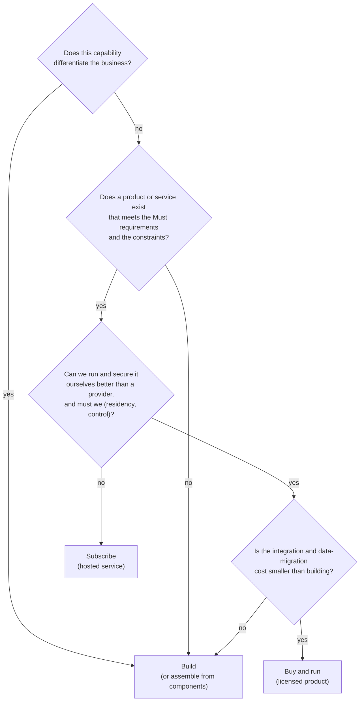
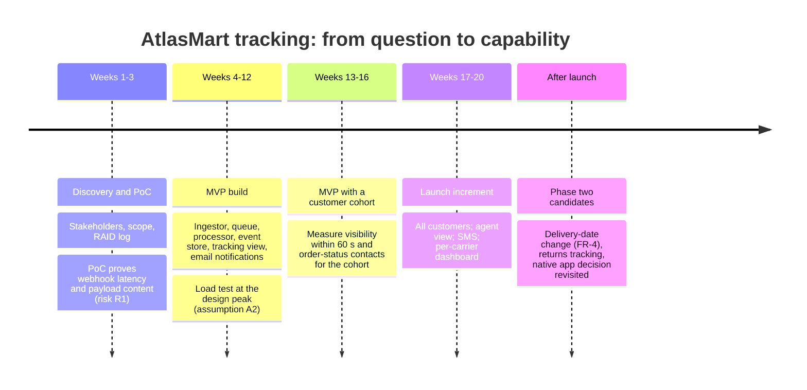
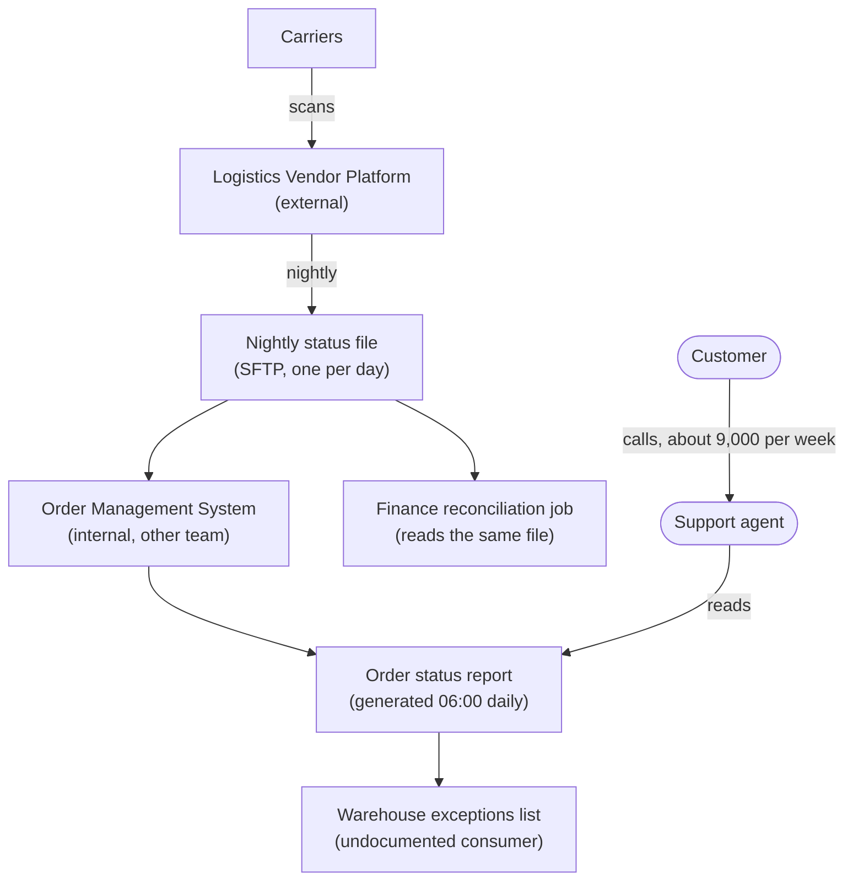
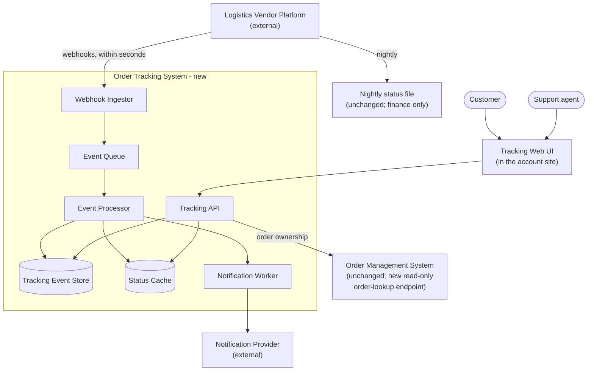

# As-Is and To-Be architecture, gap analysis, and build vs buy

> The current state is where you are, the target state is where the success metric needs you to
> be, the gap is the work, and build-versus-buy is the first big decision about how to do that work.

!!! abstract "Page facts"
    **Level:** Intermediate (build vs buy scoring and capability-based planning are Level 3) ·
    **Status:** Draft · **Time:** 45-60 minutes · **Last verified:** 2026-11-15

## Learning objectives

After this page you should be able to:

- Document a current-state (As-Is) architecture at the right level of detail and without flattering
  it.
- Describe a future-state (To-Be) architecture in terms of capabilities and containers, tied to the
  success metric.
- Produce a gap analysis that turns the difference into a list of work items with owners.
- Run a build vs buy vs SaaS comparison with explicit criteria and weights, and present it so the
  decision can be challenged.
- Tell a proof of concept from a minimum viable product, and know what each is allowed to prove.
- Use functional decomposition and capability-based planning to sequence the work.

## Prerequisites

- [Stakeholders, business capabilities, and success metrics](stakeholders-business-capabilities-and-success-metrics.md)
  — the capability map is the backbone of both states.
- [Constraints, assumptions, dependencies, risks, and scope](constraints-assumptions-dependencies-risks-and-scope.md)
  — constraints bound the To-Be; risks drive what the PoC proves.
- [The C4 model](c4-model.md) — As-Is and To-Be are drawn as context and container diagrams.

## The problem this solves

Teams skip the current state because it is boring and they already know it, then discover in
delivery that nobody knew all of it: the nightly batch also feeds finance, the report has a hidden
consumer in the warehouse, the vendor feed has two formats. Teams also describe the target state as
a technology list ("event-driven, Kubernetes, Redis") instead of a capability change, so nobody can
say whether a given piece of work closes the gap. And the build-versus-buy question is answered by
instinct, which means it is answered by whoever has the strongest instinct. This page replaces
instinct with a short, repeatable method whose outputs a sponsor can read.

## What it is

| Artifact | Content | Level of detail |
|---|---|---|
| As-Is architecture | Systems, interfaces, data flows, and the capabilities they realize, as they are today, including the workarounds | Context plus container; enough to find every consumer of what will change |
| To-Be architecture | The same views for the target state, derived from the capability changes and NFRs | Context plus container; technology choices only where decided |
| Gap analysis | A table: for each capability, interface, data store, and operational concern, what differs and what work closes it | One row per gap, with type (new, changed, retired, unchanged), owner, and size |
| Build vs buy vs SaaS | A scored comparison of sourcing options for each major gap | Weighted criteria, scores with reasons, sensitivity to the weights |
| Feasibility and cost-benefit | Can it be done under the constraints, and is the benefit worth the cost | Order-of-magnitude; tied to the success metric |
| Roadmap | PoC, MVP, and later increments sequenced by risk and value | Capabilities per increment, not features per sprint |

## Mental model

Think of renovating a house while living in it. The As-Is is the survey: where the pipes really run,
which wall is load-bearing, which socket is on which circuit, and the extension cord the previous
owner ran under the carpet. The To-Be is the architect's drawing of the finished kitchen. The gap
analysis is the builder's schedule of works. Build vs buy is whether you have cabinets made or buy
them from a catalogue: made-to-measure fits perfectly and costs more and takes longer; catalogue
cabinets are cheap and fast and you adapt the kitchen to them. The proof of concept is drilling a
hole in the wall to see what is behind it; the minimum viable product is a working sink and hob so
you can cook while the rest is finished.

**Where the analogy breaks:** a house has one owner and the old kitchen is thrown away. Software's
old system usually keeps running alongside the new one for months or years, with data flowing both
ways, and its consumers are other teams who did not ask for a renovation. Transition states are a
first-class part of the To-Be, not an afterthought.

## Key terms

| Term | Meaning on this page |
|---|---|
| As-Is (current-state) architecture | A description of the systems, interfaces, data, and capabilities that exist now, including unofficial ones |
| To-Be (future-state, target) architecture | The intended architecture at a stated future point, derived from the business goal, constraints, and NFRs |
| Transition architecture | An intermediate state between As-Is and To-Be that the organization will actually run for a period |
| Gap analysis | Comparing As-Is and To-Be element by element to list what must be created, changed, retired, or kept |
| Build vs buy vs SaaS | Sourcing options for a capability: develop it, license and run a product, or subscribe to a hosted service |
| Cost-benefit analysis | Comparing the expected cost of an option (build and run, over a horizon) with the expected benefit (the success metric expressed in money or risk) |
| Feasibility analysis | Checking whether an option can be delivered under the technical, business, and organizational constraints |
| Proof of concept (PoC) | A disposable experiment that answers one technical question; it proves feasibility, not value |
| Minimum viable product (MVP) | The smallest releasable product that lets real users generate evidence about the business goal; it proves value, not scale |
| Functional decomposition | Breaking a capability or system into smaller functions until each can be assigned, estimated, and sourced |
| Capability-based planning | Sequencing investment by the capability increments it delivers, rather than by projects or systems |

## How it works

### Documenting the As-Is

The current state is documented to find everything the change will touch. The method:

1. Start from the capability map and list the systems that realize each capability in scope.
2. Draw the context and container diagrams for those systems *as they run*, not as designed. Walk
   the data flows with the people who operate them; the undocumented consumers show up here.
3. For each interface, record format, frequency, owner, and what happens if it stops.
4. Record the pain: where the success metric is being lost today, with measurements where they
   exist.
5. Record what is good and must be preserved. An As-Is that is only a list of problems misleads the
   To-Be.

The level of detail is "enough to find every consumer of what changes". Documenting the whole estate
is enterprise architecture's job; the solution architect documents the slice.

### Deriving the To-Be

The target state is not a technology wish list. It is derived:

1. Take the capability changes from discovery (Shipment Tracking to near-real-time; Customer
   Self-Service gains delivery-date changes; Customer Notification gains event triggers).
2. Apply the constraints (standard platform, vendor webhooks, EU region, identity provider).
3. Apply the NFRs (60-second freshness rules out batch; 99.9% rules out a single instance; p95 300 ms
   rules out joining the order system on every read).
4. Choose containers and interfaces that satisfy the above, and record each choice as an ADR with the
   alternatives considered.
5. Define the transition states: what runs in parallel, for how long, and how data stays consistent
   between old and new.

The To-Be is stated at a date ("at launch, week 20") because a target without a date is a vision,
and visions do not have gap analyses.

### Gap analysis

Put As-Is and To-Be side by side, element by element. Each row gets a type:

| Type | Meaning | Work |
|---|---|---|
| New | Exists only in the To-Be | Build, buy, or subscribe |
| Changed | Exists in both with a different shape, interface, or scale | Modify; manage consumers |
| Retired | Exists only in the As-Is | Decommission; migrate consumers; archive data |
| Unchanged | Same in both | Verify it really is; record the dependency |

The rows become the work breakdown, and the "Retired" rows are the ones most often missed. Nothing
is retired until its last consumer has moved, which is why the As-Is lists consumers.

### Build vs buy vs SaaS

Three sourcing options for each "New" gap, and sometimes for "Changed" ones:

**Figure 1 — A decision path for sourcing a capability.** The questions are asked in order; the
first decisive answer usually settles it, and the scoring table that follows checks the instinct.

How to read it: start at the top; "differentiate" means customers choose AtlasMart partly because
of how well this capability works. Most capabilities do not differentiate, which is why most of a
modern estate is bought or subscribed, and why the few that do deserve engineering investment.

The scoring table makes the reasoning explicit. Criteria are chosen per decision, weighted by the
sponsor and architect together, and each option is scored 1-5 with a sentence of justification. The
total is a conversation aid, not an oracle: when the ranking flips with a small change of weights,
the decision is close and should be made on the risk profile instead.

**Cost-benefit analysis** compares each option's cost over a horizon (typically three to five years:
build or licence, integrate, migrate, run, support, exit) with the benefit (the success metric in
money, plus risk reduced). Costs are order-of-magnitude and dated; this page quotes no prices because
they vary by organization and change monthly; the method is to list the cost lines and get each from
its owner.

**Feasibility analysis** asks, for each option, whether it can be delivered under the constraints:
technically (does the webhook feed exist?), organizationally (do we have the skills and the vendor
relationship?), legally (data residency, licensing), and on time (20 weeks). An option that fails
feasibility is removed before scoring.

### PoC versus MVP

They are confused constantly, and the confusion is expensive: a PoC shipped as a product carries its
shortcuts into production, and an MVP that is "just a PoC" never reaches real users.

| | Proof of concept | Minimum viable product |
|---|---|---|
| Question | Can this technical thing work under our constraints? | Do real users behave the way the business case assumes? |
| Users | None; engineers and the architect | Real users, possibly a subset |
| Lifetime | Days to weeks; then thrown away or kept only as reference | Months; it becomes the product |
| Quality bar | Enough to answer the question | Production: security, operability, support |
| Output | A yes/no with measurements, recorded in an ADR | Evidence on the success metric and leading indicators |
| AtlasMart | Receive real vendor webhooks for two weeks; measure delivery latency and payload content | Tracking view and email notifications for a cohort of customers; measure contacts and visibility within 60 s |

**Figure 2 — PoC, MVP, and increments on the AtlasMart timeline.** Each stage answers a different
question; the risk-first ordering puts the technical unknown first.

How to read it: the PoC retires the biggest technical risk before the design is frozen; the MVP
produces evidence on the business metric before the full launch; later increments add capability
maturity in the order the success metric demands.

### Functional decomposition and capability-based planning

**Functional decomposition** breaks the target capability into functions until each can be assigned
and sourced: Shipment Tracking → receive carrier events, validate and de-duplicate, store events,
derive shipment status, serve status to customers and agents, notify on status change, operate and
monitor. Each leaf is a candidate for a container, a component, a purchased service, or a story.

**Capability-based planning** sequences investment by the capability increments it produces rather
than by system or project: "Shipment Tracking at maturity level 2 by week 16, level 3 by week 20"
rather than "deploy service X". Its value is that the sponsor can follow progress in the language of
the capability map, and that work on several systems that together raise one capability is planned
and measured as one thing.

## Worked example: AtlasMart order tracking

### As-Is

**Figure 3 — As-Is: how shipment status reaches AtlasMart and its customers today.** The nightly
file is the only path; every consumer of status reads a report that is up to 24 hours old.

How to read it: the customer has no self-service path; the support agent is the interface. The
walk-through found two consumers nobody mentioned in the kick-off: the finance reconciliation job
and a warehouse exceptions list built from the report. Both must keep working, which means the
nightly file is **retired for tracking but unchanged for finance**, and the warehouse list needs a
new source or a decision that it stays on the stale report.

As-Is pain, measured: status staleness up to 24 hours (by design); about 9,000 order-status contacts
per week (contact-centre reporting, assumed baseline); agents answer from a report with no scan
history.

As-Is strengths to preserve: the order system is stable and well-owned; the identity provider handles
sign-in for the account site; the vendor relationship is good and the webhook feed is already
available under the contract.

### To-Be (at launch, week 20)

**Figure 4 — To-Be: event-driven tracking alongside the unchanged batch.** The container set is the
one from the [C4 page](c4-model.md); the nightly file continues for finance only.

How to read it: the new system is the boundary in the middle; everything outside it is unchanged or
has one small change (the order-lookup endpoint, dependency D1). The transition state between
week 13 and week 20 runs both paths for all customers while only the cohort sees the new view.

### Gap analysis

| Element | As-Is | To-Be | Type | Work | Owner |
|---|---|---|---|---|---|
| Carrier event intake | Nightly SFTP file | Webhooks within seconds, plus the file | New (webhooks) / Unchanged (file) | Build ingestor; vendor enables webhooks (D3) | Tracking team; vendor |
| Event storage | None; status overwritten in the order system | Event store with full scan history, 13-month retention | New | Build; schema; retention job | Tracking team |
| Status derivation | Report logic in the order system | Event Processor derives status per shipment | New | Build; de-duplication (FR-2) | Tracking team |
| Customer status view | None | Tracking Web UI in the account site | New | Build; usability tests | Tracking team; web team |
| Agent status view | Daily report | Same timeline as customers | Changed | Build (Should); report stays until agents move | Tracking team; support |
| Notifications | None for status | Email at launch, SMS by launch | New | Subscribe (provider); build worker | Tracking team |
| Order ownership check | N/A | Lookup by order ID in the order system | Changed (new endpoint) | Order system team adds read-only endpoint (D1) | Order system team |
| Finance reconciliation | Reads nightly file | Reads nightly file | Unchanged | Verify; record dependency | Finance IT |
| Warehouse exceptions list | Built from the daily report | Decision needed: stay on report, or consume the event store | Changed (pending) | Decide with warehouse lead by week 6 | Architect |
| Operations | Report failures noticed by agents | Per-carrier lag and error dashboard, alerts (NFR-8) | New | Build dashboards on the standard observability stack | Tracking team; platform |

The warehouse row is the kind of gap that only an honest As-Is finds, and it is deliberately left as
"decision needed" with a date rather than guessed.

### Build vs buy vs SaaS for the tracking service

Options that passed feasibility: **Build** the tracking system on the standard platform;
**Subscribe** to a hosted parcel-tracking service that aggregates carriers and offers a customer
widget and an API; **Buy** a licensed tracking module from the order system's vendor and run it
in-house. (A fourth option, extending the order system itself, failed feasibility: the order system
team has no capacity in the 20-week window, and its database is a shared risk.)

Weights were set by the sponsor and the architect; scores are the workshop's judgement for this
fictional case, with the reason in brackets. Score 5 is best.

| Criterion | Weight | Build | Subscribe (hosted tracking) | Buy (vendor module) |
|---|---|---|---|---|
| Meets Must requirements (FR-1, FR-2, NFR-1 freshness) | 5 | 5 (designed to) | 4 (freshness depends on the provider's carrier polling; 60 s not guaranteed for all carriers) | 3 (batch-oriented; near-real-time is a roadmap item) |
| Fits constraints (EU residency, identity provider, platform) | 5 | 5 | 3 (EU hosting available; identity integration limited to the widget) | 4 (runs on the platform; residency fine) |
| Time to launch within 20 weeks | 4 | 3 (build risk) | 5 (weeks to integrate) | 2 (procurement plus implementation partner) |
| Control of data and scan history (NFR-5, NFR-7, 13-month retention) | 4 | 5 | 2 (history held by provider; export limits) | 4 |
| Run cost over three years (order of magnitude from the capacity estimate and provider pricing tiers) | 3 | 3 (small system, but staffed) | 4 (per-shipment fee; low at current volume) | 2 (licence plus infrastructure plus support) |
| Differentiation and future capability (delivery-date change, returns, notifications) | 3 | 5 | 2 (widget customization limited) | 3 |
| Vendor and lock-in risk | 2 | 4 (standard components) | 2 (carrier coverage and pricing changes) | 2 (single vendor for orders and tracking) |
| **Weighted total (out of 130)** | | **115** | **84** | **79** |

Reading the table: Build wins on fit, control, and future capability; Subscribe wins on time and
near-term cost. The sensitivity check matters more than the total: if the weight on time to launch
were raised to 5 and the Must-fit weight lowered to 3 (a sponsor who cares more about peak season
than about freshness), Subscribe would score 89 to Build's 105, still behind, so the decision is not
close under any weighting the sponsor would accept. The workshop recorded the decision as ADR-09
("a small tracking service with its own event store") with the hosted service named as the fallback
if the PoC fails.

One nuance worth recording: the decision is **build the system, subscribe to the parts that do not
differentiate**. Notifications go through a hosted provider; the queue and database are managed
platform services; nothing is built that can be bought without losing the Must requirements.

### Feasibility and cost-benefit

- **Technical feasibility:** confirmed by the PoC (webhook latency and payload) and the capacity
  estimate (the system is small: one database primary, three API instances).
- **Organizational feasibility:** one Python team available; no mobile developers needed for
  mobile web; the platform team's standard services cover queue, database, cache, and observability.
- **Legal feasibility:** EU region only; no new personal data categories (NFR-6); vendor contract
  permits webhooks.
- **Schedule feasibility:** 20 weeks with a two-Must MVP and a cohort release; FR-4 is droppable.
- **Cost-benefit:** the benefit is the reduction of about 3,600 contacts per week at the contact
  centre's cost per contact (a figure finance holds; not quoted here), plus unquantified benefits in
  delivery satisfaction and agent time. The cost is the build team for 20 weeks plus a run cost
  dominated by the three API instances, the database pair, the queue, and the notification
  provider's per-message fee. Finance signed off on the comparison at order-of-magnitude precision
  (C-7); the capacity estimate is attached as the basis of the run forecast.

### What the PoC proved and what the MVP will

The PoC (weeks 1-3) received live webhooks from the vendor's test feed for two carriers and recorded
delivery latency from scan to receipt and payload fields per carrier. It answered: latency within the
60-second budget for the carriers tested; location present as text for one carrier and as a code
needing a lookup for the other (assumption A1 partly false; a mapping table was added to scope). The
PoC code was discarded; its measurements live in ADR-07.

The MVP (weeks 13-16, customer cohort) will answer: do customers who can see status call less? The
leading indicators (events visible within 60 s; tracking views per in-transit order) are measured
from day one; the cohort's order-status contacts are compared with a control group of similar
customers who do not yet have the view.

## Real-world architecture example

The same shapes appear in every modernization program, at larger scale:

1. **Migration strategies.** Cloud migration programs classify each application with a small set of
   strategies (retire, retain, rehost, relocate, repurchase, replatform, refactor) which is exactly a
   gap analysis type per application, with "repurchase" being buy-or-subscribe and "refactor" being
   build. The per-application decision uses the same criteria as the table above.
2. **Strangler-style replacement.** When a legacy system is retired capability by capability, each
   transition state is a To-Be with a date, the gap analysis per capability drives the sequence, and
   the old system's hidden consumers (the finance job, the warehouse list) are what makes the last
   10% take as long as the first 90%.
3. **Portfolio rationalization.** Enterprise architecture overlays As-Is systems on the capability
   map, finds capabilities realized by several systems, and uses build/buy/SaaS scoring to pick the
   survivor. Capability-based planning then funds the consolidation as capability increments rather
   than as system projects.

The common thread is that the decisions are recorded with their criteria, so that when a weight
changes (a new regulation, a vendor acquisition, a price rise), the decision can be re-run rather
than re-argued.

## Design choices and trade-offs

| Choice | Favor when | Avoid when |
|---|---|---|
| Detailed As-Is walk-through with operators | The change retires or alters anything with consumers | A greenfield system with no existing consumers; a context diagram is enough |
| To-Be with a date and transition states | Old and new will coexist; data must stay consistent across both | A clean cutover is possible and cheap; a single target state suffices |
| Weighted scoring for build vs buy | Several credible options; stakeholders disagree; the decision must be defensible | One option is clearly infeasible or clearly dominant; record the reasoning in an ADR and move on |
| Subscribe for non-differentiating capabilities | A provider meets the Musts and constraints; volume pricing is acceptable | Residency, data control, or freshness requirements the provider cannot meet |
| Build | The capability differentiates, or no option meets the Musts and constraints | Building something a product does well, out of preference for building |
| PoC first (risk-first) | A technical unknown decides the architecture | The unknowns are small; start the MVP and learn from users |
| MVP with a cohort and a control group | The success metric can be influenced by outside events | The population is too small to split; use before/after with care |
| Capability-based planning | Several systems change to raise one capability; the sponsor thinks in capabilities | A single-system change inside one team |

**Assumption behind all of this:** the As-Is is allowed to be unflattering. In organizations where
documenting workarounds is politically unsafe, the gap analysis will be wrong, and the architect's
first task is to make honesty safe.

## Failure modes and anti-patterns

- **The flattering As-Is.** The documented current state is the design from five years ago. Detect:
  operators laugh at the diagram. Prevent: walk the flows with them; draw what runs.
- **The To-Be as a technology list.** "Kubernetes, Kafka, GraphQL." Detect: no capability or NFR
  justifies any item. Prevent: derive the To-Be from capability changes, constraints, and NFRs, and
  record each technology in an ADR with alternatives.
- **Gap analysis without "Retired".** Everything is new; the old path is never switched off; two
  systems run forever. Detect: no decommissioning tasks in the plan. Prevent: a Retired row for every
  As-Is element not in the To-Be, with its consumers.
- **Scoring theatre.** Weights tuned until the preferred option wins. Detect: nobody can explain a
  weight. Prevent: weights set before scoring, by sponsor and architect, and a sensitivity check.
- **Building the commodity.** A home-grown notification sender, queue, or identity system. Detect:
  the build list contains capabilities every company has. Prevent: question 1 of Figure 1.
- **Subscribing away a Must.** A hosted service that cannot meet the freshness or residency Must,
  chosen for speed. Prevent: feasibility before scoring; Musts are gates, not criteria.
- **The PoC that shipped.** Prototype code with no tests, secrets in config, and no operability
  becomes the MVP. Prevent: declare the PoC disposable at the start; keep only its ADR.
- **The MVP that never meets users.** Six months of "MVP" with no cohort. Prevent: a cohort date in
  the roadmap and a metric the MVP must report.
- **Hidden consumers found at cutover.** The finance job breaks when the file is retired. Prevent:
  the As-Is interface table with "what happens if it stops" per consumer.

## Security considerations

- **Buy and subscribe move security work, they do not remove it.** A hosted provider's residency,
  encryption, access control, retention, and breach notification terms are feasibility gates and
  scoring criteria; the architect reads the provider's security documentation before scoring, and
  the contract records the obligations. Shared responsibility must be written down per option.
- **Transition states have the weakest security.** While old and new run together, data flows both
  ways through temporary paths. Each transition architecture needs its own data-flow and trust
  boundary review, not just the end state.
- **Retirement is a security task.** A retired system with live credentials, an open webhook
  endpoint, or an unarchived database is an attack surface with no owner. Retired rows include
  credential revocation and data disposal.
- **PoCs run with production data far too often.** The AtlasMart PoC used the vendor's test feed;
  where real data is unavoidable, the PoC needs the same access controls as production or a
  minimized, anonymized sample.

## Performance, reliability, and cost

- **Performance:** the To-Be is where the NFRs are first tested against a shape; the capacity
  estimate is done on the To-Be container diagram. A To-Be without numbers on its arrows is not
  ready for a gap analysis.
- **Reliability:** the transition state doubles the paths and therefore the failure modes. Define
  which path is authoritative for each consumer at each stage, and what happens when the new path
  fails during the cohort period (the old report still exists; agents can fall back).
- **Cost:** three-to-five-year cost comparisons are dominated by run and people costs, not build
  cost, and subscribe options turn a fixed cost into a variable one that grows with volume. Model the
  crossover point: at what shipment volume does a per-shipment fee exceed the run cost of a built
  system? For AtlasMart's 60,000 orders per day the question was asked and answered with the
  provider's published tiers at the time; the answer is not quoted here because tiers change.

## Hands-on lab: gap analysis and sourcing for a capability you know

1. Choose a capability in an organization you know that is served badly today (expense claims,
   internal document search, on-call scheduling).
2. Draw the As-Is as a context diagram and a list of interfaces with owners and "what happens if it
   stops". Interview or imagine at least one operator; add the consumer nobody mentioned.
3. Write the To-Be at a date, in capability terms first, then as a container diagram, with the
   constraints that shaped it.
4. Produce the gap table with New / Changed / Retired / Unchanged rows and an owner per row. Check
   that every Retired row lists its consumers.
5. List three sourcing options for the biggest New gap. Run feasibility (remove any option that
   fails a Must or a constraint), then score the rest against five to seven weighted criteria. Change
   the two largest weights by one point each and see whether the ranking changes.
6. Write one paragraph each for a PoC (the single technical question, how it is measured, when it is
   thrown away) and an MVP (the users, the metric, the date).

??? question "Hint: picking criteria for the scoring table"
    Start from the Musts and the constraints as gates, then choose criteria from these families:
    fit to Should/Could requirements, time to value, total cost over the horizon, data control and
    security, operability, future capability, and vendor risk. Five to seven criteria is enough;
    more than ten means the weights do not matter.

## Knowledge check

1. Why does the As-Is need to list the consumers of each interface, and what goes wrong without it?
2. Give the four gap types and say which one is most often missing from plans.
3. In the AtlasMart scoring, Subscribe scored highest on time to launch. Why did it still lose, and
   what single change to the requirements would have made it win?
4. State one thing a PoC is allowed to prove and one thing it is not, and the same for an MVP.
5. What does "build the system, subscribe to the parts that do not differentiate" mean in the
   AtlasMart To-Be?

??? success "Answers"
    1. Because retiring or changing an interface breaks every consumer that was not listed. Without
       the list, the finance reconciliation job or the warehouse exceptions list fails at cutover, and
       the old path can never be switched off because nobody knows who still uses it.
    2. New, Changed, Retired, Unchanged. Retired is most often missing, which leaves old systems
       running indefinitely alongside new ones.
    3. It scored lower on the Must-fit (freshness not guaranteed for all carriers), on constraint fit
       (identity integration), and on data control and future capability; those criteria carried
       more weight. If NFR-1 were relaxed to, say, a few minutes and the 13-month history requirement
       dropped, Subscribe would pass the gates with higher scores and likely win on time and cost.
    4. A PoC proves technical feasibility (webhook latency and payload content) and is not allowed
       to prove business value or to become production code. An MVP proves value with real users
       (contacts fall for the cohort) and is not expected to prove scale beyond its cohort or to be
       feature-complete.
    5. The tracking logic, event store, and views are built because they carry the Must
       requirements and differentiate; the queue, database, cache, observability, and notifications
       are managed or hosted services because they do not differentiate and products meet the
       requirements.

## Architecture discussion questions

1. The warehouse team wants their exceptions list to keep coming from the daily report "because it
   works". What are the options for the Changed row, and what would make you choose each?
2. A year after launch, the hosted tracking provider adds guaranteed sub-minute freshness and
   EU-only hosting at a lower price than AtlasMart's run cost. Should the decision be re-run? What
   would the gap analysis for a reverse migration look like?
3. Your organization has a policy of "buy before build". How do you apply the decision path in
   Figure 1 under that policy without either breaking it or building nothing that differentiates?

## Summary

The As-Is is documented as it runs, with every interface's consumers, pain, and strengths. The To-Be
is derived from capability changes, constraints, and NFRs, dated, and accompanied by its transition
states. The gap analysis classifies every element as New, Changed, Retired, or Unchanged and becomes
the work breakdown, with Retired rows the ones most often forgotten. Build vs buy vs SaaS is decided
with feasibility gates, weighted criteria set before scoring, and a sensitivity check; most
capabilities are bought or subscribed, and the few that differentiate are built. A PoC proves a
technical question and is thrown away; an MVP proves value with real users and becomes the product.
Functional decomposition and capability-based planning turn the result into a sequence the sponsor
can follow. For AtlasMart, the method found two hidden consumers of the nightly file, chose to build
the tracking service while subscribing to notifications and managed infrastructure, and put the
webhook PoC first.

## Related topics

- **Before:** [Stakeholders, business capabilities, and success metrics](stakeholders-business-capabilities-and-success-metrics.md);
  [Constraints, assumptions, dependencies, risks, and scope](constraints-assumptions-dependencies-risks-and-scope.md);
  [The C4 model](c4-model.md)
- **Alongside:** [Functional vs non-functional requirements](functional-vs-non-functional-requirements.md);
  [Capacity estimation](../performance-and-scalability/capacity-estimation.md) — the numbers on the
  To-Be arrows
- **After:** [Trade-offs, principles, ADRs, and architecture governance](trade-offs-principles-adrs-and-architecture-governance.md)
  — recording the sourcing decision; [Integration architecture](../application-and-api-architecture/integration-architecture.md)
  — the patterns for the transition state
- **Planned:** application modernization and migration strategies (D10); enterprise architecture
  frameworks, capability-based planning, and portfolio management (D28-T03/T04); cloud cost models
  and FinOps (D17).

## References

| Source | Type | Checked |
|---|---|---|
| The Open Group, [The TOGAF Standard, 10th Edition](https://pubs.opengroup.org/togaf-standard/) — ADM Techniques on gap analysis and capability-based planning; Architecture Content on baseline and target architectures | Standard (free to read online; chapter pages are rendered by JavaScript) | 2026-11-15 |
| Amazon Web Services, [About the migration strategies](https://docs.aws.amazon.com/prescriptive-guidance/latest/large-migration-guide/migration-strategies.html) — AWS Prescriptive Guidance | Official documentation (the "7 Rs" as gap types per application) | 2026-11-15 |
| Martin Fowler, [Strangler Fig Application](https://martinfowler.com/bliki/StranglerFigApplication.html) | Article (incremental replacement and transition states) | 2026-11-15 |
| Eric Ries, [The Lean Startup: Principles](https://theleanstartup.com/principles) | Website (minimum viable product and validated learning) | 2026-11-15 |
| UK Government Digital Service, [Choosing technology: an introduction](https://www.gov.uk/service-manual/technology/choosing-technology-an-introduction) — Service Manual | Guidance (build, buy, and open-source choices) | 2026-11-15 |
| UK Government Digital Service, [How the alpha phase works](https://www.gov.uk/service-manual/agile-delivery/how-the-alpha-phase-works) — Service Manual | Guidance (prototyping to test riskiest assumptions before building) | 2026-11-15 |
| Gregor Hohpe, *The Software Architect Elevator* (O'Reilly, 2020), on build vs buy and vendor decisions | Book | 2026-11-15 |

## Review notes

- Canonical page for D01-T04. All inventory items are covered: As-Is, To-Be, gap analysis, build vs
  buy vs SaaS, cost-benefit analysis, feasibility analysis, PoC vs MVP, functional decomposition,
  capability-based planning. Cost-benefit analysis is covered as a method and a list of cost lines
  without figures, by design (no prices are quoted anywhere in this repository).
- The scoring table's weights and scores are illustrative judgements for the fictional case. The
  weighted totals were computed as the sum of weight × score: Build 115, Subscribe 84, Buy 79; the
  sensitivity variant gives Build 105 and Subscribe 89. A reviewer should recheck the arithmetic if
  any score is edited.
- New AtlasMart details introduced here: the finance reconciliation job and the warehouse exceptions
  list as consumers of the nightly file; the PoC finding that one carrier sends location codes
  needing a lookup table; the cohort-with-control MVP design (weeks 13-16). The C4 page's container
  names are reused unchanged.
- The TOGAF chapter pages render client-side, so only the standard's landing page was verified by an
  automated check. The AWS migration strategies page was verified by title.
- The timeline diagram (`timeline`) is less common than flowcharts; if it fails to render in a
  future Mermaid version, replace it with the four-row table of stages in the "PoC versus MVP"
  section.
