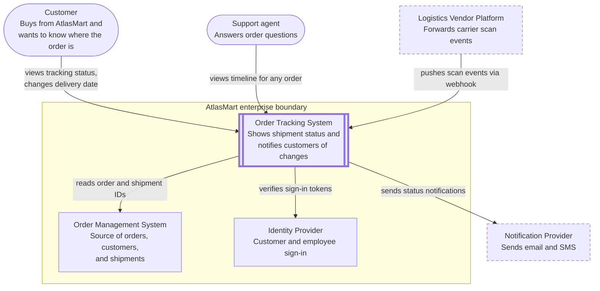
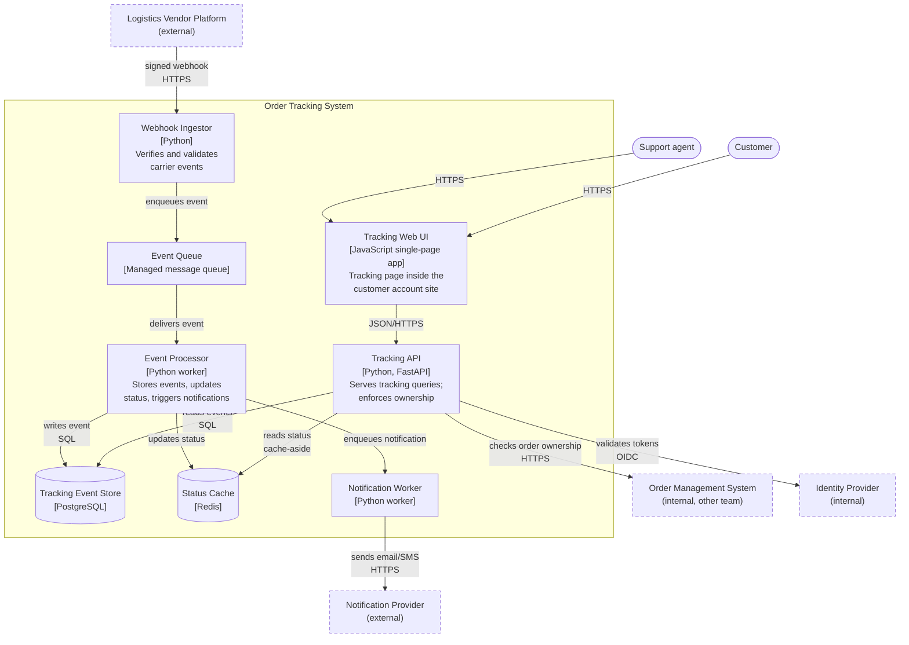
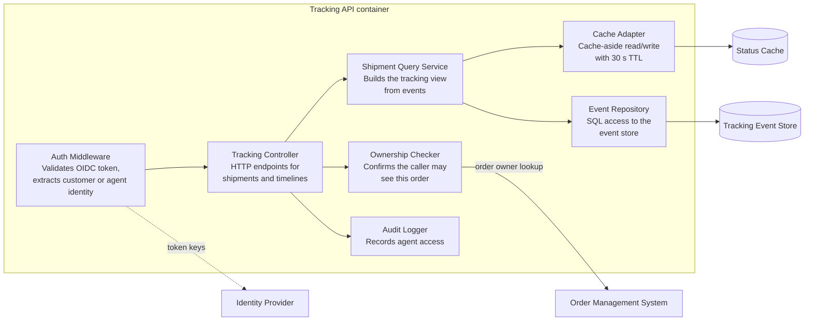
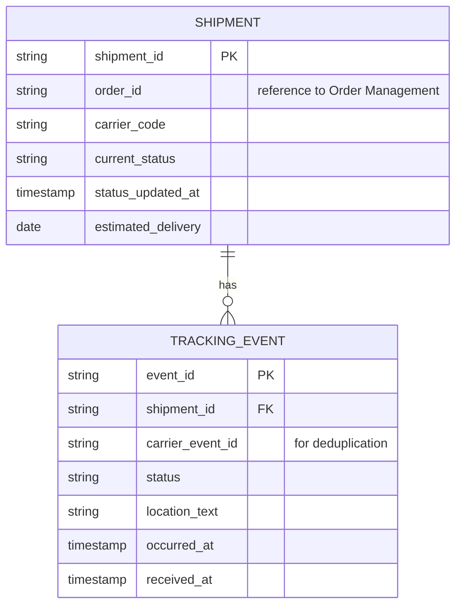
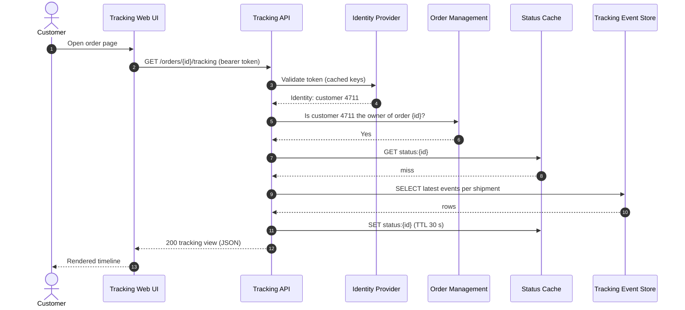
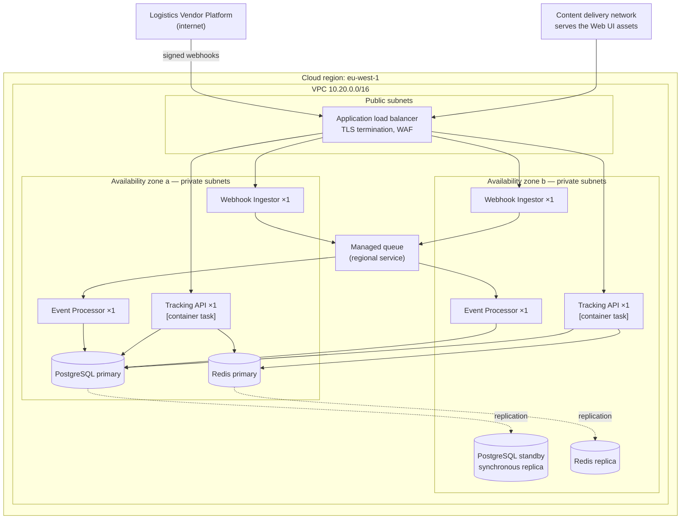

# C4 model: how to communicate software architecture

> C4 gives architecture diagrams zoom levels, so that an executive, a delivery team, and an operator
> each get a picture at the detail they need, drawn from one consistent set of abstractions.

!!! abstract "Page facts"
    **Level:** Beginner → Intermediate · **Status:** Draft · **Time:** 40-60 minutes ·
    **Last verified:** 2026-11-15

## Learning objectives

After this page you should be able to:

- Explain the four C4 levels and the abstractions each one shows.
- Draw System Context and Container diagrams for a system you know, with correct notation.
- Decide when a Component diagram is worth drawing and when Code-level diagrams should be generated
  rather than drawn.
- Use the supplementary diagrams (System Landscape, Dynamic, Deployment) for their intended purpose.
- Keep diagrams as code in the repository and recognize the common diagram mistakes.

## Prerequisites

- [What does a Solutions Architect do?](what-does-a-solutions-architect-do.md) — the Communicate
  step is where C4 is used.

## The problem this solves

Most architecture diagrams fail in one of three ways. They mix levels of detail, so a database table
sits next to "the internet". They use boxes and lines with no stated meaning, so two readers
interpret them differently. Or they are drawn once for a slide deck and never updated, so they
describe a system that no longer exists. The result is that the diagram cannot be used to onboard
someone, review a design, or diagnose an incident, which are the three things a diagram is for.

Unified Modeling Language (UML) tried to solve this with a precise, rich notation, and it works where
teams invest in learning it, but most teams found the full notation heavy and stopped drawing. The C4
model, created by Simon Brown, is a deliberate middle: a small set of abstractions, a few zoom levels,
and notation rules simple enough that any team can follow them.

## What it is

The **C4 model** describes software architecture with four nested abstractions and four
corresponding diagram levels. The name comes from the four levels: **Context, Containers,
Components, Code**.

The abstractions:

| Abstraction | Meaning | Examples |
|---|---|---|
| **Person** | A human user of the software system | Customer, support agent, administrator |
| **Software system** | The highest level of abstraction; something that delivers value to its users, built by one team or bought | Order Tracking System; an external payment provider |
| **Container** | A separately runnable or deployable unit that executes code or stores data. **Not** a Docker container, although it may run in one | Web application, mobile app, API service, database, message broker, file store |
| **Component** | A grouping of related functionality inside a container, behind a well-defined interface | A controller, a repository, a domain service, a module |
| **Code** | Classes, functions, tables; the implementation of a component | A class diagram; an entity-relationship diagram |

The levels:

| Level | Diagram | Shows | Audience |
|---|---|---|---|
| 1 | **System Context** | The system in scope as one box, the people who use it, and the systems it depends on | Everyone, including non-technical stakeholders |
| 2 | **Container** | The containers inside the system, their technologies, and how they communicate | Architects, developers, operations |
| 3 | **Component** | The components inside one container and their dependencies | Developers of that container |
| 4 | **Code** | Classes, interfaces, tables inside one component | Developers, usually generated from code on demand |

Supplementary diagrams:

| Diagram | Purpose |
|---|---|
| **System Landscape** | Several systems and people across an enterprise; a context diagram zoomed out |
| **Dynamic** | How elements collaborate for one scenario, with numbered interactions (a sequence or collaboration view) |
| **Deployment** | Where containers run: infrastructure nodes, regions, zones, networks, instances |

## Mental model

Think of an online map. At country level you see cities and the roads between them; at city level,
districts and main streets; at street level, individual buildings; inside a building, the floor plan.
Each zoom level has its own kind of object and nobody expects to see floor plans on the country map.
C4 is that zoom for software: System Context is the country map, Containers the city, Components the
street, Code the floor plan.

**Where the analogy breaks:** map zoom is continuous and automatic; C4 has four discrete levels and
you draw each one by hand, so you must choose which levels earn their maintenance cost. Most teams
draw Levels 1 and 2 for every system, Level 3 only for complex containers, and generate Level 4 from
code when needed.

## Key terms

| Term | Meaning on this page |
|---|---|
| System in scope | The software system the diagram is about; drawn with emphasis |
| External system | A system outside the team's control; drawn differently (grey or dashed here) |
| Boundary | A box grouping elements that belong together: a system, an enterprise, a deployment zone |
| Relationship | A labelled, directed line stating what one element does to or with another, often with the protocol |
| Diagrams as code | Diagram source stored as text in version control and rendered on demand |

## How it works: drawing the four levels

### Notation rules that apply to every level

1. **Title** every diagram with its type and scope: "System Context diagram for Order Tracking".
2. **Label every box** with name, type, and a short description. Containers and components add the
   technology ("Tracking API [Python, FastAPI]").
3. **Label every line** with intent and, where useful, protocol: "reads tracking status from
   [HTTPS/JSON]". Unlabelled lines carry no information.
4. **Show direction.** Arrows point in the direction of the dependency or the main data flow; be
   consistent and say which in the legend.
5. **Include a legend** when shapes, colors, or line styles carry meaning. Never rely on color alone.
6. **Keep one level per diagram.** A container diagram does not show classes; a context diagram does
   not show databases.
7. **Keep it readable.** If a diagram needs more than roughly 20 boxes, split it or zoom out.

### Level 1 — System Context

Draw the system in scope as a single box in the middle. Add the people who use it and the systems it
sends data to or receives data from. Say nothing about technology.

**Figure 1 — System Context diagram for the AtlasMart Order Tracking System.** The system in scope
is the box with the thick double border in the center. People are stadium-shaped. Other AtlasMart systems sit inside the
enterprise boundary; third-party systems sit outside it and are drawn with dashed borders. Arrows
show the direction of requests or data with a label stating the purpose.



How to read it: start at the people. Customers and agents use the Order Tracking System. The system
depends on two internal systems (orders and identity) and exchanges data with two third parties
(carrier events in, notifications out). That is everything an executive or a new team member needs to
know before asking "how does it work inside?"

### Level 2 — Container

Zoom into the system in scope. Show each separately deployable unit with its technology, and how the
units communicate. External systems and people from Level 1 stay on the edge so the reader keeps
context.

**Figure 2 — Container diagram for the Order Tracking System.** Everything inside the boundary is
part of the system; cylinders are data stores. Technology choices in brackets are illustrative for
this example, not recommendations.



How to read it: two flows enter the system. The read flow (top-left) goes browser → API → cache or
database. The write flow (bottom-left) goes vendor webhook → ingestor → queue → processor → database
and cache → notification worker → provider. The queue between ingestor and processor is the design
decision that lets the system absorb bursts of carrier events without slowing the webhook response.
The container diagram is where that decision becomes visible.

### Level 3 — Component

Zoom into one container. Show its major components, their responsibilities, and their dependencies,
including the containers they talk to. Draw this level only for containers whose internal structure
is non-obvious or shared across several developers.

**Figure 3 — Component diagram for the Tracking API container.** Components are grouped by layer;
arrows show calls.



How to read it: a request passes through authentication, then the controller asks the ownership
checker whether the caller may see the order, then the query service assembles the view, trying the
cache before the database. Agent access is logged. A new developer can find where to add a feature
("delivery date change" belongs in a new component next to Shipment Query Service) without reading
the code first.

### Level 4 — Code

Class diagrams, entity-relationship diagrams, or similar for one component. In practice these are
generated from the code or the database schema when needed (IDE tools, schema visualizers) and not
hand-maintained, because they change with every commit. Draw them by hand only for a small, central,
stable piece such as a core domain model.

**Figure 4 — Entity-relationship diagram for the Tracking Event Store (Level 4 example).**



Read it as: one shipment has many tracking events; `carrier_event_id` exists so a replayed webhook
does not create a duplicate event (an idempotency requirement from the NFRs).

## Supplementary diagrams

### Dynamic diagram

Shows one scenario across containers or components with ordered steps. A sequence diagram is the
natural form.

**Figure 5 — Dynamic diagram: customer views tracking status (cache miss).** Numbered messages run
top to bottom; dashed lines are responses.



How to read it: the ownership check happens before any tracking data is read; the cache miss path
shows why p95 latency depends on the database only on misses. A second dynamic diagram for the
webhook path would show the write side.

### Deployment diagram

Maps containers onto infrastructure. This is where regions, zones, networks, and trust boundaries
appear, and it is the diagram operations and security teams ask for first.

**Figure 6 — Deployment diagram for the Order Tracking System in one cloud region (illustrative, AWS
terminology).** Nested boxes are deployment nodes. Each container instance is shown where it runs.
Two availability zones give redundancy for the application tier and the database.



How to read it: the internet reaches only the load balancer in the public subnets; everything else is
private. Each application container runs in both zones, so the loss of one zone leaves one instance of
each. The database replicates synchronously to the standby in the other zone, which is the decision
from the [trade-off matrix](quality-attributes-and-trade-offs.md#step-3-score-the-options). The
deployment diagram is where availability and security requirements become visible as topology.

## Worked example: from description to diagrams

Suppose you join a team and are handed this paragraph:

> "The expense tool is a React front end talking to a Spring Boot API. The API stores data in
> PostgreSQL and puts receipts in object storage. Employees log in through the company's identity
> provider. When an expense is approved, the API calls the payroll system's SOAP endpoint. Managers
> get an email from our notification service when something needs approval."

Extract the C4 elements:

- **People:** Employee, Manager.
- **System in scope:** Expense Tool.
- **External systems:** Identity Provider, Payroll System, Notification Service.
- **Containers:** Web front end [React], Expense API [Spring Boot], Expense Database [PostgreSQL],
  Receipt Store [object storage].
- **Relationships:** Employee → front end (submits expenses); Manager → front end (approves); front
  end → API (JSON/HTTPS); API → database (JDBC); API → receipt store (HTTPS); API → identity
  provider (OIDC); API → payroll (SOAP/HTTPS, on approval); API → notification service (HTTPS, on
  submission).

The System Context diagram has one system, two people, and three external systems. The Container
diagram has four containers plus the externals. Draw them yourself before opening the solution.

??? success "Solution: Context and Container diagrams for the expense tool"
    ```mermaid
    flowchart TB
        E([Employee]) -->|submits expenses| X[["Expense Tool"]]
        M([Manager]) -->|approves expenses| X
        X -->|authenticates users<br/>OIDC| I["Identity Provider"]
        X -->|posts approved expenses<br/>SOAP/HTTPS| P["Payroll System"]
        X -->|requests approval emails<br/>HTTPS| N["Notification Service"]
        classDef focus stroke-width:4px;
        class X focus;
    ```

    ```mermaid
    flowchart TB
        E([Employee]) & M([Manager]) -->|HTTPS| FE
        subgraph X[Expense Tool]
            FE["Web Front End<br/>[React]"]
            API["Expense API<br/>[Spring Boot]"]
            DB[("Expense Database<br/>[PostgreSQL]")]
            S3[("Receipt Store<br/>[object storage]")]
        end
        FE -->|JSON/HTTPS| API
        API -->|JDBC| DB
        API -->|HTTPS| S3
        API -->|OIDC| I["Identity Provider"]
        API -->|SOAP/HTTPS| P["Payroll System"]
        API -->|HTTPS| N["Notification Service"]
    ```

## Real-world architecture example: the documentation set

C4 diagrams are one part of a small, maintainable documentation set for a system. A workable set for
most services:

| Artifact | Answers | Update cadence |
|---|---|---|
| System Context diagram | What is this and who uses it? | When an integration is added or removed |
| Container diagram | What runs, where, and how do parts talk? | When a container is added, split, or replaced |
| Deployment diagram | Where does it run and where are the trust boundaries? | When topology, zones, or network changes |
| ADRs | Why is it like this? | At each significant decision |
| Runbook | How do I operate and recover it? | After each incident or change in operations |
| API contract (OpenAPI, event schemas) | How do I integrate with it? | Every release |

Component and code diagrams are added for the containers that need them. Diagrams live in the
repository next to the code as text (Mermaid, Structurizr DSL, or PlantUML), are reviewed in pull
requests, and are rendered by the documentation build, so they change when the system changes.

## Design choices and trade-offs

| Choice | Favor when | Avoid when |
|---|---|---|
| Draw all four levels | A large, long-lived system with many developers | Small services: Levels 1 and 2 are enough |
| Diagrams as code (Mermaid, Structurizr DSL, PlantUML) | Diagrams must stay current and be reviewed | One-off workshop sketches; use a whiteboard |
| A modelling tool with one model and many views (Structurizr) | Many diagrams must stay consistent with each other | A handful of diagrams; plain Mermaid is lighter |
| UML or ArchiMate instead of C4 | The organization already uses them, or formal semantics are needed (enterprise architecture, regulated design) | The audience will not learn the notation; C4's simplicity wins |
| Vendor icons in deployment diagrams | The audience is operations staff on that platform | General architecture explanation; generic shapes keep it readable and vendor-neutral (and avoid logo licensing questions) |

## Failure modes and anti-patterns

- **Mixed levels.** A database table on the same diagram as an external partner. Prevent: name the
  diagram's level in its title and remove anything from another level.
- **Boxes and lines without labels.** Prevent: the rule "every line has a verb".
- **The everything diagram.** Forty boxes, all connected. Prevent: split by level or by scenario; use
  a System Landscape diagram for the big picture.
- **Icon soup.** Cloud provider icons with no names or types. Prevent: name, type, technology on every
  box; icons at most as decoration.
- **Stale diagrams.** Drawn for the kickoff deck, never updated. Prevent: diagrams as code in the
  repository, reviewed with changes, rendered by the docs build.
- **Hidden trust boundaries.** A deployment diagram with no indication of public versus private
  networks. Prevent: always draw network and trust boundaries on deployment diagrams.
- **Docker confusion.** Calling every Docker container a C4 container, or assuming a C4 container is
  one process. Prevent: define the term in the legend.

## Security considerations

Diagrams are both a security tool and a security risk.

- **Tool:** the System Context and Deployment diagrams are the natural starting point for threat
  modeling. Every line crossing a boundary is a place to ask "who can send this, how is it
  authenticated, how is it validated?" Draw trust boundaries explicitly.
- **Risk:** a detailed deployment diagram with real hostnames, IP ranges, account IDs, and software
  versions is reconnaissance material. Keep such details out of diagrams that leave the team; use
  illustrative values in public documentation (this page's CIDR and region are illustrative).

## Performance, reliability, and cost

The Container and Deployment diagrams are where performance and reliability decisions should be
visible: the cache, the queue that absorbs bursts, the replicas, the zones. A useful review
technique is to annotate the Container diagram with the capacity numbers from the
[estimation page](../performance-and-scalability/capacity-estimation.md) (requests per second on
each arrow, data volume on each store) and then walk each failure: "what happens if this box is
gone?" A diagram that cannot answer that question is missing a level.

## Hands-on lab: draw your system

1. Pick a system you work on or know well.
2. Write one paragraph describing it, as in the worked example.
3. Draw the System Context diagram in Mermaid (`flowchart`), following the notation rules: title,
   labelled boxes, labelled directed lines, legend.
4. Draw the Container diagram. Add technology to each container. Mark external systems.
5. Draw a Deployment diagram showing at least one trust boundary.
6. Show the Context diagram to someone non-technical and the Container diagram to a developer. Note
   every question they ask; each one is a missing label or a wrong level.

Render diagrams locally by pasting them into the
[Mermaid Live Editor](https://mermaid.live/) or into a Markdown file served by `mkdocs serve`.

## Knowledge check

1. What is a "container" in C4, and how does it differ from a Docker container?
2. Which diagram would you show a new executive sponsor, and what must it *not* contain?
3. When is a Component diagram worth maintaining by hand?
4. A deployment diagram shows services but no network boundaries. What is missing and why does it
   matter?
5. Why are diagrams as code preferred over drawing tools for long-lived systems?

??? success "Answers"
    1. A separately runnable or deployable unit that executes code or stores data (an application, a
       database, a broker). A Docker container is one way to run such a unit; a C4 container might be
       several Docker containers (a scaled service) or none (a managed database).
    2. The System Context diagram. It must not contain technology, internal containers, or
       implementation detail; only the system, its users, and the systems it exchanges data with.
    3. When a container is complex enough that several developers need a shared map of its internals
       and the structure is stable enough to keep current. Otherwise, generate from code or skip it.
    4. Trust boundaries (public versus private subnets, internet versus internal). Without them the
       reader cannot see where authentication, validation, and encryption must happen, and security
       review cannot start.
    5. They live in the repository, are reviewed with code changes, render automatically, and
       therefore stay current; drawing-tool files decay because updating them is a separate chore.

## Architecture discussion questions

1. Your organization has forty systems. Which diagrams would you maintain centrally, which per team,
   and how would you keep the central ones consistent with the per-team ones?
2. A team argues that their Kubernetes manifests *are* the deployment diagram. What is right and
   wrong about that claim?
3. When would you choose ArchiMate over C4, and could the two coexist?

## Summary

C4 describes a system at four zoom levels built from four abstractions: people, software systems,
containers, and components (plus code). System Context and Container diagrams are worth drawing for
every system; Component diagrams only where the internals are complex; Code diagrams are generated.
Dynamic diagrams show one scenario in order; Deployment diagrams show where things run and where
trust boundaries are. Every diagram has a title, labelled boxes, labelled directed lines, and a
legend, and lives as code in the repository so it stays true.

## Related topics

- **Before:** [What does a Solutions Architect do?](what-does-a-solutions-architect-do.md)
- **Alongside:** [Quality attributes and trade-offs](quality-attributes-and-trade-offs.md) — the
  decisions the diagrams make visible.
- **Next:** [Capacity estimation](../performance-and-scalability/capacity-estimation.md) — the
  numbers to annotate on the arrows.
- **Planned:** diagram tools (D01-T09); trade-offs, principles, ADRs, and governance (D01-T07);
  architecture styles (D03-T01); security principles and threat modeling (D12-T01).

## References

| Source | Type | Checked |
|---|---|---|
| [The C4 model for visualising software architecture](https://c4model.com/) — Simon Brown | Primary documentation of the model (abstractions, levels, notation, FAQ) | 2026-11-15 |
| [Structurizr](https://structurizr.com/) and the [Structurizr DSL](https://docs.structurizr.com/dsl) — Structurizr Ltd | Official tool documentation (one model, many views) | 2026-11-15 |
| [Mermaid: Flowcharts](https://mermaid.js.org/syntax/flowchart.html), [Sequence diagrams](https://mermaid.js.org/syntax/sequenceDiagram.html), [Entity relationship diagrams](https://mermaid.js.org/syntax/entityRelationshipDiagram.html), [C4 diagrams (experimental)](https://mermaid.js.org/syntax/c4.html) — Mermaid project | Official documentation | 2026-11-15 |
| [C4-PlantUML](https://github.com/plantuml-stdlib/C4-PlantUML) — PlantUML standard library | Open-source project documentation | 2026-11-15 |
| [ISO/IEC/IEEE 42010 Architecture description](https://www.iso.org/standard/74393.html) — ISO | Standard (viewpoints and views; paywalled) | 2026-11-15 |
| [The Open Group ArchiMate specification](https://www.opengroup.org/archimate-forum/archimate-overview) — The Open Group | Standard overview | 2026-11-15 |

## Review notes

- Canonical page for D01-T08. UML, DFD, and other diagram types from the inventory are mentioned by
  contrast; a dedicated comparison belongs with the planned D01-T09 diagram tools page.
- Diagrams use Mermaid `flowchart` styled as C4 rather than Mermaid's experimental C4 syntax
  (see ADR-0003). Reviewer: re-check C4 notation guidance against c4model.com in case the
  recommended shapes or terminology changed.
- Technology names in the examples are illustrative, not recommendations.
