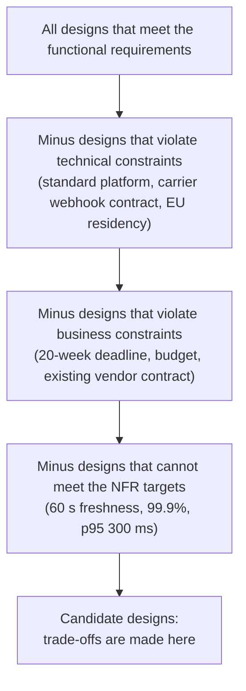
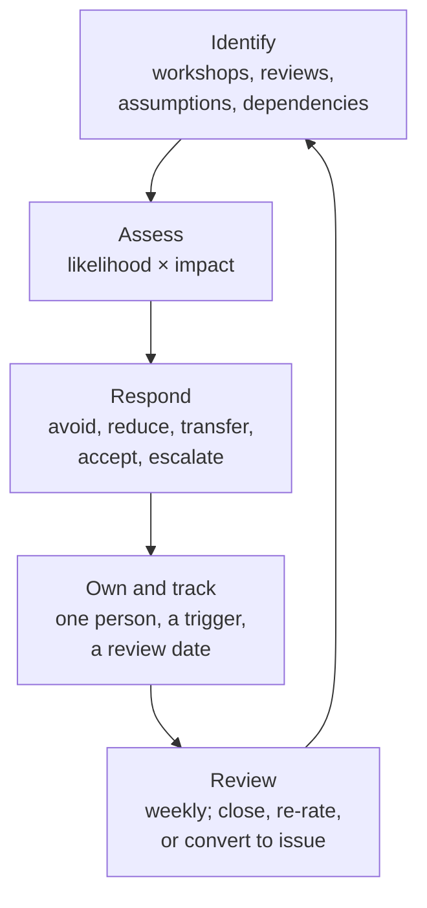
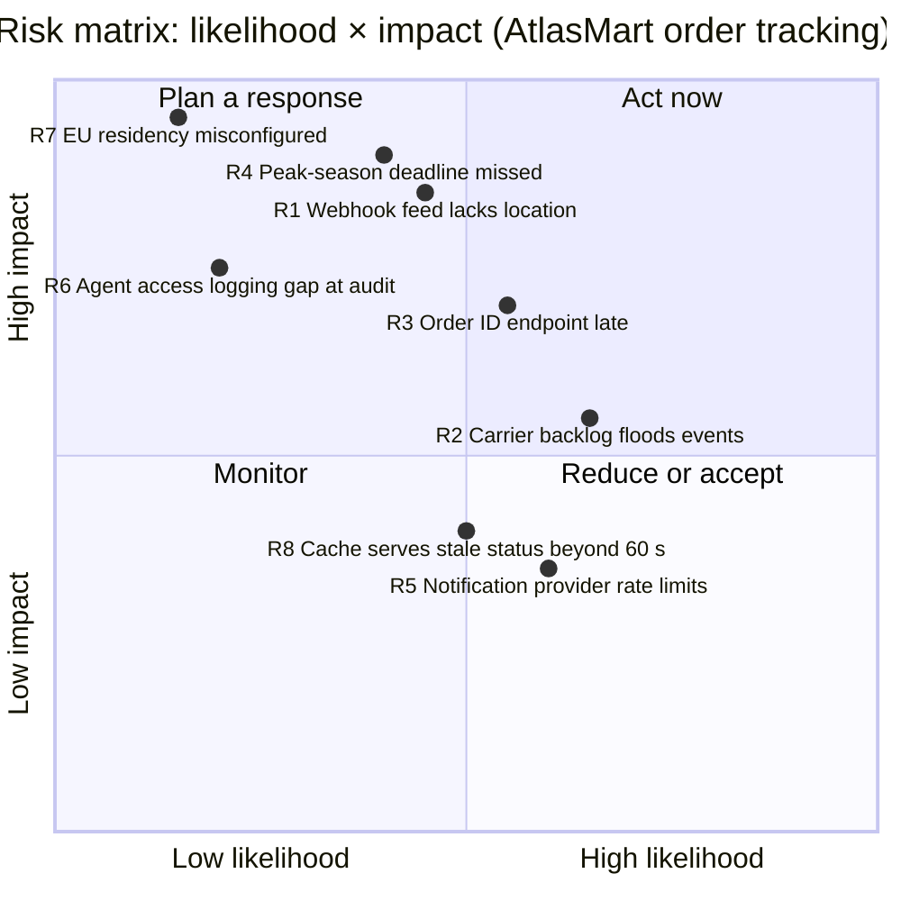

# Constraints, assumptions, dependencies, risks, and scope

> A design is only as honest as its list of things it cannot change, things it is assuming, things
> it is waiting for, things that could go wrong, and things it has decided not to do.

!!! abstract "Page facts"
    **Level:** Beginner → Intermediate · **Status:** Draft · **Time:** 45-60 minutes ·
    **Last verified:** 2026-11-15

## Learning objectives

After this page you should be able to:

- Tell a constraint from a requirement, an assumption from a fact, and a risk from an issue.
- Keep a RAID log (risks, assumptions, issues, dependencies) that stays useful after the first week.
- Assess risks by likelihood and impact, choose a response for each, and know when to escalate.
- Write a scope statement with explicit out-of-scope items and defend it.
- Prioritize requirements with MoSCoW and explain why "Must" is a small list.

## Prerequisites

- [What does a Solutions Architect do?](what-does-a-solutions-architect-do.md) — the Discover and
  Shape steps produce the artifacts on this page.
- [Stakeholders, business capabilities, and success metrics](stakeholders-business-capabilities-and-success-metrics.md)
  — constraints and risks are found by asking stakeholders.

## The problem this solves

Every design is a set of bets made inside a set of walls. The walls are constraints: the regulation,
the budget, the deadline, the platform standard, the vendor contract. The bets are assumptions: the
carrier feed will be reliable, the order system will expose an ID, traffic will grow 30% a year.
Projects fail when a wall is discovered late ("EU data must stay in the EU" in week 18) or a bet
turns out wrong ("the vendor's webhook feed does not include location"). The fix is cheap and
unglamorous: write the walls and the bets down, give each a name and an owner, and revisit the list
every week. This page is that list, and the scope statement and prioritization that follow from it.

## What it is

Five words, five different things:

| Word | Definition | Test | Who can change it |
|---|---|---|---|
| Constraint | A condition the design must satisfy and cannot negotiate away | "If we ignore this, the project is stopped or illegal" | A stakeholder with power, rarely the architect |
| Assumption | Something taken as true that has not been verified | "If this is false, which decision changes?" | Reality; the architect verifies it |
| Dependency | Something outside the team that the work needs, by a date | "Who delivers it, and what happens if they are late?" | The owning team; the architect negotiates |
| Risk | An uncertain future event with a negative effect | "Has it happened yet? No, but it might" | Reduced by a response; owned by one person |
| Issue | A risk that has happened, or a problem that exists now | "It is happening" | Resolved by action, not by planning |

Scope is the sixth: the boundary of what the initiative will change, expressed in capabilities,
features, users, and data, with explicit exclusions. Prioritization orders what is in scope so that
the plan survives contact with the deadline.

## Mental model

Think of planning a mountain expedition. Constraints are the things the mountain and the law set:
the climbing season, the permit, the route that is closed. Assumptions are what the plan bets on:
the weather window, the porters arriving, your fitness. Dependencies are what others must deliver:
the permit office, the helicopter company. Risks are what might go wrong: altitude sickness, a storm.
Issues are what has gone wrong: a sprained ankle at base camp. Scope is the summit you are going for
and the summits you are not, and MoSCoW is the packing list: the things you will not leave without,
the things you would like, and the things you will drop first when the pack is too heavy.

**Where the analogy breaks:** mountains do not move the deadline, change the sponsor, or reorganize
the porters halfway up. In software, constraints themselves change, which is why the list has a
review date, not just a creation date.

## Key terms

| Term | Meaning on this page |
|---|---|
| Technical constraint | A constraint arising from technology or existing systems: a mandated platform, an interface that cannot change, a data residency rule enforced by infrastructure |
| Business constraint | A constraint arising from the organization: budget, deadline, contract, regulation, policy, staffing |
| RAID log | A single register of Risks, Assumptions, Issues, and Dependencies, each with an owner, a status, and a review date |
| Likelihood and impact | The two dimensions used to rank risks; each rated on a small scale (for example 1-5) by judgement |
| Risk response | What is done about a risk: avoid, reduce (mitigate), transfer, accept, or escalate |
| Scope statement | The written boundary of the initiative: what is in, what is out, and the criteria for deciding new requests |
| Scope creep | Growth of scope without a corresponding change to time, budget, or priority |
| MoSCoW | A prioritization scheme with four classes: Must have, Should have, Could have, Won't have (this time) |

## How it works

### Constraints narrow the design space

The design space starts as "every architecture that could meet the functional requirements". Each
constraint removes a region; what remains is where trade-offs are made. The order matters: technical
and business constraints are applied first because they are not negotiable; quality attribute
requirements come next because they are negotiable at a price.

**Figure 1 — How constraints narrow the design space.** Each stage removes candidate designs; the
architect chooses among what is left.

How to read it: the funnel is why the architect asks for constraints before proposing anything. A
design that is elegant at the top and illegal at the second stage was never a candidate. For
AtlasMart, "replace the nightly carrier batch with a direct carrier integration" was removed at the
first stage by constraint C-1 (carrier events only arrive through the vendor's webhook API), before
anyone drew it.

### Technical and business constraints

Typical sources, and what to ask:

| Source | Ask | AtlasMart example |
|---|---|---|
| Platform standards | What can we run, where, deployed how? | Standard cloud accounts, one region with three zones, standard pipeline (C-2); PostgreSQL is the supported relational database |
| Existing interfaces | Which contracts cannot change on our timescale? | The vendor's webhook API (C-1); the order system exposes order IDs through its existing API |
| Regulation and policy | Which data has rules about where it lives and who sees it? | EU customer data stays in the EU region (C-4); agent access must be logged |
| Identity | How are users and services authenticated? | The existing identity provider is mandatory for customer and agent sign-in |
| Deadline | What is the immovable date and why? | Launch before peak season, 20 weeks (C-3) |
| Budget | What is the envelope for build and for run? | A fixed build budget; run cost must be forecast and approved by finance |
| Contract | What has already been signed? | The logistics vendor contract fixes the integration method this year |
| Staffing | Who is available with what skills? | One Python team; no mobile developers on staff (a reason "build a native app" was expensive) |

A constraint should be written with its **source** and its **expiry**. "PostgreSQL is the standard
(platform team policy, reviewed annually)" tells a future reader where to go to challenge it.
Constraints without sources become folklore, and folklore constraints outlive their reasons.

### Assumptions

An assumption is a decision taken on credit. The log records what is assumed, which decision depends
on it, how it will be verified, and by when. Three kinds matter most to architects:

- **Load and growth assumptions** (400,000 DAU, 30% growth per year): verify with analytics and
  revisit quarterly; see [capacity estimation](../performance-and-scalability/capacity-estimation.md).
- **Interface assumptions** ("the webhook payload includes location text"): verify by reading the
  vendor's specification and by a proof of concept, before design is fixed.
- **Organizational assumptions** ("the order system team will add an endpoint by week 8"): these are
  really dependencies and should be moved to that list once a named owner agrees to a date.

The habit that makes the list useful: every assumption has a verification task in the plan. An
assumption nobody intends to verify is a risk in disguise.

### Dependencies

Dependencies are deliverables the team needs from someone else: an interface, an environment, a
contract change, a decision, a dataset. Record the provider, the date needed, the date promised, and
the fallback. The architect's job is to design so that dependencies arrive as late as possible on
the critical path (stub the interface, build behind a feature flag, agree the contract before the
implementation) and to escalate early when a promised date slips.

### Risks: identify, assess, respond, review

**Figure 2 — The risk cycle.** Risks are found continuously, rated by likelihood and impact, given
a response and an owner, and reviewed on a cadence until they close or become issues.

How to read it: the loop never ends during the project; a risk that is rated once and filed is not
managed. The cycle's output is a short list of risks that are currently above the team's tolerance
and what is being done about each.

**Assessment.** Rate likelihood and impact on a scale the team agrees on (1-5 is common) and plot the
product. The scale is judgement, consistently applied; it is not a probability estimate and should
not be dressed up as one. What matters is the ranking and the conversation it forces.

**Figure 3 — Risk matrix for the AtlasMart tracking initiative (discovery stage).** Likelihood on
the horizontal axis, impact on the vertical; positions are the workshop's judgement.

How to read it: the top-right quadrant needs a response this week; the top-left (high impact,
unlikely) needs a plan and a trigger so that it is not forgotten; the bottom-right is reduced if
cheap or accepted; the bottom-left is watched. R7 is a good example of why impact alone is not enough:
unlikely because the platform enforces region, catastrophic if wrong, so it gets a verification
task rather than daily attention.

**Responses.** For each risk above tolerance, one of:

| Response | Meaning | AtlasMart example |
|---|---|---|
| Avoid | Change the plan so the risk cannot occur | R7: deploy only in the EU region; no multi-region option in phase one |
| Reduce | Lower likelihood or impact | R1: a two-week proof of concept against the real webhook feed before design freeze; R2: a queue between ingestor and processor sized for backlogs |
| Transfer | Move the consequence to someone better placed to bear it | R5: a contract with the notification provider that includes burst capacity, with the cost on the run budget |
| Accept | Take the risk knowingly, with a trigger for revisiting | R8: accept 30-second cache TTL staleness because NFR-1 allows 60 s; trigger: p95 lag alert (NFR-8) |
| Escalate | The response needs authority the team lacks | R3: escalate to the CTO if the order system team cannot commit a date by week 4 |

### Scope definition

A scope statement has four parts:

1. **In scope**, stated as capabilities and features, users, data, and channels.
2. **Out of scope**, stated just as explicitly, with the reason and, where useful, "not this time"
   versus "never".
3. **Boundaries**, the interfaces to systems that are not changed.
4. **Change criteria**: how a new request gets in (which stakeholder decides, what has to come out
   to make room).

Out-of-scope items are the most valuable part. An unstated exclusion is an argument waiting to happen
in week 15; a stated one is a decision that was made in week 1 and can be revisited on purpose.

### Requirement prioritization with MoSCoW

MoSCoW sorts requirements into **Must have** (the release is not viable without it), **Should have**
(important; painful to leave out; a workaround exists), **Could have** (desirable; small impact if
omitted), and **Won't have this time** (explicitly deferred, which is scope control, not rejection).

The discipline is in the proportions. If everything is a Must, the deadline is a hope. Teams that
use MoSCoW well keep Must to the minimum that makes the release worth shipping, so that when the
20-week plan slips, there is something to drop that was agreed in advance.

Other schemes exist: **weighted scoring** against the success metric (used on the
[As-Is/To-Be page](as-is-and-to-be-architecture-gap-analysis-and-build-vs-buy.md) for build vs buy),
**cost of delay** (what is lost each week a feature is not live), and **risk-first** ordering, where
the work that retires the biggest risk (the webhook proof of concept) is done first regardless of its
feature value. Architects usually combine MoSCoW for the release boundary with risk-first for the
ordering inside it.

## Worked example: AtlasMart order tracking

### RAID log (extract, discovery stage)

| ID | Type | Statement | Owner | Response or verification | Status / review |
|---|---|---|---|---|---|
| A1 | Assumption | The vendor's webhook payload includes a location text field | Architect | Verify in the proof of concept by week 3 | Open |
| A2 | Assumption | Tracking reads peak at about 210/s on a sale day (see [capacity estimation](../performance-and-scalability/capacity-estimation.md)) | Architect | Load test at week 10; revisit with analytics quarterly | Open |
| A3 | Assumption | 70% of orders on mobile web means mobile web is sufficient for phase one | Product manager | Confirm with two usability tests | Open |
| D1 | Dependency | Order system exposes an order-lookup-by-ID endpoint for the tracking service | Order system team lead | Needed week 8; promised week 7; fallback: read-only replica view | Promised |
| D2 | Dependency | Platform team provisions the standard environment with a managed queue | Platform team | Needed week 2; standard request | Delivered |
| D3 | Dependency | Vendor enables webhook delivery to AtlasMart's endpoint | Vendor account manager | Needed week 3; contract allows it; lead time two weeks | Requested |
| R1 | Risk | Webhook feed lacks location (A1 false) | Architect | Reduce: proof of concept; fallback: status-only tracking in phase one | Open, high |
| R2 | Risk | A carrier backlog delivers tens of thousands of events in minutes | Architect | Reduce: queue with burst capacity; backlog scenario in the load test | Open, medium |
| R3 | Risk | D1 is late | Delivery lead | Escalate at week 4 if no commitment | Open, high |
| R4 | Risk | Peak-season deadline missed | Sponsor | Reduce: MoSCoW with a small Must set; weekly burn-down | Open, high |
| R6 | Risk | Agent access logging does not satisfy the next audit | Security | Reduce: review log schema with internal audit by week 6 | Open, medium |
| I1 | Issue | The order system's test environment is shared and unstable | Delivery lead | Request a dedicated test tenant; stub the interface meanwhile | Open |

### Constraints (with sources)

| ID | Constraint | Type | Source | Reviewed |
|---|---|---|---|---|
| C-1 | Carrier events arrive only through the vendor's webhook API | Technical / contractual | Vendor contract, fixed this year | Contract renewal |
| C-2 | Runs in the existing cloud accounts, one region with three zones, standard deployment pipeline | Technical | Platform standards | Annually |
| C-3 | Launch before peak season, 20 weeks from kick-off | Business | Sponsor; the business case assumes peak-season benefit | Fixed |
| C-4 | EU customer data stays in the EU region | Regulatory | Privacy policy and legal advice | On regulatory change |
| C-5 | PostgreSQL is the supported relational database; Redis the supported cache | Technical | Platform standards | Annually |
| C-6 | Customer and agent sign-in use the existing identity provider | Technical / security | Security policy | Annually |
| C-7 | Build budget fixed; run cost forecast must be approved by finance before launch | Business | Finance | Quarterly |

### Scope statement

**In scope.** Near-real-time shipment status and timeline for customers (web, including mobile web)
and support agents; event-triggered notifications by email and SMS; customer self-service
delivery-date change before hub departure; per-carrier operational dashboard.

**Out of scope.** A native mobile app (not this time; revisit after phase one metrics). Storing
delivery addresses in the tracking service (never; NFR-6). Carrier booking, label printing, or rate
shopping (never in this system; Carrier Management is unchanged). Returns tracking (not this time).
Replacing the nightly batch for other consumers in the order system (not this time; the batch keeps
running for finance reconciliation).

**Boundaries.** Order Management System (read order and shipment IDs; no writes). Logistics Vendor
Platform (inbound webhooks only). Notification Provider (outbound only). Identity Provider (sign-in
only).

**Change criteria.** New requests are assessed against the success metric and the Must list by the
sponsor and the architect; a Must added means a Should removed or the date moved, and the decision
is recorded.

### MoSCoW for the functional requirements

| Requirement | Class | Reason |
|---|---|---|
| FR-1 View latest status per shipment | Must | The mechanism behind the success metric |
| FR-2 Record every scan event | Must | FR-1 depends on it; audit and durability (NFR-7) |
| FR-3 Notifications on out-for-delivery and delivered | Should | Reduces calls further; email alone is acceptable at launch, SMS can follow |
| FR-5 Agent view of the customer timeline | Should | Agents can use the customer view with impersonation as a workaround for the first weeks |
| FR-4 Customer changes delivery date | Could | Valuable, but depends on a hub-departure signal that is a further vendor dependency |
| Native mobile app | Won't (this time) | Does not address staleness; adds two platforms; no mobile developers |
| Returns tracking | Won't (this time) | Different event source; separate business case |

Two Musts out of five functional requirements is the shape to aim for. When week 14 arrives and the
hub-departure signal is still not available, FR-4 is dropped from the launch without a crisis,
because that decision was made in week 2.

## Real-world architecture example

In practice these artifacts live in three places and are linked:

1. **The architecture brief or solution outline** carries the constraints table and the scope
   statement, because reviewers need both to judge the design. An architecture review board that
   sees a design without its constraints will ask for options that were never available.
2. **The RAID log** lives in the delivery team's tracker and is reviewed in a standing weekly slot.
   The architect owns the technical assumptions and risks; the delivery lead owns dependencies and
   issues; the sponsor owns business risks such as the deadline.
3. **ADRs** record the moment an assumption was verified or a risk was accepted, so that the
   reasoning survives staff turnover: "ADR-07 chose webhooks over batch; assumption A1 verified in
   the proof of concept on week 3." The
   [ADR and governance page](trade-offs-principles-adrs-and-architecture-governance.md) covers the
   format.

The link that most often breaks is between the RAID log and the architecture: a risk is accepted in
the log, but the design still carries the cost of mitigating it, or the reverse. A quarterly read of
the log against the current design catches this.

## Design choices and trade-offs

| Choice | Favor when | Avoid when |
|---|---|---|
| Treat a stakeholder wish as a constraint | It has a source with authority (regulation, contract, signed policy) | It is a preference; log it as a requirement and prioritize it instead |
| Verify assumptions with a proof of concept | The assumption decides an expensive, hard-to-reverse choice | The cost of being wrong is small; verify by asking or reading |
| Five-point likelihood/impact scale | A team of mixed experience needs a shared vocabulary | Precision theatre: do not compute expected losses from judgement scores |
| Accept a risk | The response costs more than the exposure; a trigger exists | Nobody has the authority to accept it; escalate instead |
| MoSCoW with a small Must set | Fixed deadline, variable scope | Fixed scope (a regulatory deliverable), where the variable is time or resources |
| Risk-first ordering of work | A big technical unknown decides the design | The unknowns are small and the business needs visible progress first |
| Explicit "never" exclusions | Privacy and security boundaries | Product decisions that may change; use "not this time" with a revisit trigger |

**Assumption behind all of this:** someone will read the list. A RAID log that is written for an
audit and never reviewed is cost without benefit; the weekly review is the mechanism, not the
document.

## Failure modes and anti-patterns

- **Folklore constraints.** "We cannot use a queue here" with no source. Detect: nobody can say who
  set it or when. Prevent: source and review date on every constraint; challenge the ones without.
- **Assumptions as facts.** The design says "the feed includes location" without a verification
  task. Detect: the word "will" in design documents. Prevent: every assumption has a verifier and a
  date.
- **Risk theatre.** A 60-row register rated once, never reviewed. Detect: no risk has changed state
  in a month. Prevent: a weekly review of the top five only; close or merge the rest.
- **Everything is a Must.** Detect: Must is more than about half the list. Prevent: ask "would we
  cancel the launch without this?" for each one.
- **Silent scope creep.** Features arrive through stories without a scope decision. Detect: the
  backlog has items that are not traceable to the scope statement. Prevent: change criteria, applied.
- **Dependencies discovered on the critical path.** The order ID endpoint is needed in week 8 and
  first discussed in week 7. Prevent: list dependencies in discovery; design to stub them.
- **Issues logged as risks.** "Risk: the test environment is unstable" when it already is. Prevent:
  the "has it happened?" test; issues need action, not response plans.
- **Accepted risks with no trigger.** The cache staleness risk is accepted and then forgotten when
  NFR-1 tightens to 30 seconds. Prevent: every accepted risk names the condition that reopens it.

## Security considerations

- **Security constraints are usually non-negotiable and often undocumented.** Identity provider,
  logging retention, data residency, encryption standards: ask the security team for the list in
  discovery, not in review. Each becomes a constraint with a source.
- **Threat modelling is risk identification.** The security risks in the log (forged webhooks,
  order enumeration, address leakage) come from walking the trust boundaries on the data-flow
  diagram; the responses (signature verification, ownership checks, data minimization) become
  NFR-5 and NFR-6. The method is developed on the
  [ADR and governance page](trade-offs-principles-adrs-and-architecture-governance.md).
- **"Never" exclusions are security controls.** "The tracking service never stores delivery
  addresses" is a scope decision that removes an entire data breach scenario. Scope statements are
  part of the security design.
- **Accepting a security risk needs the right owner.** The architect can accept a cache staleness
  risk; only the security lead or the sponsor can accept an unmitigated data exposure.

## Performance, reliability, and cost

- **Performance:** load assumptions (A2) are the most frequently wrong entries in the log and the
  most expensive when wrong in either direction. Tie each to a measurement date and a load test.
- **Reliability:** dependencies are reliability risks at run time as well as delivery time. Every
  external dependency in the scope boundary (vendor feed, notification provider, order system) needs
  a stated behaviour when it is unavailable, which is where the use case's failure flows come from.
- **Cost:** budget is a constraint with two parts, build and run. The run cost forecast (C-7) comes
  from the capacity estimate; finance approves it before launch, and the risk "cloud cost exceeds
  forecast" belongs in the log with a monthly review against the invoice.

## Hands-on lab: write the RAID log for a design you are making

1. Take a current or recent design decision (a real one, or the AtlasMart example extended with a
   returns-tracking phase two).
2. List every constraint you are designing under. For each, write its source and when it could be
   challenged. Mark the ones you cannot source; go and find the source for at least one.
3. List five assumptions your design makes. For each, name the decision that depends on it, how you
   would verify it, and by when.
4. List your external dependencies with needed and promised dates and a fallback for each.
5. Identify at least six risks; rate each 1-5 for likelihood and impact; plot them; write a
   response and an owner for every risk in the top-right quadrant.
6. Write a scope statement with at least four explicit out-of-scope items, labelled "not this time"
   or "never" with a reason. Then classify your requirements with MoSCoW and check that Must is a
   minority.

??? question "Hint: if everything feels like a Must"
    Imagine the launch is tomorrow and one requirement is unfinished. For each requirement, ask
    whether you would still launch. If yes, it is not a Must. Then ask which Should you would
    rather have than each Could; that ordering is your drop list.

## Knowledge check

1. Is "the system must use PostgreSQL" a constraint or a requirement? What would make it one or the
   other?
2. State the difference between an assumption and a risk, and describe how one turns into the
   other.
3. Risk R7 (EU residency misconfigured) is rated low likelihood, very high impact. Which response
   does the example choose and why is "monitor" wrong?
4. Why is a small Must set a feature of a good MoSCoW classification rather than a sign of low
   ambition?
5. The order system team says the order-ID endpoint will be two weeks late. Which list does this
   belong to now, and what should already exist in the design to absorb it?

??? success "Answers"
    1. It is a constraint if it has an authoritative source the team cannot override on its
       timescale (a platform standard, a support contract). If it is a preference or an unexamined
       habit, it is at most a requirement to be prioritized, or a design choice to be made on
       merit.
    2. An assumption is something taken as true without verification; a risk is an uncertain future
       event with a negative effect. An assumption that may be false and would change a decision is
       a risk ("A1 is false" is risk R1); an assumption nobody intends to verify is a hidden risk.
    3. Avoid: deploy only in the EU region so the misconfiguration cannot happen, plus a
       verification task. Monitoring is wrong because the impact is unacceptable the first time it
       occurs; low likelihood does not reduce a catastrophic impact to a tolerable exposure.
    4. A small Must set is what lets the plan survive a slip without a crisis: the team and the
       sponsor agreed in advance what could be dropped. Ambition lives in the Should and Could lists
       and in the next release, not in an unachievable Must list.
    5. It is an issue now (it has happened), logged with an action, not a response plan. The design
       should already have the interface stubbed behind a contract agreed in discovery, and the
       fallback (a read-only replica view) named in the dependency entry, so the team keeps working.

## Architecture discussion questions

1. The sponsor asks you to treat the 20-week deadline as "a strong preference, not a constraint".
   What changes in how you plan, and what do you need to put in writing?
2. Your RAID log has 40 open risks after three weeks. Is that a problem? Describe how you would
   decide what to do about it.
3. A regulator announces a rule that will apply in 18 months. Is it a constraint today, an
   assumption, or a risk? How does your answer change the architecture you propose now?

## Summary

Constraints are walls with sources and expiry dates; assumptions are bets with verification tasks;
dependencies are deliverables from others with dates and fallbacks; risks are rated by likelihood
and impact, given one of five responses and an owner, and reviewed weekly; issues are risks that
have happened and need action. Scope is written with explicit exclusions and change criteria, and
MoSCoW keeps the Must list small so the plan can bend without breaking. For AtlasMart, this work
removed a native app and direct carrier integration from the design space before they were drawn,
turned the webhook payload question into a proof of concept, and made FR-4 droppable in advance.

## Related topics

- **Before:** [What does a Solutions Architect do?](what-does-a-solutions-architect-do.md);
  [Stakeholders, business capabilities, and success metrics](stakeholders-business-capabilities-and-success-metrics.md)
- **Alongside:** [As-Is and To-Be architecture, gap analysis, and build vs buy](as-is-and-to-be-architecture-gap-analysis-and-build-vs-buy.md);
  [Functional vs non-functional requirements](functional-vs-non-functional-requirements.md)
- **After:** [Trade-offs, principles, ADRs, and architecture governance](trade-offs-principles-adrs-and-architecture-governance.md)
  — where accepted risks and verified assumptions are recorded;
  [Capacity estimation](../performance-and-scalability/capacity-estimation.md) — verifying load
  assumptions.
- **Planned:** security threat modelling methods (D12); project and delivery governance in enterprise
  architecture (D28).

## References

| Source | Type | Checked |
|---|---|---|
| NIST, [SP 800-30 Rev. 1, Guide for Conducting Risk Assessments](https://csrc.nist.gov/pubs/sp/800/30/r1/final) | Standard (likelihood and impact assessment) | 2026-11-15 |
| Agile Business Consortium, [What is MoSCoW Prioritisation?](https://www.agilebusiness.org/resource/what-is-moscow-prioritization/) | Article (origin of MoSCoW in DSDM; site returns 403 to automated clients) | 2026-11-15 |
| UK Government Digital Service, [How the discovery phase works](https://www.gov.uk/service-manual/agile-delivery/how-the-discovery-phase-works) — Service Manual | Guidance (constraints and scope in discovery) | 2026-11-15 |
| Microsoft, [Design principles for Azure applications](https://learn.microsoft.com/en-us/azure/architecture/guide/design-principles/) — Azure Architecture Center | Official documentation (designing for failure of dependencies) | 2026-11-15 |
| Len Bass, Paul Clements, Rick Kazman, *Software Architecture in Practice*, 4th ed. (Addison-Wesley, 2021), chapters on architecturally significant requirements and constraints | Book | 2026-11-15 |
| Mark Richards and Neal Ford, *Fundamentals of Software Architecture* (O'Reilly, 2020), on architecture characteristics and trade-off analysis | Book | 2026-11-15 |

## Review notes

- Canonical page for D01-T03. All inventory items are covered: technical constraints, business
  constraints, assumptions, dependencies, risks, scope definition, requirement prioritization.
  Prioritization schemes other than MoSCoW (weighted scoring, cost of delay, risk-first) are
  described in a paragraph only.
- Constraints C-1 to C-4 match the requirements page; C-5 to C-7 are introduced here and should be
  reflected there if that page is revised. The risk matrix positions and the RAID entries are
  illustrative judgements for the fictional AtlasMart case.
- The MoSCoW reference URL blocks scripted checks (HTTP 403) but resolves in a browser, as recorded
  in `ROADMAP.md`; a reviewer should re-check it manually.
- Threat modelling is only pointed to; it is developed on the ADR and governance page (D01-T07) and
  in the security domain (D12).
