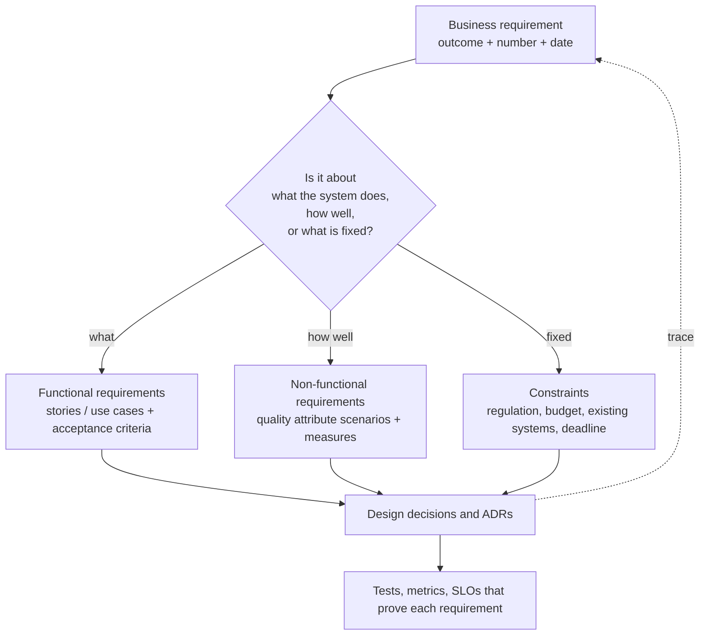

# Functional vs non-functional requirements

> Functional requirements say what the system must do. Non-functional requirements say how well it
> must do it. Architecture is mostly shaped by the second kind.

!!! abstract "Page facts"
    **Level:** Beginner → Intermediate · **Status:** Draft · **Time:** 30-45 minutes ·
    **Last verified:** 2026-11-15

## Learning objectives

After this page you should be able to:

- Distinguish business requirements, functional requirements, non-functional requirements, and
  constraints, and explain why the distinction matters for design.
- Rewrite a vague requirement ("the system should be fast") into a testable one.
- Write a non-functional requirement as a quality attribute scenario with a measurable response.
- Explain how non-functional requirements drive architecture decisions and cost.
- Spot the common requirement mistakes that lead to the wrong system being built.

## Prerequisites

- [What does a Solutions Architect do?](what-does-a-solutions-architect-do.md) — introduces the
  Discover and Shape steps where requirements are produced.

## The problem this solves

Teams are good at building what they are asked for. The trouble is that what they are asked for is
usually a feature list, and a feature list says nothing about how many users, how fast, how reliably,
how securely, or for how much money. Two systems with identical features can differ by a factor of
one hundred in cost and complexity depending on those answers.

When the "how well" questions go unasked, they are answered by accident: the first load test, the
first outage, the first audit, or the first invoice. Separating functional from non-functional
requirements, and making both testable, forces those answers to be given before the design is fixed.

## What it is

Requirements come in four kinds that are easy to blur.

| Kind | Answers | Example (AtlasMart order tracking) |
|---|---|---|
| **Business requirement** | Why are we doing this? What outcome? | Reduce "where is my order" support contacts by 40% within two quarters |
| **Functional requirement (FR)** | What must the system do? | A customer can see the latest status and location of each shipment in an order |
| **Non-functional requirement (NFR)** | How well must it do it? | Shipment status is visible within 60 seconds of a carrier scan for 99% of scan events, measured monthly |
| **Constraint** | What is fixed and non-negotiable? | Carrier data arrives through the logistics vendor's webhook API; changes to the vendor contract take one quarter |

**Functional requirements** describe behavior: inputs, processing, outputs, rules. If the behavior is
absent, the system does not do its job. They are usually written as user stories, use cases, or
"the system shall" statements, each with acceptance criteria.

**Non-functional requirements** describe qualities of that behavior: performance, availability,
security, usability, maintainability, cost, and so on. They are also called *quality attribute
requirements*, which is the more precise name; "non-functional" wrongly suggests they are less
important. An NFR without a number and a measurement method is a wish, not a requirement.

**Constraints** are decisions already made for you: regulation, budget, deadline, an existing system,
a mandated technology, a team's skills. They are often filed under NFRs, but they behave differently:
you do not trade constraints off, you design within them (or escalate to have them changed).

## Mental model

A restaurant order says *what* to cook: a steak, medium rare, with fries. That is functional. The
kitchen also has to deliver it in under 20 minutes, at a consistent temperature, safely for someone
with a nut allergy, at a price the restaurant can sustain, during the Friday rush when 80 orders
arrive in an hour. Those are non-functional. The same steak can be cooked by one person in a food
truck or by a brigade in a hotel kitchen; the menu does not decide which, the *qualities* do.

**Where the analogy breaks:** in a restaurant the qualities are mostly understood from the type of
establishment. In software they are not implied by anything; if you do not write "under 20 minutes",
nobody knows it mattered. Software also has qualities with no kitchen equivalent, such as being
modifiable by a different team in two years.

## Key terms

| Term | Meaning on this page |
|---|---|
| Acceptance criteria | The conditions that decide a requirement is met |
| Quality attribute | A measurable property such as availability or latency |
| Quality attribute scenario | A six-part structure for writing a testable NFR |
| Response measure | The number and unit in an NFR, with how it is measured |
| MoSCoW | A prioritization scheme: Must, Should, Could, Won't (this time) |
| Traceability | The ability to follow a requirement to the decisions, components, and tests that satisfy it |

## How it works

### Step 1 — Start from the business requirement

Every requirement should trace to an outcome someone will pay for. If it does not, it is either a
constraint, a solution in disguise, or unnecessary. Write the outcome with a number and a date.

### Step 2 — Elicit functional requirements as behavior

Use user stories or use cases with acceptance criteria. Good functional requirements are:

- **Behavioral:** they describe what happens, not how it is implemented ("notify the customer", not
  "send an SQS message").
- **Testable:** a tester could write a pass/fail check.
- **Atomic:** one behavior each.
- **Owned:** someone can answer questions about it.

### Step 3 — Elicit non-functional requirements as scenarios

The most reliable way to make an NFR testable is the **quality attribute scenario** structure used in
architecture evaluation methods such as the SEI's ATAM. Six parts:

| Part | Question | Example |
|---|---|---|
| Source | Who or what causes the stimulus? | A carrier's tracking system |
| Stimulus | What happens? | Sends a scan event via webhook |
| Artifact | Which part of the system is affected? | The tracking service |
| Environment | Under what conditions? | Normal operation, including peak evening load |
| Response | What should the system do? | Validate, store, and make the new status visible to the customer |
| Response measure | How is success measured? | Visible within 60 s for 99% of events, measured monthly from webhook receipt to read availability |

Written out: *"During normal operation including peak load, when a carrier sends a scan event, the
tracking service makes the new status visible to the customer within 60 seconds for 99% of events,
measured monthly."*

### Step 4 — Separate constraints

Pull out anything that is a given: regulation (data residency), budget caps, existing contracts,
platform mandates, team size, deadlines. Record who set each constraint and whether it is negotiable.

### Step 5 — Prioritize and resolve conflicts

Requirements conflict: the fastest option is rarely the cheapest or most secure. Prioritize with a
scheme like MoSCoW, and make the conflicts explicit so that stakeholders, not engineers, choose. This
is where [trade-off analysis](quality-attributes-and-trade-offs.md) starts.

### Step 6 — Keep traceability

Each significant NFR should be traceable to the design decision that satisfies it (an ADR), the
components involved, and the test or metric that proves it. Without traceability, NFRs silently stop
being true after a few releases.

**Figure 1 — From business outcome to testable requirements.** Rectangles are artifacts; the diamond
is the question that sorts statements into the right kind. Dashed arrows show traceability back to
the outcome.

Read it top to bottom: a single business outcome fans out into three kinds of statements, all three
feed the design, and the design must be provable by tests or metrics that trace back to the outcome.

## Worked example: AtlasMart order tracking

The support team's initial request, verbatim: *"We need customers to track orders in real time on
mobile, it must be fast and reliable and secure, and it should scale."*

Every phrase in that sentence is either untestable or a solution in disguise. Here is the same request
after one requirements workshop.

**Business requirement**

- BR-1: Reduce "where is my order" support contacts by 40% (from ~9,000 to ~5,400 per week) within
  two quarters of launch.

**Functional requirements** (with acceptance criteria abbreviated)

- FR-1: A signed-in customer can view, for each shipment in an order, the latest status, the time of
  that status, and the carrier's estimated delivery date. *Accept:* given an order with two shipments
  and three scan events each, the view shows the latest event per shipment.
- FR-2: The system records every carrier scan event with its timestamp and location. *Accept:* a
  replayed sample of 1,000 vendor events yields 1,000 stored events with no duplicates.
- FR-3: A customer receives a notification (email, and SMS if opted in) when a shipment is out for
  delivery or delivered. *Accept:* the two status transitions trigger exactly one notification each.
- FR-4: A customer can change the delivery date for a shipment that has not yet left the regional hub.
  *Accept:* the change is rejected with a clear message once the shipment has departed.
- FR-5: Support agents can view the same tracking timeline for any order, with the customer's
  notification history. *Accept:* agent view matches customer view for the same order.

**Non-functional requirements** (each a scenario; abbreviated to the measure)

- NFR-1 Freshness: a scan event is visible to the customer within 60 seconds of receipt for 99% of
  events, measured monthly.
- NFR-2 Availability: the tracking view is available 99.9% of the time per calendar month, measured
  by synthetic checks every minute from two regions.
- NFR-3 Latency: the tracking page's API responds within 300 ms at the 95th percentile and 800 ms at
  the 99th, measured at the API gateway, at peak load.
- NFR-4 Scale: the service handles 210 tracking reads per second and 70 scan events per second (the
  estimated peak with a sale-day burst) with CPU utilization under 70%. See the
  [capacity estimation](../performance-and-scalability/capacity-estimation.md) page for how these
  numbers were derived.
- NFR-5 Security: tracking data is visible only to the owning customer and authorized agents; every
  carrier webhook is signature-verified; all access by agents is logged with agent identity and
  retained 13 months.
- NFR-6 Privacy: delivery addresses are not stored in the tracking service; it references the order
  system by order ID only.
- NFR-7 Durability: no acknowledged scan event is lost; recovery point objective (RPO) 5 minutes,
  recovery time objective (RTO) 1 hour for the tracking service.
- NFR-8 Operability: on-call can see, per carrier, event lag and error rate on one dashboard; alerts
  fire when 95th-percentile lag exceeds 120 seconds for 5 minutes.

**Constraints**

- C-1: Carrier events arrive only through the logistics vendor's webhook API (contract fixed this year).
- C-2: Must run in AtlasMart's existing cloud accounts and use the platform team's standard
  deployment pipeline.
- C-3: Launch before the peak season in 20 weeks.
- C-4: Customer data for EU customers must stay in the EU region.

**Before → after.** The transformation that matters:

| Original phrase | Problem | Rewritten as |
|---|---|---|
| "real time" | No number | NFR-1: within 60 s for 99% of events |
| "fast" | No number, no percentile, no condition | NFR-3: p95 300 ms, p99 800 ms, at peak |
| "reliable" | Ambiguous: available? durable? correct? | NFR-2 (availability) and NFR-7 (durability) separately |
| "secure" | Not actionable | NFR-5 and NFR-6: specific access rules, verification, logging, data minimization |
| "should scale" | Scale to what? | NFR-4: specific peak rates with a utilization target |
| "on mobile" | Solution in disguise (native app?) | Deferred: FR-1 on the existing mobile web; native app is a separate decision (ADR) |

## Real-world architecture example

Each NFR above pushes the design somewhere specific. This is why architects care more about NFRs
than about the feature list:

- **NFR-1 (60-second freshness)** rules out the existing nightly batch and forces an event-driven
  integration with the carriers' webhooks.
- **NFR-2 (99.9%)** means about 43 minutes of allowed downtime per month, which rules out a
  single-instance deployment and requires multi-zone redundancy and health-checked failover.
- **NFR-3 (p95 300 ms)** means the read path cannot join across the order system on every request;
  tracking state is kept locally and cached.
- **NFR-5 and NFR-6** put the webhook endpoint on a separate ingress with signature verification,
  keep addresses out of the service entirely, and add an audit log for agent access.
- **NFR-7 (RPO 5 min)** sets the database backup and replication strategy.
- **C-4 (EU residency)** decides the deployment topology: an EU deployment for EU customers, which
  interacts with NFR-2's measurement ("from two regions").

A system with the same five functional requirements but NFR-1 at "within 24 hours" and NFR-2 at
"99%" could be a nightly batch job and a single server. Same features, a different architecture, at
perhaps a tenth of the cost.

## Design choices and trade-offs

| Choice | Favor when | Avoid when |
|---|---|---|
| Write NFRs as full quality attribute scenarios | The attribute is architecturally significant (drives a decision) | For dozens of minor qualities; use a short measurable statement instead |
| Specify targets tightly (p99, 99.99%) | A business consequence justifies the cost | "Because it sounds professional"; each extra nine or percentile roughly multiplies cost and complexity |
| Treat a stakeholder's solution ("we need Kafka") as a requirement | Never; record it as a constraint only if it is genuinely mandated | Always restate it as the underlying need |
| Prioritize with MoSCoW | Early, with stakeholders in the room | As a substitute for resolving real conflicts between Must-haves |
| Defer an NFR to "later" | The system can be changed to meet it later at modest cost (for example, adding a cache) | Meeting it later requires rework of the core (for example, data residency, strong consistency, multi-tenancy) |

**Assumption behind this advice:** requirements are being written for a system that will be operated
for years. For a throwaway experiment, lighter-weight requirements are appropriate; say so explicitly.

## Failure modes and anti-patterns

- **Adjective requirements.** "Fast", "scalable", "secure", "user-friendly". Detect: no number, no
  unit, no measurement method. Prevent: the scenario structure; refuse to accept an NFR without a
  response measure.
- **Solutions disguised as requirements.** "Must use microservices", "needs a NoSQL database".
  Prevent: ask "what would be true if this were satisfied?" until a behavior or quality appears.
- **NFRs discovered in production.** The first load test or audit reveals the real target. Prevent:
  an NFR checklist across all quality attributes during discovery, even if the answer is "not
  important".
- **Averages instead of percentiles.** An average latency target hides a slow tail that users feel.
  Prevent: specify p95 and p99 with the measurement point.
- **Unowned NFRs.** Nobody is accountable, so nobody measures. Prevent: each NFR has an owner and a
  dashboard or test.
- **Requirements that never change.** The system evolves; the requirements document is from launch.
  Prevent: keep requirements in version control next to ADRs; review them when SLOs or business goals
  change.
- **Over-specification.** Hundreds of requirements nobody reads. Prevent: focus on the
  architecturally significant ones; keep the rest in the backlog.

## Security considerations

Security requirements are NFRs with recognizable shapes: authentication (who can access),
authorization (what they can do), auditability (what was done, by whom, retained for how long),
confidentiality and integrity of data at rest and in transit, and input validation at trust
boundaries. Two additions make them useful:

- **Abuse cases.** Alongside use cases, write what an attacker would try ("an attacker replays a
  captured carrier webhook", "a customer enumerates order IDs") and the required response.
- **Compliance as constraints.** Regulatory requirements (data residency, retention, consent) are
  usually constraints, not negotiable NFRs; record their source.

NFR-5 and NFR-6 in the worked example show both patterns: specific access rules plus data
minimization (no addresses in the tracking service), which shrinks the impact of a breach.

## Performance, reliability, and cost

Performance and reliability NFRs are where the cost of a system is decided, and the relationship is
not linear. Moving from 99.9% to 99.99% availability is one more digit on paper, but it typically
means eliminating every single point of failure including the deployment process, adding automated
failover, and testing it regularly. Moving p95 latency from 800 ms to 300 ms may require caching,
data denormalization, or moving compute closer to users. Each NFR target should therefore come with a
rough cost of meeting it, so the business can decide whether the outcome justifies it. The
[quality attributes page](quality-attributes-and-trade-offs.md) quantifies availability targets;
the [capacity estimation page](../performance-and-scalability/capacity-estimation.md) shows how scale
targets become instance counts and storage.

## Hands-on lab: rewrite vague requirements

Rewrite each of the following into a testable requirement. Decide whether it is functional,
non-functional, or a constraint. For NFRs, use the six-part scenario and give a response measure.
Invent reasonable numbers and say what assumption each number rests on.

1. "The dashboard should load quickly."
2. "The system must never lose a payment."
3. "We need it to be GDPR compliant."
4. "Reports must be available to managers."
5. "The API should handle Black Friday traffic."
6. "The new service has to work with our existing SSO."
7. "Customers should be able to export their data."
8. "Downtime is unacceptable."

??? success "Sample answers (yours may differ; the structure is what matters)"
    1. NFR (performance). *When a manager opens the dashboard during business hours, the first
       meaningful content renders within 2 s at p95, measured by real-user monitoring.* Assumes a
       dashboard with ~10 widgets and pre-aggregated data.
    2. NFR (durability + consistency). *When a payment is acknowledged to the customer, the record is
       durably stored in at least two availability zones before acknowledgement; RPO 0 for payment
       records.* "Never" becomes "RPO 0 for this data class", which has a specific (and expensive)
       design implication.
    3. Constraint (regulatory), decomposed into NFRs: data of EU residents stored and processed in the
       EU; export and deletion of a customer's personal data completed within 30 days of request;
       consent recorded with timestamp and version; the legal basis for each processing activity
       documented. Assumes EU customers exist.
    4. FR. *A user with the Manager role can open the monthly sales report for their region.*
       Plus an authorization NFR: *users cannot access reports outside their region; attempts are logged.*
    5. NFR (scalability). *During the peak hour of the annual sale, the API serves 5× the normal peak
       request rate (estimate: 1,000 RPS) with p95 latency under 500 ms and error rate under 0.1%,
       verified by a load test four weeks before the event.* Assumes last year's peak and 30% growth.
    6. Constraint (existing system). *Authentication uses the corporate identity provider via OpenID
       Connect; no separate credential store.*
    7. FR. *A signed-in customer can request an export of their account data and receives a
       downloadable archive.* Plus NFRs: delivered within 24 hours; archive encrypted; link expires in
       7 days.
    8. NFR (availability), rewritten honestly: *99.95% monthly availability for the checkout path,
       measured by synthetic transactions each minute; planned maintenance counts as downtime.*
       "Unacceptable" is not a target; the number forces the real conversation about cost.

## Knowledge check

1. Why is "quality attribute requirement" a better name than "non-functional requirement"?
2. Name the six parts of a quality attribute scenario and give the response measure for a freshness
   requirement.
3. A stakeholder insists "we need a GraphQL API" as a requirement. How do you handle it?
4. Which has a bigger effect on architecture: the list of features, or the availability and latency
   targets? Why?
5. What is the difference between a constraint and an NFR in how you treat them during design?

??? success "Answers"
    1. Because these requirements describe qualities that are often more decisive for the design and
       the cost than the features are; "non-functional" misleadingly implies secondary importance.
    2. Source, stimulus, artifact, environment, response, response measure. Example measure: "visible
       within 60 seconds of receipt for 99% of events, measured monthly".
    3. Restate it as the underlying need (flexible querying from multiple clients? a single endpoint
       for a mobile team?). If it is genuinely mandated by the organization, record it as a constraint
       with its source; otherwise it becomes one option in an ADR.
    4. The targets. The same features can be met by a single server or a multi-region platform; what
       decides between them is availability, latency, scale, security, and cost targets.
    5. NFRs are traded off against each other and against cost with stakeholders; constraints are
       designed within and can only be changed by escalating to whoever set them.

## Architecture discussion questions

1. The business asks for 99.99% availability for an internal reporting tool used during office hours.
   How would you challenge the target, and what would you propose instead?
2. Two NFRs conflict: strict EU data residency and a single global view of inventory with sub-second
   freshness. Describe two architectures that resolve the conflict differently and the trade-off each
   makes.
3. How would you keep NFRs true over three years of feature development? Name specific mechanisms.

## Summary

Functional requirements describe behavior; non-functional (quality attribute) requirements describe
how well that behavior must perform, and they usually decide the architecture and its cost.
Constraints are fixed conditions you design within. Make every requirement testable: behaviors with
acceptance criteria, qualities as scenarios with a response measure, constraints with their source.
Vague adjectives and solutions disguised as requirements are the two mistakes to hunt for first.

## Related topics

- **Before:** [What does a Solutions Architect do?](what-does-a-solutions-architect-do.md)
- **Next:** [Quality attributes and trade-offs](quality-attributes-and-trade-offs.md) — the catalog
  of attributes and how to resolve conflicts between them.
- **Then:** [Capacity estimation](../performance-and-scalability/capacity-estimation.md) — turning
  scale requirements into numbers.
- **Adjacent (planned):** stakeholders and success metrics (D01-T02); constraints, assumptions, and
  scope (D01-T03); SLAs, SLOs, SLIs, and error budgets (D01-T06).

## References

| Source | Type | Checked |
|---|---|---|
| [ISO/IEC/IEEE 29148: Systems and software engineering — Life cycle processes — Requirements engineering](https://www.iso.org/standard/72089.html) — ISO | Standard (paywalled; scope public) | 2026-11-15 |
| [ISO/IEC 25010: Systems and software Quality Requirements and Evaluation (SQuaRE) — Product quality model](https://www.iso.org/standard/78176.html) — ISO | Standard (paywalled; scope public) | 2026-11-15 |
| [Architecture Tradeoff Analysis Method (ATAM)](https://www.sei.cmu.edu/library/architecture-tradeoff-analysis-method-collection/) — Software Engineering Institute, Carnegie Mellon University | Method documentation (quality attribute scenarios) | 2026-11-15 |
| [Software Architecture in Practice, 4th edition](https://www.sei.cmu.edu/library/software-architecture-in-practice-fourth-edition/) — Bass, Clements, Kazman | Book (quality attribute scenarios, chapter on quality attributes) | 2026-11-15 |
| [What is MoSCoW Prioritization?](https://www.agilebusiness.org/resource/what-is-moscow-prioritization/) — Agile Business Consortium (DSDM) | Method documentation | 2026-11-15 |
| [Site Reliability Engineering: Service Level Objectives](https://sre.google/sre-book/service-level-objectives/) — Google | Book chapter (free online) | 2026-11-15 |

## Review notes

- Canonical page for D01-T01. User stories, use cases, and acceptance criteria are introduced here
  and will be deepened in the planned D01-T02 page.
- Omitted "Implementation walkthrough": requirements have no runnable implementation; the lab
  substitutes.
- Reviewer: verify the ISO standard edition numbers and URLs; ISO renumbers editions periodically.
