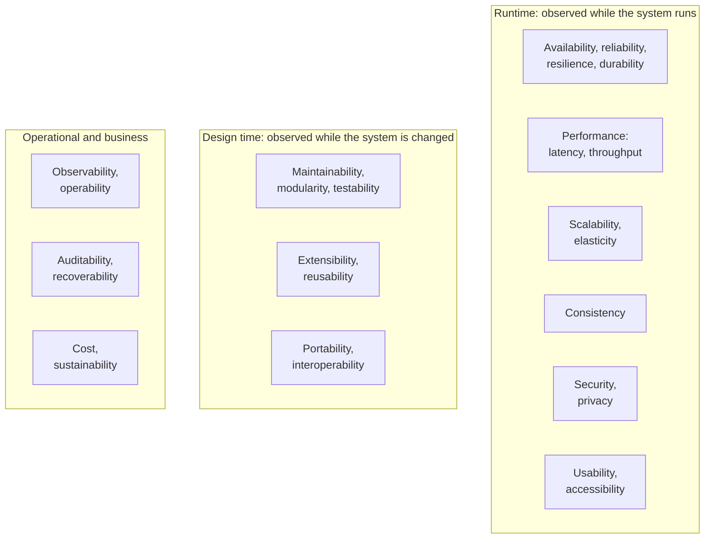
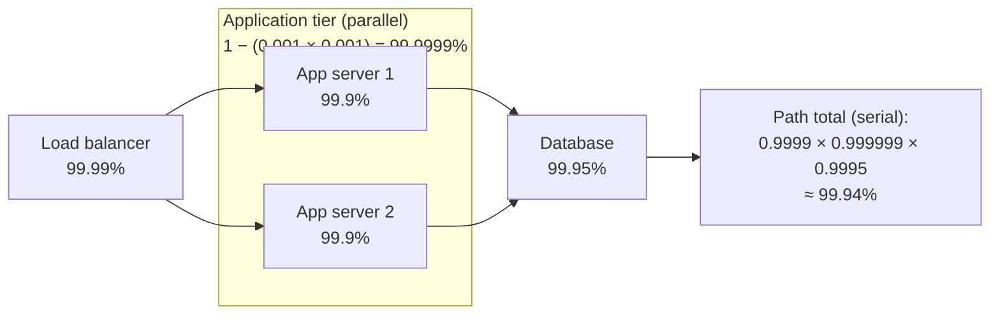
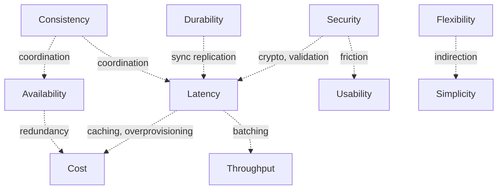
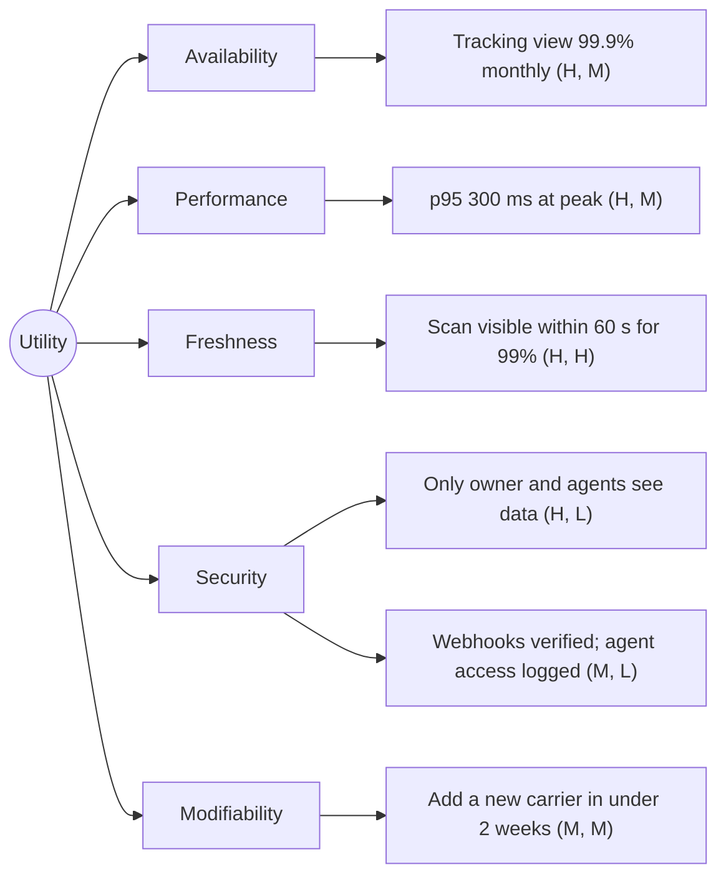

# Architecture quality attributes and trade-offs

> Quality attributes are the measurable properties that make a system fit for its purpose. They
> conflict with each other and with cost, so architecture is the discipline of choosing which ones
> win, and saying so.

!!! abstract "Page facts"
    **Level:** Mixed (Level 1 catalog → Level 3 methods) · **Status:** Draft · **Time:** 40-60 minutes ·
    **Last verified:** 2026-11-15

## Learning objectives

After this page you should be able to:

- Define the major quality attributes and name a measure for each.
- Convert an availability percentage into allowed downtime and compose availability across
  components in series and in parallel.
- Explain the most common tensions between attributes and why they are unavoidable.
- Use a utility tree and a trade-off matrix to make a decision explicit.
- Express a quality attribute as a fitness function that can be checked automatically.

## Prerequisites

- [Functional vs non-functional requirements](functional-vs-non-functional-requirements.md) — this
  page assumes you can write a quality attribute as a measurable scenario.

## The problem this solves

Every design is a compromise. A system can be made more available, faster, more secure, cheaper to
run, or easier to change, but not all at once; pushing one attribute usually costs another. When
these compromises are made implicitly, the losers are chosen by accident: the attribute nobody was
measuring is the one that fails in production. Quality attributes give the compromises names and
numbers so that the right people choose the winners deliberately.

## What it is

A **quality attribute** is a measurable, testable property of a system that indicates how well it
satisfies stakeholder needs. The international standard ISO/IEC 25010 organizes product quality into
characteristics such as functional suitability, performance efficiency, compatibility, usability
(called interaction capability in the 2023 edition), reliability, security, maintainability,
flexibility, and safety. Practitioners add operational attributes the standard treats lightly:
scalability, elasticity, observability, operability, cost, and sustainability.

A **trade-off** is a decision in which improving one attribute worsens another. A **trade-off point**
is a design element that affects more than one attribute at once (a cache improves latency and
worsens freshness). A **sensitivity point** is a design element on which one attribute strongly
depends (the replication mode of the database is a sensitivity point for durability). These terms
come from the SEI's Architecture Tradeoff Analysis Method (ATAM).

## Mental model

Imagine a mixing desk with one fader per attribute. The faders are not independent: some are
mechanically linked so that pushing one up pulls another down, and the total power available (budget,
time, people) is fixed. The architect's job is not to push every fader to maximum; it is to set each
fader at the level the business actually needs, in writing, and to know which linkages exist before
touching anything.

**Where the analogy breaks:** on a real mixing desk the linkages are fixed and visible. In
architecture they depend on the design: the right design can weaken a linkage (a well-placed cache
lets latency and cost both improve), and a poor design can create a new one.

## Key terms

| Term | Meaning on this page |
|---|---|
| Availability | Fraction of time the system is usable, as a percentage per period |
| Nines | Shorthand for availability levels: three nines = 99.9% |
| Serial composition | Components that must all work; availabilities multiply |
| Parallel composition | Redundant components where any one suffices; unavailabilities multiply |
| Utility tree | A tree from "utility" down to concrete quality attribute scenarios, each rated for importance and difficulty |
| Fitness function | An automated check that an architecture still has a required property |

## The catalog: Level 1

The table defines each attribute from the curriculum inventory in one line and gives a typical
measure. Measures matter: an attribute you cannot measure cannot be a requirement.

### Runtime attributes (observable while the system runs)

| Attribute | One-line definition | Typical measure |
|---|---|---|
| Availability | The system is reachable and able to serve | % of time or % of successful requests per month |
| Reliability | The system behaves correctly for a period under stated conditions | MTBF; defect rate; failed-transaction rate |
| Resilience | The system keeps operating, possibly degraded, through failures and recovers | Time in degraded mode; recovery time; survived failure scenarios |
| Fault tolerance | Operation continues despite component failure | Number of simultaneous failures tolerated (N+1, N+2) |
| Durability | Acknowledged data is not lost | Annual probability of loss; RPO |
| Performance | Work is done quickly and efficiently | Latency percentiles; throughput; utilization |
| Latency | Time from request to response | p50/p95/p99 in milliseconds at a stated point |
| Throughput | Work completed per unit time | Requests/second, events/second, MB/second |
| Scalability | More load is served by adding resources, with predictable cost | Throughput vs instance count; cost per unit of load |
| Elasticity | Capacity follows demand automatically | Time to scale out/in; over-provisioned fraction |
| Consistency | All readers see the same data | Consistency model (strong, causal, eventual); staleness bound |
| Security | Assets are protected against unauthorized access, modification, and disclosure | Control coverage; vulnerability count and age; time to detect |
| Privacy | Personal data is handled lawfully and minimally | Data classification coverage; retention compliance; access audits |
| Recoverability / disaster recovery | Service and data can be restored after a major failure | RTO; RPO; last successful DR test date |
| Usability | Users can achieve goals effectively and satisfactorily | Task success rate; time on task; error rate |
| Accessibility | Usable by people with the widest range of abilities | WCAG conformance level; audit findings |

### Design-time attributes (observable while the system is changed)

| Attribute | One-line definition | Typical measure |
|---|---|---|
| Maintainability | The system can be understood, fixed, and changed efficiently | Lead time for change; change failure rate; code health metrics |
| Modularity | The system is composed of parts with minimal, explicit dependencies | Dependency count across boundaries; cyclic dependencies |
| Extensibility | New capability can be added without rework | Effort to add a representative feature |
| Reusability | Parts can be used in other contexts | Number of consumers of a component |
| Testability | Behavior can be verified efficiently | Test coverage of critical paths; test run time; flakiness |
| Portability | The system moves between environments with little change | Effort to move; provider-specific dependency count |
| Interoperability | The system exchanges information with others correctly | Supported standards; integration defect rate |

### Operational and business attributes

| Attribute | One-line definition | Typical measure |
|---|---|---|
| Observability | Internal state can be inferred from outputs | Trace coverage; time to diagnose; unknown-unknown incidents |
| Operability | The system can be run day to day with reasonable effort | Toil hours; runbook coverage; deploy frequency |
| Auditability | Actions can be reconstructed after the fact | Audit log completeness and retention |
| Cost (efficiency) | Business value per unit of spend | Cost per transaction/customer/inference; utilization |
| Sustainability | Energy and carbon per unit of work | kWh or CO₂e per transaction; utilization; region carbon intensity |

**Figure 1 — The attribute landscape.** Attributes grouped by when they are observed. The grouping
is a teaching aid, not a standard; several attributes (security, cost) span all three.

How to read it: each group is a cluster of related attributes. When you review a design, walk through
all three groups and ask for a target or an explicit "not important" for each; the attribute nobody
mentioned is usually the one that fails.

## Availability arithmetic: Level 2

Availability is the attribute most often stated and least often calculated. Two pieces of arithmetic
turn a percentage into a design.

### From percentage to downtime

A year has 365.25 days × 24 hours = 8,766 hours; a month averages 730.5 hours.

| Availability | Allowed downtime per year | Allowed downtime per month |
|---|---|---|
| 99% ("two nines") | 87.7 hours (3.65 days) | 7.3 hours |
| 99.9% ("three nines") | 8.77 hours | 43.8 minutes |
| 99.95% | 4.38 hours | 21.9 minutes |
| 99.99% ("four nines") | 52.6 minutes | 4.38 minutes |
| 99.999% ("five nines") | 5.26 minutes | 26.3 seconds |

Worked: 99.9% means 0.1% unavailable; 0.001 × 8,766 h = 8.77 h per year, or 0.001 × 730.5 h = 0.73 h
≈ 43.8 min per month.

The practical reading: at 99.99% you have four minutes a month. A human cannot be paged, log in,
diagnose, and fix anything in four minutes, so four nines requires automated detection and failover.
At 99.9% a well-drilled on-call team can recover manually. That single observation decides much of
the architecture.

### Composing availability

**Serial** (everything must work): multiply availabilities.
Atotal = A1 × A2 × ... × An.

**Parallel** (redundant; any one suffices, failures independent): multiply *un*availabilities.
Atotal = 1 − (1 − A1)(1 − A2) ... (1 − An).

**Worked example.** A request path has a load balancer (99.99%), then one of two application
servers (99.9% each, redundant), then a database (99.95%).

1. Application tier in parallel: 1 − (0.001 × 0.001) = 1 − 0.000001 = 0.999999.
2. Whole path in series: 0.9999 × 0.999999 × 0.9995 = 0.999399 ≈ **99.94%**.

Two conclusions: redundancy made the application tier practically perfect, and the database is now
the limiting component. Adding a third application server changes nothing; adding database failover
does.

**Figure 2 — Serial and parallel composition.** Boxes carry each component's availability; the
formula under each group shows how they combine. Solid arrows are the request path.

**Assumptions behind the arithmetic:** failures are independent (a shared power feed or a bad deploy
to both servers violates this), and the figures are measured, not marketing. Correlated failure is the
reason multi-zone and multi-region designs exist; the
[reliability section](../reliability-and-disaster-recovery/index.md) develops this.

## The tensions: Level 2

Some conflicts between attributes are structural. Knowing them lets you predict where a design will
hurt before you build it.

| Tension | Why it is unavoidable | Typical resolution |
|---|---|---|
| Consistency vs availability (and latency) | Agreeing on a value across nodes takes communication; when nodes cannot communicate you must either wait or answer with possibly stale data | Choose per data class; strong for money, eventual for feeds (see CAP and PACELC in [distributed systems](../distributed-systems/index.md)) |
| Latency vs throughput | Batching and queuing raise throughput by making individual requests wait | Batch background work; keep interactive paths unbatched |
| Durability vs write latency | Durable writes wait for replication to another zone or disk flush | Synchronous replication for critical data; asynchronous elsewhere |
| Security vs usability and performance | Every control adds friction and work (authentication, encryption, validation) | Put controls at trust boundaries; make the secure path the easy path |
| Flexibility vs simplicity | Abstractions that allow change add indirection and concepts | Abstract only where change is likely and expensive |
| Performance vs maintainability | Optimized code is harder to read; denormalized data is harder to keep correct | Optimize measured hot spots only; document why |
| Availability vs cost | Each nine demands redundancy, automation, and testing | Tie each nine to a business consequence |
| Portability vs provider-native capability | Managed services are productive but provider-specific | Decide per component; isolate provider-specific code behind interfaces when the exit risk is real |
| Freshness vs latency and cost | Caches serve stale data; invalidation costs effort | Set a staleness bound from the requirement and size the TTL to it |

**Figure 3 — Tension map.** Dashed lines connect attributes that commonly pull against each other;
the label names the mechanism. This is illustrative: a specific design can strengthen or weaken any
link.

How to read it: pick the two attributes your requirement cares about most and check whether a dashed
line joins them. If it does, you will need a specific design decision to manage that link, and it
belongs in an ADR.

## A method for deciding: Level 3

### Step 1 — Build a utility tree

A utility tree (from ATAM) turns "the system must be good" into prioritized, concrete scenarios.
The root is *utility*; the next level is the quality attributes; the leaves are quality attribute
scenarios from the requirements. Each leaf is rated on **business importance** (High/Medium/Low) and
**architectural difficulty** (High/Medium/Low). High/High leaves are where the architecture is
decided.

**Figure 4 — Utility tree for AtlasMart order tracking (abbreviated).** Leaves show the scenario and
its (importance, difficulty) rating.

The (H, H) leaf, freshness, is the one that forces the event-driven design; everything else can be met
by conventional means. That is the value of the tree: it points at the one or two decisions that
matter.

### Step 2 — Identify sensitivity and trade-off points

For each candidate design, ask which elements each high-priority scenario depends on. Elements that
appear under several scenarios are trade-off points. In the tracking service, the **cache in front of
the event store** is a trade-off point: it serves latency (p95 300 ms) and cost (fewer database reads)
but works against freshness (stale for up to the TTL). The **database replication mode** is a
sensitivity point for durability and for write latency.

### Step 3 — Score the options

A weighted trade-off matrix makes the comparison explicit. Weights come from business importance;
scores from analysis or measurement.

**Worked example: replication mode for the tracking event store.** Scores 1 (poor) to 5 (excellent).

| Attribute (weight) | Option A: synchronous replication to a second zone | Option B: asynchronous replication | Option C: single zone, backups every 5 min |
|---|---|---|---|
| Durability, RPO target 5 min (weight 5) | 5 (RPO ≈ 0) | 4 (RPO seconds under normal lag) | 3 (RPO up to 5 min) |
| Availability 99.9% (weight 4) | 5 (automatic failover) | 4 (failover possible, small data loss) | 1 (zone loss = outage) |
| Write latency, p95 300 ms overall (weight 3) | 3 (each write waits for the cross-zone round trip) | 5 | 5 |
| Cost (weight 2) | 2 (two instances, cross-zone traffic) | 2 | 4 |
| Operational simplicity (weight 2) | 4 (managed failover) | 3 (lag monitoring needed) | 3 (restore drills needed) |
| **Weighted total** | **5·5+4·5+3·3+2·2+2·4 = 66** | **5·4+4·4+3·5+2·2+2·3 = 61** | **5·3+4·1+3·5+2·4+2·3 = 48** |

Option A wins for this workload because durability and availability carry the most weight and the
write latency penalty is small relative to the 300 ms budget (cross-zone round trips within a cloud
region are typically low single-digit milliseconds; AWS states that its Availability Zones within a
Region are within 100 km of each other). If the workload were a high-frequency write path with a
50 ms budget, the weights and scores would change and Option B could win. The matrix does not make
the decision; it makes the reasoning visible and reviewable.

**Caution:** weighted scores invite false precision. Use them to structure the conversation, record
the weights and scores in the ADR, and be ready to defend each number.

### Step 4 — Turn attributes into fitness functions

A **fitness function** is an automated check that the architecture still has a property. Examples for
the tracking service:

- Availability: a synthetic check every minute; monthly SLO report; alert on error-budget burn.
- Latency: a load test in the pipeline that fails if p95 at the target load exceeds 300 ms.
- Freshness: a metric for webhook-receipt-to-read-visibility lag; alert if p95 exceeds 120 s.
- Modularity: a dependency rule test that fails if the tracking service imports the order system's
  internal modules.
- Security: a pipeline step that fails if the webhook endpoint is deployed without signature
  verification configured.

Fitness functions keep trade-offs true over years of change. Without them, every decision in the
matrix silently decays.

## Real-world architecture example

Consider a payments ledger versus a product-recommendation feed in the same e-commerce platform.

- The **ledger** weights durability and consistency highest: synchronous replication, strong
  consistency, idempotent writes, audit logging, and it accepts higher write latency and cost.
- The **recommendation feed** weights latency and cost highest: aggressive caching, eventual
  consistency, graceful degradation to a default list when the recommender is down, and it accepts
  staleness of minutes.

Both are correct. Both live in one platform. A single global policy ("everything strongly consistent",
"cache everything") would be wrong for one of them. Quality attribute targets are set per data class
and per path, not per company.

## Design choices and trade-offs

| Practice | Favor when | Avoid when |
|---|---|---|
| Full utility tree and ATAM-style review | The system is large, long-lived, or high risk | A small service with obvious requirements; a lightweight scenario list suffices |
| Weighted trade-off matrix | Several real options with different strengths | One option is clearly dominant; the matrix becomes theatre |
| Targets per data class or path | Always, once the system has more than one kind of data | Never; a single global target is a sign the analysis was skipped |
| Fitness functions in CI | The attribute can be measured automatically | The attribute needs human judgement (usability); use periodic review instead |

## Failure modes and anti-patterns

- **Maximizing one attribute.** "Five nines everywhere", "zero trust everything", "microservices for
  modifiability" without a target. Detect: no number tied to a business consequence. Prevent: the
  utility tree.
- **Unmeasured nines.** An availability target with no synthetic monitoring. Detect: nobody can say
  last month's availability. Prevent: an SLI and a monthly report before the target is agreed.
- **Independent-failure assumption.** Computing 99.9999% for two servers behind the same switch.
  Prevent: identify shared fate (power, network, deploy pipeline, region) before composing.
- **Ignoring operability and observability.** They rarely appear in requirements and always appear
  in incidents. Prevent: include them in every utility tree.
- **Trade-off by default.** The compromise was never discussed, so the attribute nobody championed
  lost. Prevent: a named owner per high-priority attribute in reviews.
- **Score-sheet theatre.** Adjusting weights until the preferred option wins. Prevent: agree weights
  with stakeholders before scoring options.

## Security considerations

Security is a quality attribute, but it differs from the others in one way: an adversary is actively
optimizing against you. Targets for security are therefore less about a number and more about the
coverage of controls at trust boundaries and the time to detect and respond. When security trades
against latency or usability, resolve the trade-off by placing controls where they are needed
(boundaries, not everywhere) and by automating them (signature verification in the ingress, not in
every handler). Recording the trade-off in an ADR matters more here than elsewhere, because a
"temporary" relaxation of a control tends to become permanent.

## Performance, reliability, and cost

Cost is the attribute that every other attribute trades against. Three patterns:

- **Availability cost grows stepwise.** Each nine typically requires a qualitatively different
  architecture (single instance → multi-zone with failover → multi-region active-active), not a
  linear increase in spend.
- **Latency cost grows at the tail.** Getting p50 from 200 ms to 100 ms is usually cheap; getting p99
  under 300 ms requires attacking every slow dependency and often redundancy of requests.
- **Over-provisioning is the default failure.** Without targets, teams buy headroom "to be safe";
  with targets, headroom is a decision. The
  [capacity estimation](../performance-and-scalability/capacity-estimation.md) page shows how to size
  it.

## Hands-on lab: a trade-off matrix for a real decision

Take a decision you face or recently faced (database choice, synchronous versus asynchronous
integration, managed service versus self-hosted, monolith versus services).

1. List the quality attributes that matter for it. Give each a weight from 1 to 5 and write one
   sentence on why.
2. Write at least two real options (if you can only think of one, you have not found the decision).
3. Score each option per attribute from 1 to 5, with one sentence of evidence per score.
4. Compute weighted totals.
5. Write the sensitivity points (which attribute depends most on this decision) and trade-off points
   (which design element affects several attributes).
6. Write one fitness function that would tell you, a year from now, whether the winning attribute is
   still winning.

Then change one weight by two points and see whether the winner changes. If it does, that weight is
the real decision and needs a stakeholder, not an engineer, to confirm it.

## Knowledge check

1. Convert 99.95% monthly availability into minutes of allowed downtime per month. Show the
   arithmetic.
2. Three services are called in series, each at 99.9%. What is the path availability?
3. Why does adding a third redundant application server not improve the worked example's path
   availability meaningfully?
4. Name a trade-off point and a sensitivity point in the AtlasMart tracking service and explain the
   difference.
5. What is a fitness function, and why does a trade-off decision need one?

??? success "Answers"
    1. 0.0005 × 730.5 h = 0.365 h ≈ 21.9 minutes per month.
    2. 0.999³ = 0.997003 ≈ 99.7%. Serial chains compound; three nines each becomes less than three
       nines together.
    3. The parallel application tier is already at 99.9999%; the database at 99.95% is the limiting
       factor. Improving a non-limiting component changes the product negligibly.
    4. Trade-off point: the cache, which affects latency and cost positively and freshness
       negatively. Sensitivity point: the database replication mode, on which durability strongly
       depends. A trade-off point touches several attributes; a sensitivity point is one attribute's
       strong dependency.
    5. An automated check that the architecture still has a property (latency test in CI, dependency
       rule, synthetic availability probe). Without it the decision decays silently as the system
       changes.

## Architecture discussion questions

1. A product manager asks for "the same availability as the big cloud providers". How do you turn
   that into a target, and what questions reveal whether it is justified?
2. Your utility tree has two (High, High) leaves that conflict: strong consistency for inventory
   counts and sub-100 ms reads for the product page under global traffic. Propose two designs and
   explain which attribute each one sacrifices and where.
3. How would you argue for spending engineering time on observability when it appears nowhere in the
   requirements?

## Summary

Quality attributes are the measurable properties of a system; the catalog spans runtime, design-time,
and operational concerns. Availability turns into design through arithmetic: each nine is a different
architecture, and composition shows which component limits the whole. Attributes conflict in
predictable ways (consistency versus availability, durability versus latency, security versus
usability, everything versus cost). A utility tree finds the few scenarios that decide the design, a
trade-off matrix makes the choice visible, an ADR records it, and fitness functions keep it true.

## Related topics

- **Before:** [Functional vs non-functional requirements](functional-vs-non-functional-requirements.md)
- **Next:** [The C4 model](c4-model.md) to communicate the design;
  [Capacity estimation](../performance-and-scalability/capacity-estimation.md) to size it.
- **Deeper (planned):** SLAs, SLOs, SLIs, and error budgets (D01-T06); trade-offs, principles, ADRs,
  and governance (D01-T07); consistency models, CAP, and PACELC (D04-T02); high availability design
  (D13-T01).

## References

| Source | Type | Checked |
|---|---|---|
| [ISO/IEC 25010:2023 Systems and software engineering — SQuaRE — Product quality model](https://www.iso.org/standard/78176.html) — ISO | Standard (paywalled; scope and characteristic names public) | 2026-11-15 |
| [Architecture Tradeoff Analysis Method (ATAM) collection](https://www.sei.cmu.edu/library/architecture-tradeoff-analysis-method-collection/) — Software Engineering Institute | Method documentation (utility trees, sensitivity and trade-off points) | 2026-11-15 |
| [Site Reliability Engineering: Embracing Risk](https://sre.google/sre-book/embracing-risk/) — Google | Book chapter (availability targets and error budgets) | 2026-11-15 |
| [AWS Well-Architected Framework, Reliability Pillar](https://docs.aws.amazon.com/wellarchitected/latest/reliability-pillar/welcome.html) — Amazon Web Services | Official documentation (availability calculation guidance) | 2026-11-15 |
| [Regions and Availability Zones](https://aws.amazon.com/about-aws/global-infrastructure/regions_az/) — Amazon Web Services | Official documentation (AZ separation statement) | 2026-11-15 |
| [Building Evolutionary Architectures, 2nd edition](https://www.oreilly.com/library/view/building-evolutionary-architectures/9781492097532/) — Ford, Parsons, Kua, Sadalage | Book (fitness functions) | 2026-11-15 |

## Review notes

- Canonical page for D01-T05. SLO/error-budget detail is deferred to the planned D01-T06 page;
  availability arithmetic is introduced here because it is needed to reason about trade-offs.
- The ISO 25010:2023 characteristic names (interaction capability, flexibility, safety) should be
  re-verified by a reviewer with access to the standard text.
- Omitted "Implementation walkthrough": the fitness-function examples serve that purpose; a runnable
  example will accompany Lab 01.
