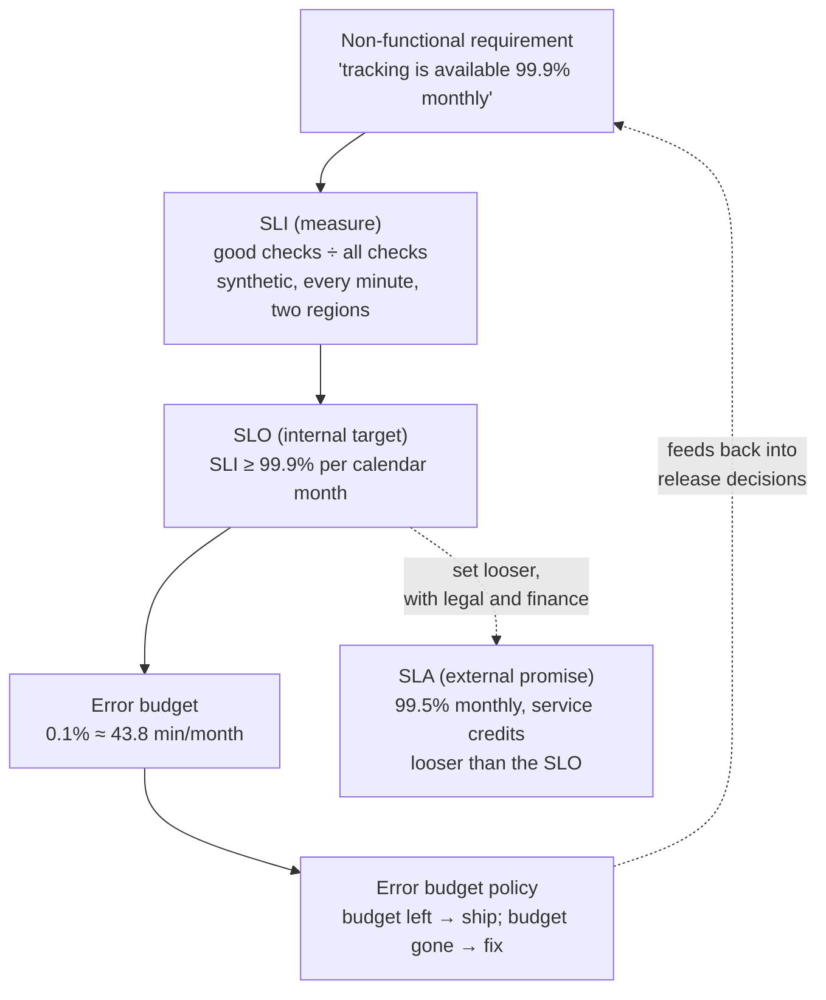
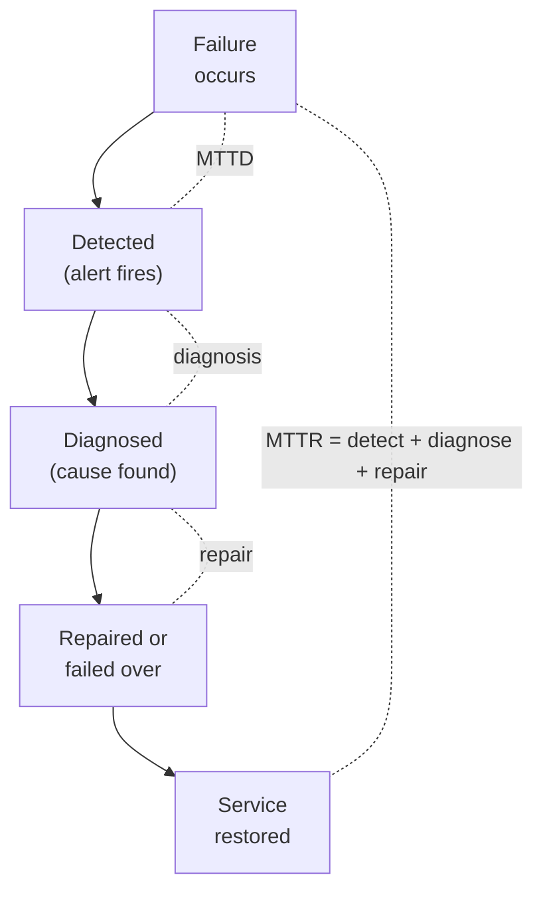
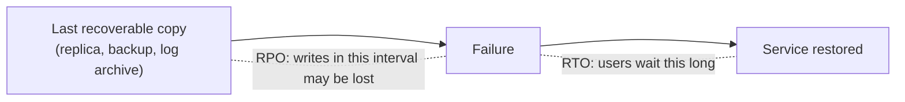
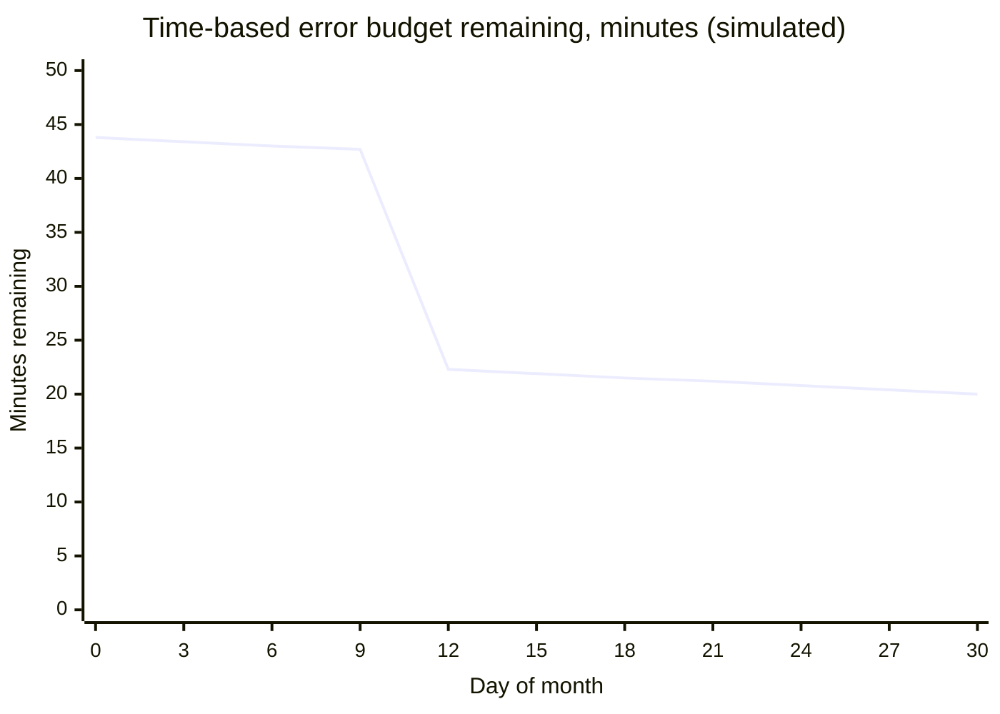

# SLAs, SLOs, SLIs, error budgets, and recovery objectives

> An SLI is what you measure, an SLO is the target you hold yourself to, an SLA is the promise you
> make to someone else, and the error budget is the gap between perfect and the SLO. Recovery
> objectives (RTO, RPO) say how much downtime and data loss a failure may cost. Together they turn
> "reliable" into numbers that decide the architecture.

!!! abstract "Page facts"
    **Level:** Mixed (definitions are Level 1; writing SLOs is Level 2; dependency and recovery
    design is Level 3) · **Status:** Draft · **Time:** 45-60 minutes · **Last verified:** 2026-11-15

## Learning objectives

After this page you should be able to:

- Define SLI, SLO, SLA, and error budget precisely and explain how they relate.
- Write an SLI with an exact measurement definition (what counts as good, where it is measured, over
  which window) and choose an SLO target for it.
- Convert an availability percentage into minutes of allowed unavailability per month and year, and
  convert a request-based SLO into a count of allowed failures.
- Explain MTTR, MTTD, and MTBF and how they relate to availability.
- Define RTO and RPO and derive concrete design choices (replication mode, backup cadence, failover
  automation) from them.
- Show why a service cannot promise a higher availability than its critical dependencies allow, and
  what to do about it.
- Use an error budget policy to decide between shipping features and reliability work.

## Prerequisites

- [Functional vs non-functional requirements](functional-vs-non-functional-requirements.md) — SLOs
  are the measurable form of the NFRs written there.
- [Quality attributes and trade-offs](quality-attributes-and-trade-offs.md) — availability versus
  cost is the trade-off this page quantifies.
- [Estimating load, throughput, storage, and capacity](../performance-and-scalability/capacity-estimation.md)
  — request counts feed the request-based error budget.

## The problem this solves

"The system must be reliable" cannot be designed for, tested, or argued about. Without numbers,
every incident becomes a debate about whether it was acceptable, every feature freeze feels
arbitrary, and the architect cannot say whether a synchronous standby database is required or
wasteful. Service levels replace that debate with a measurement everyone agreed to in advance: a
target, a budget of allowed failure, and a rule for what happens when the budget is spent. Recovery
objectives do the same for disasters: they state how long the business can wait and how much data it
can lose, which is exactly the information needed to choose a backup and failover design.

## What it is

The four terms are defined the same way throughout this repository (see the
[glossary](../start-here/glossary.md#service-levels-and-recovery)):

| Term | Definition | Who sets it | Consequence of missing it |
|---|---|---|---|
| Service Level Indicator (SLI) | A quantitative measure of one aspect of the service, normally a ratio of good events to all events over a window | Engineering, with product | None by itself; it is a measurement |
| Service Level Objective (SLO) | A target value or range for an SLI over a period | Engineering and product together | Internal: the error budget policy applies |
| Service Level Agreement (SLA) | A contract that attaches consequences (credits, penalties, termination rights) to missing a stated level | Business and legal, with engineering | External: money or contract remedies |
| Error budget | 100% minus the SLO, expressed as allowed bad minutes or bad requests per window | Derived from the SLO | When exhausted, reliability work takes priority over features |

Three further terms describe failure and recovery:

| Term | Definition |
|---|---|
| Recovery Time Objective (RTO) | The maximum acceptable time from a failure until service is restored |
| Recovery Point Objective (RPO) | The maximum acceptable data loss, measured as the time span of writes that may be lost |
| MTTR / MTTD / MTBF | Mean time to recovery, mean time to detect, mean time between failures: averages over many incidents |

The ordering matters: **SLI before SLO before SLA.** You cannot set a target for something you do not
measure, and you must not sign a contract for a level you have not shown you can meet internally.

## Mental model

Think of a monthly household budget. Income is the month's total requests (or minutes). The SLO says
what fraction must be "spent well" (served correctly); the remainder is the error budget, the money
you may spend on risk: deployments, experiments, planned maintenance, and the incidents that happen
anyway. A good month leaves budget unspent, which is a signal that you could take more risk, such as
shipping faster. A bad month overdraws the account, and the policy says what happens next: no more
risky spending until the balance recovers.

The SLA is a different thing: it is the promise you made to the landlord. It is set looser than the
budget on purpose, so that an ordinary bad month does not breach the contract.

**Where the analogy breaks:** money is fungible, failures are not. One 20-minute outage at peak
traffic affects far more users than twenty one-minute blips at night, and a request-based budget
captures that while a time-based budget does not. And unlike a bank balance, the budget is a rolling
window: last month's unspent budget does not carry over.

## Key terms

| Term | Meaning on this page |
|---|---|
| Good event | An event (request, check, scan) that meets the SLI's condition, for example "responded with a success status in under 300 ms" |
| Measurement point | Where the SLI is observed: the client, a load balancer, the service, or a synthetic prober. Different points give different numbers |
| Window | The period over which the SLI ratio is computed: a calendar month, a rolling 30 days, a rolling 28 days |
| Burn rate | How fast the error budget is being consumed relative to the rate that would exactly exhaust it at the end of the window; a burn rate of 1 spends the whole budget in one window |
| Error budget policy | The written rule for what the team does at given budget levels (for example: below 50%, no non-essential deploys) |
| Critical dependency | A dependency whose failure makes the service's SLI fail; its availability caps the service's achievable SLO |
| Availability (from measurement) | The ratio of good events to total events, or uptime to total time, as the SLI defines it; not the vendor's marketing number |

## How it works

### From requirement to measurement

**Figure 1 — How the service-level terms relate.** An SLI is measured; an SLO sets its target;
the error budget is what the SLO leaves; a policy spends the budget; the SLA is an external promise
deliberately looser than the SLO.

How to read it: the solid path is the engineering loop; the dashed arrow to the SLA shows that the
contract is derived from the internal target, never the other way round.

### Step 1 — Choose SLIs that reflect what users feel

Good SLIs measure the user's experience, not the server's health. CPU utilization is not an SLI;
"fraction of tracking page loads that returned the current status within 300 ms" is. Most services
need two to four SLIs from these families:

| SLI family | Typical ratio | Example on this page |
|---|---|---|
| Availability | successful responses ÷ all responses, or passing checks ÷ all checks | NFR-2 |
| Latency | responses faster than a threshold ÷ all responses | NFR-3 |
| Freshness | items updated within a deadline ÷ all items | NFR-1 |
| Correctness | responses with the right content ÷ all responses | agent view matches customer view (FR-5) |
| Durability | records that survive ÷ records acknowledged | NFR-7 |
| Throughput (for pipelines) | windows where processing kept up ÷ all windows | event backlog drained each hour |

Every SLI needs an exact definition: the event, the condition for "good", the measurement point, the
exclusions (for example, requests rejected because the client was unauthenticated are not failures),
and the window.

### Step 2 — Set the SLO from user need and current performance

An SLO has two inputs: what users actually need (which is often less than "as high as possible")
and what the system currently achieves. A target above current performance is a project, not an
objective. A target far above user need is waste. Start with the loosest target that keeps users
happy, measure for a few windows, then tighten only if there is a reason.

### Step 3 — Compute the error budget

For time-based availability:

| SLO | Allowed downtime per average month (43,830 min) | Allowed downtime per year (525,600 min) |
|---|---|---|
| 99% | 438.3 min (about 7.3 h) | 5,256 min (87.6 h) |
| 99.9% | 43.8 min | 525.6 min (8.76 h) |
| 99.95% | 21.9 min | 262.8 min (4.38 h) |
| 99.99% | 4.4 min | 52.6 min |
| 99.999% | 26 s | 5.3 min |

The "average month" is 365 days ÷ 12 = 30.42 days. A 30-day month gives 43.2 minutes at 99.9%; a
31-day month gives 44.6; February gives 40.3. State which you use in the SLO document; this
repository uses the average month when a figure is quoted without a specific month.

For request-based SLOs, the budget is a count: total requests in the window × (1 − SLO). The worked
example computes it.

### Step 4 — Write the error budget policy

The policy is agreed before it is needed. A common shape:

| Budget remaining (30-day window) | Rule |
|---|---|
| More than 50% | Normal release cadence; experiments allowed |
| 10-50% | Releases need an explicit risk review; no experiments on the affected path |
| Below 10% | Only reliability fixes ship; postmortem actions take priority |
| Exhausted | Feature freeze for the affected service until the window recovers; leadership informed |

The policy is what makes the SLO real. Without it the SLO is a dashboard number nobody acts on.

### Step 5 — Alert on burn rate, not on single failures

Alerting on every failed request pages people for noise. Alerting on burn rate pages them when the
budget is being consumed too fast to last the window. Two common thresholds, both derived from the
budget: a fast burn (for example, spending 2% of the monthly budget in one hour) that pages
immediately, and a slow burn (for example, 10% in three days) that creates a ticket. The exact
multipliers are an engineering choice per service; the SRE Workbook chapter in the references
explains the arithmetic.

### MTBF, MTTR, MTTD and how they bound availability

Over many incidents, measured availability is approximately MTBF ÷ (MTBF + MTTR). Two levers follow:

- **Fail less often** (raise MTBF): redundancy, change control, testing.
- **Recover faster** (lower MTTR): detection (MTTD is the first part of MTTR), automated failover,
  rehearsed runbooks, fast rollback.

Lowering MTTR is usually the cheaper lever, and MTTD is usually its largest component. NFR-8's
alerting rule exists for exactly this reason.

**Figure 2 — Where the time goes in one incident.** MTTR is the whole span from failure to
restoration; detection, diagnosis, and repair are its parts.

How to read it: the dotted lines label the intervals. Only the last interval is shortened by
automation such as failover; the first is shortened by monitoring.

### Recovery objectives: RTO and RPO

RTO and RPO describe disasters rather than routine incidents: a zone loss, a corrupted database, a
deleted table, a region outage.

**Figure 3 — RPO looks backwards from the failure; RTO looks forwards.** The last recoverable copy
of the data defines the RPO; restoration of service defines the RTO.

How to read it: shrinking the RPO means copying data more often or synchronously; shrinking the RTO
means detecting faster and restoring automatically. Both cost money, and both are set by the
business, not by the database team.

RTO and RPO are objectives; the measured results of an actual recovery are sometimes called the
recovery time *achieved* and recovery point *achieved*. A disaster-recovery test exists to compare
the two.

### Dependencies and criticality

A service is only as available as the dependencies on its critical path. For components in series,
the combined availability is the product of their availabilities (so it is always lower than the
worst one). For redundant components in parallel, the combined unavailability is the product of the
unavailabilities. The arithmetic is on the
[quality attributes](quality-attributes-and-trade-offs.md) page; this page applies it to SLOs:
**you cannot set an SLO higher than the product of your critical dependencies' SLOs**, unless you
remove a dependency from the critical path or add redundancy around it.

Classify each dependency by criticality:

| Criticality | Meaning | Design response |
|---|---|---|
| Hard | Service's SLI fails when the dependency fails | Count it in the availability product; demand an SLO from its owner; consider caching or redundancy |
| Soft | Service degrades (slower, fewer features) but the SLI still passes | Timeouts, fallbacks, feature flags |
| None | Failure is invisible to users on this path | Asynchronous; monitor separately |

### Risk-based design and performance benchmarks

Service levels make risk-based design concrete: list the failure scenarios, estimate their
likelihood and their cost in budget minutes, and spend engineering effort on the ones that threaten
the SLO. A scenario that could consume a month's budget in one event (a zone loss without failover)
justifies redundancy; one that costs a minute a year does not.

Performance benchmarks are the SLO's evidence before launch: a load test at the design peak
(NFR-4) that reports the latency SLI is how you know the latency SLO is achievable. After launch, the
production SLI replaces the benchmark, and the benchmark becomes a regression test.

## Worked example: AtlasMart order tracking service levels

The requirements page states NFR-1 (freshness), NFR-2 (availability), NFR-3 (latency), and NFR-7
(durability) for the Order Tracking System. Here they become SLIs, SLOs, a budget, a policy, an SLA,
and recovery design. All figures are stated assumptions for a fictional company.

### SLI and SLO definitions

| ID | SLI (exact definition) | SLO | Window |
|---|---|---|---|
| SLO-A (from NFR-2) | Good event: a synthetic probe (one per minute from each of two regions) receives an HTTP 200 with a valid tracking payload for a known test order within 5 s. SLI = good probes ÷ all probes. A minute is "down" only if both regions fail, to exclude single-region probe faults | ≥ 99.9% | Calendar month |
| SLO-L (from NFR-3) | Good event: a tracking API request, measured at the API gateway, that completes in under 300 ms. Excludes requests rejected with 4xx for client errors. SLI = good requests ÷ all requests. A second SLI with an 800 ms threshold | ≥ 95% under 300 ms and ≥ 99% under 800 ms | Rolling 30 days |
| SLO-F (from NFR-1) | Good event: a scan event whose "visible to customer" timestamp minus "received at ingestor" timestamp is ≤ 60 s. SLI = good events ÷ all events. Measured by the Event Processor writing both timestamps | ≥ 99% | Calendar month |
| SLO-D (from NFR-7) | Good event: an acknowledged scan event that is present in the event store after any recovery. SLI = events present ÷ events acknowledged, checked by a monthly reconciliation against the ingestor's acknowledgment log | 100% (no acknowledged event lost); RPO 5 min and RTO 1 h for disasters | Calendar month |

Two definition details are deliberate. SLO-A's probe measures the whole path (DNS, gateway, API,
cache, database), so it is the number closest to what a customer experiences, but it only samples
1,440 minutes a month from two places; a request-based SLI from gateway logs is kept alongside it.
SLO-L excludes client errors because an unauthenticated request answered quickly with 401 is the
service working correctly.

### Error budgets

**Time-based (SLO-A):** 0.1% of a 30-day month = 43.2 minutes; of the average month, 43.8 minutes.
AtlasMart documents the average month figure.

**Request-based (SLO-L):** tracking reads are 1,200,000 per day, so a 30-day window holds about
36,000,000 requests. At the 300 ms threshold, the 95% target allows 5% to be slow: about 1,800,000
slow requests. At 800 ms, 1% may be slow: 360,000. An availability SLI on the same requests at 99.9%
would allow 36,000 failed requests.

**Freshness (SLO-F):** 480,000 events per day × 30 = 14,400,000 events; 1% may be late: 144,000
events per month.

### What a 20-minute incident costs

Suppose the Tracking API returns errors for 20 minutes.

| Budget | Cost of the incident | Share of monthly budget |
|---|---|---|
| Time-based availability (43.8 min) | 20 min | 46% |
| Request-based availability at the daily average rate (13.9 req/s) | 13.9 × 1,200 s ≈ 16,700 failed requests of 36,000 allowed | 46% |
| Request-based availability at the evening peak (70 req/s) | 70 × 1,200 ≈ 84,000 failed requests | 233%: the budget is gone and overdrawn |
| Request-based availability at the sale-day peak (210 req/s) | 210 × 1,200 ≈ 252,000 failed requests | 700% |

The same outage is "half the budget" or "seven months of budget" depending on when it happens and on
which SLI you count. This is why AtlasMart keeps both SLIs: the time-based one for the SLA
conversation, and the request-based one to drive engineering priorities, because it weights
incidents by the users they actually affected.

**Figure 4 — Error budget remaining over one month (illustrative, simulated data).** Small daily
burn from deploys and blips, then a 20-minute incident on day 12 removes about 46% of the time-based
budget in one step.

How to read it: the line is the budget left; the vertical drop is the incident. After day 12 the
team is in the "10-50% remaining" band of the policy and releases need a risk review for the rest of
the month.

### The SLA, set looser than the SLO

AtlasMart's business team wants to promise tracking availability to its largest marketplace partner.
The illustrative policy: **SLA 99.5% monthly availability** measured by the same synthetic probes,
with a 5% service credit on the partner's monthly fee if missed and 10% below 99%. The SLA sits well
below the 99.9% SLO so that a month that spends its whole error budget (99.9%) and a little more
does not trigger credits; the SLO is the early warning for the SLA. No SLA is offered on latency or
freshness, because those SLIs are newer and have fewer months of history.

### Recovery design from RTO and RPO

NFR-7 states RPO 5 minutes and RTO 1 hour. Working through the failure scenarios:

| Scenario | Design that meets RPO 5 min | Design that meets RTO 1 h |
|---|---|---|
| Single database node fails | Synchronous standby in a second zone: acknowledged writes are already on the standby, so RPO is effectively zero for this case | Automated failover (minutes), health-checked, rehearsed; connection strings resolve through a name that moves with failover |
| Zone loss | Same standby, placed in a different zone from the primary | Same automated failover; Tracking API instances in the remaining zones carry the load (one per zone, N+1, see the capacity page) |
| Data corruption or an accidental delete (replicated faithfully to the standby) | Continuous transaction-log archiving with point-in-time recovery; archive at least every 5 minutes so the recovery point is within the RPO | A restore rehearsed to complete, including validation, inside 1 hour for the event store's size (about 400 GB; the rehearsal is the only way to know) |
| Region outage | Out of scope for NFR-7 as written; the requirement names the tracking service, not the region | A documented decision that tracking is unavailable during a region outage, accepted by the business; multi-region is a separate decision with its own cost |

The RPO alone forced the synchronous standby and the 5-minute log archiving. The RTO alone forced
automated failover and a rehearsed restore. Neither decision could have been justified from "the
system must be reliable".

### Dependencies cap the SLO

The tracking read path depends on the Identity Provider (to validate the customer's session) and on
the event store. Suppose the owners of those components publish SLOs of 99.9% (identity) and 99.95%
(managed database, as an assumption for the example), and the Tracking API itself achieves 99.95%.
In series:

> 0.9995 (API) × 0.9995 (database) × 0.999 (identity) ≈ 0.998, or **99.80%**

That is below the 99.9% SLO before a single incident of AtlasMart's own has happened. Two responses:

1. **Take identity off the critical read path.** The Tracking API validates signed session tokens
   locally using the provider's published keys, which it caches, and only calls the provider for
   sign-in. The read path's product becomes 0.9995 × 0.9995 ≈ 99.90%, which meets the SLO with
   almost no budget to spare.
2. **Add the cache as a fallback for the database.** If the Status Cache can serve the last known
   status (clearly marked as possibly stale) during a short database failover, the database leaves
   the hard-dependency list for reads, and SLO-A gains margin at the cost of a freshness exception
   written into SLO-F's definition.

AtlasMart chose both. The dependency analysis, not an incident, drove the design.

### MTBF and MTTR for the service

Assume, from the first six months of operation, one availability-affecting incident every 60 days
(MTBF ≈ 1,440 hours) with a mean recovery of 45 minutes (MTTR 0.75 h), of which detection averages
7 minutes (the NFR-8 alert needs lag above 120 s for 5 minutes, plus pipeline delay). Availability
≈ 1,440 ÷ 1,440.75 ≈ **99.948%**, comfortably above 99.9%. Halving MTTR by automating the two most
common runbook steps would raise this to about 99.974%; halving the incident rate would raise it to
about 99.974% as well. The cheaper of the two is almost always MTTR.

## Real-world architecture example

A typical production setup that implements these ideas has four parts:

1. **An SLI pipeline.** Gateway access logs and probe results flow into a metrics system that
   computes the good/total ratios per minute and per 30-day window. The SLI definitions live in
   version control next to the service, so changing a definition is a reviewed change.
2. **Burn-rate alerts.** Fast-burn alerts page the on-call engineer; slow-burn alerts open tickets.
   Dashboards show budget remaining per SLO, which is the number the weekly reliability review reads
   first.
3. **A release gate.** The deployment pipeline reads the budget remaining and, below the policy
   threshold, requires an explicit approval with a risk note. This is the error budget policy as
   code.
4. **Recovery automation and rehearsal.** Database failover is automatic; a quarterly restore drill
   measures the recovery time achieved against the RTO and records it next to the SLO report.

Cloud providers publish SLAs for their managed services. Those are the provider's SLA, with the
provider's exclusions and credits; they are an input to the dependency analysis above, not a
substitute for your own SLI measurement.

## Design choices and trade-offs

| Choice | Favor when | Avoid when |
|---|---|---|
| Time-based availability SLI (probes) | You need an external, path-wide, easily explained number; SLA reporting | Traffic is very uneven and you want engineering priorities weighted by affected users |
| Request-based availability SLI (logs) | Driving engineering decisions; traffic varies by hour | Traffic is so low that single failures swing the ratio |
| Calendar-month window | Aligns with billing and SLA reporting | You want smooth, continuous feedback (use rolling windows for alerts) |
| Tight SLO (99.99%+) | Users genuinely cannot tolerate minutes of downtime and the business pays for it | The system is new, dependencies are at 99.9%, or users would not notice |
| Synchronous replication | RPO near zero is required for node and zone failure | Write latency across zones is unacceptable, or the standby's failure must not block writes (then use a quorum design) |
| Automated failover | RTO is minutes and the failover logic is well tested | Failover decisions need human judgment because false positives are costly; then automate detection and make the switch one approved command |
| Publishing an SLA | A customer needs a contractual promise and you have months of SLI history | You have no SLI history; a promise without measurement is a liability |

## Failure modes and anti-patterns

- **SLOs without measurement.** A target in a document and no SLI pipeline. Detect: nobody can say
  the current budget. Prevent: no SLO is approved without a working SLI query.
- **Measuring at the wrong point.** Server-side success rates that look perfect while the load
  balancer is dropping connections. Detect: customer complaints with green dashboards. Prevent:
  measure as close to the user as practical; keep a probe alongside server logs.
- **100% targets.** An SLO of 100% has no error budget, so every deploy is a violation. Prevent:
  always leave a budget, however small; 100% is a correctness goal for durability, handled by
  reconciliation, not an availability SLO.
- **SLA equal to or tighter than the SLO.** Every budget-spending month becomes a credit event.
  Prevent: the SLA is set below the SLO by a margin agreed with finance.
- **Counting client errors as failures.** Inflated error rates from bots and bad requests. Prevent:
  define exclusions in the SLI.
- **Ignoring dependencies.** Promising 99.95% on top of a 99.9% identity service. Prevent: the
  dependency product calculation before the SLO is approved.
- **Budget policy nobody enforces.** The budget is exhausted and releases continue. Prevent: the
  gate in the pipeline, and leadership agreement before the first breach.
- **Untested RTO.** A documented one-hour RTO with a restore that has never been run and takes four
  hours. Prevent: scheduled restore drills with the achieved time recorded.
- **Averages instead of ratios.** "Average latency 120 ms" hides a slow tail. Prevent: threshold
  ratios (fraction under 300 ms) or percentiles, never means.

## Security considerations

- **Security incidents spend the same budget.** A credential-stuffing wave that overloads the
  identity path, or a forced rollback after a vulnerable release, consumes availability budget. The
  budget policy should name security fixes as always-allowed changes even during a freeze.
- **Attack-driven load is excluded from capacity but not from SLIs.** If a scraper's requests are
  counted as "all events", a mitigation that rejects them with 429 must be excluded in the SLI
  definition, or the mitigation itself will appear to break the SLO.
- **Recovery design is a security control.** Point-in-time recovery with an archive stored under
  separate credentials is also the defence against ransomware and malicious deletion. The RPO
  conversation should include "who can delete the backups".
- **SLA data is sensitive.** Probe results and incident timelines shared with a partner should not
  reveal internal topology or dependency names beyond what the contract requires.

## Performance, reliability, and cost

- **Performance:** latency SLOs are stated as threshold ratios at a measurement point under a stated
  load. The load-test at NFR-4's peak is the pre-launch evidence; the production SLI is the ongoing
  evidence. Tail thresholds (800 ms at 99%) matter more to user experience than the median.
- **Reliability:** each extra nine roughly multiplies cost and complexity: redundancy, failover
  automation, rehearsal, on-call coverage. The dependency product tells you when a nine is not
  achievable without re-architecture. Treat the SLO as a cost decision made with the business.
- **Cost:** the synchronous standby doubles database compute; 5-minute log archiving and 13-month
  retention are storage lines; probes from two regions and the SLI pipeline are small but
  permanent. Each line maps to an NFR, which is how the architect defends it in a budget review.

## Hands-on lab: compute SLIs and a burn rate from a request log

1. Create a CSV with 50,000 rows of simulated requests over 30 days with columns
   `timestamp,status,latency_ms`. Generate it with a short script that makes 99.7% of requests
   succeed, gives latencies a long tail (most near 80 ms, a few per cent above 300 ms), and inserts
   one 20-minute block on day 12 where every request fails. Use a fixed random seed.
2. Compute three SLIs over the whole window: availability (status under 500 ÷ all), latency under
   300 ms, latency under 800 ms. Compare with targets 99.9%, 95%, 99%.
3. Compute the request-based error budget at 99.9% and how much of it the day-12 block consumed.
4. Compute the burn rate per hour: failures in that hour ÷ (hourly share of the monthly budget).
   Find the hour with the highest burn rate and decide which policy band it would have triggered.
5. Change the measurement point: drop all requests with status 401 or 404 from the denominator and
   recompute. Write two sentences on how the exclusion changed the result and whether it is
   justified.
6. Write the SLI definitions you ended up with in the exact-definition style of the worked example.

??? question "Hint: the burn-rate arithmetic"
    Monthly budget at 99.9% = total requests × 0.001. Hourly share = budget ÷ 720 (hours in 30
    days). Burn rate for an hour = failures in that hour ÷ hourly share. A burn rate of 1 sustained
    for the whole month spends exactly the budget; a burn rate of 14.4 for one hour spends 2% of the
    month's budget (14.4 ÷ 720), which is a common fast-burn paging threshold.

## Knowledge check

1. A service's SLO is 99.95% monthly. How many minutes of downtime does that allow in an average
   month, and in a year?
2. Why is an SLA normally set looser than the SLO it is derived from?
3. The tracking API depends in series on a database at 99.95% and an identity service at 99.9%, and
   itself fails 0.02% of the time. Can it meet a 99.9% SLO? Show the arithmetic.
4. A team proposes "average latency under 200 ms" as a latency SLO. What is wrong with it, and how
   would you rewrite it?
5. The business sets RPO 5 minutes and RTO 1 hour for a database. Name one design choice each
   objective forces.

??? success "Answers"
    1. 0.05% of 43,830 min ≈ 21.9 min per average month; 0.05% of 525,600 ≈ 262.8 min (about 4.4 h)
       per year.
    2. So that an ordinary bad month, in which the error budget is spent, does not trigger
       contractual credits. The SLO is the internal early warning for the external promise.
    3. 0.9998 × 0.9995 × 0.999 ≈ 0.9983, or 99.83%. No. Either remove the identity service from the
       critical path (validate tokens locally) or obtain redundancy, and then re-check.
    4. Averages hide the tail; a few very slow requests can coexist with a fine average. Rewrite as a
       ratio with a threshold and a window at a stated measurement point: "95% of requests measured
       at the gateway complete under 300 ms over a rolling 30 days".
    5. RPO 5 min: synchronous replication or transaction-log archiving at least every 5 minutes.
       RTO 1 h: automated failover for node and zone failure, and a rehearsed restore that completes
       with validation inside an hour.

## Architecture discussion questions

1. AtlasMart's marketing team wants to advertise "99.99% uptime" on the public tracking page. Using
   the dependency product, the current SLO, and the cost of the next nine, how do you respond, and
   what would it take to say yes honestly?
2. The 20-minute incident in the worked example consumed 46% of the time-based budget but 233% of
   the request-based budget. Which number should decide whether the next release ships, and how
   would you explain the difference to a product manager?
3. A restore drill shows the recovery time achieved is 2 hours 40 minutes against an RTO of 1 hour.
   List three different responses (technical, organizational, contractual) and the trade-offs of
   each.

## Summary

SLIs measure the user's experience as a ratio of good events over a window; SLOs set internal
targets for them; SLAs are external promises deliberately looser than the SLOs; and the error budget
is the allowed failure that the SLO leaves, spent by incidents and risky changes under a written
policy. Availability over many incidents is MTBF ÷ (MTBF + MTTR), and shortening detection and
recovery is usually the cheapest improvement. RTO and RPO turn disaster tolerance into concrete
replication, backup, and failover choices. A service cannot promise more availability than the
product of its critical dependencies allows, so dependency analysis and removing dependencies from
the critical path are architecture work, not operations work.

## Related topics

- **Before:** [Functional vs non-functional requirements](functional-vs-non-functional-requirements.md);
  [Quality attributes and trade-offs](quality-attributes-and-trade-offs.md)
- **Alongside:** [Estimating load, throughput, storage, and capacity](../performance-and-scalability/capacity-estimation.md)
  — request counts for the budget; [High availability design](../reliability-and-disaster-recovery/high-availability-design.md)
  — the redundancy that buys the nines; [Performance fundamentals and Little's Law](../performance-and-scalability/performance-fundamentals-and-littles-law.md)
  — percentiles and tail latency behind latency SLIs.
- **Planned:** reliability engineering and SLO management in practice (D13-T02); disaster recovery
  strategies (D13-T03); monitoring, alerting, and on-call (D15-T02); incident management and SRE
  practices (D15-T03).

## References

| Source | Type | Checked |
|---|---|---|
| [Site Reliability Engineering: Service Level Objectives](https://sre.google/sre-book/service-level-objectives/) — Google | Book chapter (free online) | 2026-11-15 |
| [Site Reliability Engineering: Embracing Risk](https://sre.google/sre-book/embracing-risk/) — Google | Book chapter (free online; error budgets) | 2026-11-15 |
| [The Site Reliability Workbook: Implementing SLOs](https://sre.google/workbook/implementing-slos/) — Google | Book chapter (free online) | 2026-11-15 |
| [The Site Reliability Workbook: Alerting on SLOs](https://sre.google/workbook/alerting-on-slos/) — Google | Book chapter (free online; burn-rate alerting) | 2026-11-15 |
| [The Site Reliability Workbook: Error Budget Policy](https://sre.google/workbook/error-budget-policy/) — Google | Book chapter (free online; example policy) | 2026-11-15 |
| [AWS Well-Architected Framework, Reliability Pillar: Disaster recovery objectives](https://docs.aws.amazon.com/wellarchitected/latest/reliability-pillar/disaster-recovery-dr-objectives.html) — Amazon Web Services | Official documentation (RTO and RPO) | 2026-11-15 |
| [Azure Well-Architected Framework: Recommendations for defining reliability targets](https://learn.microsoft.com/en-us/azure/well-architected/reliability/metrics) — Microsoft | Official documentation | 2026-11-15 |
| Michael T. Nygard, *Release It!* (2nd ed., Pragmatic Bookshelf, 2018) | Book (stability patterns; dependency failure) | 2026-11-15 |

## Review notes

- Canonical page for D01-T06. All inventory items are defined; "capacity planning" and "performance
  benchmarks" are covered only as inputs to SLOs and point to the capacity page; "recovery
  strategies" beyond standby, failover, and point-in-time recovery belong to the planned disaster
  recovery page (D13-T03).
- The dependency SLO figures (99.9% identity, 99.95% managed database) and the MTBF/MTTR figures are
  assumptions for a fictional company and are labelled as such; no vendor SLA value is quoted.
- The month arithmetic uses an average month of 43,830 minutes for consistency with the quality
  attributes page; the 30-day and February variants are stated so a reviewer can check them.
- Figure 4 uses `xychart-beta` with simulated values; if a renderer lacks it, the table of budget
  values is in the diagram source.
- Reviewer: check that the SLI definitions table stays consistent with NFR-1 to NFR-8 on the
  requirements page if those are edited.
