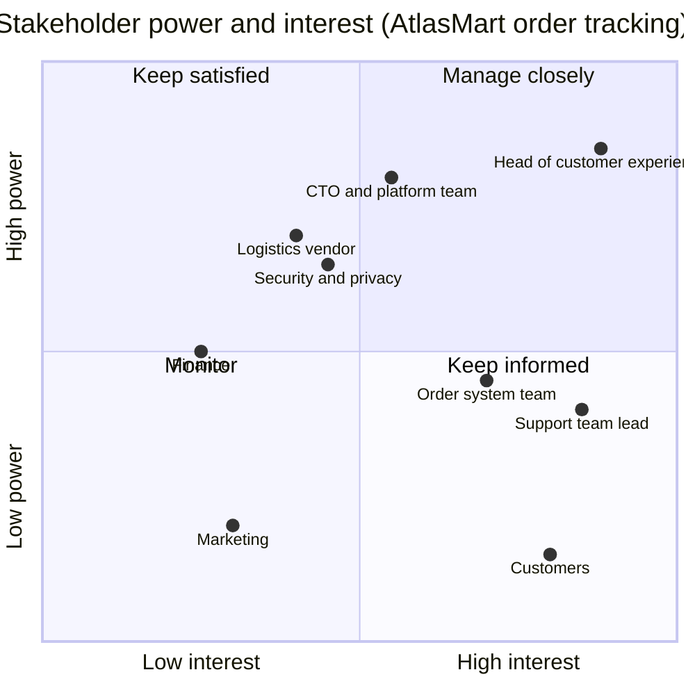
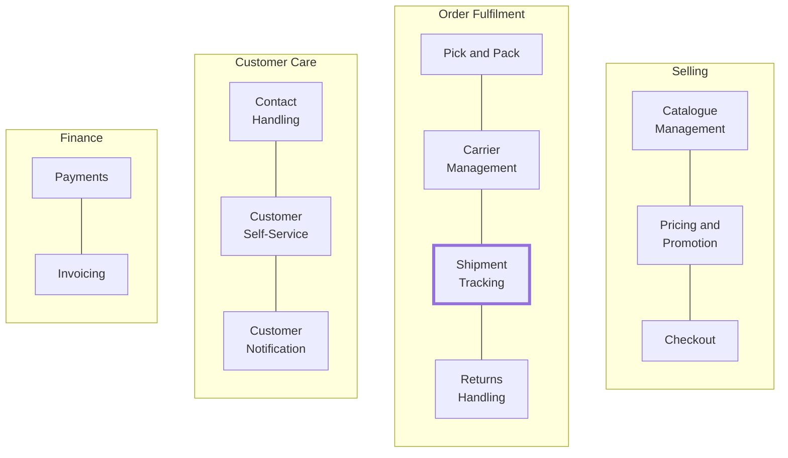
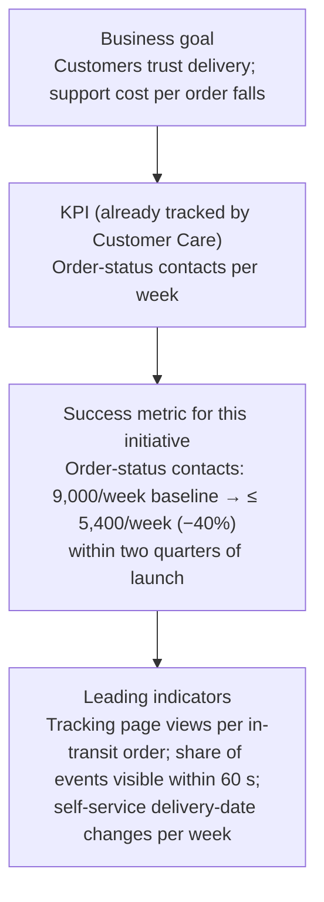

# Stakeholders, business capabilities, and success metrics

> Before a system can have requirements it needs three things: a list of the people who care, a map
> of the business capabilities it will change, and one number that says whether it worked.

!!! abstract "Page facts"
    **Level:** Beginner → Intermediate · **Status:** Draft · **Time:** 45-60 minutes ·
    **Last verified:** 2026-11-15

## Learning objectives

After this page you should be able to:

- Identify the stakeholders of a system, classify them by power and interest, and plan how each one
  is engaged.
- Distinguish a business capability from a business process and from an application, and draw a
  small capability map.
- Trace a chain from a business goal through a key performance indicator (KPI) to a success metric
  with a baseline and a target.
- Write a use case, a user story, and acceptance criteria for the same need, and say when each form
  is the right one.
- Recognize the discovery mistakes that cause the wrong system to be built well.

## Prerequisites

- [What does a Solutions Architect do?](what-does-a-solutions-architect-do.md) — this page expands
  the Discover step of the architect's loop.

## The problem this solves

Most failed systems were built correctly. They met their requirements; the requirements described the
wrong thing. The cause is almost always upstream of requirements: nobody wrote down who the system
was for, which part of the business it was meant to change, or how success would be measured. The
architect inherits a solution ("we need a mobile app") instead of a need, and the fastest way to
rescue the project is to go back and establish those three things. This page is the toolkit for that
step. It is short on technology on purpose; the output is a shared understanding that the rest of
the architecture depends on.

## What it is

Discovery produces three artifacts that the rest of the lifecycle consumes:

| Artifact | Answers | Consumed by |
|---|---|---|
| Stakeholder register and engagement plan | Who cares, how much, and how they want to be involved | Requirements workshops, reviews, communication plan |
| Business capability map (and the processes that realize the capabilities) | What the business does, independent of how it does it today | Scope, As-Is/To-Be comparison, build vs buy, application portfolio |
| Goal → KPI → success metric chain | What must change, by how much, by when, from what baseline | Business requirements, non-functional targets, the post-launch review |

Use cases, user stories, and acceptance criteria sit at the boundary between this page and the
[requirements page](functional-vs-non-functional-requirements.md): they turn a stakeholder's goal into
something a team can build and test.

## Mental model

Think of planning a new wing for a hospital. The stakeholders are not only the patients: they are
the surgeons, the nurses, the cleaners, the facilities team, the regulator, the insurer, the
neighbours who will hear the ambulances. The capability map is what the hospital must be able to
do (admit, diagnose, operate, recover, discharge), which does not change whether the wing is built
or not. The success metric is the one the board will look at in two years: waiting time for
elective surgery, say, with a baseline and a target. An architect who designs the wing from the
surgeons' wish list alone builds beautiful theatres that nobody can clean between operations.

**Where the analogy breaks:** a building has one client who pays and a small number of regulators.
Software has many users who never pay, operators who inherit it for years, and partner systems with
their own owners. The stakeholder list is longer and more fluid, and it changes as the system changes
the organization.

## Key terms

| Term | Meaning on this page |
|---|---|
| Stakeholder | Anyone who affects or is affected by the system: sponsors, users, operators, security, compliance, finance, partner teams (see the [glossary](../start-here/glossary.md)) |
| Sponsor | The stakeholder who owns the business goal and the budget, and who can say no |
| Business capability | Something the business is able to do, named with a noun phrase ("Shipment Tracking"), stable over years, independent of organization chart and technology |
| Business process | A sequence of activities, with a start and an end, that uses capabilities to produce an outcome ("Fulfil an order") |
| Business goal | An outcome the organization wants, stated in business terms and usually with a time horizon |
| Key performance indicator (KPI) | A measure the business already tracks to judge performance of a capability or process |
| Success metric | The specific measure, baseline, target, and date that will decide whether this initiative worked |
| Use case | How an actor achieves a goal through the system, with main and alternative flows |
| User story | A short, user-centred statement of a need, elaborated with acceptance criteria |
| Acceptance criteria | The conditions that must be true for a story or requirement to be considered done |

## How it works

### Stakeholder identification

Start wide and prune later. A checklist that catches most stakeholders:

1. **Who pays and who decides?** Sponsor, budget holder, steering group.
2. **Who uses it directly?** Each distinct user role, including internal roles that are easy to
   forget (support agents, warehouse staff, auditors).
3. **Who runs it?** Operations, on-call, platform team, security operations.
4. **Who is accountable for its risks?** Security, privacy, legal, compliance, finance.
5. **Who owns the systems it talks to?** The team behind every arrow that crosses the system
   boundary on the [context diagram](c4-model.md).
6. **Who is affected but never touches it?** Customers of a partner, a department whose workload
   changes, a vendor whose contract changes.

Each stakeholder gets a row in a register: name or role, what they want from the system, what they
fear, how much influence they have, and how they prefer to be engaged. The register is a living
document; new stakeholders appear when the system touches a new part of the business.

### Stakeholder management: the power and interest grid

Not every stakeholder deserves the same attention, and treating them all the same wastes their
time and yours. The common tool is a two-by-two grid of **power** (ability to change the project's
direction or stop it) against **interest** (how much the outcome affects them day to day).

**Figure 1 — Power and interest grid for the AtlasMart tracking initiative.** Positions are
judgements made in the discovery workshop, not measurements; they are revisited when circumstances
change.

How to read it: the top-right quadrant holds the people who must be in the room for every
significant decision; the top-left holds people who can stop the project and need to be kept
comfortable but not consulted on detail; the bottom-right holds people who live with the result and
should hear about progress often; the bottom-left needs occasional updates. Customers have high
interest and, individually, low power; they are represented through research and the support team
rather than in meetings.

The engagement plan follows from the grid:

| Quadrant | Engagement |
|---|---|
| Manage closely | Co-author goals and success metrics; attend decision reviews; sign off on scope |
| Keep satisfied | Short written briefings at milestones; consulted on constraints they own (security standards, platform standards, vendor contract) |
| Keep informed | Demo at every increment; a channel for feedback; involved in acceptance testing |
| Monitor | Monthly summary; invited to escalate if their interest changes |

### Business capabilities

A capability map describes what the business does in a form that survives reorganizations and
technology changes. Capabilities are named with nouns, arranged in a hierarchy (level 1 is coarse,
level 2 and 3 refine), and deliberately say nothing about *how* the capability is realized. The same
capability may be realized by three applications and two spreadsheets today and by one service next
year; the map does not change.

**Figure 2 — A partial business capability map for AtlasMart.** Each column is a level 1 capability;
the boxes inside it are its level 2 capabilities. Shipment Tracking, the capability this initiative
changes, is marked with a thick border.

How to read it: each box is something AtlasMart must be able to do regardless of which team or
system does it. The tracking initiative changes the *maturity* of Shipment Tracking (from "nightly,
agent-only" to "near-real-time, customer self-service") and, as a consequence, reduces load on
Contact Handling. Finance is shown with only two level 2 capabilities for space.

Three uses of the map in architecture work:

- **Scope.** The initiative is stated as "raise Shipment Tracking and Customer Self-Service to a
  target maturity"; everything else on the map is explicitly unchanged.
- **Heat mapping.** Colouring capabilities by pain, strategic importance, or system health shows
  where investment belongs. A single capability realized by six systems is a modernization target.
- **Build vs buy.** Capabilities that are the same in every retailer (Carrier Management) are
  candidates for buying; capabilities that differentiate are candidates for building. This is
  developed on the [As-Is/To-Be page](as-is-and-to-be-architecture-gap-analysis-and-build-vs-buy.md).

### Business processes

A process is how capabilities are used in sequence to produce an outcome. "Fulfil an order" uses
Checkout, Pick and Pack, Carrier Management, Shipment Tracking, and Customer Notification in turn.
Processes are where time, cost, and errors are measured, so they are where KPIs usually come from.
When the architect maps the current process, the hand-offs between steps are where most of the
stakeholder pain hides; in AtlasMart's case the hand-off from the carrier back to AtlasMart happens
once a night, and every "where is my order" call is a symptom of that gap.

### From business goal to success metric

A goal that cannot be measured cannot fail, which means it cannot succeed either. The chain is:

**Figure 3 — From goal to success metric.** Each level is more specific than the one above and
inherits its intent. The metric at the bottom is what the post-launch review will look at.

How to read it: the goal is qualitative and belongs to the sponsor; the KPI is a measure the business
already reports; the success metric fixes a baseline, a target, and a deadline for this initiative;
the leading indicators are measurable from day one and predict whether the lagging metric will
move.

A usable success metric has five parts: the **measure** (what is counted and how), the **baseline**
(the current value, with its source), the **target**, the **date**, and the **owner** who will report
it. Baselines are the part most often missing; without one, "reduce by 40%" is unfalsifiable.

!!! note "Leading and lagging"
    The success metric is lagging: it moves weeks after launch and is affected by things outside the
    system (a carrier strike raises calls regardless of tracking). Pair it with leading indicators
    the system itself can measure from the first day, so the team learns early whether the
    mechanism is working.

### Use cases, user stories, and acceptance criteria

Three forms for turning a stakeholder goal into buildable, testable units:

| Form | Shape | Best for |
|---|---|---|
| Use case | Actor, goal, preconditions, main success flow, alternative and failure flows, postconditions | Interactions with many branches, integrations, and failure paths; anything a tester or partner team must reason about |
| User story | "As a *role*, I want *capability*, so that *benefit*", plus acceptance criteria | Incremental delivery; keeping the benefit attached to the work; conversation starters |
| Acceptance criteria | Concrete, checkable conditions, often written as Given / When / Then | Defining done; deriving automated tests; preventing scope creep inside a story |

They are not competitors. A use case often spawns several stories; every story needs acceptance
criteria; acceptance criteria are the seed of the test suite. The architect cares most that the
*non-functional* conditions appear in acceptance criteria too, otherwise they are lost at the
boundary between discovery and delivery.

## Worked example: AtlasMart discovery

The request that started it, from the head of customer support: "We need a mobile app so customers
can track their orders." The [Solutions Architect page](what-does-a-solutions-architect-do.md) shows
why that is a solution, not a need. Here is the discovery work that found the need.

### Stakeholder register (extract)

| Stakeholder | Wants | Fears | Engagement |
|---|---|---|---|
| Head of customer experience (sponsor) | Fewer order-status contacts; better delivery reviews | A long project that misses peak season | Manage closely; owns the success metric |
| Support team lead | Agents see what customers see; fewer repetitive calls | A tool that adds a screen without removing calls | Keep informed; acceptance testing with real agents |
| Order system team | No new load on their database; a clean interface | Being blamed for tracking outages | Keep informed; co-design the order ID interface |
| Logistics vendor | Use the webhook feed they already offer | Non-standard integration requests | Keep satisfied; contract constraint C-1 |
| Security and privacy | No delivery addresses copied into a new store; webhook verification | Another system with customer data | Keep satisfied; review the data-flow diagram |
| CTO and platform team | Runs on the standard platform and pipeline | A snowflake deployment | Keep satisfied; constraint C-2 |
| Finance | Support cost per order falls; the project stays within budget | Cloud cost growth with no business case | Monitor; sees the cost model quarterly |
| Customers (via research and support transcripts) | Know where the parcel is without calling | Being told to install yet another app | Represented; two rounds of usability tests |

The register surfaced two facts the original request hid: customers were asking about staleness,
not about the channel, and the support team's real wish was to stop answering a question the
website could answer.

### Capability change

From Figure 2: Shipment Tracking moves from maturity "nightly batch, visible to agents only" to
"near-real-time, visible to customers and agents"; Customer Self-Service gains delivery-date changes;
Customer Notification gains event-triggered messages. Carrier Management is unchanged (the vendor
contract stays). Pick and Pack is unchanged. Scope is now a sentence about capabilities rather than a
list of screens.

### The metric chain

- **Goal:** customers trust AtlasMart delivery, and support cost per order falls.
- **KPI:** order-status contacts per week, already reported by Customer Care.
- **Success metric:** order-status contacts fall from a baseline of about 9,000 per week (the average
  over the last two quarters, from the contact-centre reporting system; assumption for this
  example) to at most 5,400 per week within two quarters of launch, owner: head of customer
  experience. This becomes BR-1 on the [requirements page](functional-vs-non-functional-requirements.md).
- **Leading indicators:** share of scan events visible within 60 seconds (this becomes NFR-1);
  tracking page views per in-transit order (expected to rise as customers self-serve); delivery-date
  changes made by customers rather than agents.

Notice that one leading indicator became a non-functional requirement. That is the normal route by
which NFRs acquire numbers: the business metric needs a mechanism, and the mechanism has a measurable
property.

### Use case, story, and criteria for the same need

**Use case UC-2: View shipment status**

- *Actor:* signed-in customer. *Goal:* learn the current status and expected delivery of each
  shipment in an order.
- *Preconditions:* the customer owns the order; the order has at least one shipment.
- *Main flow:* customer opens the order → system shows each shipment with latest status, time of
  that status, and carrier estimate → customer optionally opens the full scan timeline.
- *Alternative flows:* no scan yet (show "label created, awaiting pickup"); carrier feed delayed
  beyond 60 s (show last known status with its timestamp and a "last updated" label); shipment
  split by the carrier (show both parts under one line).
- *Failure flows:* customer does not own the order (deny without revealing whether the order
  exists); tracking service unavailable (order page still loads; tracking section shows a retry
  message).
- *Postconditions:* an access log entry exists for agent views (NFR-5); no change to order data.

**User story** (one of several derived from UC-2): *As a customer waiting for a parcel, I want to see
where my shipment is and when it will arrive, so that I do not need to contact support.*

**Acceptance criteria** (Given / When / Then):

- Given an order with two shipments and three scan events each, when I open the order, then I see
  the latest event per shipment with its timestamp and the carrier's estimated date.
- Given a scan event received by AtlasMart, when 60 seconds have passed, then the event is visible
  on the order page (measured over a month, 99% of events).
- Given an order I do not own, when I request its tracking page, then I receive the same "not found"
  response as for a non-existent order.
- Given the tracking service is down, when I open my order, then the order details still load and
  the tracking section shows that status is temporarily unavailable.

The second and fourth criteria are non-functional conditions written as acceptance criteria; they are
how NFR-1 and the availability behaviour survive into the delivery team's definition of done.

## Real-world architecture example

In a large organization, these artifacts have homes:

1. **The capability map** is owned by enterprise architecture and reused across initiatives. Each
   capability is linked to the applications that realize it, which is how an application portfolio
   review finds that four systems all do "Customer Notification".
2. **The stakeholder register** is owned by the initiative's product manager or architect and feeds
   the review calendar: the architecture review board, the security review, the vendor negotiation.
3. **The success metric** appears in the business case, in the architecture brief, on the launch
   dashboard, and in the post-launch review six months later. If the number is not on a dashboard
   by launch day, it will never be measured.
4. **Use cases and stories** live in the backlog tool, linked to the capability they change, so that
   anyone can answer "what are we doing to Shipment Tracking this quarter?".

The architect's contribution is to keep these four connected. A story with no capability, a
capability with no metric, or a metric with no owner is a loose end that becomes a surprise.

## Design choices and trade-offs

| Choice | Favor when | Avoid when |
|---|---|---|
| Full stakeholder workshop before any design | The request is a solution in disguise; several departments are affected; the budget is large | A small, well-understood change inside one team; use a lightweight register instead |
| Capability map at level 2 | Scoping, portfolio, and build vs buy decisions | A single feature inside one application; a level-1 statement of scope is enough |
| One success metric | Always, for the headline; it forces agreement on what matters | Never add five "primary" metrics; secondary metrics are fine if labelled |
| Use cases | Many actors, integrations, and failure paths | Simple CRUD interactions, where stories with criteria are enough |
| Stories with Given / When / Then criteria | Incremental delivery with automated acceptance tests | Criteria become a specification of the UI rather than the behaviour |
| Represent customers through research | Consumer products with many users | A handful of internal users who can attend the workshop themselves |

**Assumption behind all of this:** a sponsor exists who can state the goal and own the metric. When
nobody can, the first architecture task is to find or create that sponsor; design work without one
produces a system nobody is accountable for.

## Failure modes and anti-patterns

- **The loudest stakeholder writes the requirements.** The grid shows high interest but not high
  power; the sponsor's goal is diluted. Detect: the backlog is one department's wish list. Prevent:
  trace every story to the success metric.
- **Missing operators.** On-call, support, and platform teams are discovered after launch. Detect:
  no operability requirements (NFR-8 would not exist). Prevent: checklist item 3 above, always.
- **Capabilities named as systems.** "SAP" is not a capability; "Financial Accounting" is. Detect:
  the map changes every time a system is replaced. Prevent: nouns, no product names.
- **Goals without baselines.** "Reduce calls by 40%" with no current number. Detect: ask "40% of
  what, measured where?". Prevent: the five-part metric.
- **Vanity metrics.** Page views as the success metric; they rise while calls do not fall. Detect:
  the metric can improve while the goal does not. Prevent: use leading indicators as diagnostics,
  never as the headline.
- **Stories without benefit.** "As a user I want a button" with no "so that". Detect: nobody can
  say which metric the story moves. Prevent: reject stories with an empty benefit clause.
- **NFRs lost at the boundary.** Discovery produced 99.9% availability; the stories never mention
  it. Prevent: non-functional acceptance criteria on the stories that carry the risk.

## Security considerations

Stakeholder identification is where security and privacy enter the project or are forgotten.

- **Security and privacy are stakeholders with power.** Place them in "keep satisfied" at least;
  consult them on the data-flow and trust-boundary diagram before the design is fixed. AtlasMart's
  NFR-6 (no delivery addresses stored) came from this conversation and removed a whole class of risk.
- **Acceptance criteria must include negative cases.** "Given an order I do not own, then not found"
  is a security requirement written as a test. Without it, the ownership check is optional.
- **The register itself contains personal data** (names, roles, opinions). Keep it in the team's
  workspace, not in the public repository, and refer to roles rather than people in published
  architecture documents.

## Performance, reliability, and cost

- **Performance:** leading indicators are the first performance requirements. "Share of events
  visible within 60 s" needs measurement built into the system from the first increment, which is a
  design decision (timestamps at ingestion and at visibility).
- **Reliability:** the alternative flows of a use case are where reliability behaviour is specified:
  what the customer sees when the carrier feed is late or the tracking service is down. A story with
  only a happy path has no reliability requirement.
- **Cost:** finance is a stakeholder with a metric of its own (support cost per order; cloud cost
  for the new service). Putting both on the same page prevents a system that saves support cost by
  spending more on infrastructure than it saves.

## Hands-on lab: discover a system you know

1. Pick a system you have worked on or used heavily. Write its stakeholder register using the
   six-question checklist; aim for at least eight rows.
2. Place each stakeholder on a power/interest grid and write one line of engagement for each
   quadrant.
3. Draw a level-1 and level-2 capability map for the part of the business the system serves, with
   product names banned. Mark which capabilities the system realizes.
4. Write the goal → KPI → success metric chain. If you cannot find a baseline, write down where you
   would get one and what you would assume meanwhile.
5. Take the system's most important interaction and write it three ways: as a use case with at least
   two alternative flows, as a user story, and as four acceptance criteria of which at least one is
   non-functional.
6. Compare: which stakeholder would be surprised by your capability map or your metric? That
   surprise is the conversation the project needed.

??? question "Hint: if the system has no obvious success metric"
    Ask what would have to be true in a year for the sponsor to call it a success, then ask how they
    would know. The answer is usually a KPI the business already reports, or a cost line. If nobody
    can answer, the system may be infrastructure whose metric belongs to the systems it enables;
    write that down as the metric chain's first link.

## Knowledge check

1. What is the difference between a business capability and a business process? Give an example of
   each from retail.
2. A stakeholder has high power and low interest. How should they be engaged, and what goes wrong
   if they are treated as "manage closely"?
3. Rewrite "improve customer satisfaction with delivery" as a five-part success metric for AtlasMart,
   stating any assumption you make.
4. Why does the AtlasMart example pair the lagging success metric with leading indicators?
5. Which of the four acceptance criteria in UC-2 are non-functional, and what happens if they are
   left out of the stories?

??? success "Answers"
    1. A capability is what the business can do, named as a noun and stable over time ("Shipment
       Tracking"); a process is a sequence of activities with a start and end that uses capabilities
       ("Fulfil an order", which uses Checkout, Pick and Pack, Carrier Management, Shipment Tracking,
       Customer Notification).
    2. Keep satisfied: short briefings at milestones and consultation on the constraints they own.
       Treating them as "manage closely" consumes their time on detail they do not want, and they
       disengage or, worse, start making detailed decisions outside their interest.
    3. Example: measure = post-delivery survey score for "I knew where my order was" (1-5); baseline =
       3.1 (assumed, from the last two quarters of survey data); target = 4.0; date = two quarters
       after launch; owner = head of customer experience. Any similar answer with all five parts and
       a stated assumption is correct.
    4. The success metric moves weeks after launch and is influenced by outside events (carrier
       problems, seasonality). Leading indicators (events visible within 60 s, tracking views per
       order) are measurable from the first day and show whether the mechanism works before the
       lagging metric can.
    5. The 60-second visibility criterion and the "tracking down, order page still loads" criterion.
       Left out, the delivery team can mark the story done with a batch-fed, tightly coupled
       implementation that fails the business goal while passing every functional test.

## Architecture discussion questions

1. The support team lead has high interest and moderate power. During delivery they ask for an
   agent-only feature that is not on the capability map. How do you use the artifacts on this page
   to decide, and what do you say to them?
2. Two sponsors propose conflicting success metrics: fewer support contacts versus higher
   conversion from a "track your order" marketing email. Can one system serve both? What changes in
   the architecture if the second metric wins?
3. The capability map shows Customer Notification realized by four different systems across AtlasMart.
   Is the tracking initiative the right place to consolidate them? What would you need to know
   before answering?

## Summary

Discovery establishes who cares (a stakeholder register with a power/interest engagement plan), what
part of the business changes (a capability map that names what the business does, not which systems
do it), and what number must move (a goal → KPI → success metric chain with measure, baseline,
target, date, and owner, paired with leading indicators). Use cases, user stories, and acceptance
criteria carry that understanding into delivery, and non-functional conditions must appear in the
acceptance criteria or they are lost. For AtlasMart, this work replaced "build a mobile app" with
"raise Shipment Tracking to near-real-time and cut order-status contacts by 40%".

## Related topics

- **Before:** [What does a Solutions Architect do?](what-does-a-solutions-architect-do.md)
- **Alongside:** [Constraints, assumptions, dependencies, risks, and scope](constraints-assumptions-dependencies-risks-and-scope.md);
  [As-Is and To-Be architecture, gap analysis, and build vs buy](as-is-and-to-be-architecture-gap-analysis-and-build-vs-buy.md)
- **After:** [Functional vs non-functional requirements](functional-vs-non-functional-requirements.md);
  [SLAs, SLOs, SLIs, error budgets, and recovery objectives](slas-slos-slis-error-budgets-and-recovery-objectives.md)
  — where success metrics become service levels.
- **Planned:** enterprise architecture frameworks and capability-based planning in depth (D28-T03/T04);
  product and platform operating models (D16).

## References

| Source | Type | Checked |
|---|---|---|
| The Open Group, [The TOGAF Standard, 10th Edition](https://www.opengroup.org/togaf) — Business Architecture guide on business capabilities; ADM techniques on stakeholder management | Standard (overview page; the full text on pubs.opengroup.org now requires a free sign-in) | 2026-11-27 |
| A. L. Mendelow, ["Environmental Scanning: The Impact of the Stakeholder Concept"](https://aisel.aisnet.org/icis1981/20/), ICIS 1981 Proceedings | Paper (origin of the power/interest grid) | 2026-11-15 |
| Mike Cohn, [User Stories](https://www.mountaingoatsoftware.com/agile/user-stories) — Mountain Goat Software | Article | 2026-11-15 |
| Cucumber, [Gherkin Reference](https://cucumber.io/docs/gherkin/reference/) | Documentation (Given / When / Then syntax) | 2026-11-15 |
| UK Government Digital Service, [How the discovery phase works](https://www.gov.uk/service-manual/agile-delivery/how-the-discovery-phase-works) — Service Manual | Guidance (discovery before building) | 2026-11-15 |
| Microsoft, [Business outcomes](https://learn.microsoft.com/en-us/azure/cloud-adoption-framework/strategy/business-outcomes/) — Cloud Adoption Framework | Official documentation (outcome and KPI framing) | 2026-11-15 |
| Alistair Cockburn, *Writing Effective Use Cases* (Addison-Wesley, 2001) | Book (use case structure) | 2026-11-15 |

## Review notes

- Canonical page for D01-T02. All inventory items are covered: business capabilities, business
  processes, stakeholder identification, stakeholder management, user stories, use cases, acceptance
  criteria, business goals, KPIs, success metrics. Business processes are covered more briefly than
  capabilities; a process-modelling page (BPMN-style notation) would deepen it.
- The 9,000 contacts/week baseline and the 40% target are the same figures used on the Solutions
  Architect and requirements pages; the "last two quarters" basis for the baseline is introduced
  here as a stated assumption.
- The TOGAF chapter pages render client-side, so only the standard's landing page was verified by
  an automated check; a reviewer should confirm the Business Capabilities guide and the stakeholder
  management technique are still at that location.
- The Mendelow paper is cited for the origin of the power/interest grid; the grid as drawn here is
  a common adaptation, not a reproduction.
