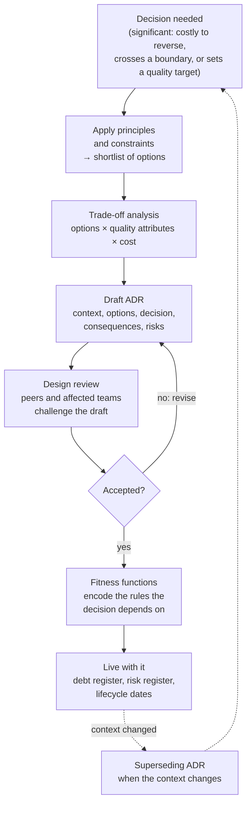
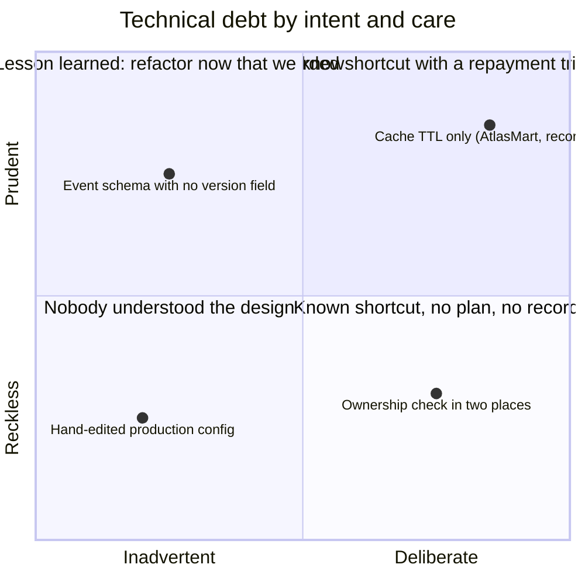
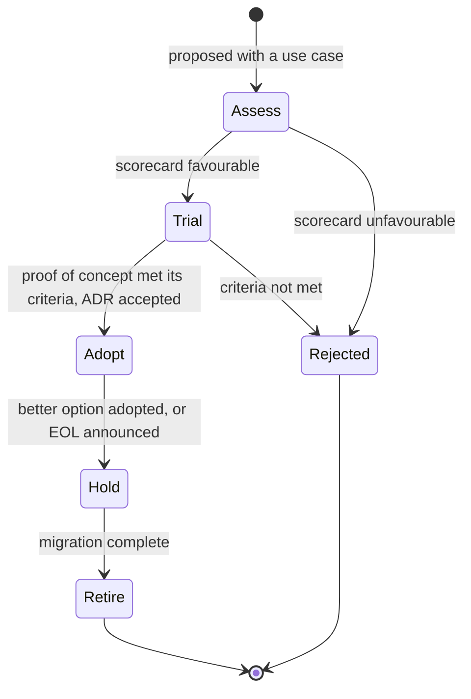

# Trade-offs, principles, ADRs, and architecture governance

> Architecture is a stream of decisions made under uncertainty. Governance is the lightweight
> machinery that makes those decisions visible, reasoned, reviewed, and revisited: principles to
> guide them, Architecture Decision Records to capture them, reviews to challenge them, fitness
> functions to enforce them, and a debt register to track the ones you knowingly deferred.

!!! abstract "Page facts"
    **Level:** Mixed (ADR writing is Level 1-2; governance design, fitness functions, and
    technology lifecycle are Level 3) · **Status:** Draft · **Time:** 45-60 minutes ·
    **Last verified:** 2026-11-15

## Learning objectives

After this page you should be able to:

- Write an Architecture Decision Record (ADR) that a stranger can use to understand and revisit a
  decision a year later.
- Write a small set of architecture principles with rationale and implications, and use them to
  settle trade-offs quickly.
- Run a lightweight design review and explain when an architecture review board helps and when it
  harms.
- Turn an architecture rule into a fitness function that runs automatically.
- Record technical debt as a deliberate, tracked decision rather than an accident.
- Perform a first-pass risk assessment and know where threat modelling plugs into the design
  process.
- Compare technologies and vendors with a weighted scorecard, and plan for end of life from the
  start.

## Prerequisites

- [What does a Solutions Architect do?](what-does-a-solutions-architect-do.md) — the Decide and
  Communicate steps are where this page's practices live.
- [Quality attributes and trade-offs](quality-attributes-and-trade-offs.md) — the trade-off
  matrix is the analysis an ADR records.

## The problem this solves

Six months after a decision, nobody remembers why the team chose a managed queue over a database
table, which options were rejected, or what would make the choice wrong. The decision gets
re-litigated in every planning meeting, reversed by a new hire who did not know the constraints, or
cemented by fear long after its reasons expired. Meanwhile, rules that everyone agreed to ("the
domain layer does not call the web layer") erode one pull request at a time, and shortcuts taken
under deadline pressure become permanent because nobody wrote them down. Governance exists to make
decisions durable, reviewable, and enforceable without turning the architect into a gatekeeper who
slows everything down.

## What it is

**Architecture governance** is the set of practices by which an organization decides how systems
are designed, checks that designs follow those decisions, and adjusts the decisions as the world
changes. Its parts, in the order they usually appear in a solution's life:

| Practice | Purpose | Artifact |
|---|---|---|
| Architecture principles | Pre-decide the recurring trade-offs so each project does not start from zero | A short principles document with rationale and implications |
| Trade-off analysis | Compare options against quality attributes and constraints | A trade-off matrix or scenario analysis |
| Architecture Decision Record (ADR) | Capture one significant decision with its context and consequences | A numbered, immutable Markdown file |
| Design review | Challenge a design before it is expensive to change | Review notes; actions; updated ADRs |
| Architecture review board (ARB) | Coordinate decisions that cross teams or affect the whole portfolio | Standards; approved exceptions |
| Fitness functions | Verify automatically that the architecture still has a required property | Tests, checks, and metrics in the pipeline |
| Technical debt register | Track deliberate shortcuts and their repayment plan | A list with owner, cost, and trigger |
| Risk assessment and threat modelling | Identify what could go wrong, how likely, how bad, and what to do | A risk register; a threat model per trust boundary |
| Technology selection and vendor evaluation | Choose components and suppliers on evidence | A weighted scorecard and an ADR |
| Technology lifecycle management | Know what is supported, until when, and what replaces it | A technology radar or inventory with end-of-life dates |

The common thread is **writing decisions down with their reasons**, so that they can be understood,
challenged, enforced, and eventually retired.

## Mental model

Think of a city's building code and planning office. The code (principles and standards) says what
is always required: fire exits, load limits. The planning application (design review) checks a
specific building against the code before concrete is poured. The approved plans, filed with the
notes on why an exception was granted (ADRs), stay on record for the next owner. Building
inspections during construction (fitness functions) check that what is being built matches what was
approved. A register of known defects with scheduled repairs (technical debt) keeps the building
insurable. And the planning office exists to make building safe and fast, not to say no.

**Where the analogy breaks:** software changes continuously after "construction" finishes, so
architecture governance must run forever, not just at approval. And unlike a building code, most
architecture rules should be cheap to change: when a principle blocks good work repeatedly, the
principle is wrong, and the process must make that easy to fix.

## Key terms

| Term | Meaning on this page |
|---|---|
| Architecture principle | A durable statement of preference that guides decisions, with a rationale and implications, for example "prefer managed services" |
| Architecture Decision Record (ADR) | A short, numbered document for one significant decision: context, options, decision, consequences. Immutable once accepted; superseded rather than edited |
| Significant decision | One that is expensive to reverse, crosses a team or system boundary, or determines whether a quality attribute target can be met |
| Design review | A structured discussion in which people who did not design the system try to find its weaknesses before it is built |
| Architecture review board (ARB) | A standing group that approves cross-cutting decisions and exceptions to standards |
| Fitness function | An automated check that measures whether the architecture still has a required property |
| Technical debt | The future cost created by a design or implementation shortcut taken now; recorded and repaid deliberately |
| Risk | An uncertain event that would harm the solution's goals, assessed by likelihood and impact |
| Threat model | A structured analysis of how an attacker could compromise a system, done per trust boundary |
| Technology lifecycle | The stages a technology passes through in an organization: assess, trial, adopt, hold, retire |
| End of life (EOL) | The date after which a vendor or community stops supporting a version; after it, security fixes stop |

## How it works

### Principles first

Principles are the trade-offs you have already decided. A good principle has three parts: the
statement, the rationale (why this organization prefers it), and the implications (what it costs
and what it rules out). Five to nine principles is a usable set; thirty is a policy manual nobody
reads. They must be specific enough to lose an argument with: "use good technology" is not a
principle, "prefer managed services unless the capability is a differentiator" is.

### The decision flow

**Figure 1 — How a significant decision moves from a question to an enforced rule.** Principles and
constraints narrow the options; analysis compares them; the ADR records the choice; review
challenges it; fitness functions keep it true.

How to read it: follow the solid arrows for one decision. The loop at the bottom is the normal way
a decision is retired: never by editing the old ADR, always by a new one that supersedes it.

### Architecture Decision Records

An ADR answers five questions in about one page: What situation forced a decision? What were the
options? What did we choose and why? What follows from it, good and bad? What would make us revisit
it? The repository's [ADR template](https://github.com/vinay9354/architecture-atlas/blob/main/templates/adr-template.md)
adds decision drivers, risks with mitigations, and follow-up actions.

Rules that make ADRs useful:

1. **One decision per record.** "Choose the queue" and "choose the queue's retention" are two ADRs.
2. **Record the rejected options honestly.** The value of an ADR a year later is mostly in knowing
   what was considered and why it lost.
3. **Immutable once accepted.** Changes of mind become a new ADR with status "Supersedes ADR-NNNN";
   the old one gets "Superseded by".
4. **Numbered, dated, and in version control** next to the code they govern, so they show up in
   pull requests and searches.
5. **Written by the people making the decision**, reviewed by the people affected. An ADR written
   after the fact by someone else is history, not a decision.
6. **Short.** If it exceeds two pages, the decision is probably several decisions.

The repository you are reading governs itself this way: the six records under
[Architecture Decision Records](../appendices/adr/index.md) explain its documentation stack,
licenses, diagram format, metadata, lab strategy, and testing. ADR-0003, for example, records why
diagrams are Mermaid text rather than images, and what would make that decision wrong.

### Design reviews and review boards

A **design review** is a meeting with a document. The designer circulates the proposal (context,
the C4 diagrams, the NFRs, the draft ADRs) before the meeting; reviewers read it and come with
questions; the meeting resolves the questions and records actions. Good reviews ask about failure
("what happens when the queue is unavailable for an hour?"), scale ("what breaks first at ten times
the load?"), security ("which trust boundary does this cross?"), operability ("who gets paged, and
what do they see?"), and reversibility ("how would we undo this?").

An **architecture review board** is a standing group, usually of senior engineers and architects,
that reviews decisions affecting more than one team. It is worth having when the organization has
many teams sharing platforms, data, or compliance obligations. It harms when it becomes a queue
every change must wait in, when it reviews things it does not understand in detail, or when its
members are not accountable for the outcomes. The healthy pattern is: teams decide and record;
the board sets standards, reviews only cross-cutting or exception decisions, and publishes its own
ADRs. The board's measure of success is how rarely it needs to meet.

### Fitness functions

A **fitness function** turns an architecture rule into a test. The rule "the Tracking API must not
store delivery addresses" (NFR-6) is a sentence in a document until a schema test fails the build
when a column named `address` appears. Fitness functions come in several kinds:

| Kind | Example | Where it runs |
|---|---|---|
| Structural | No module in the domain package imports from the web package | Unit test or dependency-analysis tool in CI |
| Performance | p95 latency under 300 ms at 210 requests per second in the load test | Nightly or pre-release pipeline |
| Security | No container image with a known critical vulnerability is deployed | Admission check in the deployment pipeline |
| Data | No column in the tracking schema contains personal data categories listed in the policy | Schema lint in CI |
| Operational | Every service exposes a health endpoint and emits the standard trace headers | Contract test at deploy time |
| Process | A pull request that adds an infrastructure component references an ADR | Pipeline check on the PR description |

Fitness functions are the only form of governance that scales with the number of changes, because
they cost nothing per change once written. Each one should trace to an ADR or a principle, and
each ADR that states a rule should name its fitness function or admit that it has none.

### Technical debt

Technical debt is a decision, not an accident. The useful classification separates **deliberate**
debt ("we will ship with time-based cache expiry and revisit when the freshness SLO tightens") from
**inadvertent** debt ("we did not know the library would not scale"), and **prudent** from
**reckless** (Fowler's quadrant, referenced below). Governance cares about deliberate, prudent debt:
it should be recorded when taken, with an owner, the cost it incurs while open, and the trigger that
makes repayment due.

**Figure 2 — The four kinds of technical debt.** Only the top-right kind is a healthy governance
tool; the others are what the register helps you notice.

How to read it: the horizontal axis is whether the team knew it was taking a shortcut; the vertical
axis is whether it did so with care. The four points are AtlasMart examples from the worked section.

### Risk assessment and threat modelling

A **risk assessment** lists what could go wrong with the solution, rates likelihood and impact, and
assigns a response: avoid, mitigate, transfer, or accept. It belongs in the design review and in the
ADR's risks table. Architecture risks are typically about scale, dependencies, skills, vendors, and
schedule.

**Threat modelling** is the security-specific form: for each trust boundary in the design, ask how
an attacker could spoof an identity, tamper with data, repudiate an action, disclose information,
deny service, or elevate privilege (the STRIDE categories). The output is a list of threats with
mitigations, which become security requirements and fitness functions. The architect's governance
responsibility is to make threat modelling a step in the review, not a separate activity that
happens after the design is fixed. The planned
security principles and threat modelling page (D12-T01, under Security architecture) covers the
method in depth.

### Technology selection and vendor evaluation

Choosing a component or vendor is a trade-off analysis with money attached. The weighted scorecard
makes the criteria explicit before the options are scored, which is the only defence against
choosing the option someone already liked. Criteria usually include: fit for the stated
requirements, operability (who runs it, how), security and compliance, total cost over the planning
horizon, lock-in and exit cost, team skills, and the vendor's health and roadmap. Scores are
evidence-based where possible (a proof of concept, a load test, reference calls) and the result is
recorded in an ADR.

### Technology lifecycle and end of life

Every technology in the portfolio has a support horizon. Lifecycle governance keeps an inventory of
what is used, which version, who owns it, and when support ends, and plans replacements before the
end-of-life date rather than after a security advisory forces the issue.

**Figure 3 — A technology's lifecycle inside an organization.** Entry is deliberate (assess, trial);
exit is planned (hold, retire) and starts well before the vendor's end-of-life date.

How to read it: "Hold" means no new uses but existing ones continue; it is the state in which
migration is planned. A technology that reaches its vendor end-of-life while still in "Adopt" is a
governance failure, not a surprise.

## Worked example: governing the AtlasMart Order Tracking System

All details are assumptions for a fictional company, continuing the example from the requirements,
C4, and capacity pages.

### AtlasMart's architecture principles

| # | Principle | Rationale | Implications |
|---|---|---|---|
| 1 | Prefer managed services for non-differentiating capabilities | A 40-person engineering team cannot operate queues, databases, and identity at the reliability NFRs require | Higher unit cost per component; vendor lock-in must be assessed per decision; self-hosting needs an ADR with an exception |
| 2 | Every significant decision has an ADR before it ships | Decisions were being reversed by people who did not know the reasons | ADRs live in each service's repository; the release pipeline checks that new infrastructure references one |
| 3 | No single point of failure within a region; multi-region is a separate decision | NFR-2 (99.9%) requires surviving a zone loss; region loss is not in scope for tracking | One instance per zone minimum; synchronous standby in another zone; region failover is out of scope unless an ADR says otherwise |
| 4 | Hold the minimum personal data | NFR-6 and the privacy obligations of a retailer | Services reference customers and orders by ID; copying addresses or contact details needs a documented purpose |
| 5 | Measure, do not assume | Past projects over-built for imagined load | Capacity estimates and SLIs precede sizing; load tests are release gates |
| 6 | Boring by default | The team's on-call capacity is limited | New technology enters through assess and trial; two of each kind (two databases, two queues) is the maximum |
| 7 | Buy or adopt before build for commodity capabilities | Notifications, identity, and payments are not where AtlasMart competes | Build requires an ADR explaining why the capability is a differentiator |

Principles 1, 3, and 6 settled most of the queue decision below before the analysis started.

### ADR for the Event Queue

**ADR-OT-004: Use the cloud provider's managed message queue for carrier events**

**Status:** Accepted
**Date:** 2026-11-15
**Deciders:** Order Tracking team lead, Solutions Architect, platform team representative
**Related:** NFR-1, NFR-4, NFR-7; container diagram (Figure 2 on the C4 page); principles 1, 3, 6

**Context.** Carrier webhooks arrive in bursts (a backlog of about 50,000 events can arrive in a
minute, see the capacity page) while processing must stay below 60 seconds for 99% of events
(NFR-1) and no acknowledged event may be lost (NFR-7). The Webhook Ingestor must acknowledge
quickly so carriers do not retry, so a buffer between ingestion and processing is required. The
team has no operational experience with a self-hosted broker. If nothing is decided, the ingestor
writes directly to the database and the processors poll it, which the team's prototype already does.

**Decision drivers.**

- Absorb a 50,000-event burst without loss and drain it inside the NFR-1 allowance.
- At-least-once delivery with a dead-letter path for poison events; duplicates are tolerated
  because events carry a carrier event ID and processing is idempotent.
- Operability by a small team; alignment with principles 1 and 6.
- Keep the option of a streaming platform open for the analytics team's later needs.

**Options considered.**

*Option 1 — Database table as a queue (the prototype).* The ingestor inserts rows; processors poll
and lock rows. Pros: no new component; transactional with the event store. Cons: polling adds
database load that competes with tracking reads at peak; lock contention with several processors;
no built-in dead-letter or visibility-timeout semantics, so retries and poison handling are custom
code; bursts arrive directly at the database, which is the component the NFRs protect most.

*Option 2 — Managed message queue (chosen).* The provider's queue service with a dead-letter queue.
Pros: absorbs bursts independently of the database; delivery, retry, visibility timeout, and
dead-lettering are configuration; no servers to run; cost scales with messages, which at about
14.4 million per month is small (exact pricing is checked against the provider's current price
list, not quoted here). Cons: at-least-once delivery means duplicates; ordering across the whole
queue is not guaranteed, which is acceptable because processing is per order and idempotent; a
provider-specific API, mitigated by a thin internal interface.

*Option 3 — Self-hosted or managed streaming platform (log-based).* Pros: replay, ordering per
partition, a future fit for analytics. Cons: more operational concepts (partitions, consumer
groups, retention) than the team needs today; principle 6 limits new technology; replay is not a
current requirement. Deferred, not rejected: an ADR can supersede this one when analytics needs it.

**Decision.** Option 2. The database-as-queue approach fails driver 1 at the design peak because
bursts and polling land on the component with the tightest latency NFR; the streaming platform
fails principles 1 and 6 for a need that does not yet exist.

**Consequences.**

*Positive:* ingestion is decoupled from processing; bursts are absorbed; retries and dead-lettering
are configuration; the database serves reads and durable writes only.

*Negative:* duplicate deliveries must be handled (idempotent processing keyed on carrier event ID);
end-to-end latency includes queue delivery, so the 60-second budget must be monitored (NFR-8);
events in the dead-letter queue need an operational process.

**Risks and mitigations.**

| Risk | Mitigation |
|---|---|
| A poison event blocks a processor | Dead-letter after three attempts; alert on dead-letter depth; weekly review |
| Queue unavailable | Ingestor returns a retryable error to the carrier; carriers retry per their contract; alert immediately |
| Duplicate processing sends duplicate notifications | Idempotency key on (carrier, event ID) checked before side effects |
| Lock-in to one provider's queue API | All producers and consumers use an internal `EventQueue` interface; a contract test runs against a local in-memory implementation |

**Follow-up actions.**

- [x] Load test with a 50,000-event burst at 100 events/s processing; confirm drain under 10 minutes.
- [ ] Dead-letter runbook written and rehearsed.
- [ ] Revisit when the analytics team requests event replay (trigger for a superseding ADR).

**Notes.** Numbers are from the capacity estimation page. The provider's queue limits (message size,
retention, throughput) were checked against its documentation on the decision date and are not
reproduced here because they change.

### The review

The design review for the tracking system took 50 minutes with the team, the platform team, a
security engineer, and the support operations manager. Three outcomes: (1) the security engineer's
threat-model walk of the webhook trust boundary added "replay of a captured signed webhook" to the
risks, mitigated by a timestamp check in the signature scheme; (2) the operations manager asked what
support agents see when the queue backs up, which produced the per-carrier lag dashboard in NFR-8;
(3) the platform representative asked for the `EventQueue` interface so the platform team could
offer a local implementation for tests. None of the three would have appeared without people who
did not design the system reading the design.

### Fitness functions for the tracking system

| Rule (source) | Fitness function | Runs |
|---|---|---|
| No delivery addresses in tracking data (NFR-6, principle 4) | Schema lint fails on column names matching a personal-data list; a data test samples rows for address-like patterns | CI on schema changes; nightly |
| Domain layer does not depend on web or persistence layers (C4 component design) | Import-dependency test in the unit suite | Every build |
| p95 latency under 300 ms at 210 req/s (NFR-3, NFR-4) | Load test in the pre-release pipeline fails the release | Pre-release |
| Every infrastructure component references an ADR (principle 2) | Pipeline check: infrastructure changes must cite `ADR-OT-` in the pull request | Every PR |
| One instance per zone minimum (principle 3) | Deployment manifest check: replica count ≥ 3 and anti-affinity across zones | Every deploy |
| Webhook signature verified before any work (NFR-5) | Contract test sends an unsigned and a replayed webhook and expects rejection | Every build |

### Technical-debt register entry

| Field | Value |
|---|---|
| ID | TD-OT-002 |
| Title | Status Cache uses time-based expiry only; no event-driven invalidation |
| Type | Deliberate, prudent |
| Taken on | 2026-11-15, ADR-OT-005 (cache strategy) |
| Why | Event-driven invalidation needs the processor to publish cache invalidations; the 30 s TTL meets NFR-1's 60 s with margin, and the extra path was not worth building for launch |
| Cost while open | Customers may see a status up to 30 s stale; a freshness complaint rate is tracked on the SLO dashboard |
| Repayment trigger | Freshness SLO tightened below 45 s, or complaint rate above the agreed threshold for two months |
| Owner | Order Tracking team lead |
| Estimated repayment | Two engineer-weeks: invalidation message on status change, consumer in the API, tests |

The other three points in Figure 2 are AtlasMart's reckless or inadvertent examples: an ownership
check duplicated in the API and the UI with no record (deliberate, reckless: fix by removing the
UI check), an event schema without a version field (inadvertent, prudent: the team learned it when
a carrier changed a field, and added versioning as a recorded lesson), and a production
configuration edited by hand during an incident and never put back under version control
(inadvertent, reckless: found by a fitness function that compares deployed and declared config).

### Technology selection scorecard for the Status Cache

Illustrative weights and scores; the point is the method.

| Criterion (weight) | Option A: managed in-memory cache | Option B: self-hosted in-memory cache on the Kubernetes platform | Option C: no cache; read replicas only |
|---|---|---|---|
| Fit for NFR-3 latency and NFR-4 load (30) | 5 → 150 | 5 → 150 | 3 → 90 |
| Operability by the team (20) | 5 → 100 | 2 → 40 | 4 → 80 |
| Security and compliance (15) | 4 → 60 | 3 → 45 | 5 → 75 |
| Three-year cost at estimated scale (15) | 3 → 45 | 4 → 60 | 2 → 30 |
| Lock-in and exit cost (10) | 3 → 30 | 5 → 50 | 5 → 50 |
| Team skills (10) | 4 → 40 | 2 → 20 | 5 → 50 |
| **Total (100)** | **425** | **365** | **375** |

Scores are 1-5 and are multiplied by the weight. The scorecard favoured the managed cache; the ADR
recording it noted that Option C scored close and would win if the working set grew beyond what one
cache node holds. The weights were agreed before scoring, in writing, which is what makes the
exercise honest.

### Lifecycle and end-of-life planning

AtlasMart's technology inventory lists, for the tracking system: the Python runtime version, the
web framework, the PostgreSQL major version, the cache engine version, the queue service, and the
container base image, each with an owner, the vendor's published end-of-support date, and a planned
upgrade quarter at least two quarters before that date. A quarterly review moves anything within
twelve months of end of life to "Hold" and opens an upgrade task. The review found, for example,
that the container base image's support window ended before the database version's, so the image
upgrade was scheduled first. No dates are quoted here because they belong to the vendors' current
documentation.

## Real-world architecture example

A mature engineering organization typically runs governance as four layers that are mostly
automated:

1. **Principles and standards** published as a short document, with an "exceptions" ADR log that
   shows which rules are being bent and why. Rules with many exceptions get revised.
2. **ADRs in every repository**, discoverable by a search across the organization, with a
   lightweight template and a linter that checks the required sections.
3. **Reviews scaled by blast radius:** a team reviews its own changes; a cross-team design review
   is required when a change touches a shared platform, personal data, or an external contract; the
   review board meets monthly for standards and exceptions, not for individual designs.
4. **Fitness functions in the pipelines**, including a technology inventory that is generated from
   the deployed artifacts rather than maintained by hand, with alerts twelve months before any
   component's end of life.

Technical debt lives in the same tracker as feature work, labelled, with a standing allocation of
engineering time to repay it, so that repayment competes fairly with features instead of waiting for
a crisis.

## Design choices and trade-offs

| Choice | Favor when | Avoid when |
|---|---|---|
| ADR per significant decision | Always; the cost is an hour | Never skip, but do not write ADRs for reversible, local choices |
| Central review board | Many teams, shared platforms, regulatory scope | A small organization; a board would just be a bottleneck for the one team |
| Principles with hard rules ("must") | Security, privacy, and safety obligations | Matters of taste; use "prefer" and let ADRs record exceptions |
| Fitness functions in CI | Any rule worth stating | Rules that cannot be checked mechanically; state them in review checklists instead |
| Weighted scorecard | Decisions with money and lock-in attached | Trivial choices; the ceremony would exceed the decision's cost |
| Dedicated debt repayment time | Debt is growing or incidents trace to known shortcuts | Debt is tracked and small; repay opportunistically |
| Superseding ADRs | Context changed or the decision proved wrong | Never edit an accepted ADR in place |

**Assumption behind all of this:** the organization values speed. Governance that slows delivery
without preventing real failures will be bypassed, and bypassed governance is worse than none
because it records decisions that were not actually made.

## Failure modes and anti-patterns

- **The ivory-tower board.** Reviews everything, understands little, delays all. Detect: queue
  time before the board exceeds design time. Prevent: review by blast radius; board sets standards.
- **ADRs as post-hoc justification.** Written after the decision to defend it. Detect: no rejected
  options, no negative consequences. Prevent: ADR drafted before the review; reviewers check for
  honest cons.
- **Edited history.** Accepted ADRs changed when they become inconvenient. Prevent: immutability
  rule and superseding records; version control shows the edit anyway.
- **Principles nobody can lose an argument with.** "Be pragmatic", "use the right tool". Prevent:
  each principle must rule something out and have implications someone dislikes.
- **Rules without checks.** The dependency rule everyone agreed to, broken in month three. Prevent:
  a fitness function per rule, or an explicit note that the rule is unenforceable.
- **Invisible debt.** Shortcuts taken under deadline and forgotten. Prevent: the register entry is
  part of "done" for any shortcut; the retrospective asks what debt was taken.
- **Scorecards with weights set after scoring.** The preferred option always wins. Prevent: weights
  agreed in writing before any option is scored.
- **End of life as a surprise.** A critical vulnerability lands in an unsupported version. Prevent:
  the inventory with dates and a quarterly review.
- **Threat modelling after the design is fixed.** Security findings that are too expensive to fix.
  Prevent: STRIDE walk of each trust boundary is a review agenda item.

## Security considerations

- Threat modelling is governance: a design review without a trust-boundary walk has not reviewed
  security. The STRIDE categories give a reviewer a checklist even without a security specialist in
  the room.
- Security rules are the best candidates for fitness functions because they are specific and the
  cost of erosion is high: signature verification before work, no personal data in a schema, no
  unsupported runtime in production, no public endpoint without authentication.
- Vendor evaluation must include the vendor's security practices, data handling, and compliance
  evidence as scored criteria, not as a checkbox at the end.
- End-of-life tracking is a security control: unsupported software receives no fixes, and most
  exploited vulnerabilities are in software for which a fix already existed.
- ADRs that document security decisions (what is encrypted, who can access what) should not
  include secrets or exact internal addresses; they are read widely.

## Performance, reliability, and cost

- **Performance:** performance targets become fitness functions (the load test as a release gate),
  which is how an SLO is protected from regression one release at a time.
- **Reliability:** the risk table in every ADR and the per-zone and failover rules as fitness
  functions are the governance side of the availability design on the high availability page.
- **Cost:** the scorecard's cost criterion should use the three-year total at the estimated scale
  from the capacity page, including the people needed to operate the option; the "cheap" self-hosted
  option usually loses once on-call time is counted. Governance itself costs time: an hour per ADR,
  an hour per review; budget it and measure that it prevents more than it costs.

## Hands-on lab: write an ADR and a fitness function for a decision you have already made

1. Pick a decision from a system you work on or know: a database, a framework, a queue, a hosting
   choice. Using the [ADR template](https://github.com/vinay9354/architecture-atlas/blob/main/templates/adr-template.md),
   write it as if before the decision: at least three options, with honest cons for the one that
   won.
2. List the principles the decision relied on. If you cannot name any, write the one or two
   principles the decision implies, with rationale and implications.
3. Identify one rule the decision depends on staying true (for example "all writes go through the
   service, never directly to the table"). Write a fitness function for it: what it checks, where it
   runs, what failure looks like. If it can be a real test in your codebase, write the test.
4. Add one risk with a mitigation and one technical-debt entry the decision created, with a
   repayment trigger.
5. Ask someone who was not involved to read the ADR for ten minutes and tell you which option they
   would have chosen. If they choose differently, your ADR is missing a driver; add it.

??? question "Hint: what counts as a significant decision"
    Ask three questions: would reversing it take more than a sprint? does it cross a team or system
    boundary? does it determine whether a quality attribute target can be met? One "yes" is enough
    for an ADR. A choice of logging library inside one service usually gets three "no" answers and
    needs no ADR; a choice of message queue gets three "yes" answers.

## Knowledge check

1. What are the five questions a good ADR answers, and why must an accepted ADR never be edited?
2. Give one example each of a structural, a performance, and a process fitness function.
3. In Fowler's classification, which kind of technical debt is a legitimate governance tool, and
   what must be recorded when it is taken?
4. Why should the weights of a technology scorecard be fixed before scoring?
5. When does an architecture review board add value, and what is the sign it has become harmful?

??? success "Answers"
    1. What forced the decision; what options were considered; what was chosen and why; what the
       consequences are; what would make us revisit it. It is not edited because its value is as a
       record of what was decided and known at the time; a change in context gets a new, superseding
       ADR.
    2. Structural: the domain package has no imports from the web package. Performance: p95 under
       300 ms at the design peak in the pre-release load test. Process: a pull request adding
       infrastructure must reference an ADR.
    3. Deliberate, prudent debt. Record what the shortcut is, why it was taken, the cost while open,
       the repayment trigger, the owner, and the estimated repayment effort.
    4. Because once scores are visible, weights get adjusted (consciously or not) to make the
       preferred option win. Agreeing the weights first makes the result evidence rather than
       advocacy.
    5. When many teams share platforms, data, or compliance obligations and decisions cross team
       boundaries. It is harmful when it reviews every change, when queue time exceeds design time,
       or when its members are not accountable for outcomes.

## Architecture discussion questions

1. AtlasMart's analytics team now wants event replay, which the queue ADR deferred. Draft the
   outline of the superseding ADR: what changed in the context, which options are back on the
   table, and which fitness functions would change.
2. Your organization has forty teams and no review board. Incidents keep tracing to decisions that
   crossed team boundaries without anyone noticing. Design the lightest governance that would have
   caught them, and state what you would measure to know whether it is working or has become a
   bottleneck.
3. A fitness function for "no personal data in the tracking schema" blocks a release because a
   carrier's event now includes a recipient name that the business wants to show. Walk through how
   principles, the ADR process, the debt register, and the threat model each play a part in
   resolving this.

## Summary

Governance is how architecture decisions stay visible, reasoned, and true over time. Principles
pre-decide recurring trade-offs; trade-off analysis compares options; ADRs record one decision each,
immutably, with honest rejected options and consequences; design reviews let outsiders find
weaknesses before they are expensive; review boards coordinate cross-team decisions and should meet
rarely; fitness functions enforce rules automatically and are the only governance that scales;
technical debt is recorded when taken, with a repayment trigger; risk assessment and threat
modelling belong inside the review; technology selection uses a weighted scorecard whose weights are
fixed in advance; and lifecycle management plans every component's exit before its end-of-life
date. The organizing rule is to write decisions down with their reasons, and to make the process
cheap enough that nobody wants to bypass it.

## Related topics

- **Before:** [What does a Solutions Architect do?](what-does-a-solutions-architect-do.md);
  [Quality attributes and trade-offs](quality-attributes-and-trade-offs.md)
- **Alongside:** [The C4 model](c4-model.md) — the diagrams a design review reads;
  [SLAs, SLOs, SLIs, error budgets, and recovery objectives](slas-slos-slis-error-budgets-and-recovery-objectives.md)
  — the targets that performance fitness functions protect;
  [Constraints, assumptions, dependencies, risks, and scope](constraints-assumptions-dependencies-risks-and-scope.md)
  — where the risk register starts;
  [As-Is and To-Be architecture, gap analysis, and build vs buy](as-is-and-to-be-architecture-gap-analysis-and-build-vs-buy.md)
  — the build-versus-buy decision is a scorecard and an ADR.
- **The repository's own ADRs:** [ADR index](../appendices/adr/index.md).
- **Planned:** security principles and threat modelling (D12-T01); enterprise architecture
  frameworks and governance (D28-T03, D28-T04); observability and SRE practices for enforcing
  SLOs (D15-T03).

## References

| Source | Type | Checked |
|---|---|---|
| Michael Nygard, ["Documenting Architecture Decisions"](https://cognitect.com/blog/2011/11/15/documenting-architecture-decisions), 2011 | Blog post (origin of the lightweight ADR format) | 2026-11-15 |
| [Architectural Decision Records](https://adr.github.io/) — ADR GitHub organization | Community site (templates and tooling) | 2026-11-15 |
| Martin Fowler, ["Technical Debt Quadrant"](https://martinfowler.com/bliki/TechnicalDebtQuadrant.html), 2009 | Article (deliberate/inadvertent × prudent/reckless) | 2026-11-15 |
| Neal Ford, Rebecca Parsons, Patrick Kua, and Pramod Sadalage, *Building Evolutionary Architectures* (2nd ed., O'Reilly, 2022) | Book (fitness functions) | 2026-11-15 |
| Thoughtworks, ["Fitness function-driven development"](https://www.thoughtworks.com/insights/articles/fitness-function-driven-development) | Article | 2026-11-15 |
| [Threat Modeling](https://community.owasp.org/Threat_Modeling) — OWASP Foundation | Community documentation | 2026-11-15 |
| [Threats — Microsoft Threat Modeling Tool (STRIDE categories)](https://learn.microsoft.com/en-us/azure/security/develop/threat-modeling-tool-threats) — Microsoft | Official documentation | 2026-11-15 |
| Mark Richards and Neal Ford, *Fundamentals of Software Architecture* (O'Reilly, 2020), chapters on architecture decisions and governance | Book | 2026-11-15 |
| Len Bass, Paul Clements, and Rick Kazman, *Software Architecture in Practice* (4th ed., Addison-Wesley, 2021) | Book (quality attributes, evaluation, documentation) | 2026-11-15 |

## Review notes

- Canonical page for D01-T07. Inventory items covered by definition and example: trade-offs,
  principles, ADRs, review boards, technical debt, fitness functions, design reviews, risk
  assessment, technology selection, vendor evaluation, lifecycle and end-of-life planning. Threat
  modelling is introduced (STRIDE named, not taught) and deferred to D12-T01.
- ADR-OT-004, the debt register entry, the scorecard, and the principles are illustrative for a
  fictional company; weights and scores are invented to show the method and say so.
- No vendor quotas, prices, or end-of-life dates are quoted; the text says where they live.
- Figure 2 uses `quadrantChart`; if a renderer lacks it, the four examples are described in the
  technical-debt register paragraph below it.
- Reviewer: confirm the OWASP link (it redirects from owasp.org to community.owasp.org) and the
  Thoughtworks article remain live; confirm the repository ADR index link renders.
