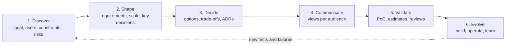
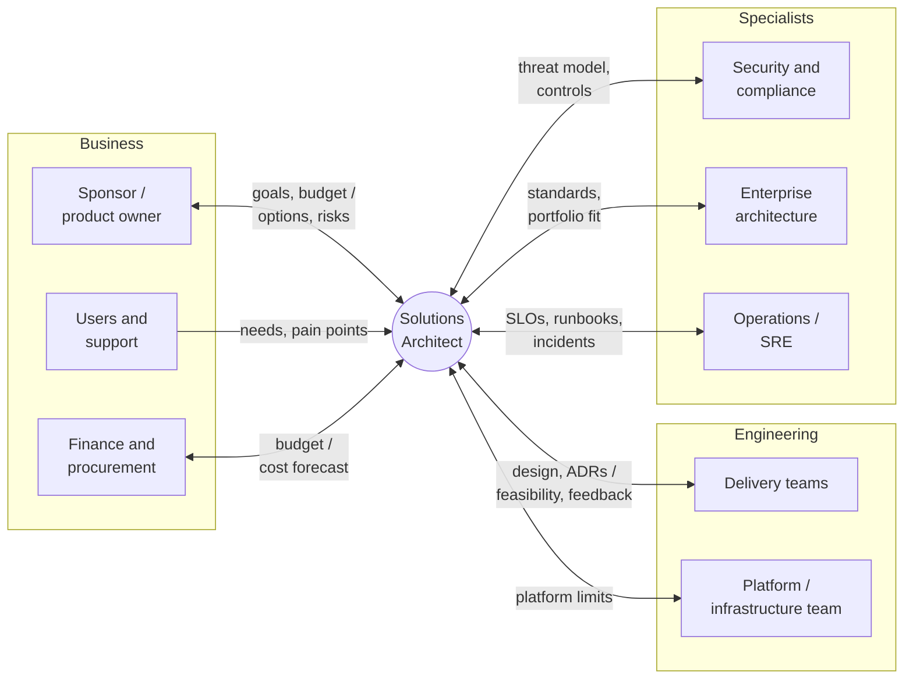

# What does a Solutions Architect do?

> A Solutions Architect turns a business problem into a technical design that a team can build, that
> stakeholders can agree to, and that will still work when the assumptions change.

!!! abstract "Page facts"
    **Level:** Beginner (with Level 3 notes) · **Status:** Draft · **Time:** 25-35 minutes ·
    **Last verified:** 2026-11-15

## Learning objectives

After this page you should be able to:

- Explain what a Solutions Architect is accountable for, and what they are not.
- Describe the architect's working loop: discover, shape, decide, communicate, validate, evolve.
- Distinguish the Solutions Architect role from Enterprise Architect, Software Architect, Tech Lead,
  and cloud vendor "SA" roles.
- Name the artifacts an architect produces and explain why each one exists.
- Recognize the most common ways the role goes wrong.

## Prerequisites

None. This is the first page of the curriculum. Terms are defined as they appear and collected in the
[glossary](../start-here/glossary.md).

## The problem this solves

Most expensive system failures are not caused by bad code. They are caused by building the wrong
thing, by discovering a constraint too late, by two teams making incompatible assumptions, or by a
quality attribute (availability, security, cost) that nobody owned until production exposed it.

Someone has to hold the whole picture: the business goal, the users, the existing systems, the
constraints, the quality targets, and the technical options, and turn them into decisions that teams
can act on. In organizations without this role, those decisions are still made; they are just made
implicitly, late, and by whoever happens to be typing.

## What it is

A **Solutions Architect (SA)** is accountable for the *significant* technical decisions of a solution:
the decisions that are expensive to reverse, that cross team or system boundaries, or that determine
whether the quality attribute targets can be met. "Solution" is deliberate: the scope is one business
problem and the systems that solve it, which may span several applications, teams, vendors, and
infrastructure platforms.

The role sits between two languages. Business stakeholders speak in outcomes, risks, budgets, and
dates. Engineering teams speak in services, data models, protocols, and deployments. The architect
translates in both directions and is accountable for the translation being faithful.

What the SA is **not**:

- Not the person who writes most of the code (though good SAs can and sometimes do).
- Not a project manager (though they care deeply about sequencing and risk).
- Not the only person who makes technical decisions. Teams make hundreds of decisions daily; the
  architect owns the few that are hard to undo and makes sure the rest have a clear owner.

## Mental model

Think of a building architect working with a client who says "we need more space". The architect does
not start drawing. They ask what the space is for, who uses it, what the budget and site allow, which
regulations apply, and what the client will regret in ten years. Then they produce drawings at
several levels of detail, from a site plan the city council can read to construction documents the
contractor needs, and they stay involved while it is built because reality disagrees with drawings.

**Where the analogy breaks:** buildings are finished; software systems are never finished. A software
architect's design must absorb continuous change, and the "construction crew" (the engineering team)
is also the long-term maintainer and should share ownership of the design. Treating software
architecture as a finished blueprint handed down from above is the single most common way the role
fails.

## Key terms

| Term | Meaning on this page |
|---|---|
| Significant decision | One that is expensive to change, crosses boundaries, or decides whether a quality target is met |
| Stakeholder | Anyone who affects or is affected by the system |
| Quality attribute | A measurable property such as availability, latency, or security |
| Constraint | A fixed condition the design cannot negotiate away |
| Architecture Decision Record (ADR) | A short document recording one decision, its context, options, and consequences |
| Trade-off | A choice that improves one goal at the cost of another |

## How it works: the architect's loop

The work is a loop, not a phase. Each pass goes through six activities.

1. **Discover.** Find the real goal behind the request, the users, the stakeholders, the current
   systems, the constraints, and the risks. Ask "what happens if we do nothing?" and "how will we know
   it worked?"
2. **Shape.** Turn findings into requirements: functional (what it does), non-functional (how well),
   constraints (what is fixed). Estimate scale. Identify the two or three decisions that matter most.
3. **Decide.** For each significant decision, lay out options, evaluate them against the quality
   attributes and constraints, choose, and record the choice and its consequences in an ADR.
4. **Communicate.** Produce views for each audience: a context diagram for executives, container and
   deployment diagrams for teams and operations, interface contracts for partner teams, a cost model
   for finance, threat model and trust boundaries for security.
5. **Validate.** Prove the design before fully committing: a proof of concept for the riskiest
   assumption, a capacity estimate checked against known limits, an architecture review, a game-day
   style failure walk-through.
6. **Evolve.** Stay engaged during build and operation. When reality contradicts an assumption, update
   the design and the ADRs, not just the code.

**Figure 1 — The architect's loop.** Each box is an activity; arrows show the usual order; the dashed
arrow shows that operating the system feeds the next cycle of discovery.

How to read it: start at Discover. A first pass through all six boxes may take days for a small
solution or months for a large program. The loop never terminates while the system is in use; every
incident, growth milestone, or new requirement re-enters at Discover.

## Visual walkthrough: where the role sits

**Figure 2 — Who the Solutions Architect works with.** The SA (center) is the hub between business,
engineering, and specialist groups. Lines are regular working relationships; the labels say what flows along them, with a slash separating what the SA receives from what the SA gives.

Read it from the center outward. Each group speaks a different language; the SA's job is to carry
meaning across these lines without losing it. Notice that most arrows are bidirectional: the SA is
not a one-way broadcaster.

## Worked example

**AtlasMart** is a fictional mid-sized online retailer (about 400,000 daily active users). The head
of customer support asks: "We need a mobile app so customers can track their orders."

A naive response is to design a mobile app. The architect's loop produces something different.

**Discover.** Why? Support handles 9,000 "where is my order" calls a week; each costs about the same as
a small discount. The real goal is *reduce order-status contacts by 40% within two quarters*. Users
already have the AtlasMart web account; 70% of orders are placed on mobile web. The order system
receives carrier scan events in a nightly batch, so "current location" is up to 24 hours stale, which
is the actual cause of the calls. Constraint: the carrier integration is owned by a logistics vendor
and changes take a quarter to negotiate.

**Shape.** Functional requirements: show per-shipment status and location; notify on status change;
let the customer self-serve a delivery date change. Non-functional: status visible within 60 seconds
of a carrier scan for 99% of events; 99.9% monthly availability of the tracking view; works on
existing mobile web. Key decisions: (a) how to get near-real-time carrier events, (b) whether a native
app is needed at all, (c) where tracking state lives.

**Decide.** (a) Subscribe to the carriers' webhook feeds, which the vendor already supports, instead of
replacing the nightly batch (ADR-07). (b) No native app in phase one; the mobile web account page gets
a tracking view and push-style notifications via email and SMS (ADR-08: a native app adds two
platforms to maintain and does not address the staleness that drives calls). (c) A small tracking
service with its own event store, fed by webhooks, decoupled from the order system (ADR-09).

**Communicate.** A one-page context diagram for the support head and sponsor; container and deployment
diagrams and an API contract for the delivery team; a data-flow and trust-boundary diagram for
security (carrier webhooks are untrusted input); a cost estimate for finance (small: tens of requests
per second, see the [capacity estimation page](../performance-and-scalability/capacity-estimation.md)
which uses this same scenario).

**Validate.** A two-day spike confirms the carriers' webhooks deliver within seconds and that signature
verification works. The capacity estimate shows a single small service tier handles peak with
headroom.

**Evolve.** After launch, support calls drop 35% in one quarter; the remaining calls are about
*delivery exceptions*, which leads to the next loop: exception handling and proactive notifications.

The point of the example: the architect's value was not the mobile app. It was discovering that the
nightly batch was the problem, choosing not to build a native app, and recording why.

## Real-world architecture example

In a typical enterprise you will meet several architecture roles at once. They differ by scope and
time horizon, not by seniority.

| Role | Scope | Horizon | Typical outputs |
|---|---|---|---|
| Enterprise Architect | Whole organization's portfolio | Years | Capability maps, standards, roadmaps, governance |
| Solutions Architect | One business problem across systems | Quarters to years | Requirements, options, ADRs, C4 views, cost model, risk register |
| Software (application) Architect | One application or service internals | Months to years | Module structure, patterns, code standards, fitness functions |
| Tech Lead | One team's delivery | Sprints to quarters | Technical plan, reviews, day-to-day decisions |
| Cloud vendor "Solutions Architect" | Customer's use of the vendor's platform | Deal cycle | Reference architectures, Well-Architected reviews, service guidance |
| Security Architect | Controls and trust boundaries across solutions | Continuous | Threat models, control catalogs, review sign-off |

The vendor title deserves a note: a cloud provider's Solutions Architect is a customer-facing technical
role that helps customers adopt that provider's services. It overlaps with this page's role in skills
but differs in incentives. This curriculum teaches the vendor-neutral role.

## Design choices and trade-offs: what should an architect decide?

A recurring question is *which* decisions the architect should own. A useful test has three parts.

| Own the decision when... | Delegate it when... |
|---|---|
| It is hard to reverse (data model of a core entity, synchronous vs asynchronous integration, cloud account structure) | It is easy to change later (a library, an internal class structure) |
| It crosses team or system boundaries (API contracts, event schemas, shared platforms) | It is local to one team and visible only to them |
| It determines whether a quality target can be met (replication strategy for an RPO target, authentication model) | It does not move any quality attribute materially |

Owning too much creates a bottleneck and an ivory tower. Owning too little leaves the expensive
decisions to chance. The balance shifts with team maturity: a strong team with shared context needs
fewer architect-owned decisions.

**Assumption behind this advice:** the organization has multiple teams or systems. In a single small
team, the tech lead and architect are usually the same person and this split is unnecessary.

## Failure modes and anti-patterns

- **The ivory tower.** Designs delivered as finished documents by someone who never sees the code or
  the incidents. Detect: teams quietly ignore the design. Prevent: the architect pairs, reviews pull
  requests on critical paths, and attends postmortems.
- **Resume-driven design.** Choosing a technology because it is interesting rather than because the
  requirements demand it. Detect: the ADR's "options" section has one option. Prevent: require at
  least two real options and a workload-specific justification.
- **The vendor-shaped solution.** Letting a provider's reference architecture define the requirements.
  Prevent: write requirements before reading vendor material; map vendor services to needs, not the
  reverse.
- **Undocumented decisions.** Six months later nobody knows why the system is shaped this way, so the
  reason is lost and the decision is relitigated. Prevent: ADRs, written when the decision is made.
- **Gold plating.** Designing for ten times the scale or nines that nobody asked for, at real cost.
  Prevent: every quality target traces to a business reason and a number.
- **Analysis paralysis.** Trying to resolve every uncertainty before deciding. Prevent: time-box, state
  assumptions explicitly, validate the riskiest with a spike, and decide.

## Security considerations

Security is one of the architect's accountabilities, not a review stage at the end. The architect
decides where trust boundaries are (internet, partner integrations, tenants, internal networks), which
identity model users and services use, where data is classified and protected, and which controls sit
at each boundary. In the AtlasMart example, the carrier webhooks are untrusted input across a trust
boundary, so signature verification, input validation, and rate limiting are architectural decisions,
not implementation details. Threat modeling belongs in the Shape and Decide steps; it is covered in
depth in the [security architecture](../security-architecture/index.md) section.

## Performance, reliability, and cost

The architect owns the non-functional targets and the design choices that meet them. Three habits
matter most:

- **Estimate before you design.** Order-of-magnitude numbers for users, request rates, data volume,
  and growth decide more than any pattern does. See
  [capacity estimation](../performance-and-scalability/capacity-estimation.md).
- **Make the nines explicit.** Every extra nine of availability costs money and complexity. Tie each
  target to a business consequence. See
  [quality attributes and trade-offs](quality-attributes-and-trade-offs.md).
- **Model cost at design time.** A cost forecast with stated assumptions is an architecture artifact.
  Finance should never be surprised by the first invoice.

## Hands-on lab: write an architecture brief

Pick a system you know (something you operate or use daily). In under one page, write:

1. **Goal:** the business outcome in one sentence with a number.
2. **Users and stakeholders:** who uses it, who pays for it, who runs it.
3. **Constraints:** three things the design cannot change.
4. **Quality targets:** three measurable non-functional requirements.
5. **The three significant decisions** you would own, with one sentence each on why they are hard to
   reverse.
6. **One assumption** you would validate first, and how.

Then show it to someone who knows the system and ask which item they disagree with. The disagreement
is the lesson: architecture is the practice of making these things explicit so they can be argued
about before they are built.

## Knowledge check

1. What makes a decision "significant" enough for an architect to own it?
2. In the AtlasMart example, why was "build a mobile app" the wrong first question, and what
   discovery activity exposed that?
3. Give two differences between a Solutions Architect and an Enterprise Architect.
4. Why are ADRs written at decision time rather than at project end?
5. A team says "we chose Kafka because the architect told us to" and cannot say why. Which failure
   mode is this, and what would have prevented it?

??? success "Answers"
    1. It is expensive to reverse, crosses team or system boundaries, or determines whether a quality
       attribute target can be met. Decisions that are cheap to change and local to one team are
       delegated.
    2. The app was a proposed solution, not the goal. Asking why (reduce support contacts) and
       examining the current system (nightly batch, 24-hour stale data) showed that data staleness,
       not the lack of an app, drove the calls.
    3. Scope (one solution vs the whole portfolio) and horizon (quarters-to-years vs years); outputs
       (ADRs and solution views vs capability maps, standards, and roadmaps).
    4. Because the context and the rejected options are freshest then; later they are forgotten and
       the decision gets relitigated. ADRs are also a communication tool during delivery, not only a
       historical record.
    5. Undocumented decisions (and possibly the ivory tower). An ADR with context, options considered,
       and consequences, written with the team, would have preserved the reasoning.

## Architecture discussion questions

1. Your sponsor wants a decision on a message broker by Friday; the team has not yet characterized
   the message volume or ordering needs. What do you do, and what do you write down?
2. A platform team offers a standard pattern that meets 80% of your needs. Under which conditions do
   you accept the gap, and under which do you push for an exception? What would you record either way?
3. How would the architect's loop change for a system with a hard regulatory deadline versus a
   product experiment that might be discarded in three months?

## Summary

A Solutions Architect owns the significant decisions of one solution and the translation between
business intent and technical design. The work is a loop: discover the real goal and constraints,
shape requirements and scale, decide between real options and record the decision, communicate the
right view to each audience, validate the riskiest assumptions, and stay engaged as the system
evolves. The role fails when it becomes an ivory tower, chooses technology for its own sake, or leaves
decisions undocumented.

## Related topics

- **Next:** [Functional vs non-functional requirements](functional-vs-non-functional-requirements.md)
  — the Shape step in detail.
- **Then:** [Quality attributes and trade-offs](quality-attributes-and-trade-offs.md) and
  [The C4 model](c4-model.md) — the Decide and Communicate steps.
- **Adjacent:** [Enterprise architecture](../enterprise-architecture/index.md) for the portfolio-level
  role; [Security architecture](../security-architecture/index.md) for threat modeling;
  [System design exercises](../system-design-exercises/index.md) for the full twelve-step method.

## References

| Source | Type | Checked |
|---|---|---|
| [Who Needs an Architect?](https://martinfowler.com/ieeeSoftware/whoNeedsArchitect.pdf) — Martin Fowler, IEEE Software, 2003 | Article | 2026-11-15 |
| [ISO/IEC/IEEE 42010: Systems and software engineering — Architecture description](https://www.iso.org/standard/74393.html) — ISO | Standard (paywalled; abstract and scope public) | 2026-11-15 |
| [Architecture Decision Records](https://adr.github.io/) — ADR GitHub organization | Community documentation | 2026-11-15 |
| [AWS Well-Architected Framework](https://docs.aws.amazon.com/wellarchitected/latest/framework/welcome.html) — Amazon Web Services | Official documentation | 2026-11-15 |
| [Software Architecture in Practice, 4th edition](https://www.sei.cmu.edu/library/software-architecture-in-practice-fourth-edition/) — Bass, Clements, Kazman (SEI series) | Book | 2026-11-15 |
| [The Architect Elevator](https://architectelevator.com/) — Gregor Hohpe | Book and blog | 2026-11-15 |

## Review notes

- No `coverage_ids`: this page introduces the role and links to the canonical pages for each topic
  (D01-T01, D01-T05, D01-T07, D01-T08). It is the entry point of the learning path.
- Omitted "Implementation walkthrough": not applicable to a role description.
- Reviewer: check the role comparison table against your organization's titles; titles vary widely.
