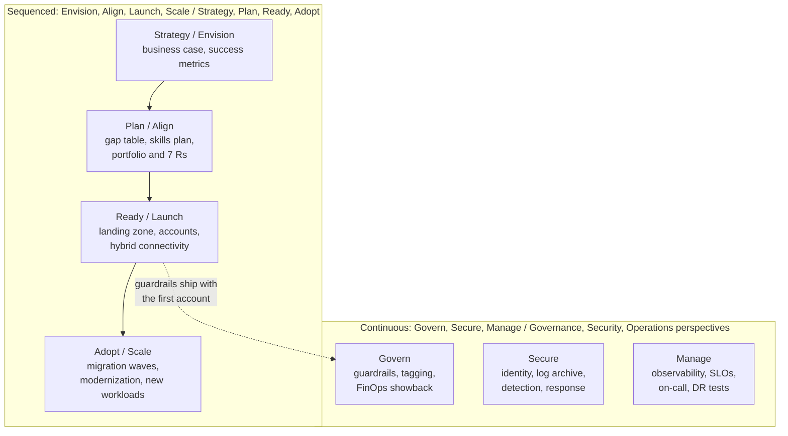
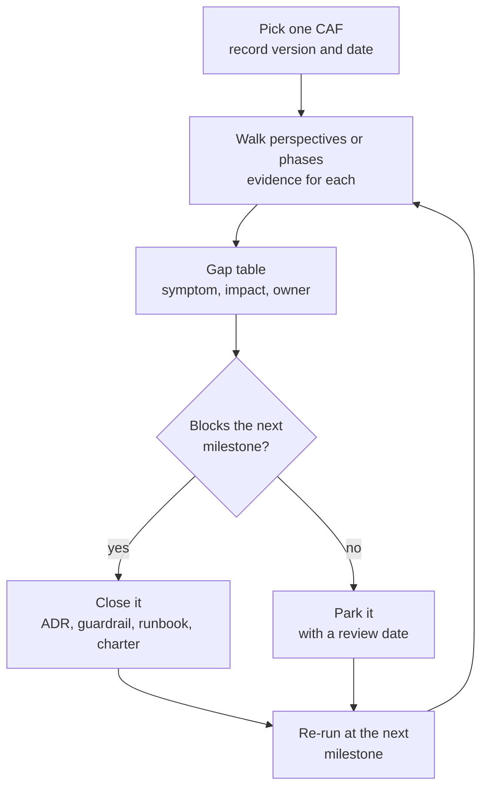

# Cloud adoption frameworks

> Cloud adoption fails more often on people, process, and governance than on technology. A cloud
> adoption framework is the provider's checklist of everything an organization needs besides the
> technology, and its value lies in the gaps it helps you find, not in the ceremony around it.

!!! abstract "Page facts"
    **Level:** Intermediate (the framework structures are Level 1; mapping them to artefacts is Level 2;
    using one to assess an operating model and prioritize gaps is Level 3) · **Status:** Draft ·
    **Time:** 45-60 minutes · **Last verified:** 2026-11-27

## Learning objectives

After this page you should be able to:

- Explain what a cloud adoption framework (CAF) is for, and how it differs from a well-architected
  framework and an enterprise architecture framework.
- Name the six perspectives and four transformation phases of the AWS Cloud Adoption Framework.
- Name the seven Azure adoption phases of the Microsoft Cloud Adoption Framework, and describe how
  Microsoft has recently reorganized it.
- Map CAF phases to concrete artefacts: business case, portfolio assessment, landing zone, migration
  waves, guardrails, and operations.
- Use one CAF as a checklist to produce a short, owned gap table for a cloud operating model.

## Prerequisites

- [Cloud building blocks and landing zones](cloud-building-blocks-and-landing-zones.md) — the landing
  zone is the central technical artefact every CAF asks for.
- [Legacy modernization and migration](../enterprise-architecture/legacy-modernization-and-migration.md)
  — the 7 Rs and migration waves that a CAF's adoption phase organizes.
- [Trade-offs, principles, ADRs, and architecture governance](../architecture-fundamentals/trade-offs-principles-adrs-and-architecture-governance.md)
  — governance as decision rights, which CAFs expand to the whole cloud estate.

## The problem this solves

An organization's first cloud workloads usually succeed on technical enthusiasm. The trouble arrives
at scale. Finance cannot explain the bill. Security discovers accounts it never knew existed.
Operations teams are handed applications they have no skills or tools to run. A migration programme
moves fifty servers and stalls because nobody decided who approves a cutover. Every one of those
failures is organizational, and every one was foreseeable.

Providers have watched thousands of customers hit the same failures and published the lessons as
cloud adoption frameworks. Used well, one gives an architect a complete list of questions to ask
before they become incidents. Used badly, it becomes a months-long assessment that produces a slide
deck and no change.

## What it is

A **cloud adoption framework (CAF)** is provider-published guidance that organizes the organizational
capabilities, decisions, and sequence needed to adopt a cloud: strategy and business case, people and
skills, governance, the platform (landing zone), security, operations, and the migration or building
of workloads. Its unit of analysis is the **organization** and its **cloud operating model** (who
decides, who builds, who runs, who pays), not a single workload.

Three framework families are easy to confuse:

| Family | Unit of analysis | Question it answers | On this site |
|---|---|---|---|
| Cloud adoption framework | The organization adopting one cloud | Are we ready, organized, and governed to use this cloud at scale? | This page (D28-T02) |
| Well-architected framework | One workload | Is this workload designed well against the pillars (reliability, security, cost, and so on)? | [Well-architected frameworks](well-architected-frameworks.md) (D28-T01) |
| Enterprise architecture framework | The enterprise's whole portfolio | How do business, data, applications, and technology fit together and change? | [Enterprise architecture frameworks](../enterprise-architecture/enterprise-architecture-frameworks.md) (D18-T02) |

Microsoft states the split directly: its CAF focuses on organizational decisions, and it points
workload design to its Well-Architected Framework and Architecture Center.

## Mental model

An aircraft manufacturer's operator-readiness checklist for an airline buying a new type: crews
trained, maintenance contracts signed, spare parts stocked, routes approved, insurance updated. It does
not fly the plane, and it assumes you bought *their* plane. A good airline uses it to find what it has
not done yet, ignores the parts that do not apply, and does not hold a ceremony for every line.

**Where the analogy breaks:** an aircraft checklist is short, fixed, and safety-critical. A CAF is
large, advisory, and changes underneath you: Microsoft deprecated a whole methodology (Organize) and
renamed a core term in late 2026. Treat the framework as a dated source, and record which version you
used.

## Key terms

| Term | Meaning on this page |
|---|---|
| Cloud adoption framework (CAF) | Provider guidance for the organizational capabilities, decisions, and sequence needed to adopt its cloud |
| Cloud operating model | Who decides, builds, runs, secures, and pays for cloud resources, and how those roles interact |
| Perspective (AWS CAF) | One of six groups of related capabilities owned by a set of stakeholders: Business, People, Governance, Platform, Security, Operations |
| Foundational capability (AWS CAF) | An organizational ability, grouped under a perspective, that the framework describes with best practices |
| Transformation domain (AWS CAF) | Where value is created: Technology, Process, Organization, Product |
| Azure adoption phase (Microsoft CAF) | One of seven steps with a key decision each: Strategy, Plan, Ready, Adopt, Govern, Secure, Manage |
| Landing zone | A governed, multi-account cloud environment whose shared foundation every account inherits before workloads arrive |
| Platform and workload landing zones | Microsoft's split between shared platform resources and the per-workload environments (called application landing zones until October 2026) |
| Cloud centre of excellence | A generic name for a small cross-functional team that sets cloud standards and enables other teams; names and shapes vary |

## How it works

### The AWS Cloud Adoption Framework

The AWS CAF groups its **foundational capabilities** into **six perspectives**, each owned by a
different set of stakeholders. The table paraphrases AWS's descriptions and adds what an architect
typically produces for each:

| Perspective | Focus (paraphrased) | Typical owners | Architect's artefacts |
|---|---|---|---|
| Business | Cloud investments tied to business outcomes | Executives, finance, CIO, CTO | Business case, success metrics, capability map |
| People | Culture, structure, leadership, workforce for continuous change | CIO, cloud leaders, HR partners | Team topology, skills plan, roles and responsibilities |
| Governance | Steering cloud initiatives while managing risk and benefits | CIO, CFO, risk and data leaders | Decision rights, guardrails, cost governance, portfolio tracking |
| Platform | An enterprise-grade, scalable, hybrid platform; modernizing and building workloads | CTO, architects, engineers | Landing zone, reference architectures, migration patterns |
| Security | Confidentiality, integrity, and availability of data and workloads | CISO, compliance, audit, security architects | Identity model, detective controls, data protection, incident response |
| Operations | Cloud services delivered at the level the business needs | Infrastructure and operations leaders, SREs | Observability, SLOs, incident and change management, patching |

It names **four transformation domains** where value appears: **Technology**, **Process**,
**Organization**, and **Product**. And it describes a **cloud transformation journey** of four
iterative phases:

- **Envision** — show how the cloud accelerates specific business outcomes and pick the
  opportunities.
- **Align** — find capability gaps across the six perspectives, cross-team dependencies, and
  stakeholder concerns.
- **Launch** — deliver pilots in production and show incremental value.
- **Scale** — expand the pilots to the desired scale and make the benefits stick.

Note what Align is: a gap analysis across the perspectives. That is exactly the use this page
recommends. AWS also says that the foundational capabilities do not all need to be tackled at once;
they evolve as the journey progresses.

### The Microsoft Cloud Adoption Framework

Microsoft's overview page (titled "Cloud Adoption Framework for Azure"; the hub page now reads "Cloud
Adoption Framework for Microsoft") organizes **Azure adoption** into **seven phases**, each with one key
decision:

| Phase | Key decision (paraphrased) | Main artefacts |
|---|---|---|
| Strategy | What should our adoption look like, and why? | Business justification, outcomes |
| Plan | How will we prepare people, processes, and technology? | Adoption plan, skills plan, workload inventory and strategies |
| Ready | How will we build the landing zone? | Platform landing zone, workload landing zones |
| Adopt | How will we migrate, modernize, and build workloads? | Migration waves, modernization plans, new cloud-native workloads |
| Govern | How will we control the environment? | Policies, governance team, compliance and cost controls |
| Secure | How will we protect the environment? | Security baseline and operations |
| Manage | How will we operate and optimize over time? | Operations baseline, monitoring, optimization |

On the hub page, Adopt appears as three entries: **Migrate**, **Modernize**, and **Cloud-native**.
Govern, Secure, and Manage are described there as covering the whole Azure environment, so in practice
they run continuously rather than after Adopt. Further **scenarios** plug into this foundation; at the
time of checking they were Unified data platform, AI adoption, AI agents, Sovereignty, and Azure VMware
Solution.

Microsoft reorganizes the framework regularly, and its "What's new" page records the changes. The
ones that matter for anyone reading older material, as listed there in late 2026:

- The **Organize** guidance is deprecated, with removal planned for November 30, 2026.
- **Application landing zones** were renamed **workload landing zones** in October 2026, and the
  separate data landing zone categories were folded into that one term.
- Several product-specific articles and scenarios (for example SAP, Oracle, and Hybrid and multicloud)
  were removed, to keep the framework on organizational decisions.
- Several self-assessment tools are deprecated, with removal planned for January 2027.

The lesson for an architect is not the specific changes but the habit: cite the page and the date
checked, and expect the structure to move.

### Google Cloud's adoption guidance

Google Cloud publishes the **Google Cloud Adoption Framework**, which on its current page describes
four themes for cloud readiness: **Lead**, **Learn**, **Scale**, and **Secure**. Its detail is in a
downloadable whitepaper. For the step-by-step migration process, Google's Architecture Center guide
describes assess, plan, deploy, and optimize phases (see the
[legacy modernization page](../enterprise-architecture/legacy-modernization-and-migration.md)).

### Comparing the frameworks

| Concern | AWS CAF | Microsoft CAF | Google Cloud Adoption Framework |
|---|---|---|---|
| Main structure | Six perspectives of capabilities | Seven adoption phases with key decisions | Four themes |
| Sequence | Envision, Align, Launch, Scale (iterative) | Strategy, Plan, Ready, Adopt; Govern, Secure, Manage | Not a phase model on its overview page |
| Landing zone | Platform perspective; landing-zone tooling documented separately | Ready phase: platform and workload landing zones | Covered by separate landing zone design guidance |
| Migration | Platform perspective plus separate migration guidance (7 Rs, large migrations) | Adopt: Migrate, Modernize, Cloud-native | Separate migration guide |
| Best used as | A capability checklist by stakeholder group | A decision sequence and a deep library per phase | A short readiness lens |

**Figure 1 — CAF phases mapped to the artefacts this site teaches.** Inside the top box, top to
bottom is roughly time; the bottom box runs continuously from the first account onwards.

How to read it: the top box is the order in which most organizations need the artefacts; the bottom
box must exist from the first production account, not after migration. The dashed arrow is the most
common sequencing mistake in reverse: governance arriving after the landing zone is already full of
workloads. The pages that teach each artefact are linked in Related topics.

### How an architect uses a CAF without ceremony

1. **Pick one framework** as the checklist, normally your primary provider's. Do not merge three into
   a super-framework; the overlap is large and the merge is a project of its own.
2. **Use its structure, not its programme.** Walk the perspectives or phases and ask, for each, "what
   do we have, with evidence?" Skip what does not apply and say so.
3. **Write gaps, not maturity scores.** A gap has an observable symptom, a consequence, an owner, and
   an artefact that closes it. A score of "2.5 out of 5" changes nothing.
4. **Prioritize by consequence.** Keep the top few gaps that block the next adoption milestone; park
   the rest with a review date.
5. **Close gaps with existing practices**: an ADR, a guardrail, a runbook, a team charter. The CAF
   tells you *that* something is missing; the rest of this site teaches *how* to build it.
6. **Re-run at milestones** (before each major migration wave or new region), against the
   framework's current version.

**Figure 2 — The lightweight CAF loop.**

How to read it: the loop has one output that matters, the closed gaps. Nothing in it requires a
workshop series, a maturity model, or a consultant, although each can help a large organization
start.

### Strengths and limitations

| Strengths | Limitations |
|---|---|
| Completeness: covers people, finance, and governance that technical teams overlook | Vendor-specific: examples and tooling steer towards that provider's services |
| Shared vocabulary between executives, finance, security, and engineering | Large and advisory: no single "minimum" set, so teams over-adopt |
| Encodes failures seen across many customers | Changes often; old copies and training material go stale |
| Free, maintained, and linked to detailed guidance (landing zones, migration) | Says what to have, rarely how much or how good (no thresholds) |
| Aligns with provider support and partner programmes | Invites assessment theatre: scores and decks instead of changes |

## Worked example: AtlasMart's cloud operating model checked against the AWS CAF

AtlasMart's platform is well established (Phase 4A): a 29-account landing zone, hub-and-spoke network,
GitOps per cluster, central logs, workforce SSO, and workload identity. It is about to run the
120-application migration from the [legacy modernization page](../enterprise-architecture/legacy-modernization-and-migration.md).
The architect uses the **AWS CAF's six perspectives** as the checklist (assumption: chosen because its
stakeholder-grouped perspectives suit an operating-model review; AtlasMart's provider is deliberately
not named on this site, and using the checklist does not require AWS).

### Step 1 — Scope and evidence

Scope: the cloud operating model needed for the migration, not every capability in the framework.
Evidence comes from the existing design pages and the Phase 4B assumptions:

- 8 product teams, each owning dev, staging, and prod accounts, plus a platform team owning 5 platform
  accounts (29 in all).
- Guardrails, mandatory tags (`owner-team`, `environment`, `cost-centre`, `data-classification`,
  `backup-tier`), and budgets with alerts at 80% and 100%.
- Cost reported in illustrative cost units with showback by tag, no chargeback; unit metrics "cost per
  1,000 tracking reads" and "cost per order".
- Each product team runs an on-call rotation of 6 engineers; paging only on SLO burn and hard safety
  alerts; DORA metrics reported monthly.
- DR: a recovery region in a second EU region; tier 1 warm standby, tier 2 pilot light, tier 3 backup
  and restore; failover rehearsed quarterly.

### Step 2 — The gap table

Severity: **High** blocks or endangers the migration waves; **Medium** causes cost or toil within a
year; **Low** is worth recording. All gaps are assumptions for the fictional company.

| # | Perspective | Evidence today | Gap (symptom) | Severity | Owner | Closing artefact |
|---|---|---|---|---|---|---|
| 1 | Business | Unit metrics for tracking and orders | No benefits tracking for the migration: nobody can say when the data-centre exit pays back | Medium | Programme sponsor with FinOps | Migration business case with decommission dates and CU per wave |
| 2 | People | 8 product teams, platform team, on-call rotations | No owner team for the 42 rehosted and 8 relocated applications; their current operators are on-premises staff | High | Head of engineering | Team charter and skills plan for a migrated-applications team |
| 3 | People | Platform skills in Kubernetes and GitOps | Little experience running long-lived virtual machines in the cloud | Medium | Platform lead | Training plan; pairing during waves 1-3 |
| 4 | Governance | Guardrails, tags, budgets | No decision rights for migration: who approves a wave's go or no-go is undefined | High | Architecture review board | Cutover governance ADR: go/no-go owner per wave, criteria template |
| 5 | Governance | Showback by tag | Migrated applications arrive untagged with no cost-centre mapping | Medium | FinOps lead | Tag mapping in the migration runbook; proactive tag check on migrated accounts |
| 6 | Platform | Landing zone built for containers and immutable images | No virtual-machine baseline: patching, backup, agents, and image refresh for the servers of the 42 rehosted applications | High | Platform team | VM landing-zone baseline and patch pipeline, built in wave 0 |
| 7 | Platform | Dedicated private connection planned, VPN live | Replication for later waves depends on a link not yet built | High | Network team | Case study 09 connectivity plan; link live before wave 5 (assumption) |
| 8 | Security | SSO, workload identity, immutable log archive | Rehosted applications carry local accounts and embedded passwords | Medium | Security architect | Secret rotation step in the runbook; detective rule for local admin accounts |
| 9 | Operations | OpenTelemetry, SLO-based paging, DR game days | Migrated and retained systems have no SLOs and no telemetry in the shared backends | Medium | SRE lead | Minimum telemetry and SLO template per migrated application |
| 10 | Operations | Quarterly DR game day for tier 1 | DR tiers not yet assigned to the 120 applications | Low | Application owners | DR tier as a mandatory field in the portfolio assessment |

### Step 3 — Prioritize and act

Four gaps are High: 2, 4, 6, and 7. Counting by perspective: People 2, Governance 2, Platform 2,
Security 1, Operations 2, Business 1, so 2 + 2 + 2 + 1 + 2 + 1 = 10 gaps, none of them a technology
product choice. The architect's actions, in order:

1. **Gap 6 first**, because wave 1 rehosts virtual machines: the platform team adds a VM baseline to
   wave 0 (golden images and patching as on the
   [multi-account page](multi-account-strategy-and-infrastructure-automation.md)).
2. **Gap 4** as an ADR before the pilot wave: go/no-go owner, criteria template, and rollback
   authority, so the WMS cutover in wave 8 inherits a practised process.
3. **Gap 2** escalated to leadership, because it is a staffing decision an architect cannot make.
4. **Gap 7** tracked as a dependency of wave 5 in the wave plan.

The other six are parked with owners and a review date at the end of wave 2. The whole exercise is one
table and four actions, which is the point.

## Real-world architecture example

A common arc (fictionalized): a company commissions a CAF-based readiness assessment, receives a
maturity score per capability and a long report, and changes little. A year later a new architect
reruns it as one table: ten gaps, four owners, two ADRs, and a staffing request. The second pass
works because it ties each gap to a milestone the business already cares about (a data-centre exit
date), and because it uses the framework as a list of questions rather than a programme to complete.

## Design choices and trade-offs

| Choice | Favor when | Avoid when |
|---|---|---|
| Your primary provider's CAF as the checklist | One main provider; you want its landing zone and migration guidance linked | You need a neutral view for a provider selection |
| Another provider's CAF as a checklist | Its structure suits the question (perspectives for an operating-model review) | Teams will read its product advice as instructions |
| Several CAFs merged | A multi-cloud organization writing its own standard | Anyone expects it to be quick |
| Full framework programme with assessments | Large enterprises starting from nothing, with sponsor time | The organization already runs cloud at scale |
| Lightweight gap table | Established platforms with a concrete next milestone | Nobody owns the gaps afterwards |
| Central cloud centre of excellence | Early adoption, standards still forming | Mature teams that need enablement, not approval |

## Failure modes and anti-patterns

- **Assessment theatre.** Maturity scores and decks, no changes. Detect: no gap has an owner or a date.
  Prevent: gaps written as symptoms with closing artefacts.
- **Framework shopping.** Mixing three frameworks until the checklist is unusable. Prevent: one
  framework per assessment, named and dated.
- **Waterfall reading.** Govern, Secure, and Manage treated as "after migration". Detect: workloads in
  accounts without guardrails or monitoring. Prevent: the continuous row of Figure 1 ships with the
  first account.
- **Stale version.** Training material using deprecated structures (for example a separate Organize
  methodology). Prevent: cite the live page with the date checked.
- **Vendor advice as architecture.** The CAF's product suggestions adopted without a trade-off.
  Prevent: product choices still go through ADRs.
- **Approval-board CCoE.** A central team that approves everything becomes the bottleneck. Prevent:
  guardrails as code and enablement instead of tickets.

## Security considerations

- **A gap table is sensitive.** It lists where controls are missing; store it with access limited to
  those who need it.
- **Frameworks are not compliance.** Covering the Security perspective or the Secure phase does not
  make an organization compliant with any regulation; compliance needs the specific obligations and
  evidence (see [compliance and regulatory frameworks](../security-architecture/compliance-and-regulatory-frameworks.md);
  not legal advice).
- **Security must be continuous from the first account.** Identity federation, the log archive, and
  detective controls belong to the landing zone, not to a later phase.
- **Migration widens trust temporarily.** CAF migration guidance and this site's migration page both
  treat the hybrid period as a risk to plan, with expiring firewall rules and rotated credentials.

## Performance, reliability, and cost

- **Performance:** CAFs set no performance targets; they ask whether the Operations perspective (or
  Manage phase) has the observability to measure them. Targets come from NFRs and SLOs.
- **Reliability:** the reliability gaps a CAF finds are organizational: no owner for migrated systems,
  no DR tiers, no on-call. These cause more outages than missing technology.
- **Cost:** the framework is free; the assessment is not. Budget it in people-days and keep it small.
  The Governance perspective is where cloud financial management (showback, budgets, unit metrics)
  lives; the [FinOps page](../finops-and-sustainability/cloud-cost-models-and-finops.md) covers it in
  depth.

## Hands-on lab: a one-hour CAF gap review

A local, free exercise with a text editor; no accounts or tools are needed.

1. Pick an organization you know (or AtlasMart) and one framework: the six AWS CAF perspectives or
   the seven Microsoft CAF phases. Record the page and the date you read it.
2. For each perspective or phase, write one sentence of evidence for what exists today.
3. Write at most two gaps per perspective as observable symptoms, each with a consequence.
4. Assign each gap a severity (High, Medium, Low) against one named milestone, an owner, and an
   artefact that would close it.
5. Pick the top three and draft the first artefact for one of them (an ADR title and decision, a
   guardrail rule, or a team charter paragraph).

??? question "Hint: how do you tell a gap from a wish?"
    A gap has a symptom someone could observe today ("migrated applications arrive untagged") and a
    consequence tied to a milestone ("showback for wave 1 will be wrong"). "We should improve our
    cloud culture" has neither. If you cannot name the owner who would close it, it is probably a
    wish, or it belongs to someone above you and should be escalated as a decision.

## Knowledge check

1. What is the unit of analysis of a cloud adoption framework, and how does it differ from a
   well-architected framework's?
2. Name the six perspectives of the AWS CAF and its four transformation phases.
3. Name the seven Azure adoption phases in the Microsoft CAF, and say which three apply to the whole
   environment continuously.
4. What did Microsoft rename in October 2026, and why should an architect care about such changes?
5. In AtlasMart's gap table, why was the virtual-machine baseline (gap 6) acted on first?

??? success "Answers"
    1. The organization and its cloud operating model. A well-architected framework assesses one
       workload's design against its pillars.
    2. Business, People, Governance, Platform, Security, Operations; Envision, Align, Launch, Scale.
    3. Strategy, Plan, Ready, Adopt, Govern, Secure, Manage. Govern, Secure, and Manage cover the whole
       environment and run continuously.
    4. Application landing zones became workload landing zones. Frameworks change structure and
       terms, so designs and training must cite the live page and the date checked.
    5. Wave 1 rehosts virtual machines, and the landing zone had no patching, backup, or agent
       baseline for them; without it the pilot would create unpatched, unmonitored servers.

## Architecture discussion questions

1. AtlasMart's leadership asks for a maturity score per CAF capability to report to the board. How
   would you meet the need behind the request without turning the review into assessment theatre?
2. A multi-cloud organization wants one adoption framework. Would you merge the providers' CAFs,
   pick one, or write your own, and what would you keep from each?
3. Which of AtlasMart's ten gaps would a well-architected review of the Order Tracking System have
   found, and which only an operating-model review finds?

## Summary

A cloud adoption framework is a provider's checklist for the organizational side of cloud adoption:
strategy, people, governance, platform, security, and operations. The AWS CAF groups capabilities into
six perspectives and describes an Envision, Align, Launch, Scale journey; the Microsoft CAF organizes
Azure adoption into seven phases, from Strategy to Manage, and is reorganized often; Google Cloud's
framework names four themes. Their strength is completeness and shared vocabulary; their weaknesses are
vendor bias, size, change, and a pull towards assessment theatre. Use one, dated, as a checklist; write
gaps as symptoms with owners and closing artefacts; act on the few that block the next milestone.
AtlasMart's review found ten gaps, four of them High, and none was a missing technology product.

## Related topics

- **Before:** [Cloud building blocks and landing zones](cloud-building-blocks-and-landing-zones.md);
  [Legacy modernization and migration](../enterprise-architecture/legacy-modernization-and-migration.md);
  [Trade-offs, principles, ADRs, and architecture governance](../architecture-fundamentals/trade-offs-principles-adrs-and-architecture-governance.md)
- **Alongside:** [Well-architected frameworks](well-architected-frameworks.md);
  [Enterprise architecture frameworks](../enterprise-architecture/enterprise-architecture-frameworks.md);
  [Enterprise architecture practice](../enterprise-architecture/enterprise-architecture-practice.md);
  [Multi-account strategy and infrastructure automation](multi-account-strategy-and-infrastructure-automation.md);
  [Stakeholders, business capabilities, and success metrics](../architecture-fundamentals/stakeholders-business-capabilities-and-success-metrics.md);
  [Cloud cost models and FinOps](../finops-and-sustainability/cloud-cost-models-and-finops.md);
  [Platform engineering](../devops-and-platform-engineering/platform-engineering.md);
  [Monitoring, alerting, and on-call](../observability-and-sre/monitoring-alerting-and-on-call.md);
  [Case study 09: hybrid migration with private connectivity](../end-to-end-case-studies/cs-09-hybrid-migration-with-private-connectivity.md)
- **Planned:** AI evaluation, security, and governance (D25) and industry-specific solution architecture (D26).

## References

| Source | Type | Checked |
|---|---|---|
| Amazon Web Services, [AWS Cloud Adoption Framework](https://aws.amazon.com/cloud-adoption-framework/) | Official framework page (perspectives, transformation domains, phases) | 2026-11-27 |
| Amazon Web Services, [Foundational capabilities](https://docs.aws.amazon.com/whitepapers/latest/overview-aws-cloud-adoption-framework/foundational-capabilities.html) — An Overview of the AWS Cloud Adoption Framework (whitepaper) | Official whitepaper (six perspectives and their stakeholders) | 2026-11-27 |
| Amazon Web Services, [Your cloud transformation journey](https://docs.aws.amazon.com/whitepapers/latest/overview-aws-cloud-adoption-framework/your-cloud-transformation-journey.html) — same whitepaper | Official whitepaper (Envision, Align, Launch, Scale) | 2026-11-27 |
| Microsoft, [Cloud Adoption Framework for Azure (overview)](https://learn.microsoft.com/azure/cloud-adoption-framework/overview) | Official framework page (seven Azure adoption phases, scenarios) | 2026-11-27 |
| Microsoft, [Cloud Adoption Framework hub](https://learn.microsoft.com/azure/cloud-adoption-framework/) | Official framework page (Adopt as Migrate, Modernize, Cloud-native) | 2026-11-27 |
| Microsoft, [What's new in Microsoft's Cloud Adoption Framework](https://learn.microsoft.com/azure/cloud-adoption-framework/whats-new) | Official change log (Organize deprecation, workload landing zone rename) | 2026-11-27 |
| Microsoft, [What is an Azure landing zone?](https://learn.microsoft.com/azure/cloud-adoption-framework/ready/) — Cloud Adoption Framework | Official guidance (Ready phase) | 2026-11-27 |
| Google Cloud, [Google Cloud Adoption Framework](https://cloud.google.com/adoption-framework) | Official framework page (Lead, Learn, Scale, Secure) | 2026-11-27 |

## Review notes

- Canonical page for D28-T02. Both inventory items (AWS CAF, Azure CAF) are covered in depth, with
  purpose, scope, strengths, limitations, and practical use; Google Cloud's framework is mentioned
  because its current page was verified (four themes only; maturity phases from older versions could
  not be verified on the live page and are omitted).
- Verified on 2026-11-27: AWS CAF six perspectives (Business, People, Governance, Platform, Security,
  Operations), four transformation domains (Technology, Process, Organization, Product; the landing
  page lists them as use cases), four phases (Envision, Align, Launch, Scale). The count of AWS CAF
  foundational capabilities is not stated on the pages read, so none is given. Microsoft: overview page
  title "Cloud Adoption Framework for Azure", hub title "Cloud Adoption Framework for Microsoft"; seven
  Azure adoption phases (Strategy, Plan, Ready, Adopt, Govern, Secure, Manage); hub splits Adopt into
  Migrate, Modernize, Cloud-native; scenarios and deprecations as listed on the What's new page.
- Microsoft renamed "application landing zones" to "workload landing zones" in October 2026; the
  landing zone page (D10-T02) was updated to the new term on 2026-11-27.
- New AtlasMart assumptions: the AWS CAF chosen as checklist; the ten gaps with severities and owners;
  a VM baseline added to wave 0; the dedicated link live before wave 5; a migrated-applications team.
  These must stay consistent with the legacy modernization page and case study 09.
- Figure 1 uses two subgraphs stacked with `~~~` plus one dashed cross-link; check it renders top to
  bottom and the subgraph titles are not truncated.
