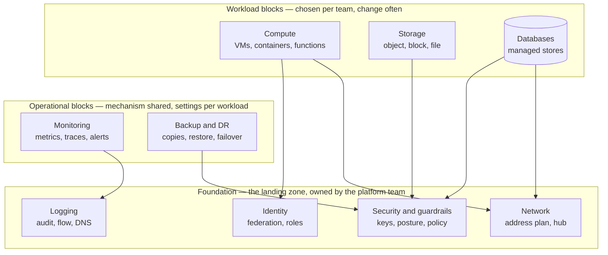
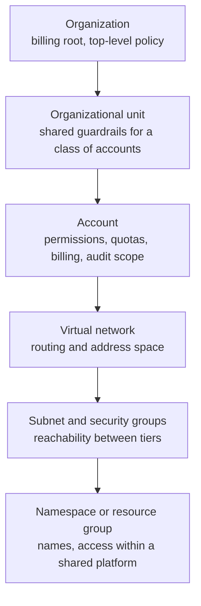
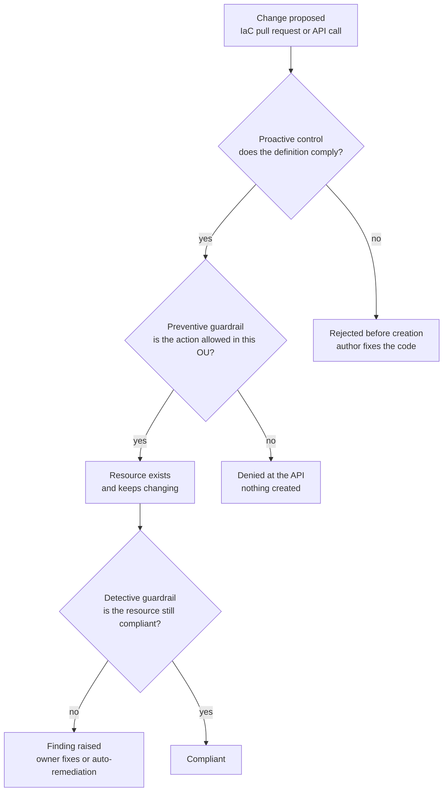
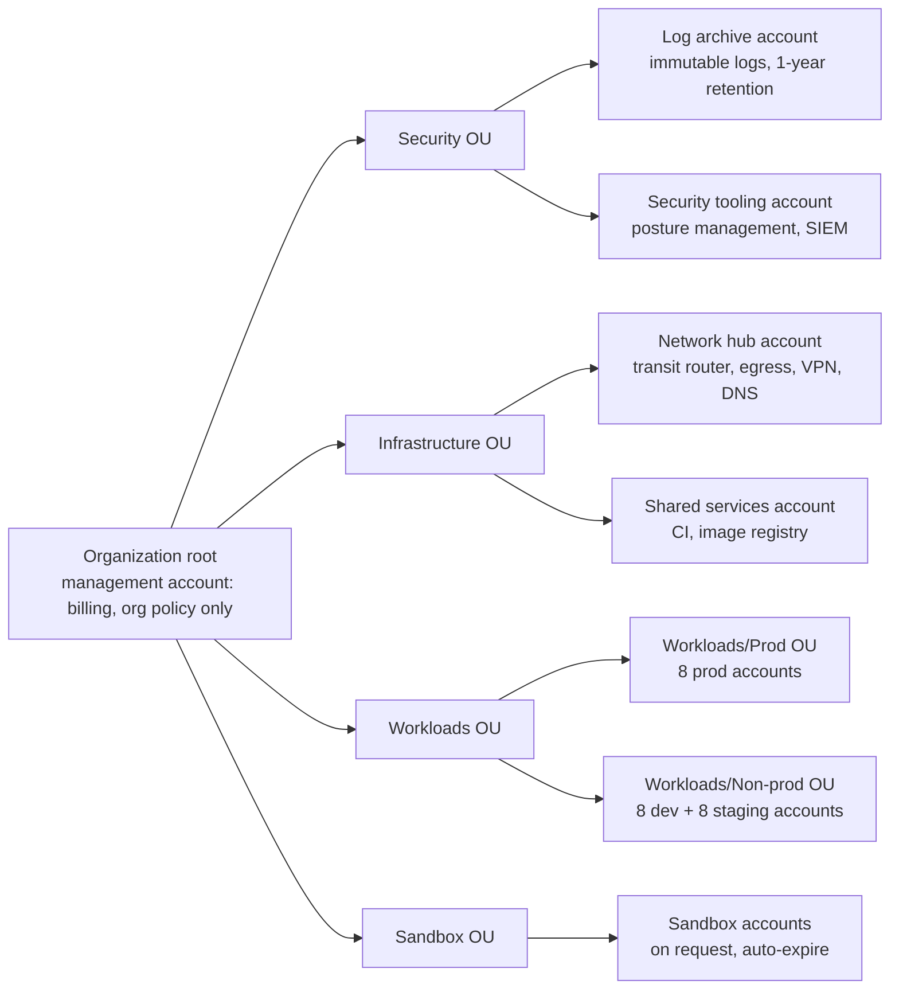

# Cloud building blocks and landing zones

> Every cloud design is assembled from the same dozen building blocks, and every one of them sits
> inside an account that somebody had to create, connect, log, and fence. A landing zone is that
> prepared ground: the minimum foundation a workload can land on without each team reinventing
> identity, networking, logging, and guardrails.

!!! abstract "Page facts"
    **Level:** Intermediate (the building blocks and landing-zone vocabulary are Level 1-2; isolation
    choices, quota and dependency analysis, and guardrail design are Level 3) · **Status:** Draft ·
    **Time:** 60-75 minutes · **Last verified:** 2026-11-21

## Learning objectives

After this page you should be able to:

- Name the ten cloud building blocks and the one decision an architect owns for each.
- Choose an isolation boundary for teams, environments, and tenants, and explain silo, pool, and
  bridge tenancy.
- Treat quotas and service limits as design inputs: look them up, size against them, monitor them.
- Map a workload's dependencies by scope (zonal, regional, global) and by plane (control or data),
  and spot the ones a shared platform silently adds.
- Explain what a landing zone is, list its minimum foundation, and distinguish preventive,
  proactive, and detective guardrails.
- Describe AtlasMart's 29-account landing zone and the baseline every new account receives.

## Prerequisites

- [Networking fundamentals: IP, CIDR, routing, and DNS](../networking/networking-fundamentals-ip-cidr-routing-and-dns.md)
  — the address plan this page places inside accounts.
- [High availability design](../reliability-and-disaster-recovery/high-availability-design.md)
  — zones, fault domains, and static stability.
- [Cloud service and deployment models](cloud-service-and-deployment-models.md) — shared
  responsibility and the control plane versus data plane split.

## The problem this solves

The first cloud account in most companies is created with a credit card and a personal sign-in. A
year later it holds production, test, and someone's experiment side by side; one administrator role
can delete everything; logs live in the same account an attacker would need to cover their tracks in;
nobody knows who owns half the resources; and two teams picked overlapping address ranges that now
block a VPN. Each new workload repeats the same set-up work and the same mistakes.

The fix has two parts: a shared vocabulary of **building blocks**, so a design says what it needs
from each instead of listing products; and a **landing zone**, a designed set of accounts, identity,
network, logging, and guardrails, built once by a platform team and stamped onto every new account.

## What it is

A **cloud building block** is a category of capability that almost every workload consumes and every
major provider offers in some form. The list is stable even as product catalogs change:

| Building block | What it provides | The architect's main decision |
|---|---|---|
| Compute | Somewhere to run code: virtual machines, containers, functions | Which abstraction, and how it scales (deep: D10-T03) |
| Storage | Object, block, and file storage | Which data is durable where, and for how long |
| Network | Virtual networks, subnets, routing, load balancing, private endpoints | Address plan and trust boundaries |
| Database | Managed relational, key-value, document, and other stores | Data model, consistency, and failover behavior |
| Identity | Who (person or workload) is calling, and what they may do | Federation, roles, and no long-lived secrets |
| Security | Key management, secrets, posture management, threat detection | Which controls are mandatory and where they run |
| Logging | Audit logs, flow logs, DNS logs, application logs | What is kept, where, for how long, and who can delete it |
| Monitoring | Metrics, traces, alerts, dashboards | Which signals prove the SLOs (deep: D15) |
| Backup | Point-in-time copies of data, kept apart from the original | Copy location, retention, and restore testing |
| Disaster recovery (DR) | The ability to restore service after losing a zone or region | RTO and RPO per workload (deep: D13-T03) |

A **landing zone** is a pre-configured, governed environment, made of multiple accounts, into which
workloads are deployed. It is defined by its **foundation**: the account hierarchy, identity
federation, network baseline, logging baseline, security tooling, guardrails, and tagging rules that
every account inherits. A landing zone is not a product; providers offer accelerators that build one,
but the design decisions are the organization's.

**Governance** is the set of rules, owners, and mechanisms that keep the cloud estate within agreed
limits for security, cost, compliance, and reliability. The landing zone is where governance stops
being a document and becomes enforced configuration.

## Mental model

Think of a business park. The developer lays out plots (accounts), grouped into zones with different
rules (organizational units: the chemical plant zone has stricter rules than the offices). Before
any tenant arrives, every plot gets the same utilities: a road connection to the park's ring road
(network attachment to the hub), a meter (cost tagging), a key system tied to the park's security
desk (federated identity), and cameras that record to the park's own control room, not the tenant's
office (centralized logs). Park bylaws say what may not be built at all (preventive guardrails);
patrols notice what was built anyway (detective guardrails). Tenants then build whatever they like
inside their plot.

**Where the analogy breaks:** cloud accounts share the provider's hardware, control plane, and
regional services; an account bounds permissions, billing, and quotas, not physics. And a landing
zone's guardrails are code that changes weekly, so it needs its own testing and release process.

## Key terms

| Term | Meaning on this page |
|---|---|
| Account (subscription, project) | The provider's basic container for resources, permissions, billing, and quotas; AWS calls it an account, Azure a subscription, Google Cloud a project |
| Organization | The root that owns all of a company's accounts and applies policies to them |
| Organizational unit (OU) | A group of accounts under the organization that receives the same policies (Azure: management group, Google Cloud: folder) |
| Landing zone | A governed, multi-account environment with a shared foundation, into which workloads are deployed |
| Guardrail | An automated rule that keeps accounts within policy; preventive guardrails block, detective guardrails report |
| Proactive control | A check that evaluates a resource definition before it is created and rejects non-compliant ones |
| Quota / service limit | A cap on how much of a resource an account may use; quotas are usually adjustable on request, hard limits are fixed by the service's design |
| Blast radius | The share of users or functions affected by a single failure, here also a single mistake or compromise |
| Tenant isolation | Keeping one tenant's data, performance, and failures from affecting another tenant |
| Control plane / data plane | The control plane creates and configures resources; the data plane serves the running workload's traffic |
| Tagging | Key-value labels on resources (owner, environment, cost centre) used for cost, automation, and policy |
| Cloud-native design | Building for the cloud's properties: disposable compute, managed services, automation, and failure as normal |

## How it works

### The building blocks form layers

The blocks are not equal peers. Identity, network, logging, and guardrails form a **foundation**
that is shared, changes slowly, and is owned by a platform team. Compute, storage, and databases are
**workload blocks** that each team chooses and changes often. Monitoring, backup, and DR are
**operational blocks** that cut across both: the platform provides the mechanism, each workload
declares what it needs.

**Figure 1 — Cloud building blocks in three layers.** Arrows mean "depends on".

How to read it: workload blocks at the top lean on the foundation at the bottom. A team should be
able to change everything in the top box without touching the bottom one; if a new workload needs a
foundation change (a new route, a new permission boundary), that is a platform request, and a sign
that the foundation is missing a capability.

### Isolation boundaries, from coarse to fine

Isolation answers "if this part fails, is compromised, or is misconfigured, what else is affected?"
Clouds offer nested boundaries, each isolating different things:

**Figure 2 — Nested isolation boundaries and what each one isolates.**

How to read it: each step down is cheaper to create and weaker as a boundary. The **account** is the
strongest boundary an organization controls directly: by default nothing in one account can touch
another, each has its own quotas, and its bill is separate. That is why landing zones use many
accounts; the multi-account strategy, OU design, and account vending are covered in
[Multi-account strategy and infrastructure automation](multi-account-strategy-and-infrastructure-automation.md).

**Tenant isolation** applies the same boundaries to customers or internal teams that share a
platform. Three models are common:

| Model | How tenants are separated | Strength | Cost |
|---|---|---|---|
| Silo | Each tenant gets its own account or stack | Strong isolation, per-tenant quotas and bills, easy deletion | Many copies to run and patch; low utilization |
| Pool | Tenants share the same resources; every row, message, and request carries a tenant ID | Efficient, one stack to operate | A bug in tenant filtering leaks data; one noisy tenant can starve others |
| Bridge | Some layers siloed, some pooled (for example a shared compute cluster with per-tenant databases) | Spends isolation where the risk is | Two models to reason about |

AtlasMart is a bridge: accounts silo each team's data services and permissions, while the
per-environment Kubernetes cluster is pooled, with teams separated by namespaces (D11-T02). Pooled
layers need bulkheads and enforced tenant context; siloed ones need automation, or copies drift.

### Multi-region is a separate decision

Running in **multiple regions** protects against a region-wide failure and brings users closer, at
the cost of asynchronous replication, duplicated foundations, and residency questions. A landing
zone should be able to add a region (address space reserved, guardrails parameterized by region);
whether a workload uses one is a DR and latency decision (D13-T03), not a default.

### Quotas and service limits are design inputs

Every provider caps usage per account (and usually per region): virtual CPUs, addresses, load
balancers, network attachments, API calls per second, accounts per organization. **Adjustable
quotas** can be raised on request, which takes time and is not guaranteed; **hard limits** follow
from a service's design (a maximum policy size, rules per table) and force a design to change shape.
Never write a quota value from memory: values differ by provider, region, account, and date. Read
them from the provider's current quota service, record them with the date checked, and then:

1. **List** every quota the design touches, including control-plane rate quotas (API calls during a
   deployment or a scale-out storm) and organization-level quotas (number of accounts).
2. **Size** the design's peak against each one, including transient doubling during blue/green
   deployments or node replacements.
3. **Request** increases before launch, not during the incident.
4. **Monitor** utilization of each quota as a metric and alert well before the cap.
5. **Partition** when a hard limit or an unrealistic increase blocks growth: more accounts, more
   virtual networks, or cells each stay inside their own limits.

### Dependency mapping

A design's availability is capped by its **critical (hard) dependencies**. In the cloud, map each
dependency along two axes:

- **Scope:** zonal (a VM, a NAT gateway), regional (most managed services), or global (DNS, the
  identity provider, some provider control planes). A regional design with a global dependency
  inherits that dependency's failure modes.
- **Plane:** data-plane dependencies are needed for every request; control-plane dependencies are
  needed only to change things (create, scale, deploy). A design that must call a control plane to
  recover (launch new instances, update DNS) is not statically stable.

Shared platforms add dependencies teams do not see: a central egress firewall, a shared container
registry, a central secrets store, the hub's transit router. Each belongs on the map with an owner and
an SLO.

### Cloud-native design

**Cloud-native design** builds for the cloud's properties instead of transplanting a data-centre
design. Its working rules: compute is disposable and replaced rather than repaired; state lives in
managed services built to keep it; every resource is created by code; components assume their
dependencies will fail and degrade gracefully; capacity follows demand; and telemetry is built in.
The landing zone makes these rules cheap to follow: if creating an account, a network, or a role
takes a pipeline run instead of a ticket, teams stop hand-building snowflakes.

### What a landing zone contains

The minimum foundation, in the order it is usually built:

| Element | What it establishes | Why it cannot wait |
|---|---|---|
| Account structure | Organization, OUs, platform accounts, the rule "one workload environment per account" | Moving accounts and resources later is slow and risky |
| Identity federation | Workforce sign-in from the corporate identity provider, roles (permission sets) per job, break-glass access | Local users and long-lived keys created "temporarily" never go away |
| Network baseline | Address registry, hub, routing to on-premises, DNS zones, egress path | Overlapping ranges block connectivity for years |
| Logging baseline | Organization-wide audit logs, flow and DNS logs, delivered to a separate log archive account | Evidence must exist before the incident, out of reach of the people being audited |
| Security baseline | Posture management, threat detection, key management, encryption defaults | Every account must be visible to the security team from its first minute |
| Guardrails | Preventive, proactive, and detective rules attached to OUs | Rules applied after the fact leave a backlog of violations |
| Tagging and cost | Mandatory tags, budgets, cost allocation | Untagged spend cannot be allocated or cleaned up |
| Backup policy | Default backup plans selected by tag | Teams forget backups until they need a restore |

### Preventive, proactive, and detective guardrails

**Figure 3 — Where each guardrail type acts.** A change flows downward; each guardrail can stop or
report it.

How to read it: the earlier a rule acts, the cheaper the fix. **Preventive** guardrails (for
example an organization policy that denies creating resources outside approved regions) cannot be
bypassed from inside the account, but they are blunt: they block, with little context, and a wrong
one stops legitimate work. **Proactive** controls check a resource definition (often in the
deployment pipeline or the provider's provisioning engine) and can give the author a precise
message. **Detective** guardrails scan what exists and raise findings; they catch drift and
anything created by paths the other two do not see, but the bad state exists until someone fixes
it. A sound landing zone uses preventive guardrails for the few rules that must never be broken,
proactive checks for most configuration rules, and detective guardrails as the safety net for all
of them.

### Landing-zone accelerators

Each major provider publishes guidance and tooling that builds a landing zone. They differ in
vocabulary more than in substance:

| Concept | AWS | Microsoft Azure | Google Cloud |
|---|---|---|---|
| Account boundary | Account | Subscription | Project |
| Grouping for policy | Organizational unit in AWS Organizations | Management group | Folder |
| Preventive policy | Service control policies and resource control policies | Azure Policy with the deny effect | Organization Policy Service constraints |
| Detective checks | AWS Config rules, Control Tower detective controls | Azure Policy audit effects, Microsoft Defender for Cloud | Security Command Center |
| Workforce sign-in | IAM Identity Center | Microsoft Entra ID | Cloud Identity or Workforce Identity Federation |
| Landing-zone tooling | AWS Control Tower; Landing Zone Accelerator on AWS | Azure landing zones (platform and workload landing zones) with Microsoft accelerators | Landing zone design guidance; enterprise foundations blueprint |
| Quota visibility | Service Quotas | Subscription and service limits documentation, quota pages | Cloud Quotas |

AWS Control Tower builds the landing zone on AWS Organizations, with an Account Factory, and AWS
suggests Landing Zone Accelerator on AWS on top for configuration-driven additions. Azure landing
zones split a central platform landing zone from per-workload landing zones (called application
landing zones until Microsoft renamed them in October 2026). Google
Cloud's guidance walks through each decision, and its blueprint is a Terraform implementation.
Accelerators save months but encode default decisions: read what they create before adopting them.

## Worked example: AtlasMart's 29-account landing zone

AtlasMart's platform team is moving from a handful of hand-built accounts to a landing zone that the
Order Tracking System, and seven other product teams, will run in. Everything below is a platform
assumption for Phase 4, labelled as such, and consistent with constraint C-2 (workloads run in the
company's cloud accounts) and C-4 (EU customer data stays in the EU region).

### Step 1 — Count the accounts

| Group | Arithmetic | Accounts |
|---|---|---|
| Workload accounts (assumption) | 8 product teams x 3 environments (dev, staging, prod) | 24 |
| Platform accounts (assumption) | management, log archive, security tooling, network hub, shared services | 5 |
| Total | 24 + 5 | 29 |
| Sandbox accounts | on request, time-limited, not counted | 0 or more |

One account per team per environment is the decision that drives the rest: prod and non-prod never
share permissions, quotas, or a bill, and a mistake in a dev account cannot reach production data.

### Step 2 — Group accounts into OUs

**Figure 4 — AtlasMart's organizational units and accounts.** Guardrails attach to OUs, so every
account below an OU inherits them.

How to read it: OUs group accounts by the rules they need, not by the org chart. Prod and non-prod
are separate OUs because their guardrails differ (for example, interactive write access is allowed
in dev, not in prod); teams are not OUs, because a team re-organization should not move accounts.
The management account runs nothing but the organization itself, which keeps its all-powerful
credentials out of daily use.

### Step 3 — The baseline every new account receives

Every account, from its first minute, gets the same foundation. The mechanism that applies it
(account vending) is on the [multi-account page](multi-account-strategy-and-infrastructure-automation.md);
this is the content:

| Area | Baseline (all AtlasMart assumptions) | Inherited from |
|---|---|---|
| Identity | Workforce SSO federated from the corporate identity provider; permission sets for read-only, developer, operator, and break-glass roles; no human access keys | Identity configuration in the management account |
| Workload identity | Workloads use the platform's workload identity; static keys denied by guardrail | Workloads OU guardrail |
| Audit logging | Organization-wide audit log delivered to the log archive account, which nobody in the workload account can modify or delete; 1-year retention | Organization trail and Security OU |
| Network logging | Flow logs and DNS query logs on every virtual network, delivered to the log archive account | Network baseline |
| Security tooling | Enrolled in posture management and threat detection run from the security tooling account; findings flow to the SIEM | Security OU delegation |
| Network | One virtual network with a `/16` from the address registry, zone-first `/18`s as in the [address plan](../networking/networking-fundamentals-ip-cidr-routing-and-dns.md); attached to the hub's transit router; default route to the hub for egress | Network hub account |
| DNS | Private zone `internal.atlasmart.example` resolved through the hub | Network hub account |
| Encryption | A customer-managed key per account in the key management service, yearly rotation; default encryption on for storage and databases | Account baseline |
| Backup | Backup plans selected by a `backup-tier` tag | Account baseline |
| Cost | Mandatory tags `owner-team`, `environment`, `cost-centre`, `data-classification`, `backup-tier`; a monthly budget with alerts at 80% and 100% | Tag policy and budget template |

### Step 4 — Guardrails by OU

| Guardrail (assumption) | Type | Applies to | Why |
|---|---|---|---|
| Deny resource creation outside the approved EU region (global services excepted) | Preventive | All OUs | C-4: EU customer data stays in the EU region |
| Deny leaving the organization, disabling audit logging, or changing the log archive | Preventive | All OUs | Evidence must survive a compromised account |
| Deny creating long-lived access keys for human users | Preventive | All OUs | Identity baseline |
| Deny internet gateways in workload accounts except in public ingress subnets | Preventive | Workloads OUs | Egress is centralized through the hub |
| Reject storage, databases, or volumes without encryption, and resources without the mandatory tags | Proactive (pipeline) | Workloads OUs | Cheaper to fix in the pull request |
| Report publicly readable storage, open administrative ports, untagged resources, unused credentials | Detective | All OUs | Catches drift and console changes |
| Deny interactive write access for humans in prod (break-glass excepted, alerted) | Preventive | Workloads/Prod | Changes reach prod only through the pipeline |

### Step 5 — Quotas the landing zone must size

Quota values are not quoted here; the platform team reads them from the provider's quota service and
records them with the date checked. What the design must compare against them:

- **Accounts in the organization:** 29 today, plus sandboxes, plus growth (each new team adds 3).
- **Virtual CPUs in the account and region that host the prod Kubernetes cluster:** prod starts with
  6 nodes x 4 vCPU = 24 vCPU (assumption from the platform). If the cluster autoscaler may grow to
  18 nodes on sale day (a new assumption), that is 18 x 4 = 72 vCPU, and replacing every node during a
  node-image rollout can briefly double it to 144 vCPU. The quota request is sized to 144 vCPU plus
  headroom, not to today's 24.
- **Transit router attachments and route entries in the hub:** one attachment per workload virtual
  network (24) plus the shared services network, the VPN, and later the planned private connection.
  Route entries stay low because each `/16` is one route, and environments can be summarized.
- **Control-plane API rate quotas:** a vending run or a cluster-wide rollout makes bursts of API calls;
  pipelines must back off on throttling instead of failing half-way.

### Step 6 — Map Order Tracking's new dependencies

Landing in the landing zone changes the Order Tracking System's dependency map:

| Dependency | Scope | Plane | Critical for | Note |
|---|---|---|---|---|
| Hub transit router and egress firewall | Regional (zonal attachments) | Data | Ingestor's outbound calls to carriers, Notification Worker to Notification Provider | New: centralized egress makes the hub a hard dependency of notifications |
| Private DNS resolution through the hub | Regional | Data | Every internal name lookup | Cache TTLs limit the impact of short outages |
| Image registry in the shared services account | Regional | Control | Pod start-up and scale-out | Running pods are unaffected; a sale-day scale-out is not |
| Workforce identity federation | Global | Control | Engineers and operators signing in | Break-glass access must work without it |
| Log delivery to the log archive | Regional | Neither (asynchronous) | Nothing on the request path | Must buffer, never block requests |
| Key management service | Regional | Data | Decrypting database storage and secrets | Provider-managed, but a policy mistake on the key blocks the database |

The first row is the design finding: NFR-2 (99.9% monthly, about 43.8 minutes of allowed downtime)
now depends on the hub's egress path for every notification. The hub must be built across all three
zones with per-zone attachments, and its availability target must be at least as strict as the
workloads behind it. Inbound traffic is unaffected: ingress stays in each workload's own virtual
network behind its load balancer and WAF.

## Real-world architecture example

Enterprise adoption usually runs the same arc. A first workload goes live in one account, the next
teams copy its set-up by hand, and an audit asks who can delete the logs ("everyone with
administrator rights"). The company then adopts an accelerator, creates security and infrastructure
OUs, moves logs to an archive account, and federates sign-in. The painful part is migrating the
original accounts, with hard-coded addresses and unowned resources. Hence the rule: build the
foundation before the second workload, because retrofitting gets dearer with every account.

## Design choices and trade-offs

| Choice | Favor when | Avoid when |
|---|---|---|
| Account per team per environment | Several teams, production data, compliance scope to contain | One small team with one workload, where the overhead dominates |
| Silo tenancy | Tenants with strict isolation, residency, or per-tenant billing needs | Thousands of small tenants |
| Pool tenancy | Many small tenants, efficiency matters, strong tenant-ID enforcement exists | Regulatory or contractual isolation requirements |
| Provider accelerator for the landing zone | Standard needs, small platform team | Requirements the accelerator fights (then a custom IaC build, if a team will own it for years) |
| Mostly preventive guardrails | Few, absolute rules (region, logging, organization membership) | Rules with many legitimate exceptions |
| Mostly detective guardrails | Fast-changing rules, early adoption | Rules whose violation causes immediate harm (public data) |
| Centralized egress through a hub | Inspection and allow-listing of outbound traffic is required | The hub cannot be made as available as the workloads |

## Failure modes and anti-patterns

- **The landing zone as a one-off project.** Built once, never updated, drifts from reality. Detect:
  accounts created outside the vending path, guardrails with no owner. Prevent: a platform team owns
  it as a product with a backlog, releases, and tests.
- **Logs in the account they describe.** An intruder with administrator rights deletes them. Detect:
  audit log destinations per account. Prevent: organization-level delivery to a separate,
  write-once log archive.
- **Quota surprise on launch or sale day.** Scale-out fails with "limit exceeded". Detect: quota
  utilization metrics with alerts. Prevent: size quotas to peak including rollout doubling, request
  increases early.
- **Hidden platform dependencies.** A central egress firewall or registry outage takes down teams
  that did not know they depended on it. Detect: dependency maps per workload. Prevent: SLOs for
  platform services, zonal design of the hub, cached images and static stability.
- **Guardrail that blocks recovery.** A preventive rule denies the action an incident needs (for
  example creating resources in a second zone or region). Detect: game days. Prevent: break-glass
  paths that are logged and alerted, and testing guardrails against runbooks.
- **Tags as an afterthought.** Spend cannot be allocated and orphaned resources cannot be found.
  Prevent: proactive tag checks and a tag policy from day one.

## Security considerations

- **Separation of duties is structural.** The people who run workloads cannot change the log archive,
  the security tooling, or organization policies, because those live in other accounts.
- **Identity is the perimeter.** Federated sign-in with short-lived credentials, role-based permission
  sets, and no long-lived human keys remove the most common cause of cloud breaches: leaked static
  credentials. Workload identity removes the second most common: keys baked into code or images.
- **Guardrails are code with privileges.** Whoever can change an organization policy can disable every
  control; changes go through review and a pipeline, and the management account has the tightest
  access in the estate.
- **Residency guardrails are a control, not a compliance verdict.** Restricting regions supports
  AtlasMart's C-4 constraint; whether a particular law requires it depends on facts and needs legal
  advice (D12-T08 covers compliance; this is not legal advice).

## Performance, reliability, and cost

- **Performance:** the foundation is mostly off the request path; the exceptions are network hops
  through the hub (egress inspection, private DNS) and key management calls. Measure them in the
  latency budget (NFR-3: p95 300 ms).
- **Reliability:** the landing zone adds shared dependencies; each one needs a zonal design and an
  SLO at least as strict as the workloads that rely on it. Isolation by account limits the blast
  radius of a mistake, which is a reliability benefit as well as a security one.
- **Cost:** accounts themselves usually cost nothing extra, but per-account baseline resources
  (logging, detection, network attachments, NAT or firewall processing) multiply with the account
  count, so the baseline is a cost driver: 29 accounts means 29 copies of everything per-account.
  Tagging and budgets turn the bill into per-team numbers (D17 covers FinOps).

## Hands-on lab: check an account inventory against the baseline

A local, free exercise using Python's standard library (and PyYAML if you prefer YAML input). The
infrastructure module and static checks in
[Lab 15](../labs/lab-15-infrastructure-module-and-static-checks.md) take the same idea further.

1. Write an inventory file listing a few accounts with `name`, `ou`, `region`, `cidr`, and `tags`
   (use AtlasMart-style names such as `tracking-prod`, with CIDRs from the address plan).
2. Write a checker that fails an account if any mandatory tag is missing, if its region is not the
   approved EU region, or if a workload account sits outside a Workloads OU.
3. Use the `ipaddress` module to check that no two accounts' CIDRs overlap, and that none overlaps
   the hub `10.0.0.0/16`, the office `192.168.0.0/16`, or the distribution centre `172.16.0.0/16`.
4. Add an account with `10.10.128.0/17` and confirm the overlap check catches it.
5. Classify each check as preventive, proactive, or detective if it ran in a real landing zone.

??? question "Hint: which of your checks would be detective in production?"
    Running the checker on a pull request that adds an account is proactive: it stops a bad
    definition before anything exists. Running the same logic against the live estate every hour is
    detective. The overlap rule is best proactive (an overlapping network is painful to remove);
    the tag rule needs both, because tags can be removed later through the console.

## Knowledge check

1. Name the ten building blocks on this page and say which three belong to the shared foundation
   rather than to individual workloads.
2. Why is the account, not the virtual network, the main isolation boundary in a landing zone?
3. A design document says "the provider allows 1,000 load balancers per region". What is wrong
   with that sentence, and what should the document contain instead?
4. Give one example each of a preventive, a proactive, and a detective guardrail, and one reason not
   to make every rule preventive.
5. Why did moving AtlasMart's egress to the hub change the Order Tracking System's availability
   analysis?

??? success "Answers"
    1. Compute, storage, network, database, identity, security, logging, monitoring, backup, and DR.
       Identity, network, and logging (with security guardrails) are the foundation the landing zone
       provides; monitoring, backup, and DR are shared mechanisms configured per workload.
    2. The account bounds permissions, quotas, billing, and audit scope by default; nothing in one
       account can act on another without an explicit grant. A virtual network only bounds routing
       and addressing, and identities in the same account can still change it.
    3. It quotes a quota from memory: values vary by provider, region, account, and date, and many
       can be raised. The document should name the quota, the design's peak need with arithmetic,
       the value read from the provider's current quota service with the date checked, and the
       increase requested.
    4. Preventive: deny resources outside the approved region. Proactive: reject an unencrypted
       database in the pipeline. Detective: report publicly readable storage. Preventive rules are
       blunt: they block legitimate exceptions and can block incident recovery, so they are kept for
       a few absolute rules.
    5. Outbound calls (carrier key fetches, notifications) now cross the hub's transit router and
       firewall, so the hub became a critical data-plane dependency; its availability now caps the
       notification path, and it must be zonal and held to at least the workloads' SLO.

## Architecture discussion questions

1. AtlasMart's analytics team wants one account holding data from all eight product teams' prod
   databases. Which isolation model is that, what would you require of it, and would you put it in
   the Workloads/Prod OU?
2. The security team proposes making every detective rule preventive "so nothing bad can ever be
   created". Argue for and against, with one rule you would keep detective.
3. If AtlasMart later adds a second EU region for disaster recovery, list what in this landing zone
   must change and what was designed so that it does not have to.

## Summary

Cloud designs are built from ten stable building blocks. Identity, network, logging, and guardrails
form a shared foundation that a landing zone provides once for every account. Isolation comes in
nested boundaries, with the account as the strongest one an organization controls; tenants can be
siloed, pooled, or bridged. Quotas and hard limits are design inputs to look up, size against, and
monitor, never to quote from memory, and dependency maps must include the hidden ones a shared
platform adds. Guardrails act before creation (proactive), at the API (preventive), or after the
fact (detective). AtlasMart's landing zone has 29 accounts in five OU groupings, and every account
starts with federated identity, central logs, a hub-attached network, encryption, backup, tags, and
region-restriction guardrails.

## Related topics

- **Before:** [Networking fundamentals: IP, CIDR, routing, and DNS](../networking/networking-fundamentals-ip-cidr-routing-and-dns.md);
  [High availability design](../reliability-and-disaster-recovery/high-availability-design.md);
  [Cloud service and deployment models](cloud-service-and-deployment-models.md)
- **Alongside:** [Multi-account strategy and infrastructure automation](multi-account-strategy-and-infrastructure-automation.md)
  — OU design, account vending, and IaC; [Network security, load balancing, and traffic flow](../networking/network-security-load-balancing-and-traffic-flow.md)
  — the hub-and-spoke network in depth; [Identity and access management](../security-architecture/identity-and-access-management.md);
  [Compute options and sizing](compute-options-and-sizing.md); [Cloud providers: principles before catalogs](cloud-providers-principles-before-catalogs.md);
  [Case study 08: multi-account landing zone and hub-and-spoke network](../end-to-end-case-studies/cs-08-multi-account-landing-zone-and-hub-and-spoke-network.md);
  [Exercise: multi-account landing zone](../system-design-exercises/multi-account-landing-zone.md)
- **Planned:** disaster recovery (D13-T03); observability and SRE (D15); FinOps (D17); Well-Architected
  and adoption frameworks (D28).

## References

| Source | Type | Checked |
|---|---|---|
| [Organizing Your AWS Environment Using Multiple Accounts](https://docs.aws.amazon.com/whitepapers/latest/organizing-your-aws-environment/organizing-your-aws-environment.html) — AWS whitepaper | Official guidance (recommended OUs and accounts) | 2026-11-21 |
| [What is AWS Control Tower?](https://docs.aws.amazon.com/controltower/latest/userguide/what-is-control-tower.html) and [About controls](https://docs.aws.amazon.com/controltower/latest/userguide/controls.html) — AWS documentation | Official documentation (preventive, detective, proactive controls) | 2026-11-21 |
| [Landing Zone Accelerator on AWS: solution overview](https://docs.aws.amazon.com/solutions/latest/landing-zone-accelerator-on-aws/solution-overview.html) — AWS Solutions | Official documentation | 2026-11-21 |
| [What is an Azure landing zone?](https://learn.microsoft.com/azure/cloud-adoption-framework/ready/landing-zone/) — Microsoft Cloud Adoption Framework | Official guidance (platform and application landing zones, accelerators) | 2026-11-21 |
| [Landing zone design in Google Cloud](https://cloud.google.com/architecture/landing-zones) and [Enterprise foundations blueprint](https://cloud.google.com/architecture/security-foundations) — Google Cloud Architecture Center | Official guidance | 2026-11-21 |
| [Azure Policy overview](https://learn.microsoft.com/azure/governance/policy/overview) and [Organization Policy Service overview](https://cloud.google.com/resource-manager/docs/organization-policy/overview) | Official documentation (policy enforcement models) | 2026-11-21 |
| [What is Service Quotas?](https://docs.aws.amazon.com/servicequotas/latest/userguide/intro.html), [Azure subscription and service limits](https://learn.microsoft.com/azure/azure-resource-manager/management/azure-subscription-service-limits), [Cloud Quotas overview](https://cloud.google.com/docs/quotas/overview) | Official documentation (where to read current quotas) | 2026-11-21 |
| [NIST SP 800-145, The NIST Definition of Cloud Computing](https://csrc.nist.gov/pubs/sp/800/145/final) | Standard (cloud characteristics behind cloud-native design) | 2026-11-21 |

## Review notes

- Canonical page for D10-T02. In depth: building-block layers, isolation boundaries and tenancy
  models, quotas and service limits as design inputs, dependency mapping, landing-zone foundation,
  guardrail types, accelerators, and governance as enforced configuration. Only defined or briefly
  treated: storage, database, monitoring, backup, and DR as individual blocks (deep elsewhere: D06,
  D15, D13-T03); multi-region (decision deferred to D13-T03); multi-account (deep on D10-T04);
  cloud-native design (principles only).
- No quota, limit, or price is quoted (quota arithmetic uses only labelled assumptions). Every product name in the equivalence table was checked on 2026-11-21 against the provider's
  current page (titles fetched), including resource control policies, Microsoft Entra ID, Cloud
  Quotas, and the Terraform basis of the enterprise foundations blueprint.
- The conventions do not say which account hosts the per-environment Kubernetes clusters; this page
  deliberately does not place them ("the account that hosts the prod cluster"). The coordinator
  should settle it and align the Kubernetes pages and case study 08.
- New AtlasMart assumptions: permission sets (read-only, developer, operator, break-glass); mandatory
  tags `owner-team`, `environment`, `cost-centre`, `data-classification`, `backup-tier`; budget
  alerts at 80% and 100%; guardrail list in Step 4; 18-node prod autoscaler maximum (72 vCPU, 144
  vCPU during full node replacement).
- The Step 6 finding (hub egress becomes a critical dependency of notifications) should agree with
  the D09-T03 page's hub design; reviewer to cross-check.
- Figure 1 uses `~~~` to stack three subgraphs; verify they render top to bottom.
