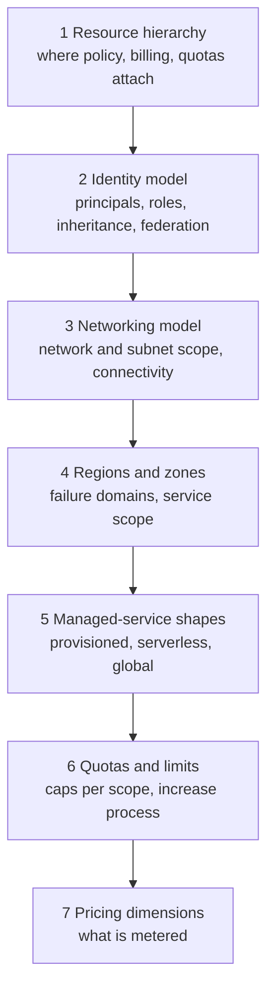
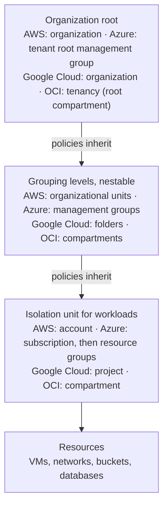
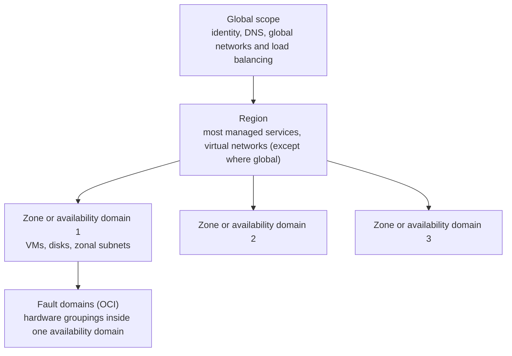
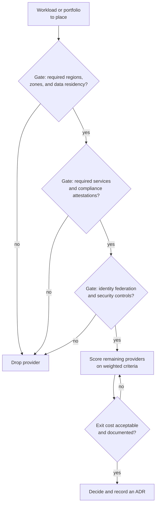

# Cloud providers: principles before catalogs

> Every provider sells hundreds of services, and the names change. Underneath, each one answers the
> same seven questions: how resources are grouped, who may act on them, how they are networked,
> where they physically run, what shapes managed services take, what limits apply, and what is
> metered. Learn those answers once per provider and the catalogue becomes a lookup.

!!! abstract "Page facts"
    **Level:** Intermediate (the seven lenses and the equivalence table are Level 1-2; the
    provider-selection guide and mapping a design across providers are Level 3) · **Status:** Draft ·
    **Time:** 60-75 minutes · **Last verified:** 2026-11-21

## Learning objectives

After this page you should be able to:

- Learn an unfamiliar provider by answering seven questions in order, from its own documentation.
- Explain how resource hierarchies, identity models, network scopes, and failure domains differ
  between AWS, Microsoft Azure, Google Cloud, and Oracle Cloud Infrastructure (OCI), and why those
  differences change a design.
- Use a building-block equivalence table safely: as a starting point, checked against current
  documentation, never as proof that two services behave the same.
- Describe private-cloud and VMware-based infrastructure, and the ways public providers now run
  VMware stacks or their own hardware on customer sites.
- Apply a provider-selection guide with pass/fail gates first and weighted criteria second.

## Prerequisites

- [Cloud service and deployment models](cloud-service-and-deployment-models.md) — service models,
  shared responsibility, control and data planes.
- [Networking fundamentals: IP, CIDR, routing, and DNS](../networking/networking-fundamentals-ip-cidr-routing-and-dns.md)
  — the AtlasMart address plan used in the worked example.

## The problem this solves

An architect who learns a provider by memorizing its catalogue faces three problems. The catalogue
is too big to hold in one head. It changes: Microsoft renamed Azure Active Directory to Microsoft
Entra ID; AWS Single Sign-On became AWS IAM Identity Center on 26 July 2022; Google discontinued
support for Cloud Deployment Manager on 1 April 2026 and points users to Infrastructure Manager.
And, most dangerously, similar names hide different behaviour: a "virtual network" is regional on
one provider and global on another, and a "subnet" is tied to one zone on one provider and spans all
zones on another. A design copied from one provider to another by renaming boxes can be wrong in
ways no diagram shows.

The fix is to learn the **principles** every provider must implement (grouping, identity,
networking, placement, service shapes, limits, metering) and to look up the **catalogue** only to
find each provider's answer.

## What it is

A **provider model** is the set of answers a cloud provider gives to seven design questions. This
page calls them lenses:

| Lens | Question it answers | Why an architect cares |
|---|---|---|
| 1. Resource hierarchy | How are resources grouped, and where do policies, billing, and quotas attach? | Isolation, blast radius, governance, cost allocation |
| 2. Identity model | Who are the principals (people, workloads), and how are permissions granted and inherited? | Least privilege, federation with the corporate identity provider |
| 3. Networking model | What is the scope of a virtual network and a subnet, and how do networks connect? | Address planning, zone resilience, hybrid links |
| 4. Regions and zones | What are the failure domains, and which services are global, regional, or zonal? | Availability design, data residency |
| 5. Managed-service shapes | Is a service provisioned (instances you size), serverless (per request), or global? Who patches what? | Shared responsibility, scaling, cost behaviour |
| 6. Quotas and limits | What caps apply, per what scope, and which can be raised? | Capacity for peaks, failure modes when a cap is hit |
| 7. Pricing dimensions | What is metered: time, capacity, requests, storage, data transfer, licences, support? | Cost model and the design decisions that drive it |

The providers this page names are the four in the curriculum: **AWS**, **Microsoft Azure**, **Google
Cloud**, and **Oracle Cloud Infrastructure**, plus **private-cloud** platforms (VMware-based and
OpenStack-based) that organizations run themselves.

## Mental model

Learning a provider is like arriving in a new city's public transport system. Every system has
lines, stations, zones, tickets, timetables, and rules about transfers; the names and colours are
different. A traveller who knows to ask "how are fares zoned, where do I change lines, what runs at
night?" is productive on day one, while one who memorized another city's map is lost.

**Where the analogy breaks:** transport systems differ mostly in names, but cloud providers differ in
*scope and semantics*: one provider's "network" covers the whole world, another's one region; one
provider's grouping unit is a hard isolation boundary, another's a policy folder inside a shared
tenancy. Those differences change designs, not just labels. And a city's map changes slowly, while
provider catalogues change every month.

## Key terms

| Term | Meaning on this page |
|---|---|
| Resource hierarchy | The tree of containers (organization, groups, accounts or projects, resources) where policy, billing, and quotas attach and inherit |
| Isolation unit | The container a provider treats as the main boundary for resources and permissions: account, subscription, project, or compartment |
| Principal | An identity that can be granted permissions: a person, group, or workload |
| Region | A geographic area with one or more isolated data-centre groups |
| Availability zone | An isolated location within a region with independent power, cooling, and networking (OCI's term is availability domain) |
| Fault domain | A grouping of hardware inside a zone or availability domain, used for anti-affinity |
| Service quota | A provider-enforced cap on resources or request rates per scope; some can be raised on request |
| Private cloud | Cloud-style self-service infrastructure run for one organization, usually on its own hardware |

## How it works

**Figure 1 — The seven lenses in learning order.** Each lens depends on the ones before it: you cannot
reason about permissions before you know what they attach to.

How to read it: spend the first hours of learning a provider on lenses 1-4, which shape every
design; lenses 5-7 are then looked up per service as needed.

### Lens 1 — Resource hierarchy

Every provider has a root for the organization, optional grouping levels, an isolation unit where
resources live, and the resources themselves. Policies set high in the tree are inherited below.

**Figure 2 — The generic hierarchy and each provider's names for its levels.**

How to read it: the shapes are similar, but the strength of the boundary is not. An AWS account
and a Google Cloud project are strong containers for resources, quotas, and permissions; an Azure
subscription is a billing and quota boundary with resource groups inside it for lifecycle grouping;
an OCI compartment is a policy and quota boundary inside one tenancy, and compartments nest. Which
boundary you use for "one team's production" decides blast radius and how many policies you write.

### Lens 2 — Identity model

Each provider separates **who** (principals: users, groups, workload identities) from **what they may
do** (roles or policies) and **where** (the scope in the hierarchy). The differences that matter:

- **Where human identities live.** Azure's principals come from Microsoft Entra ID; a Google Cloud
  organization is tied to a Google Workspace or Cloud Identity account; AWS and OCI have their own identity services and
  commonly federate a corporate identity provider for workforce sign-in (AWS IAM Identity Center,
  OCI identity domains).
- **How permissions are written.** Policy documents attached to identities or resources (AWS),
  role assignments at a scope (Azure RBAC, Google Cloud IAM allow policies), or readable policy
  statements of the form "allow group *G* to *verb* *resource-type* in compartment *C*", stored in the
  tenancy or a compartment (OCI).
- **How workloads authenticate.** Every provider offers a way for a running workload to obtain
  short-lived credentials without stored keys; learn its name and its trust configuration before
  writing any application code.

AtlasMart's rules apply on any provider: workforce SSO federated into every isolation unit, no
long-lived human access keys, workloads using workload identity (Phase 4 platform assumptions).

### Lens 3 — Networking model

The concepts from the networking fundamentals page (CIDR blocks, subnets, route tables, NAT,
private DNS) exist everywhere. Their **scope** differs, and scope changes the address plan:

| Provider | Virtual network scope | Subnet scope |
|---|---|---|
| AWS | One region (a VPC) | One availability zone; a subnet cannot span zones |
| Azure | One region (a virtual network) | All zones in the region; subnets are not divided by zone |
| Google Cloud | Global (a VPC network, with its routes and firewall rules) | One region |
| OCI | One region (a virtual cloud network, VCN) | One availability domain or the whole region (regional subnets are recommended) |

Consequence: AtlasMart's zone-first plan (one `/18` per zone, a public, private-app, and private-data
subnet in each) maps one to one onto zonal subnets. On a provider whose subnets span zones, the same
three tiers become three regional subnets, and zone placement moves to the resources (zonal VMs,
node pools, database standbys). The tiers, routes, and trust boundaries survive the move; the
per-zone route tables and per-zone summaries may not.

### Lens 4 — Regions, zones, and failure domains

All four providers organize capacity into **regions**, each with isolated locations inside it. AWS,
Azure, and Google Cloud call them availability zones (or zones); OCI calls them **availability
domains** and adds three **fault domains** inside each one. Two facts to check for every region you
plan to use:

- **How many isolated locations it has.** OCI documents that many of its regions have a single
  availability domain, where fault domains (not zones) provide in-region redundancy; Azure documents
  that resiliency options vary by region. A three-zone design needs a three-zone region.
- **Each service's scope.** Some services are global (identity, DNS, a global network), most are
  regional, and some resources are zonal (a VM, a disk). A global service is a dependency shared by
  every region.

**Figure 3 — Service scopes and failure domains.** Arrows mean "contains".

How to read it: a failure is contained by the smallest box it starts in, unless something in a larger
box depends on it. Global services are the widest blast radius; the static stability rules of the
service-models page apply to them first.

### Lens 5 — Managed-service shapes

A managed service is one of three shapes, whatever it is called:

- **Provisioned:** you choose instance sizes and counts (managed databases, caches, Kubernetes node
  pools). You pay while it exists; scaling is a control-plane action; you plan capacity.
- **Serverless or per-request:** capacity is invisible and billing follows use (queues, object storage,
  functions). Scaling is the provider's problem, within quotas.
- **Global or edge:** one logical service served from many locations (DNS, content delivery, global
  load balancing). Highly available, and a shared dependency.

For each managed service ask: which shape, which scope (Lens 4), who patches and when, how it fails
over, and what happens to clients during failover.

### Lens 6 — Quotas and limits

Every provider caps resources and request rates per scope (per isolation unit and region, usually).
Some caps are adjustable through a request process, some are fixed. A quota hit at the wrong moment
is a control-plane failure you caused yourself: the autoscaler asks for nodes and is refused. Habits
that work on any provider: inventory the quotas your design touches; raise them ahead of known peaks
(AtlasMart's sale days); alert on usage as a fraction of quota; and never quote a number from memory,
because limits change. Check the provider's current documentation.

### Lens 7 — Pricing dimensions

Principles only; this page quotes no prices. Every provider meters some combination of:

| Dimension | Typical unit | Design lever |
|---|---|---|
| Compute time | Instance-hours or vCPU and memory per second | Right-sizing, autoscaling the billed layer, commitments |
| Provisioned capacity | Instance-hours of managed databases and caches | Size to need; stop non-production at night |
| Requests and operations | Per million requests, per invocation | Batching, caching |
| Storage | GB-month, by tier | Lifecycle rules, retention |
| Data transfer | GB out to the internet, between zones, between regions | Keep chatty traffic zone-local; private endpoints; cache at the edge |
| Licences and support | Per core, per user, percentage of spend | Bring-your-own licence terms, support tier |
| Commitments | Discount for committed spend or capacity | Commit only to the measured baseline |

Two habits matter more than any price list: tag or label every resource with an owner and cost
centre so spend can be allocated, and model the dimension that grows with the business (for
AtlasMart, data transfer and storage grow with orders; compute is dominated by the cluster minimum).

### The equivalence table (checked 2026-11-21)

Use this table to find the right documentation page, not to assume equal behaviour. Each name links
to the provider's own page, which is where it was checked.

| Building block | AWS | Microsoft Azure | Google Cloud | Oracle Cloud Infrastructure |
|---|---|---|---|---|
| Resource container | [Account in AWS Organizations](https://docs.aws.amazon.com/organizations/latest/userguide/orgs_introduction.html) | [Subscription and resource group, under management groups](https://learn.microsoft.com/en-us/azure/governance/management-groups/overview) | [Project, under folders and an organization](https://docs.cloud.google.com/resource-manager/docs/cloud-platform-resource-hierarchy) | [Compartment in a tenancy](https://docs.oracle.com/en-us/iaas/Content/Identity/compartments/managingcompartments.htm) |
| Identity and access | [AWS IAM](https://docs.aws.amazon.com/IAM/latest/UserGuide/introduction.html); [IAM Identity Center](https://docs.aws.amazon.com/singlesignon/latest/userguide/what-is.html) for workforce | [Microsoft Entra ID](https://learn.microsoft.com/en-us/entra/fundamentals/whatis) with [Azure RBAC](https://learn.microsoft.com/en-us/azure/role-based-access-control/overview) | [Identity and Access Management (IAM)](https://docs.cloud.google.com/iam/docs/overview) | [OCI IAM with identity domains](https://docs.oracle.com/en-us/iaas/Content/Identity/home.htm) |
| Virtual network | [Amazon VPC](https://docs.aws.amazon.com/vpc/latest/userguide/what-is-amazon-vpc.html) | [Azure Virtual Network](https://learn.microsoft.com/en-us/azure/virtual-network/virtual-networks-overview) | [VPC network](https://docs.cloud.google.com/vpc/docs/vpc) | [Virtual cloud network (VCN)](https://docs.oracle.com/en-us/iaas/Content/Network/Concepts/overview.htm) |
| Object storage | [Amazon S3](https://docs.aws.amazon.com/AmazonS3/latest/userguide/Welcome.html) | [Azure Blob Storage](https://learn.microsoft.com/en-us/azure/storage/blobs/storage-blobs-introduction) | [Cloud Storage](https://docs.cloud.google.com/storage/docs/introduction) | [Object Storage](https://docs.oracle.com/en-us/iaas/Content/Object/Concepts/objectstorageoverview.htm) |
| Managed Kubernetes | [Amazon EKS](https://docs.aws.amazon.com/eks/latest/userguide/what-is-eks.html) | [Azure Kubernetes Service (AKS)](https://learn.microsoft.com/en-us/azure/aks/what-is-aks) | [Google Kubernetes Engine (GKE)](https://docs.cloud.google.com/kubernetes-engine/docs/concepts/kubernetes-engine-overview) | [Kubernetes Engine (OKE)](https://docs.oracle.com/en-us/iaas/Content/ContEng/Concepts/contengoverview.htm) |
| Functions | [AWS Lambda](https://docs.aws.amazon.com/lambda/latest/dg/welcome.html) | [Azure Functions](https://learn.microsoft.com/en-us/azure/azure-functions/functions-overview) | [Cloud Run functions](https://docs.cloud.google.com/functions/docs/concepts/overview) | [Functions](https://docs.oracle.com/en-us/iaas/Content/Functions/Concepts/functionsoverview.htm) |
| Managed relational database (PostgreSQL example) | [Amazon RDS](https://docs.aws.amazon.com/AmazonRDS/latest/UserGuide/Welcome.html) | [Azure Database for PostgreSQL flexible server](https://learn.microsoft.com/en-us/azure/postgresql/flexible-server/overview) | [Cloud SQL](https://docs.cloud.google.com/sql/docs/introduction) | [OCI Database with PostgreSQL](https://docs.oracle.com/en-us/iaas/Content/postgresql/overview.htm) |
| Key management | [AWS Key Management Service (KMS)](https://docs.aws.amazon.com/kms/latest/developerguide/overview.html) | [Azure Key Vault](https://learn.microsoft.com/en-us/azure/key-vault/general/overview) (keys) | [Cloud Key Management Service (Cloud KMS)](https://docs.cloud.google.com/kms/docs/key-management-service) | [Vault and Key Management](https://docs.oracle.com/en-us/iaas/Content/KeyManagement/Concepts/keyoverview.htm) |
| Secrets | [AWS Secrets Manager](https://docs.aws.amazon.com/secretsmanager/latest/userguide/intro.html) | [Azure Key Vault](https://learn.microsoft.com/en-us/azure/key-vault/general/overview) (secrets) | [Secret Manager](https://docs.cloud.google.com/secret-manager/docs/overview) | [Secret Management](https://docs.oracle.com/en-us/iaas/Content/secret-management/home.htm) |
| Audit log of API activity | [AWS CloudTrail](https://docs.aws.amazon.com/awscloudtrail/latest/userguide/cloudtrail-user-guide.html) | [Activity log in Azure Monitor](https://learn.microsoft.com/en-us/azure/azure-monitor/platform/activity-log) | [Cloud Audit Logs](https://docs.cloud.google.com/logging/docs/audit) | [Audit](https://docs.oracle.com/en-us/iaas/Content/Audit/Concepts/auditoverview.htm) |
| Monitoring | [Amazon CloudWatch](https://docs.aws.amazon.com/AmazonCloudWatch/latest/monitoring/WhatIsCloudWatch.html) | [Azure Monitor](https://learn.microsoft.com/en-us/azure/azure-monitor/overview) | [Cloud Monitoring](https://docs.cloud.google.com/monitoring/docs/monitoring-overview) | [Monitoring](https://docs.oracle.com/en-us/iaas/Content/Monitoring/Concepts/monitoringoverview.htm) |
| Provider-native IaC | [AWS CloudFormation](https://docs.aws.amazon.com/AWSCloudFormation/latest/UserGuide/Welcome.html) | [ARM templates and Bicep](https://learn.microsoft.com/en-us/azure/azure-resource-manager/bicep/overview) | [Infrastructure Manager](https://docs.cloud.google.com/infrastructure-manager/docs/overview) (runs Terraform) | [Resource Manager](https://docs.oracle.com/en-us/iaas/Content/ResourceManager/Concepts/resourcemanager.htm) (runs Terraform) |
| Regions and isolated locations | [Regions and Availability Zones](https://docs.aws.amazon.com/global-infrastructure/latest/regions/aws-regions.html) | [Regions](https://learn.microsoft.com/en-us/azure/reliability/regions-overview) and [availability zones](https://learn.microsoft.com/en-us/azure/reliability/availability-zones-overview) | [Regions and zones](https://docs.cloud.google.com/compute/docs/regions-zones) | [Regions, availability domains, fault domains](https://docs.oracle.com/en-us/iaas/Content/General/Concepts/regions.htm) |
| Quotas | [Service Quotas](https://docs.aws.amazon.com/servicequotas/latest/userguide/intro.html) | [Azure Quotas](https://learn.microsoft.com/en-us/azure/quotas/quotas-overview) | [Cloud Quotas](https://docs.cloud.google.com/docs/quotas/overview) | [Service limits](https://docs.oracle.com/en-us/iaas/Content/General/Concepts/servicelimits.htm) |

Cautions when reading across a row: Azure Key Vault covers both keys and secrets in one service;
Google Cloud's and OCI's "native" IaC services run Terraform configurations rather than a
provider-specific template language; the managed-database row names one engine family, and each
provider offers several engines with different high-availability mechanics; and the identity row
compares services whose scopes differ (Lens 2). Both Microsoft (Azure for AWS professionals) and
Google (a comparison of AWS and Azure services to Google Cloud) publish fuller mappings; use them the
same way, as starting points.

### Private cloud and VMware-based infrastructure

A **private cloud** offers cloud-style self-service (an API, quotas, metering) on infrastructure
dedicated to one organization. Two families dominate:

- **VMware-based.** VMware Cloud Foundation (VMware is now part of Broadcom) bundles vSphere (the
  ESX hypervisor and vCenter management), vSAN (software-defined storage from the hosts' own disks),
  and NSX (software-defined networking and firewalling), with operations and automation tooling on
  top. Concepts map onto the lenses: vCenter's inventory and permissions are the hierarchy and
  identity; NSX segments and gateways are the network; clusters and hosts are the failure domains;
  capacity is bought, so quotas are what the hardware holds.
- **OpenStack-based.** An open-source set of services, each with a project name: Compute (Nova),
  Networking (Neutron), Block Storage (Cinder), Object Storage (Swift), Identity (Keystone), Image
  (Glance), and Orchestration (Heat), among others. The same lenses apply; the organization runs the
  control plane itself.

Public providers now meet private clouds halfway in two ways:

- **VMware stacks inside a public cloud**, so VMware workloads move without re-platforming:
  [Azure VMware Solution](https://learn.microsoft.com/en-us/azure/azure-vmware/introduction),
  [Google Cloud VMware Engine](https://docs.cloud.google.com/vmware-engine/docs/overview),
  [Oracle Cloud VMware Solution](https://docs.oracle.com/en-us/iaas/Content/VMware/Concepts/ocvsoverview.htm),
  and [Amazon Elastic VMware Service (Amazon EVS)](https://docs.aws.amazon.com/evs/latest/userguide/what-is-evs.html),
  which AWS documents as running VMware Cloud Foundation on bare-metal instances inside the
  customer's own VPC, with the customer responsible for the VMware stack.
- **Provider hardware on the customer's site** (the distributed cloud model):
  [AWS Outposts](https://docs.aws.amazon.com/outposts/latest/userguide/what-is-outposts.html),
  [Azure Local](https://learn.microsoft.com/en-us/azure/azure-local/overview),
  [Google Distributed Cloud](https://docs.cloud.google.com/distributed-cloud/docs), and
  [Oracle Compute Cloud@Customer](https://docs.oracle.com/en-us/iaas/compute-cloud-at-customer/ccc/home.htm).

Read the shared responsibility split for each one carefully: in the VMware-in-public-cloud services
the customer often still patches and operates the VMware layer, which is IaaS-like responsibility
with a managed hardware layer underneath.

### A provider-selection decision guide

**Figure 4 — Gates first, then weighted criteria, then an exit check.** A provider that fails any gate
is out, however well it scores elsewhere.

How to read it: gates are pass/fail facts read from documentation and contracts; weights express the
organization's priorities; the exit check stops a high score from hiding a costly dependency. The
result is an architecture decision record, not a spreadsheet alone.

Weighted criteria that usually matter, in rough order for an organization that already has a cloud
estate: existing accounts, landing zone, contracts, and skills; maturity of the specific managed
services needed; operational tooling and support; cost model for this workload's dominant pricing
dimension; and exit cost.

## Worked example: AtlasMart's platform through the seven lenses

AtlasMart's platform team wants a provider-neutral description of its Phase 4 platform so that any
future provider decision (an acquisition, a regulator's question, a new region) starts from
principles. They also want a recorded answer to a product team's question: "Should Order Tracking
move to a different provider that has a feature we like?"

### Step 1 — Describe the platform in lens terms

| Lens | AtlasMart platform (Phase 4 platform assumptions) | What to verify on any provider |
|---|---|---|
| Hierarchy | 29 isolation units: 8 teams × 3 environments = 24 workload units, plus 5 platform units (management, log archive, security tooling, network hub, shared services); groups Security, Infrastructure, Workloads/Prod, Workloads/Non-prod, Sandbox | Is the isolation unit a hard boundary for resources, quotas, and permissions? Can groups nest? |
| Identity | Workforce SSO federated into every unit with permission sets per role; workload identity; customer tokens from AtlasMart's customer Identity Provider (OIDC) | Federation protocol support (SAML, OIDC), workload identity mechanism, policy inheritance |
| Network | Hub-and-spoke with a transit router in the hub; hub `10.0.0.0/16`; prod `10.10.0.0/16` with per-zone `/18`s; centralized egress; private zone `internal.atlasmart.example` | Network and subnet scope (Lens 3 table); transit routing service; private DNS resolution through the hub |
| Regions | One EU region with three zones (C-4) | Does the chosen EU region have three isolated locations? Which services are zonal there? |
| Service shapes | Managed Kubernetes per environment (6 nodes in prod, 2 per zone); managed PostgreSQL with synchronous standby; managed Redis; managed queue; secrets manager; KMS with yearly rotation; private registry | Provisioned or serverless? Zone-redundant? Who patches? Failover behaviour? |
| Quotas | Sale-day scale-out to HPA maximum 9 Tracking API replicas | Which quotas the scale-out touches; raise before sales |
| Pricing | Cluster minimum dominates compute; storage and data transfer grow with orders | Metering of cross-zone traffic, NAT and egress, managed-service instance hours |

### Step 2 — Map the address plan onto each networking model

| Provider networking model | How AtlasMart's prod plan is expressed |
|---|---|
| Zonal subnets (AWS; OCI with AD-specific subnets) | As documented: 9 subnets, three per zone, each zone summarized by its `/18`; per-zone route tables for per-zone NAT |
| Regional subnets (Azure; Google Cloud; OCI regional subnets) | 3 subnets per environment (public, private-app, private-data), each spanning all zones; zone placement set on node pools, database standby, and NAT; the per-zone `/18` summaries no longer exist as subnets but can still be kept as an allocation convention |

The tiers, the absence of a default route in the data tier, private endpoints, and short DNS TTLs
carry over unchanged. Per-zone summaries and per-zone route tables are the parts that depend on the
provider. [Lab 15](../labs/lab-15-infrastructure-module-and-static-checks.md) computes the zonal
version of the plan with a provider-free module and tests every prefix.

### Step 3 — Answer the product team's question with gates and weights

Gates first. Both the incumbent provider (where AtlasMart's accounts already are) and the
alternative provider are assumed (for this example) to pass the region, services, and identity gates.
Then the weighted criteria. Weights and 1-5 scores below are illustrative assumptions agreed for this
exercise, not assessments of any real provider:

| Criterion | Weight | Incumbent score | Incumbent weighted | Alternative score | Alternative weighted |
|---|---|---|---|---|---|
| Fit with existing accounts, landing zone, and pipeline (C-2) | 30 | 5 | 150 | 1 | 30 |
| Team skills and operational tooling | 20 | 4 | 80 | 2 | 40 |
| Maturity of the managed services Order Tracking uses | 20 | 4 | 80 | 5 | 100 |
| Cost model for the dominant dimensions | 15 | 3 | 45 | 4 | 60 |
| Exit cost from the resulting position | 15 | 3 | 45 | 3 | 45 |
| **Total (maximum 500)** | **100** | | **400** | | **275** |

Arithmetic for the incumbent: 30 × 5 + 20 × 4 + 20 × 4 + 15 × 3 + 15 × 3 = 150 + 80 + 80 + 45 + 45 =
400. For the alternative: 30 + 40 + 100 + 60 + 45 = 275. Even if the alternative scored 5 on every
criterion except landing-zone fit, it would reach 30 + 100 + 100 + 75 + 75 = 380, still below 400:
constraint C-2 and existing skills dominate. The decision recorded: Order Tracking stays with the
incumbent; the feature the team wanted becomes a requirement to evaluate on the incumbent first,
with a second-provider pilot only if the incumbent cannot meet it.

### What the design decided

| Decision | Driven by |
|---|---|
| Describe the platform in lens terms, not product names | Names change; scopes and responsibilities drive design |
| Keep the zone-first address plan as an allocation convention on every provider | Summaries and future growth survive even where subnets span zones |
| Gate on a three-zone EU region before any scoring | C-4 and NFR-2 |
| Stay with the incumbent for Order Tracking | C-2 and skills outweigh one feature (400 versus 275) |

## Real-world architecture example

Organizations that use more than one provider usually do so by workload, not by spreading one
workload across providers: a primary provider for most systems, a second for a specific capability
or an acquired business, and a VMware-based private cloud or a VMware service inside a public cloud
for systems not yet modernized. Their platform teams keep one internal vocabulary (isolation unit,
workload identity, transit hub, log archive) and a short provider mapping maintained like code,
reviewed when providers rename or retire services. Landing-zone guidance from each provider (AWS
multi-account guidance, the Microsoft Cloud Adoption Framework, Google's resource hierarchy
guidance, and OCI's compartment guidance) all describe the same lens-1 to lens-4 decisions with
different names.

## Design choices and trade-offs

| Choice | Favor when | Avoid when |
|---|---|---|
| One primary provider | Most organizations: depth of skills, tooling, and discounts | A regulator or contract requires diversification |
| Second provider for specific workloads | A capability gap, an acquisition, or a regulator's concentration concern | It is chosen for an abstract fear of lock-in without a costed scenario |
| Provider-native IaC | Single provider, newest features first | Several providers, where one tool and language across them helps more |
| Cross-provider IaC (Terraform or OpenTofu) | Several providers or on-premises targets; one workflow | You expect it to make infrastructure portable: modules are still per provider |
| VMware service inside a public cloud | Data-centre exit with many VMware workloads and little time | The workloads will be modernized soon anyway; pay once, not twice |
| Private cloud (VMware or OpenStack) | Steady load, data that must stay on site, existing investment and skills | Spiky load or a small team that cannot run a control plane well |
| Provider hardware on site | Cloud APIs needed where data or latency must stay local | The site lacks power, space, or connectivity of the required quality |

## Failure modes and anti-patterns

- **Renaming boxes.** A design moved between providers by swapping product names. Detect: no
  review of network, subnet, and service scope. Prevent: map through the seven lenses, then rename.
- **Assuming zones exist.** A three-zone design placed in a region with one availability domain or
  without zone support. Detect: the region check in the gates. Prevent: verify per region.
- **Stale equivalence tables.** Documentation that uses retired names or deprecated services. Detect:
  links that redirect or pages marked deprecated. Prevent: a "checked" date on every mapping and a
  review cadence.
- **Quota surprises.** Scale-out blocked by a limit nobody inventoried. Detect: alerts on quota usage.
  Prevent: quota inventory and increase requests before known peaks.
- **Hierarchy mismatch.** Using one provider's grouping unit as if it were another's boundary (for
  example treating a policy folder as a hard isolation boundary). Detect: test whether a principal in
  one unit can act in another. Prevent: Lens 1 analysis before building the landing zone.
- **Lowest common denominator.** Avoiding every managed service so the workload could run anywhere.
  Prevent: lock-in register and exit plan (service-models page).

## Security considerations

- Identity models are where cross-provider mistakes become breaches: inheritance rules differ, and a
  grant at a high level of the hierarchy reaches everything below. Review effective permissions, not
  just assignments.
- Audit logging of API activity exists everywhere, but what is on by default, how long it is kept,
  and whether data-access events are included differ. AtlasMart's rule (all audit, flow, and DNS logs
  to an immutable log archive) must be re-implemented per provider.
- Key management and secrets services differ in key hierarchy and in whether keys and secrets share a
  service and access policy (Azure Key Vault holds both). Map who can use a key separately from who
  can manage it.
- Private clouds put the control plane's security on you: hypervisor patching, management-network
  isolation, and the management console's access control.
- Compliance attestations are per provider, per service, and per region; check the provider's
  compliance documentation and remember that an attestation covers the provider's part of the shared
  responsibility only. Whether a regulation applies to a given company depends on facts; ask counsel.

## Performance, reliability, and cost

- **Performance:** service scopes decide latency paths: a global network can route between regions
  on the provider's backbone; regional services keep data close. Measure, do not infer from names.
- **Reliability:** failure-domain models differ (zones, availability domains, fault domains), and so
  does the way managed services use them. For each managed service, read how it fails over and what
  clients see during failover.
- **Cost:** compare providers on the pricing dimensions your workload actually drives (Lens 7), not
  on headline compute rates; data transfer and managed-service instance hours usually decide the
  difference. This page quotes no prices; check each provider's current pricing pages and
  calculators.

## Hands-on lab: learn a provider in one hour

Local and free: you need a browser and a text editor, no account.

1. Pick the provider you know least among the four. Open its documentation home page.
2. Answer lenses 1-4 in your own words, one paragraph each, with a link to the page you used. Time
   yourself: aim for 45 minutes.
3. Fill one row of the equivalence table for a building block not in this page (for example a
   managed message queue, a content delivery network, or a private DNS service) for all four
   providers. Write the date you checked each name.
4. Using the Lens 3 table, rewrite AtlasMart's prod address plan for your chosen provider's subnet
   scope. If you have Terraform or OpenTofu installed, use
   [Lab 15](../labs/lab-15-infrastructure-module-and-static-checks.md)'s module to generate the zonal
   version and compare.
5. Write three sentences: the biggest scope difference you found, one renamed or deprecated service
   you came across, and one question you would ask the provider's account team.

??? question "Hint: where to find scope information quickly"
    Search the provider's documentation for the resource's own overview page and look for words such
    as "global resource", "regional", "zonal", "spans", or "availability domain". Scope is usually
    stated in the first screen of the overview or in a "concepts" page; the console never tells you.

## Knowledge check

1. Name the seven lenses and say why the first four come first.
2. AtlasMart's plan puts one subnet per tier in each zone. What changes on a provider whose subnets
   span all zones in a region, and what stays the same?
3. Why is an equivalence table a starting point rather than an answer? Give two examples from this
   page where similar names hide different behaviour.
4. What is the difference between a VMware service inside a public cloud and provider hardware on a
   customer's site, in terms of who operates the virtualization layer?
5. In the selection example, why did the alternative provider lose even with a higher service score,
   and why are gates applied before weights?

??? success "Answers"
    1. Resource hierarchy, identity model, networking model, regions and zones, managed-service
       shapes, quotas, pricing. The first four shape every design (boundaries, permissions, address
       plans, failure domains); the last three are looked up per service.
    2. The three tiers become three regional subnets; zone placement moves to the resources (node
       pools, database standby, NAT). Tiers, routes, no default route in the data tier, private
       endpoints, and DNS design stay the same; per-zone subnets, summaries, and per-zone route
       tables change.
    3. Names suggest equal behaviour, but scope, defaults, and failover differ. Examples: Google
       Cloud's VPC network is global while AWS's and Azure's are regional; AWS subnets are zonal while
       Azure subnets span zones; Azure Key Vault covers keys and secrets in one service; Google's
       and OCI's native IaC services run Terraform.
    4. In the VMware-in-public-cloud services the customer usually operates and patches the VMware
       stack on provider-managed hardware (AWS documents this split for Amazon EVS). With provider
       hardware on site (distributed cloud), the provider operates its own stack and the customer
       provides the site.
    5. Fit with existing accounts and pipeline (constraint C-2) and team skills carried half the
       weight, and the alternative scored low on both: 275 versus 400. Gates come first because a
       provider that cannot meet a hard requirement (an EU region with three zones) must not be
       rescued by high scores elsewhere.

## Architecture discussion questions

1. AtlasMart acquires a company that runs entirely on a different provider. Using the seven lenses,
   list what you would learn first, what you would connect first, and what you would deliberately
   leave alone for a year.
2. A regulator asks AtlasMart how it would continue operating if its primary provider became
   unavailable for a long period. Compare a second public provider, a private cloud, and a provider
   hardware-on-site option for Order Tracking, with their costs and the parts of the design each
   would and would not cover.
3. Your organization keeps an equivalence table in its wiki that is two years old. Design a process
   that keeps it trustworthy, including who owns it and what triggers a review.

## Summary

Providers differ in names and, more importantly, in scopes and semantics. Seven lenses describe any
provider: resource hierarchy, identity model, networking model, regions and zones, managed-service
shapes, quotas, and pricing dimensions; the first four shape every design. An equivalence table
(this page's covers fourteen building blocks across AWS, Azure, Google Cloud, and OCI, each name
checked against current documentation) helps find the right page but never proves equal behaviour:
network and subnet scope, keys and secrets, and IaC engines all differ. Private clouds (VMware Cloud
Foundation, OpenStack) apply the same lenses with the control plane run in-house, and public providers
now offer VMware stacks in their regions and their own hardware on customer sites. Choose providers
with pass/fail gates first, weighted criteria second, and an exit check last; for AtlasMart, existing
accounts and skills outweigh a single attractive feature.

## Related topics

- **Before:** [Cloud service and deployment models](cloud-service-and-deployment-models.md);
  [Networking fundamentals: IP, CIDR, routing, and DNS](../networking/networking-fundamentals-ip-cidr-routing-and-dns.md).
- **Alongside:** [Cloud building blocks and landing zones](cloud-building-blocks-and-landing-zones.md);
  [Multi-account strategy and infrastructure automation](multi-account-strategy-and-infrastructure-automation.md);
  [Identity and access management](../security-architecture/identity-and-access-management.md);
  [Trade-offs, principles, ADRs, and architecture governance](../architecture-fundamentals/trade-offs-principles-adrs-and-architecture-governance.md)
  (recording the selection as an ADR); [Lab 15](../labs/lab-15-infrastructure-module-and-static-checks.md).
- **Planned:** FinOps and cost allocation (D17); enterprise architecture and modernization (D18);
  Well-Architected and adoption frameworks (D28).

## References

| Source | Type | Checked |
|---|---|---|
| [Compare AWS and Azure services to Google Cloud](https://docs.cloud.google.com/docs/get-started/aws-azure-gcp-service-comparison) — Google Cloud | Official documentation (service mapping) | 2026-11-21 |
| [Azure for AWS professionals](https://learn.microsoft.com/en-us/azure/architecture/aws-professional/) — Azure Architecture Center | Official documentation (service mapping and concept differences) | 2026-11-21 |
| [About resource hierarchy](https://docs.cloud.google.com/resource-manager/docs/cloud-platform-resource-hierarchy) — Google Cloud | Official documentation (organization, folders, projects, inheritance) | 2026-11-21 |
| [Regions and Availability Domains](https://docs.oracle.com/en-us/iaas/Content/General/Concepts/regions.htm) — Oracle Cloud Infrastructure | Official documentation (availability and fault domains) | 2026-11-21 |
| [New name for Azure Active Directory](https://learn.microsoft.com/en-us/entra/fundamentals/new-name) — Microsoft Learn | Official documentation (rename to Microsoft Entra ID) | 2026-11-21 |
| [Deployment Manager deprecation](https://docs.cloud.google.com/deployment-manager/docs/deprecations) — Google Cloud | Official documentation (support discontinued, Infrastructure Manager recommended) | 2026-11-21 |
| [VMware Cloud Foundation](https://www.vmware.com/products/cloud-infrastructure/vmware-cloud-foundation) — VMware by Broadcom | Product documentation (components) | 2026-11-21 |
| [OpenStack Installation Guide](https://docs.openstack.org/2026.2/install/) — OpenStack | Official documentation (service names and roles) | 2026-11-21 |

## Review notes

- Canonical page for D10-T05. In depth: the seven lenses, the equivalence table, network and subnet
  scope, and the selection guide. Defined only: OpenStack services and VMware Cloud Foundation
  components (one sentence each), and the four VMware-in-public-cloud and four provider-hardware-on-site
  offerings (named and linked, not compared).
- Every product name in the equivalence table and in the private-cloud section links to the
  provider page where it was checked on 2026-11-21 (all returned HTTP 200; Google Cloud pages now
  redirect from cloud.google.com to docs.cloud.google.com, and the final URLs are used). The
  AWS IAM Identity Center rename date comes from that service's "What is" page; the Deployment
  Manager dates from Google's deprecation page; the Amazon EVS responsibility split from its
  "What is" page; the Azure, AWS, Google, and OCI subnet scopes from each provider's networking
  documentation. "VMware is now part of Broadcom" rests on the VMware site's own Broadcom branding
  and links; a reviewer may prefer a dated primary source.
- Names deliberately not printed because they were not verified for this page: transit routing
  services, workload identity product names, and higher-level database brands. W3's landing-zone
  page may name them.
- New AtlasMart content: the provider selection weights and 1-5 scores (illustrative assumptions,
  explicitly not assessments of real providers) and the "incumbent versus alternative" framing; the
  regional-subnet version of the prod plan (three subnets per environment) is a derived mapping.
- Check in a browser that Figure 2's long node labels wrap legibly on a phone.
