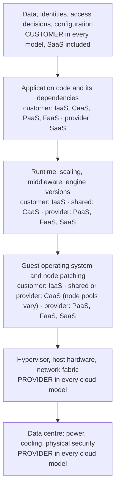
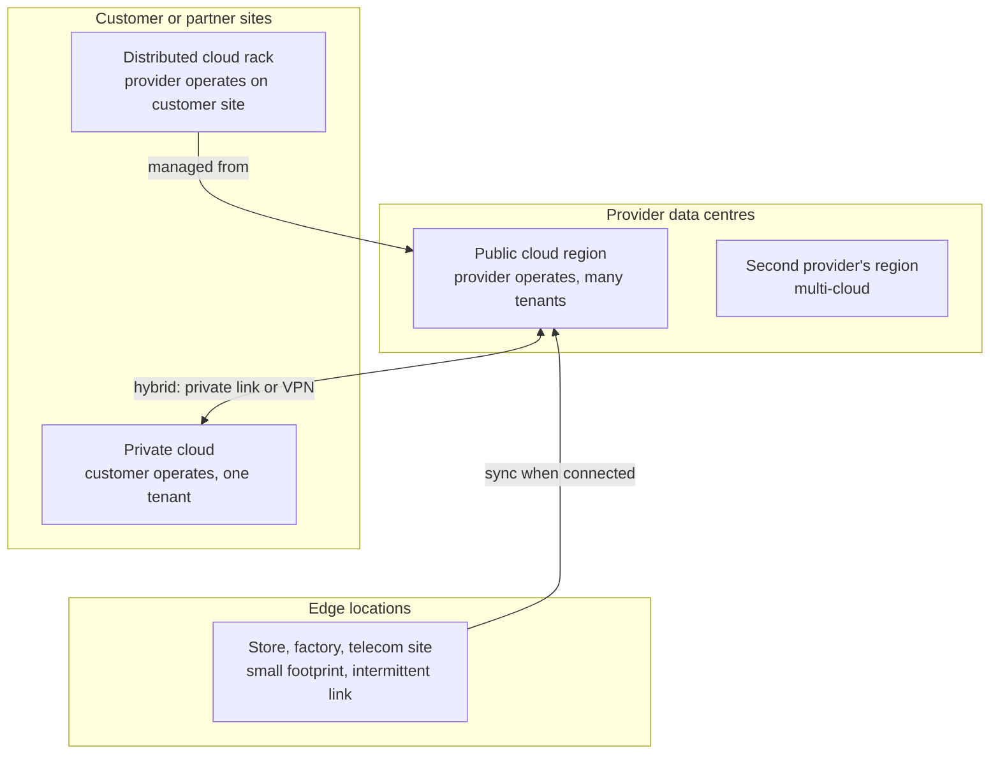
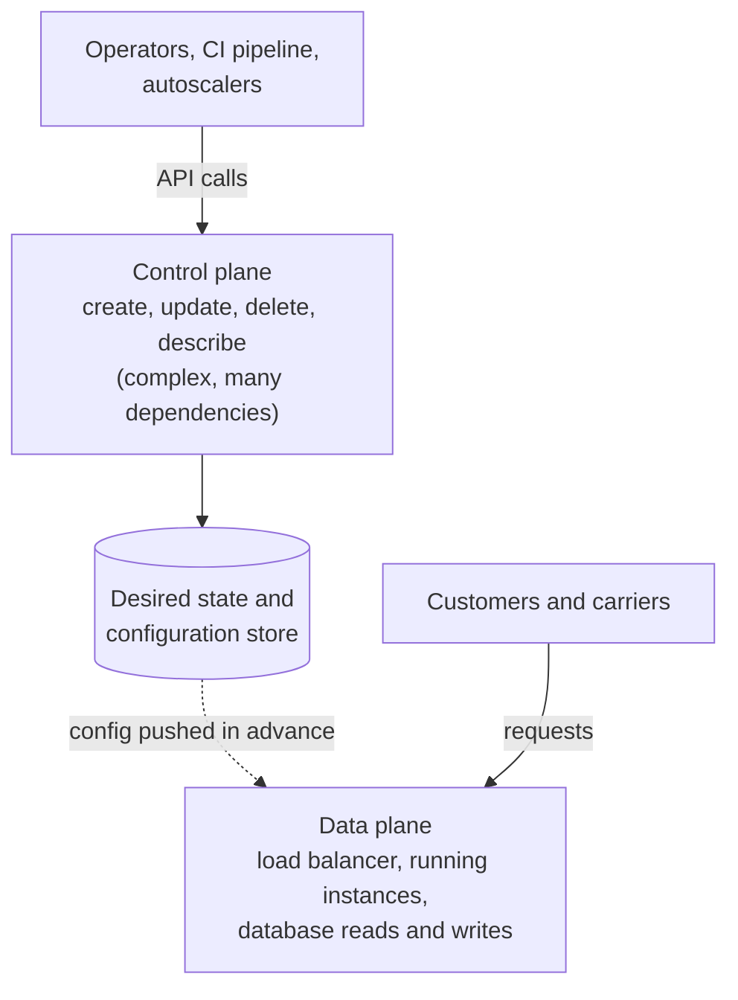
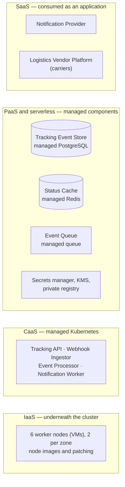

# Cloud service and deployment models

> A cloud service model is a contract about who runs which layer of the stack; a deployment model is
> a statement about where the hardware sits and who may share it. Choosing per component, not per
> company, is the architect's job, and the most important question in every choice is the same: what
> keeps working when the provider's management systems do not?

!!! abstract "Page facts"
    **Level:** Mixed (the models and shared responsibility are Level 1-2; per-component placement,
    lock-in registers, and control-plane independence are Level 3) · **Status:** Draft ·
    **Time:** 60-75 minutes · **Last verified:** 2026-11-21

## Learning objectives

After this page you should be able to:

- Define IaaS, CaaS, PaaS, FaaS, and SaaS by the layers each one hands to the provider, and place a
  real component on that spectrum with a reason.
- Distinguish public, private, community, hybrid, multi-cloud, distributed, and edge deployment
  models, and say which problem each one solves.
- Draw the shared responsibility split for each service model and name the duties that never move
  to the provider.
- Explain capital versus operating expenditure and elasticity with arithmetic, including when
  elasticity saves money and when it only buys headroom.
- Describe lock-in as an exit cost, list where it comes from, and choose mitigations that are worth
  their price.
- Separate a service's control plane from its data plane and design a workload whose request path
  does not depend on any control plane.

## Prerequisites

- [Quality attributes and trade-offs](../architecture-fundamentals/quality-attributes-and-trade-offs.md)
  — elasticity, portability, and cost are quality attributes that trade against each other.
- [High availability design](../reliability-and-disaster-recovery/high-availability-design.md) —
  zones, failover, and static stability.
- [Networking fundamentals: IP, CIDR, routing, and DNS](../networking/networking-fundamentals-ip-cidr-routing-and-dns.md)
  — the AtlasMart network that the worked example runs on.

## The problem this solves

Before cloud computing, running software meant owning everything underneath it: buying servers
months ahead, sizing them for a peak that might never come, racking and patching them, and keeping
spare parts. Every team made the same decisions about operating systems, databases, and queues, and
every team carried the same operational load whether or not that load was what made the business
different.

Cloud services sell those layers as a service with an API. That solves the procurement problem
(capacity in minutes, paid by use) and the undifferentiated-work problem (someone else patches the
database engine). It creates three new questions that this page answers. *Which layers should we
hand over, component by component?* *Where should the hardware be, and who may share it?* *What
happens to us when the provider's own management systems fail, or when we want to leave?*

## What it is

The US National Institute of Standards and Technology (NIST, SP 800-145) defines cloud computing by
five characteristics: **on-demand self-service**, **broad network access**, **resource pooling**
across many customers, **rapid elasticity**, and **measured service** (you pay for what is metered).
It names three service models (IaaS, PaaS, SaaS) and four deployment models (private, community,
public, hybrid). Practice has since added service models between and beside those three, and
deployment models that describe where provider-run infrastructure sits.

| Model | What you consume | What you still run | Typical examples (generic) |
|---|---|---|---|
| **IaaS** (infrastructure as a service) | Virtual machines, block storage, virtual networks | Guest OS, runtime, middleware, application, data | Virtual machines in a virtual network |
| **CaaS** (containers as a service) | A container orchestrator or container runtime service | Container images, workload configuration, often the worker nodes | Managed Kubernetes; serverless container platforms |
| **PaaS** (platform as a service) | A runtime or managed component with an API | Application code, configuration, data | Managed databases, managed caches, application platforms |
| **FaaS** (functions as a service) | Execution of a function per event, scaled to zero | Function code, event wiring, data | Functions triggered by queues, HTTP, or storage events |
| **SaaS** (software as a service) | A complete application | Your configuration, your users, your data | Email, CRM, a notification service |

| Deployment model | Who owns and operates the hardware | Who shares it |
|---|---|---|
| **Public cloud** | A provider, in its own data centres | Many unrelated customers, isolated logically |
| **Private cloud** | The organization or a contractor, on dedicated hardware | One organization |
| **Community cloud** | One or more members or a provider | Organizations with shared concerns (for example a regulator's requirements) |
| **Hybrid cloud** | Mixed: private or on-premises plus public, connected and managed together | Per part |
| **Multi-cloud** | Two or more public providers used by one organization | Per provider |
| **Distributed cloud** | The public provider operates its services in locations it does not own (customer sites, partner facilities) | Usually one customer per installation |
| **Edge cloud** | Provider or customer, close to users or devices (stores, factories, telecom sites) | Varies; small, many, often intermittently connected |

## Mental model

Think of food. **IaaS** is renting a professional kitchen by the hour: the building, power, and ovens
are provided, but you bring the recipes, cook, and clean. **PaaS** is a catering service that cooks
your recipes in its kitchen to your instructions. **FaaS** is ordering single dishes as guests
arrive, paid per dish, with nothing cooked when nobody is there. **SaaS** is eating at a
restaurant: you choose from the menu and own only your table and your guests. **CaaS** sits between
the kitchen and the caterer: you supply sealed, ready-to-heat meals and a staff schedule, and the
venue's staff place and reheat them. Deployment models are about *where* the kitchen is: in a food
hall shared with strangers (public), in your own building (private), in a building shared by a few
hospitals with the same hygiene rules (community), or a truck parked outside your factory (edge).

**Where the analogy breaks:** a restaurant that closes its booking line still serves the guests
already seated, and that is exactly the property architects must *check* for in cloud services
rather than assume (the control plane and data plane section). Food is consumed and gone, but data
stays with the provider and costs money and time to move out, which is the heart of lock-in.

## Key terms

| Term | Meaning on this page |
|---|---|
| Service model | The split of stack layers between provider and customer (IaaS, CaaS, PaaS, FaaS, SaaS) |
| Deployment model | Where the infrastructure runs and who shares it (public, private, community, hybrid, multi-cloud, distributed, edge) |
| Shared responsibility model | The provider's statement of which security and operational duties it owns and which remain with the customer |
| Elasticity | Adding and removing resources automatically as load changes (see the glossary) |
| Capital expenditure (capex) | Money spent up front on assets, depreciated over their life |
| Operating expenditure (opex) | Money spent as you go on services and running costs |
| Lock-in | The cost, time, and risk of moving a workload to another provider or platform |
| Control plane | The management side of a service: the APIs and workflows that create, change, and delete resources |
| Data plane | The part of a service that does its main job for running resources: serving requests, storing and returning data |
| Static stability | Continuing to operate through a dependency's failure using only state already in place (see the glossary) |

## How it works

### The service-model spectrum

Each step from IaaS toward SaaS hands one more layer to the provider. What you gain is less
operational work and faster delivery; what you lose is control over versions, tuning, placement, and
timing, plus a little portability with each step.

**Figure 1 — Shared responsibility by service model.** Each layer lists who runs it in each model;
read from the top (always yours) to the bottom (always the provider's in any cloud model).



How to read it: the line between customer and provider moves down the stack as you move from SaaS
to IaaS, but it never moves past the top box. A misconfigured access policy on a SaaS tenant or a
public storage bucket on PaaS is the customer's breach, whatever the model. The "shared" layers are
where most incidents start, because each side assumes the other has it covered.

The three large providers each publish their own version of this split. Microsoft's lists duties
the customer always keeps (data, endpoints, accounts, and access management) and duties that move
or become shared with the model; AWS phrases it as the provider's security "of" the cloud versus the
customer's security "in" the cloud; Google adds **shared fate**, the provider's commitment to help
customers succeed with secure defaults, blueprints, and guidance rather than only drawing a line.
The principle is the same in all three: read the split for the exact service, not for the category.

**CaaS deserves care.** "Managed Kubernetes" usually means the provider runs the Kubernetes control
plane (API server, scheduler, etcd) while the customer owns worker nodes, their images and patches,
cluster add-ons, and everything deployed. Some offerings also manage nodes; serverless container
platforms hide nodes entirely. The same label can therefore hide three different responsibility
splits.

**FaaS** (defined, with its sibling "backend as a service", in the CNCF Serverless Working Group's
overview) runs code only when an event arrives, bills per invocation and duration, and scales to
zero. It suits spiky, event-driven, short tasks; it fits less well where work is long-running,
latency-critical on the first request after idle (a cold start), or needs connection pools to a
relational database.

### Deployment models

**Figure 2 — Where each deployment model puts the infrastructure.** Boxes are locations; the label
says who operates what is inside.



How to read it: hybrid is defined by the connection and the shared management between private and
public, not by either side alone. Distributed cloud keeps the provider's control plane in the
provider's region while the hardware sits on a customer site; edge pushes compute to where the data
is produced, and must assume the link back can be down.

What each model is for:

- **Public** for elasticity, breadth of managed services, and speed. The default for new workloads.
- **Private** when regulation, data sovereignty, steady predictable load, or existing investment
  outweighs elasticity. It brings back capacity planning and patching.
- **Community** when organizations with the same compliance regime share an environment built for
  it (for example a government or healthcare cloud).
- **Hybrid** when some systems must stay on premises (latency to factory equipment, data that may not
  move, a mainframe) and others benefit from public services. The connection becomes critical
  infrastructure (hybrid connectivity is covered in D09-T04).
- **Multi-cloud** for a specific reason: a service only one provider has, an acquisition, a
  regulator's concentration-risk concern, or negotiating leverage. Running *one* workload actively
  across two providers is rare and expensive; using *different* providers for different workloads
  is common.
- **Distributed** when the provider's services and APIs are wanted on a site the provider does not
  own: provider-operated racks in a customer data centre, or an extension of a region into a metro
  location. The provider remains responsible for the stack; the customer provides space, power, and
  network.
- **Edge** when latency, bandwidth, or autonomy demands compute next to devices: in-store systems that
  must keep selling when the WAN is down, or video analysis that cannot ship every frame.

### Economics and elasticity

**Capex versus opex.** Owned infrastructure is a capital purchase: you pay up front, depreciate over
the asset's life, and pay the same each month whether it is busy or idle. Cloud consumption is an
operating expense: you pay for what is metered. The comparison that matters is cost per unit of
*useful* work. With symbols only (no prices on this page):

- Owned server, monthly: `C / m + O`, where `C` is the purchase price, `m` the depreciation period in
  months, and `O` the monthly running cost (power, space, staff share).
- Equivalent on-demand capacity, monthly: `r × h`, where `r` is the hourly rate and `h` the hours it
  actually runs.
- Write `k` for how much more on-demand costs than owning when both run all month:
  `k = (r × 730) / (C / m + O)`. Then on-demand is cheaper whenever the fraction of the month the
  capacity is needed, `u = h / 730`, is below `1 / k`.

As an illustration only (not market data): if `k` were 2.5, on-demand would win for any capacity
needed less than 1 / 2.5 = 40% of the time, and owning (or a provider's commitment discount, which
lowers `k`) would win for the always-on baseline. Real decisions also price in staff, the cost of
being wrong about growth, and the speed of change; check your provider's current pricing and
commitment models.

**Elasticity** turns this into architecture: run the baseline on cheap, committed capacity and the
peaks on elastic capacity. It saves money only at the layer you are billed for. Scaling pods inside a
cluster saves nothing if the cluster's nodes (the billed IaaS layer) stay the same size; a managed
database billed per provisioned instance costs the same at 3 a.m. as at peak. The worked example
shows this for AtlasMart.

### Portability and lock-in

Lock-in is not a yes-or-no property; it is the **exit cost** of a choice, paid only if you leave.
It comes from:

- **Proprietary APIs and semantics** (a queue's visibility rules, a function's event format).
- **Data gravity:** the volume of data and the time and transfer charges to move it out.
- **Identity and policy models:** permissions written in one provider's policy language.
- **Operational knowledge and tooling:** runbooks, dashboards, and skills built around one provider.
- **Contracts:** commitments and discounts that run for years.

Lock-in is worth paying for when the service delivers far more than the exit cost times the
probability of exit. Mitigations, in order of usual value: choose services with **standard
interfaces** where they cost little (PostgreSQL or MySQL engines, Kubernetes, OCI container images,
OpenTelemetry); put **adapters** around proprietary APIs at a few seams (the hexagonal "ports and
adapters" idea); keep **infrastructure and policy as code** so the inventory is known; and write
an **exit plan** that states how data would leave and how long it would take. Running everything on
the lowest common denominator across providers is usually the most expensive mitigation of all.

### Control plane versus data plane

Every cloud service has two halves. The **control plane** is the management API and the workflows
behind it: create a virtual machine, resize a database, change a load balancer rule, update a DNS
record. The **data plane** is the service doing its job for resources that already exist: the
running instance, the load balancer forwarding packets, reads and writes against an existing bucket
or volume, a DNS server answering queries. AWS's guidance on fault isolation describes control
planes as complex orchestration with many dependencies (launching an instance touches capacity
placement, networking, storage, and identity), and data planes as deliberately simpler, so broad
failures are less likely in the data plane and a dependency on it is likely to be more available.

**Figure 3 — Control plane and data plane, and what survives a control-plane outage.** Solid arrows
are the request path; the dashed arrow is configuration pushed ahead of time.



How to read it: requests touch only the data plane. If the control plane fails, existing resources
keep serving with the last configuration pushed to them, but nothing new can be created, resized,
or reconfigured. A design is **statically stable** against control-plane failure when it can ride
through that window without any of the blocked actions.

Why this matters in outages: the actions engineers reach for during an incident (launch more
instances, fail over a database, change DNS, scale out) are mostly control-plane actions, and a broad
provider incident often impairs the control plane first. Designs that need those actions to *recover*
from a zone failure are exposed exactly when they need them. The Amazon Builders' Library article on
static stability describes the remedy: provision enough capacity in advance in every zone that losing
one zone needs no new launches (with three zones, each runs at about two-thirds of what it has been
load-tested to carry), and keep request-path dependencies on data-plane operations only.

Practical rules:

- **Pre-provision for a zone loss.** If a service needs `N` replicas at peak and runs in three zones,
  run at least `1.5 × N` so the two surviving zones hold `N` without launching anything.
- **Keep control-plane calls off the request path.** No "describe" calls per request, no creating
  resources on demand, no reading configuration from a management API at request time.
- **Cache what you fetch at start-up.** Secrets, signing keys, feature flags, and service endpoints
  should be cached so a running process survives the source being unreachable.
- **Prefer failover that the data plane performs.** A health-checked load balancer removing a bad
  target is data plane; a runbook step that edits DNS through a management API is control plane.

## Worked example: AtlasMart Order Tracking on the IaaS-to-SaaS spectrum

AtlasMart's platform team has asked the architect to document, for the Order Tracking System, where
each component sits on the service-model spectrum and why, what elasticity buys, where lock-in sits,
and which runtime dependencies are control planes. The platform facts come from the course's running
example: one EU region, three zones, managed Kubernetes for services, managed PostgreSQL and Redis,
and a managed queue (Phase 4 platform assumptions).

### Step 1 — Place every component

**Figure 4 — Order Tracking components by service model.** Each band holds the components consumed
at that level; the arrow shows "more handed to the provider".



How to read it: the further up the figure, the less AtlasMart operates. The worker nodes sit at the
bottom because, with the platform's managed Kubernetes as assumed here, AtlasMart's platform team
still chooses, patches, and replaces their images, which is IaaS-style responsibility.

| Component | Model | Why there | What AtlasMart still owns |
|---|---|---|---|
| Tracking API, Webhook Ingestor, Event Processor, Notification Worker | CaaS (managed Kubernetes) | Platform standard (constraint C-2); custom code with steady traffic and a 300 ms p95 target (NFR-3) suits always-on containers | Images, Deployments, HPA settings, network policies, signing |
| Worker nodes | IaaS | The cluster's billed unit; node pools are platform-owned | Instance type, node image, patch cadence, zone spread |
| Tracking Event Store (PostgreSQL, primary + synchronous standby) | PaaS | No differentiation in running database engines; managed failover meets RTO 1 h (NFR-7) | Schema, queries, parameter choices, backups' retention, access |
| Status Cache (Redis, ~1.8 GB working set) | PaaS | Same reasoning; a cache can be rebuilt, so the managed service's limits are acceptable | Key design, TTL (30 s), eviction policy |
| Event Queue | PaaS / serverless messaging | At-least-once delivery without running brokers; billed per use | Visibility timeout, DLQ policy, consumer idempotency |
| Secrets manager, KMS, private registry | PaaS | Security primitives that are hard to run well | Policies, rotation (yearly), who may read |
| Notification Provider, Logistics Vendor Platform | SaaS | Bought, not built | Contracts, credentials, data shared with them |
| Tracking Web UI | Served through the platform's standard web hosting (assumption: static assets on object storage behind a CDN, PaaS) | Static files need no servers | Build, cache headers, content |

Two components were candidates for FaaS and were kept on CaaS. The **Notification Worker** is
event-driven and bursty, which suits functions, but it already shares the cluster's images,
pipeline, identity, and dashboards; one more runtime model would add a second deployment path for a
small saving. The **Webhook Ingestor** must answer carriers quickly at up to about 70 events/s; cold
starts would add latency on the first request after idle. Both decisions should be revisited if the
cluster's minimum size, not the workload, becomes the cost driver.

### Step 2 — Elasticity in numbers

Load from the running example: 1.2M tracking reads/day ≈ 13.9/s on average, 210/s at the sale-day
design peak. Peak-to-average ratio: 210 / 13.9 ≈ 15.1. A fleet sized statically for the sale-day peak
would run at 13.9 / 210 ≈ 6.6% average utilization.

The Tracking API runs a minimum of 3 replicas and the HPA can scale to 9. Assume (new, illustrative
assumptions for this page) a 30-day month with 4 sale days; on the 26 normal days, 3 replicas for 20
hours and 6 replicas for a 4-hour evening peak; on sale days, 9 replicas for 12 hours and 3 for the
other 12.

| Schedule | Arithmetic | Replica-hours per month |
|---|---|---|
| Normal days | 26 × (20 × 3 + 4 × 6) = 26 × 84 | 2,184 |
| Sale days | 4 × (12 × 9 + 12 × 3) = 4 × 144 | 576 |
| **Elastic total** | 2,184 + 576 | **2,760** |
| Fixed at peak | 9 × 24 × 30 | 6,480 |

Elastic scaling uses 2,760 / 6,480 ≈ 42.6% of the replica-hours. But AtlasMart is billed for
**nodes**, not replicas, and the platform assumption is a fixed 6-node cluster sized to carry the
peak through a zone loss. Unless the cluster autoscaler removes nodes off-peak, the 57% fewer
replica-hours save nothing; they buy headroom for other workloads on the same nodes. That is the
honest conclusion at AtlasMart's scale: elasticity is a **reliability** feature here (absorbing a
sale-day spike without a ticket), and a **cost** feature only for the pay-per-use parts (the queue,
object storage, data transfer). The managed PostgreSQL and Redis are billed per provisioned instance
and cost the same at any load.

### Step 3 — Static stability through a zone loss

At sale-day peak the HPA runs up to 9 Tracking API replicas, 3 per zone. If a zone is lost, 6 remain.
By the `1.5 × N` rule the design is statically stable for any peak that needs at most 9 / 1.5 = 6
replicas; if load tests show the 210 reads/s peak needs more, the HPA maximum (and the node capacity
under it) must rise before the next sale, not during it. The same reasoning applies one layer down:
the 6 nodes, 2 per zone, must fit the surviving pods on 4 nodes (the compute sizing page checks this).

### Step 4 — Classify runtime dependencies

| Action | Depends on | Plane | Design response |
|---|---|---|---|
| Serve a tracking read | Load balancer, running pods, Redis, PostgreSQL | Data | Nothing to change: no control-plane call on the path |
| Validate a customer's access token | Identity Provider's signing keys | Data (cached) | Cache the key set; refresh in the background, keep the last good copy |
| Start a new pod | Kubernetes API and scheduler; image pull; secrets manager read; KMS decrypt | Control (cluster), data (registry, secrets, KMS) | Keep minimum replicas running; pre-pull images on nodes; cache secrets in memory |
| Scale out for a sale | HPA and scheduler; new nodes through the provider's compute API | Control | Raise minimums before planned sales; do not rely on new nodes during an incident |
| Fail over PostgreSQL to the standby | Managed service's failover workflow and DNS update | Control (provider-run) | Short DNS TTL (30 s, from the networking page); test failover in game days |
| Deploy a new version | CI pipeline, registry push, Kubernetes API | Control | Freeze deploys during provider incidents; roll back by keeping the previous ReplicaSet |

### Step 5 — Lock-in register

| Component | Proprietary surface | Exit cost | Mitigation chosen |
|---|---|---|---|
| Managed PostgreSQL | Management API, failover mechanics | Low: standard engine and wire protocol | Use only standard SQL features; logical backups in a portable format |
| Managed Redis | Management API | Very low: cache, rebuildable | None needed |
| Managed queue | Send, receive, and delete API, visibility semantics | Medium | Ingestor and Processor talk to a small queue port; one adapter per provider |
| Managed Kubernetes | Load balancer annotations, workload identity binding | Low to medium | Keep provider-specific settings in platform-owned overlays, not in service manifests |
| IAM policies, KMS keys, audit logs | Provider policy language and key hierarchy | High, and unavoidable on any provider | Policies as code; documented key and log inventory |
| Event data | Transfer time and charges | Grows with retention | Retention policy; exports in an open format |

### What the design decided

| Decision | Driven by |
|---|---|
| CaaS for all four custom services | C-2 (platform standard), NFR-3 latency, one deployment path |
| PaaS for database, cache, queue, secrets, keys | No differentiation in running them; NFR-7 RTO through managed failover |
| No FaaS for now | Cold starts on webhooks; one more runtime model for a small saving |
| HPA maximum treated as zone-loss capacity (`1.5 × N`) | NFR-2: survive a zone failure without control-plane actions |
| Elasticity justified as headroom, not savings | Node-level billing and a fixed minimum cluster |
| Adapter only around the queue | Highest proprietary-semantics exposure per line of code |

## Real-world architecture example

Most established companies run a portfolio rather than a model: SaaS for email, HR, and CRM; a
public cloud for customer-facing systems on managed Kubernetes and managed data services; a private
or co-located environment for a mainframe, hardware-tied licences, or data a regulator wants kept
close; and edge devices in stores or plants. A platform team standardizes one container platform and
a short list of approved managed services, publishes the responsibility split for each, and keeps a
lock-in register for the few that matter. Retailers keep store tills working with the WAN down (an
edge requirement) and pre-scale before known sales (control-plane independence by schedule).

## Design choices and trade-offs

| Choice | Favor when | Avoid when |
|---|---|---|
| IaaS (virtual machines) | Software needs OS-level control, licences tied to hosts, or lift-and-shift with no time to refactor | The team would mostly be patching and capacity planning undifferentiated software |
| CaaS (managed Kubernetes) | Many services, a platform team, portability of workloads across environments | One or two small services; the cluster's fixed cost and skills outweigh the benefit |
| PaaS managed data services | The engine is standard and the team gains nothing by operating it | You need engine versions, extensions, or tuning the service does not offer |
| FaaS | Spiky, event-driven, short tasks; scale to zero matters | Latency-critical first requests, long-running work, heavy connection pools |
| SaaS | A commodity capability (email, CRM, notifications) | The capability is the differentiator, or data cannot be shared with the vendor |
| Single public provider | Most organizations: depth of skills and services beats theoretical leverage | A regulator requires concentration-risk mitigation, or a required service exists elsewhere |
| Multi-cloud by workload | Acquisitions, best-of-breed services, regulatory diversification | It is chosen "to avoid lock-in" without a costed exit scenario |
| Hybrid or distributed cloud | Data or latency must stay on site but cloud APIs and operations are wanted | The site cannot provide power, space, or connectivity of the required quality |
| Pre-provisioned capacity for zone loss | Customer-facing paths with an availability SLO (NFR-2) | Batch or internal work that can wait for the control plane |

## Failure modes and anti-patterns

- **Assuming the provider does it.** Backups, encryption settings, or access reviews left to "the
  managed service". Detect: map every control to an owner using the shared responsibility table for
  the exact service. Prevent: a responsibility matrix per service in the platform catalogue.
- **Recovery that needs the control plane.** Runbooks that say "launch new instances" or "edit DNS"
  as the first step of zone recovery. Detect: game day with management API access removed. Prevent:
  pre-provisioned capacity and data-plane failover.
- **Elasticity that saves nothing.** Pods scale down; nodes do not. Detect: compare replica-hours to
  node-hours in billing data. Prevent: cluster autoscaling with sensible minimums, or accept that the
  benefit is headroom.
- **Lowest-common-denominator multi-cloud.** Every service rebuilt on raw VMs so it can run anywhere,
  at the cost of the managed services that justified the cloud. Detect: a design with no managed
  services "for portability". Prevent: a costed exit plan instead.
- **Lift-and-shift and stop.** IaaS copies of on-premises servers with the same manual operations
  and static sizing. Detect: average utilization in single digits on fixed fleets. Prevent: plan
  the second step (managed services, autoscaling) at migration time.
- **Unbounded FaaS.** Functions that fan out without concurrency limits overwhelm a database that
  cannot scale. Detect: connection exhaustion during bursts. Prevent: reserved concurrency limits, a
  queue in front, or connection proxies.
- **Edge sites that need the cloud to work.** Store systems that stop when the WAN is down. Detect:
  disconnect test. Prevent: local autonomy and later synchronization.

## Security considerations

- The customer always owns data, identities, and access decisions. A public bucket or an
  over-permissive role is the customer's incident on any service model.
- Each step toward SaaS moves patching to the provider (good) and moves visibility away (you cannot
  inspect the provider's hosts). Compensate with the provider's audit logs, certifications, and
  contractual rights, and with configuration posture management.
- Multi-tenancy is the public cloud's default; isolation between tenants is the provider's job, and
  the customer's job is isolation *between its own* environments (accounts, networks, keys).
- Control-plane credentials are the most powerful credentials you own: whoever can call the
  management API can delete the data plane. Protect them with SSO, MFA, short-lived roles, and
  separate break-glass access (D12-T02 covers identity in depth).
- Hybrid, distributed, and edge models extend the trust boundary to sites you must physically secure.
- Data location and sovereignty requirements (AtlasMart's C-4: EU customer data stays in the EU
  region) apply to every model, including SaaS vendors and their sub-processors. Whether a given law
  applies to a given company depends on facts; ask counsel.

## Performance, reliability, and cost

- **Performance:** managed services remove tuning knobs; check that the knobs you need (connection
  limits, engine parameters, instance families) exist before committing. FaaS adds cold-start
  latency; CaaS and IaaS add the cost of keeping capacity warm.
- **Reliability:** the provider's SLA covers its data plane for your resource, not your design.
  Static stability, pre-provisioned zone capacity, and cached start-up dependencies are what keep a
  workload up through provider incidents. Multi-cloud for reliability is only real if failover has
  been tested end to end.
- **Cost:** elasticity saves money only where billing is per use; commitments cheapen the baseline;
  data transfer and managed-service instance hours are the usual surprises (no prices quoted here).

## Hands-on lab: classify a system and test its elasticity claim

This mini-lab needs only a text editor and Python 3.

1. Pick a system you know (or use AtlasMart). List every component, including external services, and
   place each on the IaaS-CaaS-PaaS-FaaS-SaaS spectrum with one sentence of justification.
2. For each component, write who patches it, who backs it up, and who reviews access. Mark any cell
   where the answer is "not sure".
3. Reproduce the elasticity arithmetic for one service:

    ```python
    normal = 26 * (20 * 3 + 4 * 6)
    sale = 4 * (12 * 9 + 12 * 3)
    fixed = 9 * 24 * 30
    print(normal + sale, fixed, round((normal + sale) / fixed * 100, 1))
    ```

    Change the schedule to your own system's and say whether the billed layer actually shrinks.

4. List the actions your recovery runbook takes after a zone failure. Mark each as control plane or
   data plane.
5. Write a five-row lock-in register: component, proprietary surface, exit cost, mitigation, and
   whether the mitigation is worth its cost.

??? question "Hint: which runbook steps are control plane?"
    Anything that creates, resizes, deletes, or reconfigures a resource through a management API:
    launching instances, scaling a node group, promoting a replica, editing DNS records, changing
    load balancer rules. Health-checked load balancers removing failed targets, clients retrying
    against surviving replicas, and caches serving stale data are data-plane behaviour.

## Knowledge check

1. In managed Kubernetes, who typically patches the worker nodes' operating system, and why does the
   answer vary?
2. Which duties stay with the customer in every service model, SaaS included?
3. A fleet sized for a 210/s peak serves an average of 13.9/s. What is its average utilization, and
   why might autoscaling pods still not reduce the bill?
4. Give two examples of control-plane actions and two of data-plane operations, and explain why
   recovery plans should avoid depending on the first kind.
5. Why is "multi-cloud to avoid lock-in" often a poor reason on its own?

??? success "Answers"
    1. Usually the customer (or its platform team), because the provider runs the Kubernetes control
       plane while nodes are customer-owned VMs; some offerings manage node patching or hide nodes
       entirely, so check the exact service's responsibility split.
    2. Data, identities and accounts, access decisions and configuration of the service (plus the
       devices users connect from).
    3. 13.9 / 210 ≈ 6.6%. If billing is per node and the node count stays fixed, fewer pods use the
       same paid nodes; savings need the node layer to scale too (or the benefit is only headroom).
    4. Control plane: launching an instance, changing a DNS record through the API, resizing a
       database. Data plane: a running instance serving requests, reads and writes to an existing
       bucket, a DNS server answering queries. Control planes are more complex and more likely to be
       impaired in a broad incident, exactly when recovery would call them.
    5. It trades a possible future exit cost for a certain present cost: duplicated skills, tooling,
       and the loss of managed services. Without a costed exit scenario and a realistic probability
       of using it, the mitigation usually costs more than the risk.

## Architecture discussion questions

1. AtlasMart's finance team asks why the Tracking API autoscales if it saves no money. Prepare the
   argument for keeping autoscaling and the changes that would make it save money, with their risks.
2. A regulator asks AtlasMart to show it could continue Order Tracking if its cloud provider had a
   prolonged region-wide control-plane outage. What would you demonstrate, and what would you admit
   cannot be done without a second region or provider?
3. A team proposes moving the Notification Worker to functions to "scale to zero". Under what traffic
   pattern and cost structure would you agree, and what would you require first?

## Summary

Service models split the stack between provider and customer: IaaS hands over hardware and
virtualization, CaaS the container orchestrator, PaaS the runtime or managed component, FaaS
execution per event, SaaS the whole application; data, identities, and access decisions stay with
the customer in all of them. Deployment models say where the hardware is and who shares it: public,
private, community, hybrid, multi-cloud, distributed, and edge. Cloud turns capex into opex and makes
elasticity possible, but elasticity saves money only at the layer you are billed for. Lock-in is an
exit cost to manage with standard interfaces, a few adapters, and an exit plan, not a reason to
avoid managed services. Control planes create and change resources; data planes serve; designs that
keep the request path and zone recovery on the data plane stay up when providers' management systems
do not. AtlasMart runs its services on CaaS, its data on PaaS, buys SaaS for notifications and
carriers, and treats its HPA maximum as zone-loss capacity.

## Related topics

- **Before:** [Quality attributes and trade-offs](../architecture-fundamentals/quality-attributes-and-trade-offs.md);
  [As-is and to-be architecture, gap analysis, and build versus buy](../architecture-fundamentals/as-is-and-to-be-architecture-gap-analysis-and-build-vs-buy.md)
  (SaaS is "buy").
- **Alongside:** [Cloud building blocks and landing zones](cloud-building-blocks-and-landing-zones.md);
  [Compute options and sizing](compute-options-and-sizing.md) (the node-level arithmetic);
  [Cloud providers: principles before catalogs](cloud-providers-principles-before-catalogs.md);
  [High availability design](../reliability-and-disaster-recovery/high-availability-design.md)
  (static stability); [Architecture styles](../software-architecture/architecture-styles.md)
  (hexagonal adapters at lock-in seams).
- **Planned:** hybrid connectivity (D09-T04, being written as
  [Hybrid connectivity and VPNs](../networking/hybrid-connectivity-and-vpns.md)); FinOps and cost
  allocation (D17); disaster recovery (D13-T03); Well-Architected and adoption frameworks (D28).

## References

| Source | Type | Checked |
|---|---|---|
| Peter Mell and Timothy Grance, [SP 800-145: The NIST Definition of Cloud Computing](https://csrc.nist.gov/pubs/sp/800/145/final), NIST, 2011 | Standard (definitions of characteristics, service and deployment models) | 2026-11-21 |
| [Shared responsibility in the cloud](https://learn.microsoft.com/en-us/azure/security/fundamentals/shared-responsibility) — Microsoft Learn | Official documentation (responsibility by service model) | 2026-11-21 |
| [Shared Responsibility Model](https://aws.amazon.com/compliance/shared-responsibility-model/) — Amazon Web Services | Official documentation | 2026-11-21 |
| [Shared responsibilities and shared fate on Google Cloud](https://docs.cloud.google.com/architecture/framework/security/shared-responsibility-shared-fate) — Google Cloud Architecture Center | Official documentation (shared fate) | 2026-11-21 |
| [Control planes and data planes](https://docs.aws.amazon.com/whitepapers/latest/aws-fault-isolation-boundaries/control-planes-and-data-planes.html) — AWS Fault Isolation Boundaries whitepaper | Whitepaper | 2026-11-21 |
| Mike Furr, [Static stability using Availability Zones](https://aws.amazon.com/builders-library/static-stability-using-availability-zones/) — Amazon Builders' Library | Article (pre-provisioning so zone loss needs no control-plane action) | 2026-11-21 |
| [Serverless overview whitepaper](https://github.com/cncf/wg-serverless/blob/master/whitepapers/serverless-overview/README.md) — CNCF Serverless Working Group | Whitepaper (FaaS and BaaS definitions) | 2026-11-21 |
| [What is Azure Local?](https://learn.microsoft.com/en-us/azure/azure-local/overview) — Microsoft Learn | Official documentation (one example of provider services on customer-owned sites) | 2026-11-21 |

## Review notes

- Canonical page for D10-T01. In depth: service models, shared responsibility, economics and
  elasticity, lock-in, control versus data plane. Only defined: community, distributed, and edge
  cloud (the last two are not in NIST SP 800-145; the definitions are the page's own).
- FaaS follows the CNCF serverless overview; control and data plane paraphrase AWS's fault
  isolation whitepaper; `1.5 × N` is arithmetic from static stability (the Builders' Library article,
  now redirecting to builder.aws.com with Mike Furr in the byline, says about two-thirds per zone).
- New AtlasMart assumptions (labelled in the text): Tracking Web UI as static assets on object
  storage behind a CDN; the replica schedule (30-day month, 4 sale days) giving 2,760 versus 6,480
  replica-hours. Peak-to-average 15.1 and 6.6% are arithmetic from existing load numbers; the
  Notification Worker in the cluster follows the compute sizing page; `k = 2.5` is illustrative.
- No prices, quotas, or SLA figures. Figures 2 and 4 use `~~~` to stack subgraphs; check in a browser.
