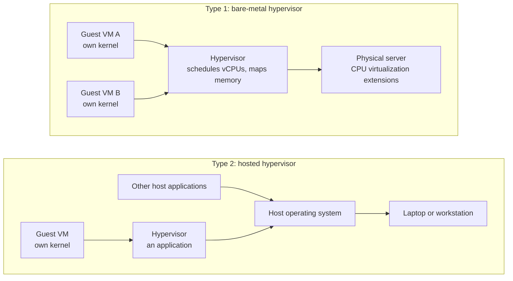
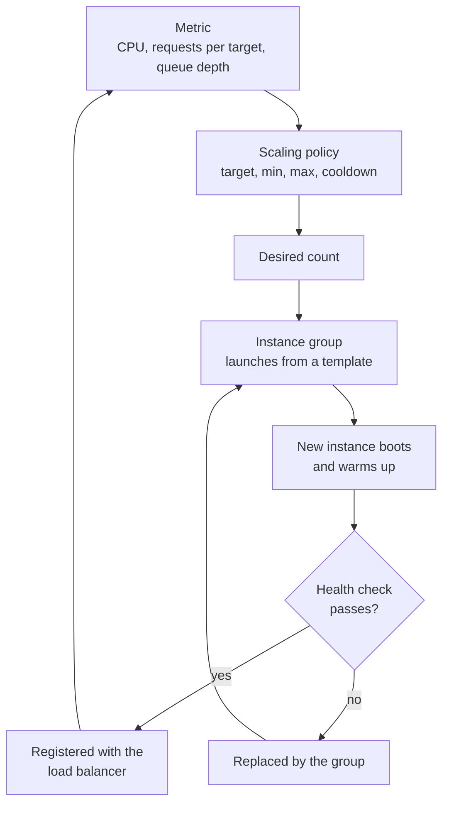
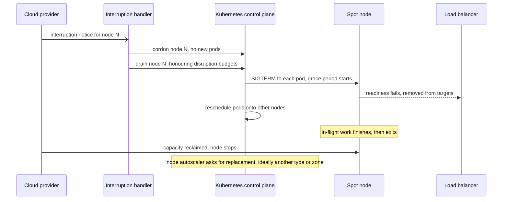
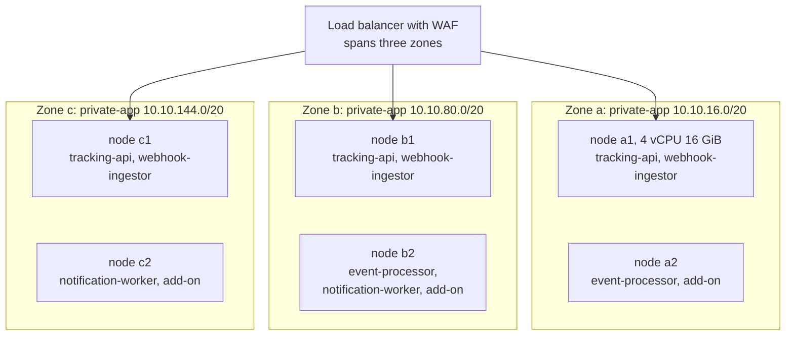

# Compute options and sizing

> Every compute option, from a physical server to a function, trades control for convenience and
> start-up speed. Sizing is the same arithmetic on all of them: CPU time per unit of work, times the
> design peak, divided by a utilization target, then rounded up for availability and packing.

!!! abstract "Page facts"
    **Level:** Intermediate (the options and vocabulary are Level 1-2; placement, spot strategy, and
    the node-pool sizing method are Level 3) · **Status:** Draft · **Time:** 60-90 minutes ·
    **Last verified:** 2026-11-21

## Learning objectives

After this page you should be able to:

- Place physical servers, bare metal, virtual machines, containers, serverless functions, batch, and
  HPC on one spectrum, and say what each gives up and gains.
- Explain type 1 and type 2 hypervisors and the costs of virtualization an architect still sees.
- Design an instance group with autoscaling, and explain why scaling out takes minutes, not
  seconds, for anything that boots a machine.
- Use spot capacity safely: which workloads tolerate interruption and how a platform reacts to the
  warning.
- Reason about serverless cold starts and concurrency with Little's Law, and choose spread, cluster,
  or partition placement.
- Size a Kubernetes node pool from a non-functional requirement, separating real CPU work from
  reserved requests, and check it survives a zone failure.

## Prerequisites

- [Computers, operating systems, and Linux for architects](../foundations/computers-operating-systems-and-linux-for-architects.md)
  — vCPUs, hardware threads, cgroups, and the per-request CPU figure this page reuses.
- [How to estimate load, throughput, storage, and capacity](../performance-and-scalability/capacity-estimation.md)
  — the source of AtlasMart's 210 reads/s and 70 events/s design peak.
- [Cloud service and deployment models](cloud-service-and-deployment-models.md) — IaaS, PaaS, FaaS,
  and CaaS, which this page turns into concrete compute choices.

## The problem this solves

"Where does the code run, and on how much?" is often answered by habit: the last team used VMs, the
instance size came from a template, the cluster has six nodes because a slide said so. Habit either
pays for idle cores every hour of the year or fails at the worst moment, usually from a mismatch of
shape rather than total size: pods that cannot be scheduled during a sale, survivors too small after
a zone failure, a function that floods a database with connections. A deliberate compute choice plus
a written sizing method turns those surprises into arithmetic anyone can check.

## What it is

**Compute** is the capacity to run code: processors, memory, and the local resources attached to
them. Cloud providers sell it at several levels of abstraction. The lower the level, the more you
control and the more you operate yourself.

| Option | What you get | You manage | Start-up time (relative) | Typical fit |
|---|---|---|---|---|
| Physical server (on premises) | A whole machine in your own facility | Everything, including hardware and the building | Weeks (procurement) | Steady loads, data-centre estates, special hardware |
| Bare metal instance (cloud) | A whole rented machine, no hypervisor between you and it | OS and up; provider owns hardware | Slowest of the cloud options | Licensing tied to physical cores, own hypervisor, hardware features |
| Virtual machine (VM) | A slice of a machine with its own kernel, behind a hypervisor | OS and up | Minutes | The default general-purpose building block |
| Container on a VM or cluster | An isolated process group sharing the host kernel | Image and app; a platform manages hosts | Seconds when the image is cached | Services packed densely onto shared hosts |
| Serverless function | Code invoked per event in a provider-managed sandbox | Code and configuration only | Fast when warm; a cold start adds a delay | Spiky, event-driven, short-running work |
| Batch service | A managed queue of jobs run on capacity it provisions | Job definitions and container images | Minutes (capacity is started per job wave) | Large numbers of independent jobs, deadline-driven |
| HPC cluster | Tightly coupled nodes on a low-latency network, often with a job scheduler | Scheduler, nodes, shared storage | Minutes to hours | Simulations and models whose nodes exchange data constantly |
| GPU or accelerator instance | A VM or bare metal machine with accelerators attached | Drivers, frameworks, and up | Minutes; capacity is often scarce | Model training and inference, rendering, video |

The rows are not exclusive: a container runs on a VM, a managed Kubernetes cluster is a group of VMs,
and many function services run each sandbox inside a lightweight VM. The choice is about which layer
your team operates and which layer you rent. Containers give fast start-up, dense packing, and one
artifact for every environment, but you still size the hosts underneath unless a serverless container
service hides them; their mechanics are on [Containers and images](../containers-and-kubernetes/containers-and-images.md).

## Mental model

Think of housing. A **physical server** is owning a house; **bare metal** is renting a whole
detached house; a **VM** is a flat with its own lock (kernel) in a block run by a building manager
(the hypervisor); a **container** is a room in a shared flat with one kitchen (the kernel); a
**function** is a hotel room by the night, and the first guest of the morning waits while it is made
up (the cold start). **Spot capacity** is a cheap sublet the owner can reclaim at short notice.

**Where the analogy breaks:** VMs are built in minutes, so compute is elastic as housing never is.
Isolation strength differs sharply between a VM (hardware-assisted boundary) and a container (shared
kernel), unlike walls. And a noisy neighbour shows up as variable latency (steal time), not sound.

## Key terms

| Term | Meaning on this page |
|---|---|
| Hypervisor | Software that runs virtual machines and shares physical hardware among them; type 1 runs directly on the hardware, type 2 runs as an application on a host operating system |
| Virtual machine (VM) | An emulated computer with its own kernel and virtual devices, run by a hypervisor |
| Bare metal instance | A whole physical server rented from a cloud provider with no provider hypervisor between the tenant and the hardware |
| vCPU | A virtual CPU sold by a cloud provider or allotted to a container; often one hardware thread rather than a whole core |
| Instance group | A set of identical VMs created from one template and managed as a unit, usually with autoscaling and health-based replacement |
| Autoscaling | Changing the number (horizontal) or size (vertical) of instances automatically from a metric, the mechanism behind elasticity |
| Spot capacity | Spare provider capacity sold at a discount that the provider can reclaim after a short notice |
| Serverless function | Code the provider runs per event, scaling the number of sandboxes with demand and billing per invocation and duration |
| Cold start | The extra latency of an invocation that must first create and initialize a new sandbox |
| Placement | Rules for where instances land relative to each other: spread apart, packed close, or split into partitions |
| Request (Kubernetes) | The CPU and memory a container is guaranteed and the scheduler reserves for it on a node |
| Allocatable | A node's capacity minus what is reserved for the operating system, the kubelet, and eviction thresholds |
| Headroom | Spare capacity kept above expected peak load, expressed as a utilization target |

## How it works

### Physical servers, hypervisors, and virtual machines

One application per **physical server** wastes most of it, so virtualization took over data
centres: a **hypervisor** divides a server into **virtual machines**, each with virtual CPUs, memory,
disks, and network cards, and each booting its own kernel. A **type 1** (bare-metal) hypervisor runs directly on the hardware and is the
only thing there; cloud providers and data-centre virtualization platforms use this kind. A **type
2** (hosted) hypervisor is an application on a desktop or server operating system, the kind used for
running a test VM on a laptop. The boundary is blurred in practice: the Linux kernel's built-in
hypervisor turns a general-purpose OS into a type 1 hypervisor. NIST SP 800-125 (References)
describes both and their security implications.

**Figure 1 — Type 1 and type 2 hypervisors.** Each arrow means "runs on". The upper
stack is what a cloud VM sits on; the lower one is a developer's laptop.



How to read it: an arrow means "runs on". In type 2 the hypervisor competes with other applications
for the host operating system, which is fine for a laptop and wrong for production.

With CPU virtualization extensions and offload cards, guests run close to native speed. What an
architect still sees is second-order: **steal time** when a neighbour's vCPUs compete with yours (see the
[Linux page](../foundations/computers-operating-systems-and-linux-for-architects.md)), network-attached
disks by default, **burstable** instance types that slow down when their CPU credit runs out, and
vCPUs that are hardware threads rather than whole cores.

**Bare metal** removes the provider's hypervisor. You choose it for software licensed per physical
core, for running your own hypervisor or a VM-based sandbox, for hardware performance counters, or
for strict single-tenancy requirements. **Dedicated hosts** are a middle ground: a provider
hypervisor, but on a server that runs only your VMs.

### Instance families and the CPU-to-memory ratio

Providers group VM sizes into **families**: general purpose, compute-optimized (less memory per
vCPU), memory-optimized (more), storage-optimized, and accelerated. Within a family, sizes usually
double with memory in a fixed ratio. That ratio in GiB per vCPU (4 for AtlasMart's assumed 4 vCPU /
16 GiB node) matters most after the total: a mismatch with the workload strands memory or CPU. Exact
ratios and sizes change often; check the provider's current documentation.

### ARM and x86

Most cloud servers use **x86-64** processors; all three large providers also sell **Arm-based**
(ARM64, also called AArch64) instance families. Two questions decide whether to use them:

1. **Compatibility.** Python, Java, Node.js, and .NET code usually runs unchanged, but native
   extensions, agents, and base images must exist for ARM64; an image index can list one image per
   architecture under one tag ([Containers and images](../containers-and-kubernetes/containers-and-images.md)).
   An x86-only binary is a blocker.
2. **Price-performance.** The providers publish claims for their Arm families (References). Treat
   them as vendor claims: benchmark your workload on both at the same utilization target and compare
   cost per unit of work. A mixed fleet works (Kubernetes schedules by architecture label) but doubles
   image builds and performance tests.

### Instance groups and autoscaling

An **instance group** creates identical VMs from a **template** (machine image, size, network,
start-up script, identity) and keeps a desired number running, replacing any that fail health
checks. **Autoscaling** changes that desired number from a metric. Policies come in four common
forms:

| Policy | How it decides | Good for | Watch out for |
|---|---|---|---|
| Target tracking | Keeps a metric near a target (CPU at 70%, requests per instance, queue depth per worker) | Most stateless services | A metric that does not track load (CPU on an I/O-bound service) |
| Step or threshold | Adds or removes a fixed number when a metric crosses bands | Coarse control, simple rules | Oscillation without cooldowns |
| Scheduled | Changes the minimum at known times | Predictable peaks, sale days | Forgetting to remove it |
| Predictive | Forecasts load from history and scales ahead | Strong daily patterns, slow boots | Novel events that history does not contain |

**Figure 2 — The autoscaling control loop.** A metric drives a policy, the policy sets a desired
count, and the group launches or removes instances. New instances join the load balancer only after
they pass health checks.



How to read it: the time from a metric crossing its target to a new instance serving traffic is the
sum of every box. For a VM that is typically minutes, so shorter bursts must be absorbed by headroom
or a queue.

Kubernetes repeats the loop at two layers. The **Horizontal Pod Autoscaler** (HPA) changes the
number of pods; per the Kubernetes documentation it computes the desired replicas as the current
replicas times the ratio of the current metric to the target, rounded up, and CPU utilization is
measured against each pod's **request**. A **node autoscaler** (the Cluster Autoscaler, or Karpenter)
adds nodes when pods cannot be scheduled and removes underused ones; pods appear in seconds, nodes
as slowly as a VM. Vertical scaling (a bigger instance) usually needs a restart and stops at the
largest size, so keep it for components that do not split easily, such as databases.

### Spot and preemptible capacity

Providers sell unused capacity at a large discount on condition that they can take it back: **spot**
capacity (Google Cloud's Spot VMs are the latest version of preemptible VMs). On reclaim they send an
interruption notice, then stop, hibernate, or delete the instance; notice length and behaviour differ
by provider, so check current documentation and design for the shortest. Spot suits interruptible
work: queue workers, CI agents, checkpointed batch, test environments, and replicas above an
on-demand base. It does not suit singletons, stateful primaries, or shutdowns longer than the notice.

**Figure 3 — Handling a spot interruption on a Kubernetes node.** A handler (a provider integration
or an open-source node termination handler) turns the notice into an orderly drain.



How to read it: time runs downward. Everything between the notice and the reclaim must fit inside the
notice period, so each pod's termination grace period, and its slowest in-flight request, must be
shorter than the notice.

To make spot safe: **diversify** across instance types and zones so one capacity pool running dry
does not take every node; keep an **on-demand base** that meets the availability target and put only
the burst on spot; make work **idempotent and checkpointed** so redelivery and restarts are harmless;
and set **PodDisruptionBudgets** so a drain cannot remove too many replicas at once.

### Serverless functions: cold starts and concurrency

A **serverless function** service routes each event to a free sandbox, creating one when none is
free, and bills per invocation and duration, so idle costs nothing. Two properties shape designs.

**Cold starts.** A new sandbox must be created, the code package downloaded, the language runtime
started, and your initialization code run (imports, configuration, connection set-up) before the
first event is handled. The delay depends on runtime, package size, memory setting, and network
configuration. Mitigations: keep packages small, initialize lazily, reuse connections across
invocations, and, where latency matters, pay for pre-warmed capacity. The providers name it
differently: AWS Lambda **provisioned concurrency**, Cloud Run **minimum instances**, Azure Functions
**always ready** instances in the Flex Consumption plan (References).

**Concurrency.** The number of sandboxes busy at once follows Little's Law: concurrency = arrival
rate × average duration. AtlasMart's 70 events/s at a 20 ms processing time
([capacity page](../performance-and-scalability/capacity-estimation.md)) would need only
70 × 0.02 = 1.4 concurrent executions on average. The danger is the other direction: a carrier
backlog of 833 events/s at the same duration is about 17 concurrent executions, each opening its own
database connection. Providers cap concurrency per account and region (a quota; check the current
documentation), and most let you **reserve** or limit concurrency per function, which is how you
protect a database from a function that scales faster than it can.

Functions also have a maximum execution duration and little local state; long or stateful work
belongs elsewhere.

### Batch and HPC

**Batch** runs many independent jobs from a queue and cares about throughput and deadline, not
latency; a managed batch service starts capacity (often spot) when jobs arrive and stops it when the
queue empties, as Kubernetes Jobs and CronJobs do inside a cluster. **High-performance computing
(HPC)** splits one problem across nodes that exchange data constantly (weather or fluid models), so it
needs a low-latency interconnect, **cluster placement**, a parallel file system, and a job scheduler;
one slow node makes all wait.

### GPUs and other accelerators

A **GPU** (graphics processing unit) runs thousands of simple arithmetic operations in parallel, the
standard engine for model training, inference, rendering, and video. Three facts suffice here: GPU
capacity is scarce and often reserved ahead; memory per device usually limits what fits; and drivers
and framework versions add a compatibility matrix to every image. Depth is in GPU infrastructure and
distributed training (D24-T01, planned).

### Placement: spread, cluster, and partition

Placement controls how close instances are to each other inside a zone.

| Strategy | What it does | Choose it for | Cost |
|---|---|---|---|
| Spread | Puts each instance on distinct hardware (different racks or hosts) | A few critical instances that must not fail together: quorum members, primaries | Small groups only; the provider limits how many fit |
| Cluster (compact) | Packs instances close together for the lowest latency and highest bandwidth between them | HPC, tightly coupled distributed training | One rack or network segment is a shared fault domain |
| Partition | Divides instances into partitions that do not share hardware with each other | Large replicated systems (distributed databases, log stores) that map replicas to partitions | Must make the software aware of the partitions |

Placement works inside a zone; spreading across zones is a separate, coarser decision made with
subnets, instance groups, and Kubernetes **topology spread constraints**. Most stateless services
need only zone spread.

### A CPU and memory sizing method

The capacity page sizes in "instances"; inside a shared platform you size in vCPUs and GiB.

1. **Measure CPU time per unit of work** (per request, per event) from a load test or profile. CPU
   time, not latency: a 50 ms request that waits 45 ms on a database costs 5 ms of CPU.
2. **Compute CPU work at the design peak**: rate × CPU time, summed over services.
3. **Divide by the utilization target** to get the capacity the work needs with headroom.
4. **Set per-replica requests** so that each replica, at its share of the peak, runs at or below the
   target, including when one replica is lost.
5. **Set replica minimums from availability**, not load: at least one per zone and N+1.
6. **Add the overhead**: per-node reservations for the operating system and kubelet, per-node agents
   (DaemonSets), and shared add-ons.
7. **Pack**: check requests against each node's allocatable capacity, including whether the largest
   pod fits at all, at both the minimum and the maximum replica counts.
8. **Remove a zone** and repeat step 7 with the survivors (static stability: the plan must not depend
   on launching new nodes during a zone failure, when everyone else is launching too).
9. **Size memory** from measured resident memory plus headroom, set memory requests equal to limits,
   and pick a node family whose GiB-per-vCPU ratio matches the workload.

### Provider names

The concepts above are provider-neutral. For orientation, the current names at the three largest
providers (checked 2026-11-21 against each provider's documentation in References):

| Concept | AWS | Azure | Google Cloud |
|---|---|---|---|
| Instance group with autoscaling | EC2 Auto Scaling groups | Virtual Machine Scale Sets | Managed instance groups (MIGs) |
| Spot capacity | EC2 Spot Instances | Azure Spot Virtual Machines | Spot VMs |
| Placement inside a zone | Placement groups (cluster, partition, spread) | Proximity placement groups; availability sets | Placement policies (compact, spread) |
| Serverless functions | AWS Lambda | Azure Functions | Cloud Run functions |
| Managed batch | AWS Batch | Azure Batch | Batch |
| Arm-based VMs | Graviton-based instances | Cobalt 100-based VMs | Axion-based VMs |

## Worked example: sizing AtlasMart's prod worker nodes

The platform team runs one shared managed Kubernetes cluster per environment in its platform
accounts; product teams get namespaces. The Phase 4 assumption is that **prod starts with 6
general-purpose worker nodes, 2 per zone, 4 vCPU and 16 GiB each, and the node autoscaler may grow
to 18 (assumption)**. The question: is that consistent with NFR-4 (210 reads/s plus 70 events/s while
CPU stays under 70%) once availability and Kubernetes overhead are included?

### Step 1 — Inputs and assumptions

| Input | Value | Basis |
|---|---|---|
| Design peak | 210 reads/s, 70 events/s | NFR-4; [capacity estimation](../performance-and-scalability/capacity-estimation.md) |
| Tracking API CPU per request | 4.7 ms | Derived on the [Linux page](../foundations/computers-operating-systems-and-linux-for-architects.md) from 300 requests/s at 70% of 2 vCPUs |
| Tracking API memory | 2 worker processes × about 180 MB resident, 1 GiB limit | Linux page assumptions |
| Webhook Ingestor CPU per webhook | 2 ms (verify signature, enqueue) | New assumption for this page |
| Event Processor CPU per event | 8 ms of its 20 ms processing time; the rest is waiting on the database | 20 ms from the capacity page; the 8 ms CPU share is a new assumption |
| Notification Worker | 2 replicas in the cluster, at most one notification per event, 2 ms CPU each | New assumption for this page |
| Replicas | Tracking API min 3, HPA max 9; Webhook Ingestor 3; Event Processor 2 | Phase 4 platform assumption |
| Per-node reservation (OS, kubelet, eviction threshold) | 0.2 vCPU, 1.5 GiB | New assumption; the managed service publishes its own formula, check the provider's current documentation |
| Per-node agents (CNI, kube-proxy, log and metrics agents) | 0.3 vCPU, 0.75 GiB | New assumption for this page |
| Shared platform add-ons (cluster DNS, ingress controller, autoscaler) | 3 pods × 0.5 vCPU, 1 GiB | New assumption for this page |

### Step 2 — CPU work at the design peak

- Tracking API: 210 × 4.7 ms = **0.99 vCPU**.
- Webhook Ingestor: 70 × 2 ms = **0.14 vCPU**.
- Event Processor: 70 × 8 ms = **0.56 vCPU**.
- Notification Worker: 70 × 2 ms = **0.14 vCPU**.
- Total ≈ **1.83 vCPU** of real work. At a 70% target: 1.83 ÷ 0.7 ≈ **2.61 vCPU** of capacity.
- Year two at the capacity page's 30% growth (270 reads/s, 90 events/s): 270 × 4.7 ms + 90 × 12 ms
  ≈ 2.35 vCPU of work, 3.36 vCPU at 70%.

Six nodes hold 24 vCPU. On load alone the cluster is about nine times larger than needed, which
repeats the capacity page's finding: availability and reservations, not load, set the size.

### Step 3 — Requests per pod

Kubernetes schedules by **requests**, not usage, and the HPA measures CPU against the request, so the
request is the real sizing lever. Each request below keeps its pod at or under 70% at the design
peak even after one replica of that service is lost.

| Service | Replicas | Request (CPU, memory) | CPU per pod at design peak | After losing one replica |
|---|---|---|---|---|
| Tracking API | 3 (max 9) | 1 vCPU, 1 GiB | 70/s × 4.7 ms = 0.33 (33%) | 105/s × 4.7 ms = 0.49 (49%) |
| Webhook Ingestor | 3 | 0.25 vCPU, 0.25 GiB | 23.3/s × 2 ms = 0.05 (19%) | 35/s × 2 ms = 0.07 (28%) |
| Event Processor | 2 | 0.8 vCPU, 0.5 GiB | 35/s × 8 ms = 0.28 (35%) | 70/s × 8 ms = 0.56 (70%) |
| Notification Worker | 2 | 0.25 vCPU, 0.25 GiB | 35/s × 2 ms = 0.07 (28%) | 0.14 (56%) |

The Tracking API keeps the Linux page's two worker processes but requests 1 vCPU with **no CPU
limit**, so both can use an idle second core without throttling; its memory request equals its 1 GiB
limit. At an HPA target of 70% of 1 vCPU, each pod carries 0.7 ÷ 0.0047 ≈ 149 requests/s, so three
pods absorb about 447 requests/s, twice the design peak, before the HPA adds a fourth.

### Step 4 — Allocatable capacity

Per node: 4 − 0.2 − 0.3 = **3.5 vCPU** and 16 − 1.5 − 0.75 = **13.75 GiB** for workload pods. Six
nodes give 21 vCPU and 82.5 GiB; with one zone lost, four nodes give 14 vCPU and 55 GiB.

### Step 5 — Pack the pods

The packing script from the hands-on lab below places every pod with a first-fit-decreasing
algorithm. Real output (Python 3.14, run on 2026-11-21):

```text
CPU work at design peak 1.83 vCPU, needed at 70% 2.61 vCPU
3 zones   min: requests  7.35 vCPU  8.25 GiB | allocatable 21.0 vCPU 82.5 GiB | unplaced 0
3 zones   max: requests 13.35 vCPU 14.25 GiB | allocatable 21.0 vCPU 82.5 GiB | unplaced 0
zone lost min: requests  7.35 vCPU  8.25 GiB | allocatable 14.0 vCPU 55.0 GiB | unplaced 0
zone lost max: requests 13.35 vCPU 14.25 GiB | allocatable 14.0 vCPU 55.0 GiB | unplaced 0
```

Checking one line by hand: at the maximum, requests are 9 × 1 + 3 × 0.25 + 2 × 0.8 + 2 × 0.25 +
3 × 0.5 = 13.35 vCPU. Everything fits: 35% of allocatable CPU at the minimum, 64% at the HPA
maximum, and 95% at the HPA maximum with a zone lost. The last case is tight but needs load around
six times the design peak (9 pods × 149 requests/s ≈ 1,340 requests/s) during a zone failure.

**Figure 4 — An illustrative placement of the minimum replicas.** Each zone holds two nodes in its
private-app subnet from the [address plan](../networking/networking-fundamentals-ip-cidr-routing-and-dns.md);
the scheduler, not this figure, decides the exact placement.



How to read it: the zones sit side by side; arrows show customer and carrier traffic entering the
API and ingestor pods in every zone. Two-replica services (Event Processor, Notification Worker)
cover two zones each, so any single zone failure leaves at least one replica of each.

### Step 6 — The 2-vCPU trap

Suppose the team copies the Linux page's "2 vCPU instance" into the pod spec as a 2-vCPU request.
Total requests change little, but packing does not: two such pods need 4 vCPU, more than a node's
3.5 allocatable, so each node holds at most one. The same script, run with a 2-vCPU API request
(output trimmed to the two lines with unplaced pods; both minimum lines place everything):

```text
3 zones   max: requests 22.35 vCPU 14.25 GiB | allocatable 21.0 vCPU 82.5 GiB | unplaced 3
zone lost max: requests 22.35 vCPU 14.25 GiB | allocatable 14.0 vCPU 55.0 GiB | unplaced 5
```

The HPA could never reach nine replicas: three pods stay pending with all zones up and five with a
zone lost. The fix is the 1-vCPU request above, or larger nodes, or at least nine nodes (three per
zone) and more again for zone loss. Total vCPU hides this; only packing shows it.

### Step 7 — Memory and node shape

Memory requests peak at 14.25 GiB of 82.5 GiB allocatable (17%), so a family with less memory per
vCPU would strand less. The nodes stay general-purpose because other tenants' profiles are not yet
measured; revisit with usage data (cloud cost models and FinOps, D17-T01, planned).

### What the sizing decided

| Decision | Driven by |
|---|---|
| The 6 × 4 vCPU / 16 GiB assumption holds for Order Tracking plus shared add-ons, including a zone loss | Steps 4 and 5 |
| Tracking API requests 1 vCPU with no CPU limit, memory request = limit = 1 GiB | Packing (Step 6) and the HPA target |
| Event Processor requests 0.8 vCPU, not 0.5 | It must stay at 70% when its partner replica is lost |
| No spot nodes in prod for these services; spot allowed in dev and staging node pools | Small savings on a small footprint versus interruption risk to NFR-2 |
| Keep the autoscaler maximum of 18 nodes (assumption) | Other teams' namespaces share the cluster; growth |

The cluster lives in the platform-prod account and other product teams get namespaces in it
(assumption), so their requests add to Step 5: six nodes is the starting size, and the node
autoscaler may grow the pool to 18 nodes (72 vCPU). Order Tracking's share is at most 13.35 vCPU of
requests, so the maximum leaves ample room; the zone-loss check must be repeated as tenants join.

## Real-world architecture example

A typical mid-sized platform mixes compute models by workload. Customer-facing APIs run on managed
Kubernetes across three zones on an on-demand node pool, with a spot node pool for queue workers and
CI runners. Spiky event glue (thumbnails, partner webhook fan-out) runs as functions with reserved
concurrency to protect databases. Nightly reprocessing runs on a batch service on spot capacity with
checkpoints; a database licensed per physical core runs on dedicated hosts; inference gets a tainted
GPU node pool. Each choice is recorded with the workload property that justified it.

## Design choices and trade-offs

| Choice | Favor when | Avoid when |
|---|---|---|
| VMs in instance groups | Workloads need a full OS, special agents, or no container platform exists | You have many small services to pack and a platform team to run a cluster |
| Managed Kubernetes | Many services, need for dense packing, one deployment model across teams | One or two services and no platform team; the cluster is overhead |
| Serverless functions | Spiky or low-volume, event-driven, short tasks; idle should cost nothing | Steady high volume, long tasks, strict tail latency with no budget for pre-warming |
| Serverless containers | Request-driven services that want container packaging without managing nodes | Workloads needing node-level agents, privileged access, or custom kernels |
| Bare metal or dedicated hosts | Per-core licensing, own hypervisor, hardware access, strict single tenancy | General workloads; you lose the provider's flexibility for little gain |
| Spot capacity | Interruptible, stateless, checkpointed, or above an on-demand base | Singletons, stateful primaries, shutdown longer than the notice |
| Arm-based instances | Every dependency has ARM64 builds and your benchmark shows lower cost per unit of work | Native x86-only dependencies, or no capacity to test both |
| Cluster placement | Nodes exchange data constantly (HPC, distributed training) | Anything that needs fault isolation between those instances |
| Larger, fewer nodes | Large pods, per-node overhead dominates, licences per node | Small clusters, where losing one node removes a large share of capacity |

## Failure modes and anti-patterns

- **Sizing by total vCPU only.** Detect: `Pending` pods with "insufficient cpu" events. Prevent:
  pack the largest pod against node allocatable at the maximum replica count (Step 6).
- **No room after a zone failure.** Detect: a zone-loss game day. Prevent: method step 8, with N−1
  zones pre-provisioned, because every tenant asks for capacity at once during the event.
- **Requests from guesses.** Too high wastes money; too low over-commits nodes. Detect:
  request-versus-usage reports. Prevent: requests from measured usage, reviewed quarterly.
- **CPU limits throttling latency-sensitive services.** Detect: rising `nr_throttled` with idle node
  CPU. Prevent: a request without a tight CPU limit, as on the Linux page.
- **Scaling on the wrong metric.** Detect: queue age rising with flat CPU. Prevent: scale workers on
  queue depth or age.
- **Spot everywhere.** Detect: correlated interruptions. Prevent: on-demand base, diversified pools,
  disruption budgets.
- **Unbounded function concurrency or cold starts on the critical path.** Detect: connection alarms
  during backlogs; p99 spikes after idle. Prevent: reserved concurrency and a queue; pre-warming.

## Security considerations

- **Isolation strength differs by model.** VMs have a hardware-assisted boundary, containers share a
  kernel; put untrusted or multi-tenant code behind a VM boundary or a sandboxed runtime. Dedicated
  hosts or bare metal remove the shared-host case where cross-tenant side channels are a concern.
- **Images and templates are the attack surface at scale.** Patch machine and node images on a
  schedule and rebuild, rather than patching running instances.
- **Metadata and workload identity.** Require the provider's hardened metadata mode, block pod access
  to node credentials, and use workload identity, not static keys (AtlasMart's platform rule).
- **Short-lived hosts.** Spot and autoscaled hosts may vanish before anyone looks, so logs and audit
  trails stream to the log archive account continuously.
- **Functions widen the permission surface.** Give each function its own least-privilege role.

## Performance, reliability, and cost

- **Performance:** CPU time per unit of work and the utilization target set throughput; the node
  family's generation and architecture shift CPU time per request, so re-measure after a change.
  Cold starts and VM boot times set how fast the system can react to a burst.
- **Reliability:** the minimum footprint comes from zone spread and N+1, and must still fit after a
  zone is lost without relying on new capacity during the event. Spot adds interruption as a
  routine failure mode, which is healthy if the system is built for it.
- **Cost:** the drivers are requested vCPU and GiB per hour (not usage), the on-demand versus spot
  versus committed-use mix, idle headroom, per-node overhead, and the stranded resource when the
  node ratio does not match the workload. Prices change by region and over time; check the
  provider's current price list, and compare cost per unit of work rather than per vCPU.

## Hands-on lab: check a node pool with a packing script

Local, free, about 20 minutes, Python 3.12 or later, no cloud account. The script below is the one
that produced the Step 5 output.

```python
"""Check whether AtlasMart's prod worker nodes hold the Order Tracking pods."""
import sys

NODE = (4.0, 16.0)       # vCPU, GiB per worker node (Phase 4 platform assumption)
RESERVED = (0.2, 1.5)    # kubelet, OS, eviction threshold per node (assumption)
DAEMONS = (0.3, 0.75)    # CNI, kube-proxy, log and metrics agents per node (assumption)
ALLOC = (NODE[0] - RESERVED[0] - DAEMONS[0], NODE[1] - RESERVED[1] - DAEMONS[1])
API_REQUEST = float(sys.argv[1]) if len(sys.argv) > 1 else 1.0

# name: (items/s at design peak, CPU ms per item, min, max replicas, request vCPU, GiB)
SERVICES = {
    "tracking-api": (210, 4.7, 3, 9, API_REQUEST, 1.0),
    "webhook-ingestor": (70, 2.0, 3, 3, 0.25, 0.25),
    "event-processor": (70, 8.0, 2, 2, 0.8, 0.5),
    "notification-worker": (70, 2.0, 2, 2, 0.25, 0.25),
    "platform-add-ons": (0, 0.0, 3, 3, 0.5, 1.0),  # DNS, ingress, autoscaler
}


def unplaced(pods, nodes):
    """First-fit decreasing on CPU; count pods that fit on no node."""
    free = [list(ALLOC) for _ in range(nodes)]
    misses = 0
    for cpu, mem in sorted(pods, reverse=True):
        node = next((f for f in free if f[0] >= cpu and f[1] >= mem), None)
        if node is None:
            misses += 1
        else:
            node[0] -= cpu
            node[1] -= mem
    return misses


work = sum(rate * ms / 1000 for rate, ms, *_ in SERVICES.values())
print(f"CPU work at design peak {work:.2f} vCPU, needed at 70% {work / 0.7:.2f} vCPU")
for label, nodes in (("3 zones", 6), ("zone lost", 4)):
    for size, col in (("min", 2), ("max", 3)):
        pods = [(s[4], s[5]) for s in SERVICES.values() for _ in range(s[col])]
        cpu, mem = sum(p[0] for p in pods), sum(p[1] for p in pods)
        print(f"{label:9} {size}: requests {cpu:5.2f} vCPU {mem:5.2f} GiB | "
              f"allocatable {nodes * ALLOC[0]:4.1f} vCPU {nodes * ALLOC[1]:4.1f} GiB | "
              f"unplaced {unplaced(pods, nodes)}")
```

1. Save it as `size_nodes.py` and run `python3 size_nodes.py`. Confirm the four lines match Step 5.
2. Run `python3 size_nodes.py 2.0` and explain, from the per-node allocatable, why pods are unplaced.
3. Change `NODE` to `(8.0, 32.0)` and the node counts to 3 and 2 (one large node per zone). Run both
   request sizes again and compare with six small nodes.
4. Add a fifth service of your own (for example an Order Lookup service at 100 requests/s and 6 ms of
   CPU each) and find the smallest request that keeps it under 70% after losing one of its replicas.
5. Stretch: the script ignores zones when packing. Change it to place pods per zone with a maximum
   skew of one replica between zones, and see whether any result changes.

??? question "Hint: why do three large nodes look better, and why are they riskier?"
    With fixed per-node overhead (this script's simplification; real reservations grow with node
    size), three 8-vCPU nodes give 22.5 vCPU allocatable against 21 for six small ones, and a
    2-vCPU pod now fits three to a node. But a zone loss still removes a third of capacity, a single
    node failure removes a third instead of a sixth, and node upgrades must drain a third of the
    cluster at a time. With 2-vCPU requests and a zone lost, nine pods are unplaced.

## Knowledge check

1. What is the difference between a type 1 and a type 2 hypervisor, and which kind runs cloud VMs?
2. A service's CPU target-tracking policy fires, yet users see errors for four minutes before new
   VMs help. Where did the four minutes go, and what absorbs a burst shorter than that?
3. Which three properties make a workload a good candidate for spot capacity?
4. A function averages 120 ms per event at 50 events/s, and a backlog arrives at 600 events/s. How
   many concurrent executions does each need, and what would you configure to protect the database?
5. In the worked example, total CPU requests fit easily, yet the 2-vCPU variant leaves pods pending.
   Why?

??? success "Answers"
    1. Type 1 runs directly on the hardware with nothing beneath it; type 2 runs as an application on
       a host operating system. Cloud VMs run on type 1 hypervisors.
    2. In the loop: the metric's evaluation window, VM boot, application start-up and warm-up, and
       health checks before the load balancer sends traffic. Headroom (a utilization target below
       100%) and queues absorb bursts shorter than that.
    3. It tolerates interruption (stateless or checkpointed), its work can be retried safely
       (idempotent), and it shuts down within the notice period; ideally it also runs above an
       on-demand base.
    4. 50 × 0.12 = 6 on average; 600 × 0.12 = 72 during the backlog. Reserve or cap the function's
       concurrency (and use a connection pooler or a queue) so the database sees a bounded number of
       connections.
    5. Packing works per node: two 2-vCPU pods need 4 vCPU, but each node has only 3.5 vCPU
       allocatable, so each node holds one such pod. Six nodes hold six, not nine.

## Architecture discussion questions

1. AtlasMart's finance team asks to run the whole prod cluster on spot capacity to save money.
   Using NFR-2, the zone-loss check, and the interruption sequence, argue for a split you would
   accept, and what evidence would change your mind.
2. The Webhook Ingestor could run as a serverless function instead of three pods. Compare the two
   for cold starts, carrier backlogs, signature verification secrets, and cost at 5.6 events/s
   average with peaks of 70.
3. A team wants to move the Tracking API to Arm-based nodes. Describe the benchmark, the image
   changes, and the rollout plan (including a mixed-architecture period) you would require.

## Summary

Compute runs from physical servers through bare metal, VMs, containers, and functions, with batch,
HPC, and GPU instances as specialised shapes; moving up gives up control for faster start-up and less
operation. Autoscaling is elastic at the speed of a boot; spot trades a discount for interruption;
functions bring cold starts and a concurrency Little's Law predicts; placement sets how close
instances sit in a zone. Sizing is CPU time per unit of work times the design peak over a utilization
target, then requests, availability minimums, overhead, packing, and a zone-loss check. For AtlasMart
it confirms six 4-vCPU nodes, provided the Tracking API requests 1 vCPU rather than 2.

## Related topics

- **Before:** [Computers, operating systems, and Linux for architects](../foundations/computers-operating-systems-and-linux-for-architects.md);
  [How to estimate load, throughput, storage, and capacity](../performance-and-scalability/capacity-estimation.md);
  [Cloud service and deployment models](cloud-service-and-deployment-models.md)
- **Alongside:** [Containers and images](../containers-and-kubernetes/containers-and-images.md);
  [Kubernetes architecture and workloads](../containers-and-kubernetes/kubernetes-architecture-and-workloads.md)
  — requests, HPA, and node autoscaling in depth; [High availability design](../reliability-and-disaster-recovery/high-availability-design.md)
  — N+1 and zone spread; [Cloud building blocks and landing zones](cloud-building-blocks-and-landing-zones.md).
- **Planned:** cloud cost models and FinOps (D17-T01); reliability engineering (D13-T02); GPU
  infrastructure and distributed training (D24-T01).

## References

| Source | Type | Checked |
|---|---|---|
| NIST SP 800-125, [Guide to Security for Full Virtualization Technologies](https://csrc.nist.gov/pubs/sp/800/125/final) | Standard guidance (hypervisor types and their security) | 2026-11-21 |
| Kubernetes documentation: [Resource management for pods and containers](https://kubernetes.io/docs/concepts/configuration/manage-resources-containers/), [Reserve compute resources for system daemons](https://kubernetes.io/docs/tasks/administer-cluster/reserve-compute-resources/), [Horizontal Pod Autoscaling](https://kubernetes.io/docs/tasks/run-application/horizontal-pod-autoscale/), [Node autoscaling](https://kubernetes.io/docs/concepts/cluster-administration/node-autoscaling/) | Official documentation (requests, allocatable, HPA formula, node autoscalers) | 2026-11-21 |
| AWS documentation: [Placement groups](https://docs.aws.amazon.com/AWSEC2/latest/UserGuide/placement-groups.html), [Spot Instance interruptions](https://docs.aws.amazon.com/AWSEC2/latest/UserGuide/spot-interruptions.html), [Auto Scaling groups](https://docs.aws.amazon.com/autoscaling/ec2/userguide/auto-scaling-groups.html), [AWS Batch](https://docs.aws.amazon.com/batch/latest/userguide/what-is-batch.html) | Official documentation | 2026-11-21 |
| Microsoft Azure documentation: [Azure Spot Virtual Machines](https://learn.microsoft.com/en-us/azure/virtual-machines/spot-vms), [Proximity placement groups](https://learn.microsoft.com/en-us/azure/virtual-machines/co-location), [Virtual Machine Scale Sets](https://learn.microsoft.com/en-us/azure/virtual-machine-scale-sets/overview), [Azure Batch](https://learn.microsoft.com/en-us/azure/batch/batch-technical-overview) | Official documentation | 2026-11-21 |
| Google Cloud documentation: [Spot VMs](https://cloud.google.com/compute/docs/instances/spot), [Placement policies](https://cloud.google.com/compute/docs/instances/placement-policies-overview), [Instance groups](https://cloud.google.com/compute/docs/instance-groups), [Batch](https://cloud.google.com/batch/docs/get-started) | Official documentation | 2026-11-21 |
| Serverless warm capacity and concurrency: [AWS Lambda concurrency](https://docs.aws.amazon.com/lambda/latest/dg/lambda-concurrency.html), [Cloud Run minimum instances](https://cloud.google.com/run/docs/configuring/min-instances), [Cloud Run functions overview](https://cloud.google.com/functions/docs/concepts/overview), [Azure Functions Flex Consumption plan](https://learn.microsoft.com/en-us/azure/azure-functions/flex-consumption-plan) | Official documentation | 2026-11-21 |
| Arm-based compute, vendor price-performance claims: [AWS Graviton](https://aws.amazon.com/ec2/graviton/), [Azure Cobalt 100-based VMs](https://learn.microsoft.com/en-us/azure/virtual-machines/sizes/cobalt-overview), [Arm VMs on Compute Engine](https://cloud.google.com/compute/docs/instances/arm-on-compute) | Vendor documentation (claims, not independent benchmarks) | 2026-11-21 |
| [Choose an Azure compute service](https://learn.microsoft.com/en-us/azure/architecture/guide/technology-choices/compute-decision-tree) — Azure Architecture Center | Architecture guidance (compute decision tree) | 2026-11-21 |

## Review notes

- Canonical page for D10-T03. In depth: hypervisors and VMs, autoscaling, spot capacity, serverless
  cold starts and concurrency, placement, and the sizing method. Only defined: physical servers, bare
  metal and dedicated hosts, batch, HPC, and GPUs (deep GPU is D24-T01); containers link to D11-T01.
- Steps 4-6 check the Phase 4 assumption (6 × 4 vCPU / 16 GiB, autoscaler maximum 18 nodes, shared
  cluster in the platform-prod account): it holds for Order Tracking plus shared add-ons, including a
  zone loss at the HPA maximum, only if the Tracking API requests 1 vCPU, not 2.
- New AtlasMart assumptions: Ingestor 2 ms CPU per webhook; Event Processor 8 ms CPU of its 20 ms;
  Notification Worker in the cluster, 2 replicas, at most one notification per event, 2 ms CPU;
  per-node reservation 0.2 vCPU / 1.5 GiB; per-node agents 0.3 vCPU / 0.75 GiB; add-ons 3 × (0.5 vCPU,
  1 GiB); the requests in Step 3. Derived: 1.83 vCPU of work at design peak, 149 requests/s per API pod.
- The packing script and its outputs (including the 8-vCPU hint variant) were run by the author with
  `.venv/bin/python` (Python 3.14) on 2026-11-21. The script ignores zone spread (lab step 5).
- Provider names were checked against the linked pages on 2026-11-21 ("Cloud Run functions"; Spot
  VMs as the latest version of preemptible VMs). No notice lengths, quotas, or prices are quoted.
