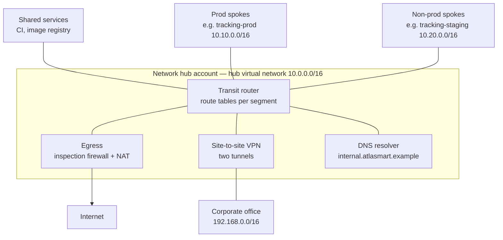
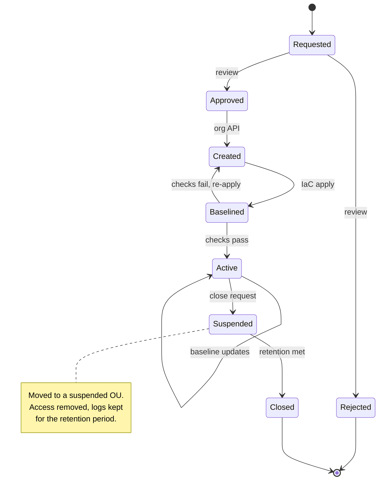
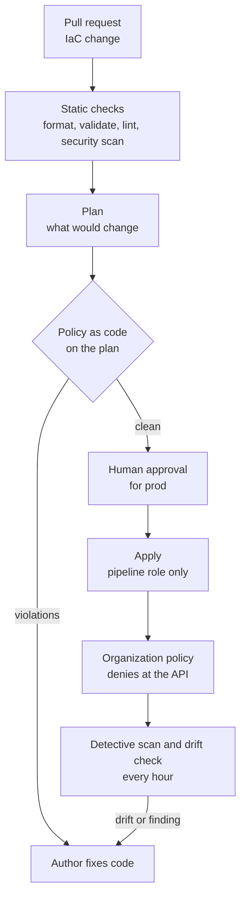
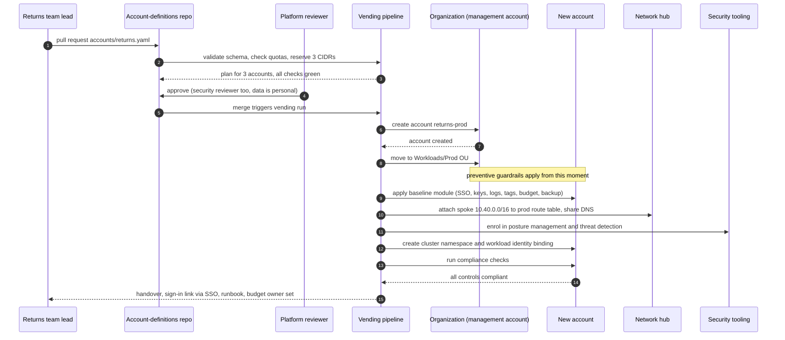

# Multi-account strategy and infrastructure automation

> Many accounts contain mistakes, attacks, quotas, and bills; automation keeps many accounts
> identical. A multi-account strategy without automation becomes dozens of hand-built snowflakes,
> and automation without a strategy just builds the wrong thing faster.

!!! abstract "Page facts"
    **Level:** Intermediate (why multiple accounts and the automation vocabulary are Level 1-2; OU
    design, account vending, and guardrail pipelines are Level 3) · **Status:** Draft ·
    **Time:** 60-75 minutes · **Last verified:** 2026-11-21

## Learning objectives

After this page you should be able to:

- Explain the four reasons for multiple accounts (blast radius, quotas, billing, permission
  boundaries) and when one more account is not worth it.
- Design an OU structure by policy need, and decide which capabilities are centralized in shared
  services, logging, and security accounts.
- Describe hub-and-spoke connectivity at the account level and account vending from request to a
  baselined, handed-over account.
- Explain infrastructure as code, policy as code, golden images, and immutable or ephemeral
  infrastructure at a conceptual level, and where each one runs in a delivery pipeline.
- Automate backup, recovery testing, and resource clean-up so they happen without anyone remembering.
- Walk through vending AtlasMart's three new returns-team accounts end to end, with the guardrails
  each one receives.

## Prerequisites

- [Cloud building blocks and landing zones](cloud-building-blocks-and-landing-zones.md) — the
  landing zone, OUs, guardrail types, and AtlasMart's account baseline.
- [Networking fundamentals: IP, CIDR, routing, and DNS](../networking/networking-fundamentals-ip-cidr-routing-and-dns.md)
  — the address registry that every new account draws from.

## The problem this solves

A landing zone designed on a whiteboard still has to be built 29 times and then kept identical while
teams, guardrails, and provider features change. Done by hand, each account takes days of tickets,
each one differs a little, and nobody can prove which guardrails a given account has today. The
next team waits weeks for an account, so it asks to "just use" an existing one, and the isolation the
design promised erodes. Infrastructure automation turns the landing zone into code that is reviewed,
tested, versioned, and applied the same way every time, and turns "give me an account" into a
self-service request that finishes in hours.

## What it is

A **multi-account strategy** is the set of rules that decides how many accounts exist, what each
one holds, how they are grouped into OUs, which capabilities are centralized, and how accounts are
created, changed, and closed.

**Infrastructure automation** is the practice of creating and changing infrastructure only through
machine-executed definitions: **infrastructure as code (IaC)** describes resources, **policy as
code** describes the rules they must satisfy, **golden images** package the operating system and
agents that compute starts from, and pipelines apply all three. **Self-service** puts those pipelines
behind a request interface, so teams get standard infrastructure without a ticket queue.

## Mental model

Think of a restaurant franchise. Head office does not let each franchisee design a kitchen: every
new site is built from the same plans (IaC), inspected against the same code before opening (policy
as code), fitted with the same pre-assembled equipment (golden images), connected to the same supply
network (hub-and-spoke), and its till reports to head office (centralized logging). A franchisee
applies with a form and gets a ready kitchen (account vending). When equipment breaks, it is swapped
for a new unit, not repaired in place (immutable infrastructure).

**Where the analogy breaks:** a restaurant, once built, stays put; a cloud account keeps changing
every day, through pipelines and occasionally through consoles. The plans must therefore be applied
continuously and compared with reality (drift detection), not just used once at opening.

## Key terms

| Term | Meaning on this page |
|---|---|
| Multi-account strategy | Rules for how many accounts exist, how they are grouped, what is centralized, and how they are created and closed |
| Account vending | An automated, self-service process that turns an approved request into a new account with the full baseline applied |
| Shared services account | A platform account hosting services many workloads use, such as CI and the image registry |
| Hub-and-spoke | A topology in which spoke networks connect only to a central hub, which provides shared routing, egress, and on-premises connectivity |
| Infrastructure as code (IaC) | Defining infrastructure in version-controlled files that a tool applies to reach the described state |
| Drift | Any difference between the infrastructure that exists and what its code describes |
| Policy as code | Writing guardrails and compliance rules as versioned, testable code evaluated by machines |
| Golden image | A pre-built, hardened, versioned machine or container base image that all compute starts from |
| Immutable infrastructure | Never modifying a running server or container in place; changes ship as a new image that replaces it |
| Ephemeral environment | A complete environment created on demand (for example per pull request) and destroyed automatically |
| Resource lifecycle | The managed path of a resource or account from request through use to clean-up and deletion |

## How it works

### Why multiple accounts

| Reason | What a separate account gives you | AtlasMart example |
|---|---|---|
| Blast radius | A mistake, a runaway script, or a compromised credential stops at the account boundary | A dev script that deletes "all test databases" cannot see prod |
| Quotas | Each account has its own quota pool, so one team's scale-out cannot exhaust another's | Order Tracking's sale-day node burst does not compete with the returns team |
| Billing | Costs arrive per account without relying on every resource being tagged | Each team's bill is three account totals |
| Permission boundaries | Roles are granted per account, and OU guardrails differ for prod and non-prod | Developers write in dev, read only in prod |

Two more reasons often decide it: **compliance scope** (systems that handle regulated data sit in
accounts that auditors examine, and everything else stays out of scope) and **ownership** (one team
per account makes "who owns this?" answerable). The costs are real too: more baseline resources,
cross-account access to design, and more networks to connect. An account per team per environment
is a good default; an account per microservice is usually too fine.

### Organizational unit design

OUs exist to attach policy, so they follow policy needs, not the org chart:

- **Separate by guardrail set.** Prod and non-prod need different rules, so they are different OUs;
  two teams with the same rules share an OU.
- **Keep it shallow.** Two or three levels are enough; deep trees make inherited policy hard to
  reason about.
- **Keep platform accounts apart.** Security (log archive, security tooling) and infrastructure
  (network hub, shared services) OUs get guardrails that workload teams cannot change.
- **Plan the edges.** AWS's multi-account guidance, for example, also describes a policy-staging OU
  for testing guardrail changes, a suspended OU for accounts being closed, and an exceptions OU for
  workloads that need a documented deviation. Even if you skip some, decide where such accounts go.

### Shared services, centralized logging, and security

Centralize what must be consistent, protected from workload owners, or expensive to duplicate;
keep in each account what the team must own and change freely.

| Capability | Centralized in | Why central | Stays per account |
|---|---|---|---|
| Audit, flow, and DNS logs | Log archive account | Immutable, out of reach of the accounts they describe | Short-term application logs for debugging |
| Posture management, threat detection, SIEM | Security tooling account (delegated administrator) | One view of every account, one team to respond | Nothing to switch off: enrolment is automatic |
| Transit routing, egress inspection, VPN, private DNS | Network hub account | One place for on-premises routes and outbound allow-lists | The account's own virtual network and ingress load balancer |
| CI runners, image registry, artifact store | Shared services account | Build once, sign once, deploy everywhere | Deployment roles that the pipeline assumes |
| Keys and secrets | Per account, with central policy | Limits who can decrypt a workload's data | The workload's own keys and secrets |

**Delegated administration** lets the security tooling account run organization-wide security
services without anyone using the management account day to day.

### Hub-and-spoke at the account level

Spoke accounts never peer with each other directly. Each spoke's virtual network attaches to a
transit router in the network hub account; the hub decides which spokes may reach which, and owns
the paths to the internet and the corporate network. Routing tables, segmentation, and firewall
design are deep topics for
[Network security, load balancing, and traffic flow](../networking/network-security-load-balancing-and-traffic-flow.md),
and the VPN for [Hybrid connectivity and VPNs](../networking/hybrid-connectivity-and-vpns.md).

**Figure 1 — AtlasMart's hub-and-spoke network across accounts.** Each box below the hub is a
separate account; each line is one attachment to the transit router.



How to read it: every spoke reaches the internet, the office, and shared services only through the
hub. Prod and non-prod spokes attach to different transit route tables, so they cannot reach each
other even though both connect to the same router. Inbound customer traffic does not cross the hub:
each workload keeps its own load balancer and WAF.

### Account vending and the account lifecycle

**Account vending** turns "we need accounts" into a pipeline run. A request (a form, a portal, or a
pull request to a repository of account definitions) is validated and approved; the pipeline then
creates the account through the organization's API, places it in an OU (inheriting preventive
guardrails immediately), applies the baseline with IaC, enrols it in security tooling, runs
compliance checks, and only then hands it to the team. Providers offer building blocks: AWS Control
Tower Account Factory and Account Factory for Terraform (AFT), Azure's subscription vending guidance
in the Cloud Adoption Framework, and project creation through the pipelines of Google Cloud's
enterprise foundations blueprint.

**Figure 2 — The life of an account.** Each state is reached only through the vending or closure
pipeline.



How to read it: an account is never usable before its checks pass, and "Active" is not the end: the
baseline keeps changing, and every change is re-applied to every account. Closure is a lifecycle
step too: suspend first, keep logs for their retention period, then close.

### Infrastructure as code, at a conceptual level

IaC tools are **declarative**: you describe the desired end state (a virtual network with these
subnets), and the tool computes the actions needed. A typical cycle is **write, plan, review,
apply**: the tool compares code with the recorded **state** of what exists, shows a plan (create,
change, destroy), a human or policy approves it, and the tool applies it. Reusable **modules**
package a pattern (an account baseline, a spoke network) with inputs, so 32 accounts run one tested
module, not 32 copies. **Drift detection** re-plans regularly; a non-empty plan on unchanged code
means someone changed something outside the pipeline.

| Tool family | Examples (names verified on the linked pages) |
|---|---|
| Cross-provider, declarative | Terraform, OpenTofu |
| Cross-provider, general-purpose languages | Pulumi |
| Provider-native | AWS CloudFormation, Bicep (Azure), Infrastructure Manager (Google Cloud, runs Terraform) |

The deep treatment of IaC (state management, module design, testing, GitOps) is D16-T03. The hands-on
version is [Lab 15: an infrastructure module with static checks](../labs/lab-15-infrastructure-module-and-static-checks.md).

### Policy as code

Guardrails written as code can be reviewed, tested, versioned, and run in more than one place: the
same rule can check a pull request (proactive), sit in an organization policy (preventive), and scan
live resources (detective). Policy engines such as Open Policy Agent (a CNCF project) evaluate rules
against structured input such as an IaC plan. A minimal, illustrative rule in OPA's Rego language
that rejects resources missing AtlasMart's mandatory tags:

```rego
package atlasmart.tags

required := {"owner-team", "environment", "cost-centre", "data-classification", "backup-tier"}

deny contains msg if {
    some r in input.resources
    present := {k | some k, _ in r.tags}
    missing := required - present
    count(missing) > 0
    msg := sprintf("%s is missing tags %v", [r.address, missing])
}
```

**Figure 3 — Where code and policy are checked on the way to an account.**



How to read it: the cheapest failures happen at the top, in the author's pull request; the
organization policy catches anything that slips past or comes from another path; the detective scan
catches drift. Guardrail code itself goes through the same flow, tested first in a policy-staging OU.

### Immutable and ephemeral infrastructure, and golden images

**Immutable infrastructure** replaces rather than repairs: to patch, build a new image and roll it
out; never log in and change a running server. Every running instance then matches a known,
scanned artifact, rollback means redeploying the previous version, and configuration drift has
nowhere to hide. The prerequisite is that state lives elsewhere (managed databases, object storage).

A **golden image** is the artifact that makes this practical: a base image built by a pipeline from
code, hardened, scanned, signed, versioned, and published to every account. AtlasMart has two kinds
(assumptions): the node image for the managed Kubernetes clusters, rebuilt weekly and on critical
patches, and the base container images that service images build on, published to the registry in
the shared services account. Image builders exist per provider (EC2 Image Builder, Azure VM Image
Builder) and across providers (HashiCorp Packer). The container-image side is covered in
[Containers and images](../containers-and-kubernetes/containers-and-images.md).

**Ephemeral infrastructure** goes one step further: whole environments exist only while needed. A
pull request can get its own short-lived preview environment, and sandbox accounts can expire. The
same IaC that builds prod builds these, which is the best test that it still works.

### Automated backup and recovery

Backups that depend on someone remembering do not exist. Automate four things:

1. **Selection by policy:** a backup policy attached at the OU picks resources by tag (`backup-tier`),
   so a new database is protected the moment it is tagged, and an untagged one raises a finding.
2. **Copies out of the blast radius:** a copy goes to a vault in a different account with
   write-once, delete-protected settings (for example AWS Backup Vault Lock or Azure Backup's
   immutable vaults), so a compromised workload account cannot delete its own backups.
3. **Restore tests:** a scheduled job restores a recent backup into a non-prod account, runs checks,
   and records the time taken; that time is the evidence for the RTO.
4. **Retention and expiry:** retention follows data classification, and expired copies are deleted
   automatically; keeping everything forever is a cost and a privacy risk.

### Resource lifecycle and clean-up

Every resource needs an owner and an end. Mandatory `owner-team` tags make owners findable;
**expiry tags** on sandbox and preview resources let a scheduled job delete them; detective rules
report orphans (unattached volumes, idle load balancers, addresses with no instance); and the account
lifecycle in Figure 2 closes whole accounts the same way. Clean-up is staged: notify the owner,
stop or snapshot, wait, delete, so that an automated sweep never destroys something that mattered.

## Worked example: vending AtlasMart's returns accounts

AtlasMart starts a returns team (a ninth product team, a new assumption) to build the online returns
flow. It needs dev, staging, and prod accounts on the standard landing zone from the
[building-blocks page](cloud-building-blocks-and-landing-zones.md).

### Step 1 — What changes in the estate

| Item | Before | After | Arithmetic |
|---|---|---|---|
| Product teams | 8 | 9 | 8 + 1 |
| Workload accounts | 24 | 27 | 9 teams x 3 environments |
| Platform accounts | 5 | 5 | unchanged |
| Total accounts (excluding sandboxes) | 29 | 32 | 27 + 5 |
| Workloads/Prod OU | 8 | 9 | one prod account per team |
| Workloads/Non-prod OU | 16 | 18 | two non-prod accounts per team |
| Transit router spoke attachments | 25 | 28 | one more per new virtual network |

The attachment count assumes 24 workload spokes plus the shared services spoke today; the VPN and
the planned private connection are separate attachment types. The organization's account quota and
the hub's attachment quota are checked against 32 and 28 before approval (values read from the
provider's quota service, not quoted here).

### Step 2 — The request

The team lead opens a pull request adding one file to the account-definitions repository:

```yaml
# accounts/returns.yaml (illustrative; values are AtlasMart assumptions)
team: returns
owner_group: returns-engineers        # workforce IdP group, not a person
cost_centre: cc-returns
data_classification: personal         # customer and order IDs, no card data
environments:
  dev:     { ou: workloads/non-prod, backup_tier: none,   network: /16 }
  staging: { ou: workloads/non-prod, backup_tier: daily,  network: /16 }
  prod:    { ou: workloads/prod,     backup_tier: tier-1, network: /16 }
kubernetes_namespace: returns
```

The pipeline validates the file against a schema and asks the address registry for three free
`/16`s. Assumption: it returns `10.40.0.0/16` (prod), `10.41.0.0/16` (staging), and `10.42.0.0/16`
(dev). The overlap check confirms none falls inside the hub `10.0.0.0/16`, the existing
`10.0.0.0`-`10.9.255.255` block, Order Tracking's `10.10`, `10.20`, or `10.30` `/16`s (or the
growth gaps reserved after each), the office `192.168.0.0/16`, or the planned distribution-centre
range `172.16.0.0/16`. Each gets the same zone-first layout as the
[address plan](../networking/networking-fundamentals-ip-cidr-routing-and-dns.md): `/18` per zone,
public `/22`, private-app `/20`, private-data `/22`.

Because the classification is `personal`, the pull request also needs a reviewer from the security
team: GDPR is relevant for EU customers' personal data, and what it requires of the returns flow
depends on facts that need advice from counsel, not this pipeline.

### Step 3 — The vending run

**Figure 4 — Vending the three returns accounts.** Time runs downward; the pipeline repeats the
create-to-verify steps once per environment (shown once).



How to read it: the account is created in step 6 and moved into the prod OU, with its preventive
guardrails, in step 8, before anyone can sign in. The team is told about it only after the checks in the last
steps pass. A failure at any step leaves the account in "Created" or "Baselined" (Figure 2), and the
pipeline re-runs idempotently instead of a person fixing it by hand.

### Step 4 — The guardrails each account receives

| Guardrail | Type | dev | staging | prod |
|---|---|---|---|---|
| EU-region restriction (C-4), no leaving the organization, no disabling audit logs | Preventive (all OUs) | Yes | Yes | Yes |
| No long-lived human access keys, workloads use workload identity | Preventive | Yes | Yes | Yes |
| No internet gateway outside public ingress subnets (egress via hub) | Preventive (Workloads OUs) | Yes | Yes | Yes |
| No interactive human writes, break-glass alerted | Preventive (Workloads/Prod) | No | No | Yes |
| Mandatory tags, encryption with the account's key, no public storage | Proactive (policy as code in the returns IaC pipeline) | Yes | Yes | Yes |
| Personal-data rules: customer-managed keys required, no cross-account sharing outside an allow-list | Proactive and detective (selected by `data_classification`) | Yes | Yes | Yes |
| Public exposure, open admin ports, unused credentials, drift | Detective (hourly) | Yes | Yes | Yes |
| Backup by `backup_tier`, cross-account vault copy, monthly restore test | Backup policy | None | Daily | Tier-1: continuous with point-in-time restore, RPO 5 min, RTO 1 h (the same tier as NFR-7) |
| Budget alerts at 80% and 100% of the team's budget | Cost | Yes | Yes | Yes |

The table is the same for every team; only the classification-driven rows and backup tiers vary.
That uniformity is the point: a reviewer can know an account's controls from its OU and tags alone.

### Step 5 — Timing and what the team gets

Assumptions for the platform's service level: the vending run takes under 60 minutes for three
accounts, and request-to-handover takes at most one working day, most of it waiting for review.
The team receives SSO access through its group, a `returns` namespace with default-deny network
policies and resource quotas in each environment's cluster, a deployment role for the shared CI,
three empty spoke networks, a budget, and a runbook. It does not receive administrator access to
prod, and it does not need a single ticket.

## Real-world architecture example

Organizations that run dozens or hundreds of accounts converge on the same shape: an
account-definitions repository or an internal developer portal in front of a vending pipeline, a
baseline module versioned like any software product, policy-as-code checks in every IaC pipeline,
and nightly drift and compliance reports per account. The platform team's success metric becomes
time from request to a compliant account, and the number of accounts that differ from the baseline,
ideally zero. Teams that skip vending usually discover the gap during an audit, when they cannot
show that every account has the same logging and guardrails.

## Design choices and trade-offs

| Choice | Favor when | Avoid when |
|---|---|---|
| Account per team per environment | Several teams with production data | A single small team, where shared accounts plus namespaces suffice |
| Account per workload or per service | Strong isolation or separate compliance scope per workload | Dozens of tiny services: account overhead and cross-account access dominate |
| Provider vending tooling | Standard baseline, small platform team | Heavy customization the tool cannot express |
| Custom vending pipeline on IaC | Unusual baseline, strong platform engineering | No team to own the pipeline long term |
| Centralized egress through the hub | Outbound allow-listing and inspection required | The hub cannot match the workloads' availability |
| Immutable images, replace to patch | Stateless compute, frequent patching | Stateful hosts that cannot yet be rebuilt (fix that first) |
| Ephemeral preview environments | Fast-moving teams, IaC that must stay tested | Environments needing large data copies or long set-up |
| Strict proactive policy in every pipeline | Rules are stable and well understood | Early adoption: start detective, then tighten |

## Failure modes and anti-patterns

- **Snowflake accounts.** Accounts created by hand before vending existed never get the new
  baseline. Detect: compare each account's applied baseline version. Prevent: import or rebuild them
  under the vending pipeline, and deny account creation outside it.
- **Baseline drift.** A console change or a failed apply leaves accounts different from code.
  Detect: scheduled plans with a non-empty diff. Prevent: deny human writes in prod, alert on drift.
- **Shared-account creep.** Teams avoid the wait by sharing an existing account. Detect: multiple
  `owner-team` tags in one account. Prevent: make vending fast enough that sharing is not tempting.
- **Big-bang guardrail change.** A new organization policy breaks every pipeline at once. Detect:
  spikes in denied API calls after a change. Prevent: test in the policy-staging OU, roll out OU by
  OU, start detective.
- **Backups inside the blast radius.** Backups in the same account are deleted with it. Prevent:
  cross-account, write-once vaults and restore tests.
- **Orphans and zombie accounts.** Unowned resources and abandoned sandboxes cost money and stay
  unpatched. Detect: missing or invalid `owner-team`, expiry tags in the past. Prevent: staged
  clean-up and the suspend-then-close lifecycle.
- **Pipeline as a single point of compromise.** The vending pipeline's role can create accounts and
  change policies. Prevent: see Security considerations.

## Security considerations

- **The automation is the most privileged identity in the estate.** The vending and baseline
  pipelines can create accounts and change guardrails. Run them in a dedicated account, with
  short-lived workload identity, protected branches, two-person review, and audited runs.
- **Policy as code needs tests and owners.** A rule that silently stops matching is worse than no
  rule, because everyone believes it holds. Unit-test rules with known-good and known-bad inputs.
- **Golden images are a supply chain.** Build them from code, scan, sign, and record provenance;
  workloads should only start from signed images (D12-T06 covers supply-chain security).
- **Separation of duties survives automation.** The people who approve a guardrail change are not
  the only people who can see it was applied; the security tooling account observes every account.
- **Personal data changes the review, not just the controls.** Classification-driven rules are
  controls; whether they satisfy a law depends on facts and needs counsel (this is not legal advice).

## Performance, reliability, and cost

- **Performance:** automation speed is a product metric: the time from request to a compliant account,
  and from a guardrail change to all accounts updated. Pipelines must back off on provider API
  throttling, because a run that touches 32 accounts makes bursts of control-plane calls.
- **Reliability:** immutable images and IaC make recovery a redeploy instead of an investigation;
  automated restore tests turn RTO from a hope into a measurement. Hub-and-spoke adds the hub as a
  shared dependency that must be zonal and monitored.
- **Cost:** every account carries baseline resources, so the baseline's per-account cost multiplies
  by 32. Automated clean-up of sandboxes, previews, and orphans is usually the fastest cost win; FinOps
  practices are D17.

## Hands-on lab: an infrastructure module with static checks

The full lab is [Lab 15: create an infrastructure module and run static checks](../labs/lab-15-infrastructure-module-and-static-checks.md):
a provider-free Terraform or OpenTofu module that plans AtlasMart's subnets, guarded by validation
rules and tests, run locally with no cloud account. A shorter, standard-library version of vending:

1. Write `accounts/returns.yaml` as in Step 2, plus a similar file for an existing team.
2. Write a Python validator that checks required keys, allowed OUs, and allowed `backup_tier` values.
3. Implement a tiny address registry with the `ipaddress` module: given used ranges, return the
   next three free `/16`s inside `10.0.0.0/8` that overlap nothing listed in Step 2.
4. Write a tag-policy check equivalent to the Rego rule above and run it on a hand-written "plan"
   (a list of resources with tags); confirm it rejects a resource missing `backup-tier`.
5. Run the validator twice on the same input and confirm the result is identical: vending must be
   idempotent.

??? question "Hint: why must the registry never hand out 10.11.0.0/16?"
    It is not in use, but it is reserved: the address plan left `10.11` to `10.19` as growth space
    for Order Tracking prod (a second region could take `10.11.0.0/16`, summarized with `10.10` as
    `10.10.0.0/15`). A registry must record reservations as well as allocations, or the first new
    team breaks a summary route that was planned years ahead.

## Knowledge check

1. Give the four main reasons for separate accounts and one situation in which an extra account is
   not worth it.
2. Why are AtlasMart's OUs split by prod and non-prod rather than by team?
3. In Figure 4, why does the pipeline move the account into its OU before applying the baseline?
4. What is drift, how is it detected, and why does immutable infrastructure reduce it?
5. Why does each automated backup copy go to a vault in a different account, and what turns the
   1-hour RTO into evidence rather than a claim?

??? success "Answers"
    1. Blast radius, quotas, billing, and permission boundaries (also compliance scope and
       ownership). Not worth it for tiny services that share one team, risk level, and lifecycle,
       where account overhead and cross-account access outweigh the isolation.
    2. OUs exist to attach guardrails, and the guardrails differ between prod and non-prod, not
       between teams. Splitting by team would duplicate policies and force account moves when teams
       re-organize.
    3. Preventive guardrails are inherited from the OU, so the account is constrained from its first
       minute; nothing created during the baseline run, or by anyone else, can break the
       organization's rules.
    4. Drift is the difference between what exists and what the code describes. It is detected by
       re-running the plan regularly and alerting on a non-empty diff. Immutable infrastructure
       replaces instead of modifying, so there is no in-place change to drift from.
    5. A compromised or deleted workload account cannot delete copies held elsewhere in a
       write-once vault. The scheduled restore test, which records how long a real restore took,
       is the evidence for the RTO.

## Architecture discussion questions

1. The returns team later wants a fourth account for a machine-learning experiment with copies of
   prod returns data. Which OU, which classification, and which guardrails would you require, and
   would you vend it at all?
2. AtlasMart's backup vaults currently sit in an existing platform account. Argue for and against a
   sixth platform account dedicated to backups.
3. A team proposes skipping golden images and patching Kubernetes nodes in place "because it is
   faster". What would you ask, and what would change your mind?

## Summary

Multiple accounts contain blast radius, quotas, bills, and permissions; OUs group them by the
guardrails they need; shared services, logging, and security tooling are centralized so they stay
consistent and out of workload owners' reach; and spokes connect only through a hub account.
Account vending makes all of that repeatable: a reviewed request becomes an account that is placed
in its OU, baselined with IaC, enrolled in security tooling, verified, and only then handed over.
IaC, policy as code, golden images, and immutable or ephemeral infrastructure keep every account
identical to its code, while automated backup, restore tests, and lifecycle clean-up run without
anyone remembering. AtlasMart's returns team goes from a pull request to three compliant accounts,
growing the estate from 29 to 32, in under a working day.

## Related topics

- **Before:** [Cloud building blocks and landing zones](cloud-building-blocks-and-landing-zones.md);
  [Networking fundamentals: IP, CIDR, routing, and DNS](../networking/networking-fundamentals-ip-cidr-routing-and-dns.md)
- **Alongside:** [Network security, load balancing, and traffic flow](../networking/network-security-load-balancing-and-traffic-flow.md);
  [Hybrid connectivity and VPNs](../networking/hybrid-connectivity-and-vpns.md);
  [Identity and access management](../security-architecture/identity-and-access-management.md);
  [Infrastructure and supply chain security](../security-architecture/infrastructure-and-supply-chain-security.md);
  [Containers and images](../containers-and-kubernetes/containers-and-images.md);
  [Lab 15](../labs/lab-15-infrastructure-module-and-static-checks.md);
  [Case study 08](../end-to-end-case-studies/cs-08-multi-account-landing-zone-and-hub-and-spoke-network.md);
  [Exercise: multi-account landing zone](../system-design-exercises/multi-account-landing-zone.md)
- **Planned:** IaC in depth and platform engineering (D16-T03 and D16); disaster recovery (D13-T03);
  FinOps (D17); GitOps (Lab 13).

## References

| Source | Type | Checked |
|---|---|---|
| [Organizing Your AWS Environment Using Multiple Accounts](https://docs.aws.amazon.com/whitepapers/latest/organizing-your-aws-environment/organizing-your-aws-environment.html) — AWS whitepaper | Official guidance (reasons for accounts, recommended OUs) | 2026-11-21 |
| [Overview of AWS Control Tower Account Factory for Terraform (AFT)](https://docs.aws.amazon.com/controltower/latest/userguide/aft-overview.html) — AWS documentation | Official documentation (account vending) | 2026-11-21 |
| [Subscription vending](https://learn.microsoft.com/azure/cloud-adoption-framework/ready/landing-zone/design-area/subscription-vending) — Microsoft Cloud Adoption Framework | Official guidance | 2026-11-21 |
| [Hub-spoke network topology in Azure](https://learn.microsoft.com/azure/architecture/networking/architecture/hub-spoke) — Azure Architecture Center | Official reference architecture | 2026-11-21 |
| [Enterprise foundations blueprint: deployment methodology](https://cloud.google.com/architecture/blueprints/security-foundations/deployment-methodology) — Google Cloud Architecture Center | Official guidance (pipelines that create projects) | 2026-11-21 |
| Martin Fowler, [InfrastructureAsCode](https://martinfowler.com/bliki/InfrastructureAsCode.html) and [ImmutableServer](https://martinfowler.com/bliki/ImmutableServer.html) | Articles (concepts) | 2026-11-21 |
| [Open Policy Agent documentation](https://www.openpolicyagent.org/docs) | Official documentation (policy as code, Rego) | 2026-11-21 |
| [AWS Backup Vault Lock](https://docs.aws.amazon.com/aws-backup/latest/devguide/vault-lock.html) and [Azure Backup immutable vault](https://learn.microsoft.com/azure/backup/backup-azure-immutable-vault-concept) | Official documentation (write-once backup copies) | 2026-11-21 |

## Review notes

- Canonical page for D10-T04. In depth: reasons for multiple accounts, OU design, centralized
  logging and security, account vending and lifecycle, policy as code, immutable infrastructure and
  golden images, automated backup and recovery, resource lifecycle. Only conceptual or defined here:
  IaC (deep in D16-T03 and Lab 15), hub-and-spoke (deep in D09-T03), self-service (as vending; the
  developer-portal side is D16), ephemeral environments, landing zones (canonical on D10-T02).
- The Rego rule is illustrative and was not executed (OPA is not installed here); it uses OPA 1.0
  syntax (`contains`, `if`, `some ... in`). A reviewer with OPA should run `opa check` on it.
- Product names checked on 2026-11-21 against fetched pages: Account Factory for Terraform (AFT),
  subscription vending, enterprise foundations blueprint pipelines, Bicep, Infrastructure Manager
  (Terraform-based), AWS CloudFormation, EC2 Image Builder, Azure VM Image Builder, HashiCorp Packer,
  Pulumi, OpenTofu, AWS Backup Vault Lock, Azure Backup immutable vault; policy-staging, suspended,
  and exceptions OUs appear in the AWS whitepaper's recommended OUs page.
- New AtlasMart assumptions: the returns team as a ninth product team (29 to 32 accounts); returns
  CIDRs `10.40.0.0/16` (prod), `10.41.0.0/16` (staging), `10.42.0.0/16` (dev), chosen without
  knowing the other seven teams' allocations; 25 spoke attachments today (24 workload spokes plus
  shared services) growing to 28; `data_classification: personal`; backup tiers none/daily/tier-1;
  weekly node-image rebuilds; vending run under 60 minutes and request-to-handover within one working
  day; hourly detective scans; backup vaults in an existing platform account (discussion question 2).
- As on D10-T02, the account hosting each environment's Kubernetes cluster is not specified; the
  namespace and workload-identity step is written so it holds wherever the cluster lives.
