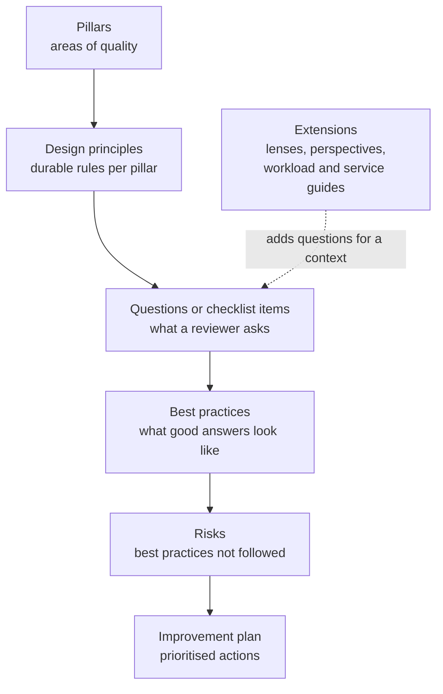
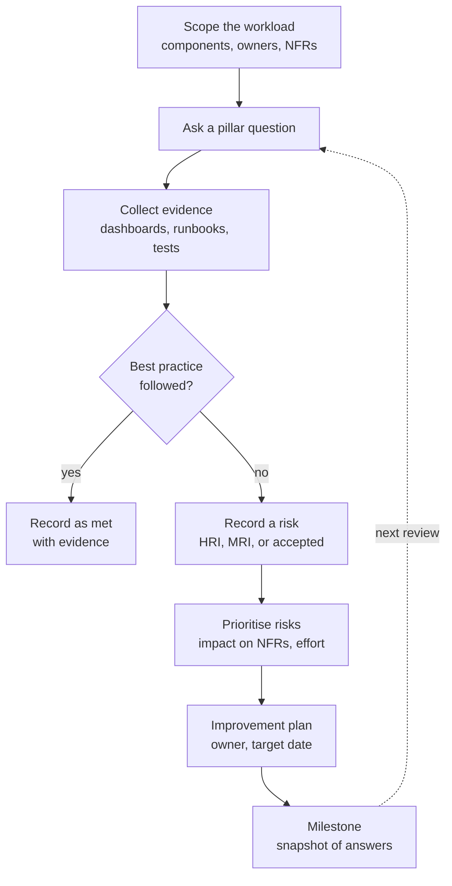
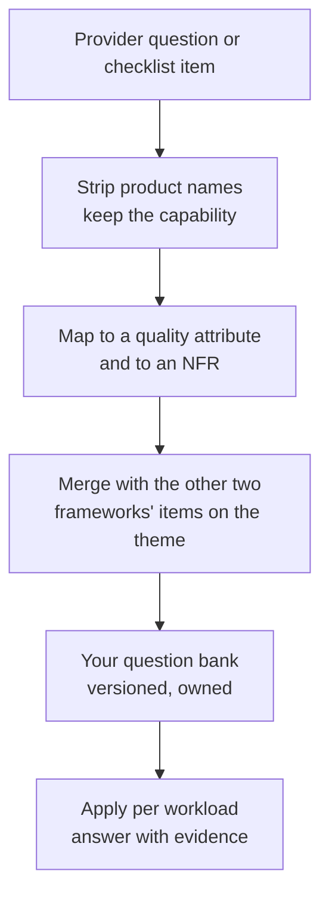
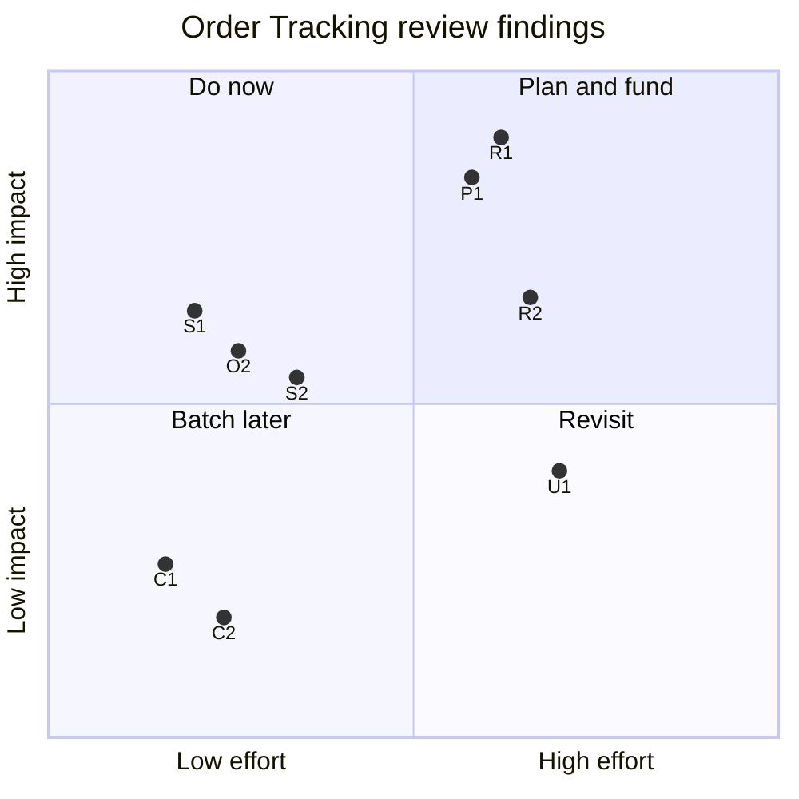

# Well-Architected frameworks (AWS, Azure, and Google Cloud)

> Each major cloud provider publishes a Well-Architected framework: a set of pillars, principles,
> and review questions distilled from many customer designs. Used well, they are a structured
> conversation that turns "is this design any good?" into a short, prioritised list of risks. Used
> badly, they are a vendor's shopping list with a score attached.

!!! abstract "Page facts"
    **Level:** Intermediate (the pillars and vocabulary are Level 1; running a review is Level 2;
    vendor-neutral use and prioritising risks across a portfolio are Level 3) · **Status:** Draft ·
    **Time:** 50-65 minutes · **Last verified:** 2026-11-27

## Learning objectives

After this page you should be able to:

- Name the pillars of the AWS, Azure, and Google Cloud Well-Architected frameworks exactly as each
  provider prints them today, and align them by theme.
- Explain the supporting structures of each framework: AWS lenses and the AWS Well-Architected Tool,
  Azure workload guidance and service guides, Google Cloud cross-pillar perspectives.
- Run a lightweight review: from question, through evidence and risk, to an improvement plan and a
  milestone.
- Use any of the three as a vendor-neutral checklist mapped to your own non-functional requirements.
- State what these frameworks are good at and where they stop being useful.

## Prerequisites

- [Architecture quality attributes and trade-offs](../architecture-fundamentals/quality-attributes-and-trade-offs.md)
  — the pillars are groupings of quality attributes; this page links to that catalog instead of
  repeating it.
- [SLAs, SLOs, SLIs, error budgets, and recovery objectives](../architecture-fundamentals/slas-slos-slis-error-budgets-and-recovery-objectives.md)
  — reliability findings are judged against these targets.
- [Cloud building blocks and landing zones](cloud-building-blocks-and-landing-zones.md) — a
  workload review assumes a governed foundation underneath it.

## The problem this solves

Design reviews without a structure depend on who is in the room. A reviewer with a security
background finds security gaps; nobody asks about restore times or about the bill. Different teams
get different reviews, findings are not comparable, and the same mistakes repeat across a portfolio.

The cloud providers saw the same pattern across thousands of customer designs and wrote it down as
**Well-Architected frameworks**: a fixed set of areas to cover (pillars), the principles behind each,
and questions that expose common gaps. That gives three things a free-form review lacks: coverage
(every pillar gets asked), comparability (the same questions across workloads and over time), and a
shared vocabulary between architects, engineers, and managers.

## What it is

A **Well-Architected framework** is a provider-published body of guidance for designing and
operating cloud workloads, organized into **pillars** (areas of quality), each with design
principles, best practices, and review questions or checklists. It is applied to a **workload**: a
set of components that together deliver business value, reviewed as a unit. It is not a standard,
a certification, or an audit; AWS describes its review explicitly as a constructive conversation
rather than an audit mechanism.

There are three in common use:

| Framework | Owner | Pillars (as printed by the owner) | Supporting structure |
|---|---|---|---|
| AWS Well-Architected Framework | Amazon Web Services | Operational excellence, Security, Reliability, Performance efficiency, Cost optimization, Sustainability | Lenses (Lens Catalog and custom lenses), AWS Well-Architected Tool, Well-Architected Framework Review |
| Azure Well-Architected Framework | Microsoft | Reliability, Security, Cost Optimization, Operational Excellence, Performance Efficiency | Workload guidance, service guides, design guides, maturity model, Azure Well-Architected Review, Azure Advisor |
| Google Cloud Well-Architected Framework | Google Cloud | Operational excellence; Security, privacy, and compliance; Reliability; Cost optimization; Performance optimization; Sustainability | Core principles, cross-pillar perspectives (AI and ML; Financial services) |

Capitalization is as each owner printed it when checked: AWS's framework pages now use sentence
case ("Performance efficiency"), Azure uses title case, and Google Cloud uses sentence case. This
page uses each owner's spelling when naming a specific framework.

## Mental model

Think of the pre-flight checklist an aircraft manufacturer publishes. It is the distilled memory of
many incidents, ordered by system (fuel, hydraulics, avionics), and it makes a tired or junior pilot
as thorough as an experienced one. Pilots do not debate whether to use it; they debate what to do
about the items that fail.

**Where the analogy breaks:** a pre-flight checklist is pass or fail, and every aircraft of the type
uses the same one. A Well-Architected review has no pass mark: a design can carry a known risk by
decision, because the business context makes it acceptable. And the checklist's author also sells
the parts, so some items quietly assume the author's products. You keep the questions and judge the
answers against your own requirements.

## Key terms

| Term | Meaning on this page |
|---|---|
| Well-Architected framework | A provider-published set of pillars, principles, and review questions for designing and operating cloud workloads |
| Pillar | One area of quality the framework asks about (for example reliability or cost); roughly a group of related quality attributes |
| Workload | The set of components (code, configuration, cloud resources) that together deliver a business outcome; the unit a review covers |
| Best practice | A practice that has repeatedly led to good outcomes; the framework's questions test whether a workload follows it |
| Lens (AWS) | An additional set of questions and best practices applied to a workload for a technology, industry, or company context |
| Cross-pillar perspective (Google Cloud) | Guidance for one technology or sector that is organized along all pillars |
| Workload guidance and service guide (Azure) | Guidance for a class of workload (for example mission-critical or SaaS), and guidance for configuring one Azure service, respectively |
| High risk issue (HRI) / medium risk issue (MRI) | AWS's labels for a missing best practice that could cause significant, or lesser, negative business impact |
| Improvement plan | The prioritised list of actions that would remove the risks a review found |
| Milestone | A saved snapshot of a review at a point in the workload's life, used to compare progress over time |
| Design review | A structured conversation about a design focused on requirements coverage, trade-offs, risks, and costly-to-reverse decisions (see the [glossary](../start-here/glossary.md)) |

## How it works

### The common anatomy

All three frameworks share one shape, even though the vocabulary differs.

**Figure 1 — The anatomy of a Well-Architected framework.** Each layer refines the one above it;
the review works on the bottom three.

How to read it: the pillars and principles change slowly; questions and best practices are
revised regularly; risks and the improvement plan are specific to one workload at one moment.
Extensions (dashed) add context-specific questions without changing the pillars.

### AWS Well-Architected Framework

AWS's framework is built on **six pillars**. In this page's own words, each asks:

| Pillar | The question behind it |
|---|---|
| Operational excellence | Can the team run, observe, and keep improving the workload so that it delivers business value? |
| Security | Are data, systems, and assets protected, and does the design use the platform to strengthen that protection? |
| Reliability | Does the workload do what it should, correctly and consistently, when expected, across its whole lifecycle? |
| Performance efficiency | Are computing resources used efficiently to meet requirements, and does that hold as demand and technology change? |
| Cost optimization | Does the workload deliver its business value at the lowest reasonable cost? |
| Sustainability | Is the environmental impact of the workload being reduced, by using fewer resources and getting more from each one? |

AWS's definitions page adds two points worth keeping. First, trade-offs between pillars are
expected and driven by business context (for example favouring cost over reliability in a
development environment), but **security and operational excellence are generally not traded
away**. Second, AWS grades missing best practices by risk: a **high risk** practice is foundational
and must-do, a **medium risk** practice is enabling, and low-risk practices are optional; there is
no "low risk issue". AWS also defines **level of effort** (high: weeks to months; medium: days to
weeks; low: hours to days), which is useful for ordering an improvement plan.

**Lenses** extend the framework. The AWS Well-Architected Framework Lens is applied to every
workload by default. Official lenses live in the **Lens Catalog**; when checked it listed lenses
including Connected Mobility, Container Build, Data Analytics, DevOps, Financial Services Industry,
Generative AI, Government, Healthcare Industry, IoT, Mergers and Acquisitions, Machine Learning,
Migration, SaaS, SAP, and Serverless Applications. **Custom lenses** let an organization write its
own pillars, questions, and best practices (for example a company security standard) and share them
across accounts.

The **AWS Well-Architected Tool** (AWS WA Tool) is the console service that records a review: a
workload is defined, lenses are applied, questions are answered, risks (HRIs and MRIs) are
calculated, an improvement plan is generated, and milestones capture snapshots. It integrates with
AWS Trusted Advisor and AWS Service Catalog AppRegistry to help answer questions, and offers a
connector for Jira to track improvement items. AWS describes the **Well-Architected Framework
Review (WAFR)** in three phases: **Prepare**, **Review**, and **Improve**. When checked, AWS also
listed an **AWS Well-Architected Agent** in preview, an automated, AI-based analysis of deployed
resources; treat preview services as subject to change.

### Azure Well-Architected Framework

Microsoft's framework has **five pillars**: Reliability, Security, Cost Optimization, Operational
Excellence, and Performance Efficiency. There is no Sustainability pillar; sustainability appears as
a **workload** guide. Microsoft describes the framework as layered:

- **Pillars**, each with design principles, a design review checklist, key design strategies,
  tradeoffs (explicitly marked), design patterns, and a **maturity model** of five levels, from
  establishing a foundation (level 1) to future-proofing with agility (level 5).
- **Workloads**: guidance for a class of workload, with its own design principles and design areas.
  The hub page listed Microsoft Fabric, Artificial Intelligence (AI), Software as a service (SaaS),
  Mission-critical, HPC, and Sustainability when checked.
- **Service guides**: how to configure one Azure service (for example Azure Kubernetes Service or
  Azure Database for PostgreSQL) in line with the pillars.
- **Design guides**: focused guidance on one practice that cuts across pillars.

The **Azure Well-Architected Review** is a no-charge questionnaire tied to the pillar checklists,
scored so that repeated runs show progress. **Azure Advisor** categorizes its configuration
recommendations by the same pillars. Microsoft draws a clear boundary: the framework is for teams
improving a workload; improving a portfolio through central controls belongs to the Cloud Adoption
Framework (see [Cloud adoption frameworks](cloud-adoption-frameworks.md)).

### Google Cloud Well-Architected Framework

When checked on 2026-11-27, Google's page was titled **Google Cloud Well-Architected Framework**,
served from the Cloud Architecture Center at a URL that still ends in `/architecture/framework`.
Older entries in its change log (for example an August 2024 entry removing the "System Design
category") still say **Architecture Framework**, the earlier name; the change log does not record
when the name changed, so this page does not state a date. Today the page lists **six pillars**:
Operational excellence; Security, privacy, and compliance; Reliability; Cost optimization;
Performance optimization; and Sustainability. Two **cross-pillar perspectives** apply the pillars
to a domain: **AI and ML** (added October 2024 per the change log) and **Financial services**
(added July 2025). Before the pillars, the page states five core principles: design for change,
document your architecture, simplify your design and use fully managed services, decouple your
architecture, and use a stateless architecture.

Two naming differences matter in practice. Google folds privacy and compliance into its security
pillar, and calls its performance pillar "optimization" rather than "efficiency". Google's overview
did not name a hosted review questionnaire comparable to the AWS WA Tool or the Azure Well-Architected
Review when checked; its pillars carry principles and recommendations, and the page offered
per-pillar assessment questions and validation checklists packaged for AI coding assistants.

### The three side by side

Aligned by theme, the frameworks agree on far more than they differ:

| Theme | AWS | Azure | Google Cloud | Honest difference |
|---|---|---|---|---|
| Running the workload | Operational excellence | Operational Excellence | Operational excellence | Same intent; Azure puts more weight on DevOps practice and observability |
| Protecting it | Security | Security | Security, privacy, and compliance | Google names privacy and compliance in the pillar; AWS and Azure cover them inside Security |
| Keeping it working | Reliability | Reliability | Reliability | Same intent; all three tie it to recovery targets |
| Using resources well for speed | Performance efficiency | Performance Efficiency | Performance optimization | Google's name stresses tuning; AWS's stresses efficiency as demand changes |
| Spending wisely | Cost optimization | Cost Optimization | Cost optimization | Same intent |
| Environmental impact | Sustainability | (workload guide, not a pillar) | Sustainability | Azure treats it as guidance for a workload class |
| Extensions | Lenses | Workload guides, service guides | Cross-pillar perspectives | Different mechanisms for the same need: context-specific questions |
| Review tooling | AWS WA Tool; WAFR | Azure Well-Architected Review; Azure Advisor | No hosted questionnaire named on the overview page | Tools store answers in the provider's console |

Each pillar is a grouping of quality attributes; the catalog, measures, and tensions between them
are on the [quality attributes page](../architecture-fundamentals/quality-attributes-and-trade-offs.md).
What the frameworks add is not new attributes but a fixed checklist of questions per attribute group.

### How a review works

A review is a short, repeatable loop, not a one-off gate.

**Figure 2 — From question to improvement plan.** One loop is one review; the milestone feeds the
next loop.

How to read it: the expensive part is evidence, not answers. "Yes, we have backups" is an answer;
"here is the timed report from last month's full-size restore" is evidence. A risk can also be
**accepted** by a named owner when the business context justifies it; that decision belongs in an
ADR (see [trade-offs, principles, ADRs, and governance](../architecture-fundamentals/trade-offs-principles-adrs-and-architecture-governance.md)).

The steps, in the order a facilitator runs them:

1. **Scope.** One workload, one environment (usually production), named owners, and the NFRs the
   workload must meet. Without NFRs, nobody can judge whether an answer is good enough.
2. **Prepare.** Share the questions in advance; collect diagrams, SLO reports, the last DR test,
   and the cost report. This is AWS's Prepare phase.
3. **Ask, per pillar.** Keep to the questions that matter for this workload; mark the rest "not
   applicable" with a reason.
4. **Record risks with evidence.** Each risk names the best practice missed, the NFR at stake, and
   what was (or was not) seen.
5. **Prioritise.** Order by risk level, then by impact on NFRs, then by effort.
6. **Plan and snapshot.** Each item gets an owner and a target; save a milestone so the next review
   can show progress.

### Using the frameworks without vendor bias

The questions are general; the recommended answers are often a product. To keep the value without
the bias:

**Figure 3 — Turning a provider checklist into a vendor-neutral one.**

How to read it: "Do you use service X for backups?" becomes "Are backups taken automatically, kept
apart from the source, and restored on a schedule?", mapped to recoverability and to the workload's
RPO and RTO. Merging the three frameworks catches themes one of them under-weights (for example
Google's privacy emphasis, or AWS's and Google's sustainability pillar). The result is your own
question bank, which AWS's custom lenses can host if you use that tool, or which can live as a
version-controlled file next to your ADRs.

Rules of thumb for neutral use:

- A finding names a **capability gap**, never a product to buy.
- Every question traces to an **NFR or principle** of yours; questions that trace to nothing are
  marked not applicable.
- Provider-specific questions (for example about one service's configuration) go in a separate,
  per-provider section, like Azure's service guides.
- Scores are progress indicators for one workload over time, not a league table across teams.

## Worked example: AtlasMart Order Tracking System, a lightweight review

AtlasMart's architect runs a half-day, AWS-pillar-structured review of the Order Tracking System in
production, using a vendor-neutral question bank built as in Figure 3. Participants (assumption):
the tracking team's tech lead and on-call engineer, a platform engineer, a security engineer, and
the FinOps analyst. Inputs: the NFRs, the SLO and lag dashboards, the deployment pipeline, the last
cost report, and the DR runbook. Facts below come from the AtlasMart baseline; review answers and
findings are assumptions for this example.

### Findings per pillar

| ID | Pillar | Question (paraphrased, vendor-neutral) | Evidence seen | Finding | Risk | NFR |
|---|---|---|---|---|---|---|
| O1 | Operational excellence | How do you know the workload is healthy? | SLO burn alerts (fast 14.4 over 1 h, slow 6 over 6 h); per-carrier lag dashboard and p95 lag alert | Met | None | NFR-2, NFR-8 |
| O2 | Operational excellence | Is there a procedure for every alert? | Runbooks for API errors and lag; none for events that repeatedly fail processing and are set aside | Gap: set-aside carrier events have no owner or replay procedure | MRI | NFR-1, NFR-7 |
| S1 | Security | How are inbound requests from partners authenticated? | HMAC verification with replay window; one signing secret per carrier | Gap: no overlap period for rotating a carrier's secret | MRI | NFR-5 |
| S2 | Security | How do you prove sensitive data is not stored? | Schema review shows no address fields | Gap: no automated check that logs and events never carry delivery addresses | MRI | NFR-6 |
| R1 | Reliability | Can you restore data within the RTO? | Log archiving every 5 min or less; restore tested only on a small copy | Gap: full-size restore never rehearsed | HRI | NFR-7 |
| R2 | Reliability | How does the workload survive the loss of a zone or the region? | Three zones; synchronous standby; tier 1 warm standby in a second EU region (assumption) | Gap: tracking not yet included in the quarterly game day | MRI | NFR-2, NFR-7 |
| P1 | Performance efficiency | How do you verify capacity for known peaks? | Production peaks of 70 reads/s observed; no test at 210 reads/s plus 70 events/s | Gap: sale-day design peak never tested | HRI | NFR-3, NFR-4 |
| P2 | Performance efficiency | Are caching choices tied to requirements? | Cache-aside, 30 s TTL, ADR records the freshness trade-off | Met | None | NFR-1, NFR-3 |
| C1 | Cost optimization | Do you know the cost per unit of business value? | Mandatory tags and monthly showback by team | Gap: "cost per 1,000 tracking reads" not yet reported | Low (optional) | — |
| C2 | Cost optimization | Is capacity matched to demand? | HPA 3 to 9 replicas; non-prod also runs 3 replicas around the clock (assumption) | Gap: non-prod floor not reduced out of hours | Low (optional) | — |
| U1 | Sustainability | Is data kept only as long as it is needed? | No retention period for tracking events; three copies (primary, standby, recovery region) | Gap: no retention policy | MRI | — |
| U2 | Sustainability | Is provisioned capacity well used? | 3-replica floor is idle much of the day | Accepted: the floor exists for zone redundancy (NFR-2) | Accepted | NFR-2 |

### The arithmetic behind three findings

**R1, restore within the RTO.** The event store holds about 430 GB. To restore it inside the 1-hour
RTO with no time left for replay and validation would need 430,000 MB ÷ 3,600 s ≈ 119 MB/s of
sustained restore throughput. Whether the chosen database service achieves that is unknown until a
full-size rehearsal is timed; a small-copy test proves the procedure, not the duration. Rated HRI
because NFR-7 is a tier 1 commitment and the evidence does not support it.

**P1, sale-day capacity.** NFR-4 requires 210 reads/s plus 70 events/s under 70% CPU. At the HPA
minimum of 3 replicas that is 210 ÷ 3 = 70 reads/s per replica; at the maximum of 9 it is
210 ÷ 9 ≈ 23.3 reads/s per replica. Nobody has measured how many reads/s one replica (1 vCPU) serves
at 70% CPU within the p95 300 ms target, nor how fast the HPA and the cluster autoscaler react. A
load test answers both (method on the [capacity estimation page](../performance-and-scalability/capacity-estimation.md)).

**C1, a first unit cost.** With an explicitly illustrative rate of 1 vCPU-hour = 1 CU, the API's
production floor is 3 replicas × 1 vCPU × 24 h = 72 CU/day. Spread over 1.2 million reads/day
(1,200 thousand), that is 72 ÷ 1,200 = 0.06 CU per 1,000 tracking reads for API compute alone,
before the cache, database, queue, and the recovery region. The number is incomplete, which is the
point: reporting it monthly makes the rest of the bill visible (see
[cloud cost models and FinOps](../finops-and-sustainability/cloud-cost-models-and-finops.md)).

**U1, storage copies.** Raw event payloads grow by 480,000 × 500 B = 240 MB/day, about
240 × 365 = 87,600 MB ≈ 88 GB/year before indexes, and every byte is held three times. A retention
period is a business and legal decision (this is not legal advice); the review's job is to show the
decision is missing.

### Prioritised risk list

**Figure 4 — AtlasMart's findings by impact and effort.** Impact is judged against the NFRs; effort
uses AWS's high, medium, and low levels of effort.

How to read it: top-left items are cheap and matter, so they start immediately; top-right items
matter but need planning and budget. The two HRIs sit top-right, so they start now as planned work
with a date rather than waiting for spare time.

The improvement plan the review hands back:

| Priority | ID | Action | Risk | Effort | Owner (assumption) | Target |
|---|---|---|---|---|---|---|
| 1 | R1 | Time a full-size restore with validation; fix until it fits inside 1 h | HRI | Medium | Tracking team with platform database engineers | Before the next sale day |
| 2 | P1 | Load test at 210 reads/s plus 70 events/s from minimum replicas; record per-replica capacity and scale-out time | HRI | Medium | Tracking team | Before the next sale day |
| 3 | S1 | Accept two valid secrets per carrier during rotation; document the procedure | MRI | Low | Tracking team with security | Next sprint |
| 4 | O2 | Owner, alert, and replay runbook for set-aside events | MRI | Low | Tracking team | Next sprint |
| 5 | S2 | Pipeline and log-scanning check that rejects address-like fields | MRI | Low | Tracking team with security | Next month |
| 6 | R2 | Add tracking to the quarterly game day, including regional failover | MRI | Medium | Incident commander rota with platform team | Next quarter |
| 7 | U1 | Propose a retention period to the business and legal owners; then expire data | MRI | Medium | Architect with data owner | Next quarter |
| 8 | C1, C2 | Report cost per 1,000 reads monthly; scale non-prod down out of hours | Low | Low | FinOps analyst and tracking team | Backlog |

The review is saved as milestone "2026-Q4 baseline" (assumption); the next review, after the sale
day, should show R1 and P1 closed with evidence.

## Real-world architecture example

A typical enterprise pattern: a central architecture team makes a Well-Architected review part of
launch readiness for every customer-facing workload, then runs it again yearly or after major change.
After a dozen reviews, the improvement plans show the same risks in most workloads: restores never
rehearsed, no unit cost, secrets rotated by hand. Those repeated themes are the real output. The
platform team fixes them once (a restore-test pipeline, a cost dashboard per tag, managed secret
rotation), and the next round of reviews is shorter because the platform answers many questions
for every team. AWS's framework recommends this use explicitly: find themes across teams that shared
mechanisms can address.

## Design choices and trade-offs

| Choice | Favor when | Avoid when |
|---|---|---|
| Provider's own review tool | Single-provider estate, wish to track milestones in the console | Multi-cloud estate, or answers must live with the ADRs in version control |
| Your own vendor-neutral question bank | Several providers, own NFR templates, strict neutrality needed | Small team that would never maintain it |
| Full review, every question | First review of a business-critical workload, launch readiness | Small internal tools; review fatigue sets in |
| Lightweight review, pillar-structured | Regular check-ins, after major change, teams new to the frameworks | Regulated launches needing a complete record |
| Adding lenses or perspectives | Workload class with its own risks (SaaS, ML, regulated industry) | The base questions are not yet answered well |
| Facilitated review (architect or partner) | Teams new to the practice; independent eyes wanted | Mature teams that self-review well, with spot checks |
| Automated advisers (Azure Advisor, AWS Trusted Advisor) between reviews | Continuous detection of configuration drift | As a substitute for the conversation; they see configuration, not intent |

## Failure modes and anti-patterns

- **Review as audit.** Teams hide gaps to get a good score. Detect: reviews with no risks found.
  Prevent: state that findings are not graded against teams; reward closed risks, not clean reviews.
- **Answers without evidence.** "Yes" to every question. Detect: no links to dashboards, tests, or
  reports. Prevent: the facilitator asks "show me" for every HRI-level question.
- **Vendor shopping list.** The improvement plan reads like a product catalog. Detect: actions that
  name products rather than capabilities. Prevent: Figure 3's translation step.
- **Score theatre.** Teams compared on a single number. Detect: dashboards ranking teams. Prevent:
  compare a workload with its own earlier milestones only.
- **Review once, never again.** The milestone ages until it describes a different system. Detect:
  last review older than the last major change. Prevent: tie reviews to launch, major change, and
  a yearly date.
- **Pillar silos.** Each specialist reviews only "their" pillar, and cross-pillar trade-offs (cost
  against reliability, security against performance) are never discussed. Prevent: one session,
  all pillars, with trade-offs recorded as ADRs.
- **Portfolio problems reviewed one workload at a time.** The same platform gap is raised by every
  team. Prevent: aggregate themes across reviews and fix them in the landing zone or platform.

## Security considerations

- **Review records are sensitive.** A list of unmitigated risks is a map for an attacker. Restrict
  who can read review data, and treat exported reports like other confidential architecture
  documents.
- **Tool access is cloud access.** Integrations that read configuration to pre-fill answers need
  read permissions; grant them through roles with least privilege, not shared credentials.
- **Sharing with partners.** Review tools can share workloads with other accounts; share only for a
  purpose and a period, and remove the share afterwards.
- **Security is not traded away.** AWS's guidance is that security (and operational excellence) are
  generally not traded off against other pillars; an accepted security risk needs a named owner and
  an end date. Threat modelling, which the security pillar assumes, is on the
  [security principles and threat modelling page](../security-architecture/security-principles-and-threat-modeling.md).

## Performance, reliability, and cost

- **Performance:** the frameworks ask whether capacity is tested and efficient; they cannot supply
  the numbers. Every performance answer needs a measurement at a stated load.
- **Reliability:** the reliability pillar is only as good as the targets it is judged against; a
  review without SLOs and RPO/RTO values produces opinions. Deep treatment:
  [reliability engineering](../reliability-and-disaster-recovery/reliability-engineering.md) and
  [disaster recovery strategies](../reliability-and-disaster-recovery/disaster-recovery-strategies.md).
- **Cost:** AtlasMart's lightweight review took half a day of six people (assumption); a full one
  takes longer. That is cheap against one avoided incident, but review fatigue is real, so scope reviews to the
  workloads and changes that warrant them. Cost and sustainability pillars both reward deleting what
  is not needed; see [sustainable and carbon-aware architecture](../finops-and-sustainability/sustainable-and-carbon-aware-architecture.md).

## Hands-on lab: a vendor-neutral review in a file

A local, free exercise using Python's standard library (and PyYAML if you prefer YAML input).

1. Write a question bank file with 12 questions, two per AWS pillar, each with `id`, `pillar`,
   `question` (no product names), `nfr` (or `none`), and `risk_if_missing` (`HRI` or `MRI`).
2. Write an answers file for the AtlasMart Order Tracking System using the findings table on this
   page: for each `id`, `met: true|false`, `evidence`, and `effort` (`low`, `medium`, `high`).
3. Write a script that joins the two files and prints an improvement plan of unmet items, sorted by
   risk level (HRI first), then by effort (low first).
4. Add an `accepted_by` field to one finding and make the script list accepted risks separately
   rather than in the plan.
5. Save the output with a date in its file name as a "milestone"; change one answer to `met: true`
   and write a second script that reports which risks closed between the two milestones.

??? question "Hint: why sort by risk before effort, not the other way round?"
    Sorting by effort first puts every quick, low-value fix ahead of the HRIs, which is how
    improvement plans fill up with easy items while the foundational risks stay open. Risk first,
    then effort within each risk level, keeps the must-do items on top while still letting cheap
    MRIs go before expensive ones. Figure 4 shows the same idea visually.

## Knowledge check

1. Name the six AWS pillars, and say which pillar the Azure framework does not have and where
   Azure covers that topic instead.
2. What does Google Cloud's framework call its security pillar and its performance pillar, and why
   does the difference matter when you merge question banks?
3. What is an AWS lens, and how does it differ from a custom lens?
4. In AtlasMart's review, why is R1 an HRI even though backups exist and RPO is met on paper?
5. Give two rules that keep a Well-Architected review vendor-neutral.

??? success "Answers"
    1. Operational excellence, Security, Reliability, Performance efficiency, Cost optimization, and
       Sustainability. Azure has no Sustainability pillar; it publishes sustainability as workload
       guidance.
    2. "Security, privacy, and compliance" and "Performance optimization". Google's security pillar
       explicitly covers privacy and compliance, so a merged bank should carry privacy questions that
       an AWS-only or Azure-only bank might place elsewhere or omit; the performance naming differs
       but the questions largely align.
    3. A lens is an extra set of questions and best practices for a technology or industry context;
       Lens Catalog lenses are official and maintained by AWS, while custom lenses are written by the
       organization itself (for example to encode its own standards) and can be shared across accounts.
    4. Because NFR-7 also sets a 1-hour RTO and no full-size restore has been timed; restoring about
       430 GB in an hour needs roughly 119 MB/s with no time left for validation, and nobody knows
       whether that is achievable. The evidence does not support a tier 1 commitment.
    5. Any two of: findings name capability gaps, not products; every question traces to an NFR or
       principle; provider-specific questions sit in a separate section; scores compare a workload
       only with its own earlier milestones.

## Architecture discussion questions

1. AtlasMart runs on one provider today. Would you use that provider's review tool or a
   version-controlled question bank? What would change your answer if the Warehouse Management
   System migration (case study 09) landed on a different provider?
2. The FinOps analyst argues that U2 (idle replica floor) should be an MRI, not an accepted risk.
   Make the case for each side using NFR-2 and the cost arithmetic.
3. After ten reviews across AtlasMart's eight product teams, which of this review's findings would
   you expect to recur, and which platform capability would close each one for every team?

## Summary

AWS, Azure, and Google Cloud each publish a Well-Architected framework: pillars of quality, design
principles, and review questions drawn from many customer designs. AWS has six pillars (Operational
excellence, Security, Reliability, Performance efficiency, Cost optimization, Sustainability),
extended by lenses and recorded in the AWS Well-Architected Tool. Azure has five pillars, with
sustainability as workload guidance, plus workload guides, service guides, a maturity model, and the
Azure Well-Architected Review. Google Cloud's framework, now titled Google Cloud Well-Architected
Framework, has six pillars including "Security, privacy, and compliance" and "Performance
optimization", plus cross-pillar perspectives. A review moves from question to evidence to risk to
a prioritised improvement plan and a milestone. Used as a vendor-neutral checklist tied to your own
NFRs, the frameworks give coverage and comparability; used as a scorecard or a shopping list, they
give neither.

## Related topics

- **Before:** [Architecture quality attributes and trade-offs](../architecture-fundamentals/quality-attributes-and-trade-offs.md);
  [SLAs, SLOs, SLIs, error budgets, and recovery objectives](../architecture-fundamentals/slas-slos-slis-error-budgets-and-recovery-objectives.md);
  [Cloud building blocks and landing zones](cloud-building-blocks-and-landing-zones.md)
- **Alongside:** [Cloud adoption frameworks](cloud-adoption-frameworks.md) — the portfolio and
  organization view; [Enterprise architecture frameworks](../enterprise-architecture/enterprise-architecture-frameworks.md);
  [Trade-offs, principles, ADRs, and architecture governance](../architecture-fundamentals/trade-offs-principles-adrs-and-architecture-governance.md);
  [Cloud providers: principles before catalogs](cloud-providers-principles-before-catalogs.md);
  [Reliability engineering](../reliability-and-disaster-recovery/reliability-engineering.md);
  [Monitoring, alerting, and on-call](../observability-and-sre/monitoring-alerting-and-on-call.md);
  [Application security](../security-architecture/application-security.md) — the webhook signature
  design behind finding S1; [Design method](../system-design-exercises/design-method.md)
- **Planned:** AI and ML architecture, where the AI-focused lenses and perspectives apply (D19-D25);
  industry-specific solution architecture, where industry lenses apply (D26).

## References

| Source | Type | Checked |
|---|---|---|
| [AWS Well-Architected Framework](https://docs.aws.amazon.com/wellarchitected/latest/framework/welcome.html) and [Definitions](https://docs.aws.amazon.com/wellarchitected/latest/framework/definitions.html) — AWS documentation | Official framework (six pillars, risk levels, level of effort, trade-offs) | 2026-11-27 |
| [What is AWS Well-Architected Tool?](https://docs.aws.amazon.com/wellarchitected/latest/userguide/tool.html), [Using lenses in AWS WA Tool](https://docs.aws.amazon.com/wellarchitected/latest/userguide/lenses.html), and [Lens Catalog for AWS WA Tool](https://docs.aws.amazon.com/wellarchitected/latest/userguide/lens-catalog.html) — AWS documentation | Official documentation (tool, lenses, lens names) | 2026-11-27 |
| [Well-Architected Framework Review (WAFR)](https://docs.aws.amazon.com/wellarchitected/latest/userguide/wa-framework-review.html) and [What is AWS Well-Architected?](https://docs.aws.amazon.com/wellarchitected/latest/userguide/well-architected.html) — AWS documentation | Official documentation (review phases, Agent preview) | 2026-11-27 |
| [Azure Well-Architected Framework](https://learn.microsoft.com/azure/well-architected/) and [How to use the Azure Well-Architected Framework documentation](https://learn.microsoft.com/azure/well-architected/what-is-well-architected-framework) — Microsoft Learn | Official framework (pillars, layers, maturity model, assessment) | 2026-11-27 |
| [Azure Well-Architected Framework pillars](https://learn.microsoft.com/azure/well-architected/pillars) and [Azure Well-Architected Review](https://learn.microsoft.com/assessments/azure-architecture-review/) — Microsoft Learn | Official documentation (pillar matrix, Advisor, review tool) | 2026-11-27 |
| [Azure Well-Architected Framework workloads](https://learn.microsoft.com/azure/well-architected/workloads) and [service guides](https://learn.microsoft.com/azure/well-architected/service-guides/) — Microsoft Learn | Official documentation (workload versus service guidance) | 2026-11-27 |
| [Google Cloud Well-Architected Framework](https://cloud.google.com/architecture/framework) and [What's new](https://docs.cloud.google.com/architecture/framework/whats-new) — Google Cloud Architecture Center | Official framework (pillars, perspectives, change log) | 2026-11-27 |
| Bass, Clements, and Kazman, *Software Architecture in Practice* (Addison-Wesley) | Book (quality attributes and architecture evaluation behind the pillars) | 2026-11-27 |

## Review notes

- Canonical page for D28-T01. All three inventory items (AWS, Azure, Google Cloud Well-Architected
  frameworks) are covered in depth, including all six AWS pillars named in the D28-T04 inventory.
  Only defined or briefly treated: individual lenses in the AWS Lens Catalog (names only), Azure
  service guides and design guides (concept only), Google Cloud's AI and ML and Financial services
  perspectives (named only), AWS Well-Architected Agent (named as a preview service only).
- Every pillar, lens, tool, and perspective name was checked on 2026-11-27 against the owner's
  current page. AWS's framework pages print pillar names in sentence case ("Operational
  excellence"), which differs from the title case in MASTER_PROMPT.md and coverage.yaml; this page
  follows AWS's current spelling when naming AWS pillars. AWS `<title>` values were checked to rule
  out soft 404s (`framework/pillars.html` is a soft 404 and is not cited).
- Google rename: the page title reads "Google Cloud Well-Architected Framework"; the change log's
  2024 entries still say "Architecture Framework" and no entry dates the rename, so no date is given.
  Perspective dates (October 2024, July 2025) come from that change log. The statement that Google's
  overview offers assessment questions packaged for AI coding assistants rather than a hosted
  questionnaire reflects the page on the check date; reviewer to re-check, as this is likely to change.
- No quota, limit, or price is quoted (the AWS lens-per-workload limits on the lenses page were
  deliberately left out). Cost arithmetic uses an illustrative 1 vCPU-hour = 1 CU rate.
- New AtlasMart assumptions: review participants; finding answers O1-U2 (set-aside events without a
  runbook, single signing secret per carrier, restore tested only on a small copy, tracking not yet in
  the game day, no test above 70 reads/s, non-prod runs 3 replicas around the clock, no retention
  period); owners and targets in the improvement plan; milestone name "2026-Q4 baseline". Derived
  numbers: 119 MB/s restore throughput, 70 and 23.3 reads/s per replica, 72 CU/day and 0.06 CU per
  1,000 reads, 240 MB/day and about 88 GB/year of raw event growth.
- Figure 4 is a `quadrantChart`; verify point labels render legibly in both light and dark themes.
