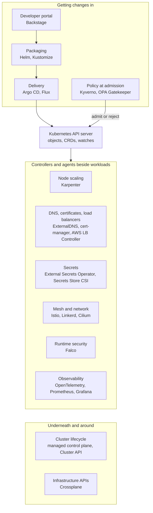
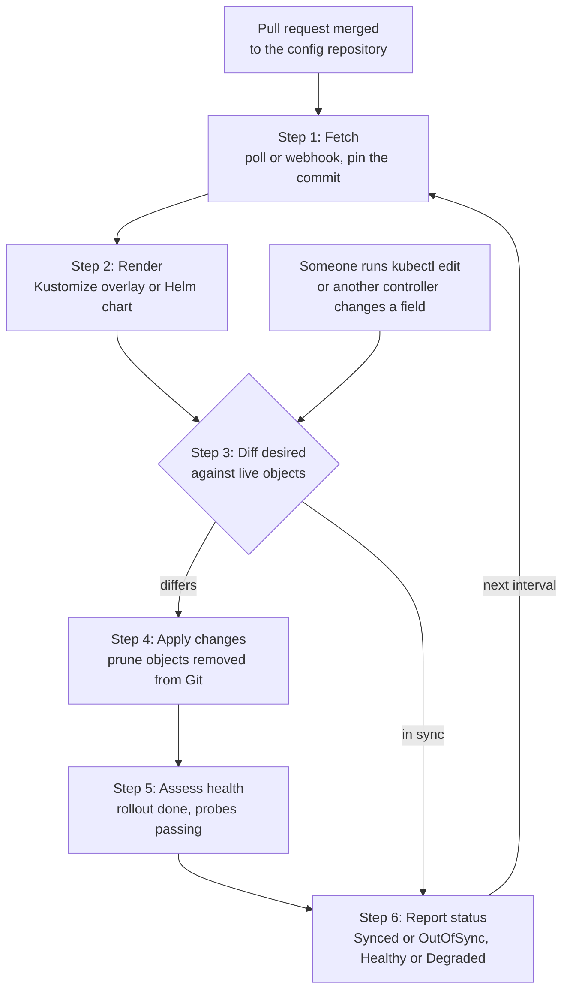
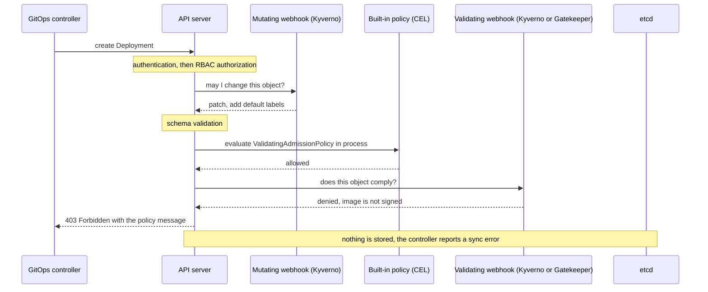
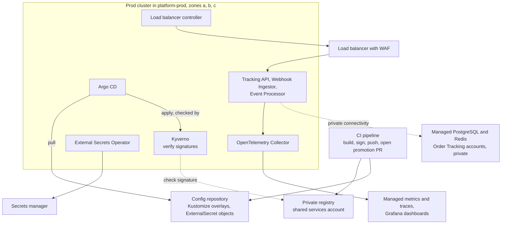

# Cloud-native ecosystem tools

> A bare Kubernetes cluster gives you an API for running containers and little else. Everything a
> production platform also needs, from packaging and delivery to certificates, secrets, telemetry,
> and policy, comes from add-ons. Pick them by the problem they solve, adopt as few as you can
> justify, and remember that every one is software you now operate.

!!! abstract "Page facts"
    **Level:** Intermediate (the tool map and definitions are Level 1; GitOps, Helm versus Kustomize,
    and policy engines are Level 2; choosing and limiting a platform tool set is Level 3) ·
    **Status:** Draft · **Time:** 60-90 minutes · **Last verified:** 2026-11-21

## Learning objectives

After this page you should be able to:

- Place each common ecosystem tool under the problem it solves, name an alternative, and explain the
  controller-and-CRD pattern most of them share.
- Describe GitOps reconciliation step by step, including drift, pruning, and pull versus push.
- Choose between Helm and Kustomize (or both) for a given set of manifests.
- Compare ValidatingAdmissionPolicy, Kyverno, and OPA Gatekeeper, and choose a webhook failure mode.
- Design a minimal tool set for a platform team and justify what it deliberately leaves out.

## Prerequisites

- [Kubernetes architecture and workloads](kubernetes-architecture-and-workloads.md) — the API
  server, controllers, and reconciliation, which almost every tool here reuses.
- [Kubernetes networking, storage, and service mesh](kubernetes-networking-storage-and-service-mesh.md)
  — CNI, Services, ingress, and the mesh concepts the networking tools implement.
- [Containers and images](containers-and-images.md) — registries, tags, digests, and signing.

## The problem this solves

Kubernetes deliberately stops at a small core: it schedules Pods, keeps replica counts, routes
Service traffic, and stores objects. It does not package an application with its configuration
variants, deploy from a repository, add nodes when Pods cannot fit, create DNS records, issue TLS
certificates, fetch secrets from a cloud secrets manager, collect metrics, encrypt service-to-service
traffic, detect a shell spawned in a container, or reject a Deployment that runs as root. Each gap
is filled by an add-on, and the open-source landscape offers several for every gap. Teams that adopt
tools by popularity end up with a dozen controllers, two policy engines, three ways to deploy, and an
upgrade backlog nobody owns. The architect's job is to name the problems the platform must solve,
pick one tool per problem (or decide the problem does not exist yet), and count the operational cost.

## What it is

The **cloud-native ecosystem** is the set of tools that extend or surround Kubernetes. They come in
three shapes:

1. **Client-side tools** that produce manifests on a laptop or in CI: Helm (templating) and Kustomize.
2. **In-cluster controllers** that watch the API and act, usually through their own
   **CustomResourceDefinitions (CRDs)**: Argo CD, Flux, Karpenter, ExternalDNS, cert-manager, External
   Secrets Operator, the AWS Load Balancer Controller, Kyverno, OPA Gatekeeper, Crossplane.
3. **Node agents and platforms beside the cluster**: CNI and mesh data planes (Cilium, Istio,
   Linkerd), node agents (Falco, the OpenTelemetry Collector), and Prometheus, Grafana, Backstage.

Many of these are hosted by the **Cloud Native Computing Foundation (CNCF)**, which labels each
project **Sandbox** (early, experimental), **Incubating** (used in production by several adopters,
growing), or **Graduated** (meets the foundation's bar for adoption, governance, and process). A
maturity level is evidence about the project's health, not a recommendation for your use case: a
Graduated tool can still be the wrong one for you, and a non-CNCF tool (several here are Kubernetes
SIG subprojects or vendor-led) can be the right one.

## Mental model

Think of Kubernetes as an operating system kernel and the ecosystem as the packages a distribution
adds on top: a package manager (Helm), a configuration manager that keeps the machine matching a
checked-in description (GitOps), a firewall (NetworkPolicy and Cilium), an audit daemon (Falco), a
metrics agent (OpenTelemetry), and a rule that refuses to install unsigned software (an admission
policy). You choose a distribution's packages by what the machine must do, not by what is available.

**Where the analogy breaks:** most of these "packages" are not passive libraries. They are running
controllers holding cluster-wide credentials, they add API types (CRDs) whose stored objects outlive
the controller, and their versions are coupled to the Kubernetes minor version. Uninstalling one can
delete what it managed; upgrading Kubernetes can break one. Each tool is a small distributed system
you now operate, three times if you run three clusters.

## Key terms

| Term | Meaning on this page |
|---|---|
| Controller (reconciliation loop) | A process that repeatedly compares the desired state stored in the API with the actual state and acts to close the gap |
| CustomResourceDefinition (CRD) | An extension that adds a new object type to the Kubernetes API, such as `Certificate` or `Application` |
| Operator | A controller plus CRDs that encodes the operational knowledge for one piece of software |
| Helm chart / release | A chart is a package of templated manifests with default values; a release is one installed instance of a chart with its own values and revision history |
| Kustomize base / overlay | A base is a set of plain manifests; an overlay references a base and patches it for one environment |
| GitOps | Operating a system by keeping its desired state declaratively in a versioned store and letting in-cluster agents pull and continuously reconcile it |
| Drift | Any difference between the live objects and the desired state in Git, caused by manual changes or by other controllers |
| Admission controller | Code in the API server's request path that can modify (mutating) or reject (validating) an object before it is stored |
| Policy as code | Rules about what may run, written as versioned, testable code and enforced automatically |
| Service mesh | Proxies plus a control plane that handle mutual TLS, retries, timeouts, and telemetry for service-to-service traffic (as in the glossary) |
| eBPF | A Linux kernel facility that runs small verified programs on kernel events, used for networking, observability, and security without kernel modules |
| CNCF maturity level | The foundation's Sandbox, Incubating, or Graduated label for a hosted project |

## How it works

### The shared mechanism: controllers watching the API

In-cluster tools follow the pattern of Kubernetes' own Deployment controller. You write an object
of the tool's type (a `Certificate`, an `ExternalSecret`, an `Application`); the controller sees it
through a watch, does the work (calls a certificate authority, reads a secrets manager, applies
manifests), and writes a status back; the next loop corrects any later divergence. Two consequences
matter. Each controller needs permissions, often broad ones, so it is part of your security
boundary. And controllers converge on what is declared, so the declaration, and who can change it,
is what you must protect.

### The ecosystem, organized by problem

**Figure 1 — The ecosystem by problem.** Tools grouped by the job they do, and where they sit
relative to the Kubernetes API.

How to read it: the top box is how a change reaches the API, the middle box reacts to what is in the
API, and the bottom box builds and extends the platform itself; arrows show the flow of changes.

The table below defines every tool in the inventory. CNCF maturity is shown only where it was
checked on the project's page under cncf.io/projects on 2026-11-21; "not a CNCF project" means the
tool lives elsewhere (for Kustomize, ExternalDNS, the Secrets Store CSI Driver, Karpenter, the AWS
Load Balancer Controller, and Cluster API, the `kubernetes-sigs` GitHub organization).

| Problem | Tool | How it works, in brief | Alternatives | CNCF maturity |
|---|---|---|---|---|
| Packaging | Helm | Renders Go-templated charts with values into manifests, installs them as a named release with revision history, and can roll back | Kustomize, plain manifests, CUE or Jsonnet | Graduated |
| Packaging | Kustomize | Patches plain YAML bases with per-environment overlays, no templates; built into `kubectl apply -k` | Helm | Not a CNCF project (Kubernetes SIG CLI) |
| Delivery | Argo CD | GitOps controller: `Application` objects point at a Git path, the controller renders, diffs, syncs, and reports health in a web UI | Flux, CI-driven `kubectl apply` | Graduated (as part of the Argo project) |
| Delivery | Flux | GitOps as a set of small controllers (source, kustomize, helm, notification, image automation) configured entirely through CRDs | Argo CD | Graduated |
| Delivery | GitOps | The operating model the two tools implement (next section) | Push-based CI/CD | Not a tool |
| Node scaling | Karpenter | Watches unschedulable Pods and launches right-sized nodes directly from the cloud API; consolidates underused nodes | Cluster Autoscaler (scales predefined node groups), the provider's managed node autoscaling | Not a CNCF project (Kubernetes SIG Autoscaling) |
| DNS | ExternalDNS | Reads hostnames from Services, Ingresses, and Gateway routes and creates records in a DNS provider, marking ownership with TXT records | Records managed in IaC | Not a CNCF project |
| Certificates | cert-manager | `Issuer` and `Certificate` CRDs; obtains certificates (ACME, private CA, cloud CA), stores them in Secrets, renews before expiry | Provider certificate service at the load balancer, mesh-issued certificates | Graduated |
| Secrets | External Secrets Operator | `SecretStore` plus `ExternalSecret` CRDs; copies values from an external secrets manager into Kubernetes Secrets and refreshes them | Secrets Store CSI Driver, sealed or encrypted secrets in Git | Sandbox |
| Secrets | Secrets Store CSI Driver | Mounts secrets from an external store into the Pod as files through a CSI volume and provider plugins; syncing to a Secret is optional | External Secrets Operator | Not a CNCF project |
| Load balancing | AWS Load Balancer Controller | Provisions the provider's application and network load balancers from Ingress and Service objects | Each provider's own integration, in-cluster ingress controllers | Not a CNCF project |
| Observability | OpenTelemetry | Vendor-neutral APIs, SDKs, and the OTLP protocol for traces, metrics, and logs, plus the Collector that receives, processes, and exports them | Vendor agents | Graduated |
| Observability | Prometheus | Pulls (scrapes) metrics from HTTP endpoints, stores them as time series, queries with PromQL, alerts through Alertmanager | Managed Prometheus-compatible services, vendor metrics | Graduated |
| Observability | Grafana | Dashboards and alerting over many data sources; developed by a company under the AGPL-3.0 licence | Provider dashboards, vendor UIs | Not a CNCF project |
| Mesh | Istio | Envoy proxies as sidecars, or the ambient mode with per-node and optional per-service proxies; mTLS, traffic splitting, L7 policy | Linkerd, Cilium mesh features, no mesh | Graduated |
| Mesh | Linkerd | Lightweight sidecar proxies with automatic mTLS, retries, and golden metrics; smaller feature set by design | Istio | Graduated |
| Network | Cilium | eBPF-based CNI: Pod networking, NetworkPolicy plus its own L3-L7 policies, flow visibility, optional kube-proxy replacement and mesh features | The provider's CNI, other CNIs | Graduated |
| Runtime security | Falco | Watches system calls and Kubernetes events against rules and raises alerts (for example a shell in a container); detects, does not block | Provider runtime threat detection, commercial agents | Graduated |
| Policy | Kyverno | Policy engine whose rules are Kubernetes resources: validate, mutate, generate, verify image signatures; also a CLI for CI | OPA Gatekeeper, built-in ValidatingAdmissionPolicy | Graduated |
| Policy | OPA | General-purpose policy engine with the Rego language; Gatekeeper is its Kubernetes admission integration | Kyverno, built-in ValidatingAdmissionPolicy | Graduated |
| Developer portal | Backstage | Software catalog, project templates, and documentation behind a plugin-based web portal | A wiki plus repository templates, commercial portals | Incubating |
| Infrastructure APIs | Crossplane | Controllers that manage cloud resources from Kubernetes objects; compositions expose simplified platform APIs | Terraform or OpenTofu in a pipeline, provider-specific operators | Graduated |
| Cluster lifecycle | (practice) | Provisioning, upgrading, and retiring clusters: managed control planes, Cluster API, node image rotation, add-on upgrades | Hand-built clusters | Cluster API is not a CNCF project |

### Packaging: Helm versus Kustomize

Both turn a set of manifests into environment-specific YAML, from opposite directions.

**Helm templates.** A chart contains templates with placeholders and a `values.yaml` of defaults.
You install it with your own values; Helm renders the templates, applies the result, and records a
**release** (by default stored as a Secret in the release's namespace) so it can show history, run
hooks before or after install, and roll back to an earlier revision. Charts are the common way
vendors and projects ship software, which is Helm's strongest argument: the ingress controller,
policy engine, or GitOps tool you install almost certainly has an official chart. The cost is that
templates are code: logic hides in conditionals, the values file becomes the real interface, and
you cannot read the final manifest without rendering it.

**Kustomize patches.** A base is ordinary, valid YAML. An overlay for `prod` lists the base and
applies patches (raise replicas, change the image tag, add a label), plus generators for ConfigMaps
and Secrets that add a content hash to the name so a change triggers a rollout. Nothing is
templated, so every file is a real manifest you can lint, and the diff between environments is
explicit. It is built into kubectl (`kubectl apply -k`) and into both GitOps tools. It has no release
concept, hooks, or rollback of its own; Git history and the GitOps controller provide those.

| Question | Helm | Kustomize |
|---|---|---|
| Who wrote the manifests? | A vendor or another team, consumed with values | Your team, kept as plain YAML |
| How many variants? | Many consumers with many settings | A few environments with small, known differences |
| Do you need install hooks or packaged rollback? | Yes, built in | No; rely on Git and the GitOps controller |
| Can reviewers read the final YAML in the pull request? | Only after rendering | Base plus patches are readable; render to be sure |
| Typical failure | Values that silently change templates in surprising ways | Patch no longer matches after the base changes |

A common combination, used in the AtlasMart example below: Kustomize for the team's own services,
Helm charts for third-party software, and the GitOps controller rendering both so nothing is
installed by hand.

### Delivery: GitOps reconciliation

The OpenGitOps principles describe GitOps in four properties: desired state is **declarative**, it
is stored **versioned and immutable** with full history, software agents **pull** it automatically,
and they **continuously reconcile** the live system toward it. The practical difference from a CI
pipeline that runs `kubectl apply` (push) is where the credentials and the loop live. In push
delivery, CI holds credentials to every cluster and acts once per pipeline run; anything changed by
hand afterwards stays changed. In pull delivery, an agent inside each cluster holds only that
cluster's permissions, reads the repository, and keeps comparing; a manual change is reported as
drift and, if self-healing is on, reverted.

**Figure 2 — The GitOps reconciliation loop.** One loop of an in-cluster GitOps controller, and how
drift re-enters it.

How to read it: the loop runs on every change and also on a timer, so the controller notices drift
even when Git has not changed. Steps 4 and 5 are separate: a successful apply only means the API
accepted the objects; health says whether the workload actually rolled out.

Details that decide whether GitOps works in practice:

- **Pruning.** Deleting a file from Git should delete the object, otherwise orphans accumulate. Both
  Argo CD and Flux can prune; turn it on deliberately and protect objects that must never be
  deleted automatically, such as namespaces holding persistent volumes.
- **Fields owned by others.** An autoscaler changes `replicas`; a mesh injects sidecars. If Git also
  sets those fields, the controller and the autoscaler fight. Leave such fields out of Git or tell
  the GitOps tool to ignore them.
- **Promotion between environments.** Each environment is a directory or overlay; promotion is a pull
  request that changes the image digest in the next environment's overlay. CI builds and signs the
  image and opens that pull request; it never touches the cluster.
- **Secrets.** Git must never hold plaintext secrets. Store references (an `ExternalSecret` that
  names a key in the secrets manager) or values encrypted for the cluster.
- **Argo CD or Flux.** Both implement the same model. Argo CD centres on `Application` objects and a
  web UI showing sync and health, with its own projects and RBAC; Flux is composable controllers
  configured only through CRDs, with Kubernetes RBAC for tenancy and no UI of its own.

The planned Lab 13 (GitOps, batch 4B) builds this loop locally on top of the
[Lab 12](../labs/lab-12-local-kubernetes-deployment.md) cluster.

### Policy engines and the admission path

Policy engines enforce rules such as "no container runs as root", "images come only from our
registry and carry a valid signature", or "every Deployment has resource limits". They act at the
API server's admission stage, after authentication and authorization and before the object is
stored, and most can also audit objects already in the cluster.

**Figure 3 — Where policy runs in an API request.** A Deployment created through GitOps passes
through mutating admission, schema validation, and validating admission before it is stored.

How to read it: mutation always happens before validation, so validators see the final object. The
built-in policy runs inside the API server; the webhooks are network calls to Pods in the cluster,
which is why their availability matters.

The three practical choices:

| | Built-in ValidatingAdmissionPolicy | Kyverno | OPA Gatekeeper |
|---|---|---|---|
| Rule language | CEL expressions in Kubernetes objects | YAML rules as Kubernetes resources | Rego in `ConstraintTemplate` objects |
| Runs | Inside the API server, no webhook | Webhook plus background controllers | Webhook plus an audit controller |
| Can mutate or generate objects | No (validation only) | Yes: mutate, generate, clean up | Mutation is supported; generation is not its focus |
| Can verify image signatures | No (no external calls) | Yes | Needs extra components |
| Beyond Kubernetes | No | Kubernetes-focused | OPA itself serves APIs, CI (for example with Conftest), and services |
| Learning curve | Low for simple checks | Low for Kubernetes people | Higher: Rego is a new language |

Design rules that hold whichever you pick:

- **Decide the failure mode.** A webhook's `failurePolicy` is `Fail` (reject requests when the
  webhook is unreachable: fail closed) or `Ignore` (allow them: fail open). Fail closed is safer but
  makes the policy engine a dependency of every deployment, including the deployment that would fix
  the policy engine. Run it with several replicas and a PDB, set short timeouts, and exclude system
  namespaces so the cluster can always heal itself.
- **Prefer the built-in path for simple checks.** ValidatingAdmissionPolicy (stable in current
  Kubernetes) has no network hop to fail. Use an engine for what CEL cannot do: mutation, generation,
  and signature verification.
- **Shift left.** Run the same policies in CI against rendered manifests, so a pull request fails
  before the GitOps controller ever sees the change.
- **Audit before enforce, and one engine.** Roll new rules out in audit or warn mode first. Two
  engines double the webhooks, latency, upgrades, and the ways a request can be rejected.

### The other problem areas, briefly

The table above defines each tool; these are the points an architect needs beyond it.

- **Node scaling.** The Cluster Autoscaler resizes predefined node groups; Karpenter asks the cloud
  API for a node that fits the pending Pods and later consolidates. Karpenter started at one provider,
  so check that yours has a supported implementation; many managed services now offer node
  autoscaling as a built-in feature, which removes an add-on to operate.
- **DNS, certificates, and load balancers.** ExternalDNS deletes only records it tagged as its own.
  cert-manager stores certificates in Secrets for ingress controllers and meshes; where TLS terminates
  at a provider load balancer with a provider-managed certificate, it may not be needed at all.
- **Secrets.** External Secrets Operator leaves a copy in etcd (encrypt it at rest with the
  provider's KMS); the Secrets Store CSI Driver avoids the copy but makes every Pod start depend on the
  external store. Either should authenticate with workload identity, never a stored key.
- **Observability.** OpenTelemetry decouples instrumentation from the backend; the Prometheus format
  is the common metrics language that many managed services accept; observability and SRE (D15,
  planned) cover signals and SLO alerting.
- **Mesh and network.** The CNI enforces NetworkPolicy; a mesh adds mTLS, retries, and traffic
  splitting at the price of proxies on the data path. The
  [networking page](kubernetes-networking-storage-and-service-mesh.md) explains when a mesh pays off.
- **Runtime security.** Admission decides what may start; Falco notices what a running container does
  afterwards. Its alerts are useful only if they reach the SIEM and someone responds.
- **Developer portal.** Backstage is a product the platform team builds and maintains (plugins,
  catalog hygiene); adopt it when teams cannot find owners, docs, or templates, not before. Platform
  engineering (D16, planned) covers it in depth.
- **Infrastructure APIs.** Crossplane reconciles cloud resources continuously from Kubernetes objects;
  the alternative is IaC run by a pipeline, covered in
  [Multi-account strategy and infrastructure automation](../cloud-architecture/multi-account-strategy-and-infrastructure-automation.md).

### Cluster lifecycle

Cluster lifecycle is the work around the cluster itself: creating clusters reproducibly (a managed
control plane plus IaC, or Cluster API, which manages clusters as objects in a management cluster),
upgrading the control plane and then the nodes one minor version at a time, rotating node images,
and upgrading every add-on in step, because each add-on supports a range of Kubernetes versions and
deprecated APIs are eventually removed. Some teams replace rather than upgrade: build a new cluster,
move workloads through GitOps, retire the old one. Every add-on you adopt joins this upgrade path.

## Worked example: AtlasMart's minimal platform tool set

AtlasMart's platform team runs one shared managed Kubernetes cluster per environment (dev, staging,
prod; Phase 4 platform assumptions) in its own workload accounts, platform-dev, platform-staging, and
platform-prod. Prod starts with 6 worker nodes, 2 per zone, and its node autoscaler may grow to at
most 18. Product teams get namespaces in these clusters: Order Tracking runs the Tracking API (3 to 9
replicas), the Webhook Ingestor (3), and the Event Processor (2). PostgreSQL, Redis, and the queue are
managed services that stay in the Order Tracking team's own accounts and are reached privately. CI builds, signs, and
pushes images to a private registry in the shared services account, and constraint C-2 requires the
platform team's standard deployment pipeline.

The team writes down the problems first, then picks at most one tool for each, preferring a
managed or built-in feature to an add-on.

### Decision table

| Problem | Adopt | Why | Deliberately leave out | Revisit when |
|---|---|---|---|---|
| Packaging | Kustomize for own services; Helm charts only for third-party software, rendered by the GitOps controller | Three environments differ in a few fields; vendors ship charts | Helm charts for own services; Helm releases installed by hand | Many teams consume the same service with many settings |
| Delivery | Argo CD, one instance per cluster, pulling from the config repository | Product teams see sync and health in the UI without kubectl access to prod; per-cluster instances mean no cluster holds another's credentials | Flux (equally valid; one tool only); CI pushing to clusters | Team prefers CRD-only operation |
| Node scaling | The managed service's node autoscaling | 6 to at most 18 nodes in 3 zones, one node type; little to tune | Karpenter | Many node types, spot capacity, or large cost pressure |
| DNS | Records in IaC | A handful of public hostnames per environment under `atlasmart.example`, changed rarely | ExternalDNS | Teams create hostnames weekly |
| Certificates | Provider-managed certificates on the load balancer, where TLS terminates | No in-cluster TLS endpoints and no mesh | cert-manager | In-cluster TLS or a mesh arrives |
| Load balancers | The provider's load balancer controller (on AWS, the AWS Load Balancer Controller) | Ingress stays in each workload VPC behind a load balancer with a WAF, created from Kubernetes objects | An in-cluster ingress controller | Need for routing features the provider lacks |
| Secrets | External Secrets Operator reading the provider's secrets manager with workload identity | Services read Secrets as files or environment variables unchanged; `ExternalSecret` objects live in Git | Secrets Store CSI Driver | Policy forbids secret copies in etcd |
| Observability | OpenTelemetry Collector (scraping Prometheus-format metrics, receiving traces) exporting to managed backends; Grafana dashboards | One agent; NFR-8 needs a per-carrier lag dashboard and alert | In-cluster Prometheus server | Managed backend cost or gaps |
| Mesh and network | The managed CNI with NetworkPolicy enforcement, default deny per namespace | Three services, mutual TLS not yet required between them | Istio, Linkerd, Cilium as a replacement CNI | East-west mTLS becomes a requirement, or canary traffic splitting |
| Runtime security | Provider audit logs to the SIEM in the security tooling account | Already collected for all accounts | Falco | Threat model demands in-container detection |
| Policy | Pod Security Admission (`restricted`) built in, plus Kyverno for signature verification and registry rules | CI signs images; only an engine can verify signatures at admission | OPA Gatekeeper (one engine only) | Policy needs extend beyond Kubernetes |
| Developer portal | A catalog file per repository and a README template | 8 product teams fit in one page | Backstage | Teams cannot find owners or templates |
| Infrastructure APIs | IaC in the platform pipeline (C-2) | Managed databases change rarely and need review | Crossplane | Self-service infrastructure at high volume |
| Cluster lifecycle | Managed control plane, clusters defined in IaC, upgrade dev then staging then prod | Provider runs etcd and the control plane | Cluster API | Many clusters or several providers |

### The arithmetic of "minimal"

Count only add-ons the platform team installs and upgrades inside each cluster: Argo CD, the load
balancer controller, External Secrets Operator, the OpenTelemetry Collector, and Kyverno, which is
5 add-ons. With 3 clusters that is 5 × 3 = 15 installations to keep compatible with every Kubernetes
upgrade. Adopting the 8 tools left out above would add 8 × 3 = 24 more, giving 39, plus the CRDs,
webhooks, and credentials each brings. The team's rule: a tool joins only when a named problem
appears in the "revisit when" column.

**Figure 4 — AtlasMart's prod cluster with the adopted add-ons.** What runs in the cluster and what
stays outside it.

How to read it: CI never touches the cluster; Argo CD pulls. The dotted signature line is a lookup;
the dotted data line crosses from the platform account to the team's accounts over private
connectivity.
The same five add-ons run in the dev and staging clusters.

## Real-world architecture example

A common enterprise pattern scales the same model: the platform team publishes a versioned "cluster
baseline" (CNI, policy engine, secrets operator, telemetry agent, GitOps controller) in Git; each
cluster's GitOps agent installs the baseline first, then each product team's applications into that
team's namespaces. Baseline upgrades are pull requests rolled through dev clusters first, policies
run both at admission and in CI, and a new tool enters the baseline only through an ADR naming the
problem, the owner, and the upgrade plan.

## Design choices and trade-offs

| Choice | Favor when | Avoid when |
|---|---|---|
| Helm for your own services | Many consumers need many settings; you publish software to others | Three environments with small differences; reviewers need to read real YAML |
| Kustomize | Your own manifests, few variants, explicit diffs | You need install hooks or a packaged rollback |
| Pull-based GitOps | Multiple clusters, audit of every change, drift correction | A single throwaway environment; no team to own the repository |
| Built-in ValidatingAdmissionPolicy | Simple field checks, no extra moving parts | Mutation, generation, or signature checks |
| Kyverno or Gatekeeper | Rich rules, image verification, audit reports | You only need two or three simple checks |
| A service mesh | Required east-west mTLS, traffic splitting, many services | Few services, no mTLS requirement, small team |
| Karpenter | Diverse node types, spot capacity, fast scale-out | Small, uniform clusters already served by managed autoscaling |
| External Secrets Operator | Applications expect Kubernetes Secrets | Policy forbids secret copies in etcd |

## Failure modes and anti-patterns

- **Tool sprawl.** Several tools per problem, adopted by different teams. Detect: an add-on inventory
  with no owner column filled in. Prevent: one tool per problem, an ADR per addition, an owner and an
  upgrade plan for each.
- **GitOps fighting an autoscaler.** Replica counts flap between Git and the HPA. Detect: constant
  OutOfSync status on `replicas`. Prevent: omit `replicas` from Git or ignore the field.
- **Policy webhook outage blocks every deploy.** A fail-closed webhook with one replica crashes.
  Detect: API errors naming the webhook. Prevent: several replicas, a PDB, short timeouts, system
  namespaces excluded, alerts on webhook latency.
- **Uninstall deletes what the tool managed.** Removing a CRD deletes every object of that type, and
  removing a GitOps app with pruning deletes its workloads. Detect: review CRD and prune settings.
  Prevent: deletion protection on critical objects, test removals in dev.
- **Expired certificates.** A certificate controller stuck on a failed renewal. Detect: alert on
  certificate expiry well before the date. Prevent: monitor renewal status, not just the controller.
- **Add-ons blocking a Kubernetes upgrade.** An add-on uses an API version that the new release
  removes. Detect: check deprecated API usage before each upgrade. Prevent: upgrade add-ons
  continuously, not once a year.
- **Metric cardinality explosion.** A label holding shipment ids or user ids creates millions of time
  series. Prevent: review metric labels; never put unbounded values in them.

## Security considerations

- **Controllers are privileged.** A GitOps controller, policy engine, or secrets operator can create
  or read sensitive objects cluster-wide. Treat their namespaces as a security boundary: minimal
  RBAC, no human shell access, images pinned by digest and verified.
- **The config repository becomes production change control.** Whoever can merge to it can change
  production. Require reviews, branch protection, and signed commits; keep CI's write access limited
  to opening pull requests.
- **Pull keeps credentials inside.** Pull-based delivery means no external system holds cluster
  credentials; a central controller managing many clusters reintroduces that risk.
- **Webhooks are part of the attack surface.** They receive every matching object; restrict them with
  NetworkPolicy and TLS, and decide fail-open versus fail-closed per policy.
- **Supply chain of the tools themselves.** Pin chart and image versions, verify signatures where
  projects publish them, and track their security advisories; the infrastructure and supply chain
  security page (D12-T06) covers signing and provenance.

## Performance, reliability, and cost

- **Performance:** each admission webhook adds a network round trip to matching API requests; a mesh
  adds proxy hops to service calls; telemetry agents consume CPU on every node. Measure before and
  after adopting each.
- **Reliability:** every controller is a dependency of something. Know what breaks when it is down:
  a stopped GitOps controller freezes deploys but leaves running workloads alone; a fail-closed
  webhook stops deploys; a stopped secrets operator leaves existing Secrets in place but stops
  refreshing them.
- **Cost:** add-ons consume node capacity (requests are reserved whether used or not) and, more
  importantly, people's time: the 15-versus-39 installation count in the worked example is mostly an
  operations cost. Managed or built-in features trade some flexibility for less of it.

## Hands-on lab: drift and reconciliation by hand

[Lab 12](../labs/lab-12-local-kubernetes-deployment.md) deploys the tracking stub to a kind cluster
with `kubectl apply -k`; reuse it to see what a GitOps controller automates (Lab 13 is planned).

1. Complete Lab 12 Steps 2-4 so the stub runs in the `atlas-tracking-lab` namespace.
2. Create drift by hand: `kubectl -n atlas-tracking-lab scale deployment tracking-stub --replicas=5`.
3. Detect it: `kubectl diff -k manifests/` shows the live object no longer matches the files.
4. Create an overlay directory `overlays/staging/` whose `kustomization.yaml` lists `../../manifests`
   as a resource and patches `replicas` to 2; render it with `kubectl kustomize overlays/staging`.
5. Run a crude pull loop: `while sleep 30; do kubectl apply -k overlays/staging; done`. Scale the
   Deployment by hand again and watch the loop put it back.
6. List what your loop does not do that Argo CD or Flux does.

??? question "Hint: what is missing from the shell loop?"
    It does not fetch from Git (it reads your working copy), does not prune objects you delete from
    the files, does not assess health after applying, reports no status, has no notion of
    multiple applications or teams, and runs with your own full credentials rather than a
    least-privilege service account inside the cluster.

## Knowledge check

1. What do most in-cluster ecosystem tools have in common in how they work, and why does that make
   them part of the security boundary?
2. A team maintains its own three services across dev, staging, and prod, with differences only in
   replicas, image tag, and one environment variable. Helm or Kustomize, and why?
3. What does a GitOps controller do when someone changes a Deployment with `kubectl edit`, and what
   would a push-based pipeline do?
4. Why might you keep a built-in ValidatingAdmissionPolicy for some rules even after installing
   Kyverno?
5. A policy webhook is configured with `failurePolicy: Fail` and one replica. What can go wrong, and
   how do you reduce the risk without switching to fail open?

??? success "Answers"
    1. They are controllers: they watch API objects, often their own CRDs, and act to make reality
       match. To act they hold permissions, frequently cluster-wide, so compromising a controller or
       the objects it reads gives an attacker those permissions.
    2. Kustomize: the manifests are the team's own, the variants are few and small, and plain YAML
       with explicit patches is easier to review. Helm is better for software consumed by many teams
       with many settings.
    3. It detects the difference as drift on its next loop, reports the application OutOfSync, and,
       if self-heal is enabled, reapplies the Git version. A push pipeline does nothing until its
       next run, so the manual change silently persists.
    4. It runs inside the API server with no network call, so it cannot be made unavailable by a
       crashed webhook and adds no latency; use the engine only for what CEL cannot express, such as
       mutation or signature verification.
    5. If the replica is down or slow, every matching API request is rejected, including deployments
       that would fix the problem. Run several replicas with a PDB and spread, set short timeouts,
       exclude system namespaces, and alert on webhook errors and latency.

## Architecture discussion questions

1. AtlasMart's security team now requires mutual TLS between all services in prod. Compare adding a
   service mesh with issuing certificates through cert-manager and terminating TLS in each service.
   Which tools enter the decision table, and what does each cost to operate?
2. A product team asks for Backstage because "everyone uses it". Using the decision table's approach,
   what evidence would justify it, who would own it, and what is the smallest step that tests the
   need?
3. One Argo CD instance managing all three clusters would be simpler to operate than three. Argue
   both sides, considering credentials, blast radius, and upgrade risk.

## Summary

The Kubernetes ecosystem is best understood by problem: packaging, delivery, node scaling, DNS and
certificates, secrets, observability, mesh and network, runtime security, policy, developer portals,
infrastructure APIs, and cluster lifecycle, each with one or more tools. Most are controllers that
reconcile declared state, so they are privileged and must be upgraded with the cluster. GitOps puts
desired state in Git and lets in-cluster agents pull and reconcile it continuously; Helm templates
packages while Kustomize patches plain YAML; policy belongs at admission and in CI, with a deliberate
failure mode. AtlasMart adopts five in-cluster add-ons and writes down when it would add each of the
others.

## Related topics

- **Before:** [Kubernetes architecture and workloads](kubernetes-architecture-and-workloads.md);
  [Containers and images](containers-and-images.md)
- **Alongside:** [Kubernetes networking, storage, and service mesh](kubernetes-networking-storage-and-service-mesh.md);
  [Infrastructure and supply chain security](../security-architecture/infrastructure-and-supply-chain-security.md);
  [Multi-account strategy and infrastructure automation](../cloud-architecture/multi-account-strategy-and-infrastructure-automation.md);
  [Lab 12: Deploy a small application to local Kubernetes](../labs/lab-12-local-kubernetes-deployment.md)
- **Planned:** observability and SRE (D15); DevOps, CI/CD, IaC, DevSecOps, and platform engineering
  (D16); Lab 13 GitOps deployment (batch 4B).

## References

| Source | Type | Checked |
|---|---|---|
| [OpenGitOps principles](https://opengitops.dev/) — CNCF GitOps Working Group | Principles (the four GitOps properties) | 2026-11-21 |
| [CNCF projects](https://www.cncf.io/projects/) — Cloud Native Computing Foundation | Project list and per-project maturity pages | 2026-11-21 |
| [Helm documentation](https://helm.sh/docs/) — Helm project | Official documentation (charts, releases, rollback) | 2026-11-21 |
| [Declarative Management of Kubernetes Objects Using Kustomize](https://kubernetes.io/docs/tasks/manage-kubernetes-objects/kustomization/) — Kubernetes | Official documentation | 2026-11-21 |
| [Argo CD documentation](https://argo-cd.readthedocs.io/en/stable/) — Argo project | Official documentation (applications, sync, health) | 2026-11-21 |
| [Flux concepts](https://fluxcd.io/flux/concepts/) — Flux project | Official documentation (GitOps Toolkit controllers) | 2026-11-21 |
| [Dynamic Admission Control](https://kubernetes.io/docs/reference/access-authn-authz/extensible-admission-controllers/) — Kubernetes | Official documentation (webhooks, failure policy) | 2026-11-21 |
| [Validating Admission Policy](https://kubernetes.io/docs/reference/access-authn-authz/validating-admission-policy/) — Kubernetes | Official documentation (CEL policies, stable) | 2026-11-21 |

## Review notes

- Canonical page for D11-T04. In depth: GitOps (Argo CD, Flux), Helm, Kustomize, policy engines
  (Kyverno, OPA Gatekeeper, built-in ValidatingAdmissionPolicy), cluster lifecycle as a practice.
  Only defined (table row plus a short bullet): Karpenter, ExternalDNS, cert-manager, External
  Secrets Operator, Secrets Store CSI Driver, AWS Load Balancer Controller, OpenTelemetry,
  Prometheus, Grafana, Istio, Linkerd, Cilium, Falco, Backstage, Crossplane.
- CNCF maturity was read from each project's cncf.io/projects page on 2026-11-21: Graduated for Helm,
  Argo, Flux, cert-manager, OpenTelemetry (2026-05-11), Prometheus, Istio, Linkerd, Cilium, Falco,
  Kyverno (2026-03-16), OPA, Crossplane (2025-10-28); Incubating for Backstage; Sandbox for
  external-secrets. The `kubernetes-sigs` homes of Kustomize, ExternalDNS, Secrets Store CSI Driver,
  Karpenter, AWS Load Balancer Controller, and Cluster API, and Grafana's AGPL-3.0 licence, were
  checked through the GitHub API. One CNCF row stands for the per-project pages (reference limit).
- Re-check at review: Helm storing releases as Secrets by default; Gatekeeper mutation support;
  Karpenter provider coverage; Istio ambient mode; maturity levels (they change).
- New AtlasMart assumptions: the tool set in the decision table; cluster placement in platform-dev,
  platform-staging, and platform-prod with product namespaces and data services in team accounts,
  and the prod maximum of 18 nodes (coordinator decision). Arithmetic: 5 add-ons × 3 clusters = 15
  installations; 8 left-out tools × 3 = 24 more, 39 in total.
- Figure 1 uses `~~~` to stack the bottom subgraph; verify it renders below the middle one.
- The mini-lab reuses Lab 12, whose cluster steps were not executed by the author; the overlay and
  loop steps were not executed either.
