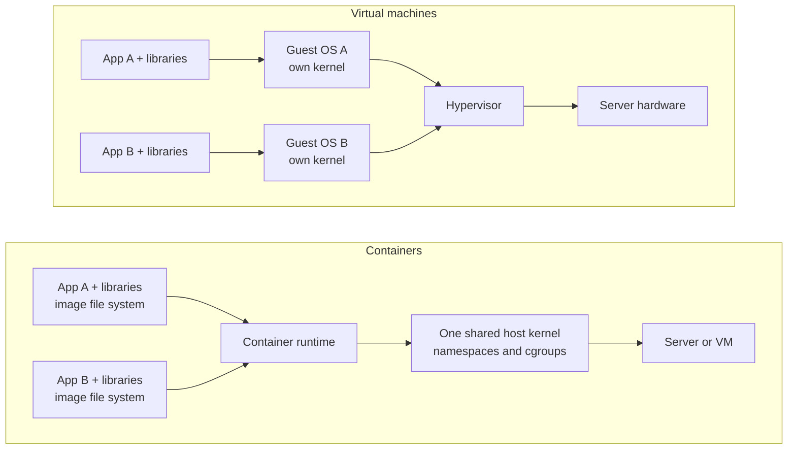
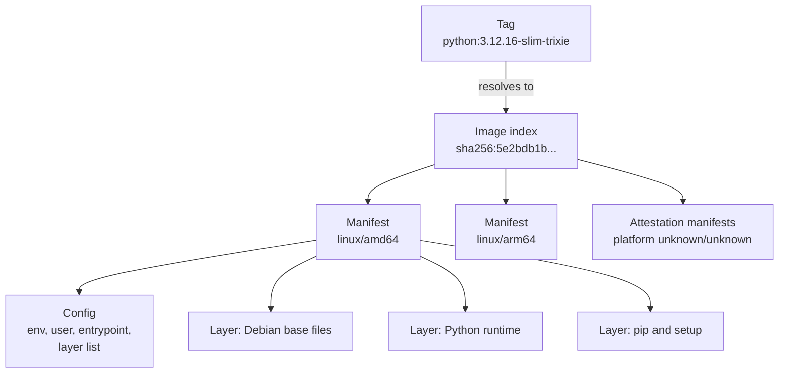
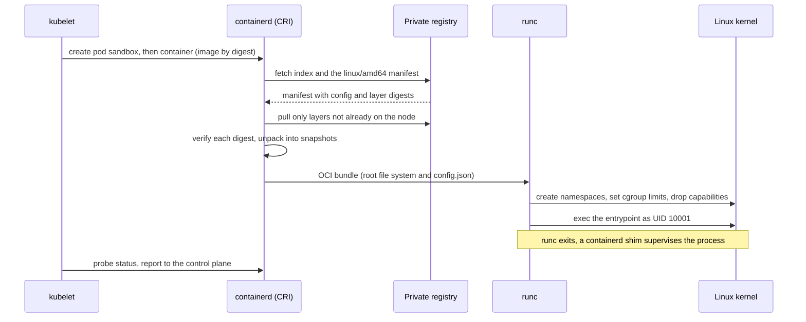
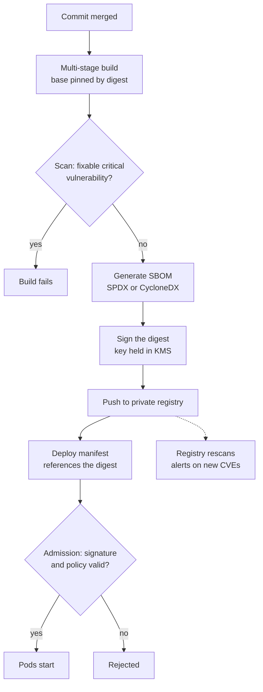

# Containers and images

> A container is an ordinary Linux process that the kernel isolates and limits; an image is a
> content-addressed bundle of file system layers plus configuration that tells a runtime how to start
> it. Getting the image right (small, pinned, non-root, scanned, signed) is most of container security.

!!! abstract "Page facts"
    **Level:** Intermediate (containers, images, and runtimes are Level 1-2; image hardening, digests,
    and the supply-chain pipeline are Level 3) · **Status:** Draft · **Time:** 60-90 minutes ·
    **Last verified:** 2026-11-21

## Learning objectives

After this page you should be able to:

- Explain how a container differs from a virtual machine, and which kernel features (namespaces,
  cgroups, capabilities, seccomp) create the isolation.
- Describe the OCI image, runtime, and distribution specifications, and how an image index, manifest,
  config, and layers fit together.
- Explain why deployments should reference images by digest rather than by tag.
- Place Docker, containerd, CRI-O, and runc in the stack that runs a container under Kubernetes.
- Write a multi-stage build that produces a small image running as a non-root user, and choose
  between slim, distroless, and scratch bases.
- Design an image pipeline with vulnerability scanning, an SBOM, and a signature verified at deploy.

## Prerequisites

- [Computers, operating systems, and Linux for architects](../foundations/computers-operating-systems-and-linux-for-architects.md)
  — processes, the kernel, cgroups, CPU throttling, and OOM kills.
- [Compute options and sizing](../cloud-architecture/compute-options-and-sizing.md) — where containers
  sit among compute options, and how AtlasMart's Tracking API pods are sized.

## The problem this solves

Before containers, a service's runtime and libraries were installed on servers shared with other
services, and versions clashed. VMs fixed that by giving each service its own OS, at the cost of
booting and patching a whole OS per service. Containers give each service its own file system and
process view on a shared kernel, so one artifact built once in CI runs unchanged everywhere, starts in
seconds, and packs densely. They also move the security question to the image: what is in it, who
built it, and whether anyone changed it on the way.

## What it is

A **container** is a set of processes started from an image, isolated from other processes by Linux
**namespaces** and limited by **cgroups**. A **container image** is a read-only package of file
system **layers** and a **configuration** (entrypoint, environment, user, working directory). A
**registry** stores and serves images. A **container runtime** pulls images, prepares the file
system, and asks the kernel to start the isolated process. The **Open Container Initiative (OCI)**
publishes the specifications that let images built by one tool run on another runtime.

| Aspect | Container | Virtual machine |
|---|---|---|
| Isolation boundary | Kernel features (namespaces, cgroups, capabilities, seccomp) on a shared kernel | Hardware-assisted virtualization; each VM has its own kernel |
| What you ship | An image: application, libraries, minimal user space | A disk image with a full operating system |
| Start-up | Seconds, faster when layers are cached | Boot time of an operating system |
| Density | Many per host; overhead is a process | Fewer per host; each carries an OS |
| Kernel | The host's; a container cannot choose another kernel | Any kernel the hypervisor supports |
| Strength against a hostile workload | Weaker: one kernel bug can cross the boundary | Stronger: a hypervisor boundary |
| Patching | Rebuild and redeploy the image | Patch the guest OS, or rebuild a machine image |

The two combine: in the cloud, containers almost always run on VMs, and sandboxed runtimes put each
container or pod inside a lightweight VM when isolation must be stronger.

## Mental model

A shipping container is a standard box: any crane, ship, or lorry can move it without knowing what
is inside, and the contents are packed once at the factory. A container image is the same idea for
software: any OCI runtime can run it, and the contents were packed once, in CI. The **manifest** is
the packing list, the **digest** is a tamper seal whose number changes if anything inside changes,
and the **registry** is the port warehouse.

**Where the analogy breaks:** shipping containers have steel walls; software containers share one
kernel, the ship's engine room, with every other container on the host, so a flaw in the kernel can
let one reach another. Labels on a shipping container stay put, but an image **tag** is a movable
sticker: the same tag can point at different contents tomorrow. And a sealed box stays the same,
while an image's contents go stale: vulnerabilities are discovered in software that has not changed.

## Key terms

| Term | Meaning on this page |
|---|---|
| Container | A set of processes started from an image and isolated by namespaces and limited by cgroups on a shared kernel |
| Container image | A read-only, content-addressed package of file system layers plus configuration for starting a container |
| Layer | A tar archive of file system changes; layers stack to form the image's root file system |
| Image manifest | The JSON document listing one image's config and layers by digest, for one platform |
| Image index | A JSON document listing manifests for several platforms (for example linux/amd64 and linux/arm64) under one reference |
| Digest | A content hash (for example `sha256:...`) that identifies an exact image or blob; any change gives a new digest |
| Tag | A human-readable, mutable name for an image in a repository, such as `3.12.16-slim-trixie` |
| Registry | A service that stores and serves images over the OCI distribution API |
| OCI | The Open Container Initiative, which publishes the image, runtime, and distribution specifications |
| Container runtime | Software that runs containers: high-level runtimes (containerd, CRI-O) manage images and lifecycles; low-level runtimes (runc) create the isolated process |
| Namespace (Linux) | A kernel feature that gives a process its own view of one resource type, such as process IDs, network, or mounts |
| cgroup | A Linux control group that limits and accounts CPU, memory, and I/O for a set of processes; the mechanism behind container resource limits |
| Multi-stage build | A build file with several stages, where the final image copies only the needed artifacts from earlier stages |
| Distroless image | A minimal base image with a language runtime and its libraries but no shell or package manager |
| SBOM | Software bill of materials: a machine-readable inventory of the components and versions inside an artifact |

## How it works

### Containers versus virtual machines

**Figure 1 — The two stacks, one above the other.** Read each stack as "runs on", top to bottom.



How to read it: in the VM stack each application has its own kernel above the hypervisor; in the
container stack both applications reach the same kernel, which enforces their isolation. That shared
kernel is the source of both the speed and the weaker boundary.

### Isolation: namespaces, cgroups, and the rest

The kernel provides several **namespace** types; a container runtime creates a new one of each kind
it needs for the container's first process.

| Namespace | What the container sees as its own |
|---|---|
| PID | Process IDs; its first process is PID 1 and it cannot see host processes |
| Network | Interfaces, IP addresses, routes, ports, and firewall rules |
| Mount | The file system tree, rooted at the image's layers |
| UTS | Host name and domain name |
| IPC | Shared memory and message queues |
| User | User and group IDs, so UID 0 inside can map to an unprivileged UID outside |
| Cgroup | Its own view of the cgroup hierarchy |
| Time | Some system clocks' offsets (rarely used by container platforms) |

**cgroups** limit and account resources: CPU (a quota that throttles), memory (a limit that ends in
an OOM kill), and I/O, as the [Linux page](../foundations/computers-operating-systems-and-linux-for-architects.md)
explains. Namespaces hide things and cgroups ration them; neither stops a process from calling the
kernel in dangerous ways, so three more layers matter:

- **Capabilities** split root's powers into units (bind a low port, change file ownership, load
  kernel modules). Runtimes give containers a reduced default set; production services should drop
  all and add back only what they need, usually nothing.
- **seccomp** filters which system calls a process may make. The runtime default profile blocks a
  set of rarely needed, risky calls.
- **Linux security modules** (AppArmor or SELinux) confine file and resource access by policy.

When those are not enough (untrusted code, multi-tenant platforms), **sandboxed runtimes** add a
boundary: one approach runs a user-space kernel that intercepts system calls (gVisor), another runs
each pod in a lightweight VM (Kata Containers).

### The OCI specifications

The OCI publishes three specifications (References), which is why the tool that builds an image does
not have to be the tool that runs it:

- The **image specification** defines the image index, manifest, config, and layer formats, and how
  content is addressed by digest.
- The **runtime specification** defines a **bundle** (a root file system plus a `config.json` saying
  which process to run, with which namespaces, mounts, capabilities, and limits) and the lifecycle
  operations a low-level runtime performs on it.
- The **distribution specification** defines the HTTP API for pushing and pulling content to and from
  a registry.

### Images, layers, and registries

Each instruction in a build that changes files produces a **layer**: a compressed archive of the
files added, changed, or deleted. At run time the runtime stacks the read-only layers with a
**union** (overlay) file system and adds a thin writable layer for the container; a write to an image
file copies it up into that layer first (**copy-on-write**). Layers are shared: ten containers from
the same image store its layers once, and a host that already has the base layers pulls only the
application layers.

**Figure 2 — Anatomy of a multi-platform image.** The real `python:3.12.16-slim-trixie` tag on Docker
Hub resolved, on 2026-11-21, to an index with digest `sha256:5e2bdb1b...`, listing manifests for
several platforms and attestation entries.



How to read it: the tag is a pointer; everything below it is addressed by digest, so an arrow means
"refers by hash to". A runtime on an ARM64 node follows the index to the arm64 manifest, which is
how one tag serves both architectures. Docker's build tooling stores provenance and SBOM attestations
as extra index entries with the platform `unknown/unknown` (References); the layer labels are
simplified.

A **registry** organizes images into **repositories** (for example `tracking-api`), each holding
tags and digests. Managed registries add access control, replication, vulnerability scanning,
immutable tags, and retention rules. Pulling from public registries in production adds an external
dependency and possible rate limits; most organizations mirror the base images they use into a
private registry.

### Tags versus digests

A **tag** is mutable: the publisher can push new content under `3.12-slim` tomorrow, and `latest`
means only "whatever was pushed last without another tag". A **digest** is the hash of the content
itself, so `python:3.12.16-slim-trixie@sha256:5e2b...` can only ever be those bytes; if the tag and
digest disagree, the digest wins. Two rules follow:

1. **Build from pinned bases.** Pin the base image by digest (with the tag beside it for humans) and
   let an automated dependency bot propose updates, so base changes are reviewed, not accidental.
2. **Deploy by digest.** CI tags images with the commit SHA for people, but the deployment manifest
   references the digest it built, scanned, and signed. Then the thing that runs is the thing that
   was checked.

### Runtimes: Docker, containerd, CRI-O, and runc

The word "Docker" covers several things: a build tool (BuildKit), a daemon (Docker Engine), a
command-line client, Docker Desktop for laptops (whose licence terms differ from the open-source
engine; check them), and Docker Hub. Underneath, Docker Engine delegates to **containerd**, a
high-level runtime, which calls **runc**, the reference low-level OCI runtime.

Kubernetes talks to runtimes through the **Container Runtime Interface (CRI)**. The two common CRI
runtimes are **containerd** and **CRI-O**; Kubernetes releases before v1.24 included a direct
integration with Docker Engine that has since been removed (References). Images built with Docker run
unchanged under either, because they are OCI images. **Podman** is a daemonless alternative to the
Docker client, often used rootless.

**Figure 3 — From a pod spec to a running process.** What happens on a node when Kubernetes starts a
Tracking API container.



How to read it: time runs downward. Every fetched object is checked against its digest, which is why
digest references are safe even over an untrusted network. The last kernel step is where non-root,
dropped capabilities, and limits from the pod spec actually take effect.

### Building images: multi-stage builds and minimal bases

A **multi-stage build** uses one stage with compilers, package managers, and build tools to produce
artifacts, and a final stage that copies only those artifacts onto a small base. The final image
carries no compiler, no build cache, and no source that is not needed at run time. Layer order also
matters for build speed: copy the dependency list and install dependencies before copying the
application code, so a code change reuses the cached dependency layer.

Base image choices for a Python service (compressed `linux/amd64` sizes as reported by Docker Hub's
API on 2026-11-21; they change with every rebuild):

| Base | What is inside | Compressed size | Trade-off |
|---|---|---|---|
| `python:3.12.16-trixie` | Full Debian with compilers and many libraries | 411.9 MB | Builds anything; large attack surface; good as a build stage only |
| `python:3.12.16-slim-trixie` | Minimal Debian plus Python | 43.3 MB | Small, glibc-compatible, has a shell and apt for debugging |
| `python:3.12.16-alpine` | Alpine Linux (musl libc) plus Python | 18.0 MB | Smallest; some native wheels and behaviour differ on musl |
| Distroless Python | Python and its libraries only; no shell, no package manager | Not measured here | Smallest attack surface; Python version is fixed by the Debian release it tracks; debugging needs ephemeral debug containers |
| `scratch` | Nothing | 0 | Only for static binaries (for example Go); not for Python |

### Rootless and non-root

Two different ideas share the word "root". A **non-root container** runs its process as an
unprivileged user (the `USER` instruction in the image, enforced by `runAsNonRoot` in Kubernetes), so
a compromise of the process does not start with root inside the container. **Rootless** operation
runs the container engine itself without root on the host, using a user namespace, so even root
inside the container maps to an ordinary host user (Docker and Podman both support it). Production
images should always be non-root; rootless engines are most useful on shared build hosts and
developer machines.

### Networking basics

A container gets its own **network namespace**. On a single host, the engine connects it to a
**bridge** with a virtual Ethernet pair, gives it a private address, uses NAT for outbound traffic,
and maps a host port to a container port for inbound traffic ("publishing" a port). Host networking
skips the namespace and shares the host's interfaces. In Kubernetes, all containers in a pod share
one network namespace and the pod gets a routable IP from the cluster network plugin (CNI);
Services, DNS, and policies are on
[Kubernetes networking, storage, and service mesh](kubernetes-networking-storage-and-service-mesh.md).

### Storage basics

The container's **writable layer** disappears with the container, so nothing that matters may live
only there. **Volumes** are storage managed by the engine and mounted into the container; **bind
mounts** map a host directory; **tmpfs** mounts live in memory. In Kubernetes, **persistent volumes**
backed by network disks or file systems outlive pods and are claimed through PersistentVolumeClaims;
their design is covered on the Kubernetes pages. A stateless service such as the Tracking API needs
only a small in-memory or empty-directory mount for temporary files.

### Signing, SBOM, and vulnerability scanning

Three controls answer "what is in this image, and is it the one we built?":

- **Vulnerability scanning** compares the packages in an image with vulnerability databases. Scan in
  CI to block the build, and keep rescanning images in the registry, because new vulnerabilities are
  published against images that have not changed.
- An **SBOM** lists every component and version in the image in a standard format (SPDX or
  CycloneDX). It turns "are we affected by this new vulnerability?" into a query instead of a
  project.
- **Signing** binds the image digest to an identity (a CI workload identity or a key held in a key
  management service), and the cluster verifies the signature at admission. Sigstore's tooling
  (References) is a common open-source choice.

**Figure 4 — An image pipeline with gates.** Solid arrows are the path of one build; the dotted
arrow is continuous rescanning after release.



How to read it: each diamond is a gate that can stop the release. Provenance, SLSA levels, and
admission policy engines are covered in depth on
[Infrastructure and supply-chain security](../security-architecture/infrastructure-and-supply-chain-security.md).

## Worked example: hardening AtlasMart's Tracking API image

The Tracking API is a Python FastAPI service run as a Kubernetes Deployment in the shared prod
cluster (min 3 replicas, HPA up to 9). The platform rule: CI builds images, signs them, and pushes
them to the private registry in the shared services account. The
[sizing page](../cloud-architecture/compute-options-and-sizing.md) gives each pod a 1 vCPU request,
a 1 GiB memory limit, and two worker processes.

### Step 1 — The naive image

A first version, written quickly, works on a laptop:

```dockerfile
FROM python:latest
WORKDIR /app
COPY . .
RUN pip install -r requirements.txt
EXPOSE 8080
CMD uvicorn app.main:app --host 0.0.0.0 --port 8080
```

| Problem | Consequence |
|---|---|
| `python:latest` | A floating tag: next week's build silently gets a new Python version and Debian release |
| Full base image | 411.9 MB compressed for the 3.12.16 full tag today, mostly compilers and libraries the service never uses, each a possible vulnerability finding |
| `COPY . .` before installing | Every code change invalidates the dependency layer; `.git`, tests, and any local `.env` file land in the image |
| No hashes on dependencies | A compromised or re-published package version installs without complaint |
| Runs as root | Any code execution flaw starts with root inside the container |
| Shell-form `CMD` | A shell may become PID 1 and not pass SIGTERM on, so the server is killed at the end of the grace period instead of draining |
| One worker process | Uses one core of the two the pod may burst to (Linux page) |
| No scan, SBOM, or signature | Nobody can say what is inside or prove where it came from |

### Step 2 — The hardened multi-stage image

The author has **not** built this image: no Docker daemon was running on the machine used to write
this page, so treat it as a reviewed illustration and build it in CI before relying on it. The base
tag and digest were read from Docker Hub on 2026-11-21.

```dockerfile
# syntax=docker/dockerfile:1
# Tracking API image (illustration; not built by the author).
ARG PYTHON_IMAGE=python:3.12.16-slim-trixie@sha256:5e2bdb1b0d542d5039cffb8181c65930093949194a65c365dfb1b0fe13a4fa5b

# Stage 1: install pinned dependencies into a virtual environment.
FROM ${PYTHON_IMAGE} AS build
ENV PIP_NO_CACHE_DIR=1 PIP_DISABLE_PIP_VERSION_CHECK=1
RUN python -m venv /opt/venv
ENV PATH="/opt/venv/bin:${PATH}"
WORKDIR /src
COPY requirements.txt .
RUN pip install --require-hashes -r requirements.txt
COPY app/ ./app/

# Stage 2: runtime with only the venv and the code, as a non-root user.
FROM ${PYTHON_IMAGE} AS runtime
RUN groupadd --system --gid 10001 tracking \
 && useradd --system --uid 10001 --gid tracking --no-create-home --shell /usr/sbin/nologin tracking
COPY --from=build /opt/venv /opt/venv
COPY --from=build /src/app /app/app
ENV PATH="/opt/venv/bin:${PATH}" PYTHONDONTWRITEBYTECODE=1 PYTHONUNBUFFERED=1
WORKDIR /app
USER 10001:10001
EXPOSE 8080
ENTRYPOINT ["uvicorn", "app.main:app", "--host", "0.0.0.0", "--port", "8080", "--workers", "2"]
```

The dependency list is pinned in a `requirements.in` file and compiled, with a hash for every package
including transitive ones, into `requirements.txt` by a lock tool (for example pip-tools'
`pip-compile --generate-hashes`):

```text
fastapi==0.165.0
uvicorn==0.54.0
```

Both versions exist on PyPI as of 2026-11-21. A `.dockerignore` keeps the build context clean:

```text
.git
.venv
**/__pycache__
tests/
*.env
```

What each choice does:

- **Same base in both stages, pinned by digest:** the venv's interpreter path matches, and the base
  changes only by reviewed commit. Any compiler a dependency needed would go in the build stage only.
- **Dependencies before code:** a code-only change rebuilds only the last layer.
- **Code owned by root, process as UID 10001:** the service cannot modify its own code.
- **Exec-form entrypoint:** Uvicorn is PID 1, receives SIGTERM, and drains in-flight requests within
  the grace period. **Port 8080** is above 1024, so binding needs no capability.

Distroless is the next step: its Python version is fixed by the Debian release it tracks (Python 3.13
for the Debian 13 based image at the time of writing), so the build stage must use the same
interpreter version and layout, which is why this example stays on slim.

### Step 3 — Run-time settings in the pod spec

The image makes non-root possible; the pod spec makes it mandatory and removes what the service does
not need. This fragment of the Deployment's container spec meets the Kubernetes Pod Security
Standards "restricted" profile (References):

```yaml
securityContext:
  runAsNonRoot: true
  runAsUser: 10001
  allowPrivilegeEscalation: false
  readOnlyRootFilesystem: true
  capabilities:
    drop: ["ALL"]
  seccompProfile:
    type: RuntimeDefault
volumeMounts:
  - name: tmp
    mountPath: /tmp
```

With a read-only root file system, `/tmp` comes from an `emptyDir` volume declared in the pod spec
(not shown), and `PYTHONDONTWRITEBYTECODE=1` stops Python trying to write bytecode next to the code.

### Step 4 — The pipeline

CI runs the Figure 4 pipeline: build with the pinned base; scan and fail on a critical vulnerability
that has a fix (an AtlasMart policy assumption); generate an SBOM; sign the digest with a key held in
the provider's KMS; push to the private registry in the shared services account; update the
Deployment with the new digest. The cluster's admission policy rejects any image in the
`order-tracking` namespace that is unsigned or comes from another registry. A weekly scheduled
rebuild picks up base-image patches even when the code has not changed (assumption).

### The hardening checklist

| Check | Naive | Hardened |
|---|---|---|
| Base pinned by digest, updates via reviewed pull requests | No (`latest`) | Yes |
| Minimal runtime base, build tools only in the build stage | No | Yes (slim; distroless possible) |
| Dependencies pinned with hashes | No | Yes |
| Build context filtered by `.dockerignore`, no secrets in any layer | No | Yes |
| Dependency layer before code layer | No | Yes |
| Non-root user in the image, `runAsNonRoot` in the pod | No | Yes |
| Read-only root file system, all capabilities dropped, no privilege escalation | No | Yes |
| Exec-form entrypoint, graceful SIGTERM handling | No | Yes |
| Worker count matches the CPU the pod can use | No | Yes (2) |
| Scanned in CI and rescanned in the registry | No | Yes |
| SBOM generated and stored with the image | No | Yes |
| Signed, verified at admission, deployed by digest | No | Yes |
| Built for every architecture the cluster runs | Implicit amd64 | amd64 now; add arm64 if Arm nodes are adopted |

The final image size is not quoted here because the image was not built; the runtime base is about a
tenth of the naive base (43.3 MB against 411.9 MB compressed), and the venv adds the dependencies.

## Real-world architecture example

A typical platform team offers a **golden base image** per language, rebuilt weekly from a pinned
upstream, scanned, signed, and published internally; admission policy enforces registry, signature,
and non-root rules. Stored SBOMs let the security team list services affected by a new library
vulnerability with a query instead of a survey. Registries mirror public images, keep the last N
digests plus anything deployed, and replicate to each region in use. Developers use rootless engines
locally; production nodes run containerd with no Docker daemon.

## Design choices and trade-offs

| Choice | Favor when | Avoid when |
|---|---|---|
| Slim distribution base | You want a small image that keeps a shell for debugging and broad library compatibility | You can meet debugging needs another way and want the smallest attack surface |
| Distroless base | Production services where no shell is a feature | Teams depend on shelling into containers; the runtime version must differ from the distro's |
| Alpine base | Static or pure-language apps tested on musl | Python or other stacks with native wheels that assume glibc |
| `scratch` base | Static binaries | Any interpreted language |
| Pin by digest | Always for bases and deployments | Never skip; pair with automated update proposals |
| One image per service | Independent release cadence | Many near-identical images could share a common base instead |
| Sandboxed runtime (user-space kernel or microVM) | Untrusted or multi-tenant code | Trusted first-party services where overhead and compatibility limits outweigh the gain |
| Multi-architecture images | Mixed x86 and Arm fleets, Arm price-performance trials | Single-architecture fleets; doubles build and test time |

## Failure modes and anti-patterns

- **Floating tags in production.** Two replicas run different code after a re-push. Detect:
  deployments that reference tags. Prevent: deploy by digest; immutable tags in the registry.
- **Secrets baked into layers.** A deleted file still exists in an earlier layer. Detect: secret
  scanning of images. Prevent: `.dockerignore`, build-time secret mounts, and runtime secrets from
  the secrets manager.
- **Fat images.** Slow pulls during scale-out and hundreds of irrelevant findings. Detect: image size
  and finding counts per service. Prevent: multi-stage builds and minimal bases.
- **Running as root.** Detect: admission policy or audit for `runAsNonRoot`. Prevent: `USER` in the
  image and the restricted Pod Security profile.
- **Stale images.** Code unchanged for months, base full of newly published vulnerabilities. Detect:
  registry rescans and image age. Prevent: scheduled rebuilds from patched bases.
- **PID 1 that ignores SIGTERM.** Requests dropped on every rollout. Detect: errors during deploys.
  Prevent: exec-form entrypoint or a small init process.
- **Writable-layer state.** Data lost on restart. Detect: files written outside mounted volumes.
  Prevent: read-only root file system, explicit volumes.
- **Public registry as a production dependency.** Pulls fail on rate limits or outages. Prevent:
  mirror bases into the private registry.

## Security considerations

- **The kernel is shared.** Treat containers from different trust levels as needing separate nodes
  or a sandboxed runtime; never run privileged containers for application workloads.
- **Least privilege at three levels:** image (non-root user, minimal base), pod (dropped
  capabilities, seccomp, read-only root, no privilege escalation), and node (no Docker socket mounted
  into containers, since access to it is effectively root on the host).
- **Supply chain.** Pin and verify what you build from, scan what you produce, record it in an SBOM,
  sign it, and verify the signature before it runs; depth is in D12-T06.
- **Registry access** is itself sensitive: push rights only for CI's workload identity, pull rights
  per cluster, and audit logs to the log archive account.
- **Secrets** never go into images or build arguments; they are injected at run time from the
  provider's secrets manager.

## Performance, reliability, and cost

- **Performance:** image size drives pull time, which adds to scale-out and node replacement; shared
  base layers and pre-pulled images cut it. Inside, CPU and memory follow cgroup limits.
- **Reliability:** deploy-by-digest makes rollbacks exact; a private, replicated registry removes a
  public dependency; graceful SIGTERM handling makes rollouts invisible to users.
- **Cost:** registry storage and replication grow with every digest (set retention rules); scanners
  and signing tools may be licensed per image or node; smaller images move and store less.

## Hands-on lab: build and inspect two images

Local and free with Docker Engine, Docker Desktop, or Podman (replace `docker` with `podman`), about
30 minutes. **Not executed by the author** (no container engine was running on the authoring machine).
[Lab 12: deploy a small application to local Kubernetes](../labs/lab-12-local-kubernetes-deployment.md)
continues from an image like this one.

1. Create a folder with `requirements.txt` containing the two pinned lines above (without hashes for
   the lab, and drop `--require-hashes` from the Dockerfile), and `app/main.py`:

    ```python
    from fastapi import FastAPI

    app = FastAPI()


    @app.get("/healthz")
    def healthz() -> dict[str, str]:
        return {"status": "ok"}
    ```

2. Save the naive file as `Dockerfile.naive` and the hardened one as `Dockerfile`, then build both:
   `docker build -f Dockerfile.naive -t tracking:naive .` and `docker build -t tracking:hardened .`.
3. Compare them: `docker image ls tracking` for size, `docker history tracking:hardened` for layers,
   and `docker run --rm --entrypoint id tracking:hardened` versus the same for `tracking:naive`.
4. Change one line in `app/main.py`, rebuild both, and note which steps each build reruns.
5. Inspect the base image's index: `docker buildx imagetools inspect python:3.12.16-slim-trixie`,
   and find the amd64 and arm64 manifests and the attestation entries.
6. Run the hardened image with `docker run --rm -p 8080:8080 --read-only --tmpfs /tmp
   --cap-drop ALL tracking:hardened`, call `http://localhost:8080/healthz`, then stop it with Ctrl+C
   and watch Uvicorn shut down gracefully.

??? question "Hint: why does the naive build reinstall every dependency after a one-line change?"
    `COPY . .` comes before `pip install`, so any changed file changes that layer's input, and every
    later layer must be rebuilt. The hardened file copies only `requirements.txt` before installing,
    so a code change reuses the cached dependency layer and rebuilds only the final `COPY`.

## Knowledge check

1. Which kernel features isolate a container, and which limit it? Why is that weaker than a VM?
2. A deployment references `tracking-api:1.4`. Give two ways it could run different code on two
   nodes, and the fix.
3. What do the OCI image, runtime, and distribution specifications each define?
4. What is the difference between a non-root container and a rootless engine?
5. Name the three supply-chain controls in Figure 4 and the question each answers.

??? success "Answers"
    1. Namespaces isolate (PID, network, mount, UTS, IPC, user, cgroup, time); cgroups limit CPU,
       memory, and I/O; capabilities, seccomp, and LSMs restrict what the process may do. All
       containers share one kernel, so a kernel flaw can cross the boundary; a VM has its own kernel
       behind a hypervisor.
    2. The tag was re-pushed between two pulls, or one node had an older copy cached under that tag
       and the pull policy did not re-check. Fix: reference the image by digest.
    3. Image: the index, manifest, config, and layer formats and content addressing. Runtime: the
       bundle (root file system plus `config.json`) and lifecycle operations. Distribution: the
       registry HTTP API for push and pull.
    4. Non-root: the container's process runs as an unprivileged user. Rootless: the engine itself
       runs without host root, with container root mapped to an unprivileged host user.
    5. Scanning: does it contain known vulnerabilities? SBOM: exactly what is inside? Signature: is
       this the image our CI built, unchanged?

## Architecture discussion questions

1. AtlasMart's platform team proposes distroless as mandatory for all services. What would you need
   for debugging, for Python version alignment, and for teams with native dependencies, and would you
   make it mandatory?
2. A critical vulnerability is announced in a library used by most services. Describe how SBOMs,
   registry rescans, golden base images, and deploy-by-digest let you find, fix, and prove the fix
   across the cluster, and how long each step takes.
3. A partner wants to run its own code inside AtlasMart's cluster to process carrier data. Which
   isolation would you require, and why are namespaces and cgroups alone not enough?

## Summary

A container is a process isolated by namespaces, limited by cgroups, and restricted by capabilities,
seccomp, and LSMs on a shared kernel: fast and dense, but a weaker boundary than a VM. An image is a
stack of content-addressed layers plus a config, described by the OCI image specification, stored in
registries via the distribution specification, and run by a high-level runtime (containerd or CRI-O)
through a low-level one (runc). Tags move; digests do not, so build from pinned digests and deploy by
digest. Multi-stage builds, minimal bases, non-root users, read-only file systems, and exec-form
entrypoints make the Tracking API image small and well-behaved; scanning, an SBOM, and a verified
signature make it trustworthy.

## Related topics

- **Before:** [Computers, operating systems, and Linux for architects](../foundations/computers-operating-systems-and-linux-for-architects.md);
  [Compute options and sizing](../cloud-architecture/compute-options-and-sizing.md)
- **Alongside:** [Kubernetes architecture and workloads](kubernetes-architecture-and-workloads.md);
  [Kubernetes networking, storage, and service mesh](kubernetes-networking-storage-and-service-mesh.md);
  [Cloud-native ecosystem tools](cloud-native-ecosystem-tools.md) — admission policy engines;
  [Infrastructure and supply-chain security](../security-architecture/infrastructure-and-supply-chain-security.md);
  [Lab 12](../labs/lab-12-local-kubernetes-deployment.md).
- **Planned:** CI/CD pipeline design and deployment strategies (D16-T02); DevSecOps and secure
  delivery (D16-T04).

## References

| Source | Type | Checked |
|---|---|---|
| Open Container Initiative: [image specification](https://github.com/opencontainers/image-spec/blob/main/spec.md), [runtime specification](https://github.com/opencontainers/runtime-spec/blob/main/spec.md), [distribution specification](https://github.com/opencontainers/distribution-spec/blob/main/spec.md), [opencontainers.org](https://opencontainers.org/) | Specifications | 2026-11-21 |
| Linux man-pages project: [namespaces(7)](https://man7.org/linux/man-pages/man7/namespaces.7.html), [cgroups(7)](https://man7.org/linux/man-pages/man7/cgroups.7.html) | Official documentation | 2026-11-21 |
| Kubernetes documentation: [Container runtimes](https://kubernetes.io/docs/setup/production-environment/container-runtimes/), [Images](https://kubernetes.io/docs/concepts/containers/images/), [Pod Security Standards](https://kubernetes.io/docs/concepts/security/pod-security-standards/) | Official documentation (CRI, dockershim removal, image pulls, restricted profile) | 2026-11-21 |
| Runtime projects: [containerd](https://containerd.io/), [CRI-O](https://cri-o.io/), [runc](https://github.com/opencontainers/runc) | Project documentation | 2026-11-21 |
| Docker documentation: [Multi-stage builds](https://docs.docker.com/build/building/multi-stage/), [Building best practices](https://docs.docker.com/build/building/best-practices/), [Rootless mode](https://docs.docker.com/engine/security/rootless/), [Attestation storage](https://docs.docker.com/build/metadata/attestations/attestation-storage/); [Python official image](https://hub.docker.com/_/python) | Vendor documentation and registry page (tags, digests, sizes read via its API) | 2026-11-21 |
| NIST SP 800-190, [Application Container Security Guide](https://csrc.nist.gov/pubs/sp/800/190/final) | Standard guidance | 2026-11-21 |
| OWASP, [Docker Security Cheat Sheet](https://cheatsheetseries.owasp.org/cheatsheets/Docker_Security_Cheat_Sheet.html); [distroless images](https://github.com/GoogleContainerTools/distroless) | Security guidance; project documentation | 2026-11-21 |
| Supply chain: [Sigstore documentation](https://docs.sigstore.dev/), [SPDX](https://spdx.dev/), [CycloneDX](https://cyclonedx.org/), [CISA: SBOM](https://www.cisa.gov/sbom) | Project documentation and government guidance | 2026-11-21 |

## Review notes

- Canonical page for D11-T01. In depth: containers versus VMs, namespaces and cgroups, OCI specs,
  images, layers and registries, tags versus digests, runtimes, multi-stage builds and minimal bases,
  non-root and rootless. Only defined or summarized: container networking and storage (persistent
  volumes belong to D11-T02 and D11-T03), sandboxed runtimes (gVisor, Kata Containers), Podman, and
  signing, SBOM, and scanning (depth in D12-T06).
- **Docker was not run.** Neither Dockerfile, nor the lab, was built or executed by the author: the
  Docker daemon was not running on the authoring machine. A reviewer should build both images, run
  the lab, and confirm that `useradd` exists in the slim base and that the exec-form Uvicorn shuts
  down gracefully on SIGTERM.
- Facts read on 2026-11-21: the `python:3.12.16-slim-trixie` index digest and the compressed amd64
  sizes (411.9 MB full, 43.3 MB slim, 18.0 MB alpine) from Docker Hub's API; fastapi 0.165.0 and
  uvicorn 0.54.0 from PyPI; the distroless `python3-debian13` image name from its README. All will
  drift; the digest pins the example regardless of later tag moves. The "Python 3.13 in Debian 13"
  statement should be rechecked.
- New AtlasMart assumptions: UID/GID 10001 for the service user; a scan gate on fixable critical
  vulnerabilities; signing with a KMS-held key; an admission policy on the `order-tracking`
  namespace; a weekly scheduled rebuild.
- Figure 2 labels the attestation entries from the observed `unknown` platforms in the index; Docker's
  attestation storage page documents that convention.
