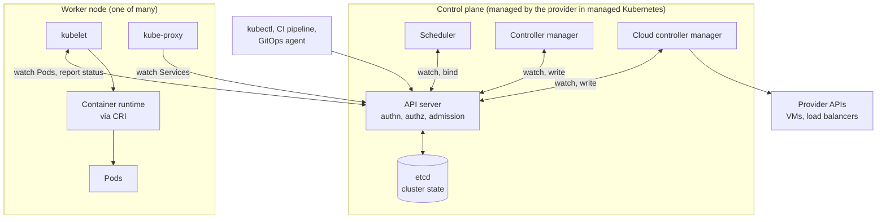
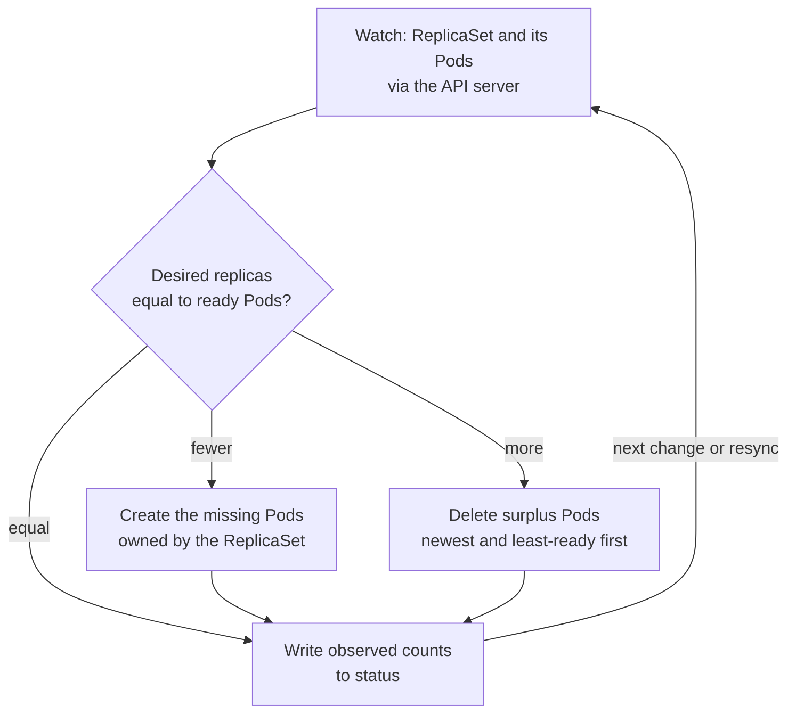
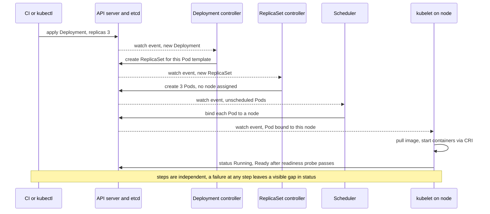
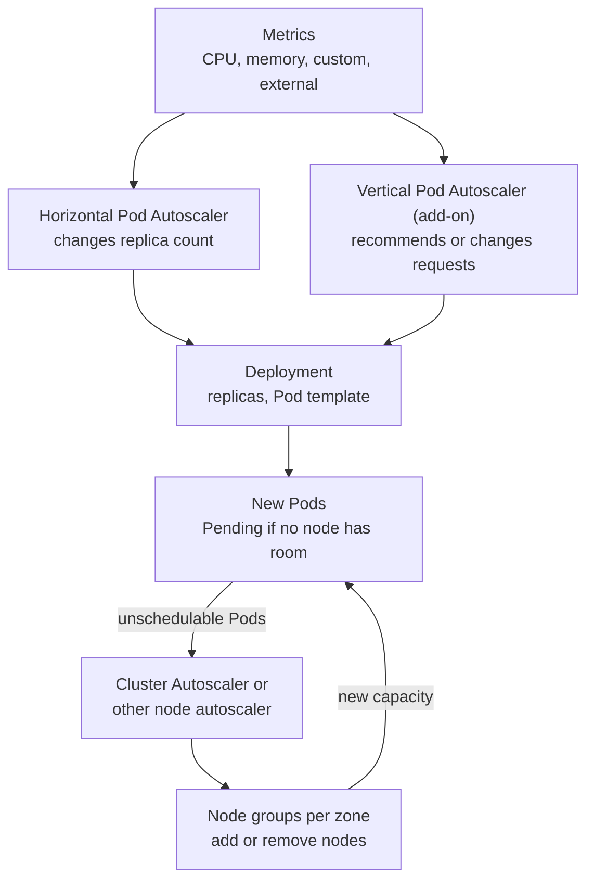

# Kubernetes architecture and workloads

> Kubernetes is a database of desired state surrounded by controllers that keep nudging the real
> world toward it. An architect who understands that loop, and the handful of fields that tell the
> scheduler and the kubelet what "healthy" and "enough" mean, can predict how a workload behaves
> when a node dies, a zone goes dark, or traffic triples.

!!! abstract "Page facts"
    **Level:** Intermediate (components and workload objects are Level 1-2; zone-aware placement,
    probe design, autoscaling layers, and cluster HA are Level 3) · **Status:** Draft ·
    **Time:** 75-90 minutes · **Last verified:** 2026-11-21

## Learning objectives

After this page you should be able to:

- Name the control-plane and node components, say what each owns, and explain why only the API
  server touches etcd.
- Describe the reconciliation loop, trace a Deployment from `kubectl apply` to a running container,
  and say what keeps working when the control plane is down.
- Choose the right workload object for a component and place ConfigMaps, Secrets, and namespaces.
- Set requests, limits, and probes so Pods are placed sensibly, are not killed unexpectedly, and a
  slow dependency does not trigger a restart storm.
- Design a zone-spread Deployment with a rollout strategy, a disruption budget, and an autoscaler,
  and compute what survives a zone loss.
- Explain RBAC, service accounts, admission, CRDs, operators, control-plane HA, DR, and multi-cluster.

## Prerequisites

- [Containers and images](containers-and-images.md) — images and runtimes; this page starts where one
  container on one host ends.
- [Computers, operating systems, and Linux for architects](../foundations/computers-operating-systems-and-linux-for-architects.md)
  — cgroups and the out-of-memory killer enforce requests and limits.
- [High availability design](../reliability-and-disaster-recovery/high-availability-design.md) and
  [capacity estimation](../performance-and-scalability/capacity-estimation.md) — zones, N+1, health
  checks, and load figures; Pod sizing comes from [Compute options and sizing](../cloud-architecture/compute-options-and-sizing.md).

## The problem this solves

One container on one machine is easy. Two hundred containers across thirty machines in three zones
are not: someone must decide where each runs, restart it when it crashes, move it when its machine
dies, replace versions without downtime, add copies under load, and tell callers where the copies are.
Scripts that say "start three copies on hosts 4, 9, and 12" are correct only for the world as it was
when they ran. Kubernetes replaces them with a declarative contract: you record what should exist, and
independent control loops keep closing the gap between that record and reality. The architect's work
moves from writing procedures to stating intent precisely: how much CPU and memory, how to tell
healthy from unhealthy, how many copies may be down at once, and which copies must not share a zone.

## What it is

**Kubernetes** is an open-source system for running containerized workloads on a cluster of
machines. A **cluster** has a **control plane**, which stores desired state and runs the decision
loops, and **worker nodes**, which run the workloads. Everything in the cluster, from a Pod to a
permission, is an **API object** with a `spec` (what you asked for) and a `status` (what the system
last observed); **controllers** act to make status match spec. Kubernetes is deliberately not a full
platform: it does not build code, provide databases, encrypt service-to-service traffic, or make a
single replica highly available. Those come from add-ons, managed services, and configuration.

Most organizations use **managed Kubernetes**, where the provider runs the control plane and you own
everything on the nodes:

| Concept | AWS | Azure | Google Cloud |
|---|---|---|---|
| Managed Kubernetes service | [Amazon EKS](https://docs.aws.amazon.com/eks/latest/userguide/what-is-eks.html) | [Azure Kubernetes Service (AKS)](https://learn.microsoft.com/en-us/azure/aks/what-is-aks) | [Google Kubernetes Engine (GKE)](https://cloud.google.com/kubernetes-engine/docs/concepts/kubernetes-engine-overview) |
| Provider runs | Control plane, etcd, their upgrades and HA | Same | Same |
| You still own | Workload objects, requests, probes, RBAC, add-ons, and node configuration unless you pick a provider-managed node mode | Same | Same |

Node-management modes and what they include change often; check the provider's current documentation.

## Mental model

Think of a **thermostat**: you set a target, and it repeatedly reads the room, compares, and switches
the heater; open a window and it simply works harder. Kubernetes is a stack of thermostats: one keeps
the number of Pods equal to the replica count, one binds each Pod to a node, one on each node keeps
its Pods' containers running. You never say *how*; you change the target.

**Where the analogy breaks:** a thermostat measures what you care about. Kubernetes measures only
what you declare: a Pod returning errors is "healthy" unless a probe says otherwise, and a Pod using
twice its declared memory is invisible to the scheduler until the kernel kills it. The loops are also
layered and asynchronous, so each layer can be correct while the whole is not (three Pods running,
all in one zone).

## Key terms

| Term | Meaning on this page |
|---|---|
| Control plane | The components that store desired state and make decisions: API server, etcd, scheduler, controller managers |
| Node | A machine (usually a VM) that runs Pods, with a kubelet, a container runtime, and usually kube-proxy |
| Pod | The smallest deployable unit: one or more containers that share a network identity and volumes and are scheduled together |
| Reconciliation loop | The observe-compare-act cycle a controller repeats; not the after-the-fact record comparison the glossary calls reconciliation |
| Deployment / ReplicaSet | A Deployment rolls a stateless workload between versions by managing ReplicaSets, each of which keeps N identical Pods running |
| StatefulSet | Runs Pods with stable names, ordered start and stop, and a persistent volume per replica |
| DaemonSet | Runs one copy of a Pod on every node (or every matching node) |
| Namespace | A named scope for objects, to which permissions, quotas, and policies are attached |
| Request / limit | The resources the scheduler reserves for a container, and the ceiling the kernel enforces |
| QoS class | Guaranteed, Burstable, or BestEffort, derived from requests and limits; decides eviction order under node pressure |
| Probe | A kubelet check of a container: liveness (restart it?), readiness (send it traffic?), startup (has it finished starting?) |
| HPA / VPA | Horizontal Pod Autoscaler (changes replica count) / Vertical Pod Autoscaler (changes requests) |
| PodDisruptionBudget (PDB) | The minimum number of a workload's Pods that voluntary disruptions such as node drains must leave running |
| Taint / toleration | A mark on a node that repels Pods, and the matching permission on a Pod to ignore it |
| CRD / operator | A custom resource type added to the API, and a controller that manages an application through such types |

## How it works

### The control plane and the nodes

| Component | Runs on | What it owns |
|---|---|---|
| API server (`kube-apiserver`) | Control plane | The only front door: authenticates and authorizes every request, runs admission, validates, stores objects in etcd, serves watches |
| etcd | Control plane (or a separate etcd cluster) | A consistent, replicated key-value store of all cluster state, using the Raft consensus protocol |
| Scheduler (`kube-scheduler`) | Control plane | Chooses a node for each unscheduled Pod and records the binding; starts nothing |
| Controller manager (`kube-controller-manager`) | Control plane | The built-in controllers: Deployment, ReplicaSet, StatefulSet, Job, node lifecycle, endpoints, garbage collection, HPA, and others |
| Cloud controller manager | Control plane | Provider-specific loops: nodes against the VM API, load balancers for `LoadBalancer` Services, routes |
| kubelet | Every node | Starts the containers of Pods bound to its node, runs probes, reports status, enforces limits through cgroups |
| Container runtime | Every node | Pulls images and runs containers behind the Container Runtime Interface (CRI), commonly containerd or CRI-O |
| kube-proxy | Every node (optional) | Programs packet forwarding so Service virtual IPs reach healthy Pods; some network plugins replace it |

**Figure 1 — Kubernetes components and who talks to whom.** Every arrow into the control plane goes
through the API server; nothing else reads or writes etcd.



How to read it: arrows show who initiates. Components never call each other; they meet in the API
server by writing objects and watching for changes, so any controller can restart without the others
noticing, and API server availability matters more than any single controller. Every request passes
**authentication**, **authorization** (usually RBAC), **admission** (mutating, then validating),
**schema validation**, and **persistence** in etcd; controllers use long-lived **watches** instead of
polling.

### The reconciliation loop

A controller **observes** the objects it cares about, **compares** desired with actual, **acts** to
reduce the difference, and records what it saw in status. It keeps no memory of commands issued; each
pass starts from current state. This is **level-triggered**: what matters is the current level (three
replicas wanted, two exist), not the event that caused it, so a missed event is harmless.

**Figure 2 — One controller's reconciliation loop.** The ReplicaSet controller shown here; every
built-in controller has the same shape.



How to read it: the loop never "finishes". Creating a Pod only adds an object that other loops
(scheduler, kubelet) pick up. If a Pod cannot be placed, the gap between desired and ready replicas
persists in status, and that gap is what you alert on.

Controllers chain through **owner references** (a Deployment owns ReplicaSets, which own Pods), and
the garbage collector removes dependents of deleted owners:

**Figure 3 — From `kubectl apply` to a running container.** Each participant only reacts to objects
appearing or changing in the API server.



How to read it: time runs downward. `kubectl apply` returns once the Deployment is stored, long before
anything runs: "applied" is not "deployed", so pipelines wait on rollout status. Two consequences:
**the control plane is not in the data path** (if the API server or etcd is down, Pods keep running
and forwarding keeps its last rules, but nothing reschedules, scales, or deploys, which removes
self-healing exactly when a node or zone also fails), and **drift is corrected** (manual edits to
managed Pods are overwritten, so manifests live in version control and are applied by a pipeline or
GitOps agent).

### Workload objects

| Object | Use it for | Key behavior | AtlasMart example |
|---|---|---|---|
| Pod | Almost never directly | Not recreated if its node dies; that is the controllers' job | None |
| ReplicaSet | Not directly | Keeps N identical Pods; a Deployment creates one per Pod template version | Created by the Tracking API Deployment |
| Deployment | Stateless services and workers | Rolling updates and rollback by switching between ReplicaSets | Tracking API, Webhook Ingestor, Event Processor |
| StatefulSet | Clustered software needing stable identity and its own disk per replica | Pods `name-0`, `name-1`, ...; ordered start; one PersistentVolumeClaim per replica | None: PostgreSQL and Redis are managed services |
| DaemonSet | Per-node agents | One Pod per node, added automatically when nodes join | Log shipper, node metrics agent (platform team) |
| Job / CronJob | Run-to-completion work, once or on a schedule | Retries up to a back-off limit; a CronJob's concurrency policy decides overlaps | Event backfill Job; nightly purge CronJob (assumptions) |
| ConfigMap | Non-secret configuration as files or environment variables | Changes do not restart Pods; env vars are read only at start | API base URLs, feature flags |
| Secret | Sensitive values, same mechanics | Only base64-encoded; encrypted in etcd only if encryption at rest is configured; readable by anyone who may read Secrets or create Pods in the namespace | Synced from the provider's secrets manager |
| Namespace | Grouping a team's or application's objects | Unit for RBAC, ResourceQuota, LimitRange, NetworkPolicy, Pod Security level; not a hard security boundary (Pods still share nodes) | `order-tracking` |

Many platforms keep secret values in the provider's secrets manager and sync or mount them (External
Secrets Operator, Secrets Store CSI Driver; see [Cloud-native ecosystem tools](cloud-native-ecosystem-tools.md)).
Services, Ingress, Gateway API, NetworkPolicies, and PersistentVolumes, PersistentVolumeClaims, and
StorageClasses are taught on [Kubernetes networking, storage, and service mesh](kubernetes-networking-storage-and-service-mesh.md).

### Scheduling: filter, then score

The scheduler takes each unscheduled Pod through two phases. **Filtering** removes nodes that cannot
run it: not enough unreserved CPU or memory for the Pod's **requests**, an untolerated taint, an
unmatched node selector or required affinity, a volume in another zone, a hard topology-spread rule
that would be violated. **Scoring** ranks the survivors by preferences and binds the Pod to the best.
If no node passes, the Pod stays **Pending** with an event saying why. The scheduler sees only
declared requests, never actual usage, so accurate requests are the most important input to
placement and cost.

| Control | What it expresses | Typical use |
|---|---|---|
| Node selector / node affinity | Run only on (required) or prefer (preferred) nodes with these labels | GPU or ARM nodes, a dedicated node pool |
| Taints and tolerations | Nodes repel every Pod that does not tolerate the taint | Nodes reserved for system agents, one tenant, or special hardware |
| Pod affinity / anti-affinity | Place near, or away from, Pods with given labels within a node or zone | Keep replicas off the same node |
| Topology spread constraints | Keep matching Pods across domains within a maximum skew | Spread replicas evenly across zones |
| Priority and preemption | Higher-priority Pods may evict lower-priority ones to get placed | Critical services over batch |

Taints repel; tolerations only permit. Dedicated node pools need both a taint (keep others out) and
affinity (keep these Pods in). A **topology spread constraint** names a `topologyKey` (for zones,
`topology.kubernetes.io/zone`), a `maxSkew` (largest allowed difference between the most and least
loaded domain), and `whenUnsatisfiable`: `DoNotSchedule` (hard) or `ScheduleAnyway` (soft). The
scheduler learns which zones exist only from existing nodes and, by default, counts tainted nodes;
the worked example shows why that matters in a zone failure.

### Requests, limits, and QoS classes

The scheduler reserves each container's **request**; the kubelet configures cgroups so the kernel
enforces its **limit**. The two resources fail differently. **CPU is compressible:** at its limit a
container is throttled for the rest of the scheduling period, so nothing crashes but tail latency
rises; without a limit it may use idle CPU beyond its request. **Memory is not:** above its limit the
container is killed (`OOMKilled`) and restarted, and a node short of memory evicts Pods in QoS order.

| QoS class | How a Pod gets it | Eviction under node memory pressure |
|---|---|---|
| Guaranteed | Every container has CPU and memory requests equal to limits | Last |
| Burstable | Some request or limit set, but not Guaranteed | After BestEffort, roughly by usage above requests |
| BestEffort | No requests or limits at all | First |

Defaults for a latency-sensitive service: set CPU and memory requests from load tests; set the memory
limit equal to the memory request; think twice before a CPU limit, because throttling hurts the tail.
**LimitRange** supplies per-container defaults in a namespace and **ResourceQuota** caps its total.
In-place Pod resize (changing a running container's resources without a restart) is stable since
Kubernetes v1.35 according to the Kubernetes autoscaling documentation checked on 2026-11-21.

### Probes and graceful shutdown

| Probe | Question it answers | Action on failure |
|---|---|---|
| Startup | Has the application finished starting? | Restart after the threshold; liveness and readiness wait until it succeeds |
| Readiness | Should this Pod receive traffic now? | Remove the Pod from Service endpoints; no restart |
| Liveness | Is the process stuck beyond recovery? | Kill and restart the container |

**The classic liveness-probe outage.** A team points the liveness probe at a `/health` endpoint
that also checks the database, "to be thorough". One day the database slows down under a batch job.
Every replica's probe times out at the same moment, so the kubelet restarts every replica on every
node at once. Restarting does not fix the database; it adds cold starts, connection storms against
the struggling database, and lost in-flight requests. A slow service becomes a down one, and may
stay in a restart loop after the database recovers. The same spiral occurs without a dependency: a
1-second timeout fails during a long garbage-collection pause under load, restarts remove capacity,
the survivors get more load, and their probes fail too. The rules:

1. **Liveness checks only the process itself** (can it serve a trivial in-process request), never a
   database, cache, queue, or other service.
2. **Readiness reflects the Pod's own ability to serve.** If every replica marks itself unready when
   a shared dependency is slow, the Service has no endpoints; prefer degraded (cached) answers and
   report the dependency through metrics.
3. **Use a startup probe for slow starts** rather than a long liveness delay.
4. **Make restarts the slowest remedy to trigger:** generous timeouts and failure thresholds
   relative to the worst normal pause.

**Graceful shutdown.** On Pod deletion the kubelet sends SIGTERM while, in parallel and unordered,
the Pod is removed from Service endpoints, so requests can still arrive briefly. Keep serving for a
few seconds (a short `preStop` sleep), finish in-flight work, and exit before
`terminationGracePeriodSeconds` (30 s by default) ends in SIGKILL.

### Rollouts

A Deployment rolls out a new Pod template by scaling a new ReplicaSet up and the old one down within
two bounds: **maxSurge** (Pods above the desired count) and **maxUnavailable** (Pods below it). Both
default to 25%, and the Deployment documentation rounds surge up and unavailable down. With 3
replicas, 25% × 3 = 0.75 gives maxSurge 1 and maxUnavailable 0: add one new Pod, wait until it is
ready (and stays ready for `minReadySeconds`), remove one old Pod, repeat, never dropping below three
ready Pods. A version whose Pods never become ready stalls the rollout, and after
`progressDeadlineSeconds` (600 by default) the Deployment reports `ProgressDeadlineExceeded`. Old
ReplicaSets are kept at zero replicas, so rollback is a switch back. `Recreate` stops all old Pods
first (downtime). Canary and blue-green split traffic at the network layer; see the
[networking page](kubernetes-networking-storage-and-service-mesh.md).

### Autoscaling in three layers

**Figure 4 — The three autoscalers and what each one changes.** They are independent loops that
communicate only through the objects they change.



How to read it: the HPA reacts in tens of seconds, a new node takes minutes, so spikes are served by
headroom first. The node autoscaler acts on Pending Pods (requests), not on node CPU usage.

The **HPA** computes, per metric, `desired = ceil(current replicas × current value ÷ target value)`,
takes the largest result, and clamps it to `minReplicas`..`maxReplicas`. CPU utilization is measured
against **requests**, so Pods without requests cannot be autoscaled on CPU. Per the HPA documentation
it ignores ratios within a 10% tolerance and by default waits a 300-second stabilization window before
scaling down; the `behavior` field tunes both directions, and missing metrics or not-yet-ready Pods
are treated conservatively. The **VPA** is a separate add-on that recommends requests and can apply
them; the Kubernetes autoscaling page (checked 2026-11-21) says it does not yet use in-place resize,
so applying means recreating Pods. Never drive VPA and HPA from the same CPU or memory signal (VPA
raises requests, utilization falls, HPA removes replicas, and they chase each other); a common pattern
is VPA in recommendation mode plus HPA. The **Cluster Autoscaler** adds nodes to a node group that can
fit unschedulable Pods and removes nodes whose Pods fit elsewhere, respecting PDBs. Other node
autoscalers (for example Karpenter, on the [ecosystem tools page](cloud-native-ecosystem-tools.md))
pick instance types per Pending Pod. All depend on the provider having capacity in the zone you need.

### Disruption budgets and maintenance

A **PodDisruptionBudget** sets `minAvailable` or `maxUnavailable` for **voluntary disruptions**:
drains, autoscaler scale-down, anything using the eviction API. It does not protect against node
crashes or zone outages; it only stops the platform from making things worse on purpose. A PDB with
`minAvailable` equal to the replica count blocks every drain and stalls upgrades.

### Access control, admission, and extension

| Mechanism | What it does | Architect's note |
|---|---|---|
| RBAC | Roles (namespaced) and ClusterRoles list verbs on resources; RoleBindings and ClusterRoleBindings grant them to users, groups, or service accounts | Additive only, no deny rules |
| Service accounts | Pod identities; each Pod gets a short-lived, audience-bound projected token | Cloud workload identity exchanges it for cloud credentials, so no static keys; disable automount where unused |
| Admission controllers | After authorization, mutating plugins may change an object, then validating plugins may reject it | Webhooks, or in-process ValidatingAdmissionPolicy (CEL, stable since v1.30) |
| Pod Security Admission | Enforces the `privileged`, `baseline`, or `restricted` Pod Security Standard per namespace | Use `restricted` for application namespaces |
| CustomResourceDefinitions | Add new object types (`Certificate`, `PostgresCluster`) served like built-in ones | The API becomes a platform for any declarative tool |
| Operators | Controllers for custom types that encode operations (provision, fail over, back up) as reconciliation loops | Often broadly privileged; review them like any privileged software |

### Control-plane HA, disaster recovery, and multiple clusters

etcd is a Raft cluster: writes need a majority, so a cluster of n members tolerates floor((n − 1) ÷ 2)
failures (3 tolerate 1, 5 tolerate 2); even sizes add cost, not tolerance. Self-managed HA runs three
or more API servers behind a load balancer and spreads etcd across zones, on the control-plane
machines (stacked) or on dedicated ones (external). Managed Kubernetes does this for you; check
whether the provider's control plane is zonal or regional and what its SLA covers.

Cluster DR has three parts: **cluster state** (etcd snapshots for self-managed clusters, or better,
reproducibility: the cluster and add-ons as infrastructure as code, every manifest in Git applied by
a pipeline or GitOps agent); **persistent data** (volume snapshots and application backups; an etcd
backup holds none of it); and **external dependencies** (registry, secrets manager, DNS, identity
provider). **Multi-cluster** designs serve blast-radius reduction, regions, tenant or environment
separation, and upgrade-by-replacement. The original Federation project (KubeFed) is archived; today
teams fan out manifests with GitOps, use provider fleet features, and use the Multi-Cluster Services
API for cross-cluster discovery. Each cluster stays its own failure domain, which is the point.

## Worked example: AtlasMart Tracking API Deployment

### Inputs

From the Phase 4 platform assumptions: one shared managed production cluster in the EU region, run
by the platform team in its platform-prod workload account, with 6 worker nodes to start, 2 per zone,
4 vCPU / 16 GiB each, and a node autoscaler maximum of 18 nodes (assumptions). Order Tracking gets the
`order-tracking` namespace; its PostgreSQL, Redis, and queue stay in its own team account, reached
privately. The Tracking API Deployment has at least 3 replicas spread across zones and an HPA up to 9.
Design peak is 210 req/s (NFR-4), and NFR-2 requires surviving a zone loss. Pod sizing comes from
[Compute options and sizing](../cloud-architecture/compute-options-and-sizing.md) (assumptions there):
the Tracking API spends about 4.7 ms of CPU per request and requests 1 vCPU and 1 GiB, memory limit
1 GiB, no CPU limit, so at a 70% HPA target one Pod carries 0.7 ÷ 0.0047 ≈ 149 req/s; Webhook
Ingestor 3 × 0.25 vCPU, Event Processor 2 × 0.8 vCPU, Notification Worker 2 × 0.25 vCPU, shared
platform add-ons 3 × 0.5 vCPU; each node has 3.5 vCPU allocatable after reservations.

### The manifests

```yaml
apiVersion: apps/v1
kind: Deployment
metadata: {name: tracking-api, namespace: order-tracking}
spec:
  replicas: 3                                   # the HPA owns this after creation
  strategy: {rollingUpdate: {maxSurge: 1, maxUnavailable: 0}}
  selector: {matchLabels: {app: tracking-api}}
  template:
    metadata: {labels: {app: tracking-api}}
    spec:
      serviceAccountName: tracking-api
      topologySpreadConstraints:
        - maxSkew: 1
          topologyKey: topology.kubernetes.io/zone
          whenUnsatisfiable: DoNotSchedule
          nodeTaintsPolicy: Honor               # do not count unreachable (tainted) nodes
          labelSelector: {matchLabels: {app: tracking-api}}
        - maxSkew: 1
          topologyKey: kubernetes.io/hostname
          whenUnsatisfiable: ScheduleAnyway
          labelSelector: {matchLabels: {app: tracking-api}}
      containers:
        - name: api
          image: registry.internal.atlasmart.example/order-tracking/tracking-api:1.4.2  # CI deploys the signed digest
          ports: [{containerPort: 8000}]
          resources:
            requests: {cpu: "1", memory: 1Gi}
            limits: {memory: 1Gi}               # no CPU limit: avoid throttling the tail
          startupProbe:                         # up to 60 s to start
            {httpGet: {path: /livez, port: 8000}, periodSeconds: 2, failureThreshold: 30}
          livenessProbe:                        # in-process only, 60 s of failure before a restart
            {httpGet: {path: /livez, port: 8000}, periodSeconds: 10, timeoutSeconds: 3, failureThreshold: 6}
          readinessProbe:                       # out of rotation within about 10 s
            {httpGet: {path: /readyz, port: 8000}, periodSeconds: 5, failureThreshold: 2}
          lifecycle: {preStop: {sleep: {seconds: 5}}}   # let endpoint removal propagate
---
apiVersion: autoscaling/v2
kind: HorizontalPodAutoscaler
metadata: {name: tracking-api, namespace: order-tracking}
spec:
  scaleTargetRef: {apiVersion: apps/v1, kind: Deployment, name: tracking-api}
  minReplicas: 3
  maxReplicas: 9
  metrics:
    - type: Resource
      resource: {name: cpu, target: {type: Utilization, averageUtilization: 70}}
---
apiVersion: policy/v1
kind: PodDisruptionBudget
metadata: {name: tracking-api, namespace: order-tracking}
spec:
  minAvailable: 2
  selector: {matchLabels: {app: tracking-api}}
```

Probe timings are AtlasMart assumptions. The `sleep` lifecycle handler is built into current
Kubernetes versions; on older clusters use an `exec` handler that runs a sleep command.

### Step 1 — Normal sale-day peak

One Pod per zone. 210 req/s ÷ 3 = 70 req/s per Pod × 4.7 ms ≈ 0.33 vCPU, 33% of its request. The HPA
wants ceil(3 × 33 ÷ 70) = ceil(1.41) = 2, below `minReplicas`, so it stays at 3. As on the capacity
page, availability, not load, sets the footprint.

### Step 2 — A zone fails at peak

Zone c disappears. Two Pods remain: 210 ÷ 2 = 105 req/s each × 4.7 ms ≈ 0.49 vCPU, 49% of request.
**The service survives without any replacement Pod**, and that is the property to design for,
because replacements are not guaranteed:

- Pods on an unreachable node are marked for deletion only after their default 300-second toleration
  expires, so no replacement is created for about five minutes.
- The replacement must pass the zone spread rule. Under the default `nodeTaintsPolicy: Ignore`, zone
  c's dead nodes still count as a zone with zero matching Pods; a third Pod in zone a or b would make
  the skew 2 − 0 = 2 > 1, so it would stay Pending for the whole outage. With `Honor`, nodes carrying
  the unreachable taint the Pod does not tolerate are excluded, and the replacement lands (skew
  2 − 1 = 1). A game day must confirm this on AtlasMart's provider.
- The PDB (`minAvailable: 2`) now has no slack, so drains in zones a and b wait until zone c returns.
  Two Pods at the 70% target still carry 2 × 149 = 298 req/s, about 1.4 times the design peak.

### Step 3 — At the HPA maximum, does the cluster have room?

At 9 replicas (3 per zone) the loss leaves 6, carrying 6 × 149 ≈ 894 req/s at target, and the HPA
tries to place 3 more Pods (3 vCPU of requests) in zones a and b. Allocatable CPU is 6 × 3.5 = 21 vCPU,
or 4 × 3.5 = 14 vCPU after a zone loss, so rescheduling a lost zone's Pods without new nodes requires
total requests at or below 14 ÷ 21 ≈ 67% of allocatable. The compute sizing page totals Order Tracking
plus shared add-ons at the HPA maximum as 9 × 1 + 3 × 0.25 + 2 × 0.8 + 2 × 0.25 + 3 × 0.5 = 13.35 vCPU:
64% of 21 vCPU, inside the ceiling, and 95% of the 14 vCPU left after a zone loss. The six starting
nodes therefore have room for Order Tracking alone; every other team's namespace pushes requests
past 67%. The platform team either alerts at 67% and adds nodes ahead of demand (static stability) or
relies on the Cluster Autoscaler (up to its 18-node maximum), accepting that during a real zone
outage many of the provider's customers want capacity in the same surviving zones. AtlasMart
pre-provisions headroom in production: it is cheaper than a second outage.

### What the design decided

| Decision | Reason |
|---|---|
| 3 replicas minimum, hard zone spread with `nodeTaintsPolicy: Honor` | Zone loss leaves two Pods at 49% CPU, 1.4 × design-peak capacity |
| CPU request 1 vCPU, memory request = limit = 1 GiB, no CPU limit; in-process liveness | Accurate placement, no throttled tail, no restart storms |
| maxSurge 1 / maxUnavailable 0, PDB minAvailable 2 | Rollouts and drains never go below two ready Pods |
| Cluster requests ≤ 67% of allocatable | A lost zone's Pods fit in the surviving zones without new nodes |

## Real-world architecture example

Organizations with many product teams usually publish a paved-road template (Helm chart, Kustomize
base, or higher-level custom resource) that bakes in this page's advice: requests enforced by
admission, zone spread and a PDB by default, separate liveness and readiness probes, workload
identity, and an HPA. Admission also rejects privileged containers and unsigned images. Databases move
to managed services or run under a platform-owned operator, and risky upgrades build a new cluster and
move workloads.

## Design choices and trade-offs

| Choice | Favor when | Avoid when |
|---|---|---|
| Managed Kubernetes | You want control-plane HA, patching, and etcd operated for you | Regulatory or connectivity constraints force self-managed clusters |
| StatefulSet (self-run database or broker) | Clustered software with an operator and a team to run it | A managed database or queue meets the need |
| Hard zone spread (`DoNotSchedule`) | Replicas must not share a zone and you have tested the zone-failure behavior | Small or uneven node pools where a hard rule leaves Pods Pending |
| No CPU limit (requests only) | Latency-sensitive services on nodes you control | Untrusted or noisy tenants that must be capped |
| HPA on CPU | CPU-bound request/response services | Queue consumers (scale on queue depth) or I/O-bound services |
| VPA in recommendation mode | Right-sizing requests over time | Automatic changes to latency-critical Pods that dislike restarts |
| Pre-provisioned node headroom | Zone-loss tolerance must not depend on new capacity | Cost outweighs the risk and the service can degrade |
| One shared cluster per environment | Small platform team, moderate scale | Strong tenant isolation, regional deployments, or too large a blast radius |

## Failure modes and anti-patterns

- **Liveness probe that checks dependencies.** Detect: simultaneous restarts of all replicas when a
  database slows. Prevent: in-process liveness; readiness and metrics for dependencies.
- **No requests (BestEffort Pods).** Packed anywhere, invisible to the HPA, evicted first. Prevent:
  LimitRange defaults and an admission policy that rejects Pods without requests.
- **CPU limits throttling the tail** (high p99, modest average CPU, throttling counters) or **memory
  limits below the real peak** (`OOMKilled` at the busiest hour). Prevent: size from load tests; drop
  CPU limits for latency-sensitive services; alert on OOMKilled restarts.
- **All replicas in one zone.** Detect: Pods-per-zone report per workload. Prevent: zone spread in the
  paved-road template.
- **PDB that allows no disruptions.** Detect: drains that never finish. Prevent: leave one Pod of slack.
- **Admission webhook as a single point of failure.** With `failurePolicy: Fail` and its service down,
  Pod creation stops cluster-wide. Prevent: replicated webhooks with a PDB, system namespaces
  excluded, in-process ValidatingAdmissionPolicy where possible.
- **HPA and VPA on the same signal**, oscillating. Prevent: drive them from different metrics.
- **"Applied" treated as "deployed".** Prevent: pipelines wait for rollout status and fail on
  `ProgressDeadlineExceeded`.
- **Lost etcd quorum (self-managed).** Prevent: 3 or 5 members across zones and tested restores.

## Security considerations

- **The API server is the crown jewel:** private endpoint where the provider allows, SSO for humans,
  audit logs to the central log archive account.
- **Least-privilege RBAC:** namespace-scoped roles for teams, cluster-admin only through break-glass.
  Permission to create Pods in a namespace implies reading its Secrets and using its service accounts.
- **Workload identity, not keys,** one narrowly scoped cloud role per service account; Secrets
  encrypted at rest, with an external secrets manager as the source of truth.
- **Admission as a control point:** `restricted` Pod Security for application namespaces and image
  signature verification; see [Infrastructure and supply chain security](../security-architecture/infrastructure-and-supply-chain-security.md).
- **Namespaces are not tenant walls:** untrusted workloads need dedicated node pools (taints plus
  affinity) or separate clusters; see the [networking page](kubernetes-networking-storage-and-service-mesh.md).

## Performance, reliability, and cost

- **Performance:** placement uses requests, so wrong requests produce hot nodes and throttled or
  evicted Pods; CPU limits and short probe timeouts are common hidden causes of tail latency.
- **Reliability:** Kubernetes heals only along the dimensions you declared (replicas, spread, probes,
  budgets). A control-plane outage freezes the cluster in its last state while Pods keep serving.
- **Cost:** nodes are sized by requests plus headroom; over-requested Pods waste money silently, and
  zone-loss headroom (a third of allocatable) is a deliberate cost for the cost model (FinOps: D17).

## Hands-on lab: local Kubernetes deployment

The full lab is [Lab 12: deploy a small application to local Kubernetes](../labs/lab-12-local-kubernetes-deployment.md),
which deploys a small service to a local cluster and exercises rollouts and health checks. A shorter
experiment on a local multi-node cluster (for example kind) with any small HTTP image:

1. Create one control-plane node and three workers labelled `topology.kubernetes.io/zone=a`, `b`, `c`.
2. Apply a 3-replica Deployment with the worked example's zone spread; confirm one Pod per zone with
   `kubectl get pods -o wide`.
3. Drain the zone `c` worker and watch the replacement Pod; repeat with `ScheduleAnyway` and compare.
4. Point a liveness probe at a path that returns an error and watch restarts and back-off grow.
5. Add a PDB with `minAvailable: 3` and try to drain a node; the drain cannot finish.

??? question "Hint: why does draining behave differently from a real zone failure?"
    A drain cordons the node and evicts Pods through the eviction API, so the scheduler sees the node
    as unschedulable at once and the PDB is consulted. In a real failure the node just stops
    reporting: Pods are marked for deletion only after their toleration expires, no PDB is consulted,
    and whether the dead nodes count for topology spread depends on `nodeTaintsPolicy`. Stopping the
    worker's container approximates a zone failure better than draining it.

## Knowledge check

1. The API server is unavailable for ten minutes. What keeps working and what stops?
2. A Deployment has 4 replicas and default rolling-update settings. How many Pods can exist and how
   many may be unavailable during a rollout?
3. Why is a liveness probe that calls the database dangerous, and what should it check instead?
4. An HPA targets 70% CPU. Three Pods each request 1 vCPU and use 1.05 vCPU on average. What replica count
   does it want?
5. Name two reasons a Pod can stay Pending while the cluster's nodes are mostly idle.

??? success "Answers"
    1. Running Pods and existing Service forwarding keep working; rescheduling, scaling, deployments,
       and new Pods stop.
    2. maxSurge 25% of 4 = 1 (rounded up), maxUnavailable 25% of 4 = 1 (rounded down): up to 5 Pods,
       at least 3 available.
    3. A slow database fails every replica's probe together, so all restart at once and a slowdown
       becomes an outage, often a restart loop. Liveness should check only the process itself.
    4. Utilization 1.05 ÷ 1 = 105%; desired = ceil(3 × 105 ÷ 70) = ceil(4.5) = 5.
    5. Any two of: requests exceed unreserved capacity on every node although usage is low; an
       untolerated taint; a required affinity or selector with no match; a hard topology spread rule;
       a volume bound to a zone with no room.

## Architecture discussion questions

1. AtlasMart's product teams share one production cluster. Argue for and against giving the
   Order Tracking System its own node pool (taint plus affinity), and say what evidence would decide.
2. The Event Processor consumes from the Event Queue. Should its autoscaling use CPU or queue depth,
   and how would you keep NFR-1 (60-second freshness) during a carrier backlog?
3. The platform team proposes upgrading the cluster by building a new cluster beside the old one and
   moving workloads, instead of upgrading in place. What must be true of manifests, secrets, DNS, and
   persistent data for that to work?

## Summary

Kubernetes stores desired state in etcd behind the API server, and independent controllers reconcile
reality toward it in level-triggered loops; running Pods survive a control-plane outage, but nothing
heals or scales meanwhile. Deployments, StatefulSets, DaemonSets, Jobs, and CronJobs cover the
workload shapes; ConfigMaps, Secrets, and namespaces configure and scope them. The scheduler places
Pods by requests, taints, affinity, and topology spread; the kubelet enforces limits and runs probes.
The architect's levers are accurate requests, liveness that checks only the process, rollouts that
never reduce ready capacity, PDBs, three autoscaling layers, and enough headroom that a zone loss
fits in the zones that remain, as the AtlasMart Tracking API arithmetic shows.

## Related topics

- **Before:** [Containers and images](containers-and-images.md); [Compute options and sizing](../cloud-architecture/compute-options-and-sizing.md);
  [High availability design](../reliability-and-disaster-recovery/high-availability-design.md)
- **Alongside:** [Kubernetes networking, storage, and service mesh](kubernetes-networking-storage-and-service-mesh.md);
  [Cloud-native ecosystem tools](cloud-native-ecosystem-tools.md); [Identity and access management](../security-architecture/identity-and-access-management.md);
  [Resilience mechanics](../distributed-systems/resilience-mechanics-timeouts-retries-and-backpressure.md); [Lab 12](../labs/lab-12-local-kubernetes-deployment.md)
- **Planned:** reliability engineering and game days (D13-T02); disaster recovery (D13-T03);
  observability and SRE (D15); DevOps, GitOps, and platform engineering (D16, Lab 13); FinOps (D17).

## References

| Source | Type | Checked |
|---|---|---|
| [Kubernetes Components](https://kubernetes.io/docs/concepts/overview/components/) — Kubernetes documentation | Official documentation | 2026-11-21 |
| [Controllers](https://kubernetes.io/docs/concepts/architecture/controller/) — Kubernetes documentation | Official documentation (control loops, desired versus current state) | 2026-11-21 |
| [Pod Topology Spread Constraints](https://kubernetes.io/docs/concepts/scheduling-eviction/topology-spread-constraints/) — Kubernetes documentation | Official documentation (`nodeTaintsPolicy` default and known limitations) | 2026-11-21 |
| [Resource Management for Pods and Containers](https://kubernetes.io/docs/concepts/configuration/manage-resources-containers/) — Kubernetes documentation | Official documentation | 2026-11-21 |
| [Configure Liveness, Readiness and Startup Probes](https://kubernetes.io/docs/tasks/configure-pod-container/configure-liveness-readiness-startup-probes/) — Kubernetes documentation | Official documentation | 2026-11-21 |
| [Horizontal Pod Autoscaling](https://kubernetes.io/docs/concepts/workloads/autoscaling/horizontal-pod-autoscale/) — Kubernetes documentation | Official documentation (algorithm, tolerance, stabilization) | 2026-11-21 |
| [Autoscaling Workloads](https://kubernetes.io/docs/concepts/workloads/autoscaling/) — Kubernetes documentation | Official documentation (VPA as add-on, in-place resize status) | 2026-11-21 |
| [Options for Highly Available Topology](https://kubernetes.io/docs/setup/production-environment/tools/kubeadm/ha-topology/) — Kubernetes documentation | Official documentation (stacked versus external etcd) | 2026-11-21 |

## Review notes

- Canonical page for D11-T02. In depth: components, reconciliation, workload objects, scheduling
  (affinity, taints and tolerations, topology spread), requests and limits with QoS, probes and
  shutdown, rollouts, HPA/VPA/Cluster Autoscaler, PDBs. Only defined or briefly described: ConfigMaps,
  Secrets, namespaces, RBAC, service accounts, admission controllers, CRDs, operators, federation,
  multi-cluster, control-plane HA and DR. Services, Ingress, Gateway API, NetworkPolicies, and
  PV/PVC/StorageClass are only named here; D11-T03 teaches them.
- Re-check version-sensitive claims: in-place resize stable since v1.35 and VPA not yet using it ("as
  of Kubernetes 1.37" on the autoscaling page); ValidatingAdmissionPolicy stable since v1.30;
  `nodeTaintsPolicy` default `Ignore`; rolling-update defaults and rounding; HPA 10% tolerance and
  300 s scale-down window; the `sleep` lifecycle handler. KubeFed's archived status was checked on
  GitHub (kubernetes-retired/kubefed). The Multi-Cluster Services API (KEP-1645) is not linked.
- Step 2's zone-failure behavior (dead nodes counted under `Ignore`, excluded under `Honor` because
  Pods tolerate only the NoExecute form of the unreachable taint) is reasoned from the topology spread
  and taint documentation, not tested; a game day or Lab 12 variant should confirm it.
- AtlasMart numbers: Pod requests, 4.7 ms CPU per request, 149 req/s per Pod, 3.5 vCPU allocatable,
  and the 13.35 vCPU total are taken from the D10-T03 compute sizing page (aligned at the
  coordinator's request); cluster placement (platform-prod account, 18-node maximum) follows the
  D10-T02 decision. New here: probe timings, the backfill Job and purge CronJob, and the arithmetic
  (33% and 49% CPU per Pod, 298 and 894 req/s surviving capacity, the 67% request ceiling).
