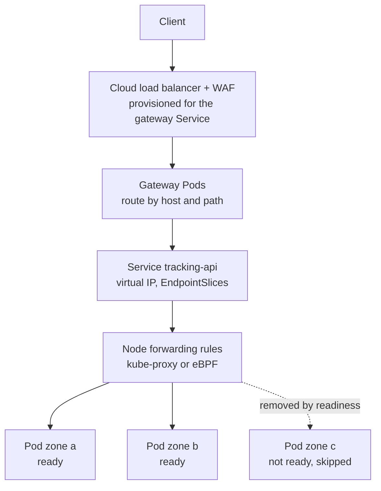
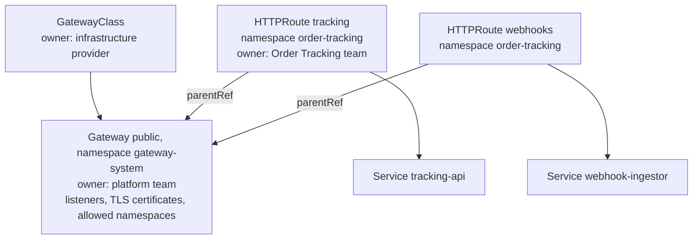
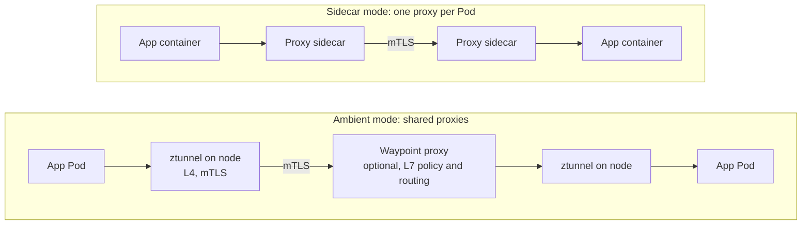
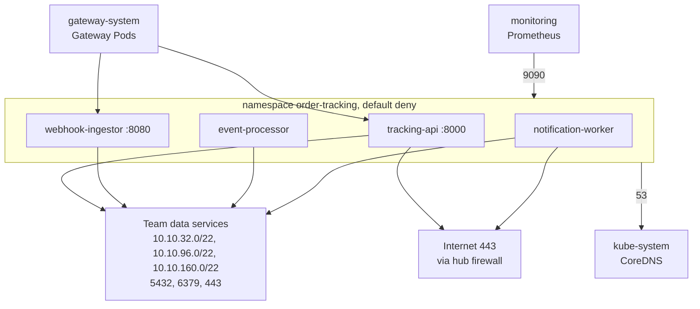

# Kubernetes networking, storage, and service mesh

> Kubernetes promises every Pod an address that every other Pod can reach, and then leaves almost
> everything else (how addresses are allocated, who may talk to whom, how traffic is encrypted, where
> disks live) to plugins and add-ons. The architect's job is to choose those plugins deliberately and
> to know which promises each one actually keeps.

!!! abstract "Page facts"
    **Level:** Intermediate (the network model, Services, DNS, and volumes are Level 1-2;
    NetworkPolicy design, mesh adoption, and multi-tenancy are Level 3) · **Status:** Draft ·
    **Time:** 75-90 minutes · **Last verified:** 2026-11-21

## Learning objectives

After this page you should be able to:

- State the Kubernetes network model, say what CNI, CSI, and CRI standardize, and choose between
  overlay and routable (VPC-native) Pod networking.
- Pick a Service type and explain how kube-proxy and CoreDNS turn a Service name into a ready Pod.
- Compare Ingress with Gateway API and state Gateway API's status as checked on its project site.
- Write default-deny NetworkPolicies that still allow DNS and needed flows, and explain why they do
  nothing on a plugin that does not enforce them.
- Choose volumes by access mode and topology, and predict a zonal volume's fate in a zone failure.
- Explain what a service mesh adds, compare sidecar and sidecarless data planes, and decide,
  ADR-style, whether a system needs one.

## Prerequisites

- [Kubernetes architecture and workloads](kubernetes-architecture-and-workloads.md) — Pods,
  controllers, readiness, and the zone-spread Deployment this page connects to the network.
- [Networking fundamentals: IP, CIDR, routing, and DNS](../networking/networking-fundamentals-ip-cidr-routing-and-dns.md)
  — the AtlasMart address plan, NAT, and DNS resolution.
- [Network security, load balancing, and traffic flow](../networking/network-security-load-balancing-and-traffic-flow.md)
  — load balancers, firewalls, and north-south versus east-west traffic outside the cluster.

## The problem this solves

Pods come and go every few minutes, each with a new address, on nodes that also come and go. Callers
need stable names and traffic that reaches only ready replicas; security teams need "only the gateway
may call the Tracking API" without knowing any IP in advance; stateful software needs disks that
follow it or fail predictably. Kubernetes fixes the model and the APIs (Service, NetworkPolicy,
PersistentVolumeClaim) and lets plugins implement them, which is why two clusters with identical
manifests can behave very differently.

## What it is

The **Kubernetes network model** has four parts: every Pod gets its own cluster-wide IP address
shared by its containers; every Pod can reach every other Pod directly, without proxies or NAT, unless
a policy segments them; node agents such as the kubelet can reach the Pods on their node; and the
**Service** API gives a group of Pods a stable virtual IP and DNS name. For storage, a
**PersistentVolumeClaim** asks, a **StorageClass** says how to provision, and a **PersistentVolume**
is the result. Three plugin interfaces let vendors implement all this:

| Interface | Standardizes | Called by | Examples of what plugs in |
|---|---|---|---|
| CNI (Container Network Interface) | Giving a Pod's network namespace an interface, an address, and routes; often also NetworkPolicy enforcement | Container runtime, on Pod creation and deletion | Cloud providers' VPC-native plugins, Calico, Cilium, the kind default plugin |
| CSI (Container Storage Interface) | Creating, attaching, mounting, snapshotting, and expanding volumes | kubelet and CSI controller components | Cloud block and file storage drivers, storage appliances |
| CRI (Container Runtime Interface) | Pulling images and running Pod sandboxes and containers | kubelet | containerd, CRI-O (see the [architecture page](kubernetes-architecture-and-workloads.md)) |

A **service mesh** adds proxies for service-to-service traffic plus a control plane that gives them
identities, certificates, and routes; beyond the glossary's sidecar form, this page covers sidecarless
data planes.

## Mental model

Picture an **office building**. Every employee has a direct phone extension (the Pod IP); each
department has a hunt-group number that rings whichever member is at a desk (a Service); a
reception desk takes calls from outside and forwards them (the Gateway); a directory maps department
names to hunt-group numbers (CoreDNS); door badges decide who may enter which floor (NetworkPolicy);
and lockers are booked through facilities by size and floor (PVC and StorageClass).

**Where the analogy breaks:** extensions are reassigned whenever someone moves desks; the hunt group
is not a central switchboard but a copy of the routing table on every floor (kube-proxy on every
node); and badge rules are enforced only if the building installed readers: with a network plugin
that does not enforce NetworkPolicy, the rules are stored and silently ignored.

## Key terms

| Term | Meaning on this page |
|---|---|
| Overlay / routable Pod network | Pod IPs from a separate range, encapsulated between nodes / Pod IPs taken from the virtual network itself (VPC-native) |
| Service | A stable virtual IP and DNS name in front of a changing set of ready Pods selected by labels |
| EndpointSlice | The object listing a Service's current Pod addresses and their readiness |
| kube-proxy | The node agent that programs forwarding from Service IPs to Pod IPs |
| CoreDNS | The cluster DNS server that answers Service and Pod names |
| Ingress / Gateway API | The older, frozen HTTP routing API / its successor, a role-oriented family of routing resources |
| NetworkPolicy | A namespaced allow-list of Pod-level ingress and egress flows, enforced by the network plugin |
| PersistentVolume (PV) / PersistentVolumeClaim (PVC) / StorageClass | A provisioned piece of storage / a request for storage / the recipe for provisioning it |
| Service mesh | Proxies plus a control plane that handle mTLS, retries, timeouts, routing, and telemetry for service-to-service traffic |
| Sidecar / sidecarless (ambient) | A proxy per Pod / shared per-node and optional per-namespace proxies |
| East-west / north-south | Traffic between services inside the platform / traffic entering or leaving it |
| Mutual TLS (mTLS) | TLS in which both sides present certificates, giving service-to-service authentication as well as encryption |

## How it works

### Pod networking and the CNI

On Pod creation the runtime calls the CNI plugin, which creates the interface, assigns an address,
and sets up routes. Two designs dominate:

| Design | How Pod IPs work | Favor when | Watch out for |
|---|---|---|---|
| Overlay | Pods get IPs from a separate cluster range; traffic between nodes is encapsulated or routed by the plugin; leaving the cluster, Pod traffic is usually translated to the node IP | Virtual-network addresses are scarce; many Pods per node | Outside systems and flow logs see node IPs, not Pods; encapsulation overhead |
| Routable (VPC-native) | Pods get IPs from the virtual network's subnets | Flow logs, firewalls, and peered networks should see real Pod IPs | Address consumption: every Pod, and often pre-allocated warm addresses per node, use subnet space |

| Concept | AWS | Azure | Google Cloud |
|---|---|---|---|
| Routable Pod IPs from the virtual network | [Amazon VPC CNI](https://docs.aws.amazon.com/eks/latest/userguide/managing-vpc-cni.html) | Azure CNI Pod Subnet ([AKS networking concepts](https://learn.microsoft.com/en-us/azure/aks/concepts-network)) | [VPC-native clusters](https://cloud.google.com/kubernetes-engine/docs/concepts/alias-ips) (alias IP ranges) |
| Overlay Pod range | Alternative plugins | [Azure CNI Overlay](https://learn.microsoft.com/en-us/azure/aks/concepts-network-azure-cni-overlay) | Not the default; check current docs |

Either way, Pod and Service ranges must not overlap networks the Pods must reach: the corporate
office, peered networks, and the planned data-centre link.

### Services and kube-proxy

A **Service** selects Pods by label. The EndpointSlice controller keeps a list of their addresses,
marking which are ready (readiness probes decide this), and kube-proxy on every node programs the
kernel so that packets to the Service's virtual IP are sent to one ready endpoint.

| Type | What you get | Typical use |
|---|---|---|
| ClusterIP (default) | A virtual IP reachable only inside the cluster | Service-to-service calls |
| NodePort | ClusterIP plus a port opened on every node | Building block for external load balancers; rarely used directly |
| LoadBalancer | NodePort plus a cloud load balancer provisioned by the cloud controller | Exposing a single service or a gateway |
| Headless (`clusterIP: None`) | No virtual IP; DNS returns the Pod IPs directly | StatefulSets, clients that balance themselves |
| ExternalName | A DNS alias (CNAME) to an outside name | Pointing an in-cluster name at an external service |

Per the Kubernetes virtual IPs reference (checked 2026-11-21), kube-proxy's Linux default mode is
`iptables`, `nftables` is planned as the future default, and `ipvs` is deprecated since v1.35; some
plugins replace kube-proxy with eBPF. `externalTrafficPolicy: Local` keeps external traffic on its
arrival node (preserving client IPs), and `trafficDistribution: PreferSameZone` prefers same-zone
endpoints, falling back cluster-wide, which cuts cross-zone latency and cost.

**Figure 1 — The north-south request path for a Kubernetes service.** From the internet to one ready
Pod, with the component that decides at each hop.



How to read it: the load balancer knows gateway endpoints, the gateway knows routes, the Service
knows ready endpoints, and node forwarding rules pick one; a readiness failure removes a Pod at the
Service hop without touching the load balancer.

### DNS with CoreDNS

CoreDNS runs as a Deployment behind a Service whose IP is written into every Pod's resolver
configuration. A Service gets the name `<service>.<namespace>.svc.cluster.local` (the cluster domain
is configurable); a headless Service returns one record per ready Pod, and StatefulSet Pods get stable
per-Pod names. Pods get a search path and, by default, `ndots:5`, so a name with fewer than five dots,
such as `api.partner.example`, is first tried against each search domain before being sent as is:
several wasted queries per lookup. In hot paths use a trailing dot or a lower `ndots`; large clusters
add a per-node DNS cache. A default-deny policy blocks DNS too, so DNS is the first flow to re-open.

### North-south: Ingress and Gateway API

**Ingress** describes HTTP host and path routing to Services, implemented by an ingress controller
you install. The Kubernetes documentation now states that the Ingress API is frozen: it stays
generally available and will not be removed, but gains no features, and the project recommends
Gateway API. Ingress mixed infrastructure and application concerns in one object and hid features in
controller-specific annotations; Gateway API fixes both by splitting the job by role. A
**GatewayClass** (infrastructure provider) names an implementation; a **Gateway** (cluster operator)
has listeners, ports, and certificates and states which namespaces may attach routes; **HTTPRoute**,
**GRPCRoute**, and other routes (application teams) attach to a Gateway and send traffic to Services,
with header matching, weights, and retries in the standard API. A route attached directly to a
Service configures mesh traffic, which the project calls GAMMA.

Status as checked on [gateway-api.sigs.k8s.io](https://gateway-api.sigs.k8s.io/docs/concepts/api-overview/)
and the project's GitHub releases on 2026-11-21: the latest release is v1.7.0 (October 2026); Gateway,
GatewayClass, and HTTPRoute are GA in the Standard channel (v1 since release v1.0); GRPCRoute is GA
(Standard since v1.1); TLSRoute is Standard since v1.5; TCPRoute and UDPRoute remain Experimental;
[mesh support (GAMMA)](https://gateway-api.sigs.k8s.io/docs/mesh/mesh-overview/) is Standard since
v1.1. The Standard channel carries compatibility guarantees and is the recommended default.

**Figure 2 — Gateway API resources and who owns them.** Ownership boundaries are namespace
boundaries, so each team edits only its own objects.



How to read it: route-to-Gateway arrows are attachments the Gateway must allow; the platform team
controls certificates and exposure, the application team controls paths, weights, and timeouts.

### NetworkPolicies

A **NetworkPolicy** selects Pods in its namespace and lists allowed **ingress** sources and **egress**
destinations by Pod labels, namespace labels, or IP blocks, plus ports. The semantics are worth
learning exactly:

- A Pod is **isolated** for a direction only once some policy selects it and lists that direction in
  `policyTypes`; until then everything is allowed.
- Once isolated, only flows allowed by at least one policy pass. Policies are **additive**: there is
  no deny rule and no ordering.
- For a connection to succeed, the source's egress and the destination's ingress must both allow it.
- Replies to allowed connections are allowed automatically.

The **default-deny pattern** is a policy with an empty Pod selector (all Pods) and both policy types
but no rules, followed by narrow allow policies. **Enforcement depends on the network plugin**: the
Kubernetes documentation says a cluster must use a plugin that supports NetworkPolicy, and that
creating a policy without one has no effect. The API server accepts the object either way, so
verify enforcement with a test. The documentation also lists what the API cannot do, including
targeting Services by name, TLS, logging connections, explicit deny rules, cluster-wide defaults, and
blocking traffic from the Pod's own node (so kubelet probes keep working). It cannot name domains:
reaching "the notification provider" needs IP ranges, a plugin's extended policy, or a name-based
egress firewall.

### Storage: PV, PVC, StorageClass, and CSI

A workload requests storage with a **PVC** (size, access mode, StorageClass). With dynamic
provisioning, the CSI driver named in the **StorageClass** creates a disk and a **PV** bound to the
claim; the kubelet attaches and mounts it into the Pod. Key choices:

| Field | Options | Architect's note |
|---|---|---|
| Access mode | ReadWriteOnce (one node), ReadOnlyMany, ReadWriteMany (many nodes), ReadWriteOncePod (one Pod, stable since v1.29) | Cloud block disks are usually single-node; many-node read-write needs a file service |
| Reclaim policy | Delete (default for dynamic volumes), Retain; Recycle is deprecated | Use Retain for data you must not lose with an accidental claim deletion |
| Volume binding mode | Immediate, or WaitForFirstConsumer | WaitForFirstConsumer creates a zonal disk in the zone where the Pod was scheduled |
| Snapshots and expansion | VolumeSnapshot objects; online expansion if the driver supports it | Snapshots are crash-consistent unless the application quiesces |

Block disks are usually **zonal**: a StatefulSet Pod whose volume is in zone c cannot move when zone c
fails, so data-tier availability comes from replication across zones (or a managed service), not
rescheduling. Scratch space uses `emptyDir`, which disappears with the Pod.

### Service mesh: what it adds and the two data-plane shapes

A mesh moves cross-cutting traffic features out of application code: **mTLS** with identities derived
from service accounts and automatically rotated certificates; **authorization** by caller identity
rather than IP; **L7 control** (retries, timeouts, circuit breaking, header routing, weighted splits);
and uniform **telemetry** per caller and callee.

**Figure 3 — Sidecar versus sidecarless (ambient) data planes.** Istio's names are used; other meshes
have similar shapes.



How to read it: in sidecar mode every Pod carries a proxy sized for its worst case and proxy upgrades
restart Pods; in ambient mode a per-node proxy handles encryption and L4 policy for all Pods on the
node, and L7 features cost something only where a waypoint is deployed.

Istio's documentation (checked 2026-11-21) calls these **sidecar mode** and **ambient mode**; ambient
uses a per-node L4 proxy, **ztunnel**, and optional per-namespace **waypoint proxies** for L7, and the
project announced ambient mode as generally available in Istio 1.24 (November 2024). Its data-plane
comparison page still lists some multi-cluster and VM scenarios as sidecar-only, so check it for your
topology. Kubernetes native sidecar containers (stable since v1.33) fix the old ordering problems: the
proxy starts before and stops after the application container.

### East-west traffic, traffic splitting, and egress

**East-west** traffic is service to service inside the platform. NetworkPolicy controls it by labels
and IPs at L3/L4, a mesh adds identity, encryption, and L7 rules, and applications can authenticate
calls themselves; the layers combine. **Traffic splitting** sends a share of requests to a new
version: a **canary** starts with a small weight and increases it while error rate and latency match
the stable version; **blue-green** runs two full versions and flips all traffic at once, keeping the
old one for rollback. Both need backward-compatible schema changes, because both versions share the
data. With Gateway API the split is a weighted route:

```yaml
apiVersion: gateway.networking.k8s.io/v1
kind: HTTPRoute
metadata: {name: tracking, namespace: order-tracking}
spec:
  parentRefs: [{name: public, namespace: gateway-system}]
  hostnames: ["tracking.atlasmart.example"]
  rules:
    - matches: [{path: {type: PathPrefix, value: /v1/shipments}}]
      backendRefs:
        - {name: tracking-api-stable, port: 8000, weight: 90}
        - {name: tracking-api-canary, port: 8000, weight: 10}
```

**Egress** control decides what Pods may reach outside the cluster. NetworkPolicy egress works by IP;
domain-based control needs a plugin's extended policy, a mesh egress gateway, or a central egress
firewall with name-based rules. Outside systems see the NAT or egress-gateway address, so partner
allowlists must name those, not Pod IPs.

### Network observability and multi-tenant clusters

**Network observability** comes from cloud flow logs (node or Pod IPs depending on the CNI design),
DNS query logs, the plugin's flow visibility and policy-drop counters where available, and mesh
telemetry. Policy drops are the first thing to check when a deployment cannot reach a dependency.

**Multi-tenant clusters** share a control plane and nodes among teams or customers. Soft multi-tenancy
(trusted internal teams) uses a namespace per team with RBAC, quotas, default-deny NetworkPolicies,
Pod Security `restricted`, and per-team routes; harder isolation adds dedicated node pools, sandboxed
runtimes, or a cluster per tenant (see the Kubernetes [multi-tenancy guide](https://kubernetes.io/docs/concepts/security/multi-tenancy/)).

## Worked example: AtlasMart Order Tracking network policies and the mesh decision

### Inputs

- The platform team's shared production cluster runs in its platform-prod account; Order Tracking
  owns the `order-tracking` namespace. Its PostgreSQL, Redis, and Event Queue stay in the Order
  Tracking prod account, reached privately through the hub's transit router (Phase 4 decisions).
- Assumption: those services' private endpoints sit in that account's private-data subnets from the
  [address plan](../networking/networking-fundamentals-ip-cidr-routing-and-dns.md), 10.10.32.0/22 (zone
  a), 10.10.96.0/22 (b), 10.10.160.0/22 (c): PostgreSQL 5432, Redis 6379, queue and secrets manager 443.
- Assumptions: load balancer and WAF → Gateway `public` in `gateway-system` → Tracking API (8000) and
  Webhook Ingestor (8080); Prometheus in `monitoring` scrapes port 9090; internet egress (Notification
  Provider, the customer identity provider's signing keys) leaves through the hub firewall, which
  filters by domain name; the cluster's network plugin enforces NetworkPolicy (verified by test).

**Figure 4 — Allowed flows for the `order-tracking` namespace.** Everything not drawn is denied.



How to read it: arrows are allowed connection directions; replies are implicit. No Pod in the
namespace accepts connections from another, because none calls another directly.

### The policies

```yaml
apiVersion: networking.k8s.io/v1
kind: NetworkPolicy
metadata: {name: default-deny-all, namespace: order-tracking}
spec: {podSelector: {}, policyTypes: [Ingress, Egress]}
---
apiVersion: networking.k8s.io/v1
kind: NetworkPolicy
metadata: {name: allow-dns-egress, namespace: order-tracking}
spec:
  podSelector: {}
  policyTypes: [Egress]
  egress:
    - to:
        - namespaceSelector: {matchLabels: {kubernetes.io/metadata.name: kube-system}}
          podSelector: {matchLabels: {k8s-app: kube-dns}}
      ports: [{protocol: UDP, port: 53}, {protocol: TCP, port: 53}]
---
apiVersion: networking.k8s.io/v1
kind: NetworkPolicy
metadata: {name: allow-gateway-ingress, namespace: order-tracking}
spec:
  podSelector:
    matchExpressions: [{key: app, operator: In, values: [tracking-api, webhook-ingestor]}]
  policyTypes: [Ingress]
  ingress:
    - from: [{namespaceSelector: {matchLabels: {kubernetes.io/metadata.name: gateway-system}}}]
      ports: [{protocol: TCP, port: 8000}, {protocol: TCP, port: 8080}]
---
apiVersion: networking.k8s.io/v1
kind: NetworkPolicy
metadata: {name: allow-metrics-scrape, namespace: order-tracking}
spec:
  podSelector: {}
  policyTypes: [Ingress]
  ingress:
    - from: [{namespaceSelector: {matchLabels: {kubernetes.io/metadata.name: monitoring}}}]
      ports: [{protocol: TCP, port: 9090}]
---
apiVersion: networking.k8s.io/v1
kind: NetworkPolicy
metadata: {name: allow-team-data-services, namespace: order-tracking}
spec:
  podSelector:
    matchExpressions: [{key: app, operator: In, values: [tracking-api, webhook-ingestor, event-processor, notification-worker]}]
  policyTypes: [Egress]
  egress:
    - to: [{ipBlock: {cidr: 10.10.32.0/22}}, {ipBlock: {cidr: 10.10.96.0/22}}, {ipBlock: {cidr: 10.10.160.0/22}}]
      ports: [{protocol: TCP, port: 5432}, {protocol: TCP, port: 6379}, {protocol: TCP, port: 443}]
---
apiVersion: networking.k8s.io/v1
kind: NetworkPolicy
metadata: {name: allow-internet-https, namespace: order-tracking}
spec:
  podSelector:
    matchExpressions: [{key: app, operator: In, values: [tracking-api, notification-worker]}]
  policyTypes: [Egress]
  egress:
    - to: [{ipBlock: {cidr: 0.0.0.0/0, except: [10.0.0.0/8, 172.16.0.0/12, 192.168.0.0/16]}}]
      ports: [{protocol: TCP, port: 443}]
```

Design notes:

- **Namespaces are selected by `kubernetes.io/metadata.name`,** a label Kubernetes sets itself, so a
  team cannot gain access by adding labels to its own namespace.
- **Two rules are coarser than ideal:** the Gateway may reach both ports on both workloads (only one
  listens on each), and all four workloads reach all three data ports. Splitting them per workload is
  the next refinement; database credentials and the data account's own
  firewall rules remain the real gate.
- **The internet rule excludes every private range,** so it cannot reach other teams or the office;
  which domains are reachable is the hub firewall's decision, because NetworkPolicy cannot name domains.
- **Test it in the pipeline:** from a Pod in another namespace, `tracking-api:8000` must time out; from
  the Gateway it must succeed; from a Tracking API Pod, DNS and PostgreSQL must work and a staging
  address such as `10.20.0.10` must not.

### Decision: does AtlasMart need a service mesh?

| ADR field | Content |
|---|---|
| Context | NFR-5 requires owner-only access and signed webhooks. Inside the cluster, Order Tracking has only two inbound hops (Gateway → Tracking API, Gateway → Webhook Ingestor) plus metrics scraping; every other hop goes to managed services in another account (PostgreSQL, Redis, queue, secrets manager) or to the internet, which a mesh does not cover. The cluster is shared by eight teams (assumption), so a mesh is a platform decision, not Order Tracking's alone. |
| Option A — no mesh | Default-deny NetworkPolicies; TLS from the load balancer to the Gateway and from the Gateway to Pods using certificates issued in-cluster; TLS to managed services configured in client libraries; customer access tokens validated in the Tracking API; HMAC on webhooks |
| Option B — sidecar mesh | mTLS and identity-based authorization for every in-cluster hop, L7 retries and splits, uniform telemetry; a proxy in every Pod, Pod restarts for every proxy upgrade, more to operate |
| Option C — ambient (sidecarless) mesh | Same mTLS and L4 identity policy with per-node proxies; waypoints only where L7 is needed; lower per-Pod overhead; platform team owns the proxies; check topology limits |
| Option D — encryption in the network plugin | Some plugins encrypt node-to-node traffic transparently; no identity-based authorization or L7 features |
| Decision | Option A now. The mesh would protect two in-cluster hops that Gateway-to-Pod TLS and NetworkPolicy already cover, while the hops carrying customer data leave the cluster and need client-side TLS regardless. Traffic splitting is available at the Gateway (weighted HTTPRoute) without a mesh. |
| Consequences | No uniform service-to-service telemetry: Order Tracking emits its own request metrics. Identity-based authorization between in-cluster services is not available; NetworkPolicies use labels instead. Each team configures TLS to its managed services itself. |
| Revisit when | Several teams' services call each other inside the cluster; a compliance requirement demands mTLS for all in-cluster traffic; or the platform team adopts a mesh for everyone, in which case ambient mode (Option C) is the first candidate because it does not add a proxy to every Pod. |

### Pod addresses: does the network have room?

The platform team uses routable (VPC-native) Pod networking so flow logs and the hub firewall see Pod
IPs (assumption). Assume the cluster network in the platform-prod account follows the address plan's
pattern of a /20 private-app subnet per zone (4,096 addresses; exact range from the landing-zone plan),
the 18-node autoscaler maximum (6 per zone), and at most 30 Pods per node with addresses handed to
nodes in blocks of 16 (assumptions). Per node: 30 Pods → 2 blocks = 32 addresses + 1 for the node = 33.
Per zone at the maximum: 6 × 33 = 198 addresses, about 5% of 4,096; the /20 runs out only near
4,096 ÷ 33 ≈ 124 nodes per zone. Address space is not this cluster's constraint, but a /24 per zone
with dense nodes is the common VPC-native failure.

## Real-world architecture example

A typical enterprise platform exposes one or two shared Gateways per cluster behind the provider's
load balancer and WAF, issues certificates automatically, and lets teams attach their own routes.
Namespace templates include default-deny and DNS policies, so teams only add allows; internet egress
leaves through a central firewall with name-based rules. Meshes appear where many services call each
other inside the cluster and compliance asks for encryption and identity on every hop, increasingly
in sidecarless form; stateful data mostly lives in managed services.

## Design choices and trade-offs

| Choice | Favor when | Avoid when |
|---|---|---|
| Routable (VPC-native) Pod IPs | Flow logs, firewalls, and peered networks must see Pod IPs | Address space is scarce or Pods per node are very dense |
| Gateway API over Ingress | New platforms; several teams share an entry point; weighted routing in the standard API | An existing Ingress estate works and no new features are needed (migrate deliberately) |
| `LoadBalancer` Service per app | One or two services, simple L4 exposure | Many services: one load balancer each multiplies cost and certificates |
| Default-deny NetworkPolicies per namespace | Any shared or production cluster | The network plugin does not enforce them (fix that first) |
| Service mesh (sidecar) | Many in-cluster service calls needing mTLS, L7 policy, uniform telemetry; multi-cluster topologies the sidecar mode supports | Few in-cluster hops; small platform team |
| Service mesh (ambient / sidecarless) | Mesh benefits with less per-Pod overhead and no Pod restarts for proxy upgrades | Topologies its documentation lists as unsupported |
| Weighted canary at the Gateway | Gradual rollout of HTTP services | Changes that break the database schema for the old version |

## Failure modes and anti-patterns

- **Policies on a non-enforcing plugin.** Detect: a connection that should be denied succeeds.
  Prevent: an enforcing plugin and connectivity tests in the pipeline.
- **Default-deny without DNS.** Every lookup times out after the deny lands. Prevent: ship the DNS
  allow with the default deny.
- **Pod IP exhaustion (VPC-native).** Pods stuck in `ContainerCreating` with address errors. Prevent:
  size subnets for maximum nodes times addresses per node; alert on free addresses.
- **`ndots` amplification.** External lookups multiply DNS queries. Prevent: trailing-dot names, lower
  `ndots` for those Pods, a node-local DNS cache.
- **Zonal volume after a zone loss.** A StatefulSet Pod stays Pending because its disk is in the dead
  zone. Prevent: replicate data across zones in the application, or use a managed service.
- **ReadWriteOnce multi-attach during a rollout.** The surge Pod lands on another node and cannot
  attach the disk. Prevent: `Recreate` strategy or a StatefulSet.
- **Mesh control plane or certificate authority down.** New Pods get no certificates; long outages let
  certificates expire. Prevent: HA control plane and certificate-expiry alerts.
- **Canary without a compatible schema.** Prevent: expand-then-contract schema changes.

## Security considerations

- **Default deny is the baseline:** without it a compromised Pod reaches every Pod and the data
  subnets. Pair it with Pod Security `restricted` and RBAC that keeps teams inside their namespaces.
- **NetworkPolicy is not authentication:** the Tracking API still validates customer tokens (NFR-5)
  and the Ingestor still verifies HMAC signatures.
- **Encrypt where data travels:** TLS from the load balancer through the Gateway to Pods and to managed
  data services; see [Network security architecture](../security-architecture/network-security-architecture.md).
- **Egress is an exfiltration path:** name-based egress filtering plus IP rules, DNS logs in the log
  archive account.
- **Shared Gateways are shared risk:** restrict which namespaces may attach routes and which hostnames
  they may claim.

## Performance, reliability, and cost

- **Performance:** each proxy hop (gateway, sidecar, waypoint) adds latency; measure it against the
  300 ms p95 budget (NFR-3), prefer same-zone endpoints, and avoid the `ndots` penalty.
- **Reliability:** Services and DNS are only as good as readiness probes; CoreDNS is a critical
  dependency and needs replicas across zones; zonal volumes tie stateful Pods to zones; a mesh control
  plane becomes a platform dependency.
- **Cost:** cross-zone transfer, a load balancer per exposed Service, and per-Pod sidecar resources are
  the usual drivers; check the provider's current pricing, which this page does not quote.

## Hands-on lab: default-deny on a local cluster

[Lab 12](../labs/lab-12-local-kubernetes-deployment.md) gives you a running local cluster and
application; [Lab 14: network segmentation](../labs/lab-14-network-segmentation.md) covers segmentation
more broadly. On a local kind cluster (release v0.24.0 or later, whose release notes add
out-of-the-box NetworkPolicy support):

1. Create namespaces `order-tracking`, `gateway-system`, and `other`; run a small HTTP server labelled
   `app: tracking-api` with a ClusterIP Service in `order-tracking`.
2. From a throwaway Pod in `other`, call the Service by DNS name; it succeeds.
3. Apply `default-deny-all`; the call now times out, and DNS lookups from `order-tracking` fail too.
4. Apply `allow-dns-egress` and `allow-gateway-ingress`; a Pod in `gateway-system` succeeds,
   the Pod in `other` still fails.
5. Stretch: install a Gateway API implementation, apply a 90/10 weighted route, send 100 requests, and
   count responses per version.

??? question "Hint: why does the kubelet's readiness probe still work after default deny?"
    NetworkPolicy cannot block traffic from a Pod's own node, and the kubelet probes from the node;
    the Kubernetes documentation lists this among the API's limits. It also means a privileged process
    on the node is not restricted by these policies.

## Knowledge check

1. A team applies a default-deny policy and a correct allow policy, yet every connection still
   succeeds. What is the most likely cause, and how do you prove it?
2. Which Service type gives clients the Pod IPs directly, and when do you want that?
3. Why does a name like `api.partner.example` cost more DNS queries from a Pod than
   `api.partner.example.` with a trailing dot?
4. A StatefulSet Pod's volume is in zone c, and zone c fails. What happens to the Pod, and where must
   availability come from instead?
5. Name two things a service mesh gives that NetworkPolicy cannot.

??? success "Answers"
    1. The network plugin does not enforce NetworkPolicy, so the objects are stored and ignored. Prove
       it with a connectivity test that should be denied; fix it by choosing an enforcing plugin.
    2. A headless Service (`clusterIP: None`): for StatefulSets that address individual members and
       for clients that do their own load balancing.
    3. With `ndots:5` the resolver first tries the name with each search domain appended, and only then
       as is; the trailing dot marks it fully qualified, so it is resolved directly.
    4. It stays Pending because its zonal disk cannot attach elsewhere; availability must come from
       cross-zone replication or a managed multi-zone service.
    5. Any two of: mTLS; authorization by workload identity; L7 retries, timeouts, and header
       routing; weighted splitting between versions; per-request telemetry.

## Architecture discussion questions

1. Three more AtlasMart teams start calling the Tracking API from inside the cluster. Which revisit
   trigger in the mesh decision fires, and would you choose Option A extended with token
   authentication, or Option C? What would you measure first?
2. Partners demand a fixed source IP for AtlasMart's outbound calls. Where should that address live
   (hub NAT, egress gateway, per-service), and what does each choice do to blast radius?
3. The platform team proposes one cluster per product team instead of namespaces in a shared
   cluster. Compare the two for isolation, cost, operations, and the network address plan.

## Summary

Kubernetes fixes a network model (a routable IP per Pod, Services with stable virtual IPs and DNS
names) and delegates it to CNI, CSI, and CRI plugins, so the plugin decides address usage, flow
visibility, and whether NetworkPolicies are enforced at all. Services, EndpointSlices, kube-proxy, and
CoreDNS turn names into ready Pods. Gateway API succeeds the frozen Ingress API. Default-deny
NetworkPolicies with explicit DNS and service flows are the baseline; storage hinges on access mode
and zone. A mesh adds mTLS, identity, L7 control, and telemetry in sidecar or ambient form; for
AtlasMart's Order Tracking, with two in-cluster hops, policies, TLS, and Gateway routing suffice until
the revisit triggers fire.

## Related topics

- **Before:** [Kubernetes architecture and workloads](kubernetes-architecture-and-workloads.md);
  [Networking fundamentals](../networking/networking-fundamentals-ip-cidr-routing-and-dns.md);
  [Network security, load balancing, and traffic flow](../networking/network-security-load-balancing-and-traffic-flow.md)
- **Alongside:** [Cloud-native ecosystem tools](cloud-native-ecosystem-tools.md) (Istio, Linkerd,
  Cilium, cert-manager, ExternalDNS); [Network security architecture](../security-architecture/network-security-architecture.md);
  [Microservices architecture](../software-architecture/microservices-architecture.md); [Lab 12](../labs/lab-12-local-kubernetes-deployment.md);
  [Lab 14](../labs/lab-14-network-segmentation.md)
- **Planned:** observability and SRE (D15, Lab 11 tracing and logging); DevOps, GitOps, and progressive
  delivery (D16, Lab 13); reliability engineering (D13-T02).

## References

| Source | Type | Checked |
|---|---|---|
| [Services, Load Balancing, and Networking](https://kubernetes.io/docs/concepts/services-networking/) — Kubernetes documentation | Official documentation (the network model) | 2026-11-21 |
| [Virtual IPs and Service Proxies](https://kubernetes.io/docs/reference/networking/virtual-ips/) — Kubernetes documentation | Official documentation (kube-proxy modes, traffic distribution) | 2026-11-21 |
| [Network Policies](https://kubernetes.io/docs/concepts/services-networking/network-policies/) — Kubernetes documentation | Official documentation (enforcement requirement, limitations) | 2026-11-21 |
| [Ingress](https://kubernetes.io/docs/concepts/services-networking/ingress/) — Kubernetes documentation | Official documentation (Ingress API frozen) | 2026-11-21 |
| [Persistent Volumes](https://kubernetes.io/docs/concepts/storage/persistent-volumes/) — Kubernetes documentation | Official documentation (access modes, reclaim policies) | 2026-11-21 |
| [API Overview](https://gateway-api.sigs.k8s.io/docs/concepts/api-overview/) — Kubernetes Gateway API project | Official project documentation (resources, roles, channel status) | 2026-11-21 |
| [Sidecar or ambient?](https://istio.io/latest/docs/overview/dataplane-modes/) — Istio documentation | Official documentation (data plane modes) | 2026-11-21 |
| [Istio's ambient mode reaches General Availability](https://istio.io/latest/blog/2024/ambient-reaches-ga/) — Istio blog | Project announcement (ambient GA in 1.24) | 2026-11-21 |

## Review notes

- Canonical page for D11-T03 and the teaching home for Services, Ingress, Gateway API,
  NetworkPolicies, and PV/PVC/StorageClass named on the D11-T02 page. In depth: network model, CNI
  designs, Services and kube-proxy, NetworkPolicy semantics, Gateway API, mesh data planes, the
  AtlasMart policies and mesh decision. Only defined or briefly described: CSI and CRI internals,
  CoreDNS operations, ingress controllers as products, network observability tools, egress gateways,
  and multi-tenant isolation beyond namespaces.
- Re-check version-sensitive claims: Gateway API v1.7.0 and per-resource channel status (API overview
  page and GitHub releases); kube-proxy default mode and `ipvs` deprecation since v1.35;
  ReadWriteOncePod stable since v1.29; native sidecars stable since v1.33; Istio ambient GA in 1.24 and
  the sidecar-only scenarios on its data-plane page (which publishes latency figures this page
  deliberately does not quote); kind NetworkPolicy support from v0.24.0. Provider product names were
  checked against the linked pages.
- AtlasMart assumptions introduced: data-service endpoints in the Order Tracking prod account's
  private-data subnets, reached through the transit router; ports 8000, 8080, 9090, 5432, 6379, 443;
  namespaces `gateway-system` and `monitoring`; Gateway `public`; hostname `tracking.atlasmart.example`;
  routable Pod networking; a /20 per zone in the cluster network; 30 Pods per node and 16-address
  blocks. Placement in platform-prod and the 18-node maximum follow the D10-T02 decision.
- The YAML was parsed with PyYAML but not applied to a live cluster in this build.
