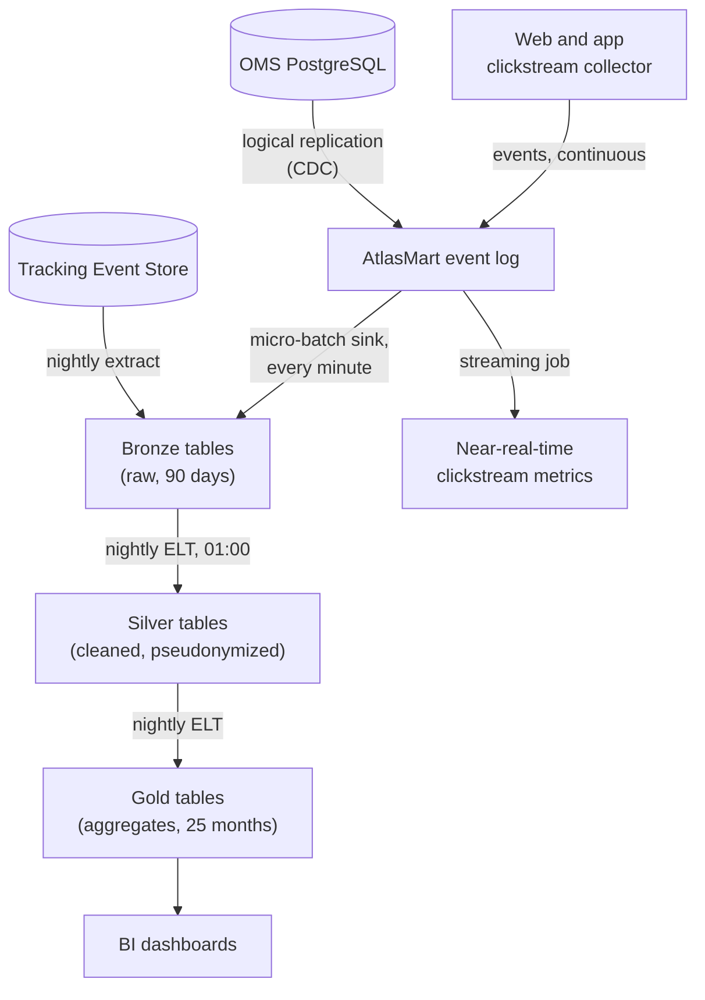
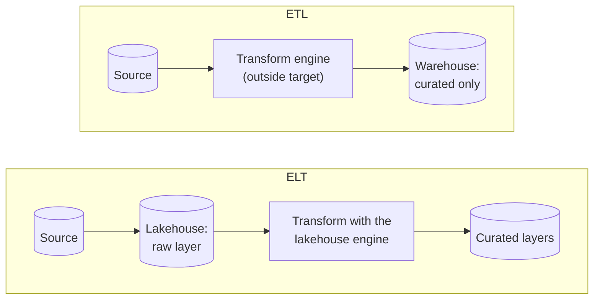
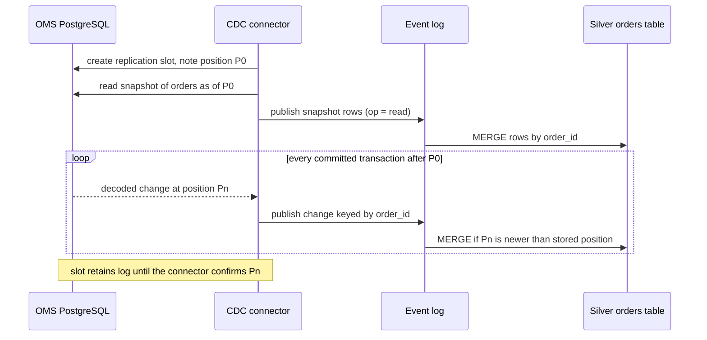
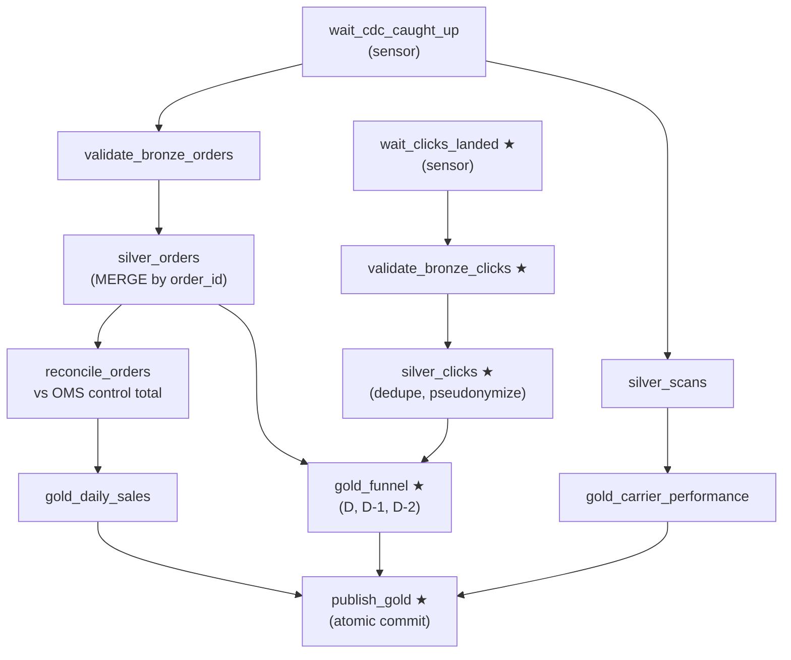

# Batch, streaming, ETL/ELT, and pipelines

> A data pipeline copies facts out of the systems that create them, reshapes them, and delivers them
> to the people and programs that analyze them. The engineering is in making every step repeatable:
> a pipeline that can be rerun safely, checked against its source, and evolved without breaking its
> readers is worth more than a fast one.

!!! abstract "Page facts"
    **Level:** Mixed (processing styles, ETL/ELT, and formats are Level 1-2; orchestration design,
    CDC, reconciliation, and schema compatibility policy are Level 3) · **Status:** Draft ·
    **Time:** 60-75 minutes · **Last verified:** 2026-11-27

## Learning objectives

After this page you should be able to:

- Place a requirement on the latency spectrum (batch, near-real-time, real-time, streaming) and pick
  the cheapest processing style that meets it.
- Explain the difference between ETL and ELT and say when each still fits.
- Design an orchestrated pipeline as a DAG of idempotent tasks that can be retried and backfilled.
- Describe log-based change data capture, its snapshot-then-stream lifecycle, and its failure modes.
- Write validation and reconciliation rules that catch silent data loss before a report is published.
- Choose a schema compatibility mode and a serialization format for a given data path.

## Prerequisites

- [Message queues and brokers](../messaging-and-streaming/message-queues-and-brokers.md) — delivery
  guarantees and idempotent consumers, which pipelines reuse at every hop.
- [Relational databases and SQL internals](../databases-and-storage/relational-databases-and-sql-internals.md)
  — transactions, the write-ahead log, and schema migration.
- [Capacity estimation](../performance-and-scalability/capacity-estimation.md) — the arithmetic used
  for the batch window below.

## The problem this solves

Operational databases are built to answer "what is true now?" for one customer at a time. Analysts
ask a different kind of question: how many orders did each channel produce last week, which carriers
were late in November, where do mobile shoppers abandon checkout. Running those scans against the
Order Management System's production database competes with checkout traffic, and the data an analyst
needs is spread across systems owned by different teams with different schemas.

The older answer was scheduled scripts that exported tables, reshaped them, and overwrote a
reporting database. Nobody could say whether last night's run loaded every row, a rerun doubled some
numbers, and a renamed source column broke a dashboard silently weeks later. Pipeline discipline
replaces that with explicit stages, repeatable tasks, schema contracts, and checks against the source.

## What it is

A **data pipeline** is a sequence of steps that **ingests** data from sources, **transforms** it,
and **loads** or **serves** it to a destination. Three questions describe any pipeline:

| Question | Options | Decided by |
|---|---|---|
| How often does data move? | Batch (scheduled, bounded input) or streaming (continuous, unbounded input) | The freshness the consumer needs and the cost of achieving it |
| Where does transformation happen? | Before loading (ETL) or inside the destination after loading (ELT) | Where compute is cheap, whether raw data must be kept, and where sensitive fields may land |
| How are steps coordinated? | Orchestrated (a scheduler runs a DAG of tasks) or choreographed (each stage reacts to data arriving) | How many steps, dependencies, and failure paths there are |

**Ingestion** is getting data out of a source: bulk export, incremental query, file drop, API pull,
event subscription, or change data capture. **Transformation** is cleaning, deduplicating,
conforming types and codes, joining, and aggregating. **Orchestration** (also called workflow
orchestration) is the scheduling, dependency management, retry, and monitoring of the steps.
**Synchronization** is keeping a copy consistent with its source over time; **validation** checks
that data is well formed and plausible; **reconciliation** checks that it is complete by comparing it
with an independent count from the source.

## Mental model

A pipeline is a water-treatment works. Raw water arrives from several rivers (sources) on different
schedules. It is held in an intake reservoir untouched (the raw or Bronze layer), so that if a
filter fails the works can reprocess yesterday's water instead of asking the river for it again. It
passes through filters in a fixed order (transformations), each stage checks its output before
passing it on (validation), and the works compares the volume leaving with the volume that came in
(reconciliation). A control room runs the stages on a timetable and restarts any that trip
(orchestration).

**Where the analogy breaks:** water is interchangeable; records are not. Losing one order row out of
60,000 is a wrong revenue number, and treating the same order twice is just as wrong. Data also
changes shape at the source (a new column, a renamed code), which no river does, so pipelines need
contracts and compatibility rules that a treatment works never needs.

## Key terms

| Term | Meaning on this page |
|---|---|
| Batch processing | Processing a bounded set of records (a day, an hour) in one run on a schedule |
| Stream processing | Processing an unbounded sequence of records continuously as they arrive |
| ETL / ELT | Extract-transform-load (transform before the destination) / extract-load-transform (load raw, transform inside the destination) |
| DAG | Directed acyclic graph: tasks as nodes, dependencies as edges, no cycles; the shape of an orchestrated pipeline |
| Idempotent task | A task whose rerun for the same input produces the same output and no duplicates |
| Backfill | Running a pipeline for past periods, to fill a gap or to apply a corrected transformation to history |
| Change data capture (CDC) | Reading a database's change log to replicate inserts, updates, and deletes continuously to another store |
| Reconciliation | Comparing two systems' records after the fact to find and repair differences that delivery missed |
| Schema registry | A service that stores versioned schemas per subject and checks each new version against a compatibility rule |
| Late-arriving data | Records whose event time falls in a period that has already been processed |
| Bronze / Silver / Gold | Raw as landed / cleaned and conformed / business-level aggregates (the medallion layers) |

## How it works

### The latency spectrum: batch, near-real-time, real-time, streaming

"Real-time" means different things to different people, so pin it to a number before designing.

| Style | Typical freshness | Mechanism | AtlasMart example |
|---|---|---|---|
| Batch | Hours to a day | Scheduled job over a bounded input (yesterday's partition) | Nightly ELT to Gold for the morning sales and carrier reports |
| Micro-batch | Tens of seconds to minutes | A streaming engine that processes small bounded chunks on a trigger interval | Clickstream landed into Bronze every minute |
| Near-real-time | Seconds to a few minutes | Streaming consumption with small buffers | Tracking status freshness of 60 s for 99% of events (NFR-1) |
| Real-time (business sense) | Milliseconds to about a second, in the request path | Per-event processing with state held in memory | A fraud score before a payment is authorized (case study 13, Halvane Pay) |

**Streaming** describes the input (unbounded) more than the latency: a streaming engine can run with
a one-hour trigger. (Hard real-time, a deadline guaranteed by design, belongs to control systems, not
data platforms.) Each step down the table costs more always-on compute, state, and operational skill,
and is worth it only when someone acts on the data within that time.

**Figure 1 — AtlasMart's data paths by latency class.** Operational flows on the left, the analytics
platform on the right; the event log carries both streams.

How to read it: the same event log feeds a near-real-time path (bottom right) and the batch path
through the medallion layers. Only the batch path writes Silver and Gold; the live metrics are
approximate and are superseded by the nightly numbers.

### ETL and ELT

**Figure 2 — ETL versus ELT.** In ETL a separate engine transforms data before the destination sees
it; in ELT raw data is loaded first and the destination's own engine transforms it.

How to read it: the difference is where the raw copy lives and which engine does the work. In ELT the
raw layer stays available, so a transformation bug is fixed by rerunning the transform, not by
re-extracting from the source.

ETL dominated when warehouse storage and compute were scarce, so only curated rows were worth
loading. Elastic object storage and scalable SQL engines made ELT the default: land everything
cheaply, transform with SQL in the destination, and keep raw history for replay. ETL remains right
when data must be reduced or redacted before it crosses a boundary (identifiers that may not land at
all, a jurisdiction raw data may not leave), and when the destination is an operational system. Most
platforms are mixed: AtlasMart is ELT, except that customer identifiers are pseudonymized on the way
into Silver and raw Bronze is restricted and kept only 90 days.

### Ingestion patterns

| Pattern | How it finds new data | Catches deletes? | Load on source | Fits |
|---|---|---|---|---|
| Full extract | Copies the whole table each run | Yes (by absence) | High, grows with the table | Small reference tables |
| Incremental query | `WHERE updated_at > last_watermark` | No, unless soft deletes are used | Moderate; needs an index on the column | Sources without log access |
| File or API drop | The source pushes files or exposes a paged API | Depends on the source | Owned by the source | Partners, SaaS systems |
| Event subscription | The source publishes business events | If it publishes them | Low | Systems designed for events (see the planned event-driven architecture page, D08-T02) |
| Log-based CDC | Reads the database's transaction log | Yes | Low; no queries on tables | Operational databases you do not own |

The incremental query fails quietly: rows updated in the same second as the stored watermark can be
missed, writes that forget `updated_at` are invisible, and deletes never appear. Log-based CDC avoids
all three, which is why AtlasMart uses it for the OMS.

### Change data capture and synchronization

A database already records every committed change in its transaction log (the write-ahead log in
PostgreSQL), in commit order, for its own recovery and replication. **Log-based CDC** decodes that
log into row-level change events (insert, update, delete, with the new and sometimes the old values)
and publishes them. How transaction logs, replication slots, and log retention work is covered on
[Advanced database architecture](../databases-and-storage/advanced-database-architecture.md); this
page covers what a pipeline must do with the stream.

**Figure 3 — CDC lifecycle: consistent snapshot, then the change stream.** The connector records the
log position at which the snapshot is consistent, then streams every change after it.

How to read it: the snapshot and the stream meet at P0, so no change is lost or applied twice across
the boundary. The `MERGE` applies a change only if its log position is newer than the one stored on
the row, which makes redelivered or reordered events harmless.

Design points the architect owns:

- **Keying and ordering.** Publish each change keyed by the table's primary key so that all changes
  for one order land in one partition of the event log, in commit order. Ordering across keys is not
  needed and not provided.
- **Idempotent apply.** The event log delivers at least once. The target stores the source log
  position per row and ignores anything older, exactly the timestamp guard used by the tracking
  Event Processor on the [queues page](../messaging-and-streaming/message-queues-and-brokers.md).
- **Deletes.** A delete arrives as an event with no new values (often followed by a tombstone on a
  compacted topic). The target must apply it, and retention rules (data deletion requests, the
  180-day tracking retention) must flow through the same path.
- **Slot health.** A stalled connector makes the source keep its log, and the source's disk fills.
  Alert on replication lag and retained log size; this is the failure the OMS team will care about
  most, because it lands on their database.
- **Schema changes.** A source migration (new column, changed type) appears in the stream; the
  connector must carry the new schema to the registry, and consumers must tolerate it.

**Synchronization** beyond one-way CDC is harder: **dual writes** (the application writes to both
systems) lose updates whenever one write fails; CDC or a transactional outbox (D08-T02) from a single
owner is the reliable alternative.

### Orchestration: DAGs, idempotent tasks, and backfills

An **orchestrator** runs a pipeline defined as a DAG. Each task has inputs, outputs, and upstream
dependencies; the orchestrator starts a task when its upstream tasks have succeeded, retries it with
backoff when it fails, and records the state of each run. A **run** is parameterized by the period
it covers (Apache Airflow calls this the data interval of a Dag run), not by the wall-clock time it
happens to execute, which is what makes reruns and backfills possible.

Rules that keep an orchestrated pipeline repairable:

1. **Every task is idempotent for its period.** It writes the output for its period with overwrite
   semantics (replace partition `order_date = D`) or with a keyed merge, never with a blind append.
   Rerunning Tuesday's task produces Tuesday's output again, not a second copy.
2. **Tasks read their inputs by period, not by "latest".** A task that reads "everything since the
   last run" cannot be backfilled; one that reads partition D can.
3. **Outputs become visible atomically.** Readers see either the old partition or the new one, never
   half; table formats provide this with snapshot commits (see
   [Big data processing engines and table formats](big-data-processing-engines-and-table-formats.md)).
4. **Sensors wait for completeness, not for the clock.** A task that starts at 01:00 regardless of
   whether the source has caught up produces a confident, wrong number.
5. **Backfills run on separate capacity.** A month of reprocessing must not starve the nightly run.
6. **The DAG is code.** It is versioned, reviewed, tested, and deployed like any other software.

Orchestrators verified for this page include Apache Airflow (Python-defined Dags, scheduling,
backfills, and catchup of missed intervals), Dagster (asset-oriented: tasks declared by the data they
produce), Prefect (Python flows and tasks), and Argo Workflows (workflows as Kubernetes resources,
which fits AtlasMart's GitOps platform). Major clouds also offer managed orchestration, including
hosted Airflow; check the provider's current documentation for names and limits.

**Choreography** (each stage triggered by data arriving) suits a two-step flow but scatters the
dependency graph across event subscriptions, so nobody can see why Gold is late; beyond a handful of
steps an orchestrator earns its operating cost.

### Validation and reconciliation

**Validation** asks "is this data well formed and plausible?" and runs on every batch:

| Check | Example rule | On failure |
|---|---|---|
| Schema | Every record matches the registered schema version | Reject at ingestion; producer fixes |
| Not null and type | `order_id`, `order_ts`, `channel` present and typed | Quarantine the row, count it |
| Uniqueness | One row per `order_id` in Silver orders | Fail the task; a merge bug or duplicate source |
| Referential | Every order line's `order_id` exists in orders | Hold lines for one cycle (late parent), then quarantine |
| Range and domain | `quantity` between 1 and 99; `channel` in a known list | Quarantine, alert the owning team |
| Freshness | Latest `order_ts` within 1 hour of the run's cut-off | Fail the sensor; CDC is behind |
| Volume | Row count within ±30% of the same weekday's median | Warn; a sale or an outage, a human decides |

**Reconciliation** asks "is it complete?" and needs a number from outside the pipeline: a control
total from the source system (count and sum of amounts per day), event-log offsets consumed versus
records landed, or the row count reported by the extract. Validation cannot catch a missing day of
orders, because every row present is valid; only reconciliation can. The pattern that makes both
effective is **write, audit, publish**: write the new partition where readers cannot see it, run the
checks, and publish (commit or swap) only if they pass. A failed audit leaves yesterday's Gold in
place, with a stale-data banner, which is better than a wrong number nobody questions.

### Schema evolution and schema registries

Sources change. A **schema registry** stores each version of a schema under a subject (typically
one per topic or table) and checks every new version against a **compatibility mode** before
producers may use it. The modes, as defined by Confluent Schema Registry (whose default is
`BACKWARD`), are:

| Mode | New schema can read... | Safe changes (Avro rules) | Upgrade order |
|---|---|---|---|
| `BACKWARD` | Data written with the previous version | Add a field with a default; delete a field | Consumers first, then producers |
| `FORWARD` | Old consumers can read data written with the new version | Add a field; delete a field that had a default | Producers first, then consumers |
| `FULL` | Both directions with the previous version | Add or delete only fields with defaults | Any order |
| `*_TRANSITIVE` variants | The same check against all earlier versions, not just the last | As above | As above |
| `NONE` | No check | Anything, including breaking changes | Coordinated by hand |

A lakehouse table has its own schema evolution (adding, renaming, or widening columns as metadata
operations, covered on the table-formats page). The registry protects the stream; the table format
protects the stored data; a **data contract** between the producing team and the platform states
which changes are allowed and how they are announced. Renaming a field is never compatible in Avro
without an alias, and the safest path for a breaking change is a new subject or topic version with
both published in parallel for a migration period.

### Serialization formats

| Format | Layout | Schema | Splittable for parallel reads | Typical use |
|---|---|---|---|---|
| JSON | Row, text | None in the data (JSON Schema optional, held elsewhere) | Newline-delimited and uncompressed or with a splittable codec; a single JSON document is not | APIs, raw landing, debugging |
| Avro | Row, binary | JSON-defined; written in the container file header; readers resolve writer schema against reader schema | Yes: object container files have sync markers between blocks | Event streams with a registry, Bronze landing, CDC |
| Protocol Buffers | Row (message), binary | `.proto` files with numbered fields; not carried in the data | No standard container; each message is self-contained but not self-describing | RPC (gRPC), service events, mobile payloads |
| Parquet | Columnar, binary | In the file footer metadata | Yes, by row group | Analytical tables (Silver, Gold), lakehouse data files |
| ORC | Columnar, binary | In the file footer | Yes, by stripe | Hive-centric analytics; also used by lakehouse engines |

Row formats suit writing one record at a time and reading whole records (streams, CDC). Columnar
formats suit scanning a few columns across many rows (analytics): a query that sums `amount` reads
only that column's chunks, and similar values stored together compress well. Protocol Buffers'
documentation itself advises against using it for very large data sets loaded whole into memory,
which is why it rarely appears as a lake file format.

## Worked example: AtlasMart's nightly ELT from Bronze to Gold

**Context.** The nightly analytics batch from the
[sustainability page](../finops-and-sustainability/sustainable-and-carbon-aware-architecture.md)
(16 vCPU for 4 hours, starting 01:00, results due by 16:00, scaling to zero afterwards) becomes the
lakehouse's nightly ELT. It turns the previous business day's Bronze data into Silver and Gold.

**Inputs for business day D** (facts, Phase 5 assumptions, and new assumptions marked):

| Input | Volume | Source |
|---|---|---|
| Orders | 60,000 | Existing fact |
| Order lines | 60,000 × 3 = 180,000 | Phase 5 assumption |
| OMS change events | 60,000 inserts + 180,000 line inserts + 60,000 × 3 status updates = 420,000 (assumption: three status changes per order per day) | CDC via logical replication |
| Scan events | 480,000 × 500 B = 240 MB | Existing fact |
| Clickstream | 16,000,000 events × 1 KB ≈ 16 GB raw | Phase 5 assumption |

### The DAG

**Figure 4 — The nightly ELT DAG for business day D.** Tasks on the critical path are marked with a
star; the order branch runs alongside the clickstream branch on the same 16-vCPU pool.

How to read it: an arrow means "must succeed before". `publish_gold` is the only task that makes
anything visible to dashboards, so a failure anywhere upstream leaves yesterday's Gold intact. The
reconciliation gate sits before the sales aggregate, because that is the number finance reads.

### The batch window

Task durations are measured on the 16-vCPU pool (assumption for this example):

| Path | Tasks and minutes | Total |
|---|---|---|
| Critical (clickstream) | sensor and validation 20 + `silver_clicks` 140 + `gold_funnel` for three days 60 + publish 10 | 230 min |
| Order branch | validation 10 + `silver_orders` 40 + reconcile 10 + `gold_daily_sales` 20 | 80 min, in parallel |
| Scan branch | `silver_scans` 15 + `gold_carrier_performance` 25 | 40 min, in parallel |

The run takes about 230 minutes, within the 4-hour (240-minute) reservation, and uses
16 × 4 = 64 vCPU-hours = 64 CU per night at the illustrative rate. The slack to the deadline is the
real reliability budget:

- A normal run ends at 05:00; the deadline is 16:00, leaving 11 hours.
- A run that fails at its last step can be **rerun in full twice** (05:00-09:00 and 09:00-13:00); a
  third full run would end at 17:00 and miss. Because tasks are idempotent, the orchestrator usually
  reruns only the failed task and its descendants, which is much shorter.
- A **backfill** of 7 days of corrected history needs 7 × 64 = 448 vCPU-hours. On the nightly pool
  that would be 448 ÷ 16 = 28 hours and would collide with the next night, so backfills run on a
  separate pool (for example 64 vCPU for 448 ÷ 64 = 7 hours, 448 CU) during the day.

Shortening the critical path means shrinking `silver_clicks`: processing clickstream incrementally
through the day (the incremental option the sustainability page estimates at half the vCPU-hours)
moves that work out of the window.

### Idempotent partition overwrite

Every Silver and Gold task writes with **partition overwrite** for its period: `silver_clicks` for D
replaces partition `event_date = D` in one atomic commit, and `gold_daily_sales` replaces
`order_date = D`. Running either twice produces the same table. `silver_orders` is a current-state
table, so it uses a keyed `MERGE` with the log-position guard from Figure 3 instead; replaying the
same 420,000 change events leaves the table unchanged. The one thing the team forbids is
`INSERT INTO ... SELECT` without a key or a partition replace, because it is the line that doubles a
day's revenue on a retry.

### The late-arriving data rule

About 70% of traffic is mobile web, and phones buffer events when offline, so some clickstream
events for day D arrive after the 01:00 cut (assumption: 0.5% of a day's events, about 80,000, arrive
within 48 hours of the cut, and a negligible tail later). The rule:

1. Every event belongs to the partition of its **event date** (when it happened, in the business
   time zone), never its arrival date.
2. Late events land in Bronze normally. `silver_clicks` for D also merges late rows for D-1 and D-2
   into their Silver partitions with insert-if-absent on `event_id` (idempotent).
3. `gold_funnel` recomputes D, D-1, and D-2 every night (the 60 minutes above). Each Gold partition
   is therefore **restated** twice after first publication; dashboards show a "provisional" marker on
   the two most recent days.
4. Events older than D-2 on arrival are kept in Silver with a `late = true` flag and counted, but do
   not change Gold; a monthly job reports their volume so the 48-hour assumption can be revisited.

Orders do not need this rule: the CDC sensor waits until the connector has confirmed the OMS log
position taken at midnight, so every order committed on day D is in Bronze before `silver_orders`
starts.

### Reconciliation against the OMS

The OMS team publishes a control total for each business day at 00:30 (assumption): order count and
sum of order value, queried from their read replica. `reconcile_orders` compares it with Silver:

| Measure | OMS control | Silver | Rule |
|---|---|---|---|
| Orders created on D | 60,000 | 60,000 | Must match exactly |
| Order lines created on D | 180,000 | 180,000 | Must match exactly |
| Sum of order value | from OMS | from Silver | Must match to the cent |

A mismatch blocks `gold_daily_sales` and pages the data platform on-call. Fewer rows in Silver
usually means CDC lag or a dropped partition in the event log; the fix is to wait or replay and
rerun `silver_orders`, which is safe because it is idempotent. More rows in Silver usually means a
time-zone boundary bug (orders at 23:30 UTC assigned to the wrong business day) or a merge that is
not keyed. For clickstream there is no system of record to compare with, so reconciliation uses
event-log offsets: records consumed by the Bronze sink must equal records landed, and records removed
as duplicates in Silver must stay below 1% (assumption); a sudden rise means a client retry bug.

## Real-world architecture example

The shape above is the common lakehouse ingestion pattern: CDC from operational databases and
events from applications into a partitioned log, a sink that lands them raw into object storage, an
orchestrated batch that builds cleaned and aggregated layers with SQL, and a BI tool on top. A
retailer, a bank, and a logistics company differ in sources and regulations, not in the skeleton.
The variations that matter architecturally are where sensitive data is reduced (before landing, or
at the first transformation), whether the streaming path also writes curated tables (a Kappa-style
design, covered on
[Warehouses, lakes, lakehouses, and data mesh](warehouses-lakes-lakehouses-and-data-mesh.md)), and
who owns each table: in AtlasMart, the OMS team owns the order data product in Silver and the
4-person data platform team owns the shared pipeline machinery.

| Concern | Vendor-neutral building block | Examples verified for this page |
|---|---|---|
| CDC from PostgreSQL | Logical decoding into change events | PostgreSQL logical replication and logical decoding; Debezium PostgreSQL connector (uses the `pgoutput` plugin and a replication slot) |
| Schema registry | Versioned schemas with compatibility checks | Confluent Schema Registry (Avro, JSON Schema, Protobuf) |
| Orchestration | DAG scheduler with retries and backfills | Apache Airflow, Dagster, Prefect, Argo Workflows |
| Transformation | SQL engine over the lakehouse | Managed Spark (see the engines page) |

## Design choices and trade-offs

| Choice | Favor when | Avoid when |
|---|---|---|
| Batch | Consumers read results on a schedule; inputs are large; cost matters more than minutes | Someone must act within minutes; input arrives continuously and unevenly |
| Streaming | Freshness has a business owner and a number; per-event reaction is required | The only consumer is a daily report; the team cannot yet operate stateful jobs |
| ELT | Raw history is valuable; the destination engine scales; transformation logic changes often | Data may not legally land in raw form; the destination is an operational system |
| ETL | Data must be reduced or redacted before crossing a boundary | It is chosen only out of habit; you lose replay from raw |
| Log-based CDC | You need deletes, low source load, and every change | You cannot get log access, or the source team will not support a replication slot |
| Incremental query | Quick start on a source with reliable `updated_at` and soft deletes | Correctness matters and the source has hard deletes |
| Orchestrator | More than a few steps, shared dependencies, backfills | A two-step flow that an object-created event triggers cleanly |
| `BACKWARD` registry mode | Consumers are upgraded before producers, the common case | Many independent consumers cannot be upgraded in step; consider `FULL` |
| Avro in the stream, Parquet in tables | Row-at-a-time writes upstream, column scans downstream | Every consumer is a browser; JSON may be the pragmatic edge format |

## Failure modes and anti-patterns

- **Non-idempotent append.** A retried task inserts a second copy of a day. Detect: reconciliation
  shows exactly double counts. Prevent: partition overwrite or keyed merge in every task.
- **Clock-driven start.** The run starts at 01:00 while CDC is 20 minutes behind. Detect: order
  count below the control total. Prevent: completeness sensors on log position or offsets.
- **Silent schema drift.** A source renames a field; the transform reads nulls and Gold drops to
  zero for that dimension. Detect: null-rate and volume checks. Prevent: registry compatibility
  checks and a data contract with the producing team.
- **Stalled replication slot.** The CDC connector stops; the OMS database keeps its log and its disk
  fills. Detect: retained-log-size and lag alerts. Prevent: alerts, a runbook, and a maximum
  retained size agreed with the OMS team.
- **Arrival-date partitioning.** Late events land in today's partition and inflate it. Detect:
  event-time distribution inside a partition. Prevent: partition by event time with a stated
  lateness rule.
- **Validation without reconciliation, or publishing before auditing.** Every row is valid but an
  hour is missing, or dashboards show a half-written partition. Prevent: a control total from outside
  the pipeline, and write-audit-publish with atomic commits.
- **Backfill on the production pool.** A history rerun delays the nightly results past 16:00.
  Prevent: separate capacity and a backfill runbook.
- **Dual writes for synchronization.** The application writes to the OMS and to the lake; one
  fails. Prevent: CDC or an outbox from one owner.

## Security considerations

- **Pseudonymize early.** Customer identifiers are replaced with keyed pseudonyms before Silver;
  the mapping secret lives in the key management service and only the pseudonymization task can use
  it (see [Data security and privacy](../security-architecture/data-security-and-privacy.md)).
- **Bronze is the most sensitive layer.** It holds raw values, so access is limited to the pipeline
  identities and the platform on-call, and its 90-day retention is enforced by lifecycle rules.
- **Constraint C-4.** The event log, Bronze, and every pipeline run stay in the EU region; a
  backfill pool in another region would break the constraint.
- **CDC reads everything.** A replication slot sees every column of every published table. Publish
  only the tables and columns the platform needs (publications can be column-filtered in recent
  PostgreSQL versions; check the version in use), and never addresses (NFR-6 for tracking).
- **Deletion must propagate.** An erasure request in the OMS must reach Bronze, Silver, and any
  Gold that holds row-level data; time-travel snapshots keep deleted rows until they expire.
- **Pipeline identities are workloads**, each scoped to its task's inputs and outputs.

## Performance, reliability, and cost

- **Performance:** batch duration is dominated by the largest input (clickstream) and by shuffles in
  joins and aggregations; columnar formats and partition pruning cut the bytes read. Measure the
  critical path of the DAG, not the sum of tasks.
- **Reliability:** idempotent tasks, completeness sensors, and write-audit-publish turn most
  failures into "late", not "wrong". The 11 hours of slack before 16:00 is the error budget for the
  batch; alert when a run's projected finish eats more than half of it.
- **Cost:** the nightly run is 64 CU; the always-on streaming sink and event log are the larger
  standing costs. Streaming everything would replace a 4-hour burst with 24-hour compute; do it only
  for paths with a freshness owner.

## Hands-on lab: an idempotent daily load with reconciliation

Using Python and the standard library's `sqlite3` module:

1. Create a `source_orders(order_id, order_ts, amount)` table and insert 1,000 rows across three
   days with a seeded random generator. Add a `control_totals(day, order_count, amount_sum)` view.
2. Write `load_day(day)` that inserts the day's rows into `silver_orders` with a plain
   `INSERT ... SELECT`. Run it twice for the same day and compare counts with the control total.
3. Change `load_day` to delete the day's rows and insert them again inside one transaction
   (partition overwrite). Run it three times and reconcile again.
4. Insert five "late" rows for day 1 after day 1 was loaded. Write the rule that decides whether the
   day-3 run reloads day 1, and implement it.
5. Make `load_day` crash halfway (raise an exception after half the rows). Show what readers see,
   with and without the transaction.

??? question "Hint: what the counts should show"
    Step 2 doubles the day's count, so reconciliation fails by exactly the control total. Step 3
    matches every time. Step 4 matches again only if the day-3 run recomputes day 1, which is the
    lookback rule from the worked example. Step 5 shows a partial day without the transaction and
    the old, complete day with it: the atomic swap is what keeps a crash from being visible.

## Knowledge check

1. A product manager asks for a "real-time" sales dashboard. What question do you ask first, and
   which two answers lead to different designs?
2. Why can a pipeline that reads "all rows changed since the last run" not be backfilled, and how
   do you fix it?
3. CDC from the OMS stops for six hours on a Sunday. Name two effects, one on the analytics side and
   one on the OMS side.
4. A registry subject is in `BACKWARD` mode. A producer team wants to add a required field with no
   default. What happens, and what should they do instead?
5. Validation passes on every row, yet the Gold order count is 59,100 against an OMS count of
   60,000. Which check caught it, and what are the first two hypotheses?

??? success "Answers"
    1. "How quickly will someone act on the number, and what will they do?" If the answer is "we
       look at it each morning", a batch or hourly micro-batch suffices; if it is "we pause a
       promotion within minutes when conversion drops", a streaming path with a freshness target is
       justified.
    2. "Since the last run" depends on when it executed, not on the period it covers, so a rerun for
       last Tuesday reads the wrong rows. Parameterize each run by its period and read partition D.
    3. Analytics: the sensor holds the nightly run (or reconciliation fails), so Gold is late. OMS:
       the replication slot retains log for six hours, consuming disk on a database the platform
       team does not own.
    4. The registry rejects the new version: a field without a default cannot be read from old data
       by the new schema. Add the field with a default, or publish a new subject and migrate.
    5. Reconciliation against the control total. Hypotheses: CDC was behind at the cut (check the
       sensor and connector lag), or a partition of the event log was not consumed (check offsets
       consumed against landed).

## Architecture discussion questions

1. The marketing team wants clickstream in Gold within 5 minutes instead of next morning. What
   changes in the pipeline, the late-data rule, and the cost, and which parts of the nightly design
   would you keep?
2. The OMS team refuses a replication slot on their primary because of a past disk incident. Compare
   CDC from their standby (where supported), an outbox table, and an incremental query, and state
   what each loses.
3. Should the data platform team own the Silver order tables, or should the OMS team publish them
   as a data product? Argue both, using the reconciliation rule as the test of accountability.

## Summary

Pipelines ingest, transform, and deliver data; the processing style follows from how fast someone
acts on the result, and batch is the default until a freshness requirement with an owner says
otherwise. ELT keeps raw data for replay and transforms inside the lakehouse, with ETL-style
reduction where sensitive data must not land. Orchestrated DAGs of idempotent, period-parameterized
tasks can be retried and backfilled safely; completeness sensors and write-audit-publish keep wrong
numbers from being published. Log-based CDC captures every change including deletes, applied with a
log-position guard. Validation checks that data is well formed; only reconciliation against an
independent total proves it is complete. Schema registries and data contracts manage change in the
stream, and the format follows the access pattern: row formats for streams, columnar formats for
analytics.

## Related topics

- **Before:** [Message queues and brokers](../messaging-and-streaming/message-queues-and-brokers.md);
  [Relational databases and SQL internals](../databases-and-storage/relational-databases-and-sql-internals.md);
  [Capacity estimation](../performance-and-scalability/capacity-estimation.md)
- **Alongside:** [Big data processing engines and table formats](big-data-processing-engines-and-table-formats.md)
  — the engines and atomic commits this page relies on;
  [Warehouses, lakes, lakehouses, and data mesh](warehouses-lakes-lakehouses-and-data-mesh.md) — the
  medallion layers and Lambda and Kappa;
  [Data modeling, metadata, and data governance](data-modeling-metadata-and-data-governance.md) —
  lineage, quality ownership, and catalogs;
  [Advanced database architecture](../databases-and-storage/advanced-database-architecture.md) —
  transaction logs and CDC on the source side;
  [Event streaming and log-based architecture](../messaging-and-streaming/event-streaming-and-log-based-architecture.md)
  — partitions, offsets, and retention on the event log;
  [Transactions, sagas, and delivery guarantees](../distributed-systems/transactions-sagas-and-delivery-guarantees.md)
  — effectively-once processing;
  [Sustainable and carbon-aware architecture](../finops-and-sustainability/sustainable-and-carbon-aware-architecture.md)
  — scheduling the batch window.
  Applied in case study 12,
  [Corvina Mobility lakehouse](../end-to-end-case-studies/cs-12-data-lakehouse-with-batch-and-streaming-ingestion.md),
  and the [CDC pipeline exercise](../system-design-exercises/cdc-pipeline.md).
- **Planned:** data ingestion and feature pipelines for machine learning, in the ML lifecycle (D20-T02).

## References

| Source | Type | Checked |
|---|---|---|
| [PostgreSQL documentation: Logical Decoding](https://www.postgresql.org/docs/current/logicaldecoding.html) | Official documentation (replication slots, output plugins) | 2026-11-27 |
| [Debezium connector for PostgreSQL](https://debezium.io/documentation/reference/stable/connectors/postgresql.html) | Official project documentation (snapshots, `pgoutput`, change events) | 2026-11-27 |
| [Confluent Schema Registry: Schema Evolution and Compatibility](https://docs.confluent.io/platform/current/schema-registry/fundamentals/schema-evolution.html) | Vendor documentation (compatibility modes, default `BACKWARD`) | 2026-11-27 |
| [Apache Airflow documentation: Dags](https://airflow.apache.org/docs/apache-airflow/stable/core-concepts/dags.html) (version 3.4.0 at check time) | Official project documentation (data intervals, catchup, backfill) | 2026-11-27 |
| [Apache Avro 1.12.0 Specification](https://avro.apache.org/docs/1.12.0/specification/) | Specification (schema resolution, object container files, sync markers) | 2026-11-27 |
| [Apache Parquet: File Format](https://parquet.apache.org/docs/file-format/) and [Apache ORC documentation](https://orc.apache.org/docs/) | Official project documentation (row groups, column chunks, stripes, footers) | 2026-11-27 |
| [Protocol Buffers: Overview](https://protobuf.dev/overview/) | Official documentation (field numbers, when Protobuf is not a good fit) | 2026-11-27 |
| Martin Kleppmann, *Designing Data-Intensive Applications* (O'Reilly, 2017), chapters 4 (encoding and evolution), 10 (batch processing), and 11 (stream processing) | Book | 2026-11-27 |

## Review notes

- Canonical page for D07-T02. Depth is on the latency spectrum, ETL versus ELT, orchestration with
  idempotent tasks and backfills, log-based CDC, validation and reconciliation, schema compatibility
  modes, and the format comparison. Defined only: synchronization beyond one-way CDC (dual writes and
  bidirectional replication are mentioned, not designed), choreographed pipelines, and JSON as a
  format (its splittability statement is general knowledge, not from a cited spec page).
- Orchestrator names (Apache Airflow, Dagster, Prefect, Argo Workflows) were checked on each
  project's site on 2026-11-27; Airflow's documentation now spells the concept "Dag". Managed
  orchestration services are deliberately not named.
- The compatibility table follows Confluent's definitions; other registries use similar but not
  identical mode names. The "safe changes" column states Avro rules; Protobuf and JSON Schema
  differ, and a reviewer should not generalize it.
- New AtlasMart assumptions: three OMS status changes per order per day (420,000 change events);
  task durations (critical path 230 minutes); 0.5% of clickstream arriving up to 48 hours late, a
  D-2 restatement window, and a monthly late-volume report; OMS control totals at 00:30; a 1%
  duplicate ceiling in Silver clickstream; a 64-vCPU daytime backfill pool. The 16 vCPU, 4 h,
  01:00 start, and 16:00 deadline are reused from the sustainability page.
- The column-filtered publication remark is version-dependent; a reviewer should confirm it against
  the PostgreSQL version the OMS runs.
