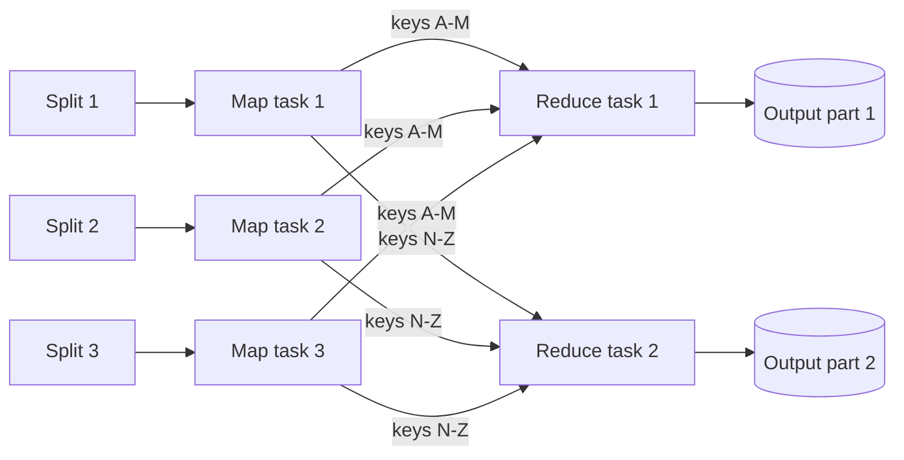
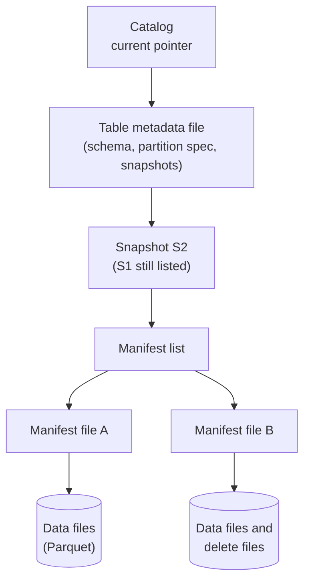
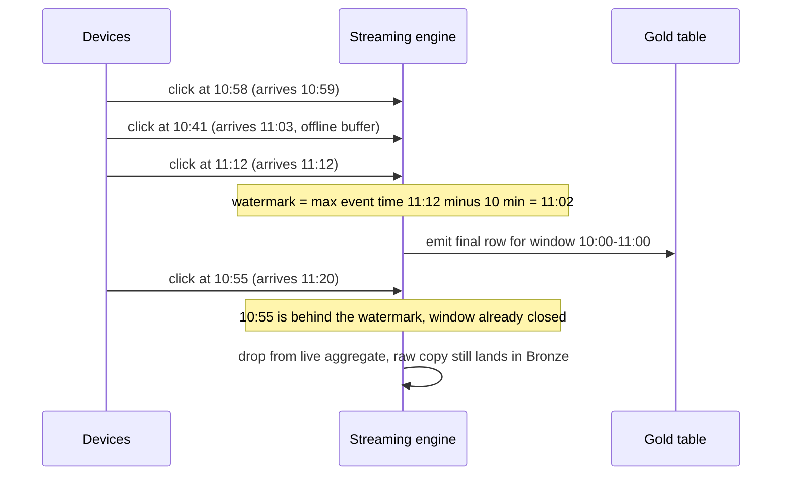
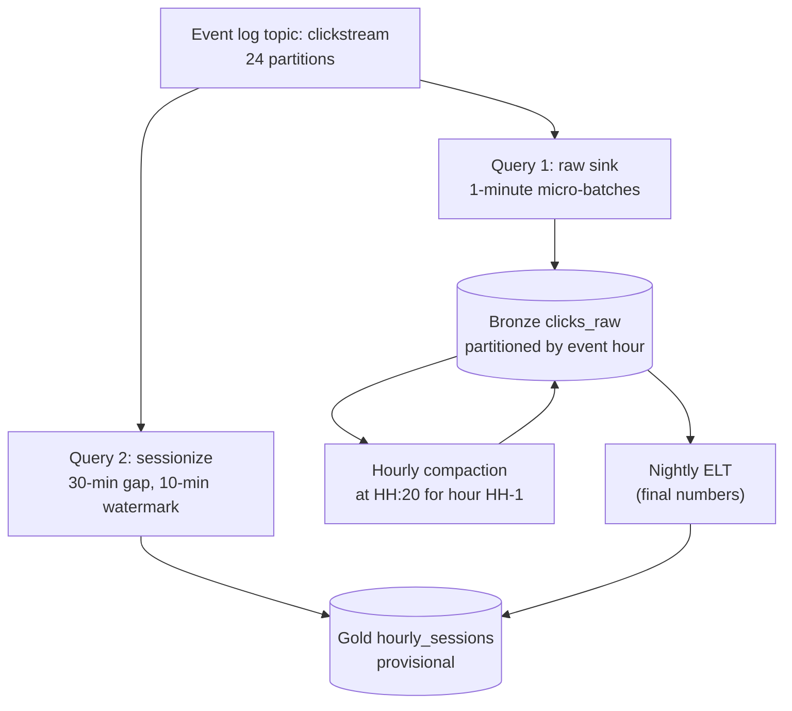

# Big data processing engines and table formats

> A big data engine splits one job across many machines, moves data between them by key, and
> survives the loss of any of them; a table format turns a pile of files in object storage into a
> table with atomic commits and a history. Most of the architecture is in the data movement: how
> files are sized, how keys are distributed, and how time is defined.

!!! abstract "Page facts"
    **Level:** Mixed (engine roles and table-format concepts are Level 1-2; skew, compaction design,
    watermarks, and exactly-once boundaries are Level 3) · **Status:** Draft · **Time:** 60-75
    minutes · **Last verified:** 2026-11-27

## Learning objectives

After this page you should be able to:

- Explain the map, shuffle, reduce model, what Hadoop introduced, and which parts of it survive in
  today's engines.
- Compare Spark, Flink, and Beam by processing model, state, and time handling, and choose one for a
  workload.
- Describe how an open table format (Iceberg, Delta Lake, Hudi) gives atomic commits, snapshots, time
  travel, and schema and partition evolution on object storage.
- Size files and partitions, plan compaction, and detect and fix data skew with salting.
- Reason about event time, processing time, windows, and watermarks, and state precisely what
  exactly-once stream processing does and does not guarantee.

## Prerequisites

- [Batch, streaming, ETL/ELT, and pipelines](batch-streaming-etl-elt-and-pipelines.md) — the
  pipelines these engines execute, and the late-data rule reused below.
- [Scaling, partitioning, and replication](../distributed-systems/scaling-partitioning-and-replication.md)
  — partition keys, hot keys, and salting in databases.
- [Message queues and brokers](../messaging-and-streaming/message-queues-and-brokers.md) — delivery
  guarantees and why "exactly-once" needs care.

## The problem this solves

One machine reads a disk at a fixed rate. Scanning a few terabytes on one machine takes hours, and
the data may not fit on it at all. Spreading the work over a hundred machines would be a hundred
times faster if three problems were solved: dividing the input so every machine has a fair share,
bringing together records that must be combined (all events for one product) even though they
started on different machines, and finishing the job when one of the hundred machines fails halfway.

Storage had a parallel problem. A "table" in a data lake used to be a directory of files. Object
storage has no multi-file transaction, so a job that failed halfway left half a partition visible,
two writers could overwrite each other, listing millions of files was slow, and changing a column or
a partition scheme meant rewriting everything. Engines solve the first set of problems; table formats
solve the second.

## What it is

A **distributed processing engine** runs a job as many **tasks**, one per partition of the data, on
a cluster of workers coordinated by a driver or job manager. Between stages it **shuffles**:
redistributes records by key so that all records with the same key meet on the same worker. It
recovers from worker failure by recomputing or restoring the lost tasks.

| Engine or project | Model | Where it fits today |
|---|---|---|
| Hadoop (HDFS, MapReduce, YARN) | Distributed file system plus disk-based map and reduce jobs, with a cluster resource manager | On-premises clusters still running; mostly replaced by object storage and Spark in cloud platforms |
| Apache Spark (Spark SQL, Structured Streaming) | DAG of stages over partitioned data, SQL and DataFrame APIs, streaming as micro-batches over an unbounded table | General-purpose batch and SQL; streaming where seconds to minutes of latency are acceptable |
| Apache Flink | Streaming first: long-running operators with keyed state, checkpoints, and event-time processing; batch as a bounded stream | Low-latency, stateful stream processing with rich time semantics |
| Apache Beam | A portable programming model (pipelines, collections, transforms, windows, triggers) executed by a chosen runner | Writing one pipeline that can run on several engines |
| Apache Hive | SQL over files in a distributed file system, with the Hive Metastore as the table catalog | The metastore survives as a catalog; Hive itself as a warehouse in Hadoop estates |

An **open table format** is a specification for metadata files, stored next to the data files, that
define exactly which data files make up each version of a table. Apache Iceberg, Delta Lake, and
Apache Hudi are the three widely used ones; engines read and write them through connectors.

## Mental model

An engine is a large sorting office. Mail arrives in sacks at many desks (input partitions); each
clerk sorts their sack by postcode (map); trolleys carry each postcode's pile to the desk responsible
for it (shuffle); that desk counts or bundles it (reduce). If a clerk falls ill, a supervisor hands
their sack to someone else, which works because sorting the same sack twice gives the same piles.

A table format is the office ledger. The shelves (object storage) hold boxes (data files); nobody
believes a box belongs to today's table until the ledger lists it, and a new ledger page is written
all at once. Old pages are kept, so anyone can ask what the shelves held last Tuesday.

**Where the analogy breaks:** in a sorting office, one huge postcode is obvious and gets extra
staff. In an engine, the shuffle sends a key to exactly one task no matter how big it is, and nobody
notices until that one task runs for an hour while the rest sit idle. And the ledger has a cost the
office does not: every tiny box adds a line, so a stream that writes thousands of tiny files makes
the ledger itself slow to read.

## Key terms

| Term | Meaning on this page |
|---|---|
| Shuffle | Redistributing records across workers by key between processing stages, over the network |
| Data skew | Uneven distribution of records over keys or partitions, so one task does far more work than others |
| Salting | Adding a random or hashed suffix to a hot key so its records spread over several tasks, then merging the partial results |
| Compaction | Rewriting many small files into fewer files near a target size, without changing the table's rows |
| Snapshot | The complete list of data files that make up a table at one committed version |
| Time travel | Querying a table as of an earlier snapshot, version, or timestamp |
| Event time / processing time | When something happened at the source / when the engine processes it |
| Window | A grouping of an unbounded stream into finite chunks by time (tumbling, sliding, or session) |
| Watermark | The engine's running estimate that no more events older than time T will arrive; it decides when a window can be finalized |
| Exactly-once processing | After failures and replays, every input record's effect on engine state and on a cooperating sink is applied once |

## How it works

### Distributed storage and Hadoop

HDFS splits each file into large **blocks**, stores each block on several **DataNodes** (the
replication factor), and keeps the file-to-block map in a **NameNode**. Its design documents two
ideas that outlived it: files are written once and read many times, and moving computation to the
data is cheaper than moving the data to the computation. **MapReduce**, published by Google in 2004
and implemented in open source by Hadoop, gave developers two functions to write: map (record to
key-value pairs) and reduce (all values for a key to a result). The framework handled splitting,
scheduling near the data, shuffling, sorting, and re-running failed tasks. **YARN** later separated
cluster resource management from the MapReduce engine so that other engines could share a cluster.

**Figure 1 — Map, shuffle, reduce.** Each map task reads one input split; the shuffle sends every
key to exactly one reduce task.

How to read it: every map task sends data to every reduce task, which is why a shuffle is the
expensive step (network, disk, and a barrier where all maps must finish). If most records carry
keys between A and M, reduce task 1 does most of the work: that is skew.

What survives from Hadoop: the map-shuffle-reduce model (every engine's group-by and join is one),
deterministic re-execution as fault tolerance, partitioned directory layouts, the Hive Metastore as a
catalog, and the columnar formats Parquet and ORC that grew up in that ecosystem. What faded: writing
MapReduce jobs by hand, materializing every intermediate result to disk, and in the cloud, HDFS
itself, because object storage separates storage from compute and lets clusters scale to zero.

### Hive and the metastore

Hive put SQL on top of files in HDFS. Its lasting contribution is the **Hive Metastore**: a database
that maps a table name to a schema, a storage location, a file format, and a list of partitions.
Hive-style partitioning encodes partition values in directory names (`event_date=2026-11-26/`), and
engines prune directories that a query's filter excludes. Spark and many SQL engines still use a
Hive-compatible metastore as their catalog, and Iceberg can use it as one of its catalog types. Its
limits (a partition list that grows large, no atomic multi-partition commit, readers that must list
directories) are exactly what table formats address.

### Spark: stages, shuffles, and Structured Streaming

A Spark job is a DAG of transformations evaluated lazily. When an action runs, Spark splits the DAG
into **stages** at shuffle boundaries; each stage runs one task per partition on executors. Spark SQL
and DataFrames let an optimizer choose join strategies and push filters and column selection down to
Parquet or table-format readers. **Adaptive Query Execution** re-plans at shuffle boundaries using
real statistics: it coalesces small shuffle partitions, switches join strategies, and splits skewed
partitions in sort-merge joins (`spark.sql.adaptive.skewJoin.enabled`). The number of shuffle
partitions (`spark.sql.shuffle.partitions`) is a tuning decision that AQE softens but does not remove.

**Structured Streaming** treats a stream as a table that grows without end and runs the same
DataFrame query incrementally, by default as a series of micro-batches on a trigger. Output modes say
what each trigger writes: **append** (only rows that are final), **update** (rows changed since the
last trigger), or **complete** (the whole result). Event-time aggregations use `withWatermark` to
bound how long state is kept for late data. The documentation's exactly-once claim rests on three
parts: replayable sources with offsets, checkpointing and write-ahead logs that record which offsets
each batch covered, and sinks that are idempotent for a replayed batch. Spark 4.3.0 was current on
the check date; the guide is now split across several pages.

### Flink: state, checkpoints, and time

Flink runs a job as long-lived operators connected by streams. Keyed state (counts, open sessions,
the last value per key) lives with the operator, partitioned by key. **Checkpoints** inject
**barriers** into the streams; when an operator has seen the barrier on all inputs it snapshots its
state, so the set of snapshots is consistent with one position in every source (Flink's
documentation relates the approach to the Chandy-Lamport snapshot algorithm). After a failure the job
restores the last checkpoint and rewinds the sources to the matching positions. **Savepoints** are
user-triggered snapshots for upgrades and migrations. Flink processes each record as it arrives, so
latency is set by buffering and checkpoint settings rather than by a trigger interval; batch jobs run
as bounded streams. Flink 2.3.0 was current on the check date.

### Beam: one model, several runners

Beam describes a pipeline as **PCollections** (data sets, bounded or unbounded) and **PTransforms**
(operations), with windowing and triggers as first-class parts of the model. A **runner** translates
the pipeline for an engine; the capability matrix on the Beam site lists, among others, the Direct
Runner and Prism for local execution, Apache Flink, Apache Spark, and Google Cloud Dataflow. The
model came from Google's Dataflow paper, which framed every streaming computation as four questions:
what is computed, where in event time, when in processing time results are emitted, and how later
refinements relate to earlier ones. Portability is real for the model and partial in practice:
runners differ in supported features, which is why the matrix exists.

### Open table formats: snapshots, manifests, and atomic commits

**Figure 2 — Iceberg's metadata tree.** A commit writes new files below and then swaps one pointer
in the catalog; readers follow whichever pointer they found when the query started.

How to read it: a manifest lists data files with per-file statistics (row counts, column bounds) so
a planner can skip files without opening them. Time travel is reading an older snapshot's manifest
list. Old snapshots keep old files alive until they are expired.

All three formats share the same core idea: data files are immutable, and a **commit** atomically
publishes a new list of them. Concurrent writers use **optimistic concurrency**: each prepares its
files, then tries to commit against the version it started from; if another commit landed first and
conflicts, it retries or fails. That gives ACID semantics on storage that has no transactions of its
own.

| Aspect | Apache Iceberg | Delta Lake | Apache Hudi |
|---|---|---|---|
| Metadata | Catalog pointer, table metadata file, manifest lists, manifest files | `_delta_log` directory of numbered JSON commits with periodic Parquet checkpoints | Timeline of instants (actions with requested, inflight, and completed states); file groups of base and log files |
| Commit | Atomic swap of the catalog's metadata pointer | Writing the next numbered log entry atomically | Completing an instant on the timeline |
| Row-level change | Position and equality delete files (spec v2), deletion vectors (v3) | Rewrite, or deletion vectors | Copy-on-Write (rewrite base files) or Merge-on-Read (append log files, merge later) table types |
| Partitioning | Hidden partitioning by transforms of columns; partition evolution as a metadata operation | Partition columns; liquid clustering as an alternative | Partition paths; clustering service |
| Maintenance | Rewrite data files (compaction), expire snapshots, remove orphan files, rewrite manifests | `OPTIMIZE` (bin-packing compaction), Z-ordering, `VACUUM` | Compaction (for Merge-on-Read), clustering, cleaning |
| Version at check | Spec versions 1-3 adopted; version 4 under development | Delta Lake 4.4.0 | Hudi 1.2.1 |

**Schema evolution** (add, drop, rename, reorder, widen) is a metadata change in all three; Iceberg
tracks columns by ID so a rename never reinterprets old files. **Partition evolution** in Iceberg
changes the spec for new data while old files keep the old layout, and queries filter on the column,
not the partition directory, so they keep working. **Time travel** gives reproducible reads and
cheap rollback, and it conflicts with deletion: a row erased today still exists in snapshots until
they are expired and their files removed.

### Partitioning, file sizing, and compaction

Partitioning a table by a column (event date or hour) lets queries skip whole partitions. Partition
too coarsely and queries scan too much; too finely and each partition holds a few tiny files. File
size is the other dial: engines plan roughly one task per file or file split, every file costs an
object-store request and a manifest entry, and columnar files need enough rows per row group to
compress well. Streaming writers produce many small files by nature, because they commit often.
**Compaction** rewrites them into files near a target size, and **clustering** or sorting during
compaction places related rows together so statistics-based skipping works better. Compaction is
itself a commit, so it must not fight with the writer for the same partition.

### Shuffle and data skew

A shuffle moves every record of a wide operation (group-by, join, distinct, repartition) across the
network to the task that owns its key. Its cost grows with the bytes shuffled, so the first tuning
step is to shuffle less: filter and project early, pre-aggregate before the shuffle (map-side
combine), and **broadcast** a small table to every task instead of shuffling the large one in a join.

Skew turns a parallel job into a serial one: the stage finishes when its slowest task finishes. Fixes,
in the order to try them:

1. **Broadcast join** when one side is small (a product dimension); the skewed key never shuffles.
2. **Adaptive skew handling** in the engine, which splits an oversized partition in a join.
3. **Salting** for aggregations: aggregate by `(key, salt)` with `salt` in `0..k-1`, then aggregate
   the partial results by `key`. The same technique as salting a hot database key on the
   [scaling page](../distributed-systems/scaling-partitioning-and-replication.md).
4. **Isolating known hot keys**: process them on a separate path with more parallelism.

### Time in streams: event time, windows, watermarks

**Event time** is when something happened (the phone's timestamp on a click); **processing time** is
when the engine sees it. They diverge because of network delay, retries, and devices that buffer
while offline. Results computed by processing time are easy and wrong for analysis: a sale-day hour
looks quiet if the network was slow and busy afterwards. Results by event time are right but force a
question: when is an hour complete?

**Figure 3 — A watermark closing a window.** Events arrive out of order; the hourly window for
10:00-11:00 is finalized only when the watermark passes 11:00, and a later event for it is late.

How to read it: the 10:41 click was late in processing time but still counted, because the
watermark had not passed 11:00 when it arrived. The 10:55 click arrived after the window closed; the
streaming result ignores it, and the nightly batch, which reads Bronze by event date, counts it.

Window types: **tumbling** (fixed, non-overlapping, such as each hour), **sliding** or hopping (fixed
length, overlapping, such as the last 15 minutes every minute), and **session** (per key, closed
after a gap of inactivity). A **watermark** trades completeness for latency: a generous delay counts
more late events and emits later and holds more state. **Allowed lateness** and **triggers** let a
window emit early (speculative) results and later corrections. Watermarks progress at the pace of the
slowest input partition, so one stalled or skewed partition holds back every window in the job.

### Exactly-once stream processing: what it covers

Engines that advertise exactly-once guarantee this: after failures and restarts, the **engine's
state** reflects every input record once, and output to a **cooperating sink** (one that commits
transactionally with the checkpoint, or that is idempotent for a replayed batch) appears once. It
rests on a **replayable source** (an event log with offsets) and consistent checkpoints.

It does not cover:

- **Duplicates already in the input.** A phone that retries a POST creates two events with the same
  `event_id`; the engine processes both exactly once each. Deduplicate by key, within a watermark.
- **Side effects inside user code.** An HTTP call or email sent from an operator is repeated on
  replay. Move side effects to a sink with an idempotency key.
- **Non-cooperating sinks.** Writing to a plain database without transactions or keys gives
  at-least-once.
- **Readers of uncommitted output.** A consumer that reads a transactional sink's output before the
  commit (for example with read-uncommitted settings on a log) can see records that are later
  aborted.

The end-to-end guarantee is therefore a property of the whole path, as the
[transactions page](../distributed-systems/transactions-sagas-and-delivery-guarantees.md) argues for
services: effectively-once is built from replay, idempotency, and atomic commits at every boundary.

## Worked example: AtlasMart's clickstream into hourly session aggregates

**Context (Phase 5 assumptions).** 400,000 DAU × 40 events = 16,000,000 events/day ≈ 185/s average,
4× peak ≈ 740/s, 1 KB per event, about 16 GB/day raw. Clickstream enters the AtlasMart event log in a
topic keyed by visitor; the lakehouse uses an open table format on EU object storage, and transforms
run on managed Spark. New assumptions for this example are marked.

**Figure 4 — Clickstream processing paths.** Two streaming queries read the same topic; maintenance
jobs keep the tables healthy.

How to read it: query 1 lands everything, including events that are too late for query 2. Query 2
gives provisional hourly numbers within the hour; the nightly ELT from the
[pipelines page](batch-streaming-etl-elt-and-pipelines.md) restates them from Bronze by event date.

### Step 1 — Engine choice

The freshness target for clickstream metrics is "within the hour" (assumption: the merchandising team
checks conversion hourly on sale days). Spark Structured Streaming on the existing managed Spark meets
that with micro-batches, and the 4-person platform team runs one engine for batch and streaming.
Flink would be chosen for sub-second, per-event reactions with large keyed state, as in case study
13's fraud scoring; that requirement does not exist here.

### Step 2 — The small-files arithmetic

Query 1 commits every minute. The sink reads the 24-partition clickstream topic (partition count from
the [event streaming page](../messaging-and-streaming/event-streaming-and-log-based-architecture.md))
and coalesces it into 12 writer tasks (an assumption); each task writes at least one file per hour
partition it touches in each commit:

| Quantity | Arithmetic | Result |
|---|---|---|
| Commits per day | 60 × 24 | 1,440 |
| Files per day (one hour partition per commit) | 12 × 1,440 | 17,280 |
| Average file size | 16,000 MB ÷ 17,280 | ≈ 0.93 MB |
| File size in the peak minute | 740/s × 60 s × 1 KB ÷ 12 | ≈ 3.7 MB |
| Data files after 90 days of Bronze retention, never compacted | 17,280 × 90 | 1,555,200 |

Every one of those files is an object-store request and a manifest entry for every query that
touches its partition. A day's query would open 17,280 files to read 16 GB, and planning alone
would read thousands of manifest entries. Hour boundaries and late events make the real count a
little higher, not lower.

### Step 3 — The compaction plan

AtlasMart chooses a 256 MB target file size (assumption; each format has its own configurable default
target, check the project documentation).

| Quantity | Arithmetic | Result |
|---|---|---|
| Average hour partition | 16,000 MB ÷ 24 | ≈ 667 MB → 3 files |
| Peak hour partition | 740/s × 3,600 s × 1 KB | ≈ 2,664 MB → 11 files |
| Files per day after compaction | 16,000 MB ÷ 256 MB, rounded up per hour | ≈ 63-72 |
| Reduction | 17,280 ÷ about 70 | about 250× fewer files |
| Compaction cost (assumption: 2 vCPU for 5 minutes per hourly run) | 2 × 5/60 × 24 | 4 vCPU-hours/day = 4 CU/day |

The plan:

1. **Hourly, at HH:20, compact hour HH-1** with bin-packing, sorted by `visitor_pseudonym` within the
   file. Twenty minutes is the 10-minute watermark plus margin, so the streaming writer has almost
   stopped writing to that partition and commit conflicts are rare; when one happens, the table
   format detects it and the compaction retries.
2. **Nightly, recompact D-1 and D-2** where late events added small files (the 48-hour late window
   from the pipelines page).
3. **Expire snapshots older than 7 days.** Query 1 alone creates 1,440 snapshots a day, plus 24
   compaction commits, so about 1,464 × 7 ≈ 10,250 snapshots stay listed; the 7-day window is also the
   time-travel window, and expiry is what lets deleted rows actually leave storage.
4. **Remove orphan files weekly** (files from failed writes that no snapshot references).

Compaction doubles the bytes written for Bronze (each byte is written once by the stream and once by
compaction). That cost, about 4 CU a day here, buys queries that open about 70 files instead of
17,280.

### Step 4 — Sessionization, windows, and watermarks

Query 2 groups events by `visitor_pseudonym` into **session windows** with a 30-minute inactivity gap
(assumption) and a watermark of the maximum event time seen minus 10 minutes (assumption). Each
closed session (start, end, page views, add-to-cart, checkout reached) is aggregated into an hourly
row by session start hour. An hour H is provisional until the watermark passes H + 1 h + 30 min, the
earliest time all sessions starting in H could have closed, so the 10:00 hour's numbers settle at
about 11:40 on the event-time clock; longer sessions update the row later in update mode.

Phones buffer while offline: assume 2% of events arrive more than 10 minutes after their event time
(assumption). Those miss the live aggregate, which therefore slightly undercounts; the raw sink keeps
them, and the nightly ELT restates the hour from Bronze. The live number is for steering a sale; the
nightly number is for reporting, and the dashboard labels which is which.

Exactly-once in this design: query 1 records the offsets of each micro-batch in its checkpoint and
commits each batch to the table atomically, so a restart does not land a batch twice. It does not
remove a client's duplicate sends; those are deduplicated by `event_id` in Silver.

### Step 5 — Skew on a sale-day hot product

A product-level view counter (views per product per 5 minutes) runs on 24 shuffle partitions
(assumption). On sale day:

| Quantity | Arithmetic | Result |
|---|---|---|
| Sale-day peak (assumption: 3× normal peak, as for tracking reads) | 3 × 740/s | 2,220/s |
| Product-view events (assumption: half of all events) | 0.5 × 2,220/s | 1,110/s |
| Hot product (assumption: 25% of views on sale day) | 0.25 × 1,110/s | ≈ 278/s |
| Fair share per partition | 1,110 ÷ 24 | ≈ 46/s |
| Hot partition | 278 + (1,110 − 278) ÷ 24 | ≈ 313/s, about 6.8× fair share |
| Per-task capacity for this aggregation (assumption) | measured in a load test | 150/s |

The hot task falls behind by about 163 events/s, and because watermarks advance at the pace of the
slowest partition, every window in the job stops closing. Salting with k = 4 for products on a
hot-list (fed by the previous day's top products and a live detector) spreads the hot product to
about 278 ÷ 4 ≈ 70/s per salt, so the worst task carries about 70 + 35 ≈ 105/s, under capacity. A
second, tiny aggregation merges four partial counts per product per window. In the nightly batch, the
same skew hits the join of view events to the product dimension; there the fix is a broadcast join
(the product table is small), so the hot key never shuffles.

## Real-world architecture example

A typical cloud lakehouse runs a managed Spark service for batch and SQL transformation, a streaming
engine (Spark Structured Streaming or Flink) consuming a partitioned event log, an open table format
on object storage, a catalog (a Hive-compatible metastore, an Iceberg REST catalog, or the provider's
own), and several query engines reading the same tables. The format choice is often driven by the
ecosystem a team already uses; the operational duties are the same for all three: compaction,
snapshot expiry, orphan cleanup, and statistics. The design work that differs between companies is
the partition scheme, the file-size target, the late-data window, and which paths need streaming at
all. Case study 12,
[Corvina Mobility](../end-to-end-case-studies/cs-12-data-lakehouse-with-batch-and-streaming-ingestion.md),
applies these decisions to vehicle telemetry.

## Design choices and trade-offs

| Choice | Favor when | Avoid when |
|---|---|---|
| Spark for batch and streaming | Freshness in seconds to minutes; one engine for a small team | Sub-second per-event reaction with large keyed state |
| Flink | Low-latency stateful processing, rich event-time handling, long-running jobs | Mostly batch SQL; the team cannot run another engine |
| Beam on a runner | Portability between engines or a managed runner is a requirement | Engine-specific features matter more than portability |
| HDFS | Existing on-premises clusters with data locality needs | New cloud platforms; object storage separates compute and storage |
| Iceberg / Delta Lake / Hudi | Ecosystem fit decides: engines, catalog, upsert-heavy workloads (Hudi Merge-on-Read), multi-engine reads | Choosing on benchmark claims; compare on your workload and your engines |
| Hourly partitions | Streams with hour-level queries and compaction per hour | Low volume where hourly partitions would hold a few MB |
| Small target file sizes | Very selective point reads | Scan-heavy analytics; per-file overhead dominates |
| Salting | A known hot key in an aggregation | Joins with a small side (broadcast instead); keys that are not hot |
| Long watermark delay | Completeness matters more than latency | State size and result latency matter; correct later in batch instead |

## Failure modes and anti-patterns

- **Small-files explosion.** Detect: files per partition and average file size in table metadata;
  planning time rising. Prevent: target file size, scheduled compaction, fewer writer tasks.
- **Snapshots never expired.** Storage grows without new data, and deleted personal data stays
  readable through time travel. Detect: snapshot count and storage versus logical size. Prevent:
  scheduled expiry and orphan removal.
- **Skewed stage.** One task runs for an hour while others finished in minutes. Detect: task
  duration and shuffle-read size distribution per stage. Prevent: broadcast joins, adaptive skew
  handling, salting.
- **Stalled watermark.** An idle or skewed partition stops every window from closing. Detect:
  watermark lag metric. Prevent: idleness handling in the source, skew fixes.
- **Processing-time aggregation for business metrics.** Hourly numbers move with network delays.
  Prevent: event time with a stated watermark and a batch restatement.
- **Side effects inside the stream job.** Alerts or emails repeat after a restart. Prevent: sinks
  with idempotency keys.
- **Compaction fighting the writer.** Repeated commit conflicts on the active partition. Prevent:
  compact only partitions past the lateness horizon.
- **Over-partitioning.** Partitioning by a high-cardinality column (visitor) creates millions of
  directories. Prevent: partition by time, cluster or sort by the high-cardinality column.

## Security considerations

- **Data files are readable by anyone with storage access.** Table-level grants in the catalog
  mean nothing if a principal can read the bucket directly; restrict storage access to engine
  identities and enforce access at the catalog.
- **Time travel and erasure.** An erasure request is complete only when the snapshots holding the
  row are expired and their files deleted; document the maximum time this takes (7 days plus the
  expiry schedule in the example).
- **Pseudonymize in the stream.** The sessionization query computes `visitor_pseudonym` before
  writing anything outside Bronze; the key it uses is held in the key management service (see
  [Data security and privacy](../security-architecture/data-security-and-privacy.md)).
- **Constraint C-4.** Clusters, checkpoints, and shuffle storage are data too; all stay in the EU
  region.
- **Engine supply chain.** Job code and connectors run with access to the data; pin versions and
  scan them like any other dependency.

## Performance, reliability, and cost

- **Performance:** bytes read and bytes shuffled dominate. Columnar files, partition pruning,
  file-level statistics, right-sized files, and broadcast joins reduce both; the slowest task, not
  the average, sets a stage's duration.
- **Reliability:** engines recover tasks by recomputation or checkpoint restore; table formats make
  a failed write invisible. Streaming jobs need monitoring of lag, watermark delay, checkpoint
  duration, and state size.
- **Cost:** a streaming job is always on; batch scales to zero. Compaction and snapshot expiry are
  small recurring costs (about 4 CU a day here) that prevent larger query and storage costs.
  Comparing products by published benchmarks is unreliable; measure on your own data.

## Hands-on lab: watermarks, small files, and salting in plain Python

Using Python 3.12 and the standard library only, with a seeded random generator:

1. Generate 100,000 click events over three hours with event times, and arrival times equal to event
   time plus a delay (mostly seconds, 2% between 10 and 60 minutes).
2. Process them in arrival order with hourly tumbling windows and a watermark of "max event time
   minus 10 minutes". Count events per hour that were included, and events dropped as late.
3. Compare with a batch count by event hour over all events. Which hours differ, and by how much?
4. Simulate a sink that emits one file per minute per writer task (12 tasks). Count files and
   average sizes, then "compact" each hour into files of at most 256 units and count again.
5. Give one product 25% of the events, assign keys to 24 partitions by hash, and print the largest
   and average partition counts. Add a salt of 4 for that product and print them again.

??? question "Hint: what the numbers should show"
    Step 2 drops roughly the share of events delayed beyond the watermark that arrive after their
    hour's window closed; step 3 shows that the batch count by event hour is higher for every hour by
    about that amount. Step 4 reproduces the files-per-day arithmetic of the worked example at small
    scale. Step 5 shows the largest partition near six to seven times the average before salting and
    close to two times after.

## Knowledge check

1. Why is a shuffle the expensive part of a distributed job, and name two ways to shuffle less.
2. What does a table format's commit change, physically, and why does that make a failed write
   invisible to readers?
3. A stream writes a commit every 30 seconds with 20 writer tasks. How many files per day before
   compaction, and what two settings would you change first?
4. A job's watermark stops advancing although events keep arriving. Give two likely causes.
5. A Flink job with exactly-once checkpoints sends an email from inside an operator. A task fails
   and recovers. What happens, and how do you fix it?

??? success "Answers"
    1. Every task of the earlier stage sends data over the network to every task of the next, often
       via disk, with a barrier until all producers finish. Filter and project early, pre-aggregate
       before the shuffle, and broadcast small join sides.
    2. It publishes a new metadata version listing the exact data files (a new snapshot) in one
       atomic step: a catalog pointer swap or the next log entry. Files from a failed write are never
       listed, so readers never see them; they become orphans to clean up.
    3. 2 × 60 × 24 × 20 = 57,600 files per partition touched. Lengthen the trigger interval (if
       freshness allows), reduce writer parallelism or repartition before writing, and schedule
       compaction.
    4. An idle source partition that receives no events (the watermark follows the slowest input),
       or a skewed task that has fallen far behind and holds back the minimum.
    5. The operator replays records since the last checkpoint and sends the email again: exactly-once
       covers state and cooperating sinks, not side effects in user code. Emit a notification record
       to a sink and send emails from a consumer that deduplicates by an idempotency key.

## Architecture discussion questions

1. AtlasMart's data platform team must pick one open table format for all layers. Which criteria
   would you weigh (engines, catalog, upsert pattern, team skills), and what evidence would you
   collect instead of relying on benchmarks?
2. The merchandising team wants product-view counts within 10 seconds on sale days. Does this change
   the engine choice, the skew plan, or only the trigger interval? Argue with the numbers above.
3. An erasure request arrives for a customer whose events sit in Bronze, Silver, Gold, and 7 days of
   snapshots. Design the deletion path and state the longest time until the data is gone from
   storage.

## Summary

Distributed engines run jobs as partitioned tasks, shuffle records by key between stages, and
recover by recomputation or checkpoints; Hadoop introduced the model, and Spark, Flink, and Beam
carry it on with in-memory stages, stateful streaming, and a portable model. Open table formats add
an atomic, versioned list of data files on top of object storage, which gives ACID commits, snapshots,
time travel, and schema and partition evolution, at the cost of maintenance: compaction, snapshot
expiry, and orphan removal. Performance is about bytes read and shuffled and about the slowest task,
so file sizing and skew handling matter more than engine tuning. Streams need event time, windows,
and watermarks, with a batch restatement for late data. Exactly-once covers engine state and
cooperating sinks; duplicates in the input and side effects in user code remain the designer's job.

## Related topics

- **Before:** [Batch, streaming, ETL/ELT, and pipelines](batch-streaming-etl-elt-and-pipelines.md);
  [Scaling, partitioning, and replication](../distributed-systems/scaling-partitioning-and-replication.md)
- **Alongside:** [Warehouses, lakes, lakehouses, and data mesh](warehouses-lakes-lakehouses-and-data-mesh.md)
  — where these tables sit in the medallion layers;
  [Event streaming and log-based architecture](../messaging-and-streaming/event-streaming-and-log-based-architecture.md)
  — partitions, offsets, and the source side of replay;
  [Storage architecture](../databases-and-storage/storage-architecture.md) — object storage
  behavior under the table formats;
  [Transactions, sagas, and delivery guarantees](../distributed-systems/transactions-sagas-and-delivery-guarantees.md)
  — effectively-once across services;
  [Distributed systems fundamentals](../distributed-systems/distributed-systems-fundamentals-time-and-coordination.md)
  — clocks and why event time is uncertain. Applied in the
  [real-time analytics exercise](../system-design-exercises/real-time-analytics.md).
- **Planned:** distributed training data and feature pipelines for machine learning (D20-T02).

## References

| Source | Type | Checked |
|---|---|---|
| J. Dean and S. Ghemawat, ["MapReduce: Simplified Data Processing on Large Clusters"](https://research.google/pubs/mapreduce-simplified-data-processing-on-large-clusters/), OSDI 2004 | Paper | 2026-11-27 |
| [Apache Hadoop: HDFS Architecture](https://hadoop.apache.org/docs/stable/hadoop-project-dist/hadoop-hdfs/HdfsDesign.html) | Official project documentation | 2026-11-27 |
| [Apache Spark: Structured Streaming Programming Guide](https://spark.apache.org/docs/latest/streaming/getting-started.html) and [Performance Tuning](https://spark.apache.org/docs/latest/sql-performance-tuning.html) (Spark 4.3.0 at check time) | Official project documentation | 2026-11-27 |
| [Apache Flink: Stateful Stream Processing](https://nightlies.apache.org/flink/flink-docs-stable/docs/concepts/stateful-stream-processing/) and [Timely Stream Processing](https://nightlies.apache.org/flink/flink-docs-stable/docs/concepts/time/) (Flink 2.3.0) | Official project documentation | 2026-11-27 |
| T. Akidau et al., ["The Dataflow Model"](https://www.vldb.org/pvldb/vol8/p1792-Akidau.pdf), PVLDB 8(12), 2015; [Apache Beam runner capability matrix](https://beam.apache.org/documentation/runners/capability-matrix/) | Paper; official project documentation | 2026-11-27 |
| [Apache Iceberg: Table Spec](https://iceberg.apache.org/spec/) and [Maintenance](https://iceberg.apache.org/docs/latest/maintenance/) | Specification; official documentation | 2026-11-27 |
| [Delta Lake documentation](https://docs.delta.io/latest/delta-intro.html) (4.4.0) and [Optimizations](https://docs.delta.io/latest/optimizations-oss.html) | Official project documentation | 2026-11-27 |
| [Apache Hudi: Table Types](https://hudi.apache.org/docs/table_types) and [Timeline](https://hudi.apache.org/docs/timeline) (1.2.1) | Official project documentation | 2026-11-27 |

## Review notes

- Canonical page for D07-T04. Depth is on map-shuffle-reduce, Spark stages and Structured
  Streaming, Flink checkpoints, the table-format commit model and maintenance, small files and
  compaction, skew and salting, event time and watermarks, and the limits of exactly-once. Defined
  only: HDFS internals (NameNode, DataNodes, replication factor) and YARN, Hive beyond its metastore,
  Beam beyond the model and runners, and Hudi's indexes and incremental queries (not covered).
- Terminology checked on each project's site on 2026-11-27: Iceberg spec versions 1-3 adopted and
  version 4 under development, maintenance actions (rewrite data files, expire snapshots, remove
  orphan files, rewrite manifests), hidden partitioning and partition evolution; Delta Lake 4.4.0,
  `_delta_log` JSON commits and Parquet checkpoints (PROTOCOL.md), `OPTIMIZE`, Z-ordering, `VACUUM`,
  liquid clustering, deletion vectors; Hudi 1.2.1 timeline instants (requested, inflight,
  completed), Copy-on-Write and Merge-on-Read, compaction, clustering, cleaning; Spark AQE settings;
  Flink barriers, savepoints, Chandy-Lamport reference; Beam runners listed on the capability matrix.
  Spark 4.3 also documents a "Real-time Mode" for Structured Streaming that this page does not
  describe; a reviewer may add it after reading that section.
- The table-format comparison makes no performance claims by design.
- New AtlasMart assumptions: 12 Bronze writer tasks reading the 24-partition clickstream topic; 1-minute trigger; 256 MB target file; hourly
  compaction at HH:20 (2 vCPU × 5 min, 4 CU/day); 7-day snapshot retention; weekly orphan removal;
  30-minute session gap; 10-minute watermark; 2% of events more than 10 minutes late; a 24-partition
  product counter; sale-day peak 3× (2,220/s); product views half of events; a hot product with 25%
  of views; 150/s per-task capacity; salt k = 4. Engine choice (Spark Structured Streaming) is an
  AtlasMart decision, not a general recommendation.
- A device with a clock set far in the future pushes the watermark ahead and makes on-time events
  look late; the page does not cover clamping device timestamps, which a reviewer may add.
