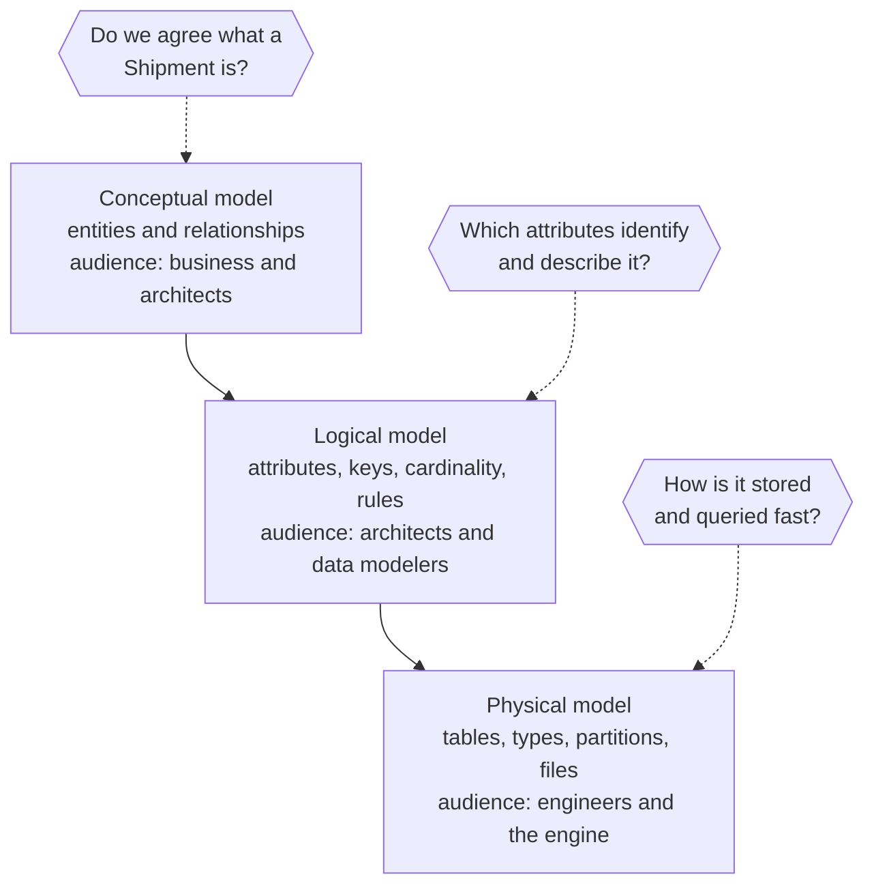
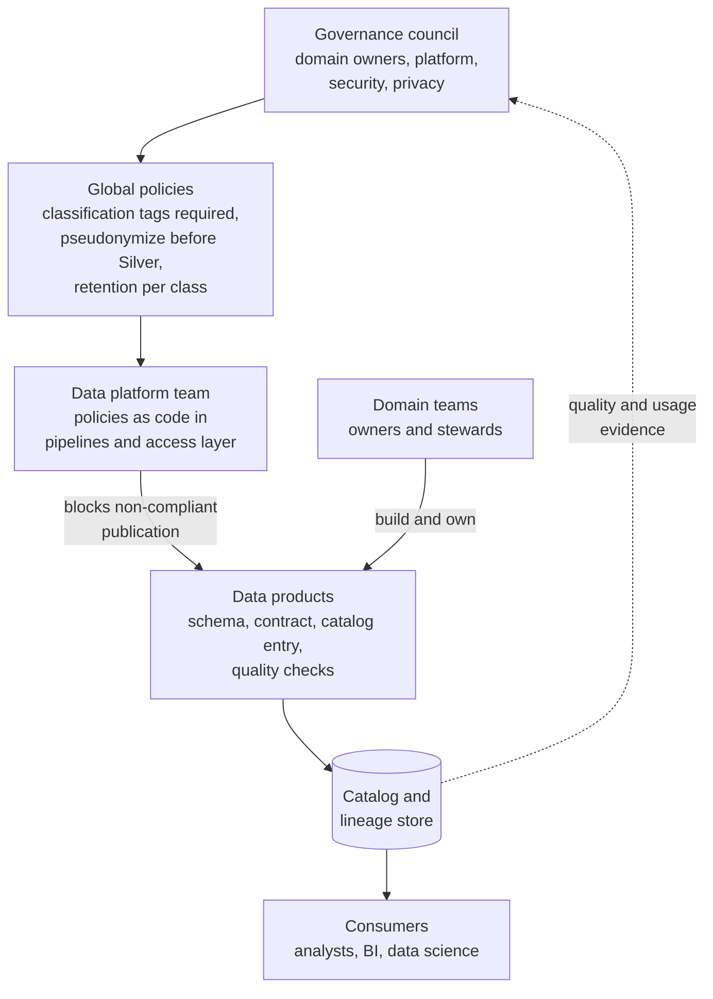
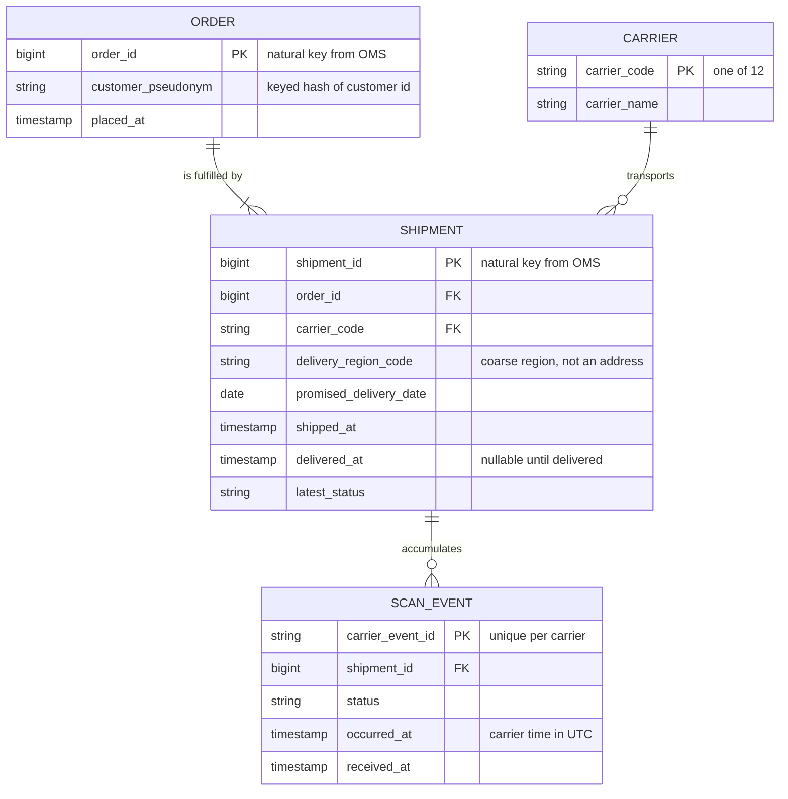
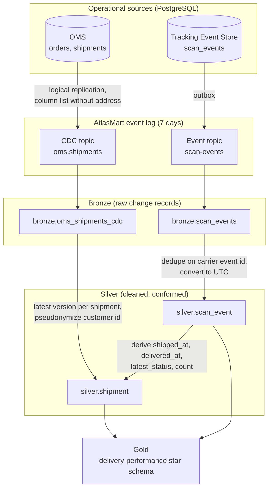

# Data modeling, metadata, and data governance

> A data platform is only as useful as people's ability to find a data set, understand what it
> means, trust that it is correct, and know whether they are allowed to use it. Data modeling gives
> data a shape, metadata describes that shape, and governance decides who answers for it.

!!! abstract "Page facts"
    **Level:** Intermediate (model levels, metadata, and quality dimensions are Level 1-2; decision
    rights, ownership models, and lifecycle design are Level 3) · **Status:** Draft ·
    **Time:** 60-75 minutes · **Last verified:** 2026-11-27

## Learning objectives

After this page you should be able to:

- Take a business entity from a conceptual model through a logical model to a physical model, and
  say which decisions belong at each level.
- Classify data as structured, semi-structured, or unstructured, and explain what each means for
  storage, validation, and querying.
- Distinguish technical, business, and operational metadata, and describe what a data catalog and
  lineage add on top of them.
- Write data-quality rules for the six common quality dimensions, with thresholds and actions, and
  explain how profiling informs them.
- Design a governance model: decision rights, policies, owners, stewards, and how policies are
  enforced by the platform rather than by meetings.
- Attach classification, lifecycle, retention, and privacy rules to an analytical data set.

## Prerequisites

- [Relational databases and SQL internals](../databases-and-storage/relational-databases-and-sql-internals.md)
  — normalization, keys, and the Tracking Event Store schema that this page builds on.
- [Data security and privacy](../security-architecture/data-security-and-privacy.md) — the
  classification scheme, pseudonymization, and the retention and deletion rules. This page applies
  them to analytical data and does not repeat them.

## The problem this solves

Operational systems are built one at a time, each with its own names and rules. When an
organization starts combining their data for analysis, three problems appear together. Nobody can
find anything: a lake holds thousands of tables whose names mean something only to the team that
created them. Nobody agrees on meaning: "delivered" in the Order Management System (OMS) is the
moment a carrier reported it, while in the finance report it is the moment the return window
started, so two dashboards show different numbers for the same week. And nobody answers for
anything: when a column goes wrong, there is no owner to ask, no record of where it came from, and
no rule about who may see it or how long it may be kept. Data modeling, metadata, and governance are
the disciplines that fix these three problems: shape, description, and accountability.

## What it is

**Data modeling** designs which entities exist, their attributes and relationships, and how they are
stored, at three levels: **conceptual**, **logical**, and **physical**. **Metadata** is data about
data (schema, meaning, owner, classification, freshness, history); a **data catalog** collects it
for every data set, and **lineage** records where each data set came from. **Data governance** is the
set of decision rights, policies, and roles that decide who owns each data set, what it means, what
**quality** it must meet, how it is **classified**, and how long it is **retained**. The DAMA Data
Management Body of Knowledge (DAMA-DMBOK) places governance at the center, coordinating the other
data management functions; this page uses that framing.

## Mental model

Think of a public library from the librarians' side. The **data model** is the shelving scheme; the
**metadata** is the catalogue card (title, author, subject, shelf mark); the **catalog** is the card
index; **lineage** is a rare-books provenance record; **governance** is the committee that decides
the scheme and who may borrow restricted volumes, and the **stewards** are the subject librarians.

**Where the analogy breaks:** books do not change after shelving and nobody copies them on the way
in. Data changes nightly, arrives in new shapes, is copied into derived tables, and may contain
personal data that must be deleted on a schedule, so its metadata has to be collected automatically
and continuously, not typed in once.

## Key terms

| Term | Meaning on this page |
|---|---|
| Conceptual model | Business entities and their relationships, with no attributes or technology |
| Logical model | Entities with attributes, keys, cardinalities, and rules, independent of any product |
| Physical model | The logical model mapped to a specific store: tables, types, partitions, file format, indexes |
| Metadata | Data that describes other data: technical, business, or operational |
| Data catalog | A searchable inventory of data sets and their metadata, including owners and classification |
| Lineage | The recorded path of data from sources through transformations to consumers |
| Data owner | The accountable person or team for a data set's meaning, quality, access, and retention |
| Data steward | The role that maintains definitions, quality rules, and catalog entries day to day |
| Data quality dimension | An aspect of quality that can be measured: completeness, validity, accuracy, consistency, uniqueness, timeliness |
| Data profiling | Computing statistics on actual data (null rates, distinct values, ranges, patterns) to discover its real shape |
| Data contract | An agreement between a data producer and its consumers on schema, meaning, quality, and freshness |
| Data classification | Giving each data element a sensitivity level that decides its handling rules (glossary definition) |
| Pseudonymization | Replacing identifiers so data cannot be linked to a person without separately kept information (glossary definition) |

## How it works

### Three levels of data model

Each level answers a different question for a different audience, and each one constrains the next.

**Figure 1 — Conceptual, logical, and physical models.** Each level adds detail and removes
choices; the audience narrows from business to engineering.



How to read it: solid arrows are refinement, dotted arrows the question each level settles. Whether
a returned parcel is a new Shipment is a conceptual question; settling it in the physical model is
expensive.

| Level | Contains | Leaves out | Typical artefact |
|---|---|---|---|
| Conceptual | Business entities, relationships, a short definition of each | Attributes, keys, data types, technology | A one-page entity diagram plus a glossary |
| Logical | Attributes, primary and natural keys, cardinality, optionality, business rules, normalization | Product-specific types, storage layout, indexes | An entity-relationship diagram with attributes |
| Physical | Tables or files, column types, nullability, partitioning, clustering, file format, indexes, constraints | Nothing: it is what the engine runs | DDL, a table-format schema, a schema registry entry |

One logical model can have several physical models: AtlasMart's shipment lives in the OMS, the
Tracking Event Store, and the lakehouse, and the logical model keeps them meaning the same thing.
Styles differ by purpose: **normalized** models for operational systems, **dimensional** models for
analytics ([OLTP vs OLAP, dimensional modeling, and BI](oltp-vs-olap-dimensional-modeling-and-bi.md)),
**Data Vault** (hubs for business keys, links for relationships, satellites for history) for
integration layers absorbing many changing sources, and **document** models for aggregates read whole.

### Structured, semi-structured, and unstructured data

| Kind | What defines it | AtlasMart examples | Consequences |
|---|---|---|---|
| Structured | A fixed schema known before writing; every record has the same typed fields | OMS orders and shipments, Tracking Event Store tables | Validated on write (schema-on-write); efficient columnar storage; SQL works directly |
| Semi-structured | Self-describing records (JSON, Avro, XML) whose fields can vary, nest, or appear over time | Carrier webhook payloads (12 carriers, 12 shapes), clickstream events | Parsed on read (schema-on-read) or validated against a schema registry; nested fields need flattening for analysis; schema drift is the main risk |
| Unstructured | No record schema; meaning is in the content | Customer support chat transcripts, product images | Stored as objects with metadata; analysis needs extraction (text, entities, embeddings) first; hard to classify automatically, so it hides personal data |

The boundary is practical: JSON with a registered schema behaves like structured data. The
architect's question is "where is the schema enforced, and by whom?" (see
[Batch, streaming, ETL/ELT, and pipelines](batch-streaming-etl-elt-and-pipelines.md)).

### Metadata: technical, business, and operational

| Kind | Answers | Examples | Usually collected by |
|---|---|---|---|
| Technical | What is its shape and where is it? | Schema, column types, partitions, file locations, table-format snapshots, row counts | Crawling stores and reading table-format metadata automatically |
| Business | What does it mean and who answers for it? | Description, glossary terms ("on-time delivery"), owner, steward, classification, retention | People, through the catalog, reviewed like code |
| Operational | What happened to it, and is it healthy? | Pipeline runs, load times, freshness, quality results, lineage events, query usage | Emitted by pipelines, schedulers, and query engines at run time |

Business metadata is scarce: machines discover a column `dlv_ts`, but only its owner can say it is
"the carrier's delivery timestamp, in UTC". Operational metadata is useful only when fresh, so
pipelines emit it. Metadata used to drive automation (alerts, access, deprecation) is called
**active metadata**.

### Data catalogs

A **data catalog** offers search by name and meaning, a glossary linked to columns, owner and
steward, classification tags, schema history, lineage, quality and freshness, usage statistics, and
access requests. The W3C Data Catalog Vocabulary (DCAT) standardizes how catalogs describe data sets.

Catalogs drift unless technical and operational metadata are harvested automatically, business
metadata lives beside the producing code (reviewed with the schema change), and publication to the
catalog is a deployment step, so no data set exists without an entry.

| Kind | Examples (names checked 2026-11-27) |
|---|---|
| Open-source catalogs | [Apache Atlas](https://atlas.apache.org/), [DataHub](https://datahubproject.io/), [OpenMetadata](https://open-metadata.org/) |
| Lineage standard and reference implementation | [OpenLineage](https://openlineage.io/docs/) (specification); [Marquez](https://marquezproject.ai/) (its reference implementation) |
| Cloud provider catalogs | [AWS Glue Data Catalog](https://docs.aws.amazon.com/glue/latest/dg/catalog-and-crawler.html); Google Cloud's [Knowledge Catalog](https://docs.cloud.google.com/dataplex/docs/catalog-overview) (formerly Dataplex Universal Catalog); Microsoft has announced the retirement of [Microsoft Purview Unified Catalog](https://learn.microsoft.com/purview/unified-catalog) data governance features in favour of Microsoft Fabric |

Catalog product names change often; check the provider's current documentation.

### Lineage

**Lineage** records, for every data set, its inputs, the job that produced it, and when. It answers
four questions architects are asked constantly: *impact* (if the OMS renames a column, which
dashboards break?), *root cause* (this number is wrong; which upstream step changed?), *compliance*
(where does customer data flow, and is every copy covered by retention?), and *trust* (is this table
derived from the system of record or from someone's spreadsheet?).

- **Table-level** lineage links data sets; **column-level** lineage links columns through
  transformations. Privacy reviews need column-level, which is harder to collect.
- **Design-time** lineage is declared in code; **runtime** lineage is emitted when jobs run, so it
  includes the ad-hoc job someone ran by hand. OpenLineage models runtime lineage as run events about
  jobs, with input and output datasets and extensible "facets" (schema, quality, and more).

### Data quality: dimensions, validation, and profiling

**Quality** means fit for the intended use, and it is measured along dimensions. The six below are
the set most commonly used in practice and in DAMA-DMBOK's discussion of data quality:

| Dimension | Question | Example rule |
|---|---|---|
| Completeness | Is everything that should be there present? | Daily scan-event count in the lakehouse matches the source within a tolerance |
| Validity | Does each value conform to its type, format, range, and reference list? | `carrier_code` is one of the 12 known carriers |
| Accuracy | Does the value match the real-world fact? | A sample of delivery timestamps agrees with carrier invoices |
| Consistency | Do related values agree, within and across data sets? | `delivered_at` is not earlier than `shipped_at` |
| Uniqueness | Is each real-world thing recorded once? | One row per `shipment_id` |
| Timeliness | Is the data available and current when needed? | Yesterday's data is complete by the agreed time |

**Validation** checks data against written rules. **Profiling** discovers what the data actually
looks like (null rates, distinct counts, ranges, frequencies, patterns). They form a loop: profile,
write rules with the owner, validate every load, re-profile to catch slow drift.

Where checks run matters as much as what they check:

1. **At the source**: database constraints (the unique carrier event ID on the
   [relational page](../databases-and-storage/relational-databases-and-sql-internals.md)).
2. **At ingestion**: schema validation sends malformed records to quarantine, not the whole load.
3. **In transformations**: rule checks per batch either block publication or raise a warning.
4. **At publication**: a quality gate decides whether a new table version becomes visible; open
   table formats make this cheap (write the snapshot, check it, then commit; see
   [Big data processing engines and table formats](big-data-processing-engines-and-table-formats.md)).
5. **In monitoring**: freshness, volume, and distribution alerts catch what no rule anticipated.

Every rule needs a **threshold** and an **action**. A rule without a threshold produces arguments; a
rule without an action produces ignored dashboards.

### Ownership and governance

Governance assigns **decision rights**: who decides what a data set means, who may change its schema,
who may access it, what quality it must meet, and how long it is kept. Three roles recur, whatever
the organization calls them:

| Role | Accountable for | AtlasMart example |
|---|---|---|
| Data owner | Meaning, quality targets, access approval, and retention of a data set; usually a product or domain lead | Order Tracking team lead for shipment and scan-event data |
| Data steward | Definitions, glossary entries, quality rules, catalog accuracy, answering consumer questions | A delivery-operations data steward role inside that team |
| Data custodian (platform) | Running the storage, pipelines, access enforcement, backups, and deletion jobs | The central data platform team (4 engineers) |

**Centralized** governance (one data team owns everything) is consistent but becomes a bottleneck
far from the people who understand the data. **Federated** governance, in the data mesh principles,
gives domains ownership of their data products under a few global policies that the platform
enforces as code: **federated computational governance**. The organizational trade-offs are on
[Warehouses, lakes, lakehouses, and data mesh](warehouses-lakes-lakehouses-and-data-mesh.md).

**Figure 2 — A federated governance operating model.** A council sets few global policies; the
platform enforces them as code; domains own their data products within them.



How to read it: the council decides little; domain teams decide most. A data product without a
classification tag or owner fails deployment, as code without tests fails CI. The dotted arrow is the
feedback loop. Decisions are recorded as for architecture (see
[Trade-offs, principles, ADRs, and architecture governance](../architecture-fundamentals/trade-offs-principles-adrs-and-architecture-governance.md)).
A **data contract** is the data-product equivalent of an API contract: schema, semantics, quality
checks, and freshness, with breaking changes versioned and announced.

### Classification, lifecycle, retention, and privacy

The classification levels, pseudonymization, and deletion mechanics are defined on
[Data security and privacy](../security-architecture/data-security-and-privacy.md); this page adds
where they attach in a data platform, where every copy needs the original's answers:

- **Classification travels as metadata.** Derived columns inherit the highest tag of their inputs
  unless a reviewed transformation (aggregation that removes identifiers) lowers it; column-level
  lineage makes inheritance automatic.
- **Lifecycle per layer.** Raw layers keep data briefly for reprocessing, cleaned layers for the
  purpose's retention period, and aggregates that no longer identify people can be kept longer.
- **Privacy by design in the pipeline.** Minimize at extraction, pseudonymize early, and keep the
  pseudonymization key with the data owner. Pseudonymized data is still personal data.
- **Deletion is a pipeline.** Scheduled jobs delete rows in every layer that holds them; lineage
  tells you which layers those are.

## Worked example: AtlasMart's shipment entity, from model to governed data product

AtlasMart's lakehouse (Phase 5 data-platform assumptions) sits in the EU region with an open table
format and Bronze, Silver, and Gold layers; the OMS publishes changes by PostgreSQL logical
replication into the AtlasMart event log (Kafka-compatible, 7-day retention). Order Tracking publishes
processed scans to a `scan-events` topic through an outbox in the Tracking Event Store, an explicit
event contract rather than raw table changes (see the
[real-time analytics exercise](../system-design-exercises/real-time-analytics.md)).

### Conceptual model

The logistics, finance, and tracking teams agreed on five entities and one disputed definition:

- A **Customer** places **Orders**; an **Order** is fulfilled by one or more **Shipments** (AtlasMart
  averages one parcel per order, but split orders exist); a **Carrier** transports a Shipment; a
  Shipment accumulates **Scan Events**.
- **Definition settled here:** a Shipment is *delivered* when its carrier reports a delivery scan,
  not when the customer confirms receipt. A returned parcel is a new Shipment, not a state of the old
  one.

### Logical model

**Figure 3 — Logical model of the shipment in Silver.** The Customer is represented only by a
pseudonym; addresses are absent by design (NFR-6 and minimization).



How to read it: crow's-foot ends mark the "many" side; `||--|{` means at least one. New assumptions:
the OMS stores a coarse `delivery_region_code` (never an address) and a `promised_delivery_date`.

### Physical model

Silver stores `silver.shipment` as one wide table (order attributes copied in, a deliberate
denormalization) beside `silver.scan_event`.

| Column | Physical type | Null? | Derived from | Classification |
|---|---|---|---|---|
| `shipment_id` | bigint | No | OMS `shipments.shipment_id` | Confidential (pseudonymous, linkable via OMS) |
| `order_id` | bigint | No | OMS | Confidential |
| `customer_pseudonym` | string (64 hex) | No | Keyed hash of OMS `orders.customer_id`, computed Bronze to Silver | Confidential (still personal data) |
| `carrier_code` | string | No | OMS, normalized to upper case | Internal |
| `delivery_region_code` | string | No | OMS | Internal |
| `promised_delivery_date` | date | No | OMS | Internal |
| `shipped_at`, `delivered_at` | timestamp (UTC) | `delivered_at` yes | Earliest scan with status `picked_up` / `delivered` | Confidential (with the row) |
| `latest_status` | string | No | Status of the newest scan by `occurred_at` | Confidential (with the row) |
| `scan_event_count` | int | No | Count of scans | Internal |
| `_source_lsn`, `_ingested_at` | bigint, timestamp | No | CDC metadata | Internal |

- **Partitioned by month of `shipped_at`:** 60,000 × 30 = 1.8 million rows a month; daily partitions
  would produce many small files.
- **Minimized at extraction:** the OMS publication uses a PostgreSQL column list, so address columns
  never reach the event log or Bronze.
- **Steady-state size.** Rows live about 5 days in transit plus 180 days after delivery (the retention
  rule below), so about 185 × 60,000 = **11.1 million rows**, small for a lakehouse table.

### Catalog entry

The entry lives as YAML in the Order Tracking team's repository and is published by the deployment
pipeline (values are AtlasMart assumptions):

```yaml
name: silver.shipment
description: >-
  One row per shipment with current status and milestones, merged from the OMS
  and the Tracking Event Store. "Delivered" means the carrier's delivery scan.
domain: order-fulfilment
owner: order-tracking-team            # data owner (accountable)
steward: delivery-ops-data-steward    # a role, not a person's name
custodian: data-platform-team
classification: Confidential          # pseudonymous personal data
retention: 180 days after delivered_at, or after the shipment is closed as lost
freshness_slo: complete up to 00:00 of the run day by 16:00
upstream: [bronze.oms_shipments_cdc, silver.scan_event]
quality_checks: [Q1-unique-shipment, Q2-valid-carrier-and-dates, Q3-scan-event-reconciliation]
contract_version: 2
```

The freshness target is the nightly batch's existing 16:00 deadline, stated as a deadline because
the batch may move for carbon-aware scheduling ([sustainability page](../finops-and-sustainability/sustainable-and-carbon-aware-architecture.md)).

### Lineage from the OMS and the Tracking Event Store into Silver

**Figure 4 — Lineage of `silver.shipment`.** Two operational sources, two change-data-capture
streams, two Bronze tables, and the transformations that join them.



How to read it: arrows point downstream; each label is a recorded transformation. Column-level
lineage from `customer_pseudonym` to `orders.customer_id` through the hashing step lets a privacy
review confirm no raw identifier reaches Silver. Each job emits OpenLineage-style run events (inputs,
outputs, row counts, quality results), so the catalog shows which run produced today's version. The
Gold star schema is the worked example on [OLTP vs OLAP, dimensional modeling, and BI](oltp-vs-olap-dimensional-modeling-and-bi.md).

### Profiling the first load

The steward profiled one week of `silver.shipment` before writing rules (illustrative findings):

| Profile statistic | Finding (illustrative) | Consequence |
|---|---|---|
| Distinct `carrier_code` | 13 values for 12 carriers: one carrier sends lower case | Normalize to upper case in the transform; validity rule Q2 |
| Null rate of `delivered_at` | High for shipments under 5 days old, near zero after | Expected; completeness rules must not demand `delivered_at` for recent rows |
| `delivered_at` earlier than `shipped_at` | A small number of rows from one carrier | Carrier sends local time without offset; convert to UTC in Bronze to Silver; consistency rule Q2 |
| Rows per `shipment_id` | A few duplicates after a replication restart | CDC is at-least-once; merge on `_source_lsn`; uniqueness rule Q1 |

### Three data-quality checks

Thresholds and actions are AtlasMart assumptions recorded in the data contract.

| Check | Dimension | Rule | Threshold (assumption) | Action |
|---|---|---|---|---|
| Q1 | Uniqueness | Exactly one row per `shipment_id` in the new snapshot | 0 duplicates | Block publication; the previous snapshot stays visible |
| Q2 | Validity and consistency | For shipments with `shipped_at` on the processed day: `carrier_code` in the 12-carrier reference list, and `delivered_at` is null or not earlier than `shipped_at` | Warn above 0.1% failing rows (60 of about 60,000); block above 1% (600) | Warn: publish and open a ticket for the steward. Block: hold the snapshot and page the owner during working hours |
| Q3 | Completeness (reconciliation) | Count of scan events received on day D in `silver.scan_event` versus the count in the Tracking Event Store (queried on its read replica) | Warn above 0.1% difference (480 of 480,000); block above 1% (4,800) | Same as Q2 |

Q1 blocks at zero because a duplicate would double count deliveries in Gold. Q3 compares with the
system of record, not yesterday's volume, because a drop could be a real carrier outage. Checks run on
the day's new data, so their cost grows with daily volume, not retention.

### Retention, lifecycle, and privacy per layer

| Layer | Holds | Retention | Basis |
|---|---|---|---|
| Event log CDC topics | Change records, including `customer_id` | 7 days | Event-log baseline |
| Bronze CDC tables | Raw change records, including `customer_id` | 90 days (assumption on this page, aligned with raw clickstream) | Reprocessing after a transform bug |
| Silver `shipment`, `scan_event` | Pseudonymous, per shipment | 180 days after delivery | Same rule as the Tracking Event Store (data security page) |
| Gold aggregates without identifiers | Counts and rates per carrier, region, day | 25 months | Year-over-year comparison; no personal data after aggregation |

Bronze, holding the raw customer ID, is restricted to pipeline identities and the platform team.
The pseudonymization key sits in the KMS under the Order Tracking owner (assumption), so Silver users
cannot reverse pseudonyms. Erasure computes the customer's pseudonym once and deletes matching Silver
and shipment-level Gold rows; Bronze ages out within 90 days; the deletion ledger covers restores.

## Real-world architecture example

Organizations that have been through one failed "data lake" often rebuild as a **catalog-first
platform**: the deployment pipeline refuses any data set without an owner, a classification for every
column, a retention rule, and at least one quality check. Lineage is emitted by the orchestrator as
OpenLineage-style events, access is granted by tag rather than per-table grants, and a small council
owns about a dozen global policies and reviews quality and usage evidence quarterly. The result is
not perfect metadata; it is metadata that cannot silently go missing.

## Design choices and trade-offs

| Choice | Favor when | Avoid when |
|---|---|---|
| Explicit conceptual model and glossary | Several teams use the same entity and have disagreed about meaning | A single team owns the data end to end and no one else consumes it |
| Normalized integration layer (3NF or Data Vault) | Many sources with changing schemas must be integrated and audited | A few stable sources feed a few well-known analyses; go straight to dimensional |
| Schema-on-write validation | Consumers need guaranteed shape; bad records must not reach them | Exploration of new semi-structured sources where the schema is not yet known |
| Centralized governance | A small organization, one data team, strict regulation, little domain expertise outside it | Many domains with deep local knowledge; the central team becomes the bottleneck |
| Federated governance with policies as code | Many domains and a platform team able to automate policy checks | No platform automation exists; federation without enforcement becomes inconsistency |
| Column-level lineage | Privacy reviews, impact analysis on wide tables, regulated reporting | Small platforms where table-level lineage answers every question asked |
| Blocking quality gates | Downstream consumers make decisions automatically from the data | Exploratory data where a late warning is better than missing data |
| Early pseudonymization (before Silver) | Most consumers need per-person patterns, not identities | A use case truly needs identities; give it a separate, tightly controlled path |

## Failure modes and anti-patterns

- **The catalog graveyard.** Entries typed in once and never updated. Detect: entries whose schema
  differs from the table, owners who have left. Prevent: harvest technical metadata automatically and
  keep business metadata in the producing repository, published by the pipeline.
- **Two definitions, one name.** "Delivered" or "active customer" computed differently in two
  dashboards. Detect: reconciliation between reports disagrees. Prevent: the definition lives in the
  conceptual model and glossary, and certified metrics are computed once.
- **Ownerless data sets.** Tables created by people who have moved on. Detect: catalog entries with no
  owner or no queries for months. Prevent: owner is a required field; unowned data sets are deprecated
  on a schedule.
- **Quality rules without thresholds or actions.** A dashboard of red checks nobody acts on. Prevent:
  every rule has a threshold, an action, and a recipient.
- **Silent schema drift.** A carrier adds a nested field or changes a type; the pipeline coerces it to
  null. Detect: profiling shows a rising null rate. Prevent: schema validation at ingestion with a
  quarantine path.
- **Personal data in derived tables.** A Gold table built by an analyst copies `customer_pseudonym` and
  is kept for 25 months. Detect: column-level lineage and tag inheritance flag it. Prevent: Gold
  retention is checked against the highest tag of its inputs at deployment.
- **Governance as a committee.** Every schema change waits for a monthly meeting. Prevent: decision
  rights sit with domain owners; the council decides only global policies.

## Security considerations

- **The catalog is sensitive.** Column names, sample values, and lineage reveal what data exists and
  where it flows. Disable sample-value previews for Confidential columns and apply access control to
  the catalog itself.
- **Access follows classification tags.** Attribute-based access control on tags scales better than
  per-table grants; the tag must be correct, so tag changes are reviewed like code (see
  [Identity and access management](../security-architecture/identity-and-access-management.md)).
- **Raw layers are the highest-risk copy, and pseudonymization keys stay with the owner.** Bronze
  holds unpseudonymized identifiers; if analysts hold the key, pseudonymization is cosmetic.
- **Lineage is audit evidence.** Runtime lineage events should be written to an append-only store, so
  that a question such as "who copied this table, and when" can be answered.

## Performance, reliability, and cost

- **Performance:** metadata harvesting and lineage emission are small compared with the data work,
  but catalog crawlers that scan storage can be expensive on large lakes; prefer reading table-format
  metadata over listing files.
- **Reliability:** the catalog and policy engine become dependencies of publication. Decide
  deliberately: publication checks should fail closed (no tag, no publish), while consumer reads
  should not depend on the catalog being up.
- **Cost:** quality checks cost compute. Scoping checks to the day's new data keeps them proportional
  to daily volume. Illustrative arithmetic: if the checks add 10% (assumption) to the 64 vCPU-hour
  nightly batch, that is 6.4 vCPU-hours, or 6.4 CU a night at the illustrative 1 vCPU-hour = 1 CU
  rate, about 192 CU over a 30-day month. Shorter retention in Bronze and Silver is the largest
  storage lever and also reduces breach impact.

## Hands-on lab: profile, check, and trace a small shipment table

This page has no dedicated lab page in this batch. The mini-lab runs locally with Python's
standard-library `sqlite3` module.

1. Create a `shipment` table with the columns from the physical model above and insert about 1,000
   rows generated with a seeded random generator. Deliberately inject defects: three duplicate
   `shipment_id` values, ten lower-case carrier codes, and five rows where `delivered_at` is earlier
   than `shipped_at`.
2. Profile the table with SQL: row count, distinct `carrier_code`, null rate of `delivered_at`, and
   minimum and maximum `shipped_at`. Write down which defects the profile reveals and which it does
   not.
3. Implement Q1 and Q2 as SQL queries that return failing-row counts, and a small Python function
   that compares each count with its warn and block thresholds and prints `pass`, `warn`, or `block`.
4. Write the catalog entry for your table as YAML and load it with PyYAML; fail the script if
   `owner`, `classification`, or `retention` is missing.
5. Represent lineage as a list of `(upstream, downstream)` pairs from Figure 4, and write a function
   that returns every data set downstream of `bronze.oms_shipments_cdc`. Use it to answer "what must
   a deletion job touch?"

??? question "Hint: which defects does profiling miss?"
    Profiling shows 13 distinct carrier codes and a minimum `delivered_at` gap below zero, so it
    surfaces the case and time-zone defects. Duplicates are easy to miss in a profile unless you
    compare the row count with the count of distinct `shipment_id`; that comparison is exactly the
    uniqueness rule Q1. Profiling suggests rules; it does not replace them.

## Knowledge check

1. At which model level should "is a returned parcel a new shipment?" be settled, and why is settling
   it at the physical level expensive?
2. Give one example each of technical, business, and operational metadata for `silver.shipment`, and
   say which is hardest to keep current without automation.
3. Why does Q3 reconcile against the Tracking Event Store instead of comparing with yesterday's
   volume in the lakehouse?
4. What is the difference between a data owner and a data custodian, and who approves access to
   `silver.shipment`?
5. An analyst builds a Gold table that includes `customer_pseudonym` and sets retention to 25 months.
   Which rule does that break, and which metadata lets the platform catch it automatically?

??? success "Answers"
    1. The conceptual level: it is a question of business meaning that every system must agree on.
       Settled late, it requires changing keys, history, and reports in several physical models.
    2. Technical: the column types and partition column. Business: the definition of "delivered" and
       the owner. Operational: last night's run time, row count, and quality results. Operational
       metadata changes daily and is useless unless emitted automatically; business metadata is the
       hardest to obtain at all.
    3. A volume drop could be real (a carrier outage), so comparing with yesterday cannot tell "the
       pipeline lost data" from "less happened". The system of record is the ground truth for
       completeness.
    4. The owner is accountable for meaning, quality, access, and retention; the custodian (the data
       platform team) runs the storage and enforces the rules. The owner (Order Tracking team)
       approves access; the platform enforces it.
    5. A pseudonym is still personal data, so the table inherits Silver's 180-days-after-delivery
       retention. Column-level lineage plus tag inheritance marks the Gold column Confidential, and a
       deployment check compares the declared retention with the class.

## Architecture discussion questions

1. The finance team wants "delivered" to mean "customer confirmed receipt" for revenue recognition.
   Do you change the shipment's definition, add a second attribute, or create a second entity? Who
   decides, and how is the decision recorded?
2. The data platform team proposes moving AtlasMart from centralized to federated governance. What
   must the platform automate first, and what would you measure after six months to know it worked?
3. Bronze keeps raw CDC records for 90 days, but Silver keeps shipments for up to 185 days. What can
   and cannot be rebuilt after a transform bug discovered on day 120, and is that acceptable?

## Summary

Data modeling works at three levels: conceptual models settle meaning across teams, logical models
fix attributes, keys, and rules, and physical models map them to tables, partitions, and files.
Structured, semi-structured, and unstructured data differ mainly in where the schema is enforced.
Metadata is technical, business, or operational; catalogs collect it, and lineage records how each
data set was produced for impact, root-cause, and privacy analysis. Quality is measured along six
dimensions; profiling discovers the real shape and validation enforces rules with thresholds and
actions. Governance assigns decision rights to owners, stewards, and custodians;
federated governance works when the platform enforces global policies as code. Classification,
lifecycle, retention, and privacy rules attach to every layer, and lineage shows which layers a
deletion must reach.

## Related topics

- **Before:** [Relational databases and SQL internals](../databases-and-storage/relational-databases-and-sql-internals.md);
  [Data security and privacy](../security-architecture/data-security-and-privacy.md)
- **Alongside:** [OLTP vs OLAP, dimensional modeling, and BI](oltp-vs-olap-dimensional-modeling-and-bi.md)
  — the Gold star schema built from this entity;
  [Batch, streaming, ETL/ELT, and pipelines](batch-streaming-etl-elt-and-pipelines.md) — CDC,
  validation, and schema evolution in the pipelines;
  [Warehouses, lakes, lakehouses, and data mesh](warehouses-lakes-lakehouses-and-data-mesh.md) —
  medallion layers and data mesh ownership;
  [Big data processing engines and table formats](big-data-processing-engines-and-table-formats.md)
  — snapshots that make publication gates cheap;
  [Trade-offs, principles, ADRs, and architecture governance](../architecture-fundamentals/trade-offs-principles-adrs-and-architecture-governance.md).
- **Planned:** data governance for AI training data and feature stores (D19-D25, Phases 6-7).

## References

| Source | Type | Checked |
|---|---|---|
| [DAMA Data Management Body of Knowledge (DAMA-DMBOK)](https://dama.org/learning-resources/dama-data-management-body-of-knowledge-dmbok/) — DAMA International | Professional body of knowledge (governance, metadata, data quality) | 2026-11-27 |
| [OpenLineage object model](https://openlineage.io/docs/spec/object-model) — OpenLineage project | Open specification (runtime and design lineage, jobs, runs, datasets, facets) | 2026-11-27 |
| [Data Catalog Vocabulary (DCAT) Version 3](https://www.w3.org/TR/vocab-dcat-3/) — W3C | Standard (describing data sets in catalogs) | 2026-11-27 |
| Zhamak Dehghani, [Data Mesh Principles and Logical Architecture](https://martinfowler.com/articles/data-mesh-principles.html) — martinfowler.com | Article (domain ownership, data as a product, federated computational governance) | 2026-11-27 |
| [PostgreSQL documentation: Logical replication column lists](https://www.postgresql.org/docs/current/logical-replication-col-lists.html) | Official documentation (minimizing replicated columns) | 2026-11-27 |
| [Apache Atlas](https://atlas.apache.org/) — Apache Software Foundation | Open-source project (metadata and governance framework) | 2026-11-27 |
| Martin Kleppmann, *Designing Data-Intensive Applications* (O'Reilly, 2017), chapter 2 (data models) and chapter 4 (encoding and schema evolution) | Book | 2026-11-27 |
| Joe Reis and Matt Housley, *Fundamentals of Data Engineering* (O'Reilly, 2022), chapter 2 (the lifecycle and its undercurrents, including data management) | Book | 2026-11-27 |

## Review notes

- Canonical page for D07-T01. In depth: the three model levels, structured/semi-structured/
  unstructured data, metadata kinds, catalogs, lineage, quality dimensions with validation and
  profiling, ownership and governance roles, and how classification and retention attach to
  analytical layers. Defined only (a paragraph or table row): Data Vault and document modeling
  styles, active metadata, data contracts, accuracy checking. Privacy,
  classification levels, and deletion mechanics are linked to the data security page and not repeated.
- The six quality dimensions are presented as common practice; DAMA-DMBOK discusses them among
  others, and the exact list varies by source. A reviewer may cite a specific edition and chapter.
- Product names in the catalog table were checked on 2026-11-27 on each linked page. Google Cloud's
  page now titles the product "Knowledge Catalog (formerly Dataplex Universal Catalog)"; Microsoft's
  page states that Unified Catalog and classic Purview data governance capabilities are being retired
  in favour of Microsoft Fabric. Both are recent changes; re-check before publishing as Reviewed.
- The EUR-Lex GDPR link used on the data security page returned HTTP 202 to a scripted check today, so
  GDPR is referenced through that page rather than cited here.
- AtlasMart sources: the OMS publishes by logical replication; Order Tracking publishes processed scans
  to a `scan-events` topic through an outbox (shared with the real-time analytics exercise). New
  assumptions: the OMS stores `delivery_region_code` and `promised_delivery_date`;
  `silver.shipment` owned by the Order Tracking team with a steward role; Bronze CDC retention 90 days;
  freshness target "complete up to 00:00 by 16:00"; quality thresholds (Q1 0 duplicates; Q2 and Q3
  warn at 0.1%, block at 1%); quality checks adding 10% to the nightly batch. Arithmetic:
  60,000 × 30 = 1.8 M rows a month; 185 × 60,000 = 11.1 M rows; 0.1% and 1% of 60,000 = 60 and 600;
  of 480,000 = 480 and 4,800; 64 × 10% = 6.4 CU a night, × 30 = 192 CU.
- Profiling findings in the worked example are illustrative, not measured.
