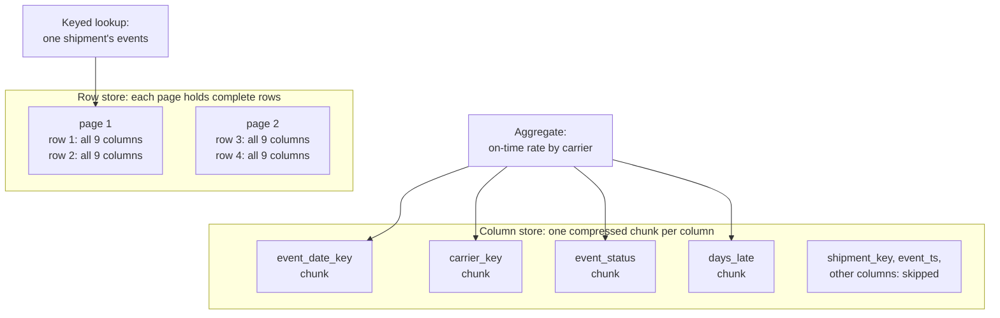
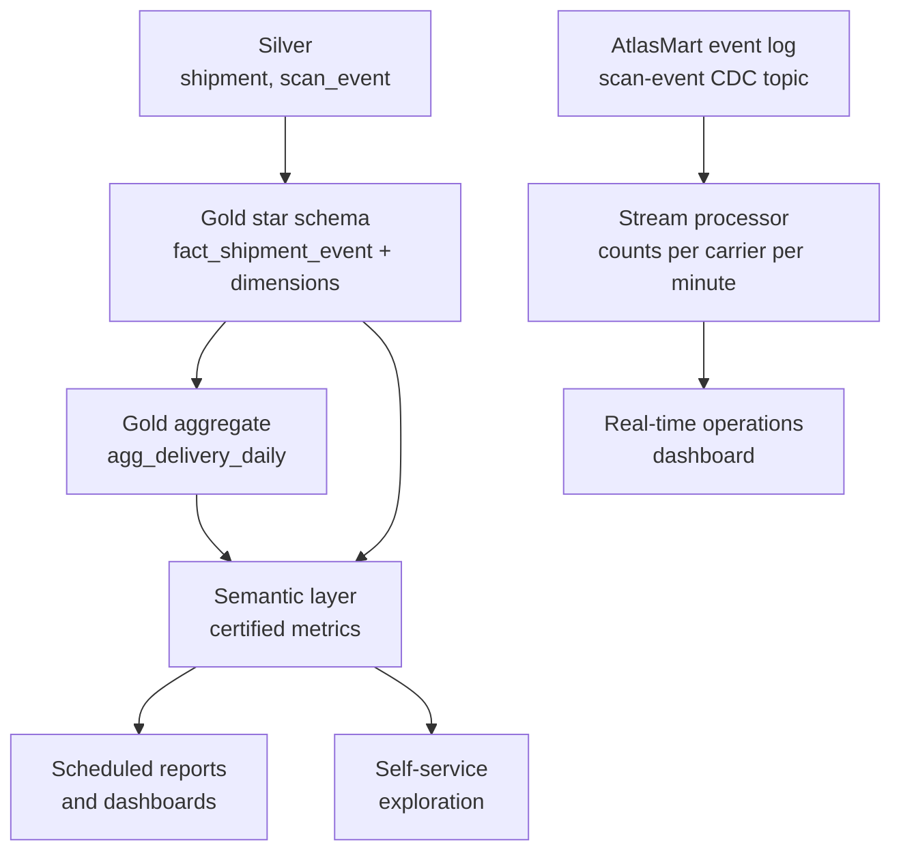
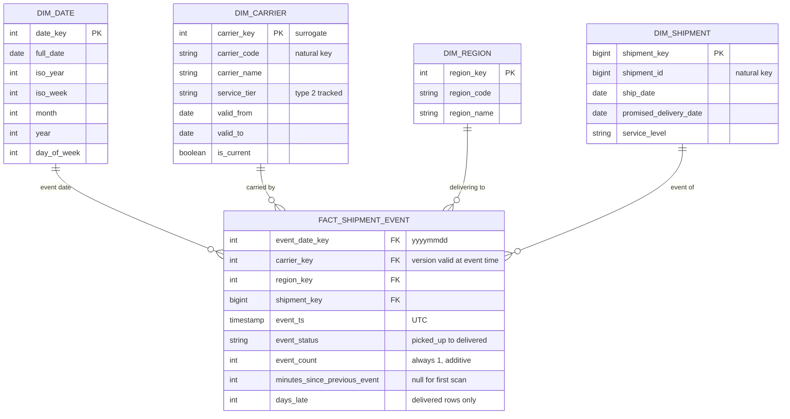
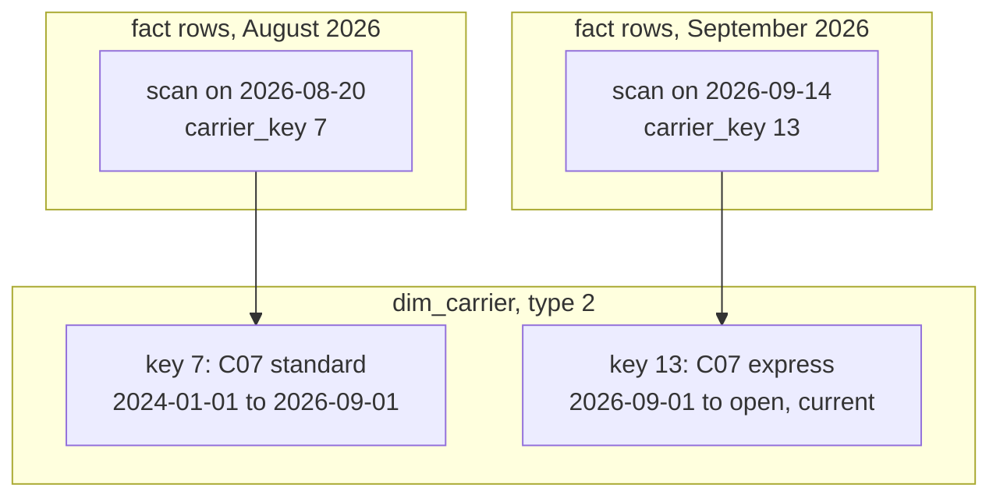

# OLTP vs OLAP, dimensional modeling, and BI

> Transactional systems answer "what is true now, for this one thing?" thousands of times a second.
> Analytical systems answer "what happened, across everything, and why?" a few times a minute. The
> two workloads want opposite storage layouts and opposite schemas, and dimensional modeling is the
> schema design that makes the analytical side understandable and fast.

!!! abstract "Page facts"
    **Level:** Intermediate (workload shapes, star schemas, and analytics types are Level 1-2; grain
    choice, slowly changing dimensions, and serving architecture are Level 3) · **Status:** Draft ·
    **Time:** 60-75 minutes · **Last verified:** 2026-11-27

## Learning objectives

After this page you should be able to:

- Contrast online transaction processing (OLTP) and online analytical processing (OLAP) workloads,
  and explain why column storage serves analytical queries and row storage serves transactions.
- Design a star schema with the four-step dimensional design process: business process, grain,
  dimensions, facts.
- Choose between star and snowflake schemas, and between transaction, periodic snapshot, and
  accumulating snapshot fact tables.
- Implement slowly changing dimensions of types 1, 2, and 3, and explain what each does to historical
  reports.
- Size a fact table from event rates and estimate how much data an analytical query reads.
- Place BI, reporting, self-service analytics, and real-time dashboards in an architecture, and
  distinguish descriptive, diagnostic, predictive, and prescriptive analytics.

## Prerequisites

- [Relational databases and SQL internals](../databases-and-storage/relational-databases-and-sql-internals.md)
  — normalization, B-tree indexes, and the Tracking Event Store, the OLTP side of this page.
- [Data modeling, metadata, and data governance](data-modeling-metadata-and-data-governance.md) —
  the three model levels, the `silver.shipment` entity this page builds on, and retention per layer.

## The problem this solves

AtlasMart's logistics team asks every week: "which carriers delivered late, in which regions?" The
first answer was a query on the Tracking Event Store's primary that joined four normalized tables and
scanned weeks of events for minutes while the database served the Tracking API at its p95 300 ms
target (NFR-3). The read replica protected customers but not analysts: every question needed someone
who knew the operational schema, two analysts computed "late" differently, and history vanished when
carrier attributes were updated in place. OLAP storage and dimensional modeling serve analysis
without hurting transactions.

## What it is

**OLTP** is the operational workload: many short transactions reading or writing a few rows by key.
**OLAP** is the analytical workload: fewer, larger queries that scan many rows, read a few columns,
and aggregate them, over historical data that is loaded rather than updated in place.

**Dimensional modeling**, as developed and documented by Ralph Kimball and the Kimball Group,
organizes analytical data into **fact tables** (measurements of a business process, at a declared
**grain**) and **dimension tables** (the descriptive context used to filter and group those
measurements). Arranged with the fact in the middle and dimensions around it, the result is a
**star schema**.

**Business intelligence (BI)** is the set of tools and practices that turn that data into reports,
dashboards, and answers for decision makers, including **self-service analytics**, where business
users explore governed data without writing pipelines.

## Mental model

Think of a supermarket. The **checkout** is OLTP: one basket at a time, scanned correctly, queue
moving. The **head office sales review** is OLAP: every receipt line for a year, but only product,
store, and amount, summed and compared. The **fact table** is the pile of receipt lines; the
**dimensions** are the labels you sort it by; the **grain** is the decision that each fact is one
receipt line, not one receipt or one day's total.

**Where the analogy breaks:** receipts never change, but dimension attributes do (a store moves to
another sales region), and the model must decide whether last year's sales move with it: the
slowly-changing-dimension problem. And the analytical copy lags the till, so every report states
its freshness.

## Key terms

| Term | Meaning on this page |
|---|---|
| OLTP | Online transaction processing: short, keyed reads and writes with strict correctness |
| OLAP | Online analytical processing: large scans and aggregations over many rows and few columns |
| Row store / column store | Storage that keeps each row's values together / each column's values together |
| Fact table | A table of measurements of a business process, one row per event or state at the declared grain |
| Dimension table | A table of descriptive attributes (who, what, where, when) used to filter and group facts |
| Grain | The exact meaning of one fact row, stated in business terms |
| Surrogate key | A meaningless integer key assigned by the warehouse, used instead of the source's natural key |
| Star / snowflake schema | Facts joined directly to denormalized dimensions / dimensions further normalized into sub-tables |
| Slowly changing dimension (SCD) | A technique for handling changes to dimension attributes over time (types 1, 2, 3 and hybrids) |
| Conformed dimension | A dimension with the same keys and meanings shared by several fact tables |
| Semantic layer | A governed layer that defines business metrics and joins once, for all BI tools |
| Normalization / denormalization | As in the glossary; dimensional models denormalize dimensions on purpose |

## How it works

### OLTP and OLAP workload shapes

| Property | OLTP (Tracking Event Store) | OLAP (delivery-performance analytics) |
|---|---|---|
| Typical query | "Status of shipment 512001" | "On-time rate by carrier and region for four weeks" |
| Rows touched per query | One to tens, found by key | Millions, filtered by time range |
| Columns touched | Most columns of those rows | A few of many columns |
| Writes | Continuous single-row inserts and updates | Bulk loads or appends; updates rare |
| Concurrency | Hundreds of short transactions | Tens of long queries |
| Latency target | Milliseconds (NFR-3: p95 300 ms end to end) | Seconds to minutes |
| Schema | Normalized, to keep each fact in one place | Dimensional, to make questions easy and joins few |
| History | Current state; old rows deleted on schedule | History kept for trends, within retention |
| Storage layout | Row-oriented with B-tree indexes | Column-oriented, compressed, partitioned |

Running OLAP queries on an OLTP primary competes for the same CPU, memory, and disk, and long scans
evict the cached pages that keyed queries rely on. A read replica isolates the load but keeps the
wrong layout and schema. That is why analytical data is copied out, by change data capture (CDC) or
batch extraction, into a store built for scanning.

### Row versus column storage

A **row store** writes all of a row's columns next to each other in a page. Reading one row costs one
page read, and inserting one row writes one place: ideal for OLTP. A **column store** writes each
column's values together, in chunks of many rows. A query that needs five of nine columns reads only
those five, and values of one column are similar to each other, so they compress well (dictionary
encoding for low-cardinality strings, run-length encoding for sorted or repetitive values). Engines
then process a chunk of a column at a time (**vectorized execution**), which uses CPU caches well.
Single-row writes touch every column's storage, so column stores batch writes. The C-Store paper
(VLDB 2005) set out the design; Apache Parquet brings the layout to data lakes.

**Figure 1 — The same fact rows in a row store and a column store.** A keyed lookup wants whole rows;
an aggregate wants a few whole columns.



How to read it: arrows show what each query reads. The lookup reads every column of a few rows; the
aggregate reads a few columns end to end. Engines also skip whole partitions outside the filter
(**partition pruning**) and chunks whose **min/max statistics** cannot match, so partition and sort
by the columns most queries filter on.

### Analytical queries and aggregation

Analytical SQL is mostly filter, join to dimensions, group, and aggregate. Beyond `GROUP BY` with
`COUNT`, `SUM`, and `AVG`, the features architects should know exist are:

- **`ROLLUP`, `CUBE`, and `GROUPING SETS`**: several subtotal levels in one pass (documented in the
  PostgreSQL manual and supported by most analytical engines).
- **Window functions**: per-row values from related rows (running totals, rank within a region, time
  between consecutive scans).
- **Approximate aggregates**: sketches such as HyperLogLog trade a small bounded error in distinct
  counts for far less memory.
- **Pre-aggregation**: materialized views or aggregate tables at a coarser grain. An **OLAP cube**
  precomputes measures across dimension combinations, in its own format (MOLAP) or from a star schema
  (ROLAP). Column stores often make full cubes unnecessary; aggregate tables remain the main lever
  for dashboard cost and latency.

**Additivity** decides which aggregates are safe. **Additive** measures (event count) sum across
every dimension. **Semi-additive** ones (shipments in transit at day end) sum across carriers but not
time; take the last value or an average. **Non-additive** ones (on-time rate) are computed from
additive parts, never summed or averaged across groups of different sizes.

### Dimensional modeling: the four-step design

The Kimball Group describes dimensional design as four decisions taken in order:

1. **Select the business process**: a measurable activity ("carriers scan parcels"), not a report.
2. **Declare the grain**: what one fact row means, before choosing columns. The finest available
   grain is the usual default, because coarser answers can be aggregated from it.
3. **Identify the dimensions**: the context true at that grain (when, which carrier, where, which
   shipment).
4. **Identify the facts**: measurements true at that grain; others belong in another fact table.

Three fact table types follow from the grain:

| Type | One row per | Updated? | AtlasMart example |
|---|---|---|---|
| Transaction | Event at a point in time | No, insert only | One row per carrier scan event |
| Periodic snapshot | Entity per regular period | No, a new row each period | Shipments in transit per carrier per day |
| Accumulating snapshot | Entity whose process has defined milestones | Yes, as milestones occur | One row per shipment with picked-up, out-for-delivery, and delivered dates |

Dimensions use **surrogate keys** so history can be versioned (type 2), sources merged, and joins
kept narrow. An identifier with no other attributes can stay on the fact as a **degenerate
dimension**. Dimensions shared with identical keys and meanings are **conformed**; the Kimball **bus
matrix** lists business processes against them to plan a warehouse incrementally.

### Star versus snowflake schemas

| Aspect | Star schema | Snowflake schema |
|---|---|---|
| Dimension structure | One denormalized table per dimension (carrier name, tier, and country in one row) | Dimensions normalized into sub-tables (carrier references a carrier-group table) |
| Joins per query | One per dimension | More, through the hierarchy |
| Ease for analysts and BI tools | Highest: what you see is what you filter | Lower: more tables to understand |
| Storage | Repeats descriptive values in dimensions, which are small anyway | Saves a little dimension storage |
| Update of a shared attribute | Update many dimension rows (or treat as SCD) | Update one row in the sub-table |
| When it fits | The default for BI and most query engines | Very large dimensions with deep, independently maintained hierarchies, or a source that is already normalized |

Dimensions are small, so snowflaking saves little while its extra joins always cost; the Kimball
guidance prefers the star, with "outrigger" tables only by exception.

### Slowly changing dimensions

Dimension attributes change: a carrier changes its service tier, a delivery region is redrawn. The
question is what historical facts should show.

| Type | Technique | History | Use when |
|---|---|---|---|
| Type 1 | Overwrite the attribute in place | Lost: all facts, past and future, show the new value | Corrections (a misspelled name) or attributes where only the current value matters |
| Type 2 | Insert a new dimension row with a new surrogate key, and mark validity dates and a current flag | Complete: each fact points at the version true when it occurred | The attribute is used to group historical facts, and reports must not be rewritten |
| Type 3 | Add a "previous value" column next to the current one | One prior value only | A planned, one-time reorganization where users want to see "old" and "new" side by side |

The Kimball Group documents further types (0, and hybrids 4 to 7, such as adding current-value columns
to a type 2 dimension); they combine these three basic moves. A worked type-2 example follows in the
AtlasMart section.

### BI, reporting, and visualization

**Reporting** delivers scheduled answers, **dashboards** monitor a few measures with drill-down, and
**ad-hoc analysis** answers new questions; all need consistent metrics and stated freshness.

Visualization choices follow the question, not the tool's default:

| Question | Chart that answers it | Common mistake |
|---|---|---|
| How did it change over time? | Line chart with time on the x-axis | Bars for long time series; dual y-axes that imply false correlation |
| Which category is biggest or worst? | Horizontal bar chart, sorted | Pie chart with more than a few slices |
| How is it distributed? | Histogram or box plot | An average that hides a long tail (show percentiles) |
| Do two measures move together? | Scatter plot | Inferring cause from correlation |
| How does it vary by place? | Map, normalized by volume | Raw counts on a map that simply show where most parcels go |

Bar charts start at zero, rates show their denominators, and colour never carries meaning alone.

### Self-service analytics and the semantic layer

**Self-service analytics** works only if users cannot easily get wrong answers. The enabler is a
**semantic layer**: metric definitions ("on-time rate = deliveries with `days_late` ≤ 0 divided by
deliveries"), joins, and access rules defined once for every BI tool. Around it sit **certified data
sets** (see the data governance page), sandboxes, and cost guardrails such as query time limits.

### Real-time dashboards

A nightly star schema cannot show "exceptions in the last hour". A streaming path maintains small
aggregates (counts per carrier per minute) from the event log. Its freshness cannot beat the source's
(60 s for 99% of events, NFR-1), late and duplicate events need windows and watermarks, and its
numbers differ from the batch until the batch catches up. Streaming aggregation is covered on
[Event streaming and log-based architecture](../messaging-and-streaming/event-streaming-and-log-based-architecture.md).

**Figure 2 — Serving architecture for AtlasMart delivery analytics.** A batch path for history and
certified metrics; a streaming path for the operations dashboard.



How to read it: the batch chain is the system of record for metrics; the streaming chain is labelled
"provisional". Both read the same events, so they converge after the nightly run.

### Descriptive, diagnostic, predictive, and prescriptive analytics

| Kind | Question | AtlasMart example | What it needs |
|---|---|---|---|
| Descriptive | What happened? | On-time rate by carrier last week | A star schema and certified metrics |
| Diagnostic | Why did it happen? | Region R07's on-time rate fell: drill down by carrier, weekday, and scan gaps | Fine-grained facts and conformed dimensions to drill along |
| Predictive | What is likely to happen? | Probability that a shipment in transit will be late, from carrier, region, and time since last scan | Clean history at event grain and a model (AI domains, planned) |
| Prescriptive | What should we do? | Recommend next week's carrier allocation per region under capacity limits | Predictions plus an optimization model and a human who approves |

Each kind builds on the one before: a prediction trained on data whose "late" definition is
inconsistent is confidently wrong.

## Worked example: AtlasMart delivery-performance star schema

The logistics team's question, restated as a business process: **carriers scan AtlasMart parcels, and
the team wants to measure delivery performance and scan behaviour by carrier, region, and time**. The
star schema lives in the Gold layer of the lakehouse and is built by the nightly batch from
`silver.shipment` and `silver.scan_event` (see the
[data governance page](data-modeling-metadata-and-data-governance.md) for their lineage and checks).

### Grain

**Grain: one row per deduplicated carrier scan event for one AtlasMart shipment, dated by the event's
occurrence date in UTC.** The finest grain available, it answers scan-gap questions that a
shipment-grain fact could not, and on-time questions through the `delivered` rows.

### Schema

**Figure 3 — Delivery-performance star schema.** One transaction fact table and four dimensions;
`dim_carrier` is a type-2 slowly changing dimension.



How to read it: every relationship is one dimension row to many fact rows. `days_late` is the
delivery date minus `promised_delivery_date`, computed at load for `delivered` rows only, so the
on-time test is `days_late <= 0`. The carrier event ID stays in Silver; the fact does not need it.

Design notes: dimensions are denormalized (12 carriers, so repetition costs nothing); `dim_shipment`
is large, one row per shipment, holding whole-shipment attributes (an accumulating snapshot is the
alternative, see Design choices); there are 20 delivery regions (new assumption), never addresses.

### Sizing

Sizes use the existing 480,000 scan events/day and 60,000 shipments/day, and an assumed physical row
width for the fact: keys 4 + 4 + 4 + 8 bytes, `event_ts` 8, `event_status` 4 (dictionary code), and
three 4-byte measures, for **44 bytes per row before compression** (assumption from the column types).

| Quantity | Arithmetic | Result |
|---|---|---|
| Fact rows per day | Existing fact | 480,000 |
| Fact bytes per day, uncompressed | 480,000 × 44 B | 21.1 MB |
| Retention of event-grain rows | 5 days in transit + 180 days after delivery (personal-data rule) | about 185 days |
| Fact rows retained | 480,000 × 185 | 88.8 million |
| Fact size retained, uncompressed | 88.8 M × 44 B | about 3.9 GB |
| `dim_shipment` rows | 60,000 × 185 | 11.1 million |
| `agg_delivery_daily` rows per day (carrier × region × date) | at most 12 × 20 | 240 |
| `agg_delivery_daily` rows over 25 months | 240 × 760 days | 182,400 |

As 500-byte operational payloads the events are 240 MB/day, so the fact is about 11 times narrower
before compression (240 / 21.1). Event-grain rows carry `shipment_key`, linkable to a person through
the OMS, so they keep Silver's 180-days-after-delivery retention; the identifier-free aggregate keeps
Gold's 25 months, so year-over-year comparisons read the aggregate.

### Type-2 example: a carrier changes service tier

On 2026-09-01, Carrier G (`C07`) moves from `standard` to `express` tier (illustrative). The nightly
load detects the change, closes the current row, and inserts a version with a new surrogate key.
Intervals are half-open (`valid_from` inclusive, `valid_to` exclusive).

| carrier_key | carrier_code | carrier_name | service_tier | valid_from | valid_to | is_current |
|---|---|---|---|---|---|---|
| 7 | C07 | Carrier G | standard | 2024-01-01 | 2026-09-01 | false |
| 13 | C07 | Carrier G | express | 2026-09-01 | 9999-12-31 | true |

**Figure 4 — Facts point at the dimension version valid when they occurred.** August scans keep the
standard tier; September scans get the express tier.



How to read it: one carrier, two dimension rows. Grouping by `service_tier` keeps August's scans
under `standard`, so the express tier's history is not polluted.

The fact load looks up the key by natural key **and event time**
(`event_ts >= valid_from AND event_ts < valid_to`), so a late scan from 2026-08-31 23:50 still gets
key 7. With **type 1**, every August delivery by Carrier G would report as express. With **type 3**, a
`previous_service_tier` column allows one before-and-after comparison and loses history at the next
change. A `current_service_tier` column updated in place adds "as of today" reporting (a Kimball hybrid).

### Query 1: weekly on-time rate by carrier and region

```sql
SELECT d.iso_year,
       d.iso_week,
       c.carrier_name,
       r.region_name,
       COUNT(*) AS delivered_shipments,
       AVG(CASE WHEN f.days_late <= 0 THEN 1.0 ELSE 0.0 END) AS on_time_rate
FROM fact_shipment_event AS f
JOIN dim_date    AS d ON d.date_key    = f.event_date_key
JOIN dim_carrier AS c ON c.carrier_key = f.carrier_key
JOIN dim_region  AS r ON r.region_key  = f.region_key
WHERE f.event_status = 'delivered'
  AND f.event_date_key BETWEEN 20261026 AND 20261122
GROUP BY d.iso_year, d.iso_week, c.carrier_name, r.region_name
ORDER BY d.iso_year, d.iso_week, on_time_rate;
```

The range is four ISO weeks (weeks 44 to 47 of 2026, Monday 26 October to Sunday 22 November). What it
reads, using the sizing above:

- **Partition pruning:** 28 of about 185 daily partitions, so 28 × 480,000 = 13.44 million fact rows.
- **Column pruning:** five columns (`event_date_key`, `carrier_key`, `region_key`, `event_status`,
  `days_late`), 5 × 4 = 20 of 44 bytes per row, so 13.44 M × 20 B ≈ 269 MB before compression,
  compared with 13.44 M × 44 B ≈ 591 MB for a row store reading the same rows, and about 3.9 GB for a
  full scan.
- **Result:** about 28 × 60,000 = 1.68 million delivered rows, grouped into at most 4 weeks × 12
  carriers × 20 regions = 960 result rows.

Averaging 1s and 0s equals on-time count divided by delivered count, correct at every grouping.

### Query 2: scan behaviour by carrier and tier

```sql
SELECT c.carrier_name,
       c.service_tier,
       SUM(f.event_count) AS scan_events,
       AVG(f.minutes_since_previous_event) AS avg_gap_minutes,
       1.0 * SUM(CASE WHEN f.event_status = 'exception' THEN f.event_count ELSE 0 END)
           / SUM(f.event_count) AS exception_share
FROM fact_shipment_event AS f
JOIN dim_carrier AS c ON c.carrier_key = f.carrier_key
JOIN dim_date    AS d ON d.date_key    = f.event_date_key
WHERE d.year = 2026 AND d.month = 10
GROUP BY c.carrier_name, c.service_tier
ORDER BY exception_share DESC;
```

With type 2, a carrier that changed tier mid-month appears on two rows, one per tier, as intended;
group by `carrier_code` for one row per carrier. Both queries were run on SQLite against a small
generated data set and use only standard SQL.

## Real-world architecture example

A typical enterprise estate has one star per business process (orders, shipments, returns,
payments) sharing conformed dimensions planned with a bus matrix, in date-partitioned columnar
tables. A semantic layer defines certified metrics; dashboards read aggregates, analysts explore the
stars, data scientists read event-grain facts, and a streaming path feeds a few provisional
operational dashboards. The architect's recurring work is defending the grain, the conformed
dimensions, and the metric definitions as teams ask for "just one more column".

## Design choices and trade-offs

| Choice | Favor when | Avoid when |
|---|---|---|
| Separate OLAP store (copy via CDC or batch) | Analytical queries are large or frequent, or need history the source deletes | A few small reports that a read replica serves within its lag tolerance |
| Event-grain transaction fact | Questions need individual events (gaps, sequences) and drill-down | Every question is about whole-process durations; an accumulating snapshot is simpler |
| Accumulating snapshot at shipment grain | Milestone durations and on-time rates dominate; one row per shipment is easy to use | Milestones are not fixed or events repeat (multiple delivery attempts need care) |
| Star schema | The default for BI tools and analysts | Huge dimensions with independently maintained deep hierarchies |
| Snowflake schema | A dimension hierarchy is large, shared, and changes independently | Analysts query directly; extra joins add confusion and cost |
| SCD type 1 | Corrections, or only the current value matters | The attribute groups historical facts |
| SCD type 2 | History must be reported as it was | The attribute changes very often (consider a mini-dimension, Kimball type 4) |
| SCD type 3 | A single planned change with side-by-side comparison | Repeated changes |
| Aggregate tables | Popular dashboards, long retention without identifiers | Ad-hoc questions at fine grain |
| Real-time dashboard | Operations act within minutes | Weekly decisions; a nightly batch is cheaper and simpler |

## Failure modes and anti-patterns

- **Undeclared or mixed grain.** Some rows are events, some are daily totals; sums double count.
  Detect: the grain cannot be stated in one sentence. Prevent: declare the grain first; one grain per
  fact table.
- **Averaging averages.** Combining regional on-time rates by averaging them gives small regions the
  weight of large ones. Prevent: store additive components and compute rates at query time.
- **Type 1 by accident.** A dimension load does a simple upsert, rewriting history silently. Detect:
  last year's report changes when re-run. Prevent: declare the SCD type per attribute in the model.
- **Joining on natural keys in the fact.** A type-2 dimension then matches several rows per fact and
  multiplies results. Prevent: facts carry surrogate keys looked up by event time.
- **Analytics on the OLTP primary.** A heavy report degrades customer latency. Detect: long-running
  queries in the primary's activity view. Prevent: analytical copies, and read-only roles that cannot
  reach the primary.
- **Dashboard sprawl.** Hundreds of dashboards with slightly different definitions. Prevent: certified
  metrics in a semantic layer; usage-based retirement of unused dashboards.
- **Real-time numbers presented as final.** Streaming counts disagree with the nightly report and
  trust collapses. Prevent: label provisional numbers and show the reconciliation time.

## Security considerations

- **Event-grain facts are personal data** when they carry a shipment or customer key that can be
  linked back. Apply the classification and retention of their source (see
  [Data security and privacy](../security-architecture/data-security-and-privacy.md)); aggregates
  without identifiers can be kept longer.
- **Row-level and column-level security in the semantic layer.** Carrier account managers see only
  their carrier's rows; shipment keys are hidden from most BI users.
- **Small groups re-identify.** A dashboard filter that narrows to one region, one day, and one rare
  status can single out a customer. Enforce minimum group sizes on published aggregates.
- **Extracts leak.** BI extracts and spreadsheet exports copy data out of governed storage; restrict
  export for Confidential data sets and log it.
- **Service accounts for BI tools** get read-only access to Gold only, never to Bronze or the OLTP
  systems.

## Performance, reliability, and cost

- **Performance:** partition by the date most queries filter on, sort or cluster by the next most
  common filter (carrier), keep facts narrow with integer keys, and pre-aggregate for dashboards.
  Engines and file formats are covered on
  [Big data processing engines and table formats](big-data-processing-engines-and-table-formats.md).
- **Reliability:** load facts and dimensions atomically per batch, so a dashboard never sees facts
  whose dimension rows do not exist yet; late-arriving dimensions get a placeholder "unknown" row that
  is updated when the real one arrives.
- **Cost:** the main driver is bytes scanned by queries and dashboards, multiplied by how often they
  refresh. A dashboard on `agg_delivery_daily` reads at most 240 rows a day of history instead of
  480,000; a live connection that refreshes every few minutes on the event-grain fact is the most
  expensive pattern. The build cost is small here: one day of facts is 21.1 MB uncompressed, well
  within the existing nightly batch.

## Hands-on lab: build and query a star schema in SQLite

This page has no dedicated lab page in this batch. The mini-lab runs locally with Python's
standard-library `sqlite3` module.

1. Create the five tables from Figure 3. Fill `dim_date` for October and November 2026, 12 carriers,
   and 20 regions.
2. With a seeded random generator, create 50 shipments a day for 55 days and five to six scan events
   per shipment (including an occasional `exception`), computing `minutes_since_previous_event` and
   `days_late` as described above.
3. Run Query 1 and Query 2 from this page. Check that the number of delivered rows equals the number
   of shipments delivered in the range.
4. Apply a type-2 change to one carrier's `service_tier` effective 2026-10-15: close the old row,
   insert a new row with a new surrogate key, and repoint facts from that date onward. Re-run Query 2
   and observe the carrier appearing on two rows.
5. Now apply the same change as type 1 (an `UPDATE` of the original row) on a copy of the database and
   re-run Query 2. Compare the results and write one sentence on which report is correct for
   "performance by tier".
6. Compute the on-time rate per region two ways: as an average of per-carrier rates, and from counts.
   Explain the difference.

??? question "Hint: why do the two on-time calculations in step 6 differ?"
    Averaging per-carrier rates gives every carrier equal weight regardless of how many parcels it
    delivered in that region. The count-based rate weights each delivery equally, which is what
    "share of deliveries on time" means. The two agree only when every carrier delivered the same
    number of parcels.

## Knowledge check

1. Why does a column store read less data than a row store for Query 1, and what would make a column
   store a poor choice for the Tracking Event Store?
2. State the grain of `fact_shipment_event`, and name one question it answers that a shipment-grain
   fact could not.
3. Is "shipments in transit at the end of the day" additive, semi-additive, or non-additive? What
   happens if a dashboard sums it over a week?
4. A carrier changes service tier. Under type 1, type 2, and type 3, what does a report of last
   year's on-time rate by tier show?
5. Why is the event-grain fact kept for about 185 days while `agg_delivery_daily` is kept for 25
   months?

??? success "Answers"
    1. Query 1 needs 5 of 9 columns; a column store reads only those (20 of 44 bytes per row before
       compression) and compresses them well. The Tracking Event Store does single-row inserts and
       keyed lookups of whole rows, which a column store handles poorly because each row is spread
       across every column's storage.
    2. One row per deduplicated carrier scan event per shipment, dated by occurrence date in UTC.
       It answers "how long do carriers leave parcels without a scan?" via
       `minutes_since_previous_event`, which a one-row-per-shipment fact would not keep.
    3. Semi-additive: it can be summed across carriers and regions for one day, but summing across
       seven days counts the same parcel up to seven times. Use the last day's value or the daily
       average.
    4. Type 1: all of last year's deliveries appear under the new tier. Type 2: each delivery appears
       under the tier in force when it happened. Type 3: the current tier and one previous tier are
       available as two columns, so a before-and-after comparison works once, and older history is
       lost at the next change.
    5. The fact carries `shipment_key`, which links to a person through the OMS, so it follows the
       personal-data retention of 180 days after delivery. The aggregate holds only counts per
       carrier, region, and day, with no identifiers, so it can follow Gold's 25-month retention.

## Architecture discussion questions

1. The finance team wants revenue per delivered parcel in the same star schema. Is revenue a fact at
   the scan-event grain? Propose where it belongs and which dimensions would be conformed.
2. Operations asks for the delivery-performance dashboard to be "real time". What would you ask
   before agreeing, what changes in Figure 2, and how would you explain the difference between
   provisional and final numbers?
3. A data scientist wants three years of event-grain history to train a lateness model, but the fact
   is kept 185 days. What options exist (for example, pseudonymized features, aggregated features,
   or a different legal basis), and who decides? (Any legal question goes to counsel.)

## Summary

OLTP and OLAP differ in rows touched, columns read, writes, and latency, so transactions use row
stores with B-tree indexes and analysis uses compressed column stores with partition and column
pruning. Additivity decides which measures can be summed; pre-aggregation is the main dashboard cost
lever. Dimensional modeling follows four steps (process, grain, dimensions, facts) and prefers star
schemas with surrogate keys and conformed dimensions. SCD type 1 overwrites, type 2 versions rows
with validity dates, type 3 keeps one prior value. BI serves reports, dashboards, and self-service
through a semantic layer, real-time dashboards add a provisional streaming path, and analytics runs
from descriptive to prescriptive. AtlasMart's fact holds 480,000 rows a day, about 88.8 million in
185 days, and a four-week on-time query reads about 269 MB of it.

## Related topics

- **Before:** [Relational databases and SQL internals](../databases-and-storage/relational-databases-and-sql-internals.md);
  [Data modeling, metadata, and data governance](data-modeling-metadata-and-data-governance.md)
- **Alongside:** [Warehouses, lakes, lakehouses, and data mesh](warehouses-lakes-lakehouses-and-data-mesh.md)
  — where the star schema lives; [Batch, streaming, ETL/ELT, and pipelines](batch-streaming-etl-elt-and-pipelines.md)
  — the nightly load and CDC; [Big data processing engines and table formats](big-data-processing-engines-and-table-formats.md)
  — columnar formats and partitioning; [Event streaming and log-based architecture](../messaging-and-streaming/event-streaming-and-log-based-architecture.md)
  — the real-time path; [Data security and privacy](../security-architecture/data-security-and-privacy.md).
- **Planned:** predictive and prescriptive analytics with machine learning (D19-D25, Phases 6-7).

## References

| Source | Type | Checked |
|---|---|---|
| [Dimensional Modeling Techniques](https://www.kimballgroup.com/data-warehouse-business-intelligence-resources/kimball-techniques/dimensional-modeling-techniques/) — Kimball Group | Practitioner reference (four-step design, fact table types, SCD types 0-7, conformed dimensions, bus matrix) | 2026-11-27 |
| [Grain](https://www.kimballgroup.com/data-warehouse-business-intelligence-resources/kimball-techniques/dimensional-modeling-techniques/grain/) — Kimball Group | Practitioner reference (declaring the grain) | 2026-11-27 |
| [Type 2: Add New Row](https://www.kimballgroup.com/data-warehouse-business-intelligence-resources/kimball-techniques/dimensional-modeling-techniques/type-2/) — Kimball Group | Practitioner reference (type-2 slowly changing dimensions) | 2026-11-27 |
| [Star Schema OLAP Cube](https://www.kimballgroup.com/data-warehouse-business-intelligence-resources/kimball-techniques/dimensional-modeling-techniques/star-schema-olap-cube/) — Kimball Group | Practitioner reference (star schemas and cubes) | 2026-11-27 |
| Ralph Kimball and Margy Ross, *The Data Warehouse Toolkit*, 3rd edition (Wiley, 2013) | Book | 2026-11-27 |
| M. Stonebraker et al., ["C-Store: A Column-oriented DBMS"](https://www.vldb.org/archives/website/2005/program/paper/thu/p553-stonebraker.pdf), VLDB 2005 | Paper (column-store design) | 2026-11-27 |
| [Apache Parquet: Overview](https://parquet.apache.org/docs/overview/) — Apache Software Foundation | Official documentation (open columnar file format) | 2026-11-27 |
| [PostgreSQL documentation: Table Expressions (GROUPING SETS, CUBE, ROLLUP)](https://www.postgresql.org/docs/current/queries-table-expressions.html) | Official documentation | 2026-11-27 |

## Review notes

- Canonical page for D07-T05. In depth: OLTP versus OLAP workloads, row versus column storage,
  dimensional modeling (four steps, grain, fact table types, additivity), star versus snowflake, SCD
  types 1, 2, and 3 with a worked type-2 example, and the sizing arithmetic. Defined only (a paragraph
  or table row): OLAP cubes (MOLAP/ROLAP), approximate aggregates, window functions, visualization,
  self-service analytics and the semantic layer, real-time dashboards (linked to the D08-T03 page),
  and the four kinds of analytics.
- The descriptive/diagnostic/predictive/prescriptive classification is widely used in industry and
  often attributed to analyst firms; no primary source page was verified, so it is presented without
  attribution. A reviewer may add a verified citation.
- Both SQL queries were run on SQLite 3 (Python standard library) with a small seeded data set to
  confirm syntax; byte counts are arithmetic from the assumed row width, not measurements. Kimball
  statements were checked against the Kimball Group technique pages on 2026-11-27 and paraphrased.
- New AtlasMart assumptions: 20 delivery regions; fact row width 44 bytes; Carrier G (`C07`) tier
  change on 2026-09-01 (illustrative); `agg_delivery_daily` at carrier × region × day. Arithmetic:
  480,000 × 44 B = 21.1 MB/day; 480,000 × 185 = 88.8 M rows; 88.8 M × 44 B ≈ 3.9 GB; 60,000 × 185 =
  11.1 M; 12 × 20 = 240; 240 × 760 = 182,400; 240 MB / 21.1 MB ≈ 11; 28 × 480,000 = 13.44 M;
  13.44 M × 20 B ≈ 269 MB; 13.44 M × 44 B ≈ 591 MB; 28 × 60,000 = 1.68 M; 4 × 12 × 20 = 960.
