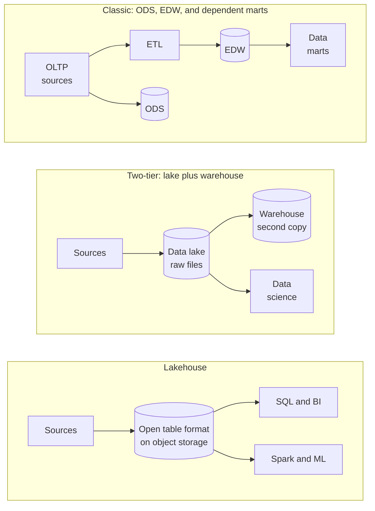
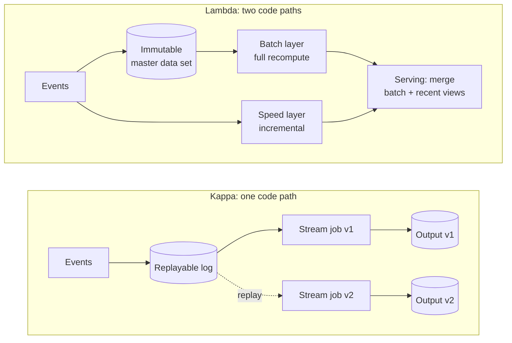
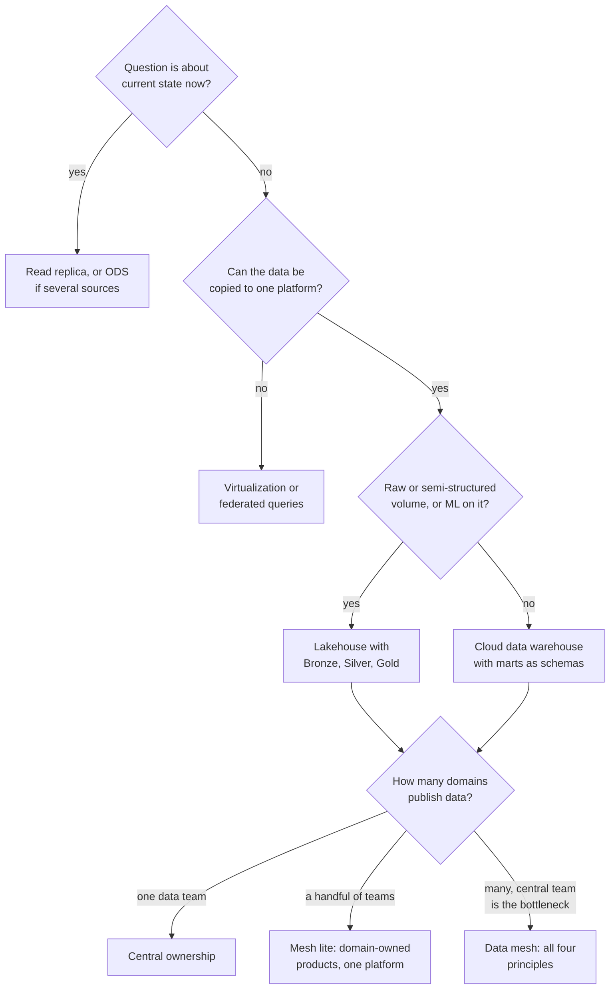
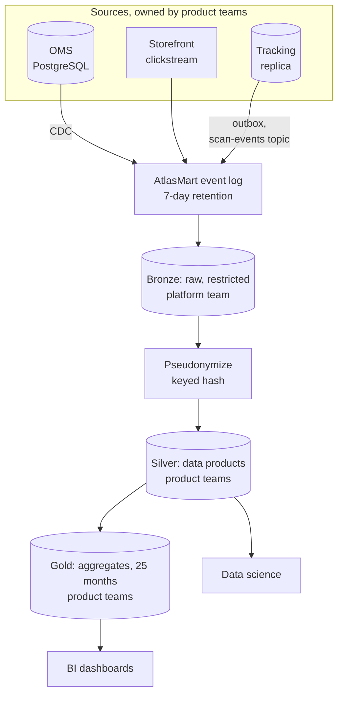

# Warehouses, lakes, lakehouses, and data mesh

> An analytical platform answers two separate questions: where the data physically lives and in
> what shape (warehouse, lake, lakehouse, or left in place and federated), and who owns each data
> set and its quality (a central team, or the domains that produce it). Most confusion in this area
> comes from treating the second question as if it were the first.

!!! abstract "Page facts"
    **Level:** Mixed (definitions and the medallion layers are Level 1-2; the decision guide, Lambda
    versus Kappa, data mesh adoption, and EDW modernization are Level 3) · **Status:** Draft ·
    **Time:** 60-75 minutes · **Last verified:** 2026-11-27

## Learning objectives

After this page you should be able to:

- Define data warehouse, enterprise data warehouse (EDW), data mart, operational data store (ODS),
  data lake, and lakehouse, and say which question each one answers best.
- Explain the medallion architecture (Bronze, Silver, Gold) and what each layer promises to its
  readers.
- Compare the Lambda and Kappa architectures, and choose between copying data into a platform and
  querying it in place with virtualization or federated queries.
- State the four principles of data mesh, distinguish data mesh (an ownership model) from data
  fabric (a metadata and integration approach), and decide how much of either an organization needs.
- Plan the modernization of an on-premises EDW without migrating years of unused reports.

## Prerequisites

- [Relational databases and SQL internals](../databases-and-storage/relational-databases-and-sql-internals.md)
  — the operational (OLTP) side that analytical platforms read from, and reporting on a replica.
- [Message queues and brokers](../messaging-and-streaming/message-queues-and-brokers.md) — delivery
  guarantees and replay, which reappear in Lambda and Kappa.
- [Data security and privacy](../security-architecture/data-security-and-privacy.md) —
  pseudonymization and retention, which the AtlasMart example applies before the Silver layer.

## The problem this solves

Operational databases are built to answer "what is the state of this order now?" for one record at
a time, fast, while thousands of writes arrive. Analytical questions are different: "how did
on-time delivery per carrier change over the last 18 months, by region and by weekday?" reads
millions of rows, joins data from several systems, and needs history that the operational system
has already overwritten or deleted. Running such queries on the operational database slows
customers down, and each team that builds its own extract ends up with its own definition of
"on time".

Organizations answered in waves: a central warehouse with curated schemas; a cheap data lake for
what the warehouse could not hold; the lakehouse, giving the lake the warehouse's guarantees; and data
mesh, which argues the bottleneck is a single central team owning every data set. An architect needs
to know what each wave fixed, what it broke, and which combination fits the organization.

## What it is

Platform shapes (where data lives and how it is structured):

| Shape | Definition | Typical reader |
|---|---|---|
| **Data warehouse** | A database designed for analytical queries over integrated, historical, structured data, with schemas defined before loading (schema-on-write) | Analysts and BI tools using SQL |
| **Enterprise data warehouse (EDW)** | One warehouse intended to integrate the whole organization's data on shared definitions; Inmon described it as subject-oriented, integrated, time-variant, and non-volatile | Every department, through marts or directly |
| **Data mart** | A subset of warehouse data shaped for one business area (finance, logistics); *dependent* if fed from the EDW, *independent* if loaded straight from sources | One department's reports |
| **Operational data store (ODS)** | An integrated, current-state copy of operational data from several systems, updated frequently, kept for short periods, for operational reporting | Support and operations staff who need "now", not history |
| **Data lake** | Low-cost object storage holding raw data in its original formats, structured only when read (schema-on-read) | Data engineers and data scientists |
| **Lakehouse** | A data lake whose files are managed by an open table format that adds transactions, schema enforcement, and versioning, so that warehouse-style SQL and machine learning read the same copy | BI, SQL, and data science together |

Ownership and access models (who owns data, and how it is reached):

| Model | Definition |
|---|---|
| **Data mesh** | A socio-technical approach in which business domains own and publish their analytical data as products, on a self-serve platform, under federated governance (Dehghani's four principles, below) |
| **Data fabric** | An integration approach that uses metadata (catalog, lineage, usage, classifications), often with automation, to discover, connect, and govern data across many stores, frequently by querying it in place. There is no standard definition; the term is used mostly by industry analysts and product vendors, and each uses it for what their product does |
| **Data virtualization** | A layer that presents data from several sources as if it were one database, translating queries to each source at read time instead of copying data |
| **Federated query** | One query that reads tables in several independent systems (for example, an object-store table and a PostgreSQL table) through an engine with a connector per source |

**Lambda** (batch layer plus speed layer, merged at query time; Nathan Marz, 2011) and **Kappa**
(one stream-processing path over a replayable log; Jay Kreps, 2014) are two ways to combine
historical and recent data, compared below. **Medallion architecture** is a layering convention inside a lake or lakehouse: **Bronze** (raw,
as received), **Silver** (cleaned, deduplicated, conformed), **Gold** (business-level aggregates and
dimensional models for specific uses).

!!! note "Two meanings of warehouse"
    AtlasMart also runs physical distribution-centre warehouses (see
    [case study 09](../end-to-end-case-studies/cs-09-hybrid-migration-with-private-connectivity.md)).
    On this page "warehouse" always means a *data* warehouse.

## Mental model

Think of food supply. A **data warehouse** is a supermarket: everything is cleaned, packaged,
labelled, and shelved in a fixed layout before customers arrive; shopping is fast, but stocking a
new kind of product takes a buyer's decision and a shelf redesign. A **data lake** is a delivery
yard where every truck tips its load as it arrives; nothing is refused, so nothing is lost, but
finding a usable crate takes expertise and some loads rot unnoticed (a *data swamp*). A
**lakehouse** is a yard with a sorting line: raw loads are kept (Bronze), washed and sorted (Silver),
and packed for specific customers (Gold), all on the same site. **Data mesh** is a farmers' market:
each farm (domain) packs and labels its own produce to shared market rules, on stalls and scales
provided by the market (the platform); the market does not grow anything itself. **Data fabric** is
an inventory system that tracks where every crate is across many yards and can fetch from any of
them.

**Where the analogy breaks:** data is copied almost for free, so keeping the raw load *and* the
packed product is normal. Data changes meaning silently: a renamed status code makes every
downstream product wrong with no visible rot. And raw data often contains personal data, so the yard
is the riskiest place, not just the dirtiest.

## Key terms

| Term | Meaning on this page |
|---|---|
| Schema-on-write / schema-on-read | Structure enforced when data is loaded / applied only when it is queried |
| Open table format | A metadata layer over data files in object storage that provides atomic commits, schema evolution, and snapshots (versions) of a table |
| Data product | A data set published by its owning domain with a named owner, documented schema and meaning, quality and freshness objectives, and access rules |
| Conformed dimension | A dimension (customer, product, date) with one agreed definition shared by every mart or data product that uses it |
| Two-tier architecture | A data lake for raw data plus a separate warehouse loaded from it, with two copies and two pipelines |
| Change data capture (CDC) | Reading a database's change log to replicate inserts, updates, and deletes continuously to another store (as in the glossary) |
| Pseudonymization | Processing personal data so it cannot be linked to a person without separately kept extra information (as in the glossary) |
| Data swamp | A lake whose contents are undocumented and unowned, so nobody can trust or find anything in it |

## How it works

### The landscape: three platform shapes

**Figure 1 — Three analytical platform shapes.** Each subgraph is a complete platform; they are
stacked for comparison, not connected.

How to read it: in the classic shape, data is transformed before it lands and every consumer reads
curated tables. The two-tier shape keeps raw data cheaply but pays with a second copy, a second
pipeline, and staleness between them. The lakehouse removes the second copy by giving the lake's
files transactional table semantics, which is the argument of Armbrust and colleagues' 2021 paper.

**Inmon versus Kimball.** Inmon's top-down approach builds a normalized, integrated EDW first and
derives dependent marts from it; Kimball's bottom-up approach builds dimensional marts one business
process at a time, integrated through conformed dimensions (the "bus architecture"). Modern platforms
mix them: an integrated Silver layer resembles Inmon's EDW, and Gold star schemas are Kimball marts
(see [OLTP vs OLAP and dimensional modeling](oltp-vs-olap-dimensional-modeling-and-bi.md)).

**The ODS** answers "what is the current state across systems?": updated in place, little history,
for operational staff. A read replica per database, or a CDC-fed current-state table in the
lakehouse, often covers the same need.

### What makes a lakehouse more than a lake

A plain lake is a directory of files. Two writers can overwrite each other, a reader can see half
of a job's output, and changing a column means rewriting or confusing every reader. An **open table
format** fixes this by keeping a metadata log next to the data files: every commit writes new files
and then atomically publishes a new table snapshot that lists them. That gives:

- **Atomic commits and isolation**: readers see the table before or after a job, never during.
- **Schema enforcement and evolution**: a bad write is rejected; a new column does not break readers.
- **Snapshots and time travel**: read the table as of a version; roll back a bad load.
- **Row-level updates and deletes**, which CDC and data-subject erasure requests require.
- **Statistics in metadata** (per-file minimum and maximum values), which let engines skip files.

Because the files are open, several engines (SQL, Spark, Python) read the same copy. The formats
(Apache Iceberg, Delta Lake, Apache Hudi), compaction, and partitioning are on the
[big data processing engines and table formats](big-data-processing-engines-and-table-formats.md) page.

### Medallion architecture: Bronze, Silver, Gold

| Layer | Contains | Promise to readers | Who reads it |
|---|---|---|---|
| Bronze | Data as received: CDC change records, raw events, files, with load metadata | Complete and replayable; not cleaned; may contain duplicates and personal data | Pipelines only, plus engineers debugging |
| Silver | Deduplicated, validated, typed, conformed entities and events, joined to shared keys | Trustworthy at row level; documented schema; quality checks passed | Analysts, data scientists, Gold pipelines |
| Gold | Aggregates, star schemas, features, and metrics for specific uses | Stable business definitions and freshness objectives | Dashboards, reports, applications |

The value of the layers is the **contract at each boundary**, not the number of copies. Bronze
makes reprocessing possible: when a Silver transformation has a bug, it is fixed and rerun from
Bronze, with no re-extraction from sources. Silver is where data is made safe and consistent once,
so every Gold product inherits the same cleaning. Gold is where business meaning (what "on time"
means) is decided and owned. A team that copies data three times with no checks or contracts
between the copies has three layers of cost and no medallion architecture.

### Lambda and Kappa

**Figure 2 — Lambda and Kappa architectures.** Two ways to serve results that include both old and
very recent data.

How to read it: in Lambda the same business logic exists twice (batch and speed), and the serving
layer hides the seam. In Kappa there is one job; a logic change is deployed as a new job that
replays the log into a new output, and readers switch when it catches up.

| Aspect | Lambda | Kappa |
|---|---|---|
| Code paths | Two (batch and streaming), which must agree | One |
| Reprocessing | Batch recompute from the master data set | Replay the log through a new job version |
| Needs | Durable master data set and a merge at query time | A log retained long enough to replay, or a lake as the long-term log |
| Main risk | The two implementations drift and give different answers | Replay of a long history through a stream engine is slow or impossible if the log has been truncated |
| Fits | Heavy historical recomputation plus a small real-time slice | Most logic expressible as stream processing over keyed events |

Marz's argument was about *human* fault tolerance: with an immutable master data set, a buggy job
or bad data is fixed by recomputing. Kreps kept that goal but met it with one code path and a
retained log. With engines that run the same code in batch and streaming modes, the practical
pattern is often "Kappa with the lakehouse as the long log": the event log holds days, Bronze holds
months, and reprocessing reads Bronze (event time and watermarks are on the
[batch, streaming, ETL/ELT, and pipelines](batch-streaming-etl-elt-and-pipelines.md) page).

### Data mesh: the four principles

Zhamak Dehghani's articles on martinfowler.com define data mesh by four principles (paraphrased):

1. **Domain-oriented decentralized data ownership and architecture.** The teams that run a business
   domain (orders, shipping) own its analytical data too, because they know its meaning and control
   its changes.
2. **Data as a product.** Each published data set has an owner, consumers, documentation, quality
   and freshness objectives, and is discoverable and addressable, treated with the care of an API.
3. **Self-serve data infrastructure as a platform.** A platform team provides storage, compute,
   pipelines, catalog, access control, and templates, so domains publish without being
   infrastructure experts.
4. **Federated computational governance.** A small set of global rules (interoperability,
   security, privacy) is agreed by domain and platform representatives and enforced automatically
   by the platform, not reviewed by hand.

The four only work together: ownership without a platform makes every domain build its own
pipelines; a platform without product thinking is a swamp with a nicer interface; ownership without
governance yields incompatible products. Data mesh solves an organizational scaling problem (many
domains, one overwhelmed central team), costs domain teams real time, and prescribes no particular
storage shape. It is not a product to buy.

**Data fabric versus data mesh.** Data mesh redistributes *ownership*; data fabric (in most vendor
usage) centralizes *metadata and access* across stores that may stay where they are. A fabric-style
catalog can be part of a mesh's platform. When a proposal says "data fabric", ask which concrete
capabilities it means (catalog, lineage, policy enforcement, virtualization) and evaluate those.

### Data virtualization and federated queries

Copying data into a platform buys query speed, history, and isolation from sources; querying in
place buys freshness and avoids a copy. A federated query engine (Trino is a widely used open-source
example) plans one query across connectors, pushes filters down to each source where the connector
supports it, and joins the results in its own workers.

| Factor | Copy into the platform | Virtualize or federate |
|---|---|---|
| Freshness | As fresh as the pipeline (minutes to a day) | As fresh as the source |
| Source load | One extract or CDC stream | Every query hits the source |
| History | Kept as the platform chooses | Only what the source keeps |
| Join performance | Local, with statistics | Data moves across the network at query time |
| Governance | One place to enforce | Enforced in the virtual layer and in every source |

Federation fits exploration, low-volume joins with reference data, data that legally or
contractually cannot be copied, and early discovery before a pipeline is worth building. It fits
badly as the main path for dashboards against operational databases.

### Modernizing an on-premises EDW

An on-premises EDW (licensed appliance or database, an ETL tool, years of reports) is moved like any
legacy system on the [legacy modernization](../enterprise-architecture/legacy-modernization-and-migration.md) page:

| Phase | What happens | Watch for |
|---|---|---|
| 1. Inventory | List sources, ETL jobs, tables, reports, consumers, and actual query usage from the EDW's logs | Reports nobody has opened in a year; retire them instead of migrating |
| 2. Choose the target and strategy | Replatform the schema to a cloud warehouse, or re-architect into a lakehouse with medallion layers | Vendor-specific SQL, stored procedures, and ETL-tool logic that must be translated, not copied |
| 3. Land raw data first | Build Bronze ingestion (often CDC) from the same sources the EDW reads | Source load from running old ETL and new ingestion together |
| 4. Migrate by subject area | Rebuild one subject area (sales, then inventory) end to end, strangler-fig style | Conformed dimensions that several subject areas share |
| 5. Parallel run and reconcile | Run old and new on the same days; compare row counts, sums, and key metrics per day | Metric definitions that differ by design; document them |
| 6. Switch consumers and decommission | Move dashboards and extracts, then switch off the old feeds | Licence and hardware end dates; data transfer charges during the dual run |

The biggest risk is semantic, not technical: the EDW encodes decades of business definitions in ETL
logic nobody fully remembers. Reconciliation by subject area is how those definitions are found.

### Choosing a shape and an ownership model

**Figure 3 — Decision guide: which pattern for which organization.** Answer the questions top to
bottom; the last question is about the organization, not the technology.

How to read it: the first three questions choose where data lives; the fourth chooses who owns it.
The answers combine: a lakehouse with central ownership, a warehouse with a data mesh, and a
lakehouse with a few federated sources are all coherent. The thresholds are judgment, not numbers:
"many domains" means the central team's backlog, not the platform's capacity, limits what gets
published.

## Worked example: AtlasMart's analytics platform

AtlasMart has eight product teams (from [platform engineering](../devops-and-platform-engineering/platform-engineering.md))
and a nightly analytics batch that builds carrier delivery-performance aggregates (16 vCPU for 4
hours from 01:00, results due by 16:00, from the
[sustainability page](../finops-and-sustainability/sustainable-and-carbon-aware-architecture.md)).
Phase 5 adds clickstream analytics and a delivery-time prediction model, and formalizes the platform.

**Inputs (assumptions, as fixed for this phase):**

- Clickstream: 400,000 DAU × 40 events per day = 16,000,000 events/day, about 185/s on average and
  740/s at a 4× peak; at 1 KB per event, about 16 GB/day raw.
- Order lines: 60,000 orders × 3 = 180,000 order lines/day, via CDC from the OMS PostgreSQL
  (logical replication) into the AtlasMart event log (Kafka-compatible, 7-day retention).
- Scan events: 480,000/day × 500 B = 240 MB/day (existing facts).
- Retention: raw clickstream 90 days in Bronze; Gold aggregates 25 months.
- Team: a central data platform team of 4 engineers.

**Figure 4 — AtlasMart's lakehouse and who owns what.** Arrows are data flow; the label in each box
says who owns it.

How to read it: everything below the event log is in object storage in the EU region (C-4), in an
open table format, processed on managed Spark run by the platform team. Pseudonymization sits on the
Bronze-to-Silver boundary, so no direct customer identifier reaches a layer analysts read. Order
Tracking publishes processed scans to a `scan-events` topic through an outbox in the Tracking Event
Store, the same contract the [real-time analytics exercise](../system-design-exercises/real-time-analytics.md) uses.

### Sizing the layers

- Bronze clickstream: 16 GB/day × 90 days = 1,440 GB, about **1.4 TB** of raw events at any time
  (before the columnar compression the table format applies, which this page does not estimate).
- Bronze is the replay source: the log keeps 7 days, Bronze 90, so a Silver bug found within 90
  days is fixed by reprocessing from Bronze without any source team re-sending data.
- Silver order lines grow by 180,000 rows/day; Gold aggregates are small (rows per carrier, region,
  and day) and kept 25 months so a month can be compared with the same month a year earlier.
- Compute: the nightly batch is 16 × 4 = 64 vCPU-hours = 64 CU per night at the illustrative rate,
  about 64 × 30 = 1,920 CU per month, on a node pool that scales to zero between runs.

### Why a lakehouse rather than a pure warehouse

A managed cloud data warehouse could store AtlasMart's volumes and answer its SQL. The lakehouse wins
here because of four specific needs, not because of scale:

1. **Raw retention for replay.** 90 days of raw clickstream (about 1.4 TB) is kept to reprocess when
   sessionization logic changes. Object storage holds it at storage-only cost, with no warehouse
   compute attached.
2. **Data science on the same copy.** The delivery-time model reads Silver order lines, shipments,
   and scan events with Spark and Python. With a warehouse, the team would export to files or run ML
   through the warehouse's own interfaces; with a lakehouse, BI and ML read the same tables.
3. **No second copy.** A lake for raw data plus a warehouse for BI (the two-tier shape) means two
   pipelines and two sets of access rules for a 4-engineer team to run.
4. **Open format.** Tables in an open format can be read by another engine later without a bulk
   export, which keeps the exit plan simple.

What AtlasMart gives up: a warehouse's very simple operations and its mature SQL concurrency for
many dashboard users. The Gold layer is small, so dashboards run on a SQL engine over Gold, and the
team revisits this if BI concurrency becomes a problem.

### What "data mesh lite" means for AtlasMart

AtlasMart adopts the first three principles at small scale, reduces the fourth, and deliberately
declines several practices that full data mesh implies:

- **Adopted: domain ownership and data as a product.** The team that owns a source owns its Silver
  and Gold products. The OMS team publishes `orders` and `order_lines`; the storefront team publishes
  `sessions` and `page_events`; the tracking team publishes `shipments` and `delivery_performance`.
  Each product has a named owner, a documented schema, a freshness objective (Gold ready by 16:00),
  and quality checks that run in the pipeline.
- **Adopted: self-serve platform.** The 4 platform engineers run ingestion into Bronze, storage,
  managed Spark, the catalog, access control, and a pipeline template; a product team publishes a
  product by filling in the template, not by building infrastructure.
- **Reduced: governance.** A handful of global rules is enforced by the platform as code:
  pseudonymize before Silver, EU region only (C-4), retention per layer, a schema and owner for every
  published table. A monthly review with the platform team, security, and one engineer from each
  publishing team changes the rules. There is no per-domain policy engine.
- **Declined: per-domain infrastructure, domain-run ingestion, a data marketplace, and chargeback.**
  With three of eight product teams publishing, per-team storage and ingestion would cost more than
  the bottleneck it removes.

### Decision record

| # | Decision | Chosen | Alternatives considered | Reason | Revisit when |
|---|---|---|---|---|---|
| 1 | Platform shape | Lakehouse on object storage, open table format, EU region | Managed cloud warehouse only; lake plus warehouse | Raw replay, ML on the same copy, one pipeline, open format | BI concurrency or SQL features become the main pain |
| 2 | Layering | Bronze, Silver, Gold with checks at each boundary | Raw plus one curated layer | Replay from Bronze; one place to clean and protect | Layers are copied without contracts |
| 3 | Where personal data is reduced | Pseudonymize (keyed hash, key in KMS outside the lake) on the Bronze-to-Silver boundary | Pseudonymize in Gold only | Analysts never read raw identifiers; Bronze stays small in audience | A use case needs re-identification; route it through the key owner |
| 4 | Ownership | Data mesh lite: product teams own Silver and Gold products | Central team owns everything; full data mesh | 4 platform engineers cannot know every domain; 8 teams do not justify per-domain infrastructure | More than a few teams publish, or the platform backlog grows |
| 5 | Processing | Batch-first (nightly Spark), streaming ingestion into Bronze; no Lambda | Lambda with a speed layer | No analytical use needs sub-hour freshness; operational freshness is served by the Order Tracking System | A dashboard needs minutes; add stream jobs over the same tables (Kappa style) |
| 6 | Federation | No federated queries against operational databases; CDC instead | Query the OMS in place | Keeps analytical load off another team's OMS; history is needed | A source cannot legally be copied |
| 7 | Marts and ODS | Gold schemas act as marts; no ODS (operational reporting stays on read replicas) | Separate mart databases; an ODS | Fewer copies; replicas already serve "now" | Several operational systems need a joined current view |

## Real-world architecture example

A common modernization starts from an on-premises EDW fed nightly by an ETL tool, independent marts
built by departments that could not wait, and an older data lake that became a swamp. The target is
a lakehouse or cloud warehouse, CDC from the main operational databases into a log, platform-run
Bronze ingestion, and subject areas migrated one at a time with a parallel run. Silver and Gold
ownership moves first to the two or three domains with the most consumers; federation stays for
sources that cannot be copied; a catalog with lineage (the useful core of most "data fabric"
proposals) is part of the platform. [Case study 12](../end-to-end-case-studies/cs-12-data-lakehouse-with-batch-and-streaming-ingestion.md)
applies the same blocks to Corvina Mobility's vehicle telemetry.

## Design choices and trade-offs

| Choice | Favor when | Avoid when |
|---|---|---|
| Cloud data warehouse | Structured data, SQL and BI consumers, a small team wanting the least to operate | Large raw or semi-structured volumes, ML on the same data, strong lock-in concerns |
| Data lake only | Cheap landing of raw data for a few expert users | Business users need trusted tables; nobody owns cataloguing |
| Lakehouse | BI and ML on one copy, raw retention for replay, open formats | The team cannot operate table maintenance (compaction, snapshot expiry) |
| Two-tier lake plus warehouse | A legacy warehouse must stay for years during migration | As a target; two copies and pipelines drift |
| ODS | Several operational systems need one current, joined view | One source; a read replica does it |
| Lambda | A heavy batch model plus a narrow real-time slice, with tolerance for two code paths | Logic can be expressed once as stream processing |
| Kappa | Keyed event logic, a log or lake that retains enough history | Reprocessing years of data through a stream engine is impractical |
| Data mesh (full) | Many domains, a central team that is the bottleneck, domain teams willing to own data | Few domains, weak platform, or domains without capacity |
| Mesh lite | A handful of publishing teams on one shared platform | One team owns all data anyway |
| Virtualization or federation | Data cannot be copied; low query volume; exploration | Dashboards over operational databases; heavy joins |

## Failure modes and anti-patterns

- **Data swamp.** Files land in the lake with no owner, schema, or catalog entry. Detect: tables
  nobody can describe; repeated "which table is right?" questions. Prevent: no table without an owner
  and catalog entry; Bronze readable by pipelines only.
- **Medallion as ceremony.** Three copies with no checks between them. Detect: Silver and Bronze
  row counts identical, no failing quality checks ever. Prevent: define what each boundary
  guarantees and test it.
- **Lambda drift.** Batch and speed layers compute "orders today" differently. Detect: the number
  jumps when the batch view replaces the speed view. Prevent: one code path, or shared logic
  libraries with reconciliation tests.
- **Kappa without history.** The log keeps 7 days, but a logic fix needs 90. Prevent: treat Bronze
  as the long-term log, or size log retention to the reprocessing window.
- **Mesh as relabelling.** The central data team is renamed "platform" but still writes every
  pipeline, or the opposite, each domain builds its own stack. Detect: domain teams cannot name the
  products they own, or several ingestion stacks exist. Prevent: platform template first, then
  domain ownership; measure who ships changes.
- **Independent marts with conflicting metrics.** Two dashboards show different revenue. Prevent:
  conformed dimensions and one owner per metric in Gold.
- **Federated query on the primary.** A dashboard joins against the OMS primary at 9:00 every day.
  Detect: OMS latency spikes at dashboard refresh times. Prevent: CDC, or federation against a
  replica with a query budget.
- **Lift-and-shift of every EDW report.** Years of unused reports migrated at full cost. Prevent:
  usage-based inventory and retirement before migration.

## Security considerations

- **Bronze is the most sensitive layer.** It holds raw identifiers and everything a source emits.
  Restrict it to pipeline identities and a few platform engineers, and keep its retention short (90
  days for AtlasMart clickstream).
- **Pseudonymize before broad access.** A keyed hash with the key held outside the lake (in a KMS,
  usable only by the Silver pipeline) keeps joins working without exposing identifiers. Pseudonymized
  data is still personal data; see [data security and privacy](../security-architecture/data-security-and-privacy.md).
- **Deletion and time travel.** In an open table format, deleting rows writes a new snapshot; the old
  files stay readable through time travel until old snapshots are expired and unreferenced files are
  removed. Erasure and retention procedures must include that maintenance step; check your table
  format's documentation for how.
- **Residency.** Every engine, catalog, BI tool, and federated connector is a processing location;
  check each against C-4, not just the storage bucket.
- **Federation as a super-user path.** A virtualization layer with one service account per source
  can read everything; prefer per-user identity propagation, or restrict it to non-sensitive sources.
- **Decentralized ownership multiplies access decisions.** Under data mesh, enforce global rules
  (classification, masking, residency) in the platform so no single owner can weaken them.

## Performance, reliability, and cost

- **Performance:** analytical speed comes from columnar files, partitioning on common filters (date),
  file skipping from table statistics, and compaction of small files from streaming writes; these
  are covered on the [table formats](big-data-processing-engines-and-table-formats.md) page. Gold
  tables sized for dashboards keep BI fast regardless of Silver volume.
- **Reliability:** atomic commits make failed jobs harmless to readers; Bronze retention makes
  pipeline bugs recoverable; per-product freshness objectives (Gold ready by 16:00) become alerts.
- **Cost:** separating storage from compute lets raw data sit at storage-only cost and compute scale
  to zero between runs (64 CU per AtlasMart night). The usual cost surprises are duplicate copies
  (two-tier), unexpired snapshots that keep deleted data, always-on query clusters for occasional
  dashboards, and data transfer during an EDW dual run. See
  [cloud cost models and FinOps](../finops-and-sustainability/cloud-cost-models-and-finops.md).

## Hands-on lab: a tiny medallion pipeline with replay

Local and free, using Python's standard library (`sqlite3`, `hmac`, `csv`, `random` with a fixed
seed). No lab page covers this topic in this phase.

1. Generate 10,000 clickstream rows (`event_id`, `session_id`, `customer_id`, `event_type`, `ts`) with a fixed
   seed, including about 1% duplicate `event_id` values and a few rows with a malformed timestamp.
   Load them unchanged into a `bronze_events` table with a `loaded_at` column.
2. Build `silver_events`: drop duplicates by `event_id`, reject malformed rows into a
   `silver_rejects` table, and replace `customer_id` with `hmac.new(pseudo_key_bytes, ...)`
   (hex digest). Keep the key in a separate file outside the database.
3. Build `gold_daily_conversion`: per day, the share of sessions with a `purchase` event.
4. Introduce a "bug fix": a new rule classifies `checkout_complete` as a purchase too. Rebuild
   Silver and Gold from Bronze only, without regenerating the source rows, and compare Gold before
   and after.
5. Delete Bronze rows older than a cutoff date and try step 4 again for that period.

??? question "Hint: what steps 4 and 5 should show"
    Step 4 changes the Gold conversion figures while Bronze is untouched, which is the point of
    keeping raw data: logic fixes are replayed, not re-extracted. Step 5 shows that once Bronze is
    deleted, the fix can only be applied from the retention cutoff onwards, which is why the Bronze
    retention (90 days for AtlasMart) is a design decision about how far back a mistake can be fixed.

## Knowledge check

1. What is the difference between an ODS and an EDW, and why does AtlasMart need neither as a
   separate system?
2. What does an open table format add to a data lake, and which two of those additions does CDC
   depend on?
3. AtlasMart's event log keeps 7 days and Bronze keeps 90. A sessionization bug is found that has
   affected the last 30 days. Where does reprocessing read from, and is that Lambda or Kappa?
4. Name the four principles of data mesh and say which one AtlasMart declines in its full form.
5. An analyst proposes a federated query that joins Gold with the live OMS database for an hourly
   dashboard. What would you say, and what would you offer instead?

??? success "Answers"
    1. An ODS holds integrated, current, frequently updated operational data with little history;
       an EDW holds integrated, historical, non-volatile data for analysis. AtlasMart's read replicas
       serve current-state reporting, and the lakehouse's Silver and Gold layers play the EDW and mart
       roles.
    2. Atomic commits, schema enforcement and evolution, snapshots and time travel, row-level
       updates and deletes, and file statistics. CDC depends on row-level updates and deletes (to
       apply changes) and atomic commits (so readers never see a half-applied batch).
    3. From Bronze, because the log no longer holds 30 days. Strictly it is neither: AtlasMart reruns
       its one batch code path over retained raw data. It shares Kappa's key property (one code path,
       replay of retained history) and has no speed layer, so it is not Lambda.
    4. Domain ownership, data as a product, self-serve platform, federated computational governance.
       AtlasMart reduces governance to a few platform-enforced rules and a monthly review, and also
       declines per-domain infrastructure.
    5. It would put dashboard load on the OMS primary every hour and couple analytics to an
       operational system owned by another team. Offer the CDC-fed Silver `orders` product (minutes
       to hours behind) or, if freshness truly matters, a query against a read replica with a budget.

## Architecture discussion questions

1. AtlasMart's marketing team wants a real-time "visitors on site now" dashboard. Would you add a
   speed layer, a streaming job writing to a Gold table, or a separate operational metric, and what
   does each do to the platform team's workload?
2. Two years from now AtlasMart has 20 product teams and 9 of them want to publish data products.
   Which parts of "mesh lite" would you change first, and what evidence would tell you the platform
   team is the bottleneck?
3. A vendor presents a "data fabric" that would let AtlasMart query every operational database in
   place and retire the lakehouse. List the questions you would ask about residency, source load,
   history, and pseudonymization before considering it.

## Summary

Warehouses, lakes, and lakehouses answer where analytical data lives and how it is structured;
data mesh answers who owns it; data fabric and virtualization answer how to reach data that stays
where it is. A lakehouse puts an open table format over object storage so BI and ML share one copy,
and the medallion layers give each boundary a contract: Bronze for replay, Silver for clean and safe
data, Gold for business meaning. Lambda keeps two code paths; Kappa keeps one and replays a log, and
the lake is often that long log. Data mesh's four principles fit organizations whose central data
team is the bottleneck; smaller ones, like AtlasMart, take domain ownership and a self-serve platform
and keep governance light. EDW modernization succeeds by subject area, with reconciliation, after
retiring what nobody uses.

## Related topics

- **Before:** [Relational databases and SQL internals](../databases-and-storage/relational-databases-and-sql-internals.md);
  [Message queues and brokers](../messaging-and-streaming/message-queues-and-brokers.md);
  [Data security and privacy](../security-architecture/data-security-and-privacy.md)
- **Alongside:** [Data modeling, metadata, and data governance](data-modeling-metadata-and-data-governance.md)
  (catalogs, lineage); [Batch, streaming, ETL/ELT, and pipelines](batch-streaming-etl-elt-and-pipelines.md)
  (CDC, event time); [Big data processing engines and table formats](big-data-processing-engines-and-table-formats.md);
  [OLTP vs OLAP, dimensional modeling, and BI](oltp-vs-olap-dimensional-modeling-and-bi.md) (Gold star
  schemas); [Event streaming and log-based architecture](../messaging-and-streaming/event-streaming-and-log-based-architecture.md);
  [Platform engineering](../devops-and-platform-engineering/platform-engineering.md);
  [Legacy modernization and migration](../enterprise-architecture/legacy-modernization-and-migration.md);
  [Case study 12](../end-to-end-case-studies/cs-12-data-lakehouse-with-batch-and-streaming-ingestion.md);
  [Data lake design exercise](../system-design-exercises/data-lake.md).
- **Planned:** AI data platforms, feature stores, and vector data (D19-D25, Phases 6-7).

## References

| Source | Type | Checked |
|---|---|---|
| Zhamak Dehghani, ["Data Mesh Principles and Logical Architecture"](https://martinfowler.com/articles/data-mesh-principles.html), martinfowler.com, December 2020 | Article (the four principles) | 2026-11-27 |
| Nathan Marz, ["How to beat the CAP theorem"](http://nathanmarz.com/blog/how-to-beat-the-cap-theorem.html), October 2011 | Essay (the batch-plus-realtime design later named Lambda) | 2026-11-27 |
| Jay Kreps, ["Questioning the Lambda Architecture"](https://www.oreilly.com/radar/questioning-the-lambda-architecture/), O'Reilly Radar, July 2014 | Essay (Kappa architecture) | 2026-11-27 |
| Michael Armbrust, Ali Ghodsi, Reynold Xin, Matei Zaharia, ["Lakehouse: A New Generation of Open Platforms that Unify Data Warehousing and Advanced Analytics"](https://www.cidrdb.org/cidr2021/papers/cidr2021_paper17.pdf), CIDR 2021 | Paper | 2026-11-27 |
| Microsoft Learn, [What is the medallion lakehouse architecture?](https://learn.microsoft.com/en-us/azure/databricks/lakehouse/medallion) (Azure Databricks) | Official documentation (Bronze, Silver, Gold) | 2026-11-27 |
| [Trino documentation: Trino concepts](https://trino.io/docs/current/overview/concepts.html) | Official documentation (connectors and catalogs for federated queries) | 2026-11-27 |
| W. H. Inmon, *Building the Data Warehouse* (Wiley; first edition 1992) | Book (EDW definition, ODS) | 2026-11-27 |
| Ralph Kimball and Margy Ross, *The Data Warehouse Toolkit*, 3rd edition (Wiley, 2013) | Book (dimensional marts, conformed dimensions, bus architecture) | 2026-11-27 |

## Review notes

- Canonical page for D07-T03. Covered in depth: data warehouse, EDW, data mart, ODS, data lake,
  lakehouse, medallion (Bronze/Silver/Gold), Lambda, Kappa, data mesh, virtualization and federated
  queries, platform modernization. **Data fabric** is defined carefully and contrasted with data
  mesh, but not cited: no vendor-neutral primary definition was found, and analyst reports are
  paywalled. A reviewer may add a source if one is found, and should keep the "no standard
  definition" caveat.
- The Lambda name is attributed carefully: Marz's 2011 essay describes the batch and realtime layers
  but does not use the name "Lambda Architecture" (it came later, with Marz and Warren's book); the
  essay was checked for this. Kreps's 2014 essay uses the name Kappa.
- The medallion source is vendor documentation (the pattern is popularized by Databricks); the page
  describes it vendor-neutrally. Products named: Trino (cited), Apache Iceberg, Delta Lake, Apache
  Hudi, Apache Spark (project sites returned 200; detail is on the D07-T04 page). No cloud warehouse
  products are named, by design.
- New AtlasMart assumptions: Bronze clickstream about 1.4 TB (16 GB × 90 days); scan events reach
  Bronze from a `scan-events` topic fed by an outbox in the Tracking Event Store; the named data products and
  owners; three of eight product teams publish; a monthly governance review; about 1,920 CU per month
  of nightly compute (64 × 30).
- Links to batch-list pages (D07-T01, D07-T02, D07-T04, D07-T05, D08-T03, case study 12, data lake
  exercise) report as broken until those pages land.
