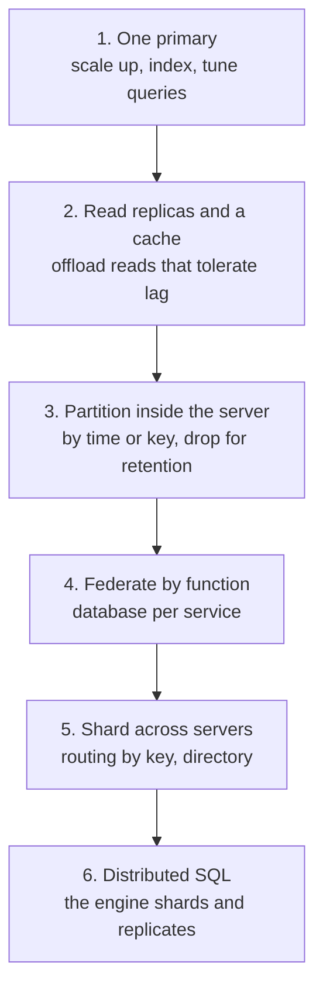
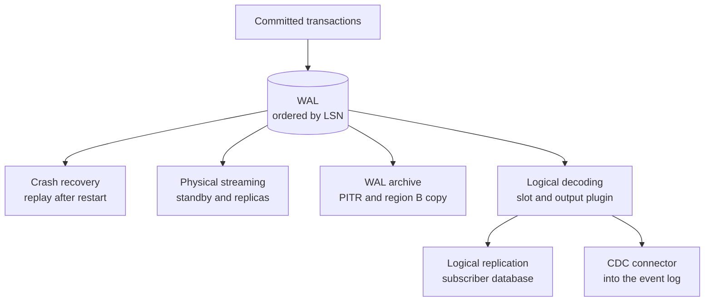
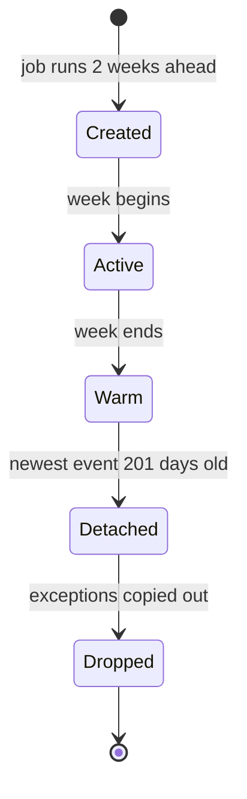
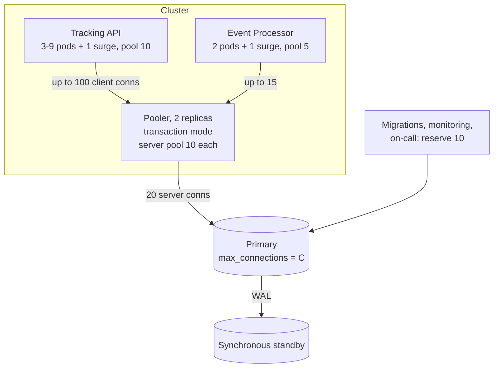

# Advanced database architecture

> One relational primary goes a long way. This page is about what you add around it as data,
> traffic, and obligations grow: partitions inside the server, more servers by function or by key,
> streams read from the transaction log, a pooler in front, and a lifecycle that deletes data on
> schedule. Each step costs operational complexity, so each must be earned with numbers.

!!! abstract "Page facts"
    **Level:** Advanced (definitions are Level 1; partition design, connection budgets, and CDC are
    Level 2; sharding triggers and global databases are Level 3) · **Status:** Draft · **Time:**
    60-75 minutes · **Last verified:** 2026-11-27

## Learning objectives

After this page you should be able to:

- Place partitioning, read replicas, federation, sharding, and distributed SQL on one scaling ladder
  and say what each step costs.
- Design time-based declarative partitioning for a retention rule, including the partition key, the
  unique constraints it allows, and the drop schedule.
- Explain how one write-ahead log serves crash recovery, replicas, point-in-time recovery, and change
  data capture, and what a replication slot can do to the primary's disk.
- Build a connection budget from replica counts and a symbolic server limit, and decide where a
  server-side pooler belongs.
- Compute when a database actually needs sharding, from growth, write rate, and restore time.
- Choose hot, warm, and cold placement, archiving, and deletion for data under a retention policy.

## Prerequisites

- [Relational databases and SQL internals](relational-databases-and-sql-internals.md) — B-tree
  indexes, plans, the WAL, synchronous standby, in-server partitioning, and pool sizing by Little's
  Law. This page builds on all of them and does not repeat them.
- [Scaling, partitioning, and replication](../distributed-systems/scaling-partitioning-and-replication.md)
  — partition strategies, partition-key choice, rebalancing, and replication topologies in the
  distributed sense.
- [Disaster recovery strategies](../reliability-and-disaster-recovery/disaster-recovery-strategies.md)
  — backups, PITR, and AtlasMart's region B design, which this page links rather than repeats.

## The problem this solves

The relational databases page assumes the data fits one primary. Real systems test that in several
directions at once: a retention `DELETE` takes hours and bloats the table; autoscaled services open
more connections than the server holds; analytics wants every change without polling; regulators want
data in a region and gone on schedule; a restore eats most of the recovery time objective. Each has
a database-level answer, and the expensive ones (sharding, distributed SQL, multi-region writes) are
often chosen before the cheap ones (partitions, a pooler, a retention job). This page orders the
answers and gives the arithmetic for moving between them.

## What it is

| Technique | What it does | Where data lives |
|---|---|---|
| Horizontal partitioning | Splits a table's **rows** into partitions by a key (range, list, hash) | One server, many partitions |
| Vertical partitioning | Splits a table's **columns** into separate tables (large, rarely read, or sensitive columns moved out) | One server, more tables |
| Federation (functional partitioning) | Splits **by function**: each service or domain has its own database | Several servers, each owning a domain |
| Sharding | Splits one dataset's rows **across servers** by a shard key | Several servers, same schema |
| Distributed SQL | An engine that shards, replicates, and runs transactions across nodes behind one SQL interface | A cluster that behaves as one database |
| Change data capture (CDC) | Reads committed changes from the transaction log and streams them elsewhere | Source database plus consumers |
| Server-side pooler | Multiplexes many client connections onto a few server connections | A proxy between applications and the database |

"Federation" has a second meaning: a query layer that reads several databases as if they were one
(PostgreSQL's foreign data wrappers are an example). This page uses the first meaning and calls the
second "federated query".

## Mental model

Think of a growing city archive. It shelves **by year**, so a whole year can be boxed and shredded
in one trip (time partitioning). It moves **tax and land records into separate buildings** with their
own staff (federation). If land records outgrow a building, it splits them **by district across
buildings** with a directory at the door (sharding), or hires a firm whose **network of buildings
answers as one archive** (distributed SQL). A clerk copies **every new filing onto a bulletin** for
other offices (CDC), and a **front desk** queues hundreds of visitors for the few clerks who can
fetch files (the pooler).

**Where the analogy breaks:** the archive's buildings never disagree about a document mid-update.
Servers do: copies lag, a transaction that spans buildings needs a protocol (two-phase commit or a
consensus-backed engine), and the bulletin can be read out of order or twice. Every step beyond one
building trades simplicity for coordination.

## Key terms

| Term | Meaning on this page |
|---|---|
| Partition (shard) / partition key | A subset of a dataset stored and served independently; the field that decides where a record lives (as in the glossary). Here "partition" is inside one server and "shard" is across servers |
| Declarative partitioning | Defining a table as partitioned in the schema (`PARTITION BY RANGE`, `LIST`, `HASH`) so the engine routes rows and prunes partitions |
| Partition pruning | The planner skipping partitions whose bounds cannot match the query's predicate |
| Federation | Splitting databases by function or domain, each owned by one service |
| Distributed SQL | A SQL database that partitions and replicates data across nodes and keeps transactional guarantees across them |
| Write-ahead log (WAL) | The ordered log of changes written before data pages; its positions are log sequence numbers (LSN) |
| Logical decoding | Turning WAL records into row-level change events (insert, update, delete) for consumers |
| Replication slot | A server-side marker that keeps WAL until a consumer confirms receipt (as in the glossary) |
| Change data capture (CDC) | Reading a database's change log to replicate changes continuously to another store (as in the glossary) |
| Connection pool / pooler | Reusable connections kept by an application (glossary) / a separate proxy that shares a small server pool among many clients |
| Point-in-time recovery (PITR) | Restoring to a chosen moment by replaying archived WAL on a base backup (as in the glossary) |
| Hot / warm / cold data | Data by access frequency: hot is read constantly, warm occasionally, cold rarely and can live on cheaper, slower storage |

## How it works

### The scaling ladder

**Figure 1 — The database scaling ladder.** Climb only when the step below is exhausted; each rung
adds a new kind of failure.

How to read it: rungs 1-3 keep one writer and one consistency domain. Rung 4 splits ownership but
each database is still simple. Rungs 5 and 6 spread one dataset over many writers; cross-shard
queries, rebalancing, and distributed transactions arrive with them. Rung 6 moves that complexity
into the engine, it does not remove it.

### Declarative partitioning inside one server

PostgreSQL's declarative partitioning (see the references) defines a parent table with
`PARTITION BY RANGE`, `LIST`, or `HASH` and attaches child tables with bounds. Rows are routed on
insert; queries whose `WHERE` clause constrains the partition key are **pruned** to the matching
partitions. Four properties drive the design:

- **Retention becomes a metadata operation.** Dropping or detaching a partition removes millions of
  rows without row-by-row deletes, without the vacuum work a bulk `DELETE` creates, and without a
  flood of WAL to replicas. `DETACH PARTITION ... CONCURRENTLY` avoids blocking queries on the
  parent.
- **Unique constraints must include the partition key.** The PostgreSQL documentation states that a
  primary key or unique constraint on a partitioned table must contain all partition-key columns.
  A global "this ID is unique" rule across partitions is therefore not available; design the key
  so uniqueness holds within the partition.
- **Queries without the partition key visit every partition.** Pruning only helps predicates on the
  key; a lookup by another column is an index search per partition.
- **Partition count is a cost.** The documentation warns that many partitions lengthen planning and
  raise memory use. Tens to low hundreds of partitions is a comfortable range for most designs; tens
  of thousands is a smell.

**Vertical partitioning** is the column-wise cousin: move a large free-text column, a rarely read
blob, or a sensitive column to a side table with the same primary key. Hot queries read narrower
rows, and the sensitive table can get tighter grants or column-level encryption.

### Federation, sharding, and distributed SQL

**Federation** is the default shape of a service architecture: AtlasMart's Order Management System
(OMS) and the Tracking Event Store are separate PostgreSQL databases, each owned by its team. The cost
is the cross-domain query ("orders with late shipments"), which becomes an API call, a read model fed
by events, or an analytics job, never a cross-database join on the hot path.

**Sharding** spreads one dataset across servers. The shard key, rebalancing, hot keys, and
scatter-gather are covered in depth on the
[scaling, partitioning, and replication page](../distributed-systems/scaling-partitioning-and-replication.md);
at the database level the decisions that remain are who routes (the application through a directory,
a proxy, or a database extension that distributes tables) and what you give up: foreign keys and
unique constraints across shards, cross-shard transactions (two-phase commit or sagas), global
secondary indexes, and simple backups (each shard is restored separately, and a consistent point
across shards needs care).

**Distributed SQL** engines keep the SQL and transactional interface while partitioning data into
ranges or tablets, replicating each with a consensus protocol, and running distributed transactions.
Google's Spanner paper (in the references) describes the pattern at global scale, using tightly
bounded clock uncertainty to order transactions across regions. What it buys: horizontal write
scaling and node or zone failure without manual failover. What it does not remove: choosing keys
that avoid hot ranges, the latency of cross-node and cross-region transactions, and
engine-specific operational knowledge.

| Category | Representative products and projects (names checked on 2026-11-27) |
|---|---|
| Distributed SQL | [Spanner](https://cloud.google.com/spanner/docs) (Google Cloud), [CockroachDB](https://www.cockroachlabs.com/docs/stable/), [YugabyteDB](https://docs.yugabyte.com/), [TiDB](https://docs.pingcap.com/tidb/stable/overview) (describes itself as MySQL compatible) |
| Sharding as a PostgreSQL extension | [Citus](https://docs.citusdata.com/en/stable/) (distributed and reference tables) |
| CDC from PostgreSQL | [Debezium PostgreSQL connector](https://debezium.io/documentation/reference/stable/connectors/postgresql.html) (logical decoding with `pgoutput`) |
| Server-side pooler | [PgBouncer](https://www.pgbouncer.org/features.html) (session, transaction, and statement pooling) |

Examples, not recommendations; managed cloud services offer equivalents, with limits in the
provider's current documentation.

### Replication strategies and global databases

The replication modes (synchronous standby, asynchronous replicas) and topologies (leader-follower,
multi-leader, leaderless) are on the two prerequisite pages. At the database level, the multi-region
options are:

| Option | Writes | Reads in other regions | Typical RPO on region loss | Fits when |
|---|---|---|---|---|
| Cross-region asynchronous replica | One region | Stale by the lag | Seconds (the lag) plus any unarchived WAL | DR and regional reads; most systems |
| Geo-partitioned rows (home region per row) | Each row in its home region | Local for local data | Per row, by its region's replication | Residency rules; users stay in one region |
| Distributed SQL across regions | Any region, consensus per range | Strong reads cost a cross-region round trip; stale reads are local | Zero for committed data if a quorum survives | Global users needing one consistent database, and willing to pay latency |
| Multi-leader with conflict resolution | Any region | Local | Small, but conflicts can drop writes | Data that merges safely; rarely for system-of-record tables |

**Consistency** follows the choice: a single primary gives read-your-writes on the primary only; any
replica or CDC consumer is eventually consistent; geo-partitioned and distributed SQL designs give
strong consistency within a range or row's home and make you pay for it across regions. The
[consistency models page](../distributed-systems/consistency-models-cap-and-pacelc.md) has the
vocabulary for writing this down per read path.

### Transaction logs and change data capture

**Figure 2 — One write-ahead log, four consumers.** Every committed change is in the WAL first;
recovery, replicas, PITR, and CDC all read it.

How to read it: physical consumers receive byte-level changes for the whole cluster; logical
consumers receive row-level changes per table, decoded through a **replication slot** that pins WAL
until they confirm it.

**Logical decoding** turns WAL into row changes through an output plugin (`pgoutput` is the
built-in one, used by logical replication and connectors such as Debezium). Unlike application dual
writes, it cannot miss a committed change or publish a rolled-back one, and it keeps commit order.
Its operating rules:

- **A stalled slot fills the primary's disk.** `max_slot_wal_keep_size` caps retained WAL (unlimited
  by default); past the cap the slot is invalidated and the consumer re-snapshots. Alert on slot lag,
  and choose explicitly between "protect the primary" and "never lose the stream".
- **DDL is not replicated.** PostgreSQL's logical replication restrictions say schema changes are not
  carried. Schema evolution needs a contract with consumers (expand, migrate, contract, as on the
  relational page), and **dropping a partition is DDL**: subscribers and CDC copies do not receive
  row deletes for it, so every copy must apply the retention rule itself.
- **Snapshot, then stream, idempotently.** A new consumer takes a consistent snapshot and streams
  from the slot's position; after a restart, unconfirmed changes arrive again, so key on primary key
  and LSN.

AtlasMart's OMS already publishes order changes this way into the AtlasMart event log (assumption
fixed for this phase); the [event streaming page](../messaging-and-streaming/event-streaming-and-log-based-architecture.md)
covers the topic side.

### Connection management

The relational page sizes a pool by Little's Law. At the architecture level the questions are the
**total** across every client and what happens when they all reconnect at once.

- **The budget.** Σ (maximum replicas including rollout surge × pool maximum) plus a reserve for
  migrations, monitoring, and humans must stay below the connection limit minus reserved slots, with
  headroom. PostgreSQL's `max_connections` is set at server start, sizes shared memory, and must be at
  least as high on a standby; `superuser_reserved_connections` and `reserved_connections` hold slots
  back for administrators.
- **Connection storms.** A failover, restart, or fleet-wide deployment makes every client reconnect
  within seconds, each paying a TLS handshake, authentication, and a server process. Mitigate with
  small minimum pools, jittered backoff, and a pooler.
- **The autoscaler is a database setting in disguise.** A higher replica maximum raises the worst-case
  connection total, so it needs the same review as a database parameter.
- **Where the pooler goes.** In-application pools alone, a pooler sidecar per pod (saves handshakes
  but not total server connections), a central pooler deployment (two or more replicas, the usual
  answer), or the provider's managed proxy. **Transaction pooling** gives the biggest reduction but
  breaks session features: PgBouncer's feature table lists `SET`, `LISTEN`, SQL-level `PREPARE`,
  `WITH HOLD` cursors, and session advisory locks as unavailable in transaction mode, and
  protocol-level prepared statements need its `max_prepared_statements` setting.

### Backup, recovery, and point-in-time recovery

The [disaster recovery page](../reliability-and-disaster-recovery/disaster-recovery-strategies.md#step-5-point-in-time-recovery)
covers base backups plus archived WAL, `archive_timeout`, and restore arithmetic. Three
database-architecture consequences follow:

1. **Restore time grows with data size**, so retention and partitioning are recovery controls too.
2. **Replication is not backup.** A bad migration replicates to every replica and CDC consumer;
   only PITR or a delayed copy undoes it.
3. **Sharded and federated systems restore per database.** A consistent point across shards needs
   coordinated markers, or per-shard restore points plus reconciliation.

### Encryption, auditing, and the data lifecycle

- **Encryption:** TLS from every client and pooler; storage encryption for data files, WAL, backups,
  replicas, and archives, keys managed off the host (the
  [data security page](../security-architecture/data-security-and-privacy.md) has AtlasMart's key
  layout). Column-level encryption (in the application or with `pgcrypto`) suits a few Restricted
  columns, at the price of indexing and range queries on them.
- **Auditing:** statement logging for DDL and privileged sessions (`log_statement` in PostgreSQL);
  application-written records for business access (the agent access log, NFR-5).
- **Hot, warm, cold, and archive:** hot data is on the primary's fast storage and in caches; warm
  data is in older partitions, perhaps on cheaper storage; cold data is detached and exported to
  object storage in a columnar format, or deleted. **Archiving is a retention decision first:** data
  with a deletion obligation cannot be archived past its deadline, so the archive keeps aggregates or
  pseudonymized extracts, not the rows.
- **Low-downtime migration:** expand-migrate-contract for schema changes (relational page); logical
  replication to a new server for major-version upgrades or platform moves (the PostgreSQL
  documentation lists replicating between major versions as a use), with a short write freeze at
  cutover; and for re-partitioning, a forward-only change, as in the worked example.

## Worked example: AtlasMart's Tracking Event Store, partitioned for 180-day retention

### Step 1 — Size today, and why it shrinks

The [capacity page](../performance-and-scalability/capacity-estimation.md) sized the store at about
**430 GB** across three copies (primary, synchronous standby, backups) at 13 months: 240 MB of
events a day × 1.5 index overhead × 3 copies × 13 months, or about 143 GB per copy. The
[data security page](../security-architecture/data-security-and-privacy.md) later set tracking
retention to **180 days after delivery**. Enforcing that is this example's job.

Assumptions introduced here: a shipment's events span at most **14 days** from label to delivery
(longer ones become exceptions, handled below), and partitions are **weekly** (chosen in Step 2).
The longest any event can stay is 180 + 14 + 7 = **201 days**.

| Quantity | Value | Arithmetic |
|---|---|---|
| Event data per day, one copy | 360 MB | 480,000 × 500 B = 240 MB × 1.5 index overhead |
| Live data, one copy | about 72.4 GB | 201 days × 360 MB |
| Live data, three copies | about 217 GB | 72.4 × 3, about half the 430 GB sizing |
| One copy after one and two years at 30% growth | about 94 GB, 122 GB | 72.4 × 1.3, × 1.3² |
| Years until one copy reaches the old 143 GB sizing | about 2.6 | ln(143 ÷ 72.4) ÷ ln 1.3 = 0.68 ÷ 0.262 |

The 430 GB sizing stays as the provisioned ceiling, and the retention job buys about 2.6 years of
growth before it is reached.

### Step 2 — Partition key and width

**Key: `occurred_at`** (the carrier's event time), range-partitioned. Two reasons:

- The idempotency rule needs a unique constraint, and on a partitioned table it must include the
  partition key. The constraint becomes `UNIQUE (carrier_id, carrier_event_id, occurred_at)`, which
  still rejects a redelivered webhook because a redelivery repeats the carrier's event time
  (assumption, to confirm per carrier). Partitioning on `received_at` would break this: the
  constraint would have to include `received_at`, which differs on every redelivery. The event row
  carries `carrier_id`, copied from its shipment, so the constraint can be declared.
- The retention clock starts at delivery, which is the `occurred_at` of the delivered scan, so
  partitions age on the same clock as the rule.

This refines the relational page's monthly partitions on `received_at`. **Width:** the drop job can
remove a partition only when its newest possible event is past the deadline, so data overstays by up
to the partition width plus the 14-day transit allowance.

| Width | Longest stay | Overstay beyond 180 days | Partitions holding data | One partition, one copy |
|---|---|---|---|---|
| Monthly | 180 + 14 + 31 = 225 days | up to 45 days | about 8 | about 11 GB, 14.9 million rows |
| **Weekly (chosen)** | 180 + 14 + 7 = 201 days | up to 21 days | 29 (201 ÷ 7) | about 2.5 GB, 3.36 million rows |
| Daily | 180 + 14 + 1 = 195 days | up to 15 days | about 195 | about 0.36 GB, 480,000 rows |

Weekly keeps the overstay short enough to state in the privacy notice ("deleted within three weeks
after the 180-day period", for counsel to confirm) with a few dozen partitions. Daily gains six days
for seven times the partitions.

**Figure 3 — The life of one weekly partition.** A scheduled job creates, checks, and drops; nobody
runs a `DELETE`.

How to read it: one partition passes through each state once; at any time two are Created, one is
Active, and about 28 are Warm, serving support reads and carrier disputes. Hot reads (in-transit
shipments, recent deliveries) hit the newest three or four partitions, which stay in memory.
Detaching is concurrent; the exception check runs before the drop.

The job also handles three edge cases:

- **Future-dated events** from a carrier clock error: a `DEFAULT` partition catches them, and an
  alert fires if it is not empty (rows there slow down attaching new partitions, as the
  documentation notes).
- **Exceptions:** before dropping, the job finds shipments with events in the partition that are not
  delivered, or were delivered less than 180 days ago, and copies those rows into an exceptions table
  with its own 180-day clock (expected to be rare; measure it).
- **Copies:** the async replica receives the drop through physical replication, but backups keep
  dropped rows for their own retention (35 days on the data security page), and any CDC or analytics
  copy must apply the rule itself because the drop is DDL.

The move from monthly to weekly is **forward-only**: new partitions are weekly from a cut-over date,
old monthly partitions age out under the same rule, and no row is moved.

### Step 3 — Connection budget

Clients of the primary (replica counts from the
[Kubernetes page](../containers-and-kubernetes/kubernetes-architecture-and-workloads.md), pools from
the capacity and relational pages; **C** is the primary's `max_connections`, **r** its reserved
slots; ops reserve of 10 is an assumption):

| Client | Worst case | Connections |
|---|---|---|
| Tracking API | HPA maximum 9 + 1 rollout surge (maxSurge 1) = 10 pods × pool 10 | 100 |
| Event Processor | 2 + 1 surge = 3 pods × pool 5 | 15 |
| Migrations, monitoring, on-call | reserve | 10 |
| **Total, direct connections** | | **125** |

With 20% headroom the rule is 125 ≤ 0.8 × (C − r), so **C ≥ 157 + r**. Little's Law shows how idle
those connections are: even if all 210 reads/s at the sale-day peak missed the cache at 5 ms each,
and 70 events/s held a connection for 5 ms each (assumption), about 210 × 0.005 + 70 × 0.005 =
1.4 connections are busy. Over 98% of 125 connections sit idle, and after a failover all 115
application connections reconnect within seconds.

**Figure 4 — The connection path with a central pooler.** Applications keep their pools; the pooler
holds the only server connections.

How to read it: client connections end at the pooler, which is cheap per connection; the database
sees only the 20 pooled connections plus the reserve. Migrations bypass the pooler because they use
session features.

With the pooler: 20 + 10 = 30 ≤ 0.8 × (C − r), so **C ≥ 38 + r**, a sale-day HPA maximum of 30
(31 pods × 10 = 310 client connections) needs no database change, and a failover reconnects 20
server connections instead of 115. The cost: two more replicas to run, one more hop, and the
transaction-mode rules (the Event Processor's per-message transaction already fits them; any use of
`SET` or session advisory locks must be removed first).

### Step 4 — When to consider sharding

Using the triggers from the
[scaling page](../distributed-systems/scaling-partitioning-and-replication.md#part-1-today-a-single-primary-is-fine-for-years)
and its per-group limit of 500 writes/s (an assumption there), plus the DR page's 200 MB/s restore
throughput (an assumption there), at 30% yearly growth:

| Trigger | Today | Limit (assumption) | Years to reach it |
|---|---|---|---|
| Peak write rate | 70 events/s | 500 writes/s | ln(500 ÷ 70) ÷ ln 1.3 = 1.97 ÷ 0.262 ≈ 7.5 |
| Restore of one copy | 72,400 MB ÷ 200 MB/s ≈ 6 min | 30 minutes of the 1-hour RTO, so 360 GB | ln(360 ÷ 72.4) ÷ ln 1.3 = 1.60 ÷ 0.262 ≈ 6.1 |
| Connections | 125 direct, 30 pooled | below 0.8 × (C − r) | not a sharding trigger: a pooler fixes it |

**Decision:** no sharding. The earliest trigger is restore time in about six years, and the levers
before sharding (more frequent base backups, a faster restore path, shorter retention if the business
agrees) are cheaper. The yearly capacity review recomputes this table from measured values.

## Real-world architecture example

A common production shape: a managed relational primary with a synchronous standby in another
zone; time-partitioned history tables with a scheduled maintenance job; a managed proxy or small
pooler deployment in front; an asynchronous replica in a second region fed by the WAL stream that is
also archived for PITR; and a CDC connector reading a logical slot into a Kafka-compatible log that
feeds search, caches, and the lakehouse. Sharding extensions or distributed SQL arrive when writes
or data outgrow the largest primary, or users on several continents need one consistent database.
The managed service runs failover and backups; the architect still owns the partition key, the
retention job, the connection budget, the slot alerts, and the recovery arithmetic.

## Design choices and trade-offs

| Choice | Favor when | Avoid when |
|---|---|---|
| Time-range partitioning | Retention by age; queries filter by time | Queries rarely include time; unique keys cannot include it |
| Hash partitioning inside one server | Very large tables needing parallel maintenance by key | Retention by age (hash partitions do not age) |
| Vertical partitioning | Wide rows with cold or sensitive columns | Every query needs every column |
| Federation by function | Clear domain owners; independent scaling and releases | Many hot-path queries join across the domains |
| Application-level sharding | A clean shard key and known access patterns; team can run many databases | Cross-entity transactions and ad-hoc queries are common |
| Distributed SQL | Writes or data beyond one primary, or multi-region consistency, with skills to run it | One primary has years of headroom (it usually does) |
| CDC from the WAL | Other stores need every committed change in order | A nightly batch extract is enough |
| Central pooler in transaction mode | Many or autoscaled clients; short transactions | Clients depend on session state |
| Partition drop for deletion | Retention by time bucket with a stated overstay | Per-record deadlines must be exact; use row deletes or crypto-shredding |

## Failure modes and anti-patterns

- **Abandoned replication slot.** WAL piles up until the disk fills. Detect: slot lag in bytes.
  Prevent: alerts, `max_slot_wal_keep_size`, dropping slots of retired consumers.
- **Missing future partition.** The maintenance job fails and inserts for the new week fail or land
  in the default partition. Detect: alert when fewer than two future partitions exist. Prevent:
  create partitions weeks ahead, monitor the job.
- **Retention that never reaches copies.** CDC targets keep dropped rows. Detect: oldest row date
  per copy. Prevent: retention owned and tested per copy.
- **Unique constraint quietly weakened.** A uniqueness rule is dropped because it could not include
  the partition key, and duplicates appear. Prevent: redesign the key or keep a separate dedupe table.
- **Connection storm on failover.** Detect: authentication spikes. Prevent: pooler, jittered
  backoff, small minimum pools.
- **Pooler as a single point of failure.** Prevent: two or more replicas across zones, and retries.
- **Session state behind a transaction pooler.** A `SET` or advisory lock applies to someone else's
  next transaction. Prevent: an inventory of session features before switching modes.
- **Sharding for fashion.** Detect: cross-shard queries and operations work with no load that needs
  them. Prevent: the trigger table in Step 4.
- **Untested restore.** Detect: no measured restore time this quarter. Prevent: scheduled restores
  timed against the RTO.

## Security considerations

- **Replication and CDC roles are powerful.** Grant per publication, rotate credentials, and
  restrict the network path.
- **Every copy is in scope.** Replicas, CDC topics, exports, archives, and backups need encryption,
  access control, residency (C-4: EU only), and retention.
- **The pooler holds credentials and sees traffic.** TLS on both sides, its own identity, no broader
  network access than its clients.
- **Audit the administrators, not only the users.** DDL, privilege changes, and slot creation are
  logged and reviewed; the agent access log stays an application record (NFR-5).
- **Deletion is a security control.** Weekly partition drops with a stated overstay make the
  180-day promise testable; NFR-6 (no delivery addresses) keeps every copy low-risk.

## Performance, reliability, and cost

- **Performance:** pruning keeps time-bounded queries on a few partitions; a lookup by shipment ID
  visits every partition's index (29 small B-tree descents), acceptable here and worth measuring. A
  pooler adds one network hop and removes connection setup.
- **Reliability:** smaller live data shortens restores; slots and partition jobs are new things to
  monitor; a pooler must be at least as available as the database.
- **Cost:** retention halves the steady-state size here (217 GB against 430 GB across copies),
  which reduces storage, backups, and replica disks; a pooler costs two small replicas; sharding or
  distributed SQL multiply nodes and operations effort, so they are bought with the Step 4 evidence.

## Hands-on lab: partition pruning and dropping in PostgreSQL

Plan reading on a single table is practised in
[Lab 06: indexing and query plans](../labs/lab-06-indexing-and-query-plans.md), which uses SQLite
from Python's standard library: full scans versus index searches, composite column order, covering
indexes, predicates that defeat an index, sorts from an index, and the write cost of extra indexes.
This mini-lab extends that to partitions, with a local PostgreSQL (a container or a package install;
free):

1. Create `scan_events (shipment_id bigint, carrier_id int, carrier_event_id text, status text,
   occurred_at timestamptz)` with `PARTITION BY RANGE (occurred_at)`, and four weekly partitions
   plus a `DEFAULT` partition.
2. Add `UNIQUE (carrier_id, carrier_event_id)` and read the error; then add it with `occurred_at`.
3. Insert about 400,000 rows with `generate_series`, spread over the four weeks.
4. Run `EXPLAIN SELECT count(*) FROM scan_events WHERE occurred_at >= <start of week 4>` and count the
   partitions in the plan; repeat with `WHERE shipment_id = 42`.
5. `ALTER TABLE scan_events DETACH PARTITION <week 1> CONCURRENTLY`, then `DROP TABLE` it, timing
   both; compare with `DELETE FROM` the same week's rows in a copy of the table.

??? question "Hint: what you should see"
    Step 2 fails because the constraint lacks the partition key. Step 4's first query lists only
    the week 4 partition (pruning); the second lists every partition, because `shipment_id` is not
    the partition key. In step 5 the detach and drop take milliseconds whatever the row count,
    while the `DELETE` grows with the rows and leaves dead tuples for vacuum.

## Knowledge check

1. Why can a partitioned `scan_events` table not keep `UNIQUE (carrier_id, carrier_event_id)`, and
   which partition key keeps idempotency working?
2. With weekly partitions and a 14-day transit allowance, what is the longest an event can stay, and
   how would monthly partitions change it?
3. A CDC consumer has been down for two days. What happens on the primary, and what two settings or
   alerts decide the outcome?
4. The Tracking API's HPA maximum rises from 9 to 30 for a sale. What is the worst-case direct
   connection total, and what does a pooler change?
5. Name two things distributed SQL does not remove compared with application sharding.

??? success "Answers"
    1. A unique constraint on a partitioned table must include the partition key. Partitioning on
       `occurred_at` and adding it to the constraint works because a redelivery repeats the carrier's
       event time; `received_at` would differ per delivery.
    2. 180 + 14 + 7 = 201 days. Monthly: 180 + 14 + 31 = 225 days, an overstay of up to 45 days
       instead of 21.
    3. Its slot pins WAL, so `pg_wal` grows. Slot-lag alerts give time to act; `max_slot_wal_keep_size`
       decides whether the slot is invalidated (primary protected, consumer re-snapshots) or WAL grows
       until the disk fills.
    4. (30 + 1) × 10 + 15 + 10 = 335 direct connections. With the pooler the database still sees 20
       server connections plus the reserve; the clients connect to the pooler instead.
    5. Choosing keys that avoid hot ranges, and the latency of cross-node or cross-region
       transactions (also: engine-specific operations, query patterns that fan out).

## Architecture discussion questions

1. AtlasMart opens a second region for customers in a new market with its own residency rule. Compare
   a separate Tracking Event Store per region (federation by geography), geo-partitioned rows in one
   distributed SQL database, and the current design plus a region B replica.
2. The analytics team wants every scan event in the lakehouse. Design the CDC path, and state how
   the 180-day deletion reaches the Bronze, Silver, and Gold layers.
3. The privacy team asks for exactly 180 days, with no overstay. What changes: daily partitions, row
   deletes for the tail, or crypto-shredding? Argue with numbers from Step 2.

## Summary

Climb the scaling ladder one rung at a time: one primary, replicas and cache, in-server partitions,
federation by function, then sharding or distributed SQL only when arithmetic says so. Declarative
partitioning turns retention into partition drops, but unique constraints must include the partition
key and queries without it visit every partition. The WAL feeds recovery, replicas, PITR, and CDC;
logical decoding gives ordered row changes, and an unattended slot can fill the primary's disk.
Connection budgets sum replicas times pools against a symbolic limit, and a central pooler keeps
autoscaling from becoming a database incident. For AtlasMart, weekly partitions on `occurred_at`
enforce the 180-day rule with a 21-day overstay, halve the store against its 430 GB sizing, a pooler
cuts server connections from 125 to 30, and sharding stays years away.

## Related topics

- **Before:** [Relational databases and SQL internals](relational-databases-and-sql-internals.md);
  [Scaling, partitioning, and replication](../distributed-systems/scaling-partitioning-and-replication.md);
  [Disaster recovery strategies](../reliability-and-disaster-recovery/disaster-recovery-strategies.md)
- **Alongside:** [NoSQL databases](nosql-databases.md); [Storage architecture](storage-architecture.md);
  [Caching architecture](caching-architecture.md);
  [Event streaming and log-based architecture](../messaging-and-streaming/event-streaming-and-log-based-architecture.md);
  [Data security and privacy](../security-architecture/data-security-and-privacy.md);
  [Lab 06](../labs/lab-06-indexing-and-query-plans.md); the
  [CDC pipeline exercise](../system-design-exercises/cdc-pipeline.md);
  [Advanced resilience and failure containment](../reliability-and-disaster-recovery/advanced-resilience-and-failure-containment.md).
- **Planned:** scaling and optimization techniques (D14-T02).

## References

| Source | Type | Checked |
|---|---|---|
| [PostgreSQL documentation: Table Partitioning](https://www.postgresql.org/docs/current/ddl-partitioning.html) | Official documentation (declarative partitioning, pruning, unique-key rule, partition-count advice) | 2026-11-27 |
| [PostgreSQL documentation: Logical Decoding](https://www.postgresql.org/docs/current/logicaldecoding.html) | Official documentation (slots, output plugins, `pgoutput`) | 2026-11-27 |
| [PostgreSQL documentation: Logical Replication](https://www.postgresql.org/docs/current/logical-replication.html) | Official documentation (use cases, restrictions on DDL) | 2026-11-27 |
| [PostgreSQL documentation: Continuous Archiving and Point-in-Time Recovery](https://www.postgresql.org/docs/current/continuous-archiving.html) | Official documentation | 2026-11-27 |
| [PostgreSQL documentation: Connections and Authentication](https://www.postgresql.org/docs/current/runtime-config-connection.html) | Official documentation (`max_connections`, reserved slots) | 2026-11-27 |
| [PgBouncer features](https://www.pgbouncer.org/features.html) | Project documentation (pool modes, transaction-mode feature table) | 2026-11-27 |
| James C. Corbett et al., ["Spanner: Google's Globally-Distributed Database"](https://www.usenix.org/conference/osdi12/technical-sessions/presentation/corbett), OSDI 2012 | Paper | 2026-11-27 |
| Martin Kleppmann, *Designing Data-Intensive Applications* (O'Reilly, 2017), chapters 5 (replication), 6 (partitioning), and 11 (change data capture) | Book | 2026-11-27 |

## Review notes

- Canonical page for D06-T03. In depth: the scaling ladder, declarative time partitioning (key,
  width, unique-key rule, drop job), WAL consumers and CDC with slot risks, connection budgets and
  pooler placement, the sharding trigger arithmetic, and retention as a recovery control. Covered
  briefly (definition plus a paragraph or table row): vertical partitioning, federation and federated
  query, replication strategies and multi-region options (the prerequisite pages own them),
  distributed SQL, backup and PITR (DR page), encryption, auditing, consistency, archiving,
  hot/warm/cold data, and low-downtime migration.
- **Cross-page decisions for the coordinator:** this page changes the Event Store's partitions from
  monthly on `received_at` (relational page, data security page) to weekly on `occurred_at`, and its
  unique key to `(carrier_id, carrier_event_id, occurred_at)` with `carrier_id` copied onto each
  event row. The 430 GB figure is treated as the capacity page's 13-month sizing; the 180-day rule
  gives about 72.4 GB per copy (217 GB across three copies).
- New AtlasMart assumptions: 14-day maximum transit, weekly partitions, 201-day longest stay, ops
  connection reserve of 10, 5 ms per event transaction, a central pooler with 2 replicas × 10 server
  connections in transaction mode, a restore budget of 30 of the 60 RTO minutes, carriers repeating
  `occurred_at` on redelivery, an exceptions table, and a sale-day HPA maximum of 30 in the knowledge
  check. Reused from other pages: pool 10 and 5, HPA 3-9, maxSurge 1, 500 writes/s per group, 200
  MB/s restore, 35-day backups.
- Product names in the equivalence table were checked on each project's or provider's documentation
  on 2026-11-27; no capabilities beyond those pages' own descriptions are claimed.
- The in-page PostgreSQL mini-lab was not executed (no local PostgreSQL in the author's environment);
  its hint describes expected, not observed, results.
