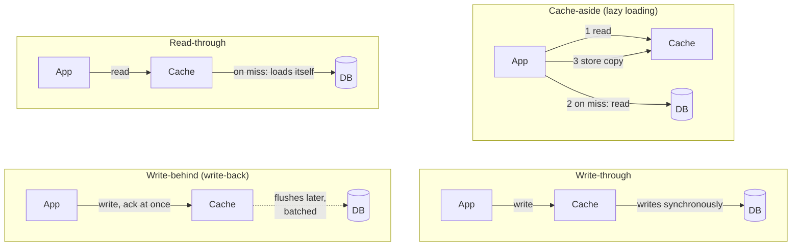
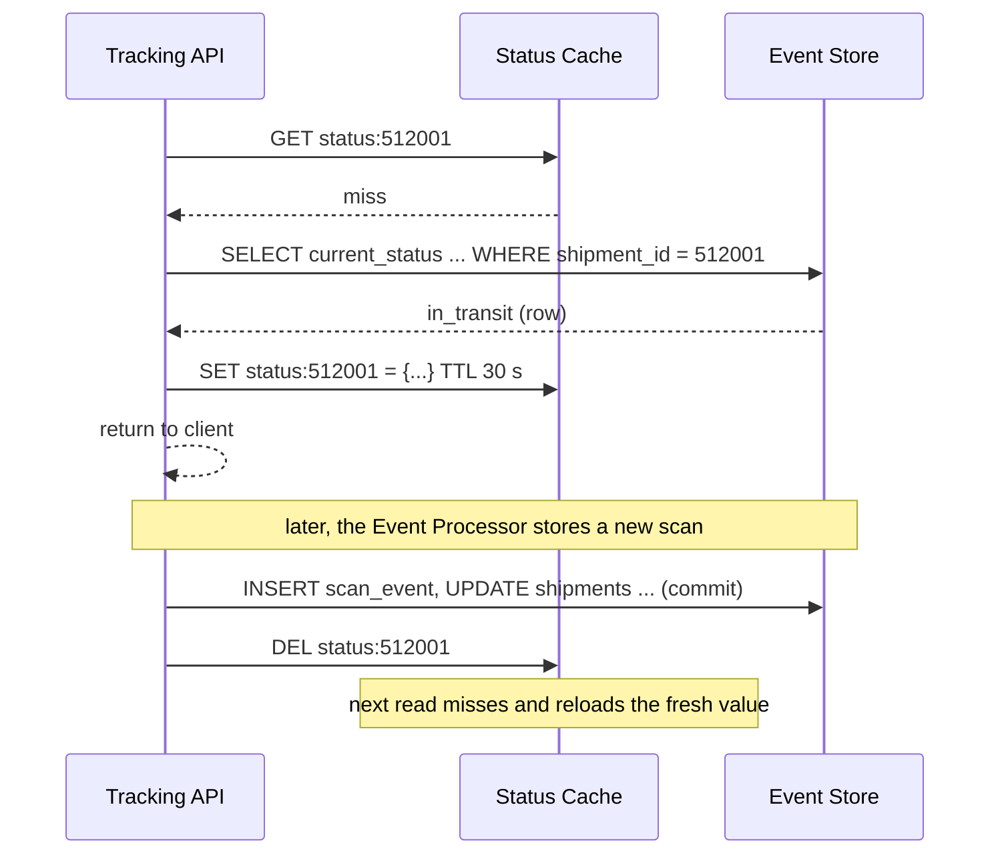

# Caching architecture

> A cache keeps a copy of data closer to where it is needed so that most reads never reach the
> system of record. The design questions are never "should we cache" but where, for how long, who
> keeps the copy correct, and what happens when the cache is wrong or gone.

!!! abstract "Page facts"
    **Level:** Mixed (patterns are Level 1-2; stampedes, hot keys, and failure handling are Level 3)
    · **Status:** Draft · **Time:** 45-60 minutes · **Last verified:** 2026-11-15

## Learning objectives

After this page you should be able to:

- Place caches at the right layers (browser, CDN, application, distributed, database) and say what
  each one protects.
- Choose between cache-aside, read-through, write-through, and write-behind from the workload's
  read/write mix and consistency needs.
- Set TTLs and eviction policies from freshness requirements and working-set size, and estimate the
  resulting hit rate and database load.
- Recognize and prevent cache stampedes, penetration, poisoning, and hot keys.
- Design the failure path: what the system does when the cache is slow, empty, or down.

## Prerequisites

- [Capacity estimation](../performance-and-scalability/capacity-estimation.md) — the read rate and
  working-set size that justify the cache.
- [Relational databases and SQL internals](relational-databases-and-sql-internals.md) — the system of
  record the cache protects.

## The problem this solves

The system of record is the most expensive place to answer a question: it is durable, consistent,
and therefore slow and hard to scale. Most reads ask for the same small set of data repeatedly (the
same product pages, the same user profile, the same parcel status), and most of that data changes
rarely. Without a cache, every one of those reads pays the full price, the database becomes the
bottleneck long before the application tier does, and latency is bounded by the database's disk and
locks. A cache answers the repeated questions from memory, close to the client, at a fraction of the
cost, and shields the database from load spikes. The price is a second copy of the data that can be
stale, and the engineering is in managing that staleness honestly.

## What it is

A **cache** is a store of copies, optimized for fast reads, with a policy for when a copy is
considered fresh and a policy for what to discard when space runs out. It is not a system of record:
losing the whole cache must be survivable. Caches exist at every layer:

| Layer | Example | Protects | Typical freshness control |
|---|---|---|---|
| Client / browser | HTTP cache, in-app memory | The network and everything behind it | HTTP `Cache-Control`, `ETag` |
| CDN / edge | Content delivery network points of presence | Origin servers and egress bandwidth | HTTP headers, purge APIs |
| Application-local | In-process memory of one instance | The distributed cache and the database | Short TTL, size limit |
| Distributed | A shared in-memory store such as Redis or Memcached | The database | TTL, explicit invalidation, eviction |
| Database-internal | Buffer pool, query result cache | Disk | Managed by the engine |

Two caches with the same data at different layers are normal; each has its own TTL, and the
freshness a user sees is the sum of the staleness allowed at each layer in the path.

## Mental model

A cache is the notepad on a receptionist's desk. Callers keep asking the same few questions (opening
hours, the address, who handles returns). Writing the answers on the notepad means most calls are
answered instantly without walking to the back office. The notepad has limited space, so old entries
get crossed out when new ones are needed (eviction). Answers go stale when the back office changes
something, so either the notepad is rewritten every morning (TTL) or someone from the back office
walks over and corrects it when a change happens (invalidation). If a question is not on the notepad,
the receptionist walks to the back office, gets the answer, and writes it down for next time
(cache-aside).

**Where the analogy breaks:** one receptionist cannot be overwhelmed by a thousand simultaneous
callers asking the same not-yet-written-down question at the moment the notepad was wiped. A
distributed system can, and that is the stampede problem. The notepad also never lies on purpose;
caches can be poisoned by an attacker who gets a wrong answer written down.

## Key terms

| Term | Meaning on this page |
|---|---|
| Hit / miss | A read served from the cache / a read that had to go to the source |
| Hit rate | Hits ÷ all reads over a period; the number that decides whether the cache pays for itself |
| Time to live (TTL) | How long an entry is served before it is considered stale |
| Invalidation | Removing or replacing an entry because the source changed |
| Eviction | Removing entries to make room, by a policy such as least recently used |
| Working set | The set of entries that receive most of the reads; what the cache must hold for a high hit rate |
| Stampede | Many concurrent misses for the same key, all hitting the source at once |
| Penetration | Repeated reads for keys that do not exist in the source, so nothing is cached and every read goes through |
| Poisoning | A wrong or attacker-controlled value stored in the cache and served to everyone |
| Hot key | One key receiving a disproportionate share of reads, concentrating load on one node |

## How it works

### The four read/write patterns

**Figure 1 — The four caching patterns.** Who talks to the database (the application or the cache)
and when the write reaches it (synchronously or later) distinguish them.

How to read it: solid arrows are synchronous; the dashed arrow in write-behind is the deferred
flush that makes writes fast and durability conditional.

| Pattern | Read miss | Write | Consistency | Use |
|---|---|---|---|---|
| Cache-aside | Application reads the database and stores the result | Application writes the database, then invalidates (or updates) the cache entry | Stale until TTL or invalidation; the application owns the logic | Default for read-heavy data with a known source of truth |
| Read-through | The cache library or proxy loads from the database | Same as cache-aside, or combined with write-through | Same as cache-aside; less application code | When a caching layer that knows the loader exists |
| Write-through | As above | Every write goes to the cache and synchronously to the database | Cache is never older than the database for written keys | Data that is read soon after it is written; tolerates slower writes |
| Write-behind | As above | Write is acknowledged by the cache; the database is updated later, often batched | Database lags the cache; a cache failure loses unflushed writes | High write rates where the source can lag and loss is tolerable or mitigated by a durable log |

Cache-aside is the workhorse because it keeps the database as the single source of truth and
degrades gracefully: an empty cache only means slower reads. Write-behind is the only one that
makes the cache part of the durability story, which is why it needs a durable write log or a
tolerance for loss.

**Figure 2 — Cache-aside read with a miss, then an invalidating write.** The read path on the left;
a later write on the right removes the stale copy.

How to read it: the write deletes rather than updates the cache entry, so the next reader loads
whatever the database holds at that moment; updating the cache directly risks writing an older value
after a newer one when two writers race.

### Freshness: TTL, invalidation, and consistency

A cached value is correct until the source changes; after that it is **stale** until something
replaces it. Two mechanisms, usually combined:

- **TTL** bounds staleness without any coordination. A 30-second TTL means a reader can see a value
  up to 30 seconds old. TTLs are the right primary control when the source changes unpredictably and
  the requirement is "within N seconds".
- **Invalidation** (delete-on-write) removes staleness for changes the application knows about, at
  the cost of a dependency: every write path must invalidate, including batch jobs and manual fixes.
  Missing one path is the most common cache bug.

The consistency a cache offers is therefore **bounded staleness**: "no older than TTL, usually much
fresher because writes invalidate". Caches are not a place to get read-your-own-writes semantics
unless the writing path updates the cache in the same request and tolerates the race described above.
Where a value must be exact (an account balance before a withdrawal), read the source.

**Negative caching** stores "not found" for a short TTL so that repeated reads for missing keys do
not all reach the source; it is the standard defence against penetration (below).

### Eviction policies

When the cache is full, something must go:

| Policy | Evicts | Suits |
|---|---|---|
| Least recently used (LRU) | The entry not read for the longest time | Most workloads; recency predicts reuse |
| Least frequently used (LFU) | The entry with the fewest reads | Stable popularity where a few keys dominate and should survive bursts of one-off reads |
| First in, first out (FIFO) | The oldest entry regardless of use | Simple, predictable; rarely the best hit rate |
| TTL-based | Entries closest to expiry | When freshness matters more than popularity |
| Random | Any entry | Surprisingly close to LRU on some workloads at lower cost; used by some engines as an approximation |

Engines implement approximations (sampling a few keys rather than keeping a perfect ordering), which
is documented in their eviction references. The architectural decision is to size the cache so that
eviction is rare for the working set, then choose LRU unless the access pattern is known to be
frequency-skewed.

### Sizing and hit rate

The hit rate is set by two things: whether the working set fits, and how long entries live
relative to how often they are read.

- **Working set fits:** if the cache holds every entry that is read at least once per TTL, every
  read except the first per TTL window is a hit. Hit rate ≈ 1 − (misses per key per window ÷ reads
  per key per window).
- **Working set does not fit:** eviction causes extra misses; the hit rate follows the popularity
  curve (a small set of keys gets most reads, so a cache much smaller than the data can still hit
  often).

The database load after caching is reads × (1 − hit rate) plus the writes, which is the number that
decides how many replicas or how large a primary the database needs.

### Distributed cache topology

A distributed cache runs on several nodes with keys spread across them by hashing. **Consistent
hashing** keeps most keys in place when nodes are added or removed, so a scaling event does not empty
the whole cache. Replication within the cache tier gives availability (a replica takes over) but not
durability; treat the data as losable. Clients talk to the cache over the network, so a cache read is
a network round trip (sub-millisecond to a few milliseconds in the same zone), far faster than a
database query but not free; an in-process local cache in front of it removes even that for the
hottest keys, at the cost of per-instance staleness.

### CDN and HTTP caching

For responses that are the same for many users (static assets, public product pages, public API
responses), the **CDN** caches at the edge near users and the browser caches locally, both driven by
HTTP headers defined in RFC 9111: `Cache-Control: max-age` sets the TTL, `ETag` and
`If-None-Match` let a client revalidate cheaply, `Vary` declares which request headers change the
response, and `private` keeps per-user responses out of shared caches. Personalized or authenticated
responses must be marked uncacheable for shared caches, or one user's data is served to another.
Purge APIs invalidate; versioned asset URLs (a hash in the filename) sidestep invalidation entirely by
never reusing a name.

## Worked example: the AtlasMart Status Cache

The Tracking API serves "where is my parcel" reads at up to 210 per second (NFR-4). The source is the
`shipments` row in the Event Store described on the
[relational databases page](relational-databases-and-sql-internals.md). All numbers are assumptions
from the [capacity page](../performance-and-scalability/capacity-estimation.md).

### Pattern and TTL

Cache-aside with a **30-second TTL** plus delete-on-write from the Event Processor. The TTL is chosen
from NFR-1 (status visible within 60 seconds of receipt): even if an invalidation is missed, the
copy expires well inside the freshness budget, leaving the other 30 seconds for queue and processing
lag. The API deletes nothing on reads; the processor deletes `status:<shipment_id>` after each
committed event. Keys are prefixed by type and versioned (`status:v2:...`) so that a schema change
to the cached payload never serves an old shape to new code.

### Hit-rate arithmetic

- Working set: 300,000 in-transit shipments × 4 KB ≈ 1.2 GB, ≈ 1.8 GB with overhead. One small
  cache node holds it, so eviction of hot entries is rare.
- Each in-transit shipment is read about 4 times a day and written (scanned) about 1.6 times a day
  (8 scans over 5 days). Reads : writes ≈ 2.5 : 1.
- Reads within 30 seconds of each other are rare for one shipment (a customer refreshing counts as
  the same read burst), so the realistic model is: each read is a miss if the entry was invalidated
  or expired since the last read. With four reads and about 1.6 invalidations per shipment per day,
  and the entry expiring between reads that are hours apart, the hit rate for this access pattern is
  low on a per-shipment basis.

That last point is the honest finding: a 30-second TTL on a value read four times a day, hours
apart, caches little of the *average* traffic. What it protects is the burst pattern: a customer
opening the page and refreshing several times, the support agent opening the same order minutes
later, a notification that sends thousands of customers to their tracking pages at once, and the
viral case below. The estimate therefore shapes the design in two ways:

1. The TTL stays at **30 seconds** (inside NFR-1's 60-second budget even if an invalidation is
   missed), and delete-on-write is the primary freshness mechanism. A longer TTL would raise the hit
   rate only marginally for this access pattern while widening the worst-case staleness, so it is
   not worth the freshness risk.
2. The cache is treated as **burst and hot-key protection**, not as the thing that makes the average
   case cheap. The database is sized to serve the average read rate on its own (tens of reads per
   second), which it can; the cache is what keeps the sale-day peak of 210 reads/s and the viral
   order off the primary.

### Hot key: the viral order

A parcel that becomes a social-media story might be read 150 times a second against an average of a
fraction of a read per second per shipment. With cache-aside, 149 of those are hits on one key on one
cache node, which a single node handles easily at this scale. At larger scales the same pattern
concentrates on one node; the mitigations, in order of cost: a **local in-process cache** with a
one- or two-second TTL in each API instance (absorbs the hot key before the network), **key
replication** (store the hot key under several suffixes and read a random one), and **request
coalescing** at the API so one instance makes one database read per interval.

### Stampede protection

When the viral order's entry expires or is invalidated, 150 readers in the same second all miss and
all query the database. Three defences, used together:

- **Single-flight** (request coalescing): the first miss on a key takes a short lock (`SET NX` with
  a small TTL) and loads; the others wait briefly and read the fresh entry, or serve the stale value
  if present.
- **Serve stale while revalidating:** keep the entry past its TTL marked as stale; one reader
  refreshes it while others keep using the old value for a few seconds.
- **Probabilistic early expiration:** each reader recomputes the entry slightly before expiry with a
  probability that rises as expiry nears, so refreshes spread out instead of aligning on the expiry
  instant (the method in the Vattani et al. paper in the references).

### Penetration and poisoning

- **Penetration:** a scraper requesting random shipment IDs produces misses that always reach the
  database. Defence: cache the negative result ("no such shipment") for 60 seconds, and reject IDs
  that fail format validation before any lookup. Ownership checks (NFR-5) run before the cache so an
  unauthorized reader never triggers a load.
- **Poisoning:** the cache stores whatever the loader returns. If the loader can be tricked (a
  request header that changes the response but is not part of the key, an upstream that returns an
  error page with a 200 status), the wrong value is served to everyone until expiry. Defence: the
  cache key includes every input that affects the value; only successful, validated responses are
  stored; errors are never cached as values (only as short negative entries where that is intended).

### When the cache is unavailable

The Status Cache is not a system of record, so its failure must not take tracking down (NFR-2).
Behavior by design:

1. Cache client timeouts are short (tens of milliseconds); a timeout is treated as a miss.
2. The API **fails open** to the database, but through a per-instance concurrency limit (a
   semaphore of, say, 20 database reads in flight) so that a cold cache during the 210 reads/s peak
   does not overwhelm the primary. Requests beyond the limit receive a fast "try again" response,
   which is a degraded but available service.
3. A circuit breaker stops calling the cache for a short period after repeated failures, removing the
   timeout latency from every request.
4. Recovery: when the cache returns, entries refill on demand; nothing needs replaying. A warm-up job
   is unnecessary at this working-set size.

Without step 2, a cache outage becomes a database outage; this is the most common way a "cache
problem" turns into a full incident.

## Real-world architecture example

The layered shape (browser cache for the tracking page's static assets, a CDN for those assets and
for public, non-personalized responses, a shared distributed cache for per-entity reads with
delete-on-write from the writer, and the database's own buffer pool underneath) is the standard
arrangement for a web-facing service in any cloud. Large-scale deployments add a lease mechanism to
solve stampedes and stale-set races and replicate the cache tier across regions; the Facebook
memcache paper in the references describes those additions and the problems that motivated them.
The architect's deliverables are the same at any scale: a table of what is cached, with its key,
TTL, invalidation path, and failure behavior.

## Design choices and trade-offs

| Choice | Favor when | Avoid when |
|---|---|---|
| Cache-aside | Read-heavy, source of truth is the database, staleness is bounded by TTL and invalidation | Writes must be immediately visible to all readers with no race window |
| Write-through | Data is read right after being written; slower writes are acceptable | Write rate is high and most written data is never read |
| Write-behind | Very high write rate; the source can lag; loss is tolerable or the cache persists its log | Any data whose loss is unacceptable without a durable log |
| Short TTL only (no invalidation) | Sources change outside your control; simplicity matters | The freshness requirement is tighter than the cost of reloading allows |
| Delete-on-write invalidation | You control every write path | Writes happen in systems you cannot hook |
| Local in-process cache in front of the shared cache | Hot keys, sub-millisecond reads, tolerate per-instance staleness | Values must be identical across instances at the same instant |
| CDN for API responses | Responses are public and identical across users | Responses are personalized or authenticated (or use `private` and short TTLs carefully) |
| Negative caching | Lookups for missing keys are common or attacker-driven | A missing key becomes present often and must be seen at once |

**Assumption behind all of this:** reads outnumber writes and repeat. A write-heavy or
read-once workload (logs, one-time tokens) gains nothing from a cache and pays its full complexity.

## Failure modes and anti-patterns

- **Cache as the database.** Data lives only in the cache; a restart loses it. Detect: no source of
  truth for some keys. Prevent: every key has a loader from a durable source.
- **Missed invalidation path.** A batch job or admin tool writes the database without deleting the
  cache; users see stale data until TTL. Detect: stale reports that resolve "by themselves" after
  the TTL. Prevent: invalidate in the data-access layer, not in each caller; keep the TTL as a bound.
- **Update-on-write race.** Writer A and B update the cache in the wrong order; the cache holds the
  older value until TTL. Prevent: delete, do not set; or version the values.
- **Unbounded TTL.** Entries never expire; a missed invalidation is permanent. Prevent: every entry
  has a TTL, even a long one.
- **Caching errors.** An upstream outage returns errors that get cached as the answer. Prevent:
  store only validated successes.
- **Thundering herd on deploy or restart.** All instances start cold at once at peak. Prevent:
  rolling restarts; serve-stale; concurrency limits on the source.
- **Key without all inputs.** A response that varies by locale or role is cached under a key that
  ignores them; users see each other's variants. Prevent: the key is the full set of inputs.
- **Measuring nothing.** No hit-rate or latency metric per key type, so nobody knows if the cache
  helps. Prevent: hit rate, miss latency, eviction count, and memory per key prefix on a dashboard.

## Security considerations

- **Authorization before caching.** Cache the entity, not the authorized response; check ownership on
  every request before reading the cache, or include the principal in the key for per-user responses.
- **Shared caches and personal data.** Never let a per-user response be stored in a shared HTTP cache
  (`Cache-Control: private`, no caching of authenticated responses at the CDN by default).
- **Poisoning surfaces.** Unkeyed inputs (headers, query parameters the loader honors but the key
  omits) and upstream error pages are the classic poisoning vectors; validate and key completely.
- **Cache contents are data at rest.** A distributed cache holding customer data needs network
  isolation, authentication, encryption in transit, and the same retention rules as the database; a
  cache dump is a data breach.
- **Penetration as denial of service.** Negative caching, input validation, and rate limiting by
  client protect the source from enumeration attacks.

## Performance, reliability, and cost

- **Performance:** a cache hit removes the database round trip and its queueing; the win is largest
  for the tail (p99), because the database's lock and I/O variance disappears for hits. Measure miss
  latency separately, because misses are now slower than before (they pay the cache miss plus the
  database).
- **Reliability:** the cache must be allowed to fail. Fail-open with a concurrency limit, short
  timeouts, and a circuit breaker turn a cache outage into degraded latency instead of an outage.
  Replicated cache nodes shorten the degraded window.
- **Cost:** memory is the cost unit; the working set sets the node size and the eviction policy
  decides how gracefully a too-small cache behaves. A cache that lets the database stay one size
  smaller usually pays for itself; a cache in front of a database that was already idle does not.

## Hands-on lab: measure a cache's effect on a hot key

Using any local HTTP service and a load generator (Lab 01's service works, or a one-file web
framework app):

1. Add an endpoint that reads one row from a local database (or sleeps 20 ms to simulate it).
2. Run a load test of 100 requests per second for 60 seconds against it; record p50 and p99 latency
   and the request rate the database saw.
3. Add an in-process cache-aside dictionary with a 5-second TTL in front of the read. Repeat the
   test; compare latencies and database request count. Compute the hit rate.
4. Make the TTL 1 second and run 50 concurrent clients that start together. Count how many database
   reads happen in the second after each expiry (the stampede). Add single-flight (a lock around the
   reload) and count again.
5. Kill the database (or make the simulated read raise an error) while the cache is warm, then
   after the TTL. Describe what the client saw in each case, and add a fail-open limit if your
   service fell over.

??? question "Hint: what to expect"
    With a warm cache, p99 drops to the in-memory read time and the database sees about one read
    per TTL window per key. Without single-flight, each expiry produces a burst of reads equal to the
    number of concurrent clients that missed in that instant; with it, one.

## Knowledge check

1. Why does cache-aside delete the entry on write rather than update it with the new value?
2. A value is read 1,000 times per hour and changes once per hour, with a 60-second TTL and no
   invalidation. Roughly what is the hit rate, and how stale can a reader's view be?
3. Name the three stampede defences on this page and the situation each suits best.
4. What distinguishes penetration from a stampede, and what is the defence for each?
5. The cache tier goes down at peak. List the three behaviors that keep the service available.

??? success "Answers"
    1. Two writers can race: the slower write may set an older value after the newer one. Deleting
       forces the next reader to load the current database state, which cannot be older than the
       last commit.
    2. About 60 misses per hour (one per TTL window) out of 1,000 reads ≈ 94% hits. A reader can see
       a value up to 60 seconds older than the hourly change; with delete-on-write that window closes
       at the write instead.
    3. Single-flight (one loader per key; others wait or serve stale): general purpose. Serve stale
       while revalidating: when a slightly old value is acceptable and latency matters. Probabilistic
       early expiration: many keys with aligned expiry times and a recomputation that is expensive.
    4. Penetration is misses for keys that do not exist, so nothing is ever cached; defended by
       negative caching and input validation. A stampede is many simultaneous misses for a key that
       does exist; defended by coalescing or early refresh.
    5. Short cache timeouts treated as misses; fail open to the database behind a concurrency limit
       that sheds excess load; a circuit breaker that stops paying the timeout on every request.

## Architecture discussion questions

1. A team proposes write-behind caching for order submissions to "make checkout instant". Which
   NFR does that endanger, what would make it acceptable, and what simpler design gives the same
   user-visible latency?
2. The tracking page must show a status within 60 seconds of a scan (NFR-1), but a product team wants
   a 10-minute CDN cache on the tracking API response for cost reasons. Reconcile these, or explain
   why you cannot.
3. Where would you put a cache in a system whose reads are dominated by one-time lookups of unique
   keys (fresh password-reset tokens), and why might the answer be "nowhere"?

## Summary

Caches hold copies closer to the reader at every layer from browser to database buffer pool.
Cache-aside with delete-on-write is the default pattern; read-through packages it; write-through
keeps written keys fresh at a write-latency cost; write-behind makes the cache part of durability.
Freshness is bounded by TTL and tightened by invalidation; eviction policies decide what survives a
full cache, and the working set decides the node size. Stampedes, penetration, poisoning, and hot keys
are the four failure patterns to design against, and the cache must be allowed to fail: short
timeouts, fail-open behind a concurrency limit, and a circuit breaker keep a cache outage from
becoming a database outage.

## Related topics

- **Before:** [Capacity estimation](../performance-and-scalability/capacity-estimation.md);
  [Relational databases and SQL internals](relational-databases-and-sql-internals.md)
- **Alongside:** [Performance fundamentals and Little's Law](../performance-and-scalability/performance-fundamentals-and-littles-law.md)
  — tail latency and the concurrency limit; [High availability design](../reliability-and-disaster-recovery/high-availability-design.md)
  — the cache as a non-critical dependency; [API design](../application-and-api-architecture/api-design-rest-graphql-grpc-and-async-apis.md)
  — HTTP caching headers on API responses; [Transport and application protocols](../networking/transport-and-application-protocols.md)
  — HTTP semantics the CDN relies on.
- **Planned:** NoSQL and in-memory data stores (D06-T02); scaling and optimization techniques
  (D14-T02); network security, load balancing, and CDNs (D09-T03); Lab 02 (add a cache and compare
  hit/miss behavior).

## References

| Source | Type | Checked |
|---|---|---|
| [RFC 9111: HTTP Caching](https://www.rfc-editor.org/rfc/rfc9111) — IETF | Standard | 2026-11-15 |
| [Redis documentation: Key eviction](https://redis.io/docs/latest/develop/reference/eviction/) | Official documentation | 2026-11-15 |
| [Amazon ElastiCache: Caching strategies](https://docs.aws.amazon.com/AmazonElastiCache/latest/dg/Strategies.html) — Amazon Web Services | Official documentation (lazy loading, write-through, TTL) | 2026-11-15 |
| R. Nishtala et al., ["Scaling Memcache at Facebook"](https://www.usenix.org/conference/nsdi13/technical-sessions/presentation/nishtala), NSDI 2013 | Paper (leases, stale sets, regional replication) | 2026-11-15 |
| A. Vattani, F. Chierichetti, K. Lowenstein, ["Optimal Probabilistic Cache Stampede Prevention"](https://www.vldb.org/pvldb/vol8/p886-vattani.pdf), PVLDB 8(8), 2015 | Paper (probabilistic early expiration) | 2026-11-15 |
| [MDN Web Docs: HTTP caching](https://developer.mozilla.org/en-US/docs/Web/HTTP/Guides/Caching) — Mozilla | Reference documentation | 2026-11-15 |
| Google, [Site Reliability Engineering: Addressing Cascading Failures](https://sre.google/sre-book/addressing-cascading-failures/) | Book chapter (load shedding, fail-open limits) | 2026-11-15 |
| Martin Fowler, [TwoHardThings](https://martinfowler.com/bliki/TwoHardThings.html) | Essay (the origin of the "cache invalidation" quip) | 2026-11-15 |

## Review notes

- Canonical page for D06-T05. Every inventory item is defined; depth is on cache-aside,
  TTL/invalidation, eviction, stampede, penetration, poisoning, hot keys, and failure handling.
  Database-internal caching and CDN are covered at the level of placement and headers; CDN
  architecture itself belongs to D09-T03.
- The worked example keeps the capacity page's 30-second TTL and concludes that the cache mainly
  protects bursts and hot keys rather than the average read rate; a reviewer should confirm that
  conclusion is stated the same way on both pages.
- The "150 reads per second for a viral order" figure is an illustrative assumption introduced on the
  capacity page's anti-pattern list; no measurement supports it.
- Reviewer: confirm the eviction-policy table against the Redis and Memcached documentation for the
  versions in use; approximations differ by engine and version.
