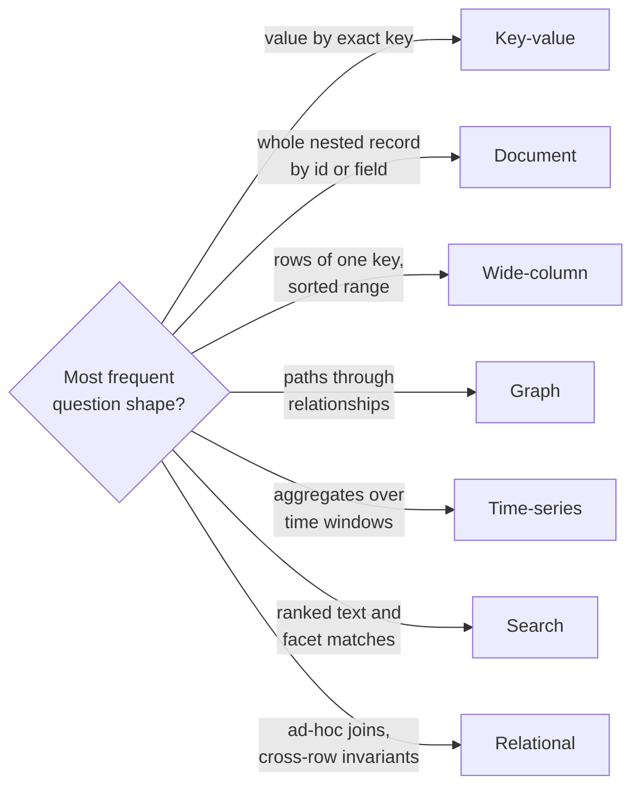
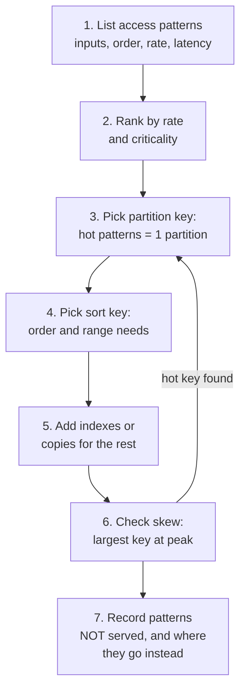
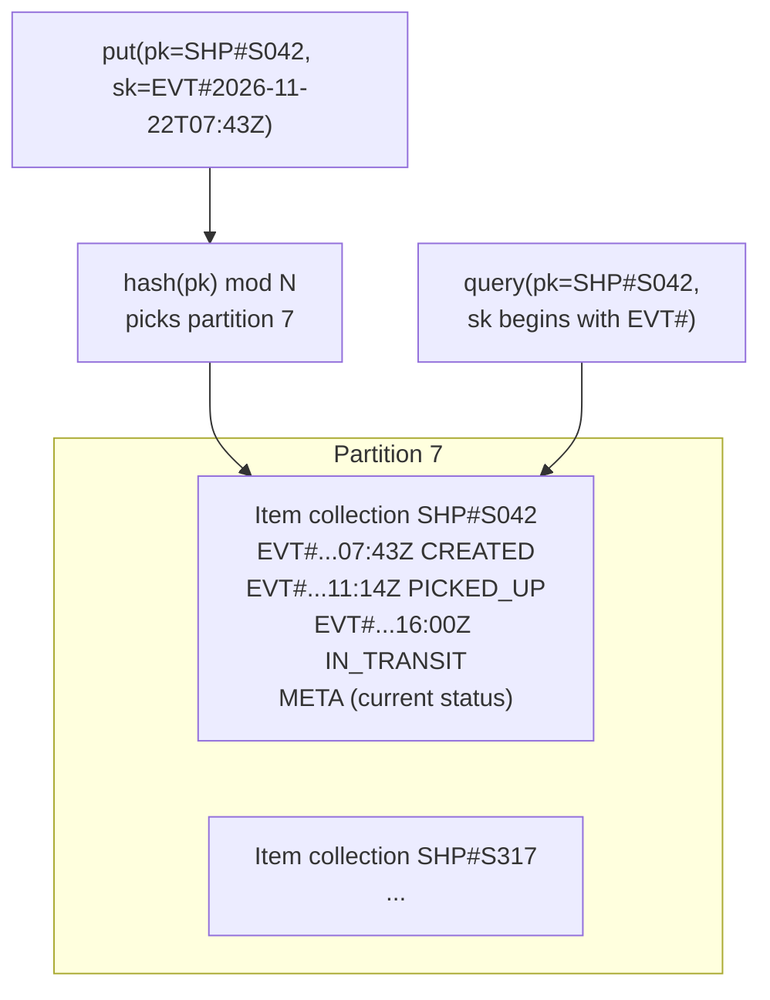
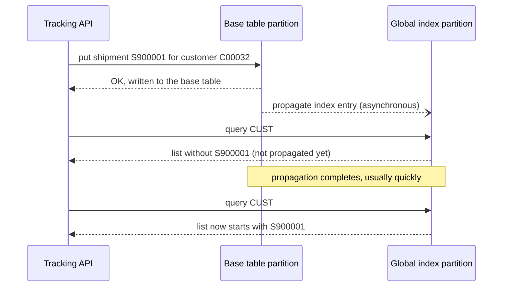
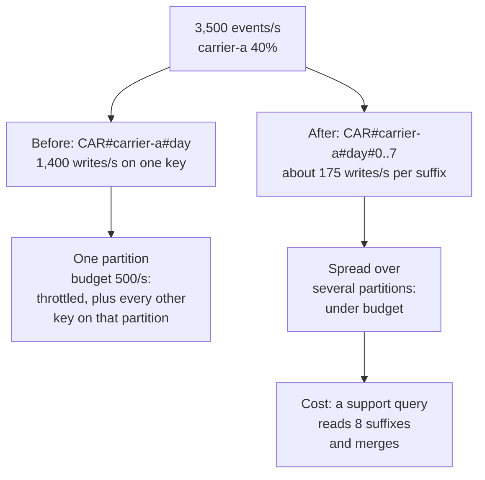

# NoSQL databases

> NoSQL databases trade the relational promise "ask any question later" for a different one:
> "the questions you designed for are answered from one partition, at any scale". Using them well
> means listing the access patterns first, choosing partition and sort keys that make each one a
> single-partition read, and knowing exactly which questions you have given up.

!!! abstract "Page facts"
    **Level:** Mixed (the families and key concepts are Level 1-2; single-table design, index
    consistency, and hot-partition control are Level 3) · **Status:** Draft · **Time:** 60-75
    minutes · **Last verified:** 2026-11-27

## Learning objectives

After this page you should be able to:

- Compare key-value, document, wide-column, graph, time-series, search, in-memory, and multi-model
  stores by data model, query shape, consistency options, and typical use.
- Design a key-value or document model from a list of access patterns, choosing partition keys and
  sort keys so that each hot pattern reads one partition.
- Decide where to denormalize and when a single-table design is worth its complexity.
- Explain local versus global secondary indexes and what each does to read consistency and write cost.
- Predict a hot partition from a key choice and a skewed workload, with arithmetic, and size write
  sharding to remove it.
- Recognize the workloads for which a relational database is still the right answer.

## Prerequisites

- [Relational databases and SQL internals](relational-databases-and-sql-internals.md) — the
  baseline this page is compared against; the AtlasMart Tracking Event Store schema used below.
- [Scaling, partitioning, and replication](../distributed-systems/scaling-partitioning-and-replication.md)
  — partitioning strategies, hash placement, and the hypothetical 50× growth scenario reused here.
- [Consistency models, CAP, and PACELC](../distributed-systems/consistency-models-cap-and-pacelc.md)
  — the models this page only maps onto product settings; it does not re-explain them.

## The problem this solves

By the mid-2000s, large web companies had workloads that one relational primary could not serve:
millions of key-addressed reads and writes per second, data spread across data centres, and a
business rule that a shopping cart must accept writes even while some servers are unreachable.
Sharding a relational database by hand worked, but it threw away most of what made the database
relational (cross-shard joins, transactions, and constraints) while keeping its operational weight.
Amazon's Dynamo paper and Google's Bigtable paper (both cited below) described the alternative:
give up general-purpose queries and multi-row transactions, keep a simple key-based data model, and
build in partitioning, replication, and failure handling from the start. Other families followed
for other shapes of data: documents for nested records, graphs for relationships, time-series for
metrics, and inverted indexes for text search.

## What it is

**NoSQL** ("not only SQL") is a loose name for databases that do not use the relational table model
as their primary abstraction. They share few properties beyond that; what they usually have in
common is that **the physical layout follows the queries**, data is **partitioned by a key** across
many nodes, and **consistency is a configurable trade-off** rather than a fixed ACID guarantee.

**Figure 1 — Choosing a family from the query shape.** Start from the question the application
asks most often; each family is optimized for one shape.

How to read it: one diamond, seven exits. Real systems often need two exits, which is why
**polyglot persistence** (one store per access-pattern family) and **multi-model** products exist.

| Family | Data model | Query shape it serves | Consistency options (typical) | Typical use |
|---|---|---|---|---|
| Key-value | Opaque value under a key, sometimes with a sort key inside the partition | Get, put, delete by key; range on the sort key within one partition | Per-request eventual or strong reads in some services; quorum settings in Dynamo-style systems | Sessions, carts, user profiles, status lookups, idempotency records |
| Document | Self-describing nested documents (JSON-like) grouped in collections | By id, by indexed fields, nested-field filters, aggregations within a collection | Primary reads are strong; replica reads and read/write concerns trade freshness for latency | Product catalogue, orders with embedded lines, content management |
| Wide-column | Rows identified by a partition key; columns clustered and sorted inside the partition | One partition's rows, sorted range slices; very high write rates | Tunable per request (one replica, a quorum, all replicas, local-datacentre quorum) | Event and activity history, IoT readings, messaging inboxes |
| Graph | Nodes and edges, both with properties | Traversals: neighbours, paths, patterns of relationships | Usually single-leader with transactions; some offer replicas with lag | Fraud rings, recommendations, network and dependency maps, access graphs |
| Time-series | Measurements keyed by series and timestamp, often with tags | Window aggregates, downsampling, latest value per series | Usually eventual across replicas; append-mostly writes | Metrics, sensor telemetry, financial ticks |
| Search | Inverted index over documents, with analyzers and relevance scoring | Full-text and fuzzy matching, ranking, faceted filters | Near-real-time: a write becomes searchable after a refresh interval | Product search, log search, support-ticket search |
| In-memory | Key-value or data structures held in RAM, optionally persisted | Sub-millisecond gets, counters, sorted sets, rate-limit buckets | Replication usually asynchronous; a failover can lose recent writes | Caches, leaderboards, rate limiting (see the [caching page](caching-architecture.md)) |
| Distributed (property, not a family) | Any of the above, partitioned and replicated across nodes by design | Whatever the model serves, at a scale beyond one node | Chosen per system or per request; this is where CAP and PACELC apply | Any workload that outgrows one node or must span zones or regions |
| Multi-model | One engine or service exposing several models (document, key-value, graph, wide-column APIs) | Each API's shape, over shared storage and operations | One account- or database-level setting applied to all models | Teams that want one operational platform for several data shapes |

A few representative systems, named only to anchor the vocabulary (each linked to its own
documentation in the References):

| System | Family it is usually filed under | Its name for the partition key / sort key |
|---|---|---|
| Amazon DynamoDB | Key-value and document (managed) | Partition key / sort key |
| Apache Cassandra | Wide-column | Partition key / clustering columns |
| MongoDB | Document | Shard key (sharded clusters); documents embed related data |
| Azure Cosmos DB | Multi-model (NoSQL, MongoDB, Apache Cassandra, Apache Gremlin, and Table APIs) | Partition key (logical partitions) |
| Google Bigtable (paper) | Wide-column | Row key (rows sorted by key) |

## Mental model

Picture a wall of **post-office boxes**. Each box has a number (the **partition key**), and inside a
box the letters are **filed in order** by a label you chose (the **sort key**). If you know the box
number, you open one box and read a slice of it, and that is just as fast with a million boxes as
with ten. You decided in advance how mail is addressed, so the questions "what is in box 4711?" and
"letters in box 4711 from last week" are instant. "Every letter mentioning a delay, in any box" means
opening every box. A **secondary index** is a second wall of boxes, addressed differently, that a
clerk fills with copies of the letters; the clerk runs a little behind.

**Where the analogy breaks:** real boxes do not have a speed limit, but a partition does: it lives
on one set of servers and serves a bounded number of requests per second, so a box that receives
half of all mail (a **hot partition**) jams while the others sit idle. And each box exists in
several copies in different buildings, which may briefly disagree about the latest letter.

## Key terms

| Term | Meaning on this page |
|---|---|
| Partition key | The attribute whose value (hashed) decides which partition stores an item (glossary: partition key) |
| Sort key | A second key that orders items inside one partition key and supports range and prefix queries |
| Item collection | All items that share one partition key value; read together by one query |
| Access pattern | A named question the application asks, with its inputs, ordering, rate, and latency target |
| Denormalization | Storing a copy of a value where a read needs it, accepting the work of keeping copies in step (glossary) |
| Single-table design | Storing several entity types in one table, keyed so that related items share a partition key |
| Local secondary index | An index with the same partition key as the base table and a different sort key; lives with the partition |
| Global secondary index | An index with its own partition key, stored and partitioned separately; updated asynchronously |
| Hot partition | A partition receiving a disproportionate share of traffic, usually from a skewed key (glossary) |
| Write sharding (key salting) | Appending a suffix to a hot partition key so its writes spread over several partitions |
| Adaptive capacity | A managed-service behaviour that shifts throughput toward, or splits, partitions that run hot |
| Tunable consistency | A per-request or per-database choice of how many replicas a read or write must involve |

## How it works

### Consistency options in NoSQL systems

The [consistency models page](../distributed-systems/consistency-models-cap-and-pacelc.md) defines
linearizable, sequential, causal, session, bounded-staleness, and eventual consistency, and explains
quorums and conflict resolution. NoSQL products expose those models through a handful of knobs:

| Knob | How it shows up | Example from the cited documentation |
|---|---|---|
| Replica counts per request | N copies; a read waits for R replicas, a write for W; R + W > N gives overlapping quorums | Dynamo's N, R, W; Cassandra's ONE, QUORUM, LOCAL_QUORUM, ALL consistency levels |
| Strong versus eventual per read | A flag on each read: route to the leader (current) or any replica (maybe stale, cheaper) | DynamoDB base-table and local-index reads; global-index queries are eventual only |
| A named level per account or request | One setting chosen from an ordered list of models | Cosmos DB: strong, bounded staleness, session, consistent prefix, eventual |
| Read and write concerns | How many replicas must acknowledge a write, and which committed data a read may see | MongoDB read concerns such as "local", "majority", "linearizable", "snapshot" |
| Conflict handling | What happens when two replicas accepted different writes | Last-write-wins timestamps; Dynamo's vector clocks returned to the client to merge |

Two rules carry over from the consistency page. First, choose per read path, not per system: a
customer's status view and a balance check need different settings on the same store. Second, a
"strong" read usually costs more (leader routing, a quorum, or more capacity units), so default to the
weakest setting the requirement allows and write down why.

### Access-pattern-first design

A relational schema is designed from the entities and then indexed for the queries. A NoSQL model is
designed **from the queries**, because the key layout is the only index the store maintains for free.

**Figure 2 — The access-pattern-first design loop.** The output is a key design plus a list of
questions that are deliberately *not* served.

How to read it: the loop back from step 6 is the normal case, not a failure; most first key choices
hide a skewed value. Step 7 is what keeps the design honest: every unsupported question gets a named
home (a secondary index, a search index, or an analytics copy).

The steps in words:

1. **List every access pattern** as a sentence with inputs and output order: "events for a shipment,
   oldest first", not "events table".
2. **Attach a rate and a latency target** from the capacity estimate. A pattern run once a day by an
   analyst is not designed for in the operational store.
3. **Choose the partition key** so the highest-rate patterns each name exactly one partition key
   value. High cardinality and even traffic matter more than tidy entity boundaries.
4. **Choose the sort key** to deliver the required order and ranges: timestamps in sortable form
   (ISO-8601 UTC strings or fixed-width numbers), hierarchical prefixes (`EVT#`, `META`), or a
   sequence number.
5. **Serve the remaining patterns** with a secondary index, a denormalized copy, or a different
   store fed by change events.
6. **Check skew** with the largest value at the peak, not the average.

### Partition keys and sort keys

**Figure 3 — How items are placed.** A stable hash of the partition key picks the partition; inside
the partition, items of one key are kept sorted by the sort key.

How to read it: the write and the query both name the partition key, so each touches exactly one
partition. The query reads a contiguous run of sort keys, already in time order; no sort step.

What the two keys can and cannot do:

- **Equality on the partition key is mandatory** for an efficient query. Without it, the only
  operation left is a **scan** of every partition.
- **Range, prefix, and order on the sort key** are cheap: "the 10 newest", "between two times",
  "begins with `EVT#`".
- **Filters on other attributes** are applied after the items are read. They reduce what is
  returned, not what is read or billed.
- **Item collections must stay bounded.** A partition key whose collection grows without limit (all
  events of a large carrier, forever) eventually exceeds what one partition can store or serve.
- **The partition key is close to irreversible.** Changing it means writing every item again under
  new keys, typically through a backfill and a dual-write period.

### Denormalization and single-table design

Because there are no joins at read time, a NoSQL model **copies data to where it is read**. The
shipment's carrier is stored on every event item, the customer id on the shipment item, and a
summary of each shipment in an index partitioned by customer. Each copy needs an owner: the code
path that writes the source must update the copies, in the same write where the store supports
multi-item transactions or through a change stream where it does not, with the staleness written down.

**Single-table design** goes further: several entity types live in one table, keyed so that the items
a page needs share a partition key and can be fetched in one query (the shipment summary and its
events, for instance). It is a technique, not a rule:

| | Single-table | One table per entity |
|---|---|---|
| Reads | Related items in one request | One request per entity type, merged in the application |
| Understanding the data | Needs a key-design document; raw items are hard to read | Familiar; each table has one item shape |
| Change | Adding a new access pattern can mean re-keying many items | New tables can be added independently |
| Capacity and metrics | Shared; one noisy entity type affects others | Separate, easier to attribute |
| Favour when | A few stable, high-rate patterns dominate | Patterns are still changing or teams own different entities |

### Secondary indexes: local and global

A secondary index lets the store answer a pattern keyed by something other than the base table's
keys, by maintaining a second, differently keyed copy of (some of) the data.

| | Local secondary index | Global secondary index |
|---|---|---|
| Partition key | Same as the base table | Any attribute; its own partitioning |
| Sort key | A different attribute | Any attribute |
| Scope of a query | Inside one base partition key | Across the whole table |
| Read consistency | Can be as strong as base-table reads (updated with the item) | Eventual: updated asynchronously after the base write |
| Write cost | Every indexed write also writes the index, in the same partition | Every indexed write also writes to another partition, possibly a hot one |
| Typical use | A second ordering of one collection (a shipment's events by status) | A different access path (shipments by customer, events by carrier and day) |

**Figure 4 — Why a global index read can miss a write that just succeeded.**

How to read it: the base write is acknowledged before the index is updated. A read-your-writes path
must read the base table by key, or show the new item from the write response, instead of trusting
the index. Lab 07 reproduces exactly this sequence.

Projections matter: an index that holds only keys forces a second read of the base item for each
result, while an index that copies ("projects") the needed attributes answers in one read at the cost
of storage and of rewriting the copy whenever a projected attribute changes. An index whose
partition key has few values (status, carrier, date) inherits every hot-partition problem below.

### Hot partitions: write sharding, salting, and adaptive capacity

The [scaling page](../distributed-systems/scaling-partitioning-and-replication.md) explains why even
placement of keys does not mean even load. In a NoSQL store the symptom is **throttling**: requests
to the hot partition are rejected or slowed while the table as a whole is far below its capacity.

- **Write sharding** (key salting) appends a suffix to the hot key: `CAR#carrier-a#2026-11-27#0` to
  `#7`. A **random suffix** spreads writes best but means every read must query all suffixes and
  merge. A **calculated suffix** (a stable hash of another attribute, such as the shipment id) spreads
  writes almost as well and lets a reader that knows that attribute go straight to one suffix.
- **Choosing k:** divide the key's peak write rate by the per-partition budget, then add headroom,
  because suffixes share physical partitions with other keys. Every read of the logical key costs
  k queries.
- **Time-bucketed keys** (`#2026-11-27`, or hourly buckets for very hot streams) bound collection size
  and age data out, but put all *current* writes on the newest bucket; combine with sharding.
- **Adaptive capacity** (a concept here): some managed services detect a hot partition and shift
  unused throughput to it, or split it so hot items get their own partition. It absorbs uneven but
  bounded skew. It cannot make one partition key value faster than one partition allows, so a single
  key that is too hot still needs sharding, caching, or a different key. Check the provider's current
  documentation for what it does automatically.
- **Reads of a hot key** (a viral shipment) are a caching problem first; see the hot-key section of
  the [caching page](caching-architecture.md).

### When relational is still the right answer

Choose a relational database when most of these are true:

- **Questions are not known in advance**: support, finance, and operations will keep inventing new
  filters and joins. Every unplanned NoSQL query is a scan or a new index with a backfill.
- **Invariants span rows or entities**: "stock never below zero across reservations", "a payment and
  its ledger entries commit together". Multi-row ACID transactions are native there and limited or
  costly in most NoSQL stores.
- **The data fits one primary** with replicas, as AtlasMart's does today (the relational page's
  worked example). Partitioning is a cost you pay for scale you need, not a feature.
- **Integrity constraints carry business rules**: foreign keys, uniqueness across entities, checks.
- **Reporting needs consistent snapshots** across many tables.

Many systems end up with both: a relational system of record and a NoSQL store (or search index) fed
from it for one high-rate access path.

## Worked example: AtlasMart tracking reads in a key-value store

AtlasMart's Tracking Event Store is PostgreSQL, and the
[relational page](relational-databases-and-sql-internals.md) shows why that is right at today's
scale. This example is an evaluation the tracking team is asked to write for the hypothetical 50×
marketplace scenario on the
[scaling page](../distributed-systems/scaling-partitioning-and-replication.md): what would the read
side look like in a managed key-value/document store, and where would it hurt?

### Step 1 — Access patterns

| # | Access pattern | Today's sale-day peak | At 50× | Order and size |
|---|---|---|---|---|
| A1 | Shipment by id (current status) | 210 reads/s (NFR-4; mostly served by the Status Cache) | 10,500 reads/s | One item |
| A2 | A customer's recent shipments | 21 reads/s (assumption: 10% of tracking reads) | 1,050 reads/s | Newest first, 5 per page |
| A3 | Events for a shipment, in order | 210 reads/s (the tracking page shows the timeline with the status) | 10,500 reads/s | Oldest first, about 8 events |
| W1 | Append a scan event, update status | 70 events/s (NFR-4) | 3,500 events/s | 500 B per event |
| X1 | Support: shipments delayed at carrier X yesterday | A few per hour | A few per hour | Any order |

### Step 2 — Key design

Single table `tracking`, partition key = the shipment, plus one global index for A2.

| Item | Partition key | Sort key | Attributes (copies marked) | Serves |
|---|---|---|---|---|
| Shipment summary | `SHP#<shipment_id>` | `META` | status, carrier, created_at, customer_id (copy), order_id (copy) | A1 by get |
| Scan event | `SHP#<shipment_id>` | `EVT#<occurred_at>#<event_id>` | status, location, carrier (copy) | A3 by query `begins_with EVT#` |
| Index `by_customer` | `CUST#<customer_id>` | `<created_at>#<shipment_id>` | projected: status, carrier | A2 by query, newest first, limit 5 |

- **A1** is one get, one item, one partition. **A3** is one query on the same partition key: about
  8 × 500 B ≈ 4 KB read in sort-key order, so the timeline needs no sort.
- **W1** writes the event item and updates `META` under the same partition key. Where the store
  offers multi-item transactions within a partition, both commit together; the
  `status_updated_at` guard from the relational page carries over as a conditional write.
- **A2** reads the index, so a customer who has just ordered may not see the new shipment for a
  moment (Figure 4). The order-confirmation page already has the shipment id and reads it by A1.
- **Retention:** tracking data is deleted 180 days after delivery (the
  [data security page](../security-architecture/data-security-and-privacy.md)). In a key-value store
  that becomes a per-item expiry timestamp set when `DELIVERED` arrives, instead of dropping monthly
  partitions. Storage stays the data security page's figure: about 185 days × 240 MB ≈ 44.4 GB of
  event data per copy today, plus the index's projected copies.
- **Consistency:** A1 and A3 use the store's default (eventual) reads. NFR-1 is a bounded-staleness
  requirement (60 s for 99% of events), and the monotonic-reads rule from the consistency page (the
  UI never replaces a status with one carrying a lower per-shipment sequence number) still applies.

### Step 3 — X1 has no key, and the obvious fix is the hot partition

X1 names a carrier and a day, not a shipment. In this design it is a scan of every partition. The
support team asks for a global index keyed `CAR#<carrier>#<day>` with sort key
`<status>#<occurred_at>#<event_id>`, so "DELAYED at carrier-c yesterday" becomes one query. Every
event write now also writes to that index, and the index's partition key has only 12 values per
day (12 carriers).

**Sale-day arithmetic (assumption: a promotion ships with carrier-a's express service, which carries
40% of scan events on sale day; the other 11 carriers share 60%):**

| Key for event writes | Writes/s on the busiest key today (70 events/s) | Same at 50× (3,500 events/s) | Against a 500 writes/s per-partition budget |
|---|---|---|---|
| Base table, `SHP#<id>` | About one event every few hours per shipment; 70/s spread over about 300,000 shipments in transit | 3,500/s spread over the same key space | Even; no partition near the budget |
| Index `CAR#<carrier>#<day>` | 0.40 × 70 = 28/s, against an even share of 70 ÷ 12 ≈ 5.8/s: 4.8× | 0.40 × 3,500 = 1,400/s | 1,400 ÷ 500 = 2.8× over: throttled |
| Index `DAY#<day>` (all events of a day) | 70/s, all on one key | 3,500/s | 7× over |
| Index `CAR#<carrier>#<day>#<0..7>` | 28 ÷ 8 = 3.5/s per suffix | 1,400 ÷ 8 = 175/s per suffix | 35% of budget, headroom for collisions |

The 500 writes/s per-partition budget is the team's design assumption, reused from the scaling page's
per-shard-group limit; it is not any product's limit. Check the provider's current documentation for
real per-partition limits, which at today's 70 events/s AtlasMart would not come near. The ratio is
the point: a key holding 40% of the traffic among 12 values carries 4.8× its fair share at any volume,
and growth turns that ratio into throttling.

**Why k = 8 and not 4:** 1,400 ÷ 500 = 2.8, so four suffixes look sufficient at 350/s each. But each
suffix lands on a physical partition that also holds other carriers' keys. In Lab 07's simulation (16
partitions), four suffixes still left one partition at 548 writes/s and throttled 1,702 of 35,000
writes; eight suffixes brought the hottest partition to 276 writes/s with nothing throttled. The cost
is on the read side: X1 now issues 8 queries and merges them, which is acceptable for a pattern that
runs a few times an hour.

**Figure 5 — The carrier-day index before and after write sharding on sale day (50× scenario).**

How to read it: the left branch fails at the partition, not at the table; the right branch moves the
cost from writes (a constraint at peak) to reads of a rare query (cheap). In the lab, three other
carriers whose keys happened to share carrier-a's partition were throttled too: a hot key damages
its neighbours.

### Step 4 — The evaluation's conclusion

The key-value design serves A1, A2, A3, and W1 from single partitions at the 50× rates, and X1 only
through an index that needs sharding. Support's next question ("delayed at carrier X yesterday, for
customers in tier gold, longer than two days") would need yet another index. The recommendation is
therefore polyglot: keep PostgreSQL (or its sharded successor) as the system of record and the home
of support queries on a read replica, and add a key-value read model only if measured load on A1 and
A3 outgrows the cache plus replicas. That decision belongs in an ADR, with this page's arithmetic as
its evidence.

## Real-world architecture example

A common production shape: a relational or document **system of record** publishes changes (through
change data capture or an outbox) to an event log; consumers build a **key-value read model** for the
high-rate, key-addressed paths (status by id, a user's recent items), a **search index** for text and
faceted queries, and an **analytics copy** for ad-hoc questions. Each store is keyed for its own access
patterns, and each one's staleness is stated as a bounded-staleness objective. This is CQRS applied
at the storage layer; the
[distributed system patterns page](../software-architecture/distributed-system-patterns.md) covers
CQRS and read models, and the advanced database architecture page (D06-T03) covers CDC.

## Design choices and trade-offs

| Choice | Favor when | Avoid when |
|---|---|---|
| Key-value or document store for an operational path | A few known, high-rate, key-addressed patterns; growth beyond one primary is expected | Patterns are still being discovered; ad-hoc queries are routine |
| Embed related data in one document or item collection | Data is read together and bounded in size (an order and its lines) | The embedded part grows without bound or is updated independently at high rate |
| Single-table design | Stable patterns where related items must come back in one request | Several teams own the entities; patterns change often |
| Global secondary index | A second access path with a different key, tolerant of brief staleness | Read-your-writes on that path; low-cardinality index keys on a write-heavy table |
| Local secondary index | A second ordering inside one partition key, with strong reads available | Queries must span partition keys |
| Strong reads | A read must reflect an acknowledged write (checkout, balances) | Displays that tolerate seconds of staleness; strong reads cost more |
| Write sharding with calculated suffix | A known hot logical key; readers can recompute the suffix or accept fan-out | The hot key is read far more often than written (cache it instead) |
| Relational instead | Cross-entity invariants, ad-hoc queries, data fits one primary | Write or read rates exceed one primary plus replicas and cannot be partitioned in SQL |

**Assumption behind all of this:** the access patterns are known and stable enough to design keys
around. If they are not, start relational and add a NoSQL read model for the patterns that prove hot.

## Failure modes and anti-patterns

- **Relational schema copied into NoSQL.** One table per entity and joins in application code: N+1
  requests per page and no transactional safety. Detect: many requests per user action in traces.
  Prevent: design from access patterns; denormalize deliberately.
- **Hot partition from a low-cardinality key.** Status, date, carrier, or tenant as the partition key.
  Detect: throttling on a few partitions while table-level utilization is low; per-key metrics.
  Prevent: high-cardinality keys, write sharding, skew check at peak in design review.
- **Scan in a request path.** A filter on a non-key attribute reads every partition. Detect: items
  read per request far above items returned. Prevent: an index, or move the query to an analytics copy.
- **Unbounded item collection.** All events of one carrier under one partition key, forever. Detect:
  the largest partition key's size growing linearly. Prevent: time buckets and expiry.
- **Stale copies after denormalization.** A renamed carrier still shows the old name on events.
  Detect: reconciliation jobs comparing copies to the source. Prevent: a named owner per copy,
  updated through a change stream, or store ids and resolve names at read time.
- **Read-your-writes through a global index.** The user creates something and the list does not show
  it. Prevent: read the base item by key after a write, or merge the write response into the list.
- **Index write amplification.** Five global indexes turn one write into six. Detect: write capacity
  dominated by indexes. Prevent: project only what each pattern needs; drop unused indexes.
- **Assuming adaptive capacity fixes a single hot key.** Detect: throttling persists on one key after
  scale-up. Prevent: shard, cache, or re-key.

## Security considerations

- **Partition keys appear in logs, metrics, and URLs.** Do not use emails, names, or other personal
  data as keys; use opaque ids. NFR-6 (no delivery addresses stored) means no address-derived key.
- **Authorization is not in the key design.** A query by `CUST#<id>` returns that customer's items to
  whoever asks; the API must check the caller owns that id (NFR-5, and BOLA on the API security pages).
- **Least privilege per table and index.** Managed services allow per-table (sometimes per-key-prefix)
  permissions; the support role reads the support index, not the base table.
- **Every copy carries the classification of its source.** A denormalized customer id in a global
  index is personal data with the same retention and deletion duties; per-item expiry must cover
  index copies and change streams.
- **Injection still exists.** Document query languages accept operators; building queries from
  unchecked JSON input lets a caller turn an equality into a match-anything filter.
- **Hot keys can be induced.** An attacker hammering one id creates a hot partition; rate-limit per
  key at the API.

## Performance, reliability, and cost

- **Performance:** latency of a keyed get or single-partition query stays flat as data grows,
  because it touches one partition. Items read (and capacity consumed) is the cost driver, so measure
  items read per request, not only latency.
- **Reliability:** partitions are replicated across zones; a node loss fails over per partition.
  The weak points are hot partitions (throttling looks like an outage for one tenant or carrier),
  eventually consistent indexes, and multi-item operations that are not atomic.
- **Cost:** managed services typically charge for provisioned or consumed reads and writes, storage,
  index storage, and data transfer. Every global index multiplies write cost; scans cost the whole
  table. Check the provider's current documentation for the pricing model; this page quotes none.

## Hands-on lab: SQL and NoSQL access patterns on one workload

[Lab 07](../labs/lab-07-sql-vs-nosql-access-patterns.md) loads the same seeded AtlasMart tracking data
(6,000 shipments, 27,422 scan events) into a normalized SQLite schema and into a small simulated
partitioned key-value store, then:

1. Runs A1, A2, and A3 on both and checks they return identical answers for 200 ids each; every
   key-value query touches one partition and reads exactly the items it returns.
2. Runs X1: SQLite answers it unchanged, with a scan of `shipments` (30,783 VM steps on the author's
   SQLite 3.53.4), then with a new index (1,064); the key-value store reads all 33,422 items in 16
   partitions, then builds an index by backfill.
3. Shows a global index missing a shipment written a moment earlier, until propagation.
4. Replays a sale-day burst: the carrier-day index has a hot ratio of 9.13 and throttles 16,356
   writes; eight write shards bring it to 1.26 and zero throttled.

??? question "Hint: before you run Step 4, predict the hot ratio"
    With 12 carrier keys and carrier-a at 40%, carrier-a's key alone carries 0.40 × 16 = 6.4 times
    the mean load of a 16-partition index. Other keys that hash to the same partition push it
    higher. After sharding into 8 suffixes the key carries 0.40 ÷ 8 = 5% each, below the mean of
    1 ÷ 16 ≈ 6.25%, so the hottest partition is set mostly by how many keys collide on it.

## Knowledge check

1. A table's partition key is `order_date`. Why does it run hot on sale day even if the table has
   many partitions, and what would you key on instead?
2. What can a query do with a sort key that it cannot do with a filter on another attribute, and why
   does that matter for cost?
3. A customer creates a wish list and the "my lists" page, served by a global secondary index, does
   not show it. Explain the cause and two fixes.
4. A logical key needs 1,400 writes/s and the per-partition budget is 500 writes/s. Why is three
   suffixes not enough, and what does sharding cost readers?
5. Name three properties of a workload that make a relational database the better choice.

??? success "Answers"
    1. Every write of the day carries the same partition key value, so all of them land on one
       partition however many exist. Key on a high-cardinality attribute that the hot patterns
       include (order id or shipment id); serve "orders by date" through a sharded index or an
       analytics copy.
    2. A sort-key condition selects a contiguous range inside the partition, so only matching items
       are read. A filter on another attribute is applied after reading, so items read (and capacity
       consumed) stay the same and only the returned set shrinks.
    3. The global index is updated asynchronously after the base write is acknowledged, so the
       query ran before propagation. Fixes: read the new item from the base table by key (or from
       the write response) and merge it into the page; or use a local index or base-table query
       with strong reads if the list can be keyed by the customer.
    4. 1,400 ÷ 3 ≈ 467/s per suffix leaves almost no headroom, and suffixes share physical
       partitions with other keys, so one partition can still exceed 500. Choose more suffixes (8
       gives about 175/s). Readers of the logical key must query every suffix and merge.
    5. Ad-hoc questions not known in advance; invariants or transactions spanning rows or entities;
       data and write rate that fit one primary with replicas (also: integrity constraints, and
       reports that need consistent multi-table snapshots).

## Architecture discussion questions

1. The support team wants "any filter on any field" over tracking data. Argue for meeting that need
   with a search index fed by change events, a relational read replica, or the analytics lakehouse,
   and state the staleness each would have.
2. A product manager proposes moving the whole OMS to a document store "to scale". What questions
   would you ask about access patterns and invariants before agreeing, and which parts of the OMS
   would you keep relational?
3. Your NoSQL table has five global secondary indexes and its write cost has tripled. How would you
   decide which indexes to drop, merge, or move to another store?

## Summary

NoSQL is a family of data models (key-value, document, wide-column, graph, time-series, search,
in-memory, multi-model) that share one idea: lay data out for the questions you will ask, and
partition it by a key so those questions stay single-partition at any scale. Design starts from
access patterns with rates; the partition key makes hot patterns single-partition, the sort key gives
order and ranges, and denormalized copies and secondary indexes serve the rest. Global indexes are
eventually consistent and add write cost; local indexes stay inside a partition. Consistency is a
per-request or per-database knob that maps onto the models on the consistency page. Hot partitions
come from low-cardinality or skewed keys and are fixed with write sharding, time buckets, caching,
or re-keying; adaptive capacity helps only with bounded skew. When questions are unknown, invariants
span rows, or the data fits one primary, relational is still the better answer.

## Related topics

- **Before:** [Relational databases and SQL internals](relational-databases-and-sql-internals.md);
  [Scaling, partitioning, and replication](../distributed-systems/scaling-partitioning-and-replication.md);
  [Consistency models, CAP, and PACELC](../distributed-systems/consistency-models-cap-and-pacelc.md)
- **Alongside:** [Caching architecture](caching-architecture.md) — hot keys on the read side;
  [Advanced database architecture](advanced-database-architecture.md) — sharding, CDC, global
  databases; [Storage architecture](storage-architecture.md);
  [Lab 07: SQL and NoSQL access patterns](../labs/lab-07-sql-vs-nosql-access-patterns.md);
  [Data modeling, metadata, and data governance](../data-engineering-and-analytics/data-modeling-metadata-and-data-governance.md);
  [Event streaming and log-based architecture](../messaging-and-streaming/event-streaming-and-log-based-architecture.md)
  — change streams that feed read models.
- **Planned:** AI data architecture, including vector stores (D19-D25, Phases 6-7).

## References

| Source | Type | Checked |
|---|---|---|
| G. DeCandia et al., ["Dynamo: Amazon's Highly Available Key-value Store"](https://www.allthingsdistributed.com/files/amazon-dynamo-sosp2007.pdf), SOSP 2007 | Paper (partitioning, N/R/W quorums, vector clocks) | 2026-11-27 |
| F. Chang et al., ["Bigtable: A Distributed Storage System for Structured Data"](https://research.google/pubs/bigtable-a-distributed-storage-system-for-structured-data/), OSDI 2006 | Paper (wide-column model, sorted row keys) | 2026-11-27 |
| Amazon DynamoDB Developer Guide: [Best practices for designing and using partition keys effectively](https://docs.aws.amazon.com/amazondynamodb/latest/developerguide/bp-partition-key-design.html), [Using write sharding](https://docs.aws.amazon.com/amazondynamodb/latest/developerguide/bp-partition-key-sharding.html), and [Burst and adaptive capacity](https://docs.aws.amazon.com/amazondynamodb/latest/developerguide/burst-adaptive-capacity.html) | Official documentation | 2026-11-27 |
| Amazon DynamoDB Developer Guide: [Improving data access with secondary indexes](https://docs.aws.amazon.com/amazondynamodb/latest/developerguide/SecondaryIndexes.html) | Official documentation (local vs global index consistency) | 2026-11-27 |
| Apache Cassandra documentation: [Data modeling](https://cassandra.apache.org/doc/latest/cassandra/developing/data-modeling/index.html) and [Dynamo (tunable consistency)](https://cassandra.apache.org/doc/latest/cassandra/architecture/dynamo.html) | Official documentation | 2026-11-27 |
| MongoDB manual: [Data modeling](https://www.mongodb.com/docs/manual/data-modeling/) and [Read concern](https://www.mongodb.com/docs/manual/reference/read-concern/) | Official documentation | 2026-11-27 |
| Microsoft Learn: [Partitioning and horizontal scaling in Azure Cosmos DB](https://learn.microsoft.com/en-us/azure/cosmos-db/partitioning-overview) and [Consistency levels in Azure Cosmos DB](https://learn.microsoft.com/en-us/azure/cosmos-db/consistency-levels) | Official documentation | 2026-11-27 |
| Martin Kleppmann, *Designing Data-Intensive Applications* (O'Reilly, 2017), chapters 2 (data models), 5 (replication), and 6 (partitioning) | Book | 2026-11-27 |

## Review notes

- Canonical page for D06-T02. Covered in depth: consistency options, access-pattern-first design,
  partition and sort keys, denormalization and single-table design, local and global secondary
  indexes, hot-partition management (write sharding, salting, time buckets, adaptive capacity as a
  concept), and when relational wins. Defined only (one table row each): graph, time-series, search,
  in-memory (the caching page covers it), distributed (treated as a property), and multi-model.
- Product claims were checked against the cited pages on 2026-11-27: global-index queries in
  DynamoDB are eventually consistent only, local-index queries can be strong; Cassandra lists ONE,
  QUORUM, LOCAL_QUORUM, and ALL among its consistency levels; Cosmos DB documents five levels; MongoDB
  documents the read concerns named. The Cosmos DB API list comes from its introduction page. No
  per-partition limits, prices, or performance figures are quoted.
- New AtlasMart assumptions: the 50× evaluation framing, A2 at 10% of tracking reads (21/s today), the
  sale-day carrier mix (carrier-a 40%, others 60% shared), and the 500 writes/s per-partition design
  budget (reused from the scaling page's per-shard-group limit). Lab 07 figures are from a real run
  (Python 3.14.7, SQLite 3.53.4); VM step counts vary with the SQLite version.
- The "about 8 events per shipment" figure comes from the relational page; Lab 07's generator
  produces about 4.6 per shipment because many lab shipments finish early. A reviewer may align them.
