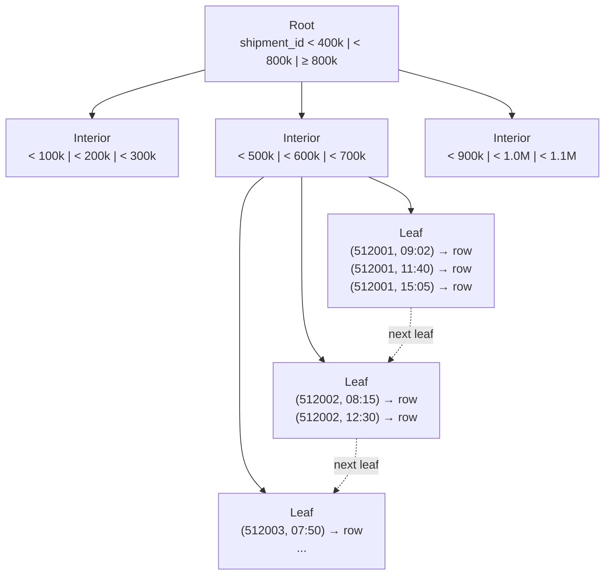
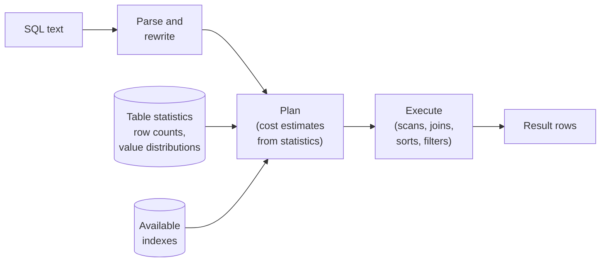
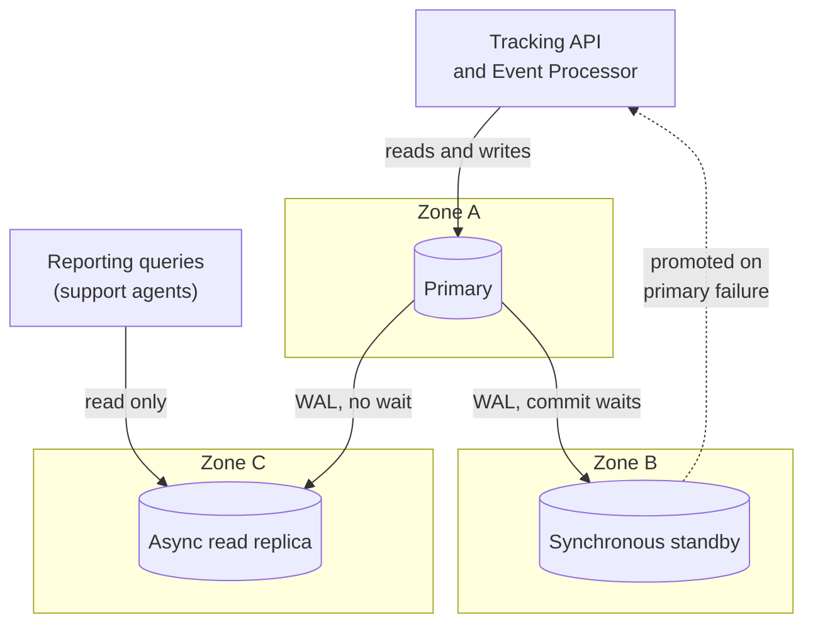
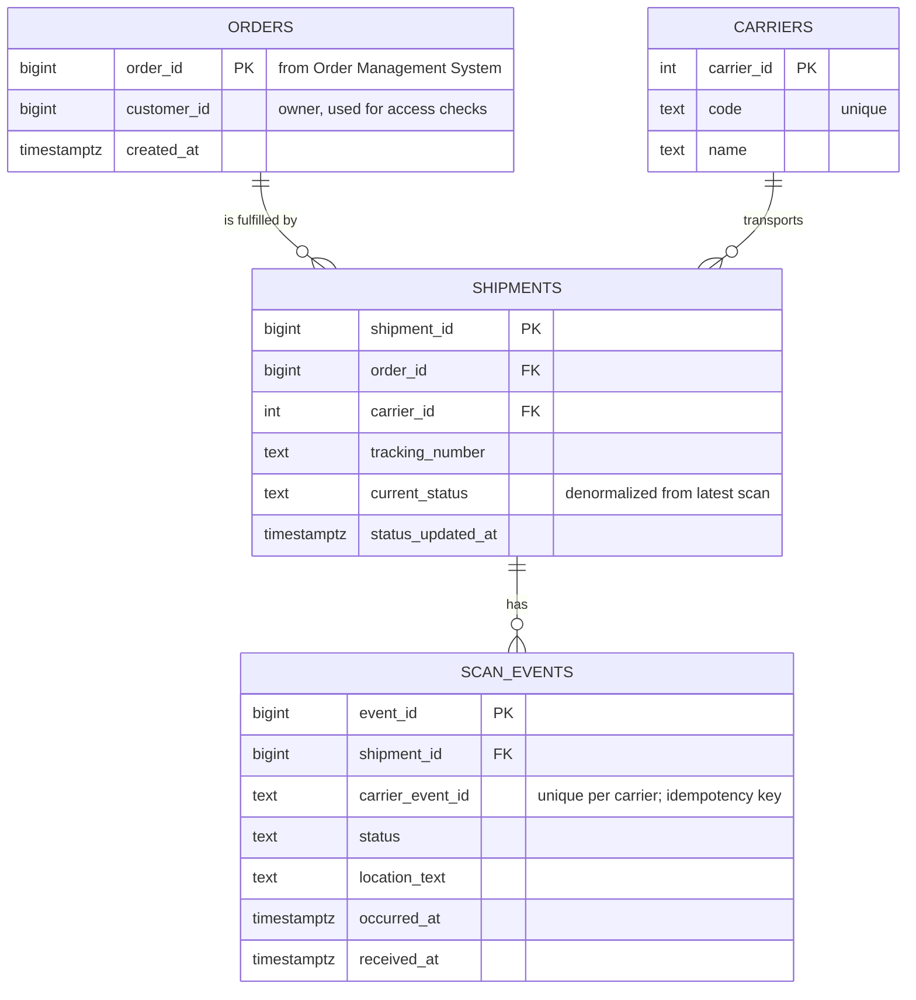

# Relational databases and SQL internals

> A relational database is a set of tables with declared relationships, a query planner that turns
> declarative questions into physical work, and a transaction engine that keeps concurrent writers
> from corrupting each other. Architects who know how the planner, the indexes, and the locks behave
> design schemas that stay fast and correct as data grows.

!!! abstract "Page facts"
    **Level:** Mixed (model and indexing are Level 1-2; isolation, replication, and failover are
    Level 3) · **Status:** Draft · **Time:** 60-75 minutes · **Last verified:** 2026-11-15

## Learning objectives

After this page you should be able to:

- Model a domain as normalized tables with primary and foreign keys, and decide where to denormalize
  on purpose.
- Explain how a B-tree index answers a query, why column order in a composite index matters, and
  which queries an index cannot help.
- Read a query plan at the level of "sequential scan versus index scan versus join strategy" and
  know what to change.
- Choose a transaction isolation level from the anomalies a workload can tolerate, and recognize
  locking and deadlock patterns.
- Size a connection pool and explain why a database wants fewer connections than the application
  thinks.
- Describe replication, read replicas, failover, partitioning, and schema migration options with
  their recovery and consistency consequences.

## Prerequisites

- [Functional vs non-functional requirements](../architecture-fundamentals/functional-vs-non-functional-requirements.md)
  — durability (NFR-7) and latency (NFR-3) decide most of the choices here.
- [Capacity estimation](../performance-and-scalability/capacity-estimation.md) — the write rate,
  storage growth, and connection counts used below come from that page.

## The problem this solves

Before relational databases, each application owned its own file formats and its own code for
searching, updating, and recovering them. Two programs could not safely share data, every new
question needed new code, and a crash in the middle of an update left files half-written.
The relational model separated *what* data means (tables and relationships) from *how* it is stored,
and the database engine took over searching (query planning), concurrency (transactions and locks),
and crash safety (write-ahead logging). Fifty years later it remains the default system of record
because those three jobs are hard, and the engines do them better than application code does.

## What it is

A **relational database** stores data as **tables** of **rows**, where each **column** has a declared
type. A **primary key** identifies a row uniquely; a **foreign key** in one table references the
primary key of another, which is how relationships are expressed. **SQL** is the declarative language
for defining the schema and querying it; the engine's **planner** decides how to execute each query.

Three properties define the category:

| Property | Meaning | Why architects care |
|---|---|---|
| Declared schema and constraints | Types, keys, uniqueness, and checks are enforced by the engine | Bad data is rejected at the boundary instead of discovered in reports |
| Declarative queries with a planner | You say which rows; the engine chooses scans, indexes, and join order | Performance is a property of indexes and statistics, not of the application code |
| ACID transactions | Groups of statements are atomic, consistent, isolated, and durable | Money, orders, and inventory can be updated by many clients without corruption |

Relational engines differ in dialect and internals, but the concepts on this page (B-tree indexes,
plans, isolation levels, write-ahead logs, replication) apply to all of the mainstream ones. Where an
example needs a concrete engine it uses PostgreSQL, because the AtlasMart example uses it; the
behaviors described are documented in its manual, linked in the references.

## Mental model

Think of a public library. The **shelves** are the table's rows in storage order. The **card
catalogues** are indexes: each one is sorted by a different attribute (author, title, subject) and
tells you the shelf position. Finding a book by author is fast because you look in the author
catalogue; finding every book with a blue cover means walking the shelves, because no catalogue is
sorted by colour. Adding a book means updating every catalogue, which is why more indexes make writes
slower. The **librarian** is the planner: given your question, she decides which catalogue to use,
or whether walking the shelves is faster because you asked for half the library anyway.

**Where the analogy breaks:** a library has one copy of each book and one reader at a time. A
database has thousands of concurrent readers and writers, so it needs rules (isolation levels and
locks) about what a reader sees while a writer is mid-change, and it keeps a journal (the
write-ahead log) so a power cut cannot leave a book half on the shelf.

## Key terms

| Term | Meaning on this page |
|---|---|
| Primary key | The column or columns that uniquely identify a row; indexed automatically |
| Foreign key | A column that references another table's primary key; the engine can enforce that the referenced row exists |
| Normalization | Organizing tables so each fact is stored once, to prevent update anomalies |
| Denormalization | Deliberately storing a fact in more than one place to make a specific read cheaper |
| Index | A separate sorted structure that maps column values to row locations |
| B-tree | The balanced tree structure used by the default index type in most engines |
| Query plan | The planner's chosen sequence of scans, joins, sorts, and filters for a query |
| Transaction | A unit of work that is applied entirely or not at all |
| Isolation level | The rule for what one transaction may see of other in-progress transactions |
| Write-ahead log (WAL) | The append-only journal written before data pages, used for crash recovery and replication |
| Replica | A copy of the database kept up to date by streaming the WAL |
| Failover | Promoting a replica to primary when the primary fails |

## How it works

### The relational model and normalization

A schema starts from the nouns of the domain and the facts about them. **Normalization** is the
discipline of putting each fact in exactly one place so that it cannot become inconsistent. The
first three normal forms are enough for almost all application schemas:

1. **First normal form:** every column holds one atomic value; no lists in a cell, no repeating
   column groups (`phone1`, `phone2`).
2. **Second normal form:** every non-key column depends on the whole primary key, not on part of a
   composite key.
3. **Third normal form:** non-key columns depend only on the key, not on other non-key columns
   (a `carrier_name` column in `shipments` would violate this, because it depends on `carrier_id`).

Relationships come in three shapes: **one-to-many** (an order has many shipments; the foreign key
lives on the "many" side), **many-to-many** (a product belongs to many categories; a join table holds
pairs of keys), and **one-to-one** (rarely needed; usually a sign that two tables should be one, or
that one holds optional or sensitive columns split out on purpose).

**Denormalization** is the deliberate reverse: copying or precomputing a value to avoid a join or an
aggregate on a hot read path. It is a performance decision with a consistency cost: something must
keep the copy correct (a trigger, the application in the same transaction, or an asynchronous job),
and the page must say which.

### Joins

A **join** combines rows from two tables on a condition, almost always a foreign key equality. The
planner picks one of three physical strategies:

| Strategy | How | Good when |
|---|---|---|
| Nested loop | For each row of the outer table, look up matches in the inner table (ideally via an index) | The outer side is small and the inner side is indexed on the join column |
| Hash join | Build a hash table from the smaller input, probe it with the larger | Both inputs are large and no useful index exists; memory holds the smaller side |
| Merge join | Sort both inputs on the join key and walk them together | Both inputs are already sorted (by an index or a previous step) |

You do not choose the strategy; you provide the indexes and the statistics that make the right one
available, and you read the plan to see which one the planner chose.

### Indexes and the B-tree

**Figure 1 — A B-tree index on `scan_events(shipment_id, occurred_at)`.** Interior nodes hold
separator keys; leaf nodes hold the indexed values in sorted order with pointers to table rows.
Finding all events for one shipment is a descent from the root plus a short walk along the leaves.

How to read it: a lookup for shipment 512001 reads the root, one interior node, and one leaf, then
follows the leaf chain while the shipment ID still matches. The tree stays shallow because each
node holds hundreds of keys, so the number of pages read grows with the logarithm of the table size.

Properties that follow from the structure:

- **Equality and range** on the leading column are fast (`shipment_id = ?`, `occurred_at BETWEEN`).
- **Composite indexes** are sorted by the first column, then the second within equal first values.
  An index on `(shipment_id, occurred_at)` serves `WHERE shipment_id = ?` and
  `WHERE shipment_id = ? ORDER BY occurred_at`, but not `WHERE occurred_at > ?` alone, because the
  dates are not globally sorted. Put the equality column first, the range or sort column second.
- **Leading wildcards and functions** defeat the index: `WHERE lower(email) = ?` needs an index on
  `lower(email)`, not on `email`.
- **Every index costs writes.** Each insert updates every index on the table; each index also takes
  space (the capacity page's "index overhead ×1.5" multiplier is this cost).
- **Covering indexes** include the columns a query returns, so the engine never visits the table row.
  They trade more index size for fewer page reads.
- **Selectivity matters.** An index on a column with three distinct values (`status`) rarely helps,
  because each value matches a third of the table; a sequential scan is cheaper. A **partial index**
  (`WHERE status = 'in_transit'`) can help when the interesting value is rare.

Other index types exist for other shapes of question (hash for pure equality, GIN or inverted
indexes for arrays and text, spatial indexes for geometry); the B-tree is the default because most
questions are equality, range, and sort.

### Query execution and plans

**Figure 2 — From SQL to rows.** The parser produces a tree, the planner estimates the cost of
alternative plans using table statistics, the executor runs the cheapest one.

How to read it: the planner never looks at the actual data; it looks at statistics about the data.
Stale statistics (after a bulk load, for example) produce bad plans even with perfect indexes.

`EXPLAIN` (the keyword is the same in most engines) prints the chosen plan. The things to look for,
in order:

1. **Sequential scan on a large table** where you expected an index. Either the index is missing,
   the predicate is not index-usable (function, type mismatch, leading wildcard), or the planner
   decided the query returns enough of the table that scanning is cheaper.
2. **Estimated rows far from actual rows** (visible with the "analyze" option that runs the query).
   This means statistics are stale or the planner cannot estimate a correlated predicate; the join
   strategy chosen on a wrong estimate is usually the real problem.
3. **A nested loop whose inner side is a sequential scan.** This is the plan that turns a 1,000-row
   outer table into 1,000 scans of a big table. An index on the inner join column fixes it.
4. **Sorts that spill to disk** because the working memory setting is too small for the result.

Optimization is mostly: add or reorder an index, rewrite the predicate so the index applies, keep
statistics fresh, and return fewer columns and rows (pagination). Hints that force a plan are a last
resort because they freeze a decision that the planner would otherwise revisit as data changes.

### Transactions and ACID

A **transaction** groups statements so that either all of them take effect or none do. The four
ACID guarantees:

| Guarantee | Meaning | Mechanism |
|---|---|---|
| Atomicity | All or nothing | Undo information in the log; a crash before commit rolls back |
| Consistency | Every constraint holds at commit | Constraint checks; the application supplies the business rules |
| Isolation | Concurrent transactions do not see each other's partial work (to the degree the isolation level says) | Multiversion concurrency control (MVCC) and locks |
| Durability | Once committed, the change survives a crash | The write-ahead log is flushed to stable storage before commit returns |

Durability is the guarantee NFR-7 ("no acknowledged scan event is lost") rests on, and it has a
cost: every commit waits for a disk flush, which bounds the commit rate of a single primary. The
write rate in the AtlasMart example (tens per second) is far below that bound; a system doing tens
of thousands of small commits per second would need to batch commits or partition writers.

### Isolation levels and their anomalies

The SQL standard defines isolation levels by the anomalies they forbid:

| Anomaly | What a transaction can observe | Forbidden at |
|---|---|---|
| Dirty read | Another transaction's uncommitted change | Read Committed and above |
| Non-repeatable read | The same row returning different values on two reads, because another transaction committed in between | Repeatable Read and above |
| Phantom read | A query returning different *sets* of rows on two runs, because another transaction inserted or deleted matching rows | Serializable (and in practice Repeatable Read in MVCC engines, with caveats) |
| Lost update | Two transactions read a value, both compute a new one, the second write overwrites the first | Needs explicit locking or Repeatable Read/Serializable, depending on the engine |
| Write skew | Two transactions each read a condition, each write something that together violates the condition | Serializable only |

Most engines default to **Read Committed**, which is the right default for most request-handling
code: each statement sees a consistent snapshot, and writes block only conflicting writes.
**Repeatable Read** (or snapshot isolation) gives a whole transaction one snapshot, which reports and
multi-statement reads need. **Serializable** makes the outcome equal to some serial order and is the
only level that prevents write skew; the engine achieves it by aborting transactions that would
violate serializability, so the application must retry.

The practical rule: pick the lowest level that forbids the anomaly your code cannot tolerate, and
write the retry loop that Serializable (and deadlock detection at any level) requires.

### Locking and deadlocks

Writers lock the rows they change until commit. Readers in MVCC engines do not block writers and are
not blocked by them; they read an older version. Two writers conflict when they touch the same row,
and the second waits.

A **deadlock** is two transactions each waiting for a lock the other holds. Engines detect it and
abort one of the transactions. The common cause is updating the same rows in different orders
(transaction A updates shipment 1 then 2; transaction B updates 2 then 1). The prevention is to
update rows in a consistent order (by primary key), keep transactions short, and never hold a
transaction open across a network call to another service.

Explicit locks (`SELECT ... FOR UPDATE`) are the tool for read-modify-write sequences such as
"read the current status, decide, write the new status". Without the lock, two processors can both
read `in_transit` and both write, and one update is lost.

### Constraints and stored procedures

**Constraints** (`NOT NULL`, `UNIQUE`, `CHECK`, foreign keys) are the cheapest correctness tool
available: they run inside the engine, cannot be bypassed by a buggy client, and document the data
rules. A unique constraint is also how idempotent inserts are made safe: inserting a carrier event
ID that already exists fails deterministically instead of creating a duplicate.

**Stored procedures** put logic inside the database. They save round trips for multi-statement
operations and can enforce rules for every client, but they are harder to version, test, and scale
(the database is the one tier you cannot add instances of easily). Use them for data-integrity
operations that must be atomic and engine-local; keep business workflow in application code.

### Connection pooling

Every database connection costs the server memory and a process or thread, and establishing one
takes a handshake and authentication. Applications therefore keep a **pool** of open connections
and hand them out per request. Two sizing facts surprise people:

- The database's useful concurrency is bounded by its CPU cores and disk parallelism; hundreds of
  active connections contend rather than help. A pool per application instance in the low tens is
  typical, and a total across instances that stays near the server's configured maximum with margin.
- Little's Law sizes the pool: connections in use = query rate × average query time. A pool much
  larger than that only queues inside the database instead of inside the application.

With many application instances (autoscaled services, serverless functions), a **server-side
pooler** (a proxy that multiplexes thousands of client connections onto a small server pool) keeps
the database within its limits.

### Partitioning, replication, and failover

**Partitioning** splits one logical table into physical pieces by a key (range by date, list by
region, hash by ID) inside one database. Queries that include the partition key touch one partition;
old partitions can be dropped in one operation, which is how the 13-month retention in the example
is cheap. Partitioning is not sharding: all partitions live on the same server. Sharding across
servers is covered on the advanced database architecture page (D06-T03, planned)
(planned, D06-T03).

**Replication** streams the write-ahead log from the primary to one or more replicas:

| Mode | Commit waits for | Data loss on primary failure | Use |
|---|---|---|---|
| Asynchronous | Local flush only | The replica may lag; recent commits can be lost | Read replicas, reporting, cross-region copies |
| Synchronous | At least one replica to acknowledge | None for acknowledged commits | The standby that failover promotes |

**Read replicas** serve read-only queries, offloading the primary. Their lag (milliseconds to
seconds under normal load, longer under heavy writes or long-running replica queries) means a client
that writes then reads from a replica may not see its own write; route read-your-own-writes paths
to the primary or wait for the replica to catch up.

**Figure 3 — Primary, synchronous standby, and asynchronous read replica.** The standby is promoted
on failure; the replica serves reports and lags by its replication delay.

How to read it: writes go to one place. The solid WAL arrow to the standby is part of every commit;
the arrow to the replica is best-effort. Failover re-points the application at the standby, which
takes the detection time plus the promotion time plus the time for clients to reconnect.

**Failover** is the combination of detecting that the primary is unhealthy, promoting a standby,
and redirecting clients (through DNS, a virtual IP, a proxy, or the managed service's endpoint). Its
two risks are **split brain** (the old primary keeps accepting writes because it did not know it was
demoted; fenced by making it read-only or cutting its network) and **false positives** (a slow
primary is "failed over" needlessly). Managed database services automate this; the architect still
owns the RTO and RPO it produces and the application's reconnect behavior.

### Migration and schema evolution

Schemas change for the life of the system. The rules that keep changes safe:

1. **Every change is a versioned, repeatable script** applied by a migration tool, never by hand.
2. **Expand, migrate, contract.** Add the new column or table (expand) while old code still runs;
   backfill and switch code to use it (migrate); remove the old structure in a later release
   (contract). Never rename or drop in the same release that introduces the replacement.
3. **Know which operations lock.** Adding a nullable column is usually instant; adding a column with
   a default, adding a constraint, or building an index can lock or scan the table. Engines offer
   non-blocking variants (concurrent index builds, `NOT VALID` constraints validated later); use them.
4. **Backfills run in batches** with pauses, so replication lag and lock contention stay bounded.
5. **Rollback is a new forward migration**, prepared before the deploy.

## Worked example: AtlasMart Tracking Event Store

The Tracking Event Store from the [C4 container diagram](../architecture-fundamentals/c4-model.md) is
a PostgreSQL database holding every carrier scan and the current status of each shipment. The numbers
are the assumptions from the [capacity page](../performance-and-scalability/capacity-estimation.md).

### Schema

**Figure 4 — Tracking Event Store entity-relationship diagram.** Orders are owned by the Order
Management System; the tracking service stores only the order ID (NFR-6: no addresses).

How to read it: crow's-foot ends mark the "many" side. `current_status` on `shipments` is a
deliberate denormalization, discussed below.

Normalization decisions:

- `carriers` is its own table so that a carrier's name is stored once (third normal form) and a
  rename does not touch 300,000 shipments.
- `scan_events` is append-only; a status is a fact about a moment in time, so it is never updated.
- **Denormalized:** `shipments.current_status` duplicates the status of the latest scan. The
  customer-facing read ("where is my parcel now") would otherwise need "the newest event per
  shipment", which is an index-ordered lookup per shipment and a join. Storing it makes the hot
  read a single-row fetch. It is maintained in the same transaction as the event insert, so it can
  never disagree with the events for longer than one transaction.
- **Constraint as idempotency:** `UNIQUE (carrier_id, carrier_event_id)` (through the shipment's
  carrier) rejects a redelivered webhook. The Event Processor treats that unique-violation as
  "already processed" and acknowledges the message. This is the database half of the
  at-least-once delivery story on the [message queues page](../messaging-and-streaming/message-queues-and-brokers.md).

### The two hot queries and their indexes

| Query | Who | Predicate and order | Index |
|---|---|---|---|
| Current status of a shipment | Tracking API, 210/s at peak (mostly served by the cache) | `shipment_id = ?` | Primary key on `shipments` |
| Timeline: all events for an order | Tracking API, on the tracking page | `shipment_id IN (shipments of order)` ordered by `occurred_at` | `scan_events (shipment_id, occurred_at)` |
| Shipments for a customer | Tracking API, account page | `order_id IN (orders of customer)` | `orders (customer_id)` and `shipments (order_id)` |
| Insert event, update status | Event Processor, 70/s at peak | by `shipment_id` and the unique carrier event ID | Primary keys plus the unique index |

The composite index puts `shipment_id` (equality) first and `occurred_at` (sort) second, so the
timeline query descends once and reads the leaf entries in the order the page displays them; no
separate sort step. An index on `occurred_at` alone would not serve this query and is not created.

### Reading the plan

For the timeline query, the expected plan is: index scan on `shipments(order_id)` to find the one or
two shipments of the order, then for each, an index scan on `scan_events(shipment_id, occurred_at)`
returning about 8 rows (a nested loop with an indexed inner side, which is the good kind). If
`EXPLAIN` showed a sequential scan on `scan_events` (roughly 480,000 rows per day, hundreds of
millions over the retention period), the first suspects would be a missing index after a migration,
or a type mismatch such as the application sending the shipment ID as text. The page gives no
timing figures because they depend on hardware; the shape of the plan is what to verify.

### The processor transaction and its isolation level

The Event Processor runs, per message:

1. `INSERT INTO scan_events ...` (fails on the unique constraint if already processed).
2. `UPDATE shipments SET current_status = ?, status_updated_at = ? WHERE shipment_id = ? AND
   status_updated_at < ?` (the comparison keeps a late-arriving older scan from overwriting a newer
   status).
3. Commit.

Read Committed is sufficient: the two statements are writes on rows identified by key, the
conditional `UPDATE` prevents the lost-update anomaly without an explicit lock, and the unique
constraint prevents duplicates. Two workers processing events for the same shipment serialize on the
`shipments` row lock for the few milliseconds of the transaction, which is the intended behavior.
Serializable would add aborts and retries for no additional guarantee here.

### Connection pool

From the capacity page: three Tracking API instances with a pool of 10 each, two Event Processor
workers with a pool of 5 each, totalling about 40 connections against a primary configured to accept
comfortably more. Little's Law check: 210 reads/s at peak, of which the cache serves most; even if all
reached the database at 5 ms each, that is 210 × 0.005 ≈ 1 connection busy on average. The pools are
sized for tail latency and bursts, not for the average, and they are still small.

### Reporting on a replica

Support agents run "all shipments delayed more than two days for carrier X" style queries that scan
large ranges. They run against the asynchronous read replica in Figure 3, so a heavy report cannot
slow the customer-facing primary. The replica may lag by seconds; for support, "as of a few seconds
ago" is acceptable and is stated on the report screen.

### Failover and the recovery objectives

The synchronous standby means an acknowledged commit exists in two zones before the processor
acknowledges the queue message. If the primary's zone fails, the standby is promoted; no acknowledged
event is lost (RPO 0 for this failure). NFR-7's **RPO of 5 minutes** is the objective for the worse
case where both the primary and the standby are lost (a regional storage fault, an operator error
that corrupts data): the backups plus archived WAL allow point-in-time recovery to within five
minutes. The **RTO of 1 hour** covers that restore; automated failover to the standby takes far less,
and the hour is the budget for the manual path.

### Partitioning for retention

`scan_events` is range-partitioned by month on `received_at`. The 13-month retention (NFR-5 for audit
logs is separate) becomes "detach and drop the oldest partition" once a month, an operation that
takes milliseconds instead of a `DELETE` of 14 million rows that would bloat the table and flood the
replicas with WAL.

!!! note "Later decisions: retention period and partition key"
    AtlasMart later set tracking retention to 180 days after delivery (see
    [Data security and privacy](../security-architecture/data-security-and-privacy.md)) and moved
    `scan_events` to weekly partitions on `occurred_at`, so the idempotency constraint can include the
    partition key and expired data overstays by at most 21 days instead of 45. The reasoning is on
    [Advanced database architecture](advanced-database-architecture.md). The monthly scheme above still
    illustrates the mechanism.

## Real-world architecture example

The pattern above (one primary with a synchronous standby in a second zone, asynchronous replicas for
reads, range partitioning on time, a unique constraint as the idempotency guard, and a pooler in
front) is the standard shape of a managed relational database behind a transactional service in any
major cloud. The managed service handles standby promotion, backups, and point-in-time restore; the
architect still decides the isolation level, the indexes, the pool sizes, the replica routing, and the
migration discipline, and still writes the RTO and RPO into the runbook because the managed
automation produces specific numbers that must be checked against the NFRs rather than assumed.

## Design choices and trade-offs

| Choice | Favor when | Avoid when |
|---|---|---|
| Normalize fully | Data is updated from many paths; correctness beats read speed | A hot read path needs several joins at high rate; denormalize that one path with a documented maintainer |
| Add an index | A frequent query filters or sorts on the column and the column is selective | The table is write-heavy and the query is rare; the column has few distinct values |
| Read Committed (default) | Request handlers doing keyed reads and writes | A multi-statement read must see one snapshot (use Repeatable Read) or a business invariant spans rows (use Serializable or explicit locks) |
| Synchronous standby | Durability NFR forbids losing acknowledged writes | Write latency is critical and the standby is far away; accept async with a stated RPO |
| Read replicas | Read-heavy reporting or geographic reads tolerate lag | Reads must see the latest write; route those to the primary |
| Partition by time | Retention deletes by age; queries filter by time | Queries never include the partition key; partitions then multiply the work |
| Stored procedures | An atomic multi-statement integrity operation shared by all clients | Business workflow logic that changes often and needs unit tests |
| Server-side pooler | Many short-lived or autoscaled clients | A fixed small number of long-lived application instances already pool well |

**Assumption behind all of this:** the data fits one primary's write capacity. When it does not,
the choices on the advanced database page (sharding, distributed SQL) replace some of these.

## Failure modes and anti-patterns

- **Missing index found in production.** Works on test data, scans in production. Detect: plans
  with sequential scans on large tables; latency rising with table size. Prevent: review the plan of
  every hot query against production-sized data before release.
- **Index on everything.** Writes slow down, storage grows, planner gets confused. Detect: many
  indexes with zero scans in usage statistics. Prevent: an index exists because a named query needs
  it; drop unused ones.
- **Long transactions.** A transaction held open across an HTTP call to another service holds locks
  and prevents vacuuming of old row versions. Detect: lock waits, bloat. Prevent: transactions wrap
  database work only; call other services before or after.
- **N+1 queries.** One query for a list, then one per item. Detect: thousands of identical small
  queries per request in the query log. Prevent: a join or a single `IN (...)` query.
- **Reading your own write from a replica.** The user saves, refreshes, and sees the old value.
  Prevent: primary reads after writes for that user, or a short sticky window.
- **Deadlocks from inconsistent update order.** Detect: deadlock errors in logs. Prevent: order updates
  by key; retry on deadlock.
- **Pool too large.** Hundreds of connections per instance times many instances exhaust the server.
  Detect: connection errors at scale-out, high context switching on the server. Prevent: Little's Law
  sizing and a pooler.
- **Unsafe migrations.** A column default rewrite or an index build locks a hot table during the day.
  Prevent: expand-migrate-contract, non-blocking variants, and a migration review step.
- **Trusting the default isolation level without knowing it.** Write skew in inventory or balance
  logic. Prevent: name the anomaly each critical transaction must avoid and test for it.

## Security considerations

- **Least privilege per role.** The Tracking API's database user can read and write tracking tables
  only; the reporting user is read-only on the replica; migrations run under a separate role. No
  application uses the superuser.
- **Parameterized queries always.** SQL injection remains the top database attack; string-built SQL
  is a defect, not a style choice.
- **Encryption in transit and at rest.** TLS between application and database; storage encryption for
  data files, WAL, and backups, with key management outside the database host.
- **Backups are sensitive data.** They contain everything; store them with the same access controls
  as the database, and test restores (an untested backup is a hope, not a backup).
- **Audit requirements** (NFR-5: agent access logged 13 months) belong in an append-only audit table
  or an external log, written by the application, not reconstructed from database logs later.
- **Data minimization**: NFR-6 is enforced by the schema having no address column at all.

## Performance, reliability, and cost

- **Performance:** the planner is as good as the statistics and indexes it has. Most database
  performance work is index design, plan reading, and keeping transactions short; hardware is the
  second lever, and query rewriting the third.
- **Reliability:** durability comes from the WAL flush and the synchronous standby; availability comes
  from automated failover and from the application's reconnect and retry logic, which is tested by
  deliberately failing over in a non-production environment.
- **Cost:** storage is the multiplier from the capacity page (replication ×3, indexes ×1.5); the
  standby doubles compute for the primary tier; replicas add linearly. Partition-based retention is
  the cheapest storage control. A managed service charges for all of these plus backups and I/O; the
  trade is operations time.

## Hands-on lab: index a timeline query

Run a local PostgreSQL in a container (or any relational engine you have) and:

1. Create `shipments(shipment_id bigint primary key, order_id bigint, current_status text)` and
   `scan_events(event_id bigserial primary key, shipment_id bigint, status text,
   occurred_at timestamptz)`.
2. Insert about 100,000 shipments and 800,000 events with a generated-series statement (eight events
   per shipment with spread-out timestamps).
3. Run `EXPLAIN (ANALYZE) SELECT * FROM scan_events WHERE shipment_id = 4242 ORDER BY occurred_at;`
   and note the scan type and the actual row count.
4. Create the index `(shipment_id, occurred_at)` and run the same `EXPLAIN` again. Compare the scan
   type and the presence or absence of a sort step.
5. Create a second index on `(occurred_at)` only and check whether the planner uses it for the same
   query. Explain why or why not in one sentence.
6. Open two sessions. In session A, `BEGIN; UPDATE shipments SET current_status = 'x' WHERE
   shipment_id = 1;` without committing. In session B, update shipment 2 then shipment 1; in session
   A, update shipment 2. Observe the deadlock detection message, then explain which ordering rule
   would have prevented it.

??? question "Hint: what the two plans should show"
    Before the index: a sequential scan (or a parallel sequential scan) over all events, a filter on
    `shipment_id`, then a sort. After: an index scan on the new index with no sort step, because the
    index already delivers rows in `occurred_at` order within the shipment. The `occurred_at`-only
    index is not used for the equality on `shipment_id`, because its entries are sorted by time, not
    by shipment.

## Knowledge check

1. A table `payments(payment_id, account_id, created_at, amount)` is queried by
   `WHERE account_id = ? AND created_at > ? ORDER BY created_at`. Which composite index serves it
   best, and in what column order?
2. Which anomaly does Read Committed allow that Repeatable Read prevents, and give an example where
   it matters.
3. Why does a synchronous standby give RPO 0 for a primary failure but not for every failure?
4. An application scales from 3 to 60 instances, each with a pool of 20. What breaks, and what are
   two fixes?
5. In the worked example, why is `current_status` stored on `shipments` even though it can be derived
   from `scan_events`, and what keeps it correct?

??? success "Answers"
    1. `(account_id, created_at)`: equality column first, then the range-and-sort column, so one
       descent finds the account and the leaf walk returns rows already ordered by time.
    2. Non-repeatable reads: the same row read twice in one transaction can change in between. A report
       that sums balances in one query and lists them in another could show totals that do not match
       the list under Read Committed; Repeatable Read gives both queries one snapshot.
    3. Acknowledged commits exist on the standby before the client sees success, so losing the
       primary loses nothing. Losing both the primary and the standby (a wider fault, corruption, or
       an operator error replicated to both) falls back to backups and archived WAL, whose recency
       sets the real RPO.
    4. 1,200 connections approach or exceed the server's limits; connections fail or the server
       thrashes. Fixes: smaller per-instance pools sized by Little's Law, and a server-side pooler
       that multiplexes clients onto a small server pool.
    5. The hot read ("current status") becomes a single primary-key fetch instead of a newest-event
       lookup and join. The same transaction that inserts the event updates the status with a
       timestamp guard, so the copy cannot drift from the events.

## Architecture discussion questions

1. A product team wants to store each shipment's full event history as a JSON array in a single
   column of `shipments` "to avoid joins". What do you gain, what do you lose, and under what
   workload would you agree?
2. The business asks for 99.99% availability of the tracking read path. Which parts of this page's
   design change, and which parts cannot deliver that on their own?
3. A migration must add a `NOT NULL` column with a computed value to `scan_events` (hundreds of
   millions of rows). Design the expand-migrate-contract sequence and name the step that would have
   locked the table if done naively.

## Summary

Relational databases combine a normalized schema with declared constraints, a planner that chooses
physical plans from statistics and indexes, and a transaction engine built on a write-ahead log.
B-tree indexes serve equality, range, and sort on their leading columns, and composite column order
decides which queries they serve. Isolation levels trade anomalies for concurrency; Read Committed is
the usual default, with explicit locks or higher levels for invariants that span rows. Connection
pools are sized by Little's Law, not by instance count. Synchronous replication protects acknowledged
writes, asynchronous replicas offload reads at the price of lag, failover produces an RTO and an RPO
that must be checked against the NFRs, partitioning makes retention cheap, and schema changes follow
expand-migrate-contract.

## Related topics

- **Before:** [Functional vs non-functional requirements](../architecture-fundamentals/functional-vs-non-functional-requirements.md);
  [Capacity estimation](../performance-and-scalability/capacity-estimation.md)
- **Alongside:** [Caching architecture](caching-architecture.md) — the Status Cache in front of this
  database; [Message queues and brokers](../messaging-and-streaming/message-queues-and-brokers.md) —
  the idempotent consumer that writes to it; [High availability design](../reliability-and-disaster-recovery/high-availability-design.md)
  — zone placement and failover arithmetic; [Distributed systems fundamentals](../distributed-systems/distributed-systems-fundamentals-time-and-coordination.md)
  — split brain and fencing.
- **Planned:** NoSQL databases (D06-T02); advanced database architecture: sharding, CDC, global
  databases (D06-T03); storage architecture (D06-T04); backup and disaster recovery (D13).

## References

| Source | Type | Checked |
|---|---|---|
| [PostgreSQL documentation: Transaction Isolation](https://www.postgresql.org/docs/current/transaction-iso.html) | Official documentation | 2026-11-15 |
| [PostgreSQL documentation: Indexes](https://www.postgresql.org/docs/current/indexes.html) | Official documentation | 2026-11-15 |
| [PostgreSQL documentation: Using EXPLAIN](https://www.postgresql.org/docs/current/using-explain.html) | Official documentation | 2026-11-15 |
| [PostgreSQL documentation: High Availability, Load Balancing, and Replication](https://www.postgresql.org/docs/current/high-availability.html) | Official documentation | 2026-11-15 |
| [PostgreSQL documentation: Table Partitioning](https://www.postgresql.org/docs/current/ddl-partitioning.html) | Official documentation | 2026-11-15 |
| H. Berenson et al., ["A Critique of ANSI SQL Isolation Levels"](https://arxiv.org/abs/cs/0701157), 1995 (arXiv copy) | Paper (anomalies and isolation levels) | 2026-11-15 |
| Markus Winand, [Use The Index, Luke](https://use-the-index-luke.com/) | Free online book (SQL indexing) | 2026-11-15 |
| Martin Kleppmann, *Designing Data-Intensive Applications* (O'Reilly, 2017), chapters 3 (storage and retrieval), 5 (replication), and 7 (transactions) | Book | 2026-11-15 |

## Review notes

- Canonical page for D06-T01. All inventory items are defined; depth is on normalization, B-tree and
  composite indexes, plans, isolation levels, locking, pooling, replication, failover, and migration.
  Stored procedures, hash and other index types, and cross-server topics (federation,
  sharding, CDC) are mentioned and deferred to D06-T03.
- The example plan shapes are stated qualitatively on purpose; no timings were measured. A reviewer
  running the lab can add observed plan output as an illustration, labelled with the engine version.
- E. F. Codd's 1970 paper is the origin of the relational model; its ACM page blocks automated
  clients (403), so it is not listed. A reviewer may add it with a verified link.
- Reviewer: confirm the isolation-level table against the PostgreSQL manual for the version in use;
  the phantom-read behavior under Repeatable Read is engine-specific.
