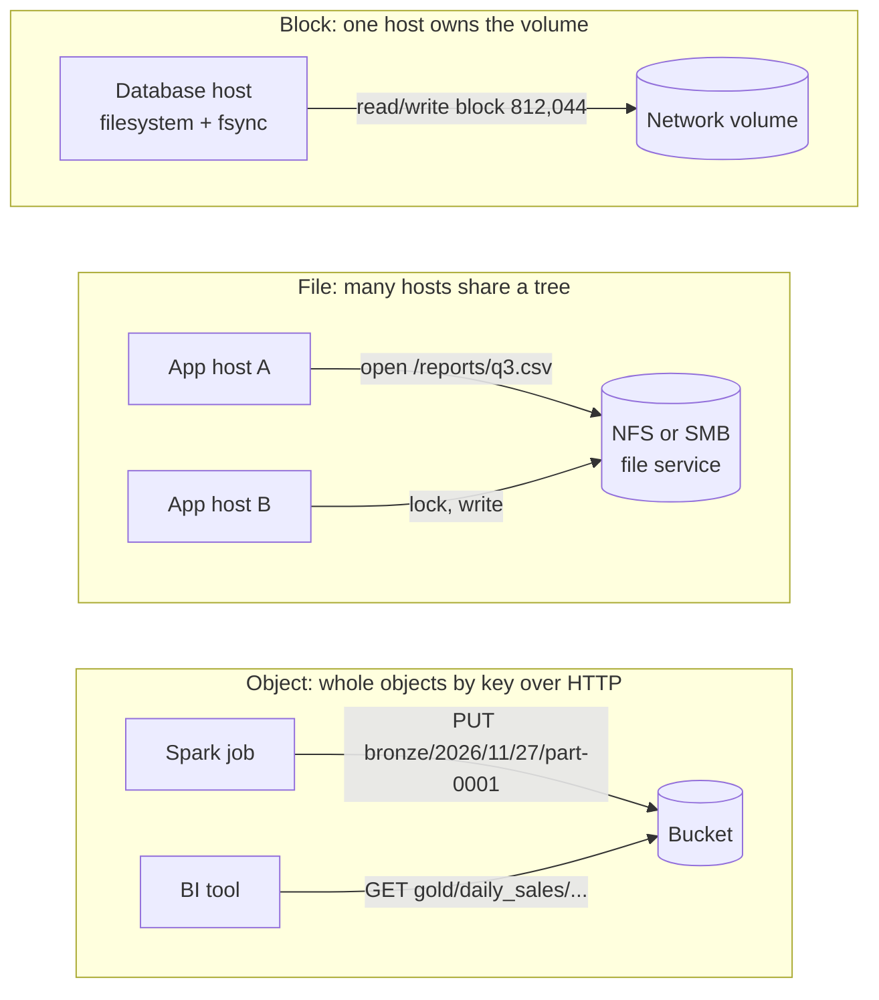
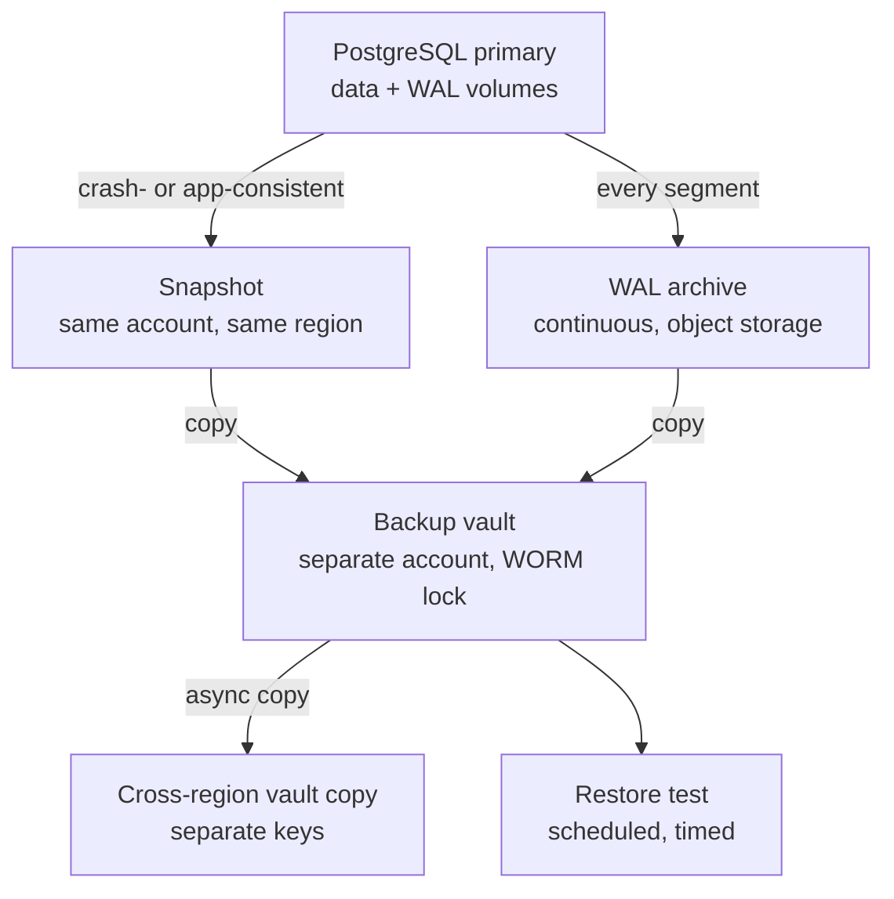
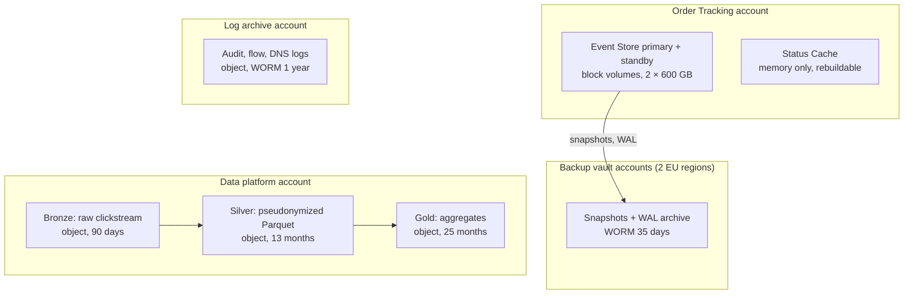
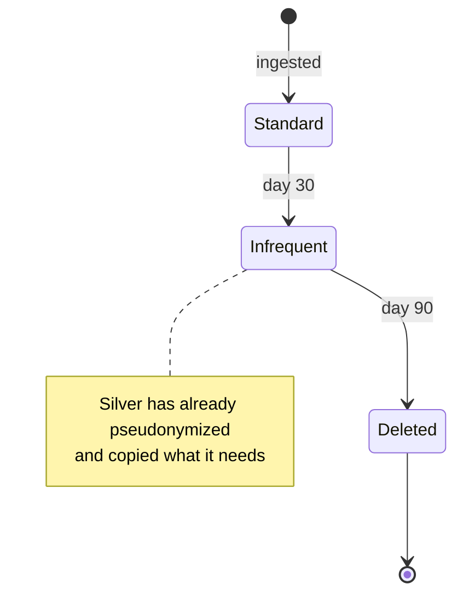
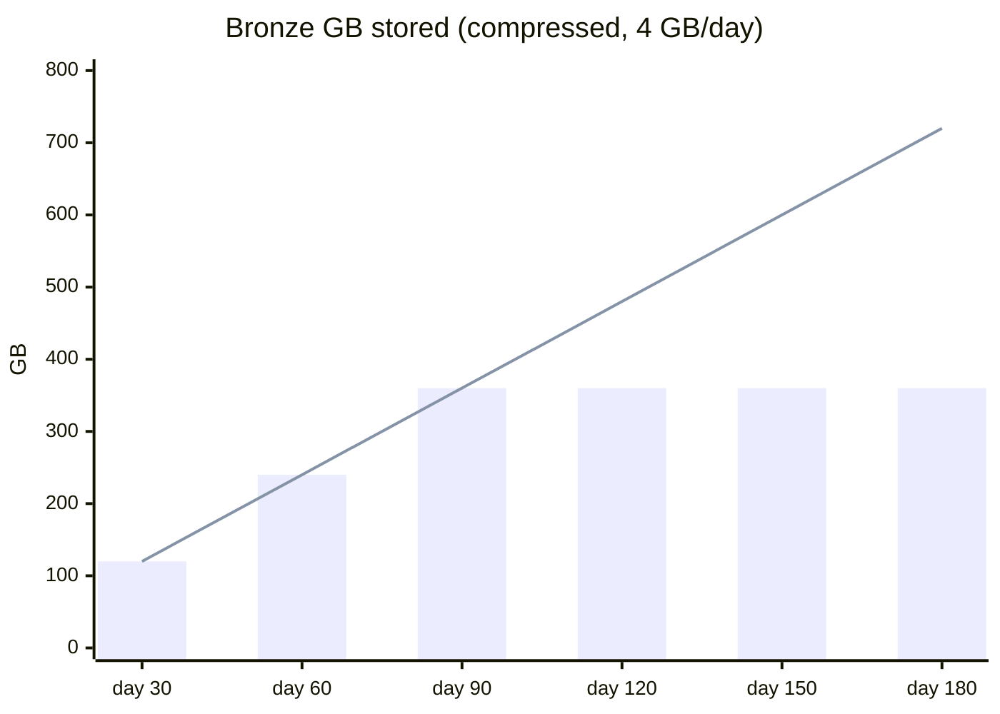

# Storage architecture

> Every byte a system keeps lives on block, file, or object storage, and each of the three answers a
> different question: "give me a disk", "give me a shared folder", or "keep this blob safely for
> years". Storage architecture is choosing the right one per dataset, then deciding how copies,
> snapshots, tiers, locks, and deletion keep that data durable, recoverable, and affordable as it grows.

!!! abstract "Page facts"
    **Level:** Mixed (the three storage models are Level 1-2; snapshot consistency, lifecycle
    economics, WORM, and hybrid storage are Level 3) · **Status:** Draft · **Time:** 45-60 minutes ·
    **Last verified:** 2026-11-27

## Learning objectives

After this page you should be able to:

- Choose between block, file, and object storage for a dataset from its access pattern, sharing
  needs, consistency needs, and latency shape.
- Explain DAS, NAS, SAN, and distributed filesystems, and say which cloud services play those roles.
- Distinguish crash-consistent from application-consistent snapshots, and snapshots from backups.
- Design a tiering and lifecycle policy, and compute storage growth and cost per tier.
- Use object versioning and object lock (WORM) correctly, including their cost traps.
- Place compression, deduplication, encryption, gateways, and content addressing in a design.

## Prerequisites

- [Capacity estimation](../performance-and-scalability/capacity-estimation.md) — the storage-growth
  arithmetic (writes × size × copies × retention) that this page extends with tiers and lifecycle.
- [Relational databases and SQL internals](relational-databases-and-sql-internals.md) — the
  write-ahead log and the Tracking Event Store whose volumes and backups appear below.

## The problem this solves

Applications want to "save data", but disks fail, networks partition, and media prices differ
widely between fast and slow tiers. Without deliberate design, teams keep everything on the most
expensive tier forever, share disks that cannot be shared, take snapshots that do not restore, keep
backups an attacker can delete, and notice log and analytics costs only when they dominate. Storage
architecture matches each dataset to a model and a tier, with the copies, locks, and deletion rules
its recovery, compliance, and cost requirements demand.

## What it is

Storage systems differ first in their **access model**: what the client addresses and how.

| Model | Client sees | Access unit and protocol | Consistency (typical) | Latency shape | Typical use |
|---|---|---|---|---|---|
| **Block** | A raw disk (volume) that one host formats with a filesystem | Fixed-size blocks by offset; SCSI, NVMe, or a cloud volume API | Strong for the one attached host; the host's filesystem owns caching and ordering | Lowest and most predictable per I/O; sized in IOPS and throughput | Databases, boot disks, anything needing `fsync` and random writes |
| **File** | A shared directory tree | Files and paths; NFS or SMB | Close-to-open or lease-based for shared clients; locking semantics vary by protocol | Low, but each metadata operation is a network round trip | Shared content, home directories, legacy apps, ML training data |
| **Object** | A flat namespace of buckets and keys | Whole objects over HTTP (PUT, GET, LIST, DELETE) | Major providers now document strong read-after-write for single objects; check yours, and note that listing and cross-object operations are not transactions | Higher first-byte latency, very high aggregate throughput with parallel requests | Backups, logs, media, data lakes and lakehouses, static assets, archives |

Around the three models sit the **data services** that this page covers: replication and erasure
coding, snapshots, backup and archive, tiering and lifecycle, compression and deduplication,
encryption, versioning and object lock, gateways for hybrid storage, and content addressing.

## Mental model

Block storage is a **rented empty warehouse**: one tenant gets the keys, arranges the shelves
(filesystem) however it likes, and is fast because nobody else is inside. File storage is a **shared
office filing room**: many people open the same drawers by folder name, so there are rules about who
holds a folder while editing it. Object storage is a **self-storage facility with numbered sealed
boxes**: you hand over a whole box and get a ticket (the key); you cannot rearrange the contents
inside a box, you replace the box. The facility has cheaper back rooms (archive tiers) where boxes
take hours to fetch, and some boxes come with a court seal (object lock) that nobody may break until
a date.

**Where the analogy breaks:** a warehouse does not vanish when the tenant leaves, but an ephemeral
cloud disk does. And the cloud operator silently keeps several copies of every box, which is why
object storage is so durable yet still not a backup: deleting the box deletes every copy.

## Key terms

| Term | Meaning on this page |
|---|---|
| Block / file / object storage | The three access models in the table above |
| DAS / NAS / SAN | Direct-attached disks in one server / a file server shared over the network / a dedicated network that presents remote block devices to servers |
| Ephemeral vs persistent storage | Storage whose contents disappear with the instance or container / storage whose lifetime is independent of any instance |
| Replication | Keeping copies of data on several nodes (glossary); for storage, also erasure coding, which stores data plus parity fragments |
| Snapshot | A point-in-time image of a volume or filesystem, usually stored as changed blocks |
| Crash-consistent / application-consistent | Captures disk state as if power was cut / captures state after the application has flushed and paused or marked a consistent point |
| Tiering / lifecycle policy | Placing data on cheaper media as it cools / rules that transition and delete data by age or condition |
| Object versioning | Keeping every overwritten or deleted version of an object as a recoverable noncurrent version |
| Write-once retention (WORM) | Storage that blocks overwriting or deleting an object until its retention period ends (glossary) |
| Content-addressable storage | Storing data under the hash of its content, so identical content has one address |
| IOPS | Input/output operations per second (glossary); with throughput, the performance size of a block volume |

## How it works

### Block, file, and object in practice

**Figure 1 — Three access models.** What the client addresses decides what can be shared and where
consistency is enforced.

How to read it: block storage puts the filesystem in the client host, so only one writer may mount a
normal volume (multi-attach exists but needs a cluster-aware filesystem). File storage moves the
filesystem into the service so many clients share it. Object storage drops the filesystem entirely:
no in-place edits, no rename of a "directory" without copying every object under it.

Consequences: **databases want block** (small random writes, `fsync` ordering for the write-ahead
log, predictable latency); **shared mutable files want file storage**, though metadata-heavy
workloads (millions of small files) are slow on any network filesystem; **large, write-once data
wants object storage**, which scales by parallel requests, costs least per GB, and carries the
lifecycle, versioning, and lock features below. Lakehouse table formats exist to give tables
transactional behavior on top of objects that offer none across keys.

### DAS, NAS, SAN, and distributed filesystems

**DAS** (direct-attached storage) is disks inside or cabled to one server: fastest path, no sharing,
and the data shares the server's fate. In the cloud, **instance-local disks** (local NVMe on a VM)
are DAS, and they are **ephemeral**: stopping or losing the instance loses the data. **NAS**
(network-attached storage) is a file server offering NFS or SMB shares; cloud managed file services
are NAS. A **SAN** (storage area network) is a dedicated network (Fibre Channel or iSCSI) over which
a storage array presents block devices to servers; cloud network volumes play the SAN role with the
network and array hidden behind an API.

A **distributed filesystem** spreads one namespace across many servers. HDFS and the Google File
System that inspired it separate a metadata service (NameNode, master) from data servers that hold
large chunks, each replicated on several machines, and are optimized for large sequential reads and
appends rather than small updates. Ceph builds block, file, and object interfaces on one distributed
object store and places data by computation (its CRUSH algorithm) rather than a central lookup table.
In the cloud, most analytics moved from HDFS to object storage, keeping the "separate compute from
storage" idea and dropping the cluster that had to be sized for both.

### Ephemeral and persistent storage

| Kind | Lifetime | Examples | Use for |
|---|---|---|---|
| Container writable layer | Dies with the container | Files written inside a running container | Nothing that matters |
| Ephemeral volume or local disk | Dies with the pod or instance | Empty-directory volumes, instance-local NVMe | Scratch space, caches, shuffle and spill files, replicas that can be rebuilt |
| Persistent network volume | Independent of any instance; zonal in most clouds | Cloud block volumes behind a PersistentVolumeClaim | Databases and stateful services |
| Managed file or object storage | Independent and usually regional | File shares, buckets | Shared and long-lived data |

The [Kubernetes storage page](../containers-and-kubernetes/kubernetes-networking-storage-and-service-mesh.md)
explains PersistentVolumeClaims and StorageClasses. The rule: anything on ephemeral storage must be
rebuildable from somewhere persistent, and a zonal volume pins its pod to that zone.

### Replication and erasure coding

Storage services keep data durable by **replication** (full copies on several devices, racks, or
zones) or **erasure coding** (split data into k fragments, compute m parity fragments, and store the
k + m pieces on different devices; any k reconstruct the data). Three-way replication stores 3 bytes
per byte; a 6 + 3 erasure code stores 1.5 bytes per byte and survives 3 lost fragments, at the price
of more CPU and network work to rebuild. Large object stores use erasure coding for this reason; the
Windows Azure Storage paper in the references describes one production design.

A volume replicated inside one zone survives a disk failure but not the zone; regional object
storage survives a zone. Cross-region replication of buckets or volumes is asynchronous and therefore
has an RPO. And replication of any kind copies deletions and corruption faithfully: it is an
availability mechanism, not a backup.

### Snapshots: crash-consistent and application-consistent

A **snapshot** records a volume's blocks at an instant. The first is a full copy (or a reference to
all blocks); later ones store only changed blocks, which is why frequent snapshots are cheap.

- **Crash-consistent:** the image equals what the disk held at that instant, as if the power had been
  cut. A database with a write-ahead log recovers from it the same way it recovers from a crash,
  provided every volume it uses (data and log) was captured at the same instant; snapshotting two
  volumes separately can capture a log and data files from different moments. Providers offer
  multi-volume or consistency-group snapshots for this.
- **Application-consistent:** the application is told first, flushes, and marks a consistent point
  (or briefly pauses writes), then the snapshot is taken. PostgreSQL's `pg_backup_start` and
  `pg_backup_stop` functions bracket a base backup this way; file servers use a quiesce hook. It
  restores without crash recovery and is the safer choice for applications that lack a log.

A snapshot is **not a backup** until it is copied to another account and region under a lock; the
[DR page](../reliability-and-disaster-recovery/disaster-recovery-strategies.md) covers schedules,
immutable vaults, and restore testing.

**Figure 2 — From a running database to a recoverable copy.** Each arrow adds an independent failure
or access boundary.

How to read it: the snapshot alone protects against a bad deploy, not an attacker or a region loss;
the locked vault, the cross-region copy, and the timed restore test turn it into RPO and RTO evidence.

### Tiering and lifecycle management

Media differ in price and access cost: memory, local NVMe, network SSD volumes, standard object
storage, infrequent-access object tiers, and archive tiers whose objects take minutes to hours to
restore. **Tiering** places each piece of data on the cheapest tier that still meets its access
needs; a **lifecycle policy** automates the moves and the deletion.

Rules that make lifecycle policies work:

1. **Decide by access pattern, not age alone.** A quarterly report may reread a year at once; some
   providers offer automatic tiering that watches access instead of age.
2. **Read the cooler tiers' conditions.** They typically charge for retrieval, may bill a minimum
   storage duration, and archive tiers need a restore step; check the provider's current
   documentation, because a tier that is cheap to store can be expensive to read.
3. **Transition large objects, not tiny ones.** Per-object overheads make tiering small files
   uneconomic; compact first.
4. **Deletion is part of the policy.** Retention comes from classification and legal requirements
   ([data security page](../security-architecture/data-security-and-privacy.md)); an expiration rule
   enforces it without a human.

### Compression and deduplication

**Compression** removes redundancy inside data. Text formats (JSON logs, CSV) compress well;
already-compressed media and encrypted data barely compress. Columnar formats such as Parquet compress
better than row formats because a column holds similar values. Ratios depend entirely on the data,
so measure on a sample rather than quoting a figure.

**Deduplication** removes redundancy across data: identical blocks or files are stored once and
referenced many times. Backup systems deduplicate heavily because consecutive backups are mostly
identical. Inline deduplication costs CPU and memory for the fingerprint index on every write;
post-process deduplication runs later. Two interactions to remember: compress or deduplicate
**before** encrypting (good encryption makes identical inputs look different), and deduplication
across tenants can leak whether another tenant stored a given file, so multi-tenant systems scope it
per tenant or key.

### Encryption

The major clouds encrypt storage at rest by default; the choices are who controls the keys and at
which layer. **Envelope encryption** with a KMS is the standard pattern (see the
[data security page](../security-architecture/data-security-and-privacy.md)). Options: provider-managed
keys (simplest), customer-managed keys (control, audit, revocation, crypto-shredding), or client-side
encryption (the service never sees plaintext, losing some server-side features). Backups and
cross-region copies need their own key policy, or the DR copy depends on the primary region's keys.

### Object versioning and object lock (WORM)

**Versioning** keeps the previous version when an object is overwritten, and turns a delete into a
**delete marker** that hides the object while the old versions remain. It protects against accidental
overwrite and deletion, and it has two traps: noncurrent versions are billed like any object, so a
versioned bucket needs a lifecycle rule that expires noncurrent versions; and an "expire after 90
days" rule on a versioned bucket only adds delete markers unless noncurrent versions are also
expired.

**Object lock** gives write-once-read-many (WORM) retention: until a retention date, the version
cannot be overwritten or deleted. Providers offer a mode that privileged users can bypass (for
testing and mistakes) and a mode that nobody, including the account root, can shorten; legal holds
block deletion without a date until released. Locked buckets are how audit logs and backups survive
ransomware and insiders; they are also irreversible, so a compliance-mode lock set to ten years by
mistake keeps ten years of bills. Lock requires versioning in the major implementations.

### Content-addressable storage

**Content addressing** names data by a cryptographic hash of its bytes (`sha256:9f86...`): identical
content gets one name (free deduplication), integrity is checkable by rehashing, and objects are
immutable by construction. Git stores its objects this way, and container image layers are
content-addressed, so images sharing a base layer store and transfer it once and a pull by digest
guarantees the exact bytes (see the [containers page](../containers-and-kubernetes/containers-and-images.md)).
The cost is garbage collection: an object can go only when nothing references its hash.

### Gateways and hybrid storage

A **storage gateway** is an on-premises appliance or VM that presents a local file or block interface,
stores the data in cloud object storage, and caches recently used data locally: useful for migration,
cloud backup, and offices needing local latency with the cloud as the system of record. **Hybrid
storage** also includes file sync with cloud tiering, bulk and offline transfer, and array-to-cloud
replication. Constraints: the [network link](../networking/hybrid-connectivity-and-vpns.md) caps
upload rate, cache misses pay WAN latency, and the gateway must be patched and made highly available
(see the [hybrid and multi-cloud page](../enterprise-architecture/hybrid-and-multi-cloud-architecture.md)).

### Provider equivalents

Names checked against the linked provider pages on 2026-11-27; details differ, so read them first.

| Capability | AWS | Azure | Google Cloud |
|---|---|---|---|
| Network block volumes | [Amazon EBS](https://docs.aws.amazon.com/ebs/latest/userguide/what-is-ebs.html) | [Azure managed disks](https://learn.microsoft.com/en-us/azure/virtual-machines/managed-disks-overview) | [Persistent Disk, Hyperdisk](https://cloud.google.com/compute/docs/disks) |
| Ephemeral local disk | [EC2 instance store](https://docs.aws.amazon.com/AWSEC2/latest/UserGuide/InstanceStorage.html) | [Ephemeral OS disks](https://learn.microsoft.com/en-us/azure/virtual-machines/ephemeral-os-disks) | [Local SSD](https://cloud.google.com/compute/docs/disks/local-ssd) |
| Object storage and tiers | Amazon S3: [S3 Standard, S3 Standard-IA, S3 Glacier Instant Retrieval, Flexible Retrieval, Deep Archive, S3 Intelligent-Tiering](https://docs.aws.amazon.com/AmazonS3/latest/userguide/storage-class-intro.html) | Azure Blob Storage: [Hot, Cool, Cold, Archive tiers](https://learn.microsoft.com/en-us/azure/storage/blobs/access-tiers-overview) | Cloud Storage: [Standard, Nearline, Coldline, Archive; Autoclass](https://cloud.google.com/storage/docs/storage-classes) |
| Lifecycle rules | [S3 Lifecycle](https://docs.aws.amazon.com/AmazonS3/latest/userguide/object-lifecycle-mgmt.html) | [Blob lifecycle management](https://learn.microsoft.com/en-us/azure/storage/blobs/lifecycle-management-overview) | [Object Lifecycle Management](https://cloud.google.com/storage/docs/lifecycle) |
| Versioning | [S3 Versioning](https://docs.aws.amazon.com/AmazonS3/latest/userguide/Versioning.html) | [Blob versioning](https://learn.microsoft.com/en-us/azure/storage/blobs/versioning-overview) | [Object Versioning](https://cloud.google.com/storage/docs/object-versioning) |
| WORM lock | [S3 Object Lock](https://docs.aws.amazon.com/AmazonS3/latest/userguide/object-lock.html) (governance and compliance modes, legal hold) | [Immutable storage for Blob](https://learn.microsoft.com/en-us/azure/storage/blobs/immutable-storage-overview) (time-based retention, legal hold) | [Bucket Lock](https://cloud.google.com/storage/docs/bucket-lock), [Object Retention Lock](https://cloud.google.com/storage/docs/object-lock) |
| Managed file (NAS) | [Amazon EFS](https://docs.aws.amazon.com/efs/latest/ug/whatisefs.html), [Amazon FSx](https://docs.aws.amazon.com/fsx/latest/WindowsGuide/what-is.html) family | [Azure Files](https://learn.microsoft.com/en-us/azure/storage/files/storage-files-introduction), [Azure NetApp Files](https://learn.microsoft.com/en-us/azure/azure-netapp-files/azure-netapp-files-introduction) | [Filestore](https://cloud.google.com/filestore/docs/overview) |
| Hybrid gateway or sync | AWS Storage Gateway ([S3 File Gateway](https://docs.aws.amazon.com/filegateway/latest/files3/what-is-file-s3.html)) | [Azure File Sync](https://learn.microsoft.com/en-us/azure/storage/file-sync/file-sync-introduction) (cloud tiering) | [Storage Transfer Service](https://cloud.google.com/storage-transfer/docs/overview) (transfer, not a caching gateway) |
| Managed backup | [AWS Backup](https://docs.aws.amazon.com/aws-backup/latest/devguide/whatisbackup.html) | [Azure Backup](https://learn.microsoft.com/en-us/azure/backup/backup-overview) | [Backup and DR](https://cloud.google.com/backup-disaster-recovery/docs/concepts/backup-dr) |

## Worked example: AtlasMart's storage map

AtlasMart runs in one EU region with three zones (C-4: EU customer data stays in the EU). Existing
facts come from the [capacity](../performance-and-scalability/capacity-estimation.md),
[FinOps](../finops-and-sustainability/cloud-cost-models-and-finops.md),
[landing zone](../cloud-architecture/cloud-building-blocks-and-landing-zones.md), and
[DR](../reliability-and-disaster-recovery/disaster-recovery-strategies.md) pages. The clickstream and
lakehouse figures are the Phase 5 data-platform **assumptions**. Every other new number is labelled
**assumption**. A month is 30 days. Rates are illustrative cost units (CU), not provider prices.

### Inputs and rates

| Input | Value | Source |
|---|---|---|
| Tracking Event Store | About 430 GB; plan for about 600 GB by end of year two | Capacity page |
| Audit, flow, and DNS logs | 300 GB/day across 29 accounts, kept 1 year in the log archive account, immutable | Observability and landing zone pages |
| Clickstream | 400,000 DAU × 40 events × 1 KB ≈ 16 GB/day raw; Bronze kept 90 days | Assumption (Phase 5 data platform) |
| Gold aggregates | Kept 25 months | Assumption (Phase 5 data platform) |
| Block volume / backup storage | 0.2 / 0.1 CU per GB-month | FinOps page (illustrative) |
| Object storage standard / infrequent / archive tier | 0.05 / 0.025 / 0.005 CU per GB-month | Assumption (illustrative) |
| Compression: logs, Bronze JSON | 5:1 for logs, 4:1 for Bronze | Assumption; measure on real samples |
| Silver size | 2 GB/day (columnar, compressed, unused fields dropped: 1/8 of raw) and kept 13 months | Assumption |
| Gold size | 0.1 GB/day | Assumption |
| Event store backup change rate | 2 GB of changed blocks per day, 35-day vault retention, copied to a second EU region | Assumption (35-day lock from the DR page's example) |

### The map

**Figure 3 — AtlasMart's storage map.** Each dataset sits on the storage model its access pattern
needs, in an account whose access rules match its sensitivity.

How to read it: only the Event Store, the one database, uses block storage. Everything append-shaped
(backups, logs, the lakehouse) is object storage with a lifecycle and, where tampering matters, a lock.

### Event Store volumes and backups

- **Volumes:** block storage bills **provisioned** capacity, not used capacity. Provisioning each of
  the primary and the synchronous standby at the year-two plan of 600 GB (assumption) costs 2 × 600 ×
  0.2 = **240 CU/month**. Provisioning at today's 430 GB and growing online would cost 2 × 430 × 0.2 =
  172 CU; the 68 CU difference buys not having to resize under pressure.
- **Snapshots:** crash-consistent, taken of the data and WAL volumes together (one multi-volume
  snapshot), daily, plus continuous WAL archiving for point-in-time recovery inside NFR-7's 5-minute
  RPO. The managed database service can do both; the architect still checks that its snapshots cover
  every volume at one instant.
- **Backup storage:** one full image plus 35 days of changed blocks: 430 + 35 × 2 = 500 GB per
  region; two EU regions make 1,000 GB × 0.1 = **100 CU/month**. Vault copies are locked for 35 days
  in accounts the workload team cannot administer (DR page).

### Logs in the log archive

Raw volume: 300 GB/day × 365 days = 109,500 GB a year. Compressed 5:1 (assumption): 60 GB/day, so
21,900 GB held at one year.

| Policy | Stored | Arithmetic | CU/month |
|---|---|---|---|
| All in the standard tier | 21,900 GB | 21,900 × 0.05 | 1,095.0 |
| 30 days standard, then archive tier until day 365 | 1,800 GB + 20,100 GB | 1,800 × 0.05 + 20,100 × 0.005 | **190.5** |

The lifecycle rule saves about 83% (1 − 190.5 ÷ 1,095), on the condition that investigators rarely
need logs older than 30 days: archive reads need a restore step and carry retrieval charges. The
bucket uses a compliance-mode WORM lock of one year; check that the provider allows lifecycle
transitions of locked objects (deletion is blocked until retention ends, which is the point).

### The lakehouse and its lifecycle

**Figure 4 — Lifecycle of one Bronze clickstream object.** Transitions and deletion are rules on the
bucket, not jobs someone remembers to run.

How to read it: raw clickstream contains customer identifiers, so Bronze is the most sensitive layer
and the shortest-lived; deleting it at day 90 is a privacy control as much as a cost control.

Growth per tier, from the inputs:

| Layer | Daily growth | Retention | Steady state | Tiering | CU/month |
|---|---|---|---|---|---|
| Bronze | 16 GB raw ÷ 4 = 4 GB | 90 days | 4 × 90 = 360 GB | 120 GB standard, 240 GB infrequent | 120 × 0.05 + 240 × 0.025 = 12.00 |
| Silver | 2 GB | 395 days (13 months) | 2 × 395 = 790 GB | 60 GB standard, 730 GB infrequent | 60 × 0.05 + 730 × 0.025 = 21.25 |
| Gold | 0.1 GB | 760 days (25 months) | 0.1 × 760 = 76 GB | All standard (dashboards read it) | 76 × 0.05 = 3.80 |
| **Total** | 6.1 GB | | **1,226 GB** | | **37.05** |

Steady state arrives at day 90 for Bronze, day 395 for Silver, and day 760 for Gold. Without any
lifecycle and without compression, Bronze alone would hold 16 × 365 = 5,840 GB after one year
(292 CU/month in the standard tier) and keep growing by 16 GB a day.

**Figure 5 — Bronze storage over the first 180 days.** With the 90-day expiration (bars) the layer
plateaus; without it (line, compressed data kept forever) it grows linearly.

How to read it: the series match until day 90, then expiration deletes a day for each day added.
Table formats keep old files for time travel until snapshots expire; align that setting with the rule.

### The whole map, per month

| Dataset | Storage | CU/month |
|---|---|---|
| Event Store volumes | Block, 1,200 GB provisioned | 240.00 |
| Event Store backups | Object vaults, 1,000 GB | 100.00 |
| Log archive | Object, 21,900 GB, tiered | 190.50 |
| Lakehouse | Object, 1,226 GB, tiered | 37.05 |
| **Total** | | **567.55** |

Storage is small next to compute (Order Tracking's monthly showback on the FinOps page is about
12,763 CU), and its largest lines are bytes billed but rarely read: database headroom and a year of
logs. The real risk is unbounded growth, so every dataset in the map has a retention rule, and a
reviewer should reject any new bucket without one.

## Real-world architecture example

The shape above (block only under databases, object storage for everything append-shaped, locked
log and backup buckets in separate accounts, lifecycle rules on lakehouse layers) is the standard
arrangement in every major cloud. At very large scale,
operators tier by measured access temperature rather than age: the f4 paper in the references
describes moving "warm" photos to an erasure-coded store with lower replication overhead once their
request rate fell, which is the same lifecycle decision made with data instead of a calendar.

## Design choices and trade-offs

| Choice | Favor when | Avoid when |
|---|---|---|
| Block volume | A database or single-writer service needs low-latency random I/O and `fsync` | Many hosts must share the data; use file or object |
| Managed file share | Several hosts need a shared POSIX-like tree; lift-and-shift apps | Millions of small files with heavy metadata traffic, or web-scale throughput |
| Object storage | Write-once data, large scale, lifecycle and lock features, analytics | In-place updates, low-latency small random writes, rename-heavy workloads |
| Instance-local (ephemeral) disk | Scratch, caches, shuffle, replicas rebuilt from elsewhere | The only copy of anything |
| Erasure coding | Large, cooler data where storage overhead dominates | Small objects or latency-critical rebuilds |
| Age-based lifecycle | Access drops predictably with age | Access is irregular; prefer access-based auto-tiering |
| Archive tier | Retention for compliance, rare reads, hours to restore acceptable | Data someone may need within minutes |
| Compliance-mode WORM | Audit logs and backups that must survive admins and attackers | Data that may need deletion on request before the lock ends (privacy erasure) |
| Storage gateway | Hybrid sites needing local latency with cloud as the copy of record | Workloads that should simply move to the cloud |

**Assumption behind all of this:** each dataset has a known owner, classification, and retention.

## Failure modes and anti-patterns

- **Database on ephemeral disk.** Detect: data volumes on instance-local storage with no replica.
  Prevent: persistent volumes for every system of record; ephemeral only for rebuildable data.
- **Snapshots that do not restore.** Data and log volumes captured at different instants. Detect:
  scheduled restore tests fail or need manual repair. Prevent: multi-volume or application-consistent
  snapshots, and timed restore tests.
- **Replication mistaken for backup.** A delete or corruption reaches every replica. Prevent:
  versioned, locked, separately administered backups.
- **Versioned bucket that never shrinks.** Expiration adds delete markers; noncurrent versions stay
  billed. Detect: bucket size keeps rising after the rule. Prevent: noncurrent-version expiration.
- **Lifecycle on small files, archive for "maybe later" data.** Per-object charges exceed the
  savings; an incident restore takes hours. Prevent: compact first, tier by observed access.
- **Unbounded retention.** No expiration rule; "keep everything" becomes the largest line on the
  bill and a privacy liability. Detect: buckets without lifecycle rules. Prevent: a policy control
  that rejects them.
- **Irreversible lock by mistake.** A compliance-mode lock with a wrong period. Prevent: test in
  governance mode, review lock periods as code, and keep lock changes behind approval.

## Security considerations

- **Public buckets and separation of duties.** Block public access organization-wide; keep log
  archive and backup vaults in accounts workload teams cannot administer, with locks for the rest.
- **Keys.** Customer-managed keys for confidential data, separate keys for DR copies, key use logged;
  crypto-shredding as the deletion path for data in immutable media.
- **Residency (C-4).** Buckets, replicas, and backup copies stay in EU regions; check that
  cross-region replication and transfer services do not target non-EU regions.
- **Privacy versus immutability.** Data under a WORM lock cannot be erased on request until the lock
  ends; keep personal data out of locked buckets or encrypt it per subject so a key can be destroyed.
- **Snapshots leak.** A shared snapshot is a copy of the data; restrict and scan for sharing.

## Performance, reliability, and cost

- **Performance:** size block volumes by IOPS and throughput, not only GB; object throughput scales
  with parallel requests and larger objects; file shares pay a round trip per metadata operation.
- **Reliability:** durability comes from replication or erasure coding inside the service;
  recoverability from independent, locked, tested copies; zonal volumes need a replica in another zone.
- **Cost:** provisioned block capacity, retained bytes per tier, retrieval charges, and cross-region
  transfer are the drivers; lifecycle, compression, deduplication, and retention are the levers.

## Hands-on lab: deduplicate by content and project a lifecycle

Local, free, Python standard library only:

1. Write a function that splits a file into 64 KB chunks, names each chunk by its SHA-256 hash, and
   stores it in a dictionary only if the hash is new.
2. Store two versions of a 10 MB generated file that differ in one byte in the middle. Count the
   unique chunks and compute the deduplication ratio (logical bytes ÷ stored bytes).
3. Insert one byte at the start of the second version instead and repeat. Explain the result.
4. Compress the stored chunks with `zlib` and record the compression ratio for random bytes and for
   repeated JSON lines.
5. Write a day-by-day projection of the Bronze layer: add 4 GB a day, move objects older than 30 days
   to the infrequent tier, delete objects older than 90 days, and print GB per tier and CU per month
   for days 30, 90, and 180 with the rates on this page.

??? question "Hint: what to expect"
    With a one-byte change in place, all but one chunk is shared, so the ratio is close to 2:1. An
    inserted byte shifts every fixed-size chunk boundary, so almost nothing is shared: this is why
    backup tools use content-defined chunking. Random bytes do not compress; JSON lines compress a
    lot. The projection should match the worked example: 360 GB and 12 CU from day 90 onwards.

## Knowledge check

1. A team wants three application instances to write the same files concurrently. Which storage
   model fits, and why not a block volume?
2. What makes a crash-consistent snapshot of a PostgreSQL database restorable, and what breaks it?
3. A versioned bucket has an "expire after 90 days" rule, yet its size keeps growing. Why?
4. Compute the steady-state size and monthly cost of a dataset that adds 10 GB/day, stays 30 days
   in standard (0.05 CU/GB-month) and then 60 days in infrequent (0.025), and is deleted at day 90.
5. Why should compression happen before encryption, and why can cross-tenant deduplication leak
   information?

??? success "Answers"
    1. A managed file share: the filesystem lives in the service and coordinates many clients. A
       normal block volume is formatted by one host's filesystem, and two hosts mounting it would
       corrupt it.
    2. The WAL: PostgreSQL replays it as after a crash. It breaks when the data and WAL volumes are
       captured at different instants; use a multi-volume snapshot or `pg_backup_start`/`stop`.
    3. Expiration on a versioned bucket only adds delete markers; the data stays as noncurrent
       versions. Add a noncurrent-version expiration rule.
    4. 10 × 90 = 900 GB: 300 GB standard (15 CU) plus 600 GB infrequent (15 CU) = 30 CU per month.
    5. Encrypted output looks random, so it no longer compresses or deduplicates. Deduplication
       reveals that someone already stored identical content (the upload is instant or uses no
       space), which tells one tenant about another's data.

## Architecture discussion questions

1. Security asks for every log kept seven years in compliance-mode WORM. Privacy asks for deletion
   of a customer's data within 30 days of a request. Design the storage so both hold.
2. The data platform team wants Bronze kept "forever, in archive, just in case". Using the worked
   example, argue for or against, including privacy, cost, and the real chance of reprocessing.
3. A branch office needs fast access to large CAD files stored in the cloud. Compare a storage
   gateway, a file sync service, and cloud desktops.

## Summary

Block storage gives one host a fast disk (databases), file storage shares a tree, object storage
keeps whole objects at scale with lifecycle, versioning, and locks. Replication and erasure coding
give durability; only independent, locked, tested, volume-consistent copies give recoverability.
Lifecycle policies move cooling data to cheaper tiers and delete it on schedule; compression,
deduplication, and content addressing remove redundancy. AtlasMart's 568 CU a month of storage is
dominated by database headroom and a year of logs, and every dataset carries a retention rule.

## Related topics

- **Before:** [Capacity estimation](../performance-and-scalability/capacity-estimation.md);
  [Relational databases and SQL internals](relational-databases-and-sql-internals.md)
- **Alongside:** [Caching architecture](caching-architecture.md) — memory as the fastest tier;
  [Disaster recovery strategies](../reliability-and-disaster-recovery/disaster-recovery-strategies.md)
  — backup schedules, vaults, restore tests; [Data security and privacy](../security-architecture/data-security-and-privacy.md)
  — classification, KMS, retention; [Cloud cost models and FinOps](../finops-and-sustainability/cloud-cost-models-and-finops.md)
  — storage cost levers; [Containers and images](../containers-and-kubernetes/containers-and-images.md)
  — content-addressed layers; [Kubernetes networking, storage, and service mesh](../containers-and-kubernetes/kubernetes-networking-storage-and-service-mesh.md)
  — persistent volumes; [Scaling, partitioning, and replication](../distributed-systems/scaling-partitioning-and-replication.md);
  [Warehouses, lakes, lakehouses, and data mesh](../data-engineering-and-analytics/warehouses-lakes-lakehouses-and-data-mesh.md);
  [Big data processing engines and table formats](../data-engineering-and-analytics/big-data-processing-engines-and-table-formats.md);
  [Advanced database architecture](advanced-database-architecture.md).
- **Planned:** none beyond this batch; AI data and vector storage belong to D19-D25.

## References

| Source | Type | Checked |
|---|---|---|
| S. Ghemawat, H. Gobioff, S.-T. Leung, ["The Google File System"](https://research.google/pubs/the-google-file-system/), SOSP 2003 | Paper (distributed filesystem design) | 2026-11-27 |
| [HDFS Architecture](https://hadoop.apache.org/docs/current/hadoop-project-dist/hadoop-hdfs/HdfsDesign.html) — Apache Hadoop | Official documentation | 2026-11-27 |
| C. Huang et al., ["Erasure Coding in Windows Azure Storage"](https://www.usenix.org/conference/atc12/technical-sessions/presentation/huang), USENIX ATC 2012 | Paper (erasure coding in production) | 2026-11-27 |
| S. Muralidhar et al., ["f4: Facebook's Warm BLOB Storage System"](https://www.usenix.org/conference/osdi14/technical-sessions/presentation/muralidhar), OSDI 2014 | Paper (temperature-based tiering) | 2026-11-27 |
| [Continuous Archiving and Point-in-Time Recovery](https://www.postgresql.org/docs/current/continuous-archiving.html) — PostgreSQL documentation | Official documentation (base backups, WAL archive) | 2026-11-27 |
| [Locking objects with Object Lock](https://docs.aws.amazon.com/AmazonS3/latest/userguide/object-lock.html) — Amazon S3 User Guide | Official documentation (WORM modes, legal hold) | 2026-11-27 |
| [Access tiers for blob data](https://learn.microsoft.com/en-us/azure/storage/blobs/access-tiers-overview) — Microsoft Learn | Official documentation (tiers, rehydration, early deletion) | 2026-11-27 |
| [OCI Image Format: Descriptor](https://github.com/opencontainers/image-spec/blob/main/descriptor.md) — Open Container Initiative | Specification (content addressing by digest) | 2026-11-27 |

## Review notes

- Canonical page for D06-T04. Every inventory item is defined. Depth is on the three access models,
  ephemeral versus persistent, replication and erasure coding, snapshot consistency, tiering and
  lifecycle, versioning and WORM, and content addressing. Only defined or briefly described: NAS,
  SAN, and DAS internals (protocols, fabrics), distributed filesystem internals beyond the
  metadata/data split, deduplication algorithms (content-defined chunking is only named in the lab
  hint), gateways and hybrid storage (one subsection), and encryption (deferred to the data security
  page).
- New AtlasMart assumptions introduced here: object storage rates 0.05 / 0.025 / 0.005 CU per
  GB-month; compression 5:1 for logs and 4:1 for Bronze; Silver 2 GB/day kept 13 months; Gold
  0.1 GB/day; 2 GB/day of changed blocks and 35-day vault retention in two EU regions; Event Store
  volumes provisioned at 600 GB each. A reviewer should reconcile the 240 CU of provisioned volumes
  with the FinOps page's 86 CU line (430 GB × 0.2), which bills used capacity.
- The object-consistency cell is hedged ("check yours") on purpose; not every object store is strong.
- Provider names in the equivalence table were checked against the linked pages on 2026-11-27.
  Google Cloud's Storage Transfer Service is listed as a transfer service, not as a caching gateway.
  Reviewer: confirm whether lifecycle transitions of WORM-locked objects are allowed on each
  provider before relying on the log-archive policy.
