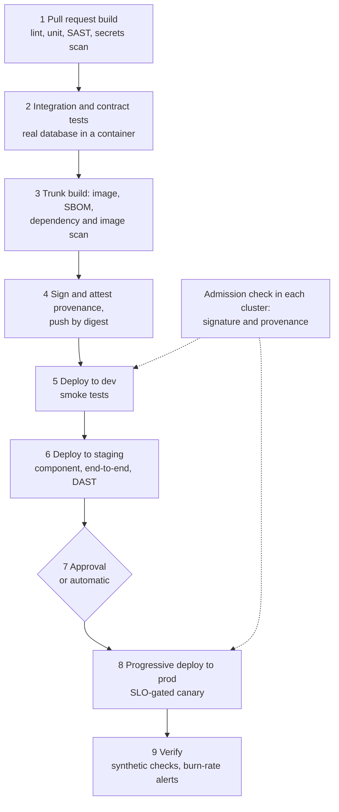
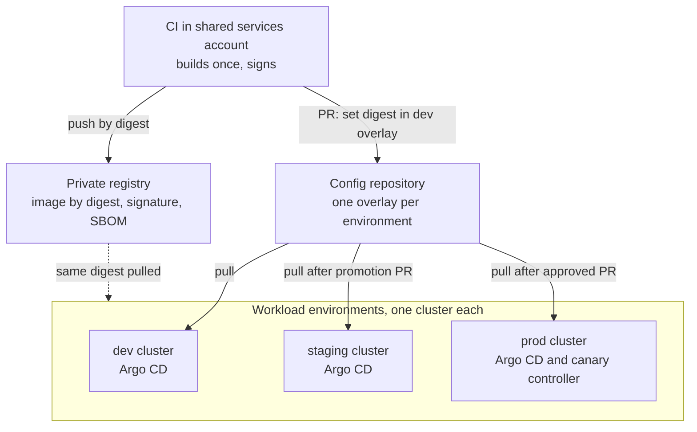
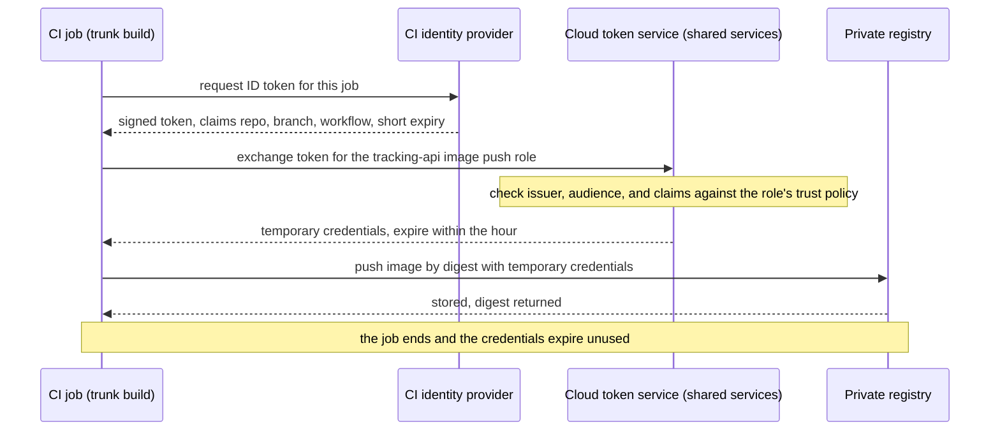
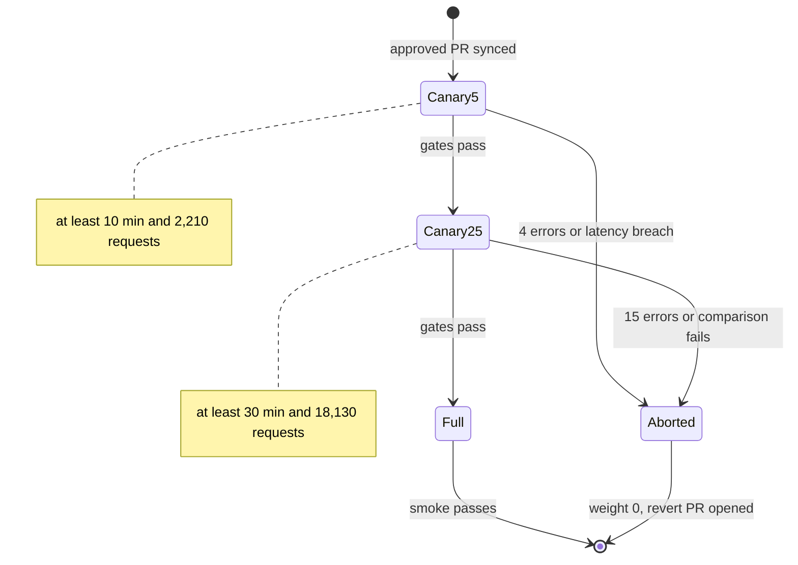

# CI/CD pipeline design and deployment strategies

> A pipeline is a sequence of gates that turns a commit into one immutable artifact and moves that
> artifact, unchanged, towards production. A deployment strategy decides how much of production sees
> the new version before you know it is good, and how long you must watch to know.

!!! abstract "Page facts"
    **Level:** Intermediate (CI, CD, and the strategies are Level 1-2; promotion design, canary
    statistics, and multi-account credentials are Level 3) · **Status:** Draft ·
    **Time:** 60-90 minutes · **Last verified:** 2026-11-27

## Learning objectives

After this page you should be able to:

- Distinguish continuous integration, continuous delivery, and continuous deployment, and say what
  each requires before the next is possible.
- Lay out pipeline stages and place each test and security check at the cheapest stage that catches
  its failure.
- Design promotion of one immutable artifact by digest through environments, with approvals that
  leave evidence.
- Compare rolling, blue-green, canary, progressive delivery, shadow traffic, and A/B testing, and
  choose between rollback and roll-forward.
- Size a canary stage: how many requests it sees and how long it must run to detect a given
  error-rate regression, stating the statistical assumption.
- Design a multi-account pipeline with short-lived federated credentials and size its runners.

## Prerequisites

- [DevOps lifecycle and source control](devops-lifecycle-and-source-control.md) — trunk-based
  development, artifacts, releases, and feature flags.
- [Software testing types and strategies](../foundations/software-testing-types-and-strategies.md) —
  the test gates and their time budgets.
- [SLAs, SLOs, SLIs, error budgets, and recovery objectives](../architecture-fundamentals/slas-slos-slis-error-budgets-and-recovery-objectives.md)
  — the signals a canary is judged on.
- [Kubernetes networking, storage, and service mesh](../containers-and-kubernetes/kubernetes-networking-storage-and-service-mesh.md)
  — weighted traffic splitting.

## The problem this solves

A team that integrates daily still fails if what reaches production is decided by hand: someone
rebuilds the code for production with a slightly different dependency, copies configuration between
environments, deploys to every server at once on a Friday evening, and learns about the bug from
customers. Every deployment then becomes an event, so deployments become rare, and the batch-size
problem returns. A designed pipeline removes the hand steps, makes the artifact that was tested the
one that runs, and exposes each change to a small, watched slice of production first, so that most
bad changes are stopped before most users see them.

## What it is

| Practice | What it means | Requires |
|---|---|---|
| Continuous integration (CI) | Every change is merged to trunk frequently and verified by an automated build and tests | Trunk-based development, fast reliable tests |
| Continuous delivery | Every change that passes the pipeline produces an artifact that could be deployed to production at any moment; a person may decide when | CI, automated deployment to every environment, environments in code |
| Continuous deployment | Every change that passes the pipeline is deployed to production automatically, with no manual step | Continuous delivery, plus automated production gates trusted enough to replace the human |

Martin Fowler's test for continuous delivery is whether the business could ask for the current
version to go to production on short notice and the request would be routine. Continuous deployment
is a further choice, not a better grade: some services keep a human approval for good reasons.

A **pipeline** is the automated workflow that implements these practices: stages that build, test,
package, scan, sign, store, promote, deploy, and verify. A **deployment strategy** is how the new
version replaces the old one in an environment.

## Mental model

Think of a sealed shipping crate. The factory builds it once, inspection stations check it, and a
seal with a serial number (the digest) is fixed to it. The crate then moves through warehouses (dev,
staging, prod) without being opened; only the delivery label (configuration) changes. At the last
warehouse, the goods go first to a few shops (canary), and the rest wait until those shops report no
problems.

**Where the analogy breaks:** inspection never proves a crate is good; some defects show only under
real customer use, which is why the final step happens in production with real traffic. And unlike
goods, a software version can be withdrawn from the shops in seconds, if the deployment strategy kept
the old version running.

## Key terms

| Term | Meaning on this page |
|---|---|
| Stage / gate | A pipeline step; a gate is a stage whose failure stops promotion |
| Artifact repository | A store for built artifacts (a registry for container images) that serves them by version and digest |
| Promotion | Moving the same artifact to the next environment by changing what that environment references |
| Digest | A content hash identifying exact bytes; any change gives a new digest |
| Rolling deployment | Replacing a fleet's instances with a new version in small batches while the rest keep serving traffic |
| Blue-green deployment | Running two complete environments and switching traffic from the old one to the new one in one step, which also gives a fast rollback |
| Canary release | Sending a small share of real traffic to the new version, comparing it with the old, and widening only if it is healthy |
| Progressive delivery | Canary or similar rollouts whose steps, analysis, and abort are automated by a controller |
| Shadow traffic (mirroring) | Copying live requests to the new version and discarding its responses |
| A/B test | Splitting users between variants to measure a business effect, usually with experiment flags |
| Rollback / roll-forward | Returning to the previous version, or fixing by deploying a newer one |
| Workload identity | A short-lived credential the platform issues to a running workload instead of a stored key |

## How it works

### Pipeline stages and where tests and security checks sit

The ordering rule: cheapest and most precise checks first, slow and broad checks later, and nothing
that needs production traffic until production. Each stage has an owner, a time budget, and a
failure policy (stop, or warn and record).

**Figure 1 — Pipeline stages with test and security gates.** The left column is the commit path; the
right side notes what each stage checks.



How to read it: stages 1-2 run on every pull request, 3-4 once per trunk merge, 5-9 per environment.
Security checks are spread out on purpose: source checks at stage 1, dependency and image checks at
stage 3, dynamic scanning against a running system at stage 6, and verification of what was built at
admission (dotted). The detailed security controls are on
[DevSecOps and secure delivery](devsecops-and-secure-delivery.md); the test types and budgets are on
the [testing page](../foundations/software-testing-types-and-strategies.md#test-automation-and-pipeline-gates).

### Artifact repositories and promotion by digest

The artifact repository is the hand-over point between building and deploying. Design rules:

- **Build once.** The trunk build produces the only artifact for that commit. Later stages never
  rebuild, because a rebuild can pull different dependencies and invalidates every earlier test.
- **Reference by digest, not tag.** A tag such as `1.4.2` or `latest` can be moved to other bytes; a
  digest cannot. Deployment descriptions pin `image@sha256:...`, and the tag is a human label only.
- **Immutable versions.** The repository refuses overwrites of a published version and keeps
  artifacts that any environment still references.
- **Attach evidence to the artifact.** Signature, SBOM, provenance, and test results are stored with
  the digest, so a later gate (or an auditor) can check them without trusting the pipeline's word.
- **Retention.** Keep every artifact that ran in production for the audit period and the rollback
  window; expire unpromoted builds.

**Figure 2 — Promoting one artifact by digest across accounts.** The registry sits in the shared
services account; each environment pulls the same digest.



How to read it: CI never touches a cluster. Promotion is a pull request that copies the digest from
one environment's overlay to the next; the GitOps agent in each cluster applies it. The dotted line
shows that every environment pulls identical bytes; only the overlay's configuration differs.

### Environment promotion and approvals

Promotion should be automatic up to the last environment, gated by the previous environment's
results. At production, choose between continuous deployment (the gates are the approval) and a
manual approval. If a person approves, make the approval a pull-request review in the config
repository rather than a ticket: it records who approved which digest and when, and the merge itself
triggers deployment. Approvals cost lead time; if the median wait is 15 minutes (an AtlasMart
assumption below), every change carries it. Approvers should check evidence (passing gates, the diff
of the digest and configuration), not re-test by hand. Deployment windows and change freezes belong
in the error budget policy: when the budget is exhausted, the pipeline refuses non-fix promotions
automatically.

### Deployment strategies compared

| Strategy | How it works | First exposure | Rollback | Extra capacity | Main requirement |
|---|---|---|---|---|---|
| Recreate | Stop all old instances, start new ones | 100% after an outage | Redeploy old version | None | Downtime is acceptable |
| Rolling | Replace instances in batches (Kubernetes `maxSurge` and `maxUnavailable`) | One batch, by instance count | Roll back the same way, minutes | One batch | Old and new versions compatible side by side |
| Blue-green | Deploy a full new stack, switch all traffic at once | 100% at the switch | Switch back, seconds | A full second stack during the switch | Shared data compatible with both; switch point (load balancer or DNS) |
| Canary | A small weighted share of traffic to the new version, compared with the stable version | 1-5% typical | Weight to zero, seconds | Small | Weighted routing; per-version metrics |
| Progressive delivery | A controller runs canary or blue-green steps, analysis, and abort automatically | As configured | Automatic abort | Small | Trusted metrics and thresholds |
| Shadow (mirroring), dark launch | Copy live requests to the new version and discard its responses; or deploy code with its flag off | 0% of users | Stop mirroring | Up to a full copy | No side effects from shadowed requests |
| A/B test | Split users between variants for a business measurement | The test share | Turn the flag off | Small | Experiment design, sticky assignment, days of data |

Points the table compresses:

- **Rolling** is the Kubernetes Deployment default and needs no traffic control, but its exposure
  unit is an instance: with 3 replicas the first new pod takes about a third of traffic. The
  [Kubernetes workloads page](../containers-and-kubernetes/kubernetes-architecture-and-workloads.md#rollouts)
  works through the defaults.
- **Blue-green** gives the fastest full rollback but exposes everyone at once; it suits changes that
  cannot run side by side with the old version at the instance level but can at the stack level.
- **Canary** must be judged by comparing canary and stable populations over the same period, because
  traffic and error rates change through the day; the SRE workbook's canarying chapter recommends
  per-population metrics and user-visible signals over resource metrics.
- **Without weighted routing a canary is a replica ratio.** A progressive delivery controller with no
  traffic router can only approximate the weight by the share of replicas (as Argo Rollouts
  documents), so a 5% step needs at least 20 replicas or a router that splits by weight.
- **Shadow traffic must have no side effects.** Mirroring tracking reads is safe; mirroring the Event
  Processor would send duplicate customer notifications.
- **A/B tests and canaries answer different questions.** A canary looks for regressions within
  minutes; an A/B test measures a hypothesis over days. Running both on the same split mixes their
  signals.
- **All side-by-side strategies need compatible data.** Schema changes follow expand and contract
  (see [DevOps lifecycle and source control](devops-lifecycle-and-source-control.md#deployment-and-rollback-basics)).

### Rollback versus roll-forward

Prefer **rollback** whenever the previous version can still run against current data: abort the
canary (weight to zero, seconds) or revert the digest in the config repository (minutes). It restores
a known state without new code under pressure. Choose **roll-forward** when rollback is impossible
(an irreversible migration has run, or the old version has a security hole) or when the fix is
trivial and the pipeline fast; it still goes through every gate, at most with a smaller canary.
Decide the rule before the incident: "roll back first, investigate after" is the usual default for a
user-visible SLO breach, and the runbook names who may roll forward instead.

### Pipeline security

The pipeline can change production, so it is a high-value target. Minimum controls, detailed on
[DevSecOps and secure delivery](devsecops-and-secure-delivery.md) and
[Infrastructure and supply-chain security](../security-architecture/infrastructure-and-supply-chain-security.md):
pipeline definitions in Git, protected and reviewed by owners; ephemeral, isolated runners; no
long-lived secrets (federated credentials, below); a separate, least-privilege identity per stage;
untrusted pull requests (for example from forks) never run with deployment credentials; artifacts
signed with provenance (SLSA's build track describes levels of build integrity); and admission
policy that refuses unsigned images or images from other builders.

### Pipeline scalability

A pipeline is a queueing system. By Little's Law (see
[Performance fundamentals and Little's Law](../performance-and-scalability/performance-fundamentals-and-littles-law.md)),
average concurrent builds = arrival rate × build duration. Builds cluster in working hours, so size
for the busy hour, not the daily average, and use autoscaling ephemeral runners rather than a fixed
pool. Other levers: cache dependencies and layers, build and test only what changed (important in a
monorepo), split long test suites across parallel runners, and keep slow suites (soak, chaos, full
DAST) on a schedule whose findings block the next promotion.

### Multi-account pipelines with short-lived federated credentials

AtlasMart's estate spans 29 accounts. A pipeline that holds a stored access key for each one is a
single leak away from the whole estate. Instead, each pipeline job proves its identity with a
short-lived token from the CI system's identity provider (an OpenID Connect token carrying claims such
as repository, branch, and workflow), and the cloud exchanges it for temporary credentials for one
role, whose trust policy accepts only tokens with the expected claims.

**Figure 3 — A CI job obtaining short-lived credentials to push an image.** No stored key exists
anywhere in the flow.



How to read it: the trust policy is the security boundary. Scope it to the exact repository and the
trunk branch, so a pull-request build cannot assume the push role. Deployment to clusters needs no
CI credential at all under GitOps; IaC pipelines use the same exchange for a per-environment role in
each team account. Provider equivalents (names checked on 2026-11-27):

| Concept | AWS | Azure | Google Cloud |
|---|---|---|---|
| Trust an external OIDC issuer and exchange its tokens for short-lived cloud credentials | [IAM OIDC identity provider](https://docs.aws.amazon.com/IAM/latest/UserGuide/id_roles_providers_create_oidc.html) with an IAM role | [Microsoft Entra Workload ID workload identity federation](https://learn.microsoft.com/en-us/entra/workload-id/workload-identity-federation) | [Workload Identity Federation with deployment pipelines](https://cloud.google.com/iam/docs/workload-identity-federation-with-deployment-pipelines) |

## Worked example: the AtlasMart Tracking API from commit to production

Inputs from the existing AtlasMart facts: the Tracking API (Python/FastAPI, 3 to 9 replicas) runs in
the prod cluster; tracking reads average 13.9/s, peak 70/s on a normal day, 210/s at sale-day design
peak; CI builds, signs, and pushes images to the registry in the shared services account; Argo CD
runs in each cluster; Kyverno verifies signatures. Phase 4B delivery assumptions: trunk-based
development, CI of about 10 minutes per build, about 200 builds a day, production canary
5% → 25% → 100% gated on SLO metrics.

New assumptions on this page: a progressive delivery controller (Argo Rollouts, from the same Argo
project as Argo CD) is added to each cluster, because a 5% step on a 3-replica service needs weighted
routing at the load balancer, not a replica ratio; by the rule on the
[ecosystem page](../containers-and-kubernetes/cloud-native-ecosystem-tools.md#the-arithmetic-of-minimal)
that makes 6 add-ons × 3 clusters = 18 installations. Production promotion needs one approval from
the Order Tracking team (median wait 15 minutes). The stable version's server error rate (5xx and
timeouts at the load balancer, client 4xx excluded as in SLO-L) is 0.05%.

### The path and its timing

| Stage | Where | Gate | Time (assumption) |
|---|---|---|---|
| Pull request build | CI runners, shared services | Lint, unit, SAST, secret scan, integration, contract | About 10 min (before merge) |
| Trunk build | CI runners | Same tests; image, SBOM, scan, sign, push by digest | About 10 min |
| Dev | dev cluster | Promotion PR auto-merged, Argo CD sync, smoke | 3 min |
| Staging | staging cluster | Component 5 min, end-to-end 10 min, smoke 1 min, plus 2 min sync | 18 min |
| Approval | config repository | One reviewer from the owning team | Median 15 min |
| Prod 5% | prod cluster | Count and latency gates below | 10.5 min at daily peak |
| Prod 25% | prod cluster | Count, latency, and comparison gates | 30 min |
| Prod 100% | prod cluster | Shift, scale, production smoke | 6 min |

From merge to 100% in production at a normal daily peak: 10 + 3 + 18 + 15 + 10.5 + 30 + 6 = 92.5
minutes, about 1.5 hours. The test budgets reuse the testing page's figures.

### How many requests the 5% stage sees

At 5% of traffic the canary receives 210 × 0.05 = 10.5 requests/s at design peak (630 a minute,
6,300 in 10 minutes), 70 × 0.05 = 3.5/s at a normal daily peak, and 13.9 × 0.05 = 0.695/s at the daily
average. Detection depends on request count, not on minutes, so the gates below are written in
requests.

### How long it must run to detect a regression

**Statistical assumption, stated plainly.** Each request fails independently with a fixed
probability; for rates this small, the number of errors among n canary requests is well approximated
by a Poisson distribution with mean n × p. The stable version's rate p0 = 0.05% is treated as known,
because it serves 95% of traffic and is measured far more precisely than the canary. The test is
one-sided: abort if the canary shows at least c errors in its first n requests. Choose the smallest n
and c such that a healthy canary (p0) is aborted at most 5% of the time (false alarm) and a canary at
the regressed rate p1 is caught at least 80% of the time (power). The values below come from the
exact Poisson tail, computed with the script in the lab.

| Regression to detect | n requests | Abort at | False alarm | Power | At 10.5/s (design peak) | At 3.5/s (daily peak) | At 0.695/s (average) |
|---|---|---|---|---|---|---|---|
| 10× (0.05% → 0.5%) | 600 | 2 errors | 3.7% | 80.1% | 57 s | 171 s | 863 s (14.4 min) |
| 5× (0.05% → 0.25%) | 2,210 | 4 errors | 2.6% | 80.1% | 210 s (3.5 min) | 631 s (10.5 min) | 3,180 s (53 min) |
| 2× (0.05% → 0.1%) | 18,130 | 15 errors | 4.4% | 80.0% | 1,727 s (28.8 min) | 5,180 s (86 min) | 26,086 s (7.2 h) |

Times are n divided by the canary's request rate, for example 2,210 ÷ 3.5 = 631 s.

What the table decides:

- **The 5% stage catches gross regressions.** It advances only after at least 10 minutes and at least
  2,210 canary requests, and aborts as soon as 4 errors appear among them; it has 80% power against a
  5× regression. At design peak that takes 3.5 minutes of traffic, so the 10-minute floor dominates;
  at a daily peak, 10.5 minutes; at night, nearly an hour. Because the error count only grows, aborting
  the moment it reaches 4 has the same false-alarm rate as checking once at 2,210.
- **Doubling is caught at 25%, not 5%.** 18,130 requests at 5% would take 86 minutes at a daily peak;
  at 25% (17.5/s) they take 18,130 ÷ 17.5 = 1,036 s, about 17 minutes, inside the 30-minute stage.
- **Smaller regressions are not caught by the canary at all.** A rise from 0.05% to 0.06% needs more
  traffic than a stage sees; SLO burn-rate alerts and the monthly SLO review are the backstop.
- **The assumption breaks in two known ways.** Errors are often correlated (one bad dependency fails
  many requests together), which makes counts burstier than Poisson; and baseline rates vary by hour,
  which is why the canary is also compared with the stable version over the same window. Repeatedly
  checking a rate comparison every minute inflates false alarms; sequential tests correct for that,
  and the count rule above avoids it for the error count.

The latency gate runs alongside: canary p95 under 300 ms (NFR-3) and no more than 10% above the stable
p95 over the same window (assumption); 2,210 requests give about 110 samples above the p95, enough
for a stable estimate.

### What a bad change costs with and without the canary

Suppose a change raises errors tenfold, to 0.5%, so each exposed request adds 0.45 percentage points
of failure. With the canary at a daily peak, about 2 errors arrive after about 400 canary requests
(2 ÷ 0.005), so the abort comes within about 2 minutes, at a cost of about 400 × 0.0045 = 1.8 extra
failed requests. Deployed to 100% at once and rolled back after 10 minutes (assumption): 70 × 600 =
42,000 requests × 0.0045 = 189 extra failures at a daily peak, or 567 at design peak. Against a
request-based 99.9% budget of 36,000 failures per 30 days (the SLO page's figure), that is 0.5% and
1.6% of the month's budget versus 0.005% with the canary.

**Figure 4 — The Tracking API canary as a state machine.** Each step advances only when its count,
time, and latency conditions are all met.



How to read it: every abort returns traffic to the stable version within seconds and opens a revert
pull request so Git again matches what runs.

### Runner capacity for 200 builds a day

200 builds × 10 minutes = 2,000 build-minutes a day. If builds arrive over a 10-hour working day, the
rate is 200 ÷ 600 = 0.33 builds a minute, and Little's Law gives 0.33 × 10 = 3.3 concurrent builds on
average. With a busy hour at 2.5 times the average (assumption) that is about 8.3, so the
autoscaling runner pool may grow to 10. With 2-vCPU runners (assumption) and 1 vCPU-hour = 1 CU
(illustrative), compute is 2,000 ÷ 60 × 2 = 66.7 CU a day, and ephemeral runners cost nothing between
builds.

## Real-world architecture example

A common pattern in organizations with many services: one platform-owned pipeline template that
every service inherits (the golden path on [Platform engineering](platform-engineering.md)), builds
on ephemeral runners with federated credentials, a single registry per organization with signatures
and provenance verified at cluster admission, GitOps promotion by pull request, and a progressive
delivery controller that runs canary analysis against the same metrics backend that drives SLO
alerts. Mobile and installed software follow the same pipeline up to the artifact, then use staged
rollouts in the distribution channel as their canary.

## Design choices and trade-offs

| Choice | Favor when | Avoid when |
|---|---|---|
| Continuous deployment to prod | Gates and canary analysis are trusted; changes are small; rollback is automatic | Regulatory approval is required per change; no reliable production signals |
| Manual approval as a PR review | Evidence of a second person is required; tier 1 services | It becomes a rubber stamp that adds hours of lead time |
| Rolling update | Stateless services with compatible versions and no traffic router | You need exposure smaller than one instance's share |
| Blue-green | Instant full switch and rollback; versions cannot mix at instance level | Doubling capacity is expensive; data changes are not backward compatible |
| Canary with automated analysis | User-facing services with enough traffic for statistics | Very low traffic (detection takes hours); batch jobs without request metrics |
| Shadow traffic | Read-only paths, performance comparison of a rewrite | Any path with writes or external side effects |
| Push deployment from CI | Targets without an agent model (functions, some managed services) | Clusters where GitOps pull removes CI's credentials |
| Federated short-lived credentials | Always, where the CI system and cloud support them | Never prefer stored keys; if unavoidable, scope and rotate them |

## Failure modes and anti-patterns

- **Rebuild per environment.** Production runs bytes nobody tested. Detect: digest differs between
  staging and prod. Prevent: build once, promote by digest, admission requires the expected digest.
- **Canary judged on too little traffic.** It "passes" after 5 minutes at night with 200 requests.
  Detect: request count per stage in the rollout record. Prevent: count-based gates, not time-only.
- **Canary compared with yesterday, not with stable.** Time-of-day changes trigger false aborts or
  hide regressions. Prevent: concurrent comparison with the stable population.
- **Mutable tags.** `latest` moves and rollback restores the wrong thing. Prevent: digests only.
- **Shadowing writes.** Duplicate side effects. Prevent: mirror only read paths, or stub sinks.
- **Long-lived pipeline credentials.** A leaked key reaches every account. Detect: credential
  inventory. Prevent: federation with claim-scoped trust policies.
- **Approval theatre.** Approvers click through without evidence. Detect: approval latency near zero
  with long queues. Prevent: show gate evidence in the PR; automate what is automatable.
- **Rollback that cannot work.** A migration removed what the old version needs. Prevent: expand and
  contract; rehearse rollback in staging.

## Security considerations

- **The pipeline is part of production's trust boundary.** Whoever controls pipeline definitions or
  runners can ship anything; protect both like production.
- **Scope trust policies to claims.** Repository, branch, and environment claims stop a pull-request
  job from assuming deployment roles.
- **Separate build and deploy identities.** The identity that builds cannot approve or deploy; under
  GitOps, deployment uses the in-cluster agent's identity.
- **Verify at the end, not only the start.** Admission checks signatures and provenance, so a
  compromised step earlier in the pipeline cannot place an unsigned image in production.
- **Canary traffic is real customer traffic** with real data; the canary runs under the same
  policies, network rules, and data protections as stable.

## Performance, reliability, and cost

- **Performance:** lead time is the sum of stage times plus waits; at AtlasMart the human approval
  (15 minutes) and the 25% stage (30 minutes) dominate, not CI. Count-based gates make deploys slower
  at night, which is correct.
- **Reliability:** progressive delivery limits the blast radius of a bad change to the canary share
  for the stage's duration; blue-green and canary keep the previous version ready for rollback in
  seconds. Most incidents follow changes, so this is the cheapest reliability investment available.
- **Cost:** runners scale with builds × duration (66.7 CU a day above, illustrative); blue-green
  doubles capacity during a switch; canaries need little extra capacity but need a traffic router and
  per-version metrics, whose storage grows with label cardinality.

## Hands-on lab: size a canary stage

Local and free; Python 3 standard library only. Lab 13 covers the GitOps half of the pipeline:
[Lab 13: GitOps reconciliation](../labs/lab-13-gitops-reconciliation.md).

1. Save this script and run it; it prints the request count and abort threshold for three
   regressions from a 0.05% baseline, reproducing the worked-example table.

    ```python
    import math


    def p_at_least(c, mean):
        """P(X >= c) for a Poisson count with the given mean."""
        term, below = math.exp(-mean), 0.0
        for k in range(c):
            below += term
            term *= mean / (k + 1)
        return 1.0 - below


    def plan(p0, p1, alpha=0.05, power=0.80, step=10):
        n = step
        while True:
            c = 0
            while p_at_least(c, n * p0) > alpha:
                c += 1
            if p_at_least(c, n * p1) >= power:
                return n, c
            n += step


    for factor in (10, 5, 2):
        n, c = plan(0.0005, 0.0005 * factor)
        print(f"{factor}x regression: {n} requests, abort at {c} errors")
    ```

2. Divide each n by the canary rates 10.5, 3.5, and 0.695 requests/s and confirm the times.
3. Change the baseline to 0.2% and rerun. Does a higher baseline make detection faster or slower?
4. Simulate: with `random.Random(7)`, draw 1,000 healthy canaries of 2,210 requests at p0 and 1,000
   bad ones at 0.25%; count how often each is aborted at 4 errors and compare with 2.6% and 80.1%.
5. Stretch: abort when the count reaches 4 at any point, and confirm the false-alarm rate is unchanged.

??? question "Hint: why does a higher baseline need fewer requests for the same factor?"
    The test separates two Poisson means, n × p0 and n × p1. With a higher baseline, the same n gives
    larger expected counts, and the relative spread of a Poisson count shrinks as its mean grows
    (the standard deviation is the square root of the mean). A tenfold rise from a tiny baseline
    produces only a handful of errors, which is why rare errors need large samples.

## Knowledge check

1. What does continuous deployment require that continuous delivery does not?
2. Why promote an artifact by digest rather than by tag, and why never rebuild for production?
3. A 3-replica service wants a 5% canary. What does it need, and why?
4. At design peak, how many requests does the Tracking API's 5% stage see in 10 minutes, and which
   regressions can it detect with 80% power?
5. When is roll-forward the right choice over rollback?

??? success "Answers"
    1. Production gates trusted enough to replace a human approval: automated verification and
       canary analysis with automatic abort, on top of the deployable-at-any-time pipeline.
    2. A tag can be moved to other bytes; a digest identifies exact content. Rebuilding can pull
       different dependencies, so the production bytes would not be the ones tested.
    3. Weighted routing (load balancer, gateway, or mesh) driven by a controller; with replicas alone
       one canary pod of four takes 25%, and 5% would need 20 replicas.
    4. 210 × 0.05 = 10.5/s, so 6,300 requests: more than the 2,210 needed for a 5× regression and the
       600 for 10×, but not the 18,130 needed to detect a doubling, which the 25% stage covers.
    5. When the old version can no longer run (irreversible migration, security flaw), or the fix is
       trivial and the pipeline fast; it still passes every gate.

## Architecture discussion questions

1. The payments team wants continuous deployment without human approval. What evidence and gates
   would you require, and what would you keep as a manual decision?
2. The Event Processor has no request traffic, only queue messages. Design a canary for it that
   avoids duplicate notifications, and say what metrics it is judged on.
3. Night-time deploys now take an hour because of count-based gates. Should AtlasMart restrict deploy
   hours, lower the detection target at night, or accept the delay? Argue with the table.

## Summary

CI merges and verifies every change; continuous delivery keeps every passing change deployable; and
continuous deployment ships it automatically once production gates are trusted. A pipeline orders its
gates from cheap to expensive, builds one artifact, signs it, and promotes it by digest through
environments by pull request, with GitOps agents applying each change. Rolling, blue-green, canary,
progressive delivery, shadow traffic, and A/B tests trade exposure, rollback speed, capacity, and
the question they answer. A canary's power depends on request count: at AtlasMart's 0.05% baseline,
2,210 canary requests catch a fivefold rise and 18,130 a doubling, so the 5% stage stops gross
regressions in minutes at design peak and the 25% stage catches subtler ones. Short-lived federated
credentials keep a 29-account pipeline free of stored keys.

## Related topics

- **Before:** [DevOps lifecycle and source control](devops-lifecycle-and-source-control.md);
  [Software testing types and strategies](../foundations/software-testing-types-and-strategies.md)
- **Alongside:** [DevSecOps and secure delivery](devsecops-and-secure-delivery.md);
  [Infrastructure as Code](infrastructure-as-code.md); [Platform engineering](platform-engineering.md);
  [Monitoring, alerting, and on-call](../observability-and-sre/monitoring-alerting-and-on-call.md)
  — the burn-rate alerts behind the gates; [Cloud-native ecosystem tools](../containers-and-kubernetes/cloud-native-ecosystem-tools.md);
  [Multi-account strategy and infrastructure automation](../cloud-architecture/multi-account-strategy-and-infrastructure-automation.md);
  [Lab 13: GitOps reconciliation](../labs/lab-13-gitops-reconciliation.md).
- **Planned:** event-driven architecture, for canarying consumers (D08-T02).

## References

| Source | Type | Checked |
|---|---|---|
| Martin Fowler, ["Continuous Delivery"](https://martinfowler.com/bliki/ContinuousDelivery.html) | Article (delivery versus deployment) | 2026-11-27 |
| Danilo Sato, ["Canary Release"](https://martinfowler.com/bliki/CanaryRelease.html) — martinfowler.com | Article | 2026-11-27 |
| Martin Fowler, ["Blue Green Deployment"](https://martinfowler.com/bliki/BlueGreenDeployment.html) | Article | 2026-11-27 |
| ["Canarying Releases"](https://sre.google/workbook/canarying-releases/), *The Site Reliability Workbook* — Google | Book chapter (free online) | 2026-11-27 |
| ["Release Engineering"](https://sre.google/sre-book/release-engineering/), *Site Reliability Engineering* — Google | Book chapter (free online) | 2026-11-27 |
| [Deployments](https://kubernetes.io/docs/concepts/workloads/controllers/deployment/) — Kubernetes | Official documentation (rolling update) | 2026-11-27 |
| [Argo Rollouts documentation](https://argo-rollouts.readthedocs.io/en/stable/) — Argo project | Official documentation (progressive delivery, traffic management, analysis) | 2026-11-27 |
| [SLSA specification v1.0](https://slsa.dev/spec/v1.0/) — OpenSSF | Specification (build track) | 2026-11-27 |

## Review notes

- Canonical page for D16-T02. In depth: CI versus delivery versus deployment, pipeline stages and
  gate placement, promotion by digest, deployment strategies, canary sizing, rollback versus
  roll-forward, multi-account federated credentials. Shorter: approvals, pipeline security (depth in
  D16-T04), pipeline scalability; recreate, shadow, dark launch, and A/B only defined in the table.
- The canary statistics use an exact one-sided Poisson test against a baseline treated as known,
  α = 5%, power 80%, n searched in steps of 10; the script in the lab was run and printed 600/2,
  2,210/4, and 18,130/15. A reviewer may prefer a two-sample test; the conclusions do not change.
- "Without a traffic router the canary weight is approximated by replica share" is from the Argo
  Rollouts traffic-management page; confirm the provider list includes AtlasMart's load balancer
  before adopting it. Provider federation names were checked on the three linked pages (the AWS
  page title read "Create an OpenID Connect (OIDC) identity provider in IAM - AWS Identity and Access
  Management").
- New AtlasMart assumptions: Argo Rollouts added (6 add-ons × 3 clusters = 18 installations); one
  approval for prod with a 15-minute median wait; stable server error rate 0.05%; stage gates (10 min
  and 2,210 requests, abort at 4; 30 min and 18,130 requests, abort at 15); latency gate within 10% of
  stable; stage times (3, 18, 6 minutes); a 10-minute detect-and-rollback for an all-at-once deploy; a
  10-hour build day, busy-hour factor 2.5, runner pool of 10, 2-vCPU runners. Arithmetic: 92.5
  minutes merge to prod; 10.5, 3.5, and 0.695 canary requests/s; 66.7 CU a day.
