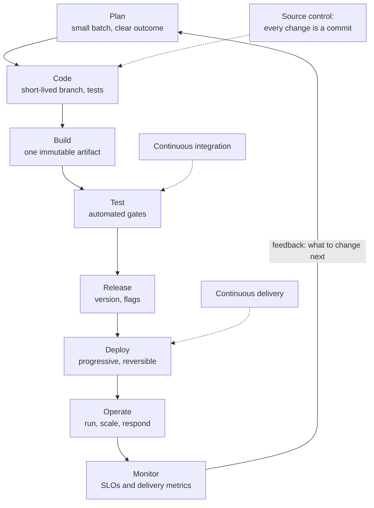
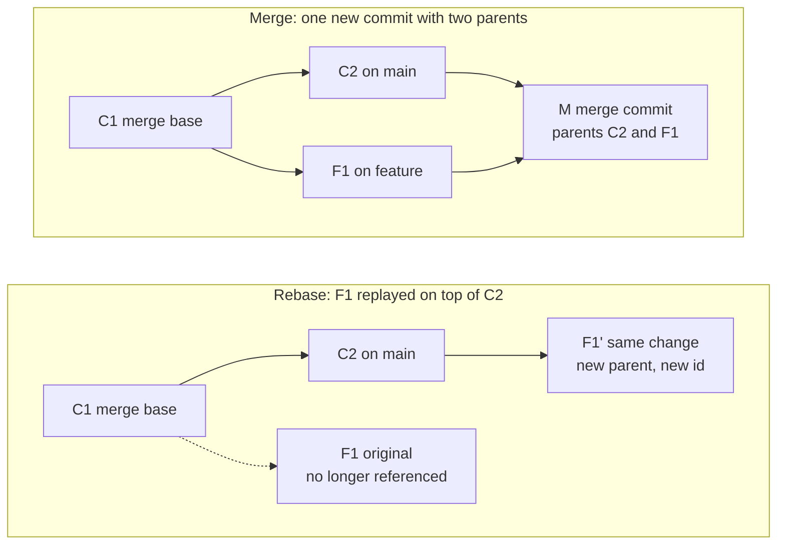
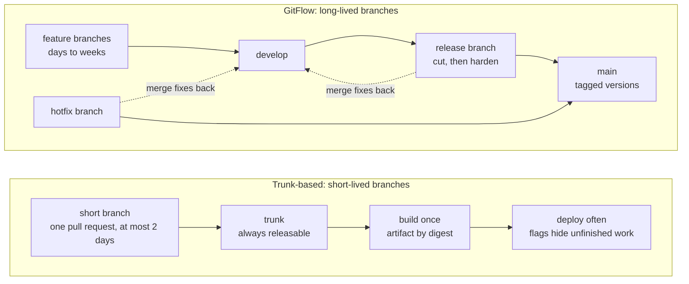
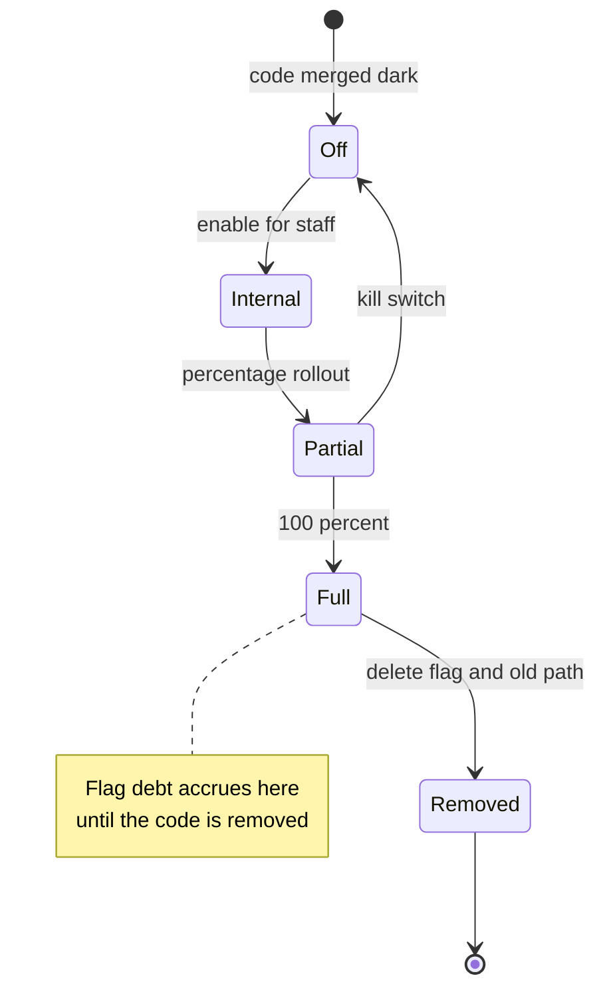

# DevOps lifecycle and source control

> DevOps is the practice of making change to a running system small, frequent, automated, and
> observable. Source control is where every change starts, and the branching strategy a team chooses
> decides how long changes wait before they meet each other, which in turn decides most of the risk.

!!! abstract "Page facts"
    **Level:** Intermediate (the lifecycle, Git objects, and pull requests are Level 1-2; branching
    strategy, flag governance, and delivery metrics are Level 3) · **Status:** Draft ·
    **Time:** 60-75 minutes · **Last verified:** 2026-11-27

## Learning objectives

After this page you should be able to:

- Draw the DevOps lifecycle and say which practice and which tool category serves each stage.
- Explain Git's object model (blobs, trees, commits, references) well enough to reason about merges,
  rebases, history rewriting, and what a commit id actually proves.
- Compare GitFlow and trunk-based development and quantify how branch lifetime drives integration
  delay and merge-conflict risk.
- Describe the path from pull request to build, artifact, release, and deployment, and separate
  configuration from the artifact per environment.
- Define GitOps and classify feature flags by type, with a lifecycle that prevents flag debt.
- Name DORA's current software delivery metrics and use them to measure a change in practice without
  turning them into targets.

## Prerequisites

- [Software testing types and strategies](../foundations/software-testing-types-and-strategies.md)
  — the test gates that build and test automation run.
- [Cloud-native ecosystem tools](../containers-and-kubernetes/cloud-native-ecosystem-tools.md) — the
  GitOps reconciliation loop and AtlasMart's Argo CD set-up, which this page only places in context.
- [Multi-account strategy and infrastructure automation](../cloud-architecture/multi-account-strategy-and-infrastructure-automation.md)
  — where pipelines, registries, and deployment roles live.

## The problem this solves

Software used to move in large, rare batches: weeks on separate branches, a merge near the deadline,
a week of testing what the merge broke, and a hand-over to operations on release night. Large batches
meant large, entangled failures; rare releases made each one risky, so releases became rarer still,
and nobody could say which of hundreds of changes caused an outage. The cure is a set of practices
that shrink the batch: integrate continuously, automate build, test, and deployment, keep code,
configuration, and infrastructure in version control, separate deploying from releasing, and measure
the delivery system.

## What it is

**DevOps** is a set of cultural and technical practices in which the people who build a service also
share responsibility for running it, and in which the path from idea to production is automated,
repeatable, and measured. It is not a team name or a job title, although many companies use it as
one.

**Source control** (version control) records every change to a set of files as an identified,
attributable, reversible unit and lets many people change the same files concurrently. **Git** is
the dominant distributed version control system: every clone holds the full history, and history is
a graph of content-addressed commits.

The lifecycle has eight stages that repeat continuously:

| Stage | What happens | Practices and tool categories |
|---|---|---|
| Plan | Decide the next small change from user needs and production feedback | Backlog, ADRs, SLO reviews |
| Code | Write the change and its tests on a short-lived branch | Git, pull requests, pair programming |
| Build | Compile, package, and produce one immutable artifact | CI server, dependency proxy, registry |
| Test | Run automated gates from unit to end-to-end | Test frameworks, contract broker, scanners |
| Release | Mark an artifact as a candidate and decide who sees the change | Versioning, release notes, feature flags |
| Deploy | Put the artifact into an environment, progressively | CD pipeline, GitOps controller, canary |
| Operate | Run, scale, patch, and respond | Kubernetes, IaC, runbooks, on-call |
| Monitor | Measure user experience and the delivery system | Telemetry, SLOs, DORA metrics |

## Mental model

Think of a restaurant kitchen. Cooks plate onto one shared pass (trunk) many times an hour, so a bad
sauce is noticed on the next plate, not at the end of the night. Dishes follow written recipes (code
and configuration in version control), the head chef tastes before plates leave (review and tests),
a new dish goes to one table before the menu (canary and flags), and waiters report what comes back
(monitoring). The old model is a banquet kitchen that cooks for a week and discovers on the night that
the courses clash.

**Where the analogy breaks:** dishes are eaten and gone, while software changes accumulate and
interact for years. And software can be pulled back after serving (rollback), but only if the change
was designed to be reversible, such as a migration that old code can still read.

## Key terms

| Term | Meaning on this page |
|---|---|
| Commit | An immutable snapshot of the whole tree plus metadata and parent pointers, identified by a hash of its content |
| Branch | A movable named reference to one commit; it costs a few bytes, and the commits are shared |
| Merge | Combining two lines of history, usually by a new commit with two parents |
| Rebase | Replaying commits onto a new base, which creates new commits with new ids |
| Trunk-based development | All developers integrate into one shared branch (trunk) at least daily, using short-lived branches or direct commits |
| GitFlow | A branching model with long-lived `main` and `develop` branches plus feature, release, and hotfix branches |
| Pull request | A proposal to merge a branch, carrying the diff, automated check results, and review discussion |
| Artifact | The built, versioned, immutable output of a build (a container image, package, or archive), identified by its digest |
| Release | Making a version of the software available to users, which may happen at or after deployment |
| Deployment | Installing an artifact into an environment so it runs |
| Feature flag | A runtime switch that changes behavior without deploying new code |
| GitOps | Operating a system from desired state kept in a versioned store, pulled and continuously reconciled by agents inside the system |
| Drift | Any difference between live resources or objects and the declared desired state in code or Git |
| DORA metrics | The software delivery performance measures published by the DORA research program |

## How it works

### The DevOps lifecycle as a loop

**Figure 1 — The DevOps lifecycle.** The eight stages form a loop; the side notes show which practice
family owns each part.

How to read it: the solid arrows are one change's path; the feedback arrow is what makes it a loop
rather than a conveyor. The dotted notes mark where source control, CI, and CD sit; CD is covered in
depth on [CI/CD pipeline design and deployment strategies](ci-cd-pipeline-design-and-deployment-strategies.md).
The loop turns once per change, so a team that deploys many times a day goes round it many times a
day, each turn carrying a small batch.

### Git internals at architect depth

Git stores four kinds of **object**, each named by a hash of its content (SHA-1 by default; Git can
also create repositories that use SHA-256, which, per the
[`git init` documentation](https://git-scm.com/docs/git-init), do not yet interoperate with SHA-1
repositories):

| Object | Holds | Consequence for an architect |
|---|---|---|
| Blob | The bytes of one file version | Identical files are stored once; a secret committed once lives in every clone until history is rewritten |
| Tree | A directory listing: names, modes, and the ids of blobs and sub-trees | A commit's tree id summarizes the entire repository content |
| Commit | One tree id, zero or more parent commit ids, author, committer, message, optional signature | Changing any ancestor changes every descendant's id, so a commit id pins the whole history behind it |
| Annotated tag | A named, optionally signed pointer to a commit, with a message | The usual way to mark a release in source |

A **reference** (branch or lightweight tag) is just a name that stores one commit id; `HEAD` says
which reference is checked out. Creating a branch is therefore nearly free; what costs money is the
divergence that accumulates while it lives. Because every clone carries every object, Git is
distributed: work continues offline, and a lost server can be rebuilt from any complete clone.

Three facts matter in design reviews. **A commit id is an integrity check, not an identity check:**
it proves content and ancestry, but author fields are free text, so attribution needs signed commits
or the server's record of who pushed. **Rewriting history changes ids:** rebase, amend, and squash
create new commits, and anyone who built on the old ones now has diverged history, which is why
shared branches refuse force pushes. **Deleting a file leaves it in old blobs:** a leaked credential
must be revoked; scrubbing history is secondary.

### Merges and rebases

Two branches that both moved since their common ancestor (the **merge base**) can be combined in
three ways:

- **Merge commit.** Git compares each side with the merge base (a three-way merge) and records a new
  commit with two parents, so history shows the parallel work. If one side has not moved, the branch
  name simply moves forward (a **fast-forward**) and no merge commit is made.
- **Rebase.** Git replays the commits unique to your branch, one by one, on top of the other branch,
  producing new commits with new ids: linear history at the price of rewriting it. The
  [Pro Git rebasing chapter](https://git-scm.com/book/en/v2/Git-Branching-Rebasing) explains why
  commits other people have built on must not be rebased.
- **Squash merge.** A branch's commits become one new commit on the target, so each pull request is
  one revertable commit on trunk, but the intermediate steps are lost from trunk.

**Figure 2 — Merge versus rebase of the same two lines of work.** Arrows run forward in time from
parent to child (Git itself stores the opposite pointer, child to parent).

How to read it: both end states hold the same file content. The merge keeps F1 and adds M; the
rebase creates F1', whose id differs from F1 because its parent changed, and the original F1 (dotted)
is later garbage-collected. The choice is about readability and audit, not correctness, and with
day-old branches and squash merges the difference mostly disappears.

### Branching strategies: GitFlow and trunk-based development

**GitFlow** (Vincent Driessen, 2010) keeps two permanent branches, `main` (`master` in the
original) for released versions and `develop` for integration, plus feature branches off `develop`,
release branches cut from `develop` and stabilized before merging into `main`, and hotfix branches
off `main`. The author's 2020 note says continuously delivered software such as web applications is
better served by a much simpler workflow, and GitFlow still suits explicitly versioned software with
several supported versions.

**Trunk-based development** keeps one shared branch, the trunk. Developers merge small changes into
it at least daily, either directly or through short-lived branches that the trunk-based development
site says should last no more than a couple of days, each reviewed through a pull request and built
by CI. Trunk stays releasable at all times; unfinished work is hidden behind feature flags or built
"dark" (deployed but unreachable). Release branches are optional: if used, they are cut from trunk
just before release, receive only cherry-picked fixes, and are deleted afterwards.

**Figure 3 — GitFlow and trunk-based development side by side.** Long-lived branches on top,
short-lived ones below.

How to read it: in GitFlow a change passes through three or four branches and fixes travel back
(dotted arrows), so every fix is merged at least twice. In trunk-based development a change passes
through one short branch and lands where everyone else's changes are.

**The arithmetic of integration delay and conflict risk.** A branch conflicts with trunk when another
change merged during its lifetime touched the same lines. A simple model: if other merges reach
trunk at r per working day, a branch that lives d days is exposed to r × d other merges; if each one
conflicts with yours with probability q, the chance of at least one conflict is
1 − (1 − q)^(r × d). With r = 11 merges per day and q = 1% (both assumptions, used again in the
worked example):

| Branch lifetime d | Other merges r × d | P(at least one conflict) | Expected conflicting merges |
|---|---|---|---|
| 1 day | 11 | 1 − 0.99^11 = 10.5% | 0.11 |
| 2 days | 22 | 1 − 0.99^22 = 19.8% | 0.22 |
| 10 days | 110 | 1 − 0.99^110 = 66.9% | 1.1 |
| 20 days | 220 | 1 − 0.99^220 = 89.0% | 2.2 |

The model understates the gap: a branch living ten times longer usually holds ten times more
change, so q grows too, and late conflicts are harder because the context has gone cold. Semantic
conflicts (changes that merge cleanly but break each other) follow the same exposure arithmetic and
are caught only by building and testing the merged result.

### Pull requests and review

A **pull request** (merge request in some tools) bundles a branch's diff, the automated check
results, and the review conversation. Branch protection on trunk makes it a control: no direct or
force pushes, required checks must pass, and someone other than the author must approve. What makes
reviews work:

- **Small changes, fast turnaround.** Review quality falls as diffs grow, and a pull request waiting a
  day for review is integration delay by another name; teams set a response target in hours.
- **Automated checks first.** Lint, tests, and scans run before a human looks, so review time goes to
  design and intent.
- **Merge queues.** Pull requests that each passed CI against an older trunk can still break it
  together; a queue tests each against trunk plus those ahead of it, then merges in order.
- **Ownership rules.** Changes to pipeline definitions, IaC, or authorization code need approval from
  the owning group. Pair or mob programming can count as the second party.

### Build and test automation, artifacts, and releases

Every push to a pull request branch and every merge to trunk triggers **continuous integration
(CI)**: build the code, run the fast test gates (the pipeline in
[Software testing types and strategies](../foundations/software-testing-types-and-strategies.md#test-automation-and-pipeline-gates)),
and report within minutes. A red trunk build is everyone's top priority, because nobody can integrate
safely on top of it.

The output of a trunk build is an **artifact**: a container image, package, or archive, built once,
identified by its digest, and stored in an artifact repository. Three rules keep artifacts
trustworthy: build once and promote the same bytes through every environment (never rebuild for
production); never overwrite a published version; and record which commit and pipeline produced it
(provenance, covered on [DevSecOps and secure delivery](devsecops-and-secure-delivery.md)).

A **release** is a decision about users, not servers: which version or feature is now available to
whom. With feature flags, code can sit in production switched off for days before the release turns
it on for a cohort. Release records still matter: a tag on the commit that produced the artifact,
notes generated from merged pull requests, and semantic versioning for libraries and public APIs
(for internal services the build id is usually enough).

### Environments and configuration

An **environment** is a complete, isolated place where the system runs for a purpose: development,
staging (production-like, for final checks), and production. AtlasMart gives each product team one
cloud account per environment (24 workload accounts) and one Kubernetes cluster per environment run
by the platform team.

The artifact is identical across environments; what differs is **configuration**: endpoints, sizes,
flag defaults, references to secrets. Keep it in version control next to the deployment description
(a Kustomize overlay per environment), keep secrets out of it (references a secrets operator
resolves), and review and roll it out like code, because a wrong value breaks production as reliably
as a wrong line. List every deliberate difference between environments; each undocumented one is a
place where "it worked in staging" stops being evidence.

### Deployment and rollback basics

A **deployment** installs an artifact plus configuration into an environment: automatically from the
pipeline, progressively (a small share first), watching user-facing signals, with the previous
version kept ready. **Rollback** returns to the last known-good artifact and configuration; with
GitOps it is a revert commit in the configuration repository. It works only if the new version made
no irreversible change, so schema changes follow **expand and contract** (add the new structure, move
code to it, remove the old one a release later; see
[Relational databases and SQL internals](../databases-and-storage/relational-databases-and-sql-internals.md)).
**Roll-forward** ships a fix as a new deployment instead. Deployment strategies are compared on
[CI/CD pipeline design and deployment strategies](ci-cd-pipeline-design-and-deployment-strategies.md).

### Infrastructure automation and GitOps

**Infrastructure automation** applies the same discipline to networks, accounts, clusters, and
managed databases: described as code, reviewed in pull requests, applied by a pipeline role rather
than a person in a console. Concepts are on
[Multi-account strategy and infrastructure automation](../cloud-architecture/multi-account-strategy-and-infrastructure-automation.md);
tools, state, and testing on [Infrastructure as Code](infrastructure-as-code.md).

**GitOps** keeps desired state in a versioned store (usually Git) and has agents inside the target
system pull it and continuously reconcile live state towards it; the OpenGitOps principles name the
four properties: declarative, versioned and immutable, pulled automatically, continuously
reconciled. Unlike a pipeline pushing into a cluster, the agent holds only its own cluster's
permissions, every change is a commit, and drift is detected and optionally reverted. The loop and
promotion by pull request are on [Cloud-native ecosystem tools](../containers-and-kubernetes/cloud-native-ecosystem-tools.md#delivery-gitops-reconciliation);
[Lab 13](../labs/lab-13-gitops-reconciliation.md) builds it locally. AtlasMart runs one Argo CD per
cluster.

### Feature flags

A **feature flag** (feature toggle) is a conditional in code whose value comes from configuration at
runtime, so behavior changes without a deployment. Pete Hodgson's article on martinfowler.com sorts
flags into four categories by how long they live and how dynamic their decision is:

| Category | Purpose | Typical lifetime | Decision |
|---|---|---|---|
| Release flag | Hide unfinished or untested work so trunk stays releasable | Days to a couple of weeks | Mostly static per environment |
| Experiment flag | Split users between variants to measure an effect (A/B tests) | Long enough for a statistically valid result | Per request or per user |
| Ops flag | Turn off an expensive or risky path under load (kill switch) | Mostly short; some kill switches permanent | Changed quickly by operators |
| Permissioning flag | Give a feature to a group (beta users, premium tier, staff) | Months to years | Per request or per user |

**Figure 4 — The lifecycle of a release flag.** A flag is born off and must die once fully on.

How to read it: the only exit is "removed"; a flag that stays at "full" forever is dead code with a
runtime dependency. The kill-switch transition is what makes flags a rollback tool that does not
need a deployment.

**Flag debt** is the cost of flags that outlive their purpose: n independent flags allow 2^n code-path
combinations, so five stale flags in one service mean 2^5 = 32 possible behaviors, of which tests
cover a few. Controls: an owner, an expiry date, and a removal task at creation; a CI check that fails
after expiry; a cap on active release flags per service; flag age reported with the delivery metrics;
and audit logs on every flag change.

### Measuring the delivery system: DORA metrics

The DORA research program (DevOps Research and Assessment) originally described four "key" metrics.
As checked on dora.dev on 2026-11-27, its metrics guide now lists **five** software delivery
performance metrics in two groups, and its history article says MTTR was redefined as failed
deployment recovery time in 2023 and deployment rework rate was added in 2024:

| Group | Metric (DORA's name) | What it measures (paraphrased) |
|---|---|---|
| Throughput | Change lead time | Time from a change being committed to version control to that change running in production |
| Throughput | Deployment frequency | How often changes are deployed to production in a period |
| Throughput | Failed deployment recovery time | Time to recover from a deployment that fails and needs immediate intervention |
| Instability | Change fail rate | Share of deployments that need immediate intervention, such as a rollback or hotfix |
| Instability | Deployment rework rate | Share of deployments that are unplanned and made because of a production incident |

DORA's own guidance on use is the important part for an architect: measure per application or
service, do not compare very different applications or teams, use several metrics together rather
than one, and do not set them as targets, because a measure that becomes a target gets gamed.
The guide also reports that for most teams the metrics are correlated, with top performers doing
well on all five: speed and stability are not traded against each other, which is the empirical case
for everything above.

## Worked example: AtlasMart moves from release branches to trunk-based development

AtlasMart's delivery practice (Phase 4B assumption) is trunk-based development with short-lived
branches, CI of about 10 minutes per build, about 200 builds a day across its nine teams (eight
product teams plus the platform team, from the exercise briefs), production deploys by progressive
canary, and DORA metrics reported monthly. This example reconstructs the move to that practice. All
"before" figures and all metric values are assumptions for teaching, labelled as such.

**Before (assumption):** GitFlow-style feature branches off `develop` with a median life of 10
working days; a release branch cut every 4 weeks (20 working days), hardened for 1 week (5 working
days), and deployed in a Saturday-night window after a manual change approval; hotfix branches merged
back into `develop` and the open release branch.

**After:** one trunk per repository with branch protection, one approving reviewer, and required CI
checks; branches of at most 2 days with a median of 1 day (assumption); CI of about 10 minutes, which
matches gates 1 and 2 of the testing page (2 + 8 minutes); release flags with an owner and a 30-day
expiry (assumption); one signed image per trunk build, promoted as on the CI/CD page.

### Step 1 — Integration delay

Mean time from a commit to production, before: the commit waits on average half its branch's life
(10 ÷ 2 = 5 days), then on average half a release cycle for the next cut (20 ÷ 2 = 10 days), then the
hardening week (5 days): 5 + 10 + 5 = 20 working days, about 4 weeks. After: half a branch's median
life (0.5 day), plus about 1.5 hours from merge to full production (trunk build, staging, approval,
and canary, itemized on the CI/CD page), so well under 1 working day.

### Step 2 — Merge-conflict exposure

Assume half of the 200 daily builds are merges to trunk and the rest are pull-request builds, so
about 100 merges a day across nine teams, roughly 11 per team repository per day, and a per-pair
conflict probability q = 1% (both assumptions). From the table above: a 10-day feature branch has a
66.9% chance of at least one conflict and 1.1 conflicting merges expected; a 1-day branch has 10.5%
and 0.11. Ten times fewer expected conflicts before even counting that the old branches were larger.
GitFlow also merged every hardening fix twice (into `main` and back into `develop`), a cost that
disappears.

### Step 3 — The DORA metrics before and after (assumptions, per service, monthly)

| Metric | Before | After | How "after" is produced |
|---|---|---|---|
| Deployment frequency | 1 planned deployment per 4 weeks, plus hotfixes | About 2 per working day, so about 40 a month | Every trunk merge is deployable; teams deploy when a change is ready |
| Change lead time | About 20 working days (Step 1) | Under 1 working day | Short branches, 10-minute CI, automatic promotion |
| Change fail rate | 25% | 8% | Small changes, canary gates on SLO metrics |
| Failed deployment recovery time | About 6 hours (find the culprit in a large batch, rebuild, redeploy) | About 30 minutes (abort the canary or revert one commit) | One change per deployment, previous digest still running |
| Deployment rework rate | 0.5 hotfix deployments ÷ 1.5 deployments a month = 33% | 2 incident-driven deployments ÷ 40 = 5% | Most failures are rolled back by the canary instead of hotfixed |

The after figures are what AtlasMart expects within two quarters; the first month usually looks
worse while teams learn to slice work. Metrics go per service to the owning team, never as a ranking.

### Step 4 — Transition plan

1. Make CI fast and trustworthy first: fix or quarantine flaky tests until a trunk build is reliably
   green in about 10 minutes. Trunk-based development on a slow, flaky build fails within weeks.
2. Protect trunk and introduce the 2-day branch rule, with a weekly report of branch age.
3. Introduce the flag service and the release-flag lifecycle, including the expiry check in CI.
4. Stop cutting monthly release branches once one month of trunk builds has passed staging cleanly.
5. Turn on automated promotion with canary gates, service by service, tier 3 first and tier 1
   (checkout, payments, tracking) last.

## Real-world architecture example

Large product organizations commonly run one trunk per repository (sometimes one repository for the
whole company) with hundreds of merges a day through a merge queue, a central flag service with audit
logs and expiry reports, and per-environment configuration watched by GitOps controllers. Teams that
ship installed software (mobile apps, on-premises products) still cut a release branch per version,
because they must patch versions already in customers' hands: the case the GitFlow author's 2020
note still recommends GitFlow for.

## Design choices and trade-offs

| Choice | Favor when | Avoid when |
|---|---|---|
| Trunk-based development | A service is continuously delivered; CI is fast and reliable; flags are available | Tests are slow or flaky and cannot be fixed first; regulated release batching is mandated |
| GitFlow or release branches per version | Several released versions must be supported at once (installed or embedded software) | Web services with one version in production |
| Squash merge | You want one revertable commit per pull request on trunk | The individual commits carry audit value that must stay on trunk |
| Rebase before merge | Linear, readable history on short branches owned by one person | Shared branches that others have built on |
| Merge queue | Many merges a day into one trunk with a non-trivial build | A small team with a few merges a day (overhead outweighs benefit) |
| Monorepo | Atomic changes across many components, shared tooling | Tooling cannot scale builds to only what changed; strict per-team access is needed |
| Feature flags for release | Work longer than a branch's life; dark launches; quick kill switch | No owner or expiry process exists; the change cannot be isolated behind one branch point |
| GitOps pull delivery | Kubernetes or other reconcilable targets; desire for audit and drift detection | Targets with no agent model, or imperative one-off operations |

## Failure modes and anti-patterns

- **"Trunk-based" with week-old branches.** The name changes, the risk does not. Detect: branch-age
  report, conflict rate. Prevent: a 2-day rule with a visible report, and slicing work behind flags.
- **Red trunk ignored.** Teams keep merging on a broken build, burying the cause. Detect: trunk build
  status and time-to-green. Prevent: stop-the-line rule, automatic revert of the breaking merge.
- **Flaky tests.** Developers rerun until green and stop trusting CI. Detect: pass-on-retry rate.
  Prevent: quarantine with an owner and a deadline.
- **Flag debt.** An old flag flipped by mistake revives a dead path. Detect: flag age report.
  Prevent: owner, expiry, CI check.
- **Configuration drift between environments.** Staging passes, production fails. Detect: GitOps
  drift status, an environment-difference list. Prevent: configuration in Git, applied only by agents.
- **Metrics as targets.** Deployment frequency rises because teams split deployments artificially.
  Detect: metrics moving without outcome change. Prevent: use DORA's metrics for learning, together,
  per service.
- **Irreversible deploys.** A migration drops a column and rollback becomes impossible. Prevent:
  expand and contract, and a migration review step.

## Security considerations

- **The repository is production's attack surface.** Whoever can merge to trunk can change
  production, so trunk protection and review are security controls, not style rules.
- **Commit authorship is not authenticated.** Use signed commits or the server's record of the
  authenticated pusher and approver, never the author field.
- **Secrets in history** reach every clone. Scan before push and in CI; revoke and rotate on a finding.
- **Flags are an authorization surface.** Restrict and log who can flip permissioning and ops flags.
- **Separation of duties** comes from the second reviewer and the pipeline, not a separate deployment
  team. Pipeline security is on [DevSecOps and secure delivery](devsecops-and-secure-delivery.md).

## Performance, reliability, and cost

- **Performance:** CI duration is the floor for change lead time; at 200 builds a day each minute
  saved returns 200 minutes of waiting. Dependency caches and building only what changed come first.
- **Reliability:** small batches make failures smaller and easier to attribute, and reversible
  deployments shorten recovery. Merge queues keep trunk green as merge volume grows.
- **Cost:** CI compute is builds × duration (200 × 10 = 2,000 build-minutes a day at AtlasMart);
  flags add a service; dropping the hardening week and double merges saves mostly people's time.

## Hands-on lab: merges, rebases, and commit ids

Local and free; needs only Git. Work in a temporary directory, never in a real project. If Git asks
for an identity, set a throwaway name and address for this repository only.

1. Create a repository, commit one file, and inspect the objects: `git cat-file -t HEAD` prints
   `commit`; `git cat-file -p HEAD` shows the tree id and author lines; `git cat-file -p 'HEAD^{tree}'`
   lists the blob for your file.
2. Create a branch `feature`, change the file and commit; switch back to `main`, add a second file and
   commit. The two lines have now diverged from one merge base.
3. Copy `feature` to `merge-demo` (`git branch merge-demo feature`), merge `main` into it, and run
   `git log --oneline --graph`. Count the parents of the new commit with `git cat-file -p HEAD`.
4. Note `feature`'s commit id (`git rev-parse --short feature`), then `git switch feature`,
   `git rebase main`, and print the id again. Compare the graphs of `merge-demo` and `feature`.
5. Stretch: create a conflicting change on both branches and resolve it once with merge and once with
   rebase; then compute the conflict-probability table above for your own team's merge rate.

??? question "Hint: why did the feature commit get a new id after the rebase?"
    A commit's id is a hash over its content, which includes its tree and its parent ids. Rebasing
    gives the commit a new parent (the tip of `main`) and usually a new tree, so the hash changes even
    though your change is the same. That is why rebasing commits others already have creates
    divergent history for them.

For GitOps, follow [Lab 13: GitOps reconciliation](../labs/lab-13-gitops-reconciliation.md), which
runs the reconcile loop locally with Git as the source of desired state.

## Knowledge check

1. A colleague says "creating branches is expensive in Git, so we keep few of them". What is actually
   expensive?
2. Why does rebasing a branch that a teammate has already pulled cause trouble, while merging does not?
3. Using the conflict model on this page, what happens to the chance of a conflict if a team doubles
   its merge rate and keeps 1-day branches?
4. Name the four categories of feature flag and the one property that most determines how each must
   be governed.
5. List DORA's current five software delivery metrics and say why DORA advises against using them as
   team targets.

??? success "Answers"
    1. A branch is a reference holding one commit id, so it costs almost nothing. What is expensive is
       divergence: the longer a branch lives, the more other changes it must be reconciled with.
    2. Rebase creates new commits with new ids and abandons the old ones. The teammate's work is built
       on the old ids, so their history now diverges from the branch. Merge only adds a commit and
       rewrites nothing.
    3. Exposure doubles from 11 to 22 merges, so the chance rises from 10.5% to 1 − 0.99^22 = 19.8%,
       the same as a 2-day branch at the old rate. Higher merge rates are a reason to keep branches
       even shorter, and to add a merge queue.
    4. Release, experiment, ops, and permissioning. Lifetime (and with it, dynamism) is the main
       property: short-lived release flags need expiry and removal; long-lived permissioning flags
       need access control and review like code.
    5. Change lead time, deployment frequency, failed deployment recovery time, change fail rate, and
       deployment rework rate. Used as targets they get gamed (for example by splitting deployments)
       and they mislead when compared across different applications; DORA recommends using them per
       service, together, to find where to improve.

## Architecture discussion questions

1. AtlasMart's Order Management System is a 12-year-old monolith owned by another team (Phase 4B
   assumption); assume it releases quarterly from release branches. What would you change first to shorten its
   change lead time, and what would you not attempt yet?
2. A regulator requires evidence that every production change was reviewed by someone other than its
   author. Show how trunk-based development with branch protection and GitOps produces that evidence
   without a separate change board.
3. Product managers want experiment flags to stay in the code permanently "in case we want to test
   again". Argue for or against, using flag debt and the 2^n arithmetic.

## Summary

DevOps is the practice of making change small, frequent, automated, and observable, organized as a
loop from plan to monitor. Git stores content-addressed blobs, trees, and commits; branches are cheap
references, rebases create new commits, and a commit id proves content and history but not authorship.
The cost of a branch is divergence, which grows with its lifetime: in the model on this page a 10-day
branch faces about six times the conflict probability of a 1-day branch, which is why trunk-based
development with short-lived branches suits continuously delivered services while GitFlow suits
software with several supported versions. Pull requests, CI, build-once artifacts, configuration per
environment, reversible deployments, GitOps, and feature flags with an expiry carry a change safely
to production. DORA now lists five delivery metrics in throughput and instability groups;
AtlasMart uses them per service and monthly to see whether its move to trunk-based development worked.

## Related topics

- **Before:** [Software testing types and strategies](../foundations/software-testing-types-and-strategies.md);
  [Multi-account strategy and infrastructure automation](../cloud-architecture/multi-account-strategy-and-infrastructure-automation.md)
- **Alongside:** [CI/CD pipeline design and deployment strategies](ci-cd-pipeline-design-and-deployment-strategies.md)
  — the pipeline and deployment strategies in depth; [Infrastructure as Code](infrastructure-as-code.md);
  [DevSecOps and secure delivery](devsecops-and-secure-delivery.md); [Platform engineering](platform-engineering.md)
  — golden paths that package these practices; [Cloud-native ecosystem tools](../containers-and-kubernetes/cloud-native-ecosystem-tools.md)
  — GitOps reconciliation; [Lab 13: GitOps reconciliation](../labs/lab-13-gitops-reconciliation.md);
  [Incident management and SRE practices](../observability-and-sre/incident-management-and-sre-practices.md).
- **Planned:** event-driven architecture and its versioned contracts (D08-T02).

## References

| Source | Type | Checked |
|---|---|---|
| [DORA's software delivery performance metrics](https://dora.dev/guides/dora-metrics/) — DORA | Guide (current five metrics, groups, and usage guidance) | 2026-11-27 |
| [A history of DORA's software delivery metrics](https://dora.dev/insights/dora-metrics-history/) — DORA | Article (four keys, 2023 and 2024 changes) | 2026-11-27 |
| [Trunk Based Development](https://trunkbaseddevelopment.com/) — Paul Hammant and contributors | Reference site (definition, short-lived branches, release branches) | 2026-11-27 |
| Vincent Driessen, ["A successful Git branching model"](https://nvie.com/posts/a-successful-git-branching-model/), 2010, with 2020 note of reflection | Article (GitFlow) | 2026-11-27 |
| ["Git Internals - Git Objects"](https://git-scm.com/book/en/v2/Git-Internals-Git-Objects), *Pro Git*, 2nd edition — Scott Chacon and Ben Straub | Book chapter (free online) | 2026-11-27 |
| Martin Fowler, ["Continuous Integration"](https://martinfowler.com/articles/continuousIntegration.html) | Article | 2026-11-27 |
| Pete Hodgson, ["Feature Toggles (aka Feature Flags)"](https://martinfowler.com/articles/feature-toggles.html) — martinfowler.com | Article (toggle categories and carrying cost) | 2026-11-27 |
| [OpenGitOps principles](https://opengitops.dev/) — CNCF GitOps Working Group | Principles (four GitOps properties) | 2026-11-27 |

## Review notes

- Canonical page for D16-T01. In depth: lifecycle, Git internals, merge and rebase, GitFlow versus
  trunk-based development, pull requests and review, feature flags, DORA metrics. Only short sections
  (depth elsewhere): build and test automation, CI/CD, artifacts, releases, environments,
  configuration, deployment, rollback, infrastructure automation, GitOps.
- DORA names, groups, and history read on dora.dev on 2026-11-27 (five metrics; MTTR redefined 2023;
  rework rate added 2024). Re-check at review; DORA has changed the set before. The 2-day branch limit
  is from trunkbaseddevelopment.com; the GitFlow 2020 note from nvie.com; SHA-256 non-interoperability
  from the `git init` documentation (linked inline).
- The conflict model 1 − (1 − q)^(r × d) is a teaching device assuming independence, not an
  empirical result.
- New AtlasMart assumptions: the before-state (10-day branches, 4-week cycle, 1-week hardening,
  Saturday window); 1-day median branch; 30-day flag expiry; 100 of 200 daily builds being trunk
  merges (about 11 per team repository a day); q = 1%; the 1.5 hours from merge to production comes from the CI/CD page; all DORA
  before and after values. The 10-minute CI matches the testing page's gates 1 and 2 (2 + 8 minutes).
- Lab commands were run with local Git in a temporary directory (two parents after merge, new id
  after rebase observed).
