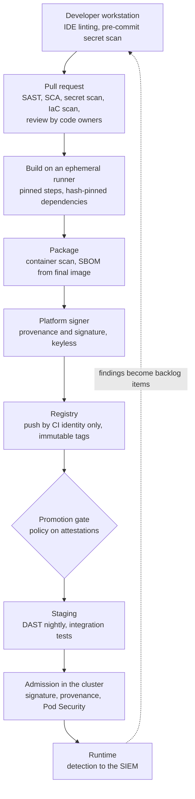
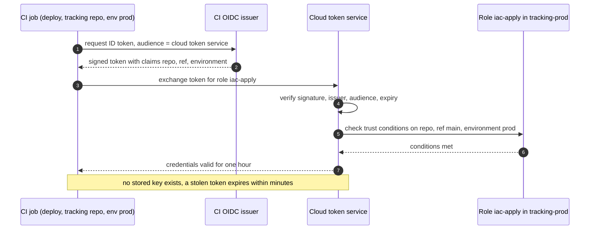
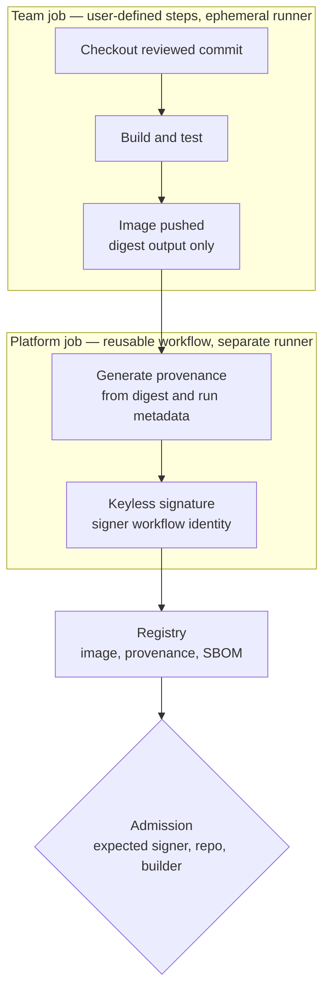

# DevSecOps and secure delivery

> DevSecOps puts security checks where changes are made and proves, at each step, that what reaches
> production is what was reviewed and built. The pipeline that carries every change is also the
> most privileged system in the estate, so securing the pipeline itself matters as much as the
> checks it runs.

!!! abstract "Page facts"
    **Level:** Intermediate (shift left and scanner placement are Level 1-2; pipeline hardening,
    federation design, and the SLSA Build L3 gap analysis are Level 3) · **Status:** Draft ·
    **Time:** 60-75 minutes · **Last verified:** 2026-11-27

## Learning objectives

After this page you should be able to:

- Explain shift left, what it buys, and the security work that cannot be shifted left.
- Draw a secure CI/CD pipeline and place SAST, SCA, secret, IaC, and container scanning, DAST, SBOM
  generation, signing, and provenance on it, with a blocking or advisory decision for each.
- Secure the pipeline itself: runner isolation, steps pinned by commit SHA, least-privilege tokens,
  and OIDC federation instead of stored cloud keys.
- Design policy enforcement and compliance gates that produce evidence rather than slow delivery.
- Connect pipeline controls to admission policies and runtime detection in the cluster.
- Run a gap analysis of a real pipeline against SLSA Build L3 and say which threat each change
  addresses.

## Prerequisites

- [Application security](../security-architecture/application-security.md) — what SAST, DAST,
  IAST, SCA, and fuzzing are and what each finds. This page only places them in the pipeline.
- [Infrastructure and supply-chain security](../security-architecture/infrastructure-and-supply-chain-security.md)
  — SBOMs, provenance, signatures, SLSA tracks, admission policy, and AtlasMart's commit-to-pod
  target design. This page is the delivery-side route to that target.
- [Infrastructure as code](infrastructure-as-code.md) — the IaC pipeline whose scans and roles this
  page secures.

## The problem this solves

AtlasMart runs about 200 builds a day across nine teams (exercise brief assumption). A security team
that reviews releases by hand at the end either becomes a queue that blocks delivery or a rubber
stamp that blocks nothing. Meanwhile the pipeline has quietly become the most powerful identity in
the company: it can read every repository, push to the registry, and change every account. Attacks
on build systems and on widely used pipeline components have shown that an attacker who controls a
build does not need to break production: the pipeline delivers the attack, signed and approved.
DevSecOps answers both problems: automate security checks into the flow of work, and treat the
delivery system as a production system with its own threat model.

## What it is

**DevSecOps** is the practice of making security a shared, continuous part of how software is
designed, built, delivered, and run, with automated controls in the delivery pipeline and security
specialists acting as enablers rather than gatekeepers. DORA's research describes the same idea as
"pervasive security": security work integrated into daily delivery, with pre-approved tools and
automated tests, and InfoSec involved from design onwards.

It has three parts:

1. **Security in the pipeline:** checks that run on every change (scanners, policy, tests).
2. **Security of the pipeline:** controls that stop the delivery system being used to deliver an
   attack (isolation, identity, integrity of steps and artifacts).
3. **Security after the pipeline:** admission and runtime controls that verify what arrives and
   detect what the earlier stages missed, feeding findings back to the teams.

## Mental model

Think of a pharmaceutical plant. Raw materials are tested on arrival (dependency scanning), each
station checks its own output (tests and scanners), every batch carries a record of where and how
it was made (provenance), and the finished pack is sealed (signature). The pharmacy refuses unsealed
packs or packs from unknown plants (admission policy), and adverse reactions are reported back
(runtime detection). The plant itself has guarded doors, and the machines that print the batch
records are out of reach of the line workers (pipeline security, SLSA Build L3).

**Where the analogy breaks:** a plant's tests check for known contaminants in physical goods.
Software scanners find only known patterns and known vulnerabilities; a clean scan does not prove a
program is safe, and attackers adapt to the checks. And unlike a plant, the "line" is
reprogrammed with every pull request, including the files that define the pipeline itself.

## Key terms

| Term | Meaning on this page |
|---|---|
| DevSecOps | Security built into delivery as a shared, automated, continuous practice rather than a final gate |
| Shift left | Moving security activities earlier in the lifecycle, where fixes are cheaper |
| SAST / DAST / SCA | Static analysis of source, probing the running application, and inventory of third-party components with their known vulnerabilities and licenses (definitions on the application-security page) |
| Secret scanning | Searching code, history, and artifacts for credentials committed by mistake |
| IaC scanning | Static analysis of infrastructure code for insecure settings before it is applied |
| SBOM | A machine-readable list of the components in an artifact, with versions and identifiers |
| Provenance | Verifiable metadata, produced by the build platform, about how an artifact was built |
| Artifact signing | A cryptographic signature over an artifact's digest that lets consumers verify who produced it and that it is unchanged |
| SLSA | An OpenSSF framework of tracks and levels for software supply-chain integrity |
| Poisoned pipeline execution | Getting a pipeline to run attacker-controlled commands, for example by changing its definition or injecting input |
| Workload identity federation | Exchanging a platform-issued identity token (such as a CI job's OIDC token) for short-lived cloud credentials, with no stored key |
| Compliance gate | A pipeline check that blocks promotion unless the evidence a policy requires is present and passing |
| Admission controller | Code in the Kubernetes API server's request path that can change or reject an object before it is stored |

## How it works

### Step 1 — Shift left, and its limits

Shifting left pays because the cost of a fix grows with the distance from the change that caused it:
a secret caught by a pre-commit hook costs seconds; the same secret found in a public repository
costs a rotation, an investigation, and maybe a disclosure. Automated checks also produce evidence on
demand, which auditors can use instead of interviews.

Shift left has limits that an architect should state plainly:

- **Some flaws only exist on the right.** Misconfiguration in a running environment, exposed
  endpoints, and runtime exploitation are invisible to source analysis. DAST, admission, and runtime
  detection exist for this reason: "shift left" must come with "extend right".
- **Developers are not a free security team.** Dumping hundreds of untriaged findings into pull
  requests teaches people to ignore them. Only high-confidence, actionable checks should block.
- **Scanners have false positives and false negatives.** A green pipeline means "no known pattern
  matched", not "secure". Threat modeling and design review (left of the code) find the flaws tools
  cannot.
- **Speed is a security property too.** If checks add 30 minutes, teams batch changes, and big
  batches are riskier. AtlasMart's CI target is about 10 minutes per build (assumption), so scanners
  run in parallel and slow ones move off the critical path.

### Step 2 — The secure CI/CD pipeline

**Figure 1 — AtlasMart's secure delivery pipeline with the controls at each stage.** Stages run top
to bottom; the last stage feeds back to the first.

How to read it: each stage adds evidence (scan results, SBOM, provenance, signature) that later
stages check instead of trusting. The promotion gate and admission both verify the same artifact
digest, so what runs in prod is the exact artifact that passed the checks. Deployment strategy and
promotion mechanics are on the [CI/CD pipeline design page](ci-cd-pipeline-design-and-deployment-strategies.md).

### Step 3 — Where each scanner runs, and whether it blocks

Definitions and strengths of each technique are on the
[application-security page](../security-architecture/application-security.md#step-8-the-testing-toolbox);
here the question is placement.

| Check | Where | Blocks? | Why there |
|---|---|---|---|
| Secret scanning | Pre-commit hook, every push, and the full history on a schedule | Yes | Cheapest at commit; a pushed secret must be rotated, not just deleted |
| SAST | Pull request (changed code), full scan nightly | Only high-confidence rules | Noisy rules erode trust; tune before blocking |
| SCA | Pull request (lock file diff) and daily against deployed versions | Yes for known-exploited or critical reachable issues | New advisories arrive after the build, so re-scan what runs |
| IaC scanning | Pull request on IaC repositories (Checkov, `trivy config`) | Yes for high severity | Insecure infrastructure is cheapest to fix before apply |
| Container image scanning | After the image is built, and daily in the registry | Yes per the triage policy on the supply-chain page | Base images age; the registry re-scan catches new CVEs |
| SBOM generation | From the final image, in the build | No (it is evidence) | The SBOM must describe what ships, not the source tree |
| DAST | Nightly against staging, and after major releases | Findings ticketed; critical ones block promotion | Needs a running application; too slow for every pull request |
| Policy as code | On IaC plans and Kubernetes manifests in the pull request; again at admission | Yes | Same rules in two places: early feedback and enforcement |

Open-source examples: gitleaks for secrets (this repository's own CI uses it), Trivy for images,
file systems, IaC, and SBOMs, Checkov for IaC; vendors offer equivalents. Name the tool in the
platform's golden path, not in each team's pipeline.

### Step 4 — SBOM, signing, and provenance in the pipeline

The supply-chain page explains what an SBOM, a provenance attestation, and a signature each prove,
and how SLSA's Build track levels work. In the pipeline, three rules matter:

1. **Generate them in the build, about the final artifact digest.** An SBOM produced later from
   source describes something else.
2. **Have the platform, not the team's steps, produce provenance and sign.** That is the difference
   between SLSA Build L1 (provenance exists) and L2/L3 (provenance is authentic and, at L3,
   unforgeable by the build's own steps).
3. **Store them with the artifact** as attestations in the registry, so the promotion gate and
   admission controller can fetch and verify them by digest.

### Step 5 — Securing the pipeline itself

The OWASP Top 10 CI/CD Security Risks is a useful checklist for this step. The controls an
architect should insist on:

| Control | What it stops | OWASP CI/CD risk |
|---|---|---|
| Ephemeral, single-job runners; no self-hosted runners for untrusted code | One job tampering with the next, persistent compromise of a runner | CICD-SEC-7 Insecure System Configuration |
| Third-party pipeline steps pinned to a full-length commit SHA, from an allow-list | A moved tag or compromised maintainer swapping the code a step runs | CICD-SEC-3 Dependency Chain Abuse; CICD-SEC-8 Ungoverned Usage of 3rd Party Services |
| Pipeline token read-only by default, write scopes granted per job | A compromised step using the token to push code or packages | CICD-SEC-5 Insufficient PBAC |
| OIDC federation to the cloud, roles scoped per repository and environment | Theft of long-lived cloud keys stored as CI secrets | CICD-SEC-6 Insufficient Credential Hygiene; CICD-SEC-2 Inadequate IAM |
| Pipeline definitions owned by the platform, untrusted input never interpolated into scripts, no secrets for unreviewed changes | Poisoned pipeline execution | CICD-SEC-4 PPE; CICD-SEC-1 Insufficient Flow Control |
| Hash-pinned dependencies through an internal proxy | Dependency confusion and typosquatting | CICD-SEC-3 |
| Pipeline audit logs shipped to the log archive | Silent changes to workflows, runners, and roles | CICD-SEC-10 Insufficient Logging and Visibility |

**Pinning by commit SHA.** A tag like `v4` is a movable pointer; anyone who can push to the step's
repository can move it. GitHub's hardening guide recommends pinning third-party actions to a
full-length commit SHA and checking that the SHA comes from the original repository. Pinning freezes
fixes too, so a bot proposes updates as reviewed pull requests.

**Least-privilege tokens.** Set the pipeline's built-in token to read-only by default and grant
write scopes only to the jobs that need them (for example, only the publish job may push packages,
and only the signing and deploy jobs may request an OIDC token).

**OIDC federation instead of stored keys.**

**Figure 2 — A CI job obtains short-lived cloud credentials through OIDC federation.**

How to read it: the cloud trusts the CI platform's issuer, but only for tokens whose claims match the
role's conditions. A workflow on a feature branch, in another repository, or without the `prod`
environment gets nothing. The conditions are the security boundary, so wildcards in them are the
most common mistake. The job must be allowed to request the token (in GitHub Actions, the
`id-token: write` permission).

| Piece | AWS | Microsoft Azure | Google Cloud |
|---|---|---|---|
| Trust an external OIDC issuer | IAM OIDC identity provider plus a role trust policy | Microsoft Entra Workload ID federated identity credentials | Workload Identity Federation pools and providers |

CI platforms that issue job tokens include GitHub Actions and GitLab CI/CD (ID tokens).

### Step 6 — Policy enforcement and compliance gates

A **compliance gate** turns a policy ("prod images must have passed scanning, have an SBOM, and be
built by the approved builder from a reviewed commit") into a machine check on evidence:

- **Evidence as attestations.** Each stage attaches a signed statement to the artifact digest: test
  results, scan results, SBOM, provenance, review record. The gate verifies them; nobody fills in a
  form.
- **Policy as code, tested.** Gate rules are versioned, reviewed, and unit-tested with known-good
  and known-bad inputs, like any guardrail.
- **Exceptions with an owner and an expiry.** A blocked team can get a time-limited, recorded
  exception; exceptions without expiry become the real policy.
- **Map, do not duplicate, frameworks.** NIST's Secure Software Development Framework (SP 800-218)
  and SP 800-204D (supply-chain security in DevSecOps CI/CD pipelines) describe practices; map each
  gate to the practice it evidences. Whether that satisfies a given regulation depends on facts, as
  the [compliance page](../security-architecture/compliance-and-regulatory-frameworks.md) explains.

### Step 7 — Admission policies and runtime security

The pipeline's guarantees are only as good as the last check before code runs.

- **Admission policies** in each cluster reject Pods whose images are not referenced by digest,
  not signed by the expected CI workflow identity, or lack provenance from the expected repository
  and builder, and enforce the `restricted` Pod Security profile. Kyverno, OPA Gatekeeper, and the
  built-in ValidatingAdmissionPolicy are the usual tools; signature checks need a webhook engine
  because they fetch data from the registry. Roll out in audit mode, then enforce.
- **Runtime security** watches what admission cannot predict: a shell in a container, unexpected
  outbound connections, writes to read-only paths. Falco (a CNCF project) is an open-source example;
  findings go to the SIEM ([Security operations](../security-architecture/security-operations.md)).
- **Feedback.** A runtime finding becomes a backlog item and, where possible, a new pipeline or
  admission rule, so the same problem is caught earlier next time. That loop is the "Ops" in
  DevSecOps.

## Worked example: hardening AtlasMart's CI/CD to SLSA Build L3

The exercise brief sets a target of SLSA Build Level 3 for production services, with 200 builds a
day and no long-lived deployment credentials. The supply-chain page describes the target
commit-to-pod path; this example is the route from today's pipeline to it.

### Step 1 — Today's pipeline (assumptions)

- CI jobs run on a pool of 10 persistent self-hosted runner VMs (4 vCPU each) in the shared
  services account, reused across jobs and teams, with a shared on-disk build cache.
- Images are signed with a long-lived signing key stored as a CI secret that any workflow step can
  read. Each team's workflow writes its own provenance file with a script step and signs it with
  the same key.
- Third-party steps are referenced by tag. The pipeline token has write permissions in every job.
- One machine identity with a long-lived access key, stored as a CI secret, can assume the deploy
  and IaC roles in all 29 accounts.
- Any repository writer can change workflow files, and branch builds receive the same secrets as
  `main`.
- SCA and secret scanning run on pull requests; SAST is advisory; there is no IaC scanning; DAST is
  a manual quarterly exercise. Kyverno in each cluster checks that images are signed by the key.

### Step 2 — Where it stands against SLSA Build requirements

SLSA v1.2 assigns these Build track requirements to the build platform: provenance exists (L1);
provenance authentic and a hosted platform (L2); provenance unforgeable and builds isolated from
one another (L3), which includes keeping signing secrets out of reach of user-defined build steps.

| Requirement | Level | Today | Gap |
|---|---|---|---|
| Provenance exists | L1 | Yes, written by a script step | None |
| Hosted build platform | L2 | Yes, runners are platform-managed, not workstations | None |
| Provenance authentic | L2 | No: generated by the team's own step, signed with a key every step can read | G1 |
| Provenance unforgeable | L3 | No: any step can forge fields or sign arbitrary provenance | G2 |
| Builds isolated | L3 | No: persistent runners and a shared writable cache let one build influence another | G3 |

So the production pipeline is at **Build L1** today. Separately from SLSA, three pipeline-security
gaps raise the risk: G4 the long-lived cloud key, G5 tag-pinned steps and write-all tokens, and G6
unprotected workflow definitions.

### Step 3 — The changes, and the threats each addresses

SLSA's threat model labels build-side threats (D) external build parameters, (E) build process,
(F) artifact publication, and (G) distribution channel; the table uses those labels and the OWASP
CI/CD risk IDs.

| Change | Closes | Threats addressed |
|---|---|---|
| C1 Ephemeral runners: a fresh VM per job, destroyed after; caches keyed per repository and read-only across trust boundaries | G3 (L3 isolated) | (E) compromise other build, poison the build cache; CICD-SEC-7 |
| C2 A platform-owned reusable workflow, in a separate job the team's steps cannot influence, generates provenance from the build's output digest and signs it keylessly with its own workflow identity; the long-lived signing key is revoked | G1, G2 (L2 authentic, L3 unforgeable) | (E) forge provenance values, steal cryptographic secrets; (F) upload package without provenance |
| C3 OIDC federation replaces the stored cloud key: one role per repository and environment, trust conditions on repository, `main`, and environment; build jobs get no cloud role at all | G4 | Credential theft and reuse; (F) tamper with the artifact after CI; CICD-SEC-6, CICD-SEC-2 |
| C4 Third-party steps pinned by full commit SHA from an allow-list; update bot; token read-only by default with per-job grants | G5 | Build dependency threats; CICD-SEC-3, CICD-SEC-5, CICD-SEC-8 |
| C5 Workflow files owned by the platform team (code owners), untrusted input passed through environment variables, no secrets or OIDC roles for unreviewed branches | G6 | (D) external build parameters; CICD-SEC-4 poisoned pipeline execution, CICD-SEC-1 |
| C6 Kyverno policies extended from "signed by the key" to "signed by the platform signer's identity, with provenance naming the expected repository and builder, by digest" | Verification | (F) build with untrusted CI/CD, tamper with artifact or provenance; (G) replace package |
| C7 IaC scanning and blocking high-confidence SAST on pull requests; DAST nightly against staging; CI audit logs to the log archive | Coverage | Insecure infrastructure, injection flaws, missing visibility; CICD-SEC-10 |

**Figure 3 — The hardened build: user steps and the platform signer are separate trust zones.**

How to read it: the team's job can only hand over a digest; it never holds signing material and
cannot write the provenance. If a malicious step tampers with the build, the provenance still truthfully
names the repository, commit, and workflow, and admission still checks the signer's identity, so a
build from anywhere else is rejected.

### Step 4 — Time and cost

- **Build time.** Assume a fresh runner adds about 1 minute per build. With 200 builds a day at
  about 10 minutes each: 200 x 10 = 2,000 runner-minutes today, 200 x 11 = 2,200 after, a 10%
  increase. Security stages run in parallel with tests; the serial additions after the image build
  (container scan, SBOM, platform signing) are assumed at about 2 minutes, which a 10-minute
  target can absorb only if tests are parallelized as well.
- **Cost, in illustrative cost units (1 vCPU-hour = 1 CU).** On-demand runners: 2,200 minutes x
  4 vCPU / 60 = about 146.7 CU a day. The persistent pool, if it runs around the clock: 10 VMs x
  4 vCPU x 24 hours = 960 CU a day. The hardened design is cheaper as well as safer, unless the
  pool was already scaled to zero outside working hours (then compare measured usage).

### Step 5 — What Build L3 does not cover

Build L3 proves the artifact came from the expected build of the expected source. It does not prove
the source was good: a malicious but reviewed commit, or a compromised maintainer, is the SLSA Source
track's concern (two-party review on protected `main`, as on the supply-chain page). It does not
stop dependency confusion (the internal package proxy does), and it says nothing about runtime
exploits of honest code (admission hardening and runtime detection do). State the level per
artifact and track, for example "Build L3 for production images", not "we are SLSA 3".

## Real-world architecture example

Organizations that mature in this area converge on a platform-owned "paved road" pipeline: teams
call reusable pipeline templates that already include scanning, SBOM, provenance, and signing; cloud
access is federated per repository and environment; third-party steps come from an allow-list pinned
by SHA; and clusters admit only artifacts that the paved road produced. Security teams spend their
time on threat models, rule tuning, and exceptions, not on reviewing releases. Public incidents
involving compromised pipeline components and build systems are the usual trigger for this
investment; the cheaper path is to make it before one.

## Design choices and trade-offs

| Choice | Favor when | Avoid when |
|---|---|---|
| Blocking scanner gate | High-confidence rules, findings the author can fix in the pull request | Noisy rules or findings outside the author's control (use tickets and dashboards) |
| Advisory scanner with SLA tracking | New tools during tuning; large legacy backlogs | Secrets and known-exploited vulnerabilities on internet-facing services |
| Hosted ephemeral runners | Most builds; isolation by default | Builds needing special hardware or private networks (use ephemeral self-hosted runners) |
| Keyless signing tied to CI identity | CI issues OIDC tokens; no wish to guard a long-lived key | Air-gapped builds or policies requiring keys in your own HSM |
| Platform-owned reusable workflows | Many teams, consistent controls, SLSA Build L3 target | A single team where the indirection adds little |
| Admission in enforce mode | Policies proven in audit mode, exceptions known | First rollout across many namespaces |

## Failure modes and anti-patterns

- **Scanner noise.** Hundreds of findings per pull request, all ignored. Detect: suppression and
  override rates. Prevent: block only on high-confidence rules, triage the rest by risk.
- **Security theatre gates.** A gate that checks that a scan ran, not what it found. Detect: gate
  rules without assertions on results. Prevent: policy on attestation contents, tested with bad
  inputs.
- **Wildcard federation.** A trust condition like "any repository in the organization" lets any
  workflow assume the prod role. Detect: review role trust policies. Prevent: exact repository,
  branch, and environment conditions, tested by a denied attempt.
- **Pipeline as a back door.** Workflow changes merged without platform review. Detect: alerts on
  workflow-file changes. Prevent: code owners on pipeline definitions.
- **Exception sprawl.** Permanent exemptions from admission policy. Detect: count and age of
  exceptions. Prevent: expiry dates and owners.
- **Left only.** No runtime detection, so an exploited dependency runs unnoticed. Prevent: extend
  right with admission, runtime sensors, and daily re-scans.

## Security considerations

- **Separate build identity from deploy identity.** Build jobs never hold credentials that can
  change environments; deploy is by GitOps pull or by narrowly federated roles.
- **Break-glass deployments** must exist for incidents, bypass gates by design, alert on every use,
  and be reviewed afterwards.
- **The pipeline is in scope for threat modeling and audit** like any production system; its logs
  belong in the immutable log archive.
- **Signing identities are crown jewels** even when keyless: whoever can change the platform signer
  workflow can sign anything, so it has the strictest review of all.

## Performance, reliability, and cost

- **Performance:** keep the pull-request path within the CI time target by running scanners in
  parallel, scanning only changed code on pull requests, and moving full scans to nightly jobs.
- **Reliability:** admission webhooks and the signing service are now on the deployment path; run
  them highly available, cache verification results by digest, and decide whether they fail open or
  closed per environment (closed in prod, with break-glass).
- **Cost:** scanners, SBOM storage, and attestations cost build minutes and storage; ephemeral
  runners often cost less than an idle persistent pool (Step 4). A prevented incident is the
  largest saving, but do not claim a number you cannot measure.

## Hands-on lab: audit pipeline definitions for supply-chain risks

A local, free exercise with Python's standard library and PyYAML. No CI platform or account needed.

1. Write three small workflow YAML files in a scratch folder, in the style of a CI platform: one
   with a step referenced as `example-org/setup-tool@v4`, one with the same step referenced by a
   40-character hexadecimal commit SHA, and one whose `run` script interpolates a pull-request
   title directly.
2. Write a checker that flags any `uses:` reference whose part after `@` is not exactly 40
   hexadecimal characters.
3. Extend it to flag workflows with no top-level `permissions` block, or with `write-all`.
4. Flag any `run` script that contains a template expression reading pull-request or issue text.
5. Map each finding to an OWASP CI/CD risk ID from Step 5, and decide which ones should block a
   pull request.

??? question "Hint: why does step 4 matter even if every step is pinned by SHA?"
    Pinning protects what code a step runs; it does nothing about data. A pull-request title is
    attacker-controlled text. If a workflow pastes it into a shell script, the attacker's text
    becomes commands running with the job's token: poisoned pipeline execution. Passing the value
    through an environment variable keeps it data.

## Knowledge check

1. Give two kinds of security problem that shifting left cannot catch, and the control that does.
2. Why is SCA run both on pull requests and daily against deployed versions?
3. What does pinning a third-party step to a commit SHA protect against, and what is its cost?
4. In Figure 2, what stops a workflow on a feature branch from obtaining the prod role?
5. Which two SLSA Build L3 requirements did AtlasMart's pipeline fail, and which changes closed
   them?

??? success "Answers"
    1. Misconfiguration of running environments and runtime exploitation (also flaws in design that
       tools do not model). DAST, admission policies, runtime detection, and threat modeling cover
       them.
    2. New vulnerabilities are disclosed after a build, so an artifact that was clean at build time
       can become vulnerable while running; daily re-scans against what is deployed catch that.
    3. A tag being moved, or a step's repository being compromised, so that the pipeline silently
       runs different code. The cost is that fixes are frozen too, so updates must be proposed and
       reviewed deliberately.
    4. The role's trust conditions require the `main` ref and the `prod` environment in the token's
       claims; the token service refuses the exchange when they do not match.
    5. Provenance unforgeable and builds isolated. C2 (platform-generated, keyless-signed provenance
       in a separate job, signing key revoked) and C1 (ephemeral single-job runners and isolated
       caches) closed them; C2 also made provenance authentic for L2.

## Architecture discussion questions

1. A team needs GPU runners that only exist as self-hosted machines in one account. How would you
   keep them inside the Build L3 isolation requirement?
2. Should the admission policy fail open or closed when the signature verification service is down,
   in dev and in prod? What does break-glass look like?
3. Security wants DAST on every pull request. Using the 10-minute CI target and 200 builds a day,
   argue for an alternative.

## Summary

DevSecOps automates security into delivery: secret scanning, SAST, SCA, and IaC scanning on every
change, container scanning and SBOMs from the final image, DAST against running environments, and
policy as code in the pull request and again at admission. Shift left lowers the cost of fixes, but
only high-confidence checks should block, and runtime controls must cover what source analysis
cannot see. The pipeline itself needs ephemeral runners, steps pinned by commit SHA, read-only tokens
by default, and OIDC federation instead of stored keys. Compliance gates check signed evidence, not
forms. AtlasMart moves from SLSA Build L1 to Build L3 by isolating builds and moving provenance and
signing into a platform job that user steps cannot reach, and it removes its riskiest credential, a
long-lived key that could reach all 29 accounts.

## Related topics

- **Before:** [Application security](../security-architecture/application-security.md);
  [Infrastructure and supply-chain security](../security-architecture/infrastructure-and-supply-chain-security.md);
  [Infrastructure as code](infrastructure-as-code.md)
- **Alongside:** [CI/CD pipeline design and deployment strategies](ci-cd-pipeline-design-and-deployment-strategies.md);
  [DevOps lifecycle and source control](devops-lifecycle-and-source-control.md);
  [Platform engineering](platform-engineering.md);
  [Identity and access management](../security-architecture/identity-and-access-management.md);
  [Security operations](../security-architecture/security-operations.md);
  [Compliance and regulatory frameworks](../security-architecture/compliance-and-regulatory-frameworks.md);
  [Containers and images](../containers-and-kubernetes/containers-and-images.md);
  [Lab 13: GitOps reconciliation](../labs/lab-13-gitops-reconciliation.md);
  [Exercise briefs: secure CI/CD](../system-design-exercises/cloud-and-enterprise-platform-exercises.md#secure-cicd)
- **Planned:** none beyond this batch.

## References

| Source | Type | Checked |
|---|---|---|
| [SLSA specification v1.2](https://slsa.dev/spec/v1.2/): [Build track basics](https://slsa.dev/spec/v1.2/build-track-basics), [Build requirements](https://slsa.dev/spec/v1.2/build-requirements), and [Threats and mitigations](https://slsa.dev/spec/v1.2/threats) — OpenSSF | Specification (level names, requirements per level, threat labels) | 2026-11-27 |
| [OWASP Top 10 CI/CD Security Risks](https://owasp.org/www-project-top-10-ci-cd-security-risks/) | Community standard (risk IDs and names) | 2026-11-27 |
| [NIST SP 800-204D, Strategies for the Integration of Software Supply Chain Security in DevSecOps CI/CD Pipelines](https://csrc.nist.gov/pubs/sp/800/204/d/final) and [NIST SP 800-218, Secure Software Development Framework](https://csrc.nist.gov/pubs/sp/800/218/final) | Standards and guidance | 2026-11-27 |
| [Secure use reference](https://docs.github.com/en/actions/reference/security/secure-use) and [OpenID Connect](https://docs.github.com/en/actions/concepts/security/openid-connect) — GitHub Docs; [OIDC authentication using ID tokens](https://docs.gitlab.com/ci/secrets/id_token_authentication/) — GitLab Docs | Official documentation (SHA pinning, token permissions, runner risks, OIDC claims) | 2026-11-27 |
| [Create an OpenID Connect identity provider in IAM](https://docs.aws.amazon.com/IAM/latest/UserGuide/id_roles_providers_create_oidc.html) — AWS; [Workload identity federation](https://learn.microsoft.com/entra/workload-id/workload-identity-federation) — Microsoft Entra; [Workload Identity Federation](https://cloud.google.com/iam/docs/workload-identity-federation) — Google Cloud | Official documentation (equivalence table) | 2026-11-27 |
| [Capabilities: Pervasive security](https://dora.dev/capabilities/pervasive-security/) — DORA | Research-based guidance (shift left, pre-approved tools, automated security tests) | 2026-11-27 |
| [Kyverno](https://kyverno.io/docs/), [Validating Admission Policy](https://kubernetes.io/docs/reference/access-authn-authz/validating-admission-policy/) — Kubernetes, [Falco](https://falco.org/docs/), [Sigstore](https://docs.sigstore.dev/) | Official documentation (admission, runtime detection, keyless signing) | 2026-11-27 |
| [gitleaks](https://github.com/gitleaks/gitleaks), [Trivy](https://trivy.dev/), [Checkov](https://www.checkov.io/) | Tool documentation (secret, image, and IaC scanning) | 2026-11-27 |

## Review notes

- Canonical page for D16-T04. In depth: shift left and its limits, the secure pipeline, scanner
  placement and blocking decisions, securing the pipeline itself (runners, SHA pinning, token
  scopes, OIDC federation), compliance gates, and the SLSA Build L3 gap analysis. Only placed or
  briefly treated, because D12-T04 and D12-T06 own them: SAST/DAST/SCA definitions, SBOM formats,
  signing and provenance mechanics, admission policy design, and runtime detection.
- SLSA facts verified on slsa.dev v1.2 on 2026-11-27: Build L0 "No guarantees", L1 "Provenance
  exists", L2 "Hosted build platform", L3 "Hardened builds"; requirement-to-level mapping from the
  Build requirements page (authentic and hosted at L2; unforgeable and isolated at L3; signing
  secrets inaccessible to user-defined steps as part of L3); threat labels (D)-(G) from the threats
  page. OWASP CI/CD risk IDs and names copied as identifiers from the OWASP project page.
- GitHub-specific facts (full-length SHA pinning, read-only default token, `id-token: write`, OIDC
  claims) verified on GitHub Docs; used as an example of a general control, not as a product choice.
  The GitHub OIDC page mentions an immutable subject-claim format for repositories created after
  July 2026; not used here.
- The "before" pipeline in the worked example is a new, deliberately weaker AtlasMart assumption;
  the D12-T06 page describes the target. Reviewer: confirm the coordinator is happy with framing the
  current CI as Build L1, since the platform facts only say "CI builds, signs, and pushes images".
- New AtlasMart assumptions: 10 persistent 4-vCPU runners in the shared services account; a
  long-lived signing key and a long-lived cloud key as CI secrets (today); about 1 extra minute per
  build for fresh runners; about 2 minutes of serial security stages after the image build; one
  cloud role per repository and environment; one-hour federated sessions. Cost arithmetic:
  146.7 CU/day on demand versus 960 CU/day for an always-on pool (1 vCPU-hour = 1 CU, illustrative).
- The mini-lab was not executed (it is a reader exercise with no shipped code).
- Links to D16-T01, D16-T02, D16-T05, and Lab 13 point at pages written in the same batch. The anchor
  `#secure-cicd` on the exercise page and `#step-8-the-testing-toolbox` on the application-security
  page should be checked after the build.
