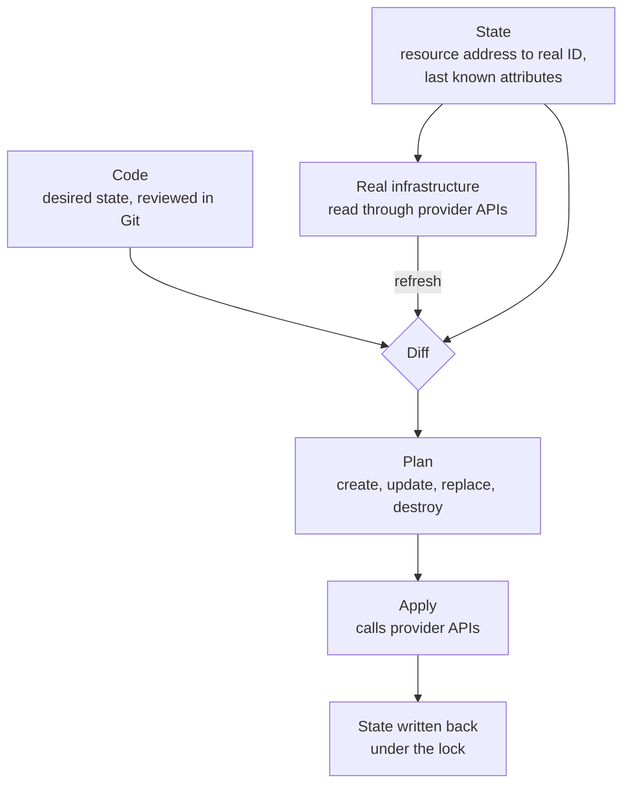
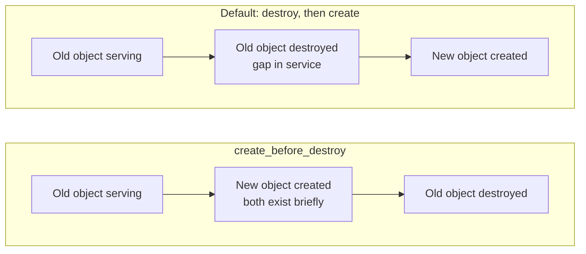
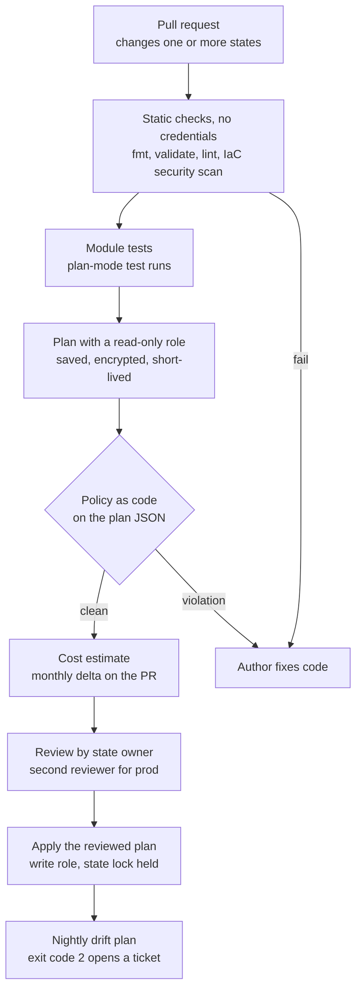
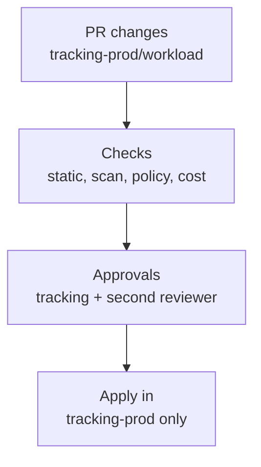

# Infrastructure as code

> Infrastructure as code turns "someone clicked it" into a reviewed, versioned, repeatable change.
> The code is the easy part; the architecture lies in how state is split and protected, how modules
> are versioned and promoted, and which checks a plan must pass before anything is applied.

!!! abstract "Page facts"
    **Level:** Intermediate (declarative tools, state, and the plan/apply cycle are Level 1-2; state
    layout, blast radius, module promotion, and the check pipeline are Level 3) · **Status:** Draft ·
    **Time:** 60-75 minutes · **Last verified:** 2026-11-27

## Learning objectives

After this page you should be able to:

- Distinguish declarative from imperative infrastructure automation, and place Terraform, OpenTofu,
  AWS CloudFormation, AWS CDK, Pulumi, and Bicep on that spectrum, with their licences stated
  factually.
- Explain what IaC state is, why it needs remote storage, locking, encryption, and tight access, and
  why it must be treated as sensitive.
- Design module boundaries and a versioning and promotion scheme for reusable modules.
- Use lifecycle rules, import, and drift detection, and say when each is the right tool.
- Choose between workspaces, directories, and accounts for environment separation.
- Lay out a plan/apply pipeline with static checks, scans, plan-based policy, tests, and cost
  estimates, and size the state split of a 29-account estate by blast radius.

## Prerequisites

- [Multi-account strategy and infrastructure automation](../cloud-architecture/multi-account-strategy-and-infrastructure-automation.md)
  — IaC, policy as code, and drift at concept level, and account vending. This page goes deeper and
  does not repeat them.
- [Cloud building blocks and landing zones](../cloud-architecture/cloud-building-blocks-and-landing-zones.md)
  — AtlasMart's 29 accounts, guardrail types, and mandatory tags.
- Helpful: [Lab 15: an infrastructure module with static checks](../labs/lab-15-infrastructure-module-and-static-checks.md),
  the hands-on companion to this page.

## The problem this solves

AtlasMart's estate has 29 accounts, three Kubernetes clusters, a hub network, and dozens of
databases, queues, and caches. Built by hand, no two accounts would be the same, a rebuild after a
disaster would depend on someone's memory, and nobody could answer "what changed on Tuesday?". The
multi-account page established that IaC is the answer. This page answers the questions that come
next: where does the tool remember what it built, who may change it, how big should one unit of
change be, how do you adopt resources that already exist, and how does a pipeline prove a change is
safe, secure, and affordable before it runs?

## What it is

**Infrastructure as code (IaC)** is defining infrastructure in version-controlled files that a tool
applies to reach the described state (glossary definition). Two styles exist:

- **Imperative** automation lists the steps: "create network, then create subnet, then attach it".
  A script of cloud CLI calls is imperative. It is simple to write, but re-running it after a
  partial failure, or after someone changed things by hand, is your problem.
- **Declarative** automation describes the end state: "a network with these three subnets should
  exist". The tool compares that description with reality and computes the steps. Re-running is
  safe by design (idempotent), and the computed steps can be reviewed as a **plan** before anything
  changes.

General-purpose-language tools (Pulumi, AWS CDK) sit between: you write loops and functions
imperatively, but the program's output is a declarative description that an engine reconciles. The
rest of this page is about declarative tools, because every serious IaC estate ends up there.

## Mental model

Think of a building surveyor with a ledger. The architect's drawings (code) say what the building
should look like. The surveyor's ledger (state) records which walls the surveyor built and their
serial numbers. On each visit the surveyor walks the site (refresh), compares site, ledger, and
drawings, and writes a work order (plan): build this, move that, demolish this. The client signs
the work order (approval) and the crew carries it out (apply), then the ledger is updated.

**Where the analogy breaks:** a real surveyor would notice a wall that a tenant added on their own;
an IaC tool only manages what is in its ledger, so unmanaged resources are invisible to it until
they are imported. And demolition is one line on the work order: a renamed resource in code can
read as "destroy the database and create a new one", which is why plans are reviewed and lifecycle
rules exist.

## Key terms

| Term | Meaning on this page |
|---|---|
| Infrastructure as code (IaC) | Defining infrastructure in version-controlled files that a tool applies to reach the described state |
| Declarative / imperative | Describing the desired end state and letting a tool compute the steps, versus scripting the steps yourself |
| State | The tool's record that maps each resource in code to a real object ID, with its last known attributes |
| Remote state and locking | State kept in a shared, durable backend, with a lock so that only one run can change it at a time |
| Plan / apply | The computed list of create, update, replace, and destroy actions, and the step that executes them |
| Module | A reusable, parameterized package of IaC with inputs and outputs, versioned like a library |
| Root configuration | The directory a run starts from; it configures the backend and providers and calls modules |
| Drift | Any difference between live resources or objects and the declared desired state in code or Git |
| Import | Bringing an existing, unmanaged resource under IaC control by recording it in state |
| Policy as code | Guardrails and compliance rules written as versioned, testable code that machines evaluate |
| Blast radius | The share of users or functions affected by a single failure, here also by a single bad apply or stolen credential |

## How it works

### The tool landscape

| Tool | Style and language | Where state lives | Scope | Licence (as stated in the project's own files) |
|---|---|---|---|---|
| Terraform | Declarative, HCL | A state file in a configurable backend | Any provider with a plugin | Business Source License 1.1 for 1.6.0 and later; earlier releases MPL 2.0 |
| OpenTofu | Declarative, HCL; a fork of Terraform | A state file in a backend; optional built-in state and plan encryption | Any provider with a plugin | Mozilla Public License 2.0 |
| AWS CloudFormation | Declarative, JSON or YAML templates | Held by the service as a stack | AWS | Managed service |
| AWS CDK | General-purpose languages (TypeScript, JavaScript, Python, Java, C#/.NET, Go) that synthesize CloudFormation | CloudFormation stacks | AWS | Apache 2.0 |
| Pulumi | General-purpose languages (and YAML) driving a desired-state engine | A state backend (managed or self-hosted) | Any provider with a plugin | Apache 2.0 (open-source engine) |
| Bicep | Declarative domain-specific language, converted to Azure Resource Manager JSON | No state file: Azure Resource Manager is the record | Azure | MIT |

Google Cloud's Infrastructure Manager runs Terraform configurations as a managed service. The licence
column describes the files, not your rights: whether a licence's terms affect a particular use is a
question for counsel, not this page. Terraform's `LICENSE` file now names IBM as licensor.

**Choosing.** Provider-native tools (CloudFormation, Bicep) need no state management and support new
services quickly, but bind you to one provider. HCL tools give one workflow across providers and a
large module ecosystem, at the price of owning state. Language-based tools suit teams that want
real abstractions and unit tests in a familiar language, at the price of programs that can become
too clever to review. The architectural rules below apply to all of them.

### State: what it is and why it is sensitive

A declarative tool needs to know which real object each resource block refers to; that mapping, plus
the last known attributes, is **state**. Without it the tool cannot tell "update this network" from
"create a second one".

**Figure 1 — How a declarative tool computes a plan.** Three inputs meet in the diff.



How to read it: the tool uses state to find the real objects, refreshes their attributes, and diffs
the result against code. Anything missing from state is invisible; anything in state but missing from
code is planned for destruction. That second rule is why deleting a block, or renaming one without
telling the tool, is the most dangerous edit in IaC.

Four properties follow:

1. **Remote.** State on a laptop is lost, stale, or forked between people. Store it in a durable,
   versioned backend (object storage with versioning, or a managed service) so every run sees the
   latest copy and an earlier copy can be restored.
2. **Locked.** Two applies against one state at once corrupt it. Backends that support locking
   take a lock for any operation that could write state; a run that cannot get the lock waits or
   fails. A "force unlock" exists for crashed runs and should be rare, logged, and human.
3. **Sensitive.** Terraform's documentation is explicit that state can contain secret values in
   plain text, and that marking a value `sensitive` only hides it from command output, not from the
   state or plan file. A saved plan file also holds sensitive values in clear text. Treat both as
   secrets: encrypt at rest, restrict read access to the pipeline role and break-glass, and audit
   every read. OpenTofu adds client-side encryption of state and plan files.
4. **Scoped.** Every resource in one state shares its lock, its refresh time, and the permissions of
   whoever can apply it. How you split state is therefore a blast-radius decision (worked example).

Layers can read each other's outputs (a workload reads the network's subnet IDs) through a remote
state data source or, better, through a narrow published interface such as parameters in a
configuration store, so that a reader does not need access to the whole of another layer's state.

### Modules and versioning

A **module** packages a pattern (an account baseline, a spoke network, a highly available PostgreSQL)
behind inputs and outputs. Good module boundaries follow the same rules as good code modules: one
purpose, a small interface, validation at the boundary (as in Lab 15's twelve validation rules), and
no hidden coupling.

- **Version modules like libraries.** Publish modules from their own repository or registry with
  semantic versions; root configurations pin an exact version. A breaking input change is a new
  major version.
- **Promote versions, not branches.** A new module version is adopted in dev roots first, then
  staging, then prod, each as a small pull request that shows its own plan. That is the IaC form of
  promoting one artifact through environments.
- **Pin providers too.** Provider plugins change resource behaviour between versions; a dependency
  lock file records exact versions and checksums and is committed.
- **Refactor without destroying.** Moving a resource into a module changes its address. Terraform's
  `moved` blocks record the old and new address so the plan shows a move instead of destroy plus
  create.
- **Do not over-wrap.** A module that exposes every argument of the resource it wraps adds a layer
  without adding a decision. Modules earn their keep by encoding defaults (encryption on, tags set,
  logs shipped).

### Resource lifecycle

By default, when a change cannot be made in place, the tool destroys the old object and then
creates the new one. For anything serving traffic that is an outage. Terraform's `lifecycle` block
(OpenTofu has the same) changes the behaviour per resource:

| Setting | What it does | Typical use |
|---|---|---|
| `create_before_destroy` | Creates the replacement first, then destroys the original | Load balancer target groups, certificates, launch templates |
| `prevent_destroy` | Rejects any plan that would destroy the object | Production databases, state buckets, key-management keys |
| `ignore_changes` | Ignores listed attributes when planning updates | Attributes another system legitimately manages, such as an autoscaler's desired count |
| `replace_triggered_by` | Forces replacement when a referenced resource or attribute changes | Recreate instances when their configuration object changes |
| `precondition` / `postcondition` | Checks assumptions before, and guarantees after, a resource changes | "The image must come from the approved registry"; "the endpoint must be private" |

**Figure 2 — Default replacement versus create-before-destroy.** Each column reads top to bottom.



How to read it: create-before-destroy removes the gap but needs room for two copies: unique names
(or name prefixes), quota for both, and dependants that can switch to the new object. `prevent_destroy`
does not stop someone deleting the block from code together with the setting, so production data
stores also need provider-side deletion protection and backups.

### Import and drift

**Import** brings an existing resource under management. Since Terraform 1.5.0 an `import` block
declares the intent in code, the plan shows the import alongside other changes, and
`terraform plan -generate-config-out=PATH` can draft the matching resource block for review. Newer
releases add query-driven bulk import; check the current documentation. Import is how hand-built
"snowflake" accounts are brought under the vending pipeline without rebuilding them.

**Drift** is the difference between reality and code. Detect it with a scheduled plan per state:
`terraform plan -detailed-exitcode` exits 0 for no changes and 2 for changes, which a scheduler can
turn into a ticket for the state's owner. CloudFormation has built-in drift detection; Bicep's
what-if shows differences before a deployment. A detected drift has three possible outcomes:

| Outcome | When | How |
|---|---|---|
| Revert | The change was unauthorized or accidental | Apply the code; investigate who changed it and how |
| Adopt | The change was right (for example an incident fix) | Change the code to match, review, apply (an empty plan proves it) |
| Accept into state | The change is legitimate and outside the code's concern | A refresh-only plan updates state without touching resources; consider `ignore_changes` |

The best drift control is upstream: deny interactive writes in prod (an AtlasMart guardrail), so the
pipeline is the only writer.

### The plan/apply workflow

**Figure 3 — The plan/apply workflow for one state.** Cheap checks first; credentials that can write
appear only at the end.



How to read it: everything above the review runs automatically on each push to the pull request.
The plan job uses a role that can read but not change the account; only the apply job, after review
and merge, assumes a write role. Applying the saved plan guarantees that what runs is what was
reviewed; if the state changed in between, the tool refuses the stale plan and the pipeline re-plans.

### Secrets in IaC

- **Never in code or variable files.** A secret in Git is in every clone and every fork forever.
  Secret scanning in the pipeline (DevSecOps page) catches mistakes; it does not make them safe.
- **Prefer secrets the platform generates.** Many managed databases can create the admin credential
  and store it in the provider's secrets manager themselves; IaC then refers to it by name and never
  sees the value.
- **Keep values out of state.** Terraform 1.10 added ephemeral values, which are available during a
  run but not written to state or plan files, and 1.11 added write-only arguments for passing such
  values into resources. Use them where providers support them.
- **Protect what remains.** State and plan files are secrets: encrypted backend, a customer-managed
  key, access only for the pipeline role and break-glass, and audit logs on every read.

### Environment separation: workspaces, directories, or accounts

| Approach | How it separates | Strength | Weakness |
|---|---|---|---|
| Workspaces | Several states for one configuration in one backend | Quick copies of the same stack | Same backend and usually the same credentials; Terraform's own documentation says workspaces are not appropriate where deployments need separate credentials and access controls |
| Directories per environment | Separate root configurations calling the same pinned modules | Each environment has its own backend, role, and module version; differences are visible in Git | Some duplication of root files |
| Accounts per environment | Separate cloud accounts, each with its own state backend and roles | The strongest boundary: a dev apply cannot reach prod even by mistake | Needs account vending and cross-account pipeline roles |

AtlasMart already has an account per team per environment, so directories map one-to-one onto
accounts. Workspaces remain useful for short-lived copies such as a preview environment.

### Policy as code and security scans

Two kinds of automated check read IaC before it applies:

- **Static security scans** read the code itself and flag insecure settings (public storage, open
  administrative ports, unencrypted volumes). Examples: Checkov (Terraform, CloudFormation,
  Kubernetes, ARM templates, AWS CDK and others) and `trivy config` from Trivy. Linters such as
  TFLint catch provider-specific mistakes (an invalid instance type) that `validate` cannot.
- **Plan-based policy** evaluates the machine-readable plan (`terraform show -json`), which contains
  computed values and the actions about to happen, so it can express rules like "no plan may destroy
  a resource tagged `backup-tier = tier-1`". Open Policy Agent with Conftest is a common pairing; the
  Rego tag rule on the [multi-account page](../cloud-architecture/multi-account-strategy-and-infrastructure-automation.md#policy-as-code)
  is an example. Provider policy engines (organization policies, Azure Policy) are the backstop at
  the API.

### Testing IaC

| Layer | What it proves | Tooling example | Runs |
|---|---|---|---|
| Static | Syntax, types, references, single-input validation rules | `fmt -check`, `validate`, TFLint | Every push, seconds |
| Security scan | No known-insecure settings | Checkov, `trivy config` | Every push |
| Plan-based | Intended values, guard rails fire on bad input, policy holds on the real plan | `terraform test` with `command = plan`; mock providers (Terraform 1.7.0 and later); Conftest on plan JSON | Every push |
| Integration | The module really works against the provider | `terraform test` runs that apply (the default), create real resources, and destroy them at the end of the file | Nightly or on module release, in a sandbox account |
| Post-deploy | Assertions about live infrastructure still hold | `check` blocks (Terraform 1.5.0 and later), drift plans, detective controls | After apply and on a schedule |

Lab 15 practises the first three layers on a provider-free module. Integration tests cost money and
time, so they run on module releases rather than on every pull request.

### FinOps hooks

IaC is where cost is cheapest to change, so put cost in front of the reviewer:

- **Cost estimates on the plan.** Tools such as Infracost read Terraform, CloudFormation, or AWS CDK
  and post the monthly cost delta on the pull request. A policy can require budget-owner review
  above a threshold.
- **Tags by default.** Set mandatory tags once (provider-level default tags where supported, module
  defaults otherwise) and enforce them with policy, so showback works without anyone remembering.
- **Lifecycle for cost.** Preview environments created by IaC carry an expiry tag and are destroyed
  by a scheduled destroy plan; the same code that builds them removes them.

## Worked example: AtlasMart's IaC repository and pipeline for 29 accounts

AtlasMart's platform team must manage 29 accounts (24 workload accounts, 8 teams x dev, staging,
prod, plus 5 platform accounts) with IaC, and let product teams change their own resources without
being able to touch anyone else's. Every number below is an AtlasMart assumption unless stated as
arithmetic.

### Step 1 — Split state by account and component

The rule: **one state per account and component**, where a component is a set of resources with
one owner and one change rhythm.

| Where | Components (one state each) | States |
|---|---|---|
| Each workload account (assumption) | `account-baseline` (platform), `network` (platform), `workload` (product team: databases, queues, caches) | 24 x 3 = 72 |
| Management account | `organization` (OUs, organization policies), `identity` (permission sets) | 2 |
| Log archive account | `account-baseline`, `log-archive` | 2 |
| Security tooling account | `account-baseline`, `security-tooling` | 2 |
| Network hub account | `account-baseline`, `hub-routing` (transit router, route tables), `hub-edge` (egress firewall, VPN, DNS resolvers) | 3 |
| Shared services account | `account-baseline`, `ci-and-registry` | 2 |
| Kubernetes clusters in the platform team's accounts | `cluster-dev`, `cluster-staging`, `cluster-prod` | 3 |
| Total | 72 + 2 + 2 + 2 + 3 + 2 + 3 | 86 |

Each state lives in a versioned, encrypted bucket with locking **in the account it describes**
(created by the vending pipeline), so read access to a state follows access to the account.

### Step 2 — The blast-radius arithmetic

Assume (to be measured) 40 resources per `account-baseline`, 35 per `network`, 60 per `workload` on
average, and 80 per platform state:

| Quantity | Arithmetic | Result |
|---|---|---|
| Workload-account resources | 24 x (40 + 35 + 60) = 24 x 135 | 3,240 |
| Platform resources | 14 platform states x 80 | 1,120 |
| Estate total | 3,240 + 1,120 | 4,360 |
| Tracking prod `workload` state as a share of the estate | 60 / 4,360 | about 1.4% |
| One account's write role as a share of accounts | 1 / 29 | about 3.4% |

Compare a single state for everything:

| Concern | One state | 86 states |
|---|---|---|
| Resources one bad apply can touch | 4,360 (100%) | 60 for tracking prod's workload (about 1.4%) |
| Accounts the apply credential can write | 29 | 1 |
| Refresh time per plan, at an assumed 0.05 s effective per resource | 4,360 x 0.05 = 218 s, about 3.6 min | 60 x 0.05 = 3 s |
| Lock contention at 12 applies per working day, 8 min lock each | 12 x 8 = 96 min a day serialized on one lock, and every open plan goes stale at each merge | Applies to different states never wait for each other |
| A corrupted or lost state | Re-import 4,360 resources | Restore one versioned object |

The cost of the split is wiring: 86 backends, and outputs passed between layers. That is paid once,
in the vending templates; the risk of the monolith is paid on every apply.

### Step 3 — The repository layout

```text
infra-modules/                       one repository, semantic version tags per module
├── account-baseline/                SSO roles, keys, log shipping, budget, backup plan
├── spoke-network/                   wraps the network-plan arithmetic from Lab 15
├── postgres-ha/                     primary + synchronous standby, prevent_destroy
└── redis-cache/
infra-live/                          one directory per account and component = one state
├── platform/
│   ├── management/organization/
│   ├── network-hub/hub-edge/
│   └── ...                          14 platform directories
└── workloads/
    ├── tracking-dev/{account-baseline,network,workload}/
    ├── tracking-staging/{account-baseline,network,workload}/
    └── tracking-prod/
        ├── account-baseline/        owner: platform team (CODEOWNERS)
        ├── network/                 owner: platform team
        └── workload/                owner: tracking team; pins postgres-ha and redis-cache
```

Each leaf directory holds a backend block (its own account's bucket and lock), provider settings
with default tags (`owner-team`, `environment`, `cost-centre`), and module calls pinned to exact
versions. Ownership files route reviews: the tracking team approves `tracking-*/workload`, the
platform team approves the rest, and prod directories need a second reviewer.

### Step 4 — The pipeline

**Figure 4 — How a change to tracking prod's workload state flows.** Only the touched directory is
planned and applied.



How to read it: the pipeline detects changed directories, so a pull request touching
`tracking-prod/workload` plans one state of 86. The plan job assumes a read-only role in the
tracking-prod account; the apply job assumes `iac-apply` in that account only, through workload
identity federation (no stored keys; the DevSecOps page covers how). Module upgrades travel as
three automated pull requests (dev, staging, prod), with a one-day soak between them (assumption).

The gates, mapped to Figure 3:

| Gate | Rule (AtlasMart assumption) |
|---|---|
| Static and scan | `fmt -check`, `validate`, TFLint, Checkov; any high-severity finding fails |
| Policy on plan | Mandatory tags present; no public storage; no destroy of any resource tagged `backup-tier = tier-1` without a linked change record |
| Cost | Monthly delta posted; a delta above 500 CU a month needs the budget owner's approval |
| Drift | 86 nightly plans; exit code 2 opens a ticket for the directory's owner |

**Cost example.** The tracking team adds a second Redis replica for sale-day reads. Assume the node
costs 0.5 CU per hour (illustrative): 0.5 x 730 hours = 365 CU a month, under the 500 CU threshold,
so the team's own approval suffices and the estimate is recorded on the pull request for showback.

## Real-world architecture example

Estates that start with one big state for "the infrastructure" usually split it within a year, after
the first plan that takes many minutes, the first lock that blocks an incident fix, or the first
apply that touches resources its author never meant to. The common end state matches Step 3: a
module repository with releases, small root configurations per account and component, a pipeline
that plans only changed directories with read-only credentials, and nightly drift plans whose
tickets go to named owners.

## Design choices and trade-offs

| Choice | Favor when | Avoid when |
|---|---|---|
| Provider-native tool (CloudFormation, Bicep) | Single provider, no appetite for owning state, day-one support for new services | Multi-provider estates, or a need to manage non-cloud resources in the same workflow |
| HCL tool (Terraform, OpenTofu) | Many providers, a large module ecosystem, plan-based policy | Teams unwilling to own state storage, locking, and access |
| General-purpose language (Pulumi, AWS CDK) | Strong abstractions, unit tests in a familiar language | Reviewers cannot easily see what a program will create |
| Small states per account and component | Many accounts and owners, prod data, independent change rhythms | A tiny estate where wiring outweighs risk |
| Workspaces for environments | Short-lived, identical copies with the same credentials | Environments needing separate credentials or access (prod) |
| Applying the saved, reviewed plan | Prod, where "what ran is what was reviewed" matters | Plans that go stale quickly; re-plan and compare instead |
| Integration tests on every pull request | Small, fast modules in a cheap sandbox | Slow or costly resources; run on release instead |

## Failure modes and anti-patterns

- **The monolithic state.** Slow plans, lock contention, and one credential for everything. Detect:
  plan duration and lock wait metrics. Prevent: split by account and component.
- **State as an open secret.** Anyone with bucket read access can read database credentials. Detect:
  access reviews and audit logs on the backend. Prevent: encryption, least-privilege access,
  ephemeral values and platform-generated secrets.
- **Rename equals rebuild.** A refactor shows destroy plus create on a database. Detect: policy that
  fails any plan destroying a protected resource. Prevent: `moved` blocks, `prevent_destroy`,
  provider deletion protection.
- **Floating module versions.** A module change reaches prod untested. Detect: unpinned sources in
  static checks. Prevent: exact pins and promotion through environments.
- **Console fixes that never come back.** An incident fix is reverted by the next apply. Detect:
  nightly drift plans. Prevent: adopt the fix in code as part of the incident's follow-up.
- **Force-unlock as a habit.** Two runs write the same state. Detect: alerts on unlock events.
  Prevent: pipeline-only applies and timeouts sized to real apply durations.

## Security considerations

- **The apply role is a privileged identity.** Scope it to one account, issue it to the pipeline only
  through short-lived federation, and require approval before the apply job can assume it.
- **Plans run untrusted code paths.** A malicious pull request can add a provider or data source that
  exfiltrates whatever the plan role can read; plan roles are read-only, and new providers need
  platform approval.
- **State and plan files are secrets** (see above); include them in the data classification.
- **Policy is code with power.** Changes to organization policies and plan policies follow the same
  review and testing as any module; the deeper supply-chain controls are on
  [Infrastructure and supply-chain security](../security-architecture/infrastructure-and-supply-chain-security.md).

## Performance, reliability, and cost

- **Performance:** plan time grows with the resources in a state; small states keep feedback in
  seconds, which keeps the CI target of about 10 minutes per build reachable.
- **Reliability:** IaC makes rebuilding an account or a region a pipeline run, which is what makes
  the DR strategies in D13-T03 credible. Versioned state buckets turn a corrupted state into a
  restore, not a re-import.
- **Cost:** cost estimates on plans catch expensive changes at the cheapest moment; tags applied by
  default make showback work; expiry tags and scheduled destroys stop preview environments from
  becoming permanent spend.

## Hands-on lab: an infrastructure module with static checks

The hands-on companion is [Lab 15](../labs/lab-15-infrastructure-module-and-static-checks.md): a
provider-free Terraform or OpenTofu module that plans AtlasMart's subnets, with validation rules,
plan-mode tests, and negative tests, run locally with no cloud account. It covers the static and
plan-based layers of the testing table. To practise this page's state and drift ideas, extend it
locally with Python's standard library:

1. Write a JSON file that mimics a tiny state: resource addresses mapped to IDs and attributes.
2. Write a second JSON file for "reality" with one attribute changed and one extra resource.
3. Write a script that reports each difference as drift (in state, different in reality) or
   unmanaged (in reality, not in state), and exits 2 if anything differs, like
   `plan -detailed-exitcode`.
4. Add a `protected` flag to one resource and make the script fail if a proposed plan would
   destroy it.
5. Using the Step 2 numbers, compute the share of the estate a single bad apply could touch for
   each of the 86 states, and list the five largest.

??? question "Hint: why does step 3 report the extra resource differently from the changed one?"
    The changed resource is in state, so a real tool would plan an update to put it back. The extra
    resource is not in state, so a real tool cannot see it at all: it is unmanaged, not drifted.
    Only an import, or a detective control scanning the account, would find it.

## Knowledge check

1. What three inputs does a declarative tool compare to compute a plan, and what happens to a
   resource that is in state but no longer in code?
2. Give two reasons state must be treated as a secret even if no secret is written in the code.
3. Why does Terraform's documentation advise against workspaces for separating environments that
   need different credentials, and what does AtlasMart use instead?
4. A refactor moves a PostgreSQL resource into a module, and the plan shows destroy and create.
   Name two mechanisms that should have prevented this reaching prod.
5. In the worked example, what share of the estate can one bad apply touch with 86 states, and with
   one state?

??? success "Answers"
    1. Code, state, and the real infrastructure (refreshed through provider APIs). A resource in
       state but not in code is planned for destruction.
    2. State records attribute values in plain text, which can include generated credentials or
       connection strings, and saved plan files contain sensitive values in clear text; marking a
       value `sensitive` only hides it from output.
    3. Workspaces share a backend and usually credentials, so they cannot give prod its own access
       controls. AtlasMart uses a directory per account and component, and the accounts themselves
       separate environments.
    4. A `moved` block recording the address change (so the plan shows a move), and a plan policy
       or `prevent_destroy` that rejects destroying a protected database; provider-side deletion
       protection is the backstop.
    5. With 86 states, the largest workload state is about 60 of 4,360 resources (about 1.4%), and
       the apply role reaches 1 of 29 accounts. With one state, all 4,360 resources and all 29
       accounts.

## Architecture discussion questions

1. AtlasMart's analytics team wants to read the `workload` states of all prod accounts to build an
   inventory. What would you give them instead, and why?
2. Argue for and against storing all 86 states in one bucket in the shared services account rather
   than in each account.
3. A team wants Pulumi in Python for its `workload` component while the platform stays on HCL. What
   would you require so the platform's pipeline gates still apply?

## Summary

IaC tools are declarative: they diff code, state, and reality into a plan, and apply it. State is
the heart of that model and must be remote, locked, encrypted, access-controlled, and split by
blast radius. Modules are versioned like libraries and promoted through environments; lifecycle
rules, `moved` blocks, and import keep changes safe and bring existing resources under control;
nightly plans detect drift. Secrets stay out of code and, where possible, out of state. A plan/apply
pipeline runs static checks, security scans, plan-mode tests, policy on the plan, and a cost
estimate before a reviewer sees it, and only then lets a narrowly scoped role apply. AtlasMart's 29
accounts become 86 small states, so one bad apply touches about 1.4% of the estate instead of all
of it.

## Related topics

- **Before:** [Multi-account strategy and infrastructure automation](../cloud-architecture/multi-account-strategy-and-infrastructure-automation.md);
  [Cloud building blocks and landing zones](../cloud-architecture/cloud-building-blocks-and-landing-zones.md)
- **Alongside:** [Lab 15](../labs/lab-15-infrastructure-module-and-static-checks.md);
  [CI/CD pipeline design and deployment strategies](ci-cd-pipeline-design-and-deployment-strategies.md);
  [DevSecOps and secure delivery](devsecops-and-secure-delivery.md);
  [Platform engineering](platform-engineering.md);
  [Infrastructure and supply-chain security](../security-architecture/infrastructure-and-supply-chain-security.md);
  [Software testing types and strategies](../foundations/software-testing-types-and-strategies.md);
  [Cloud cost models and FinOps](../finops-and-sustainability/cloud-cost-models-and-finops.md);
  [Disaster recovery strategies](../reliability-and-disaster-recovery/disaster-recovery-strategies.md)
- **Planned:** none beyond this batch.

## References

| Source | Type | Checked |
|---|---|---|
| [State](https://developer.hashicorp.com/terraform/language/state), [State: Locking](https://developer.hashicorp.com/terraform/language/state/locking), [State: Workspaces](https://developer.hashicorp.com/terraform/language/state/workspaces), and [Manage sensitive data](https://developer.hashicorp.com/terraform/language/manage-sensitive-data) — Terraform documentation | Official documentation (state, locking, workspaces caveat, sensitive, ephemeral, write-only) | 2026-11-27 |
| [lifecycle meta-argument](https://developer.hashicorp.com/terraform/language/meta-arguments/lifecycle), [Import](https://developer.hashicorp.com/terraform/language/import), [Refactor modules](https://developer.hashicorp.com/terraform/language/modules/develop/refactoring), and [terraform plan](https://developer.hashicorp.com/terraform/cli/commands/plan) — Terraform documentation | Official documentation (lifecycle, import, `moved`, `-detailed-exitcode`, `-refresh-only`, saved plans) | 2026-11-27 |
| [Tests](https://developer.hashicorp.com/terraform/language/tests) and [Checks](https://developer.hashicorp.com/terraform/language/checks) — Terraform documentation; [Terraform v1.5 changelog](https://github.com/hashicorp/terraform/blob/v1.5/CHANGELOG.md) | Official documentation and release notes (test modes, mock providers, `import` and `check` blocks in 1.5.0) | 2026-11-27 |
| [State and Plan Encryption](https://opentofu.org/docs/language/state/encryption/) — OpenTofu documentation; licence texts: [Terraform](https://github.com/hashicorp/terraform/blob/main/LICENSE), [OpenTofu](https://github.com/opentofu/opentofu/blob/main/LICENSE) | Official documentation and primary licence files | 2026-11-27 |
| [What is CloudFormation?](https://docs.aws.amazon.com/AWSCloudFormation/latest/UserGuide/Welcome.html), [drift detection](https://docs.aws.amazon.com/AWSCloudFormation/latest/UserGuide/using-cfn-stack-drift.html), and [What is the AWS CDK?](https://docs.aws.amazon.com/cdk/v2/guide/home.html) — AWS documentation | Official documentation | 2026-11-27 |
| [What is Bicep?](https://learn.microsoft.com/azure/azure-resource-manager/bicep/overview) and [Bicep what-if](https://learn.microsoft.com/azure/azure-resource-manager/bicep/deploy-what-if) — Microsoft Learn; [Pulumi concepts](https://www.pulumi.com/docs/iac/concepts/); [Infrastructure Manager overview](https://cloud.google.com/infrastructure-manager/docs/overview) — Google Cloud | Official documentation | 2026-11-27 |
| [Checkov](https://www.checkov.io/), [Trivy](https://trivy.dev/), [TFLint](https://github.com/terraform-linters/tflint), [Conftest](https://www.conftest.dev/), [Infracost documentation](https://www.infracost.io/docs/) | Tool documentation (scans, linting, plan policy, cost estimates) | 2026-11-27 |
| Martin Fowler, [InfrastructureAsCode](https://martinfowler.com/bliki/InfrastructureAsCode.html) | Article (concept) | 2026-11-27 |

## Review notes

- Canonical page for D16-T03. In depth: declarative versus imperative, the tool landscape with
  licences, state (remote, locking, sensitivity, scoping), modules and versioning, lifecycle, import,
  drift, the plan/apply workflow, secrets, environment separation, testing layers, and the state
  split worked example. Covered more briefly: policy as code (where it runs; the Rego example lives
  on D10-T04), security scans (tools named, no rules shown), FinOps hooks (cost estimate, tags,
  expiry), reusable modules (as module design rules).
- Licences checked on 2026-11-27 in each project's `LICENSE` file: Terraform BUSL 1.1 for "Version
  1.6.0 or later", with IBM now named as licensor; OpenTofu MPL 2.0; Pulumi and AWS CDK Apache 2.0;
  Bicep MIT (files read through raw.githubusercontent.com; the github.com links returned 200).
- Version facts verified on primary pages: `import` and `check` blocks and `-generate-config-out` in
  Terraform 1.5.0 (changelog); mock providers in 1.7.0, ephemeral values in 1.10, write-only
  arguments in 1.11 (Terraform documentation); `-detailed-exitcode` codes 0/1/2 and saved plans
  holding sensitive values in clear text (plan command page). The OpenTofu page does not state the
  release that introduced state encryption, so none is given. Default parallelism was not verified,
  so the refresh-time arithmetic uses an explicit "effective seconds per resource" assumption.
- New AtlasMart assumptions: 86 states (component list in Step 1); state buckets in each described
  account; 40/35/60/80 resources per baseline/network/workload/platform state (4,360 total); 0.05 s
  effective refresh per resource; 12 IaC applies per working day with an 8-minute lock; repositories
  `infra-modules` and `infra-live`; one-day soak between environments for module upgrades; 500 CU a
  month cost-approval threshold; Redis replica at 0.5 CU per hour (illustrative). Which platform
  account hosts each cluster state is deliberately not named, as on D10-T02.
- Figure 2 stacks two subgraphs with `~~~`; Figure 4 is a 4-node LR chain. Verify both render.
- Links to D16-T02, D16-T04, D16-T05, D17-T01, and D13-T03 point at pages written in the same batch.
