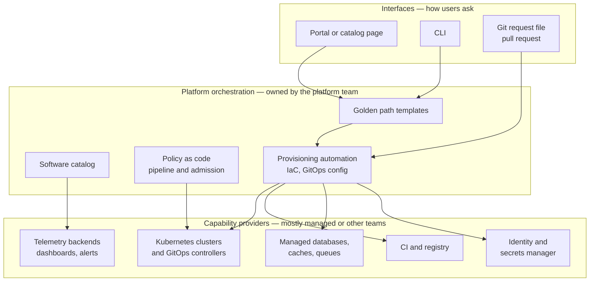
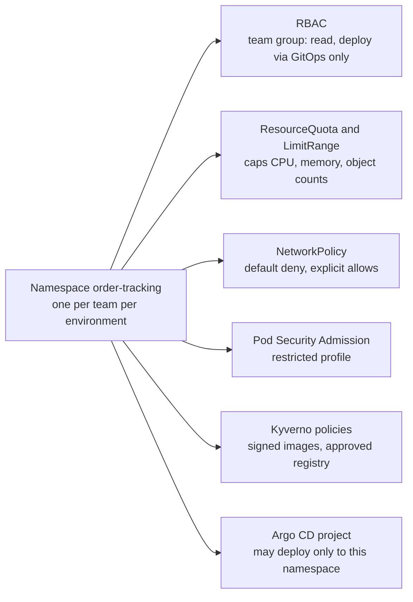
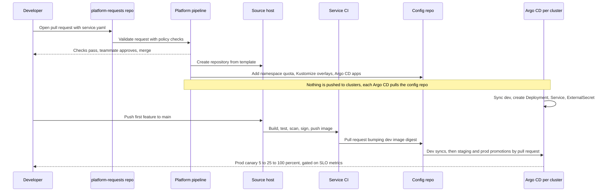

# Platform engineering

> Every product team needs the same twenty things before it writes its first feature: a repository,
> a pipeline, somewhere to run, secrets, dashboards, alerts, and a way to deploy safely. Platform
> engineering builds those once, as a product with users and a roadmap, and offers them through
> self-service golden paths, so teams get the secure, observable default by taking the easiest route.

!!! abstract "Page facts"
    **Level:** Intermediate (vocabulary and the parts of a platform are Level 1-2; tenancy, platform
    APIs, governance in the path, and measurement design are Level 3) · **Status:** Draft ·
    **Time:** 60-75 minutes · **Last verified:** 2026-11-27

## Learning objectives

After this page you should be able to:

- Distinguish an internal developer platform (IDP) from a developer portal, and say what each is for.
- Describe a golden path and the parts of AtlasMart's "new service" path, from request to first deploy.
- Explain "platform as a product": users, research, roadmap, adoption, and the thinnest viable platform.
- Choose a platform API style (Git, Kubernetes custom resources, REST or CLI) and a tenancy model for a
  shared Kubernetes platform.
- Build governance and security into the path instead of adding approval gates after it.
- Measure a platform with DORA's delivery metrics, SPACE, and adoption metrics, and explain why none
  of them should rate individual engineers.

## Prerequisites

- [Cloud-native ecosystem tools](../containers-and-kubernetes/cloud-native-ecosystem-tools.md) —
  GitOps, Backstage, and Crossplane are introduced there; this page links rather than repeats.
- [Multi-account strategy and infrastructure automation](../cloud-architecture/multi-account-strategy-and-infrastructure-automation.md)
  — account vending, the platform's own foundation.
- [CI/CD pipeline design and deployment strategies](ci-cd-pipeline-design-and-deployment-strategies.md)
  — the pipeline and canary that the golden path packages.

## The problem this solves

DevOps gave product teams ownership of build, deploy, and run. In a company with eight product teams
that ownership turns into eight copies of the same work: eight pipeline designs, eight ways to write
Kubernetes manifests, eight sets of dashboards, and eight interpretations of the security standard.
Each team spends weeks before its first feature reaches production, and the security team reviews
the same mistakes eight times. When a central team tries to help by taking requests, it becomes a
ticket queue: a namespace takes a week, a new pipeline two.

The CNCF Platforms White Paper names the cost: responsibility for supporting services has shifted
onto product teams, adding to their cognitive load and taking time from the product. Platform
engineering answers by building the common capabilities once, presenting them through consistent
self-service interfaces, and embedding the organization's rules in them, while leaving teams free to
step off the path when they have a real reason.

## What it is

**Platform engineering** is the discipline of designing, building, and running an internal platform
as a product for the organization's developers. DORA describes it as sociotechnical: it is as much
about how teams interact as about automation, self-service, and repeatability.

An **internal developer platform (IDP)** is the integrated set of capabilities a platform team
offers: pipelines, runtimes, data services, identity and secrets, observability, and the automation
that composes them. The CNCF white paper describes a platform as a curated, consistent layer over
capabilities that other teams or providers may implement; the platform team owns the experience and
interfaces more than the underlying services.

A **developer portal** is one *interface* to that platform: a web application showing a software
catalog, documentation, templates, and status. Backstage is the best-known open-source portal
framework. A portal without automation behind it is a catalog of tickets with a nicer front page.

A **golden path** (also called a paved road or paved path) is an opinionated, supported route for a
common job, such as "create a new service", bundled as a template, automation, and documentation.
Following it gives a team the organization's defaults for free; leaving it is allowed, but the team
then owns what the path would have provided.

**Platform as a product** means the platform has users (developers, testers, data scientists), a
product manager, user research, a roadmap, release notes, and adoption it must earn rather than
mandate.

## Mental model

Think of a city's road network. The city builds and maintains the roads, signs, traffic lights, and
bus routes; speed limits and crossings are built into the road itself, so the safe route is also the
easy one. Residents choose where to go. A delivery company may still take an off-road track to a
remote farm, but it needs a suitable vehicle and is on its own if it gets stuck. A good city watches
where people walk across the grass and paves those paths next.

**Where the analogy breaks:** a platform changes every week, so its "roads" need versioning,
migration paths, and deprecation notices that cities never need. Developers can also leave the
platform entirely, by building their own pipeline, which roads cannot be ignored that way. And a
platform can measure its users' journeys precisely, so it can be tempted to measure the users, which
is the mistake covered in [measuring a platform](#measuring-a-platform-without-measuring-people).

## Key terms

| Term | Meaning on this page |
|---|---|
| Platform engineering | Building and running an internal platform as a product that gives developers self-service capabilities with the organization's rules built in |
| Internal developer platform (IDP) | The integrated set of capabilities, automation, and interfaces a platform team provides to internal teams |
| Developer portal | A web interface to the platform: catalog, templates, docs, and status; one interface among several |
| Golden path (paved road) | A supported, opinionated route for a common job, packaged as template, automation, and documentation |
| Self-service | Users request and receive a capability through an interface, with no human in the fulfilment loop |
| Platform API | The contract through which users request capabilities: a Git file, a Kubernetes custom resource, or a REST or CLI call |
| Software catalog | A registry of components, owners, systems, and dependencies, usually fed by a file in each repository |
| Software template | A scaffolder that creates a new repository and its wiring from a parameterized skeleton |
| Thinnest viable platform | The smallest platform layer that delivers consistency, built mostly on managed services |
| Cognitive load | The mental effort a team spends on things other than its product; platforms aim to reduce it |
| Developer experience (DevEx) | Developers' lived experience of their tools and processes, including the friction they meet daily |
| DORA metrics | DORA's software delivery measures: change lead time, deployment frequency, failed deployment recovery time, change fail rate, deployment rework rate |
| SPACE | A framework that treats productivity along five dimensions: satisfaction and well-being, performance, activity, communication and collaboration, efficiency and flow |
| Soft / hard multi-tenancy | Tenants who trust each other somewhat and share a cluster with namespace controls / tenants who must not trust each other and need stronger isolation |

GitOps, drift, policy as code, tenant isolation, and admission controllers have the meanings given in
the [glossary](../start-here/glossary.md).

## How it works

### The layers of an internal developer platform

**Figure 1 — Layers of an internal developer platform.** Users meet interfaces; interfaces call an
orchestration layer; the orchestration layer composes capabilities that others mostly provide.

How to read it: the platform team's real product is the middle layer and the interfaces. The bottom
layer should be bought or reused wherever possible; the CNCF white paper recommends that platform
teams build capabilities themselves only when no managed or internal provider exists. The white paper
lists capability domains a platform may offer: portals, provisioning APIs, golden path templates,
build and test automation, delivery automation, development environments, observability,
infrastructure, data, messaging, identity and secrets, security, and artifact storage.

### Platform versus portal

| Question | Internal developer platform | Developer portal |
|---|---|---|
| What is it? | Capabilities plus automation | A user interface over them |
| Can it work without the other? | Yes: CLI, Git, and APIs are interfaces too | Barely: without automation it lists owners and docs and files tickets |
| Who uses it most? | Pipelines and engineers, through APIs and Git | Engineers browsing, onboarding, finding owners |
| Typical first build | One golden path for the most common job | A catalog, once teams cannot find owners and docs |
| Example | Templates, GitOps config, quotas, policy, observability wiring | Backstage with catalog and software templates |

Start with the platform. A portal earns its keep once there are enough services, owners, and
templates that people cannot find them; AtlasMart's eight teams fit in a catalog file per repository
and a page (the decision recorded on the [ecosystem tools page](../containers-and-kubernetes/cloud-native-ecosystem-tools.md)).

### Golden paths and self-service

A golden path covers one job end to end and is:

- **Opinionated but optional.** It picks one language template, one pipeline, one deployment method.
  The CNCF white paper asks that platforms be optional and composable; DORA warns against a
  "golden cage" that fits no team with different needs.
- **Complete.** It ends at "running in production with telemetry and alerts", not at "repository
  created". Half a path pushes the hardest work back onto the team.
- **Self-service.** Fulfilment is automated. A human approval inside the path should be rare, quick,
  and justified by risk, never by habit.
- **Maintained.** The platform team owns upgrades of the template's pipeline, base image, and
  libraries, so a team that took the path in year one still benefits in year three.

The hard design question is **what stays linked**. A template that copies files once (scaffold and
forget) is simple but drifts: three years later forty repositories have forty pipeline variants.
Referencing shared pieces instead (a versioned pipeline definition, a base image, a Kustomize base, a
telemetry library) keeps them upgradeable from one place, at the cost of versioning discipline.
Good paths scaffold the parts a team will change (application code) and reference the parts it
should not (pipeline, policy, base manifests).

### Platform APIs, catalogs, and templates

Users ask the platform for things through a **platform API**. Three styles are common:

| Style | How a request looks | Strengths | Weaknesses |
|---|---|---|---|
| Git as the API | A YAML request file in a pull request to a platform repository | Review, history, and rollback for free; works with GitOps; no new service to run | Slower feedback than an API call; needs validation in CI |
| Kubernetes custom resources | A `Database` or `Environment` object reconciled by a controller (Crossplane compositions, operators) | Continuous reconciliation, one API style for apps and infrastructure | Puts cloud credentials and lifecycle in the cluster; CRD versioning to manage |
| REST service or CLI | `platform create env --name ...` against a platform service | Fast, scriptable, good for portals | Another service to build, secure, audit, and keep available |

Most platforms mix them: Git for anything that should be reviewed and versioned, a CLI or portal as
a convenience that writes the Git change. The [infrastructure as code page](infrastructure-as-code.md)
covers the IaC that sits behind them.

A **software catalog** answers "who owns this, what does it depend on, where are its docs and
dashboards?". The robust pattern is a small descriptor file in every repository (owner team, system,
lifecycle, tier, links), harvested into a catalog, with the golden path writing the first version.
Backstage's catalog and software templates implement this pattern; a script that reads the files
into a static page is the thinnest version.

### Environment provisioning

Environments come in two kinds. **Long-lived environments** (dev, staging, prod) are stamped from
the same definitions so they differ only in size and data; the platform owns their foundation and
teams own what runs in them. **Ephemeral environments** (a preview per pull request, a load-test
environment for a day) are created on demand and deleted automatically. They need a time to live,
cost attribution, synthetic data rather than production copies, and a quota, or they become the
largest line on the bill. The CNCF white paper lists "provision complete environments from templates"
as a sign of a maturing platform.

### Multi-tenancy on a Kubernetes platform

A shared cluster is a pooled tenancy model (see
[cloud building blocks](../cloud-architecture/cloud-building-blocks-and-landing-zones.md)): it is
efficient, and every isolation control must be configured deliberately. The Kubernetes
multi-tenancy documentation distinguishes trust levels between tenants and the controls available.

**Figure 2 — One tenant's boundary in a shared cluster.** Every control is stamped by the golden
path; none is configured by hand.

How to read it: each box closes one way a tenant can affect another. Quotas stop a noisy neighbour
from consuming the cluster; network policy stops lateral movement; Pod Security and Kyverno stop
privileged or unsigned workloads; the GitOps project stops one team's repository from deploying into
another's namespace. This is **soft multi-tenancy**: suitable for teams of one company who share a
security standard. Tenants that must not trust each other (external customers running code,
regulated workloads with separate auditors) need **hard multi-tenancy**: separate clusters or
virtual clusters, separate nodes, or separate accounts.

### Governance and security built into the path

The CNCF white paper lists "secure by default" as a platform attribute and notes that shared
patterns let governance live in templates and capabilities. In practice the path carries controls at
three points:

| Point | Control on the golden path | Instead of |
|---|---|---|
| Creation | Template includes owner, data classification, and tier fields; request validated by policy in CI | A form reviewed by an architecture board |
| Build | Standard pipeline runs tests, dependency and image scans, SBOM generation, and signing | Each team configuring scanners |
| Deploy | Admission checks signatures and registry; secrets arrive by `ExternalSecret` reference; GitOps is the only write path to prod | A change advisory meeting per release |

Controls on the path are **guardrails**: they make the right thing automatic and the wrong thing
visible. Approval **gates** that sit outside the path are what teams route around. The
[DevSecOps page](devsecops-and-secure-delivery.md) covers the pipeline controls in depth.

### Platform as a product

A platform team that behaves like an infrastructure ticket desk builds what it is asked for, one
ticket at a time. A product team instead:

1. **Knows its users.** Personas (a product developer, a new joiner, a data engineer, an on-call
   engineer) and the journeys they repeat: create a service, add a database, debug production.
2. **Researches before building.** Interviews, observation, and usage data decide the roadmap; DORA
   suggests mapping critical user journeys such as "spinning up a new service" and starting with a
   minimum viable platform for the most common one.
3. **Publishes a roadmap and release notes**, and markets the platform internally with demos and
   office hours; the CNCF white paper treats evangelism as part of the job.
4. **Earns adoption.** A mandate gets compliance, not use; the white paper warns that top-down
   mandates breed resistance.
5. **Designs for contribution.** Other teams add capabilities through a documented model so the
   platform team is not the bottleneck.

The CNCF **Platform Engineering Maturity Model** describes progress across five aspects
(investment, adoption, interfaces, operations, measurement) at four levels (provisional,
operational, scalable, optimizing). It is useful as a conversation tool, not a score to maximize.

### Measuring a platform without measuring people

Three families of measures, combined into a balanced view:

| Family | Examples | Source |
|---|---|---|
| Delivery outcomes | Change lead time, deployment frequency, failed deployment recovery time, change fail rate, deployment rework rate | DORA's five software delivery metrics, grouped as throughput and instability |
| Developer experience and productivity | Satisfaction surveys; SPACE dimensions: satisfaction and well-being, performance, activity, communication and collaboration, efficiency and flow | SPACE (Forsgren and others, 2021); DevEx research |
| Platform adoption and efficiency | Active users and retention, time from request to fulfilment, time to build and deploy a new service, time to a new joiner's first change, task success on key journeys | CNCF white paper; DORA platform engineering guidance |

Rules that keep measurement honest:

- **Measure services and teams, never individuals.** DORA states its metrics work best per
  application or service, and lists competing between teams and turning metrics into targets as
  pitfalls. SPACE's central argument is that productivity cannot be reduced to one dimension or
  metric. Activity counts (commits, pull requests, lines) used to rate individual engineers are
  easy to game and push people toward the wrong behaviour; this page's rule for AtlasMart is that
  such data is never used in performance reviews.
- **Pair metrics that pull against each other**: throughput with instability, speed with
  satisfaction.
- **Do not let the platform team grade itself only on adoption**: a mandated path has high
  adoption and may still be slow.
- **Expect a dip.** DORA notes platform programs often show a J-curve: early gains, a dip as
  complexity grows, then recovery at a higher level.

## Worked example: AtlasMart's "new service" golden path

AtlasMart's platform team (assumption: 5 engineers and 1 product manager) serves 8 product teams
running about 40 services on three shared Kubernetes clusters, one per environment, with Argo CD per
cluster, Kyverno, External Secrets Operator, and the OpenTelemetry Collector (Phase 4 platform
assumptions). Delivery is trunk-based with a CI build of about 10 minutes and progressive canary
(5% → 25% → 100%) gated on SLO metrics. Constraint C-2 requires the platform team's standard
deployment pipeline.

User research (assumption: interviews with one engineer from each of the 8 teams) found the most
painful journey was creating a service: about 15 working days (assumption) from idea to first
production deploy, mostly waiting for tickets. The platform team made that journey its first golden
path. The Order Tracking team's next service, `tracking-eta-api` (a hypothetical service that
estimates delivery time), is the first user.

### Step 1 — What the path provides

| Element | What the path creates | Control built in |
|---|---|---|
| Request | A `service.yaml` pull request to the `platform-requests` repository: name, owner team, tier, data classification, size | Policy check in CI: owner team exists, tier is 1-3, classification set, name unique |
| Repository | A new repository from the FastAPI template: app skeleton, tests, Dockerfile, catalog descriptor, `CODEOWNERS` | Branch protection and required review on `main` |
| Pipeline | A reference to the shared, versioned pipeline: test, scan, SBOM, build, sign, push | Images are signed and land in the private registry in the shared services account |
| Namespace | Team namespace per environment (created on the team's first service; later services raise its quota) | RBAC, ResourceQuota, LimitRange, default-deny NetworkPolicy, Pod Security `restricted` |
| GitOps app | Kustomize base and dev, staging, prod overlays in the config repository; an Argo CD Application per environment in the team's Argo CD project | Prod changes only through Git; Kyverno verifies signatures at admission |
| Secrets | `ExternalSecret` objects naming paths in the secrets manager; workload identity | No secret values in Git; no static keys |
| Observability | OpenTelemetry SDK settings, a default dashboard, an SLO file, burn-rate alerts (fast 14.4 over 1 h, slow 6 over 6 h), on-call routing to the team's rotation | Service cannot reach prod without an SLO and an owner rotation |
| Catalog | Catalog descriptor with owner, system, tier, and links | Ownership is never blank |

### Step 2 — From request to first deploy

**Figure 3 — The "new service" golden path, request to first production deploy.** Every step after
the review is automated.

How to read it: the developer touches two things, the request file and the code. Neither the
platform pipeline nor CI holds cluster credentials; each Argo CD pulls its own cluster's config,
which is the loop [Lab 13](../labs/lab-13-gitops-reconciliation.md) builds. Promotion between
environments is a pull request that changes an image digest, so the audit trail of every deploy is
Git history.

### Step 3 — Sizing the namespace quota

The request declares a size. The path translates it into quota with headroom for a rolling update
(all figures assumptions except the Tracking API's, which are existing ones):

| Item | Arithmetic | Result |
|---|---|---|
| `tracking-eta-api` size "small": 2 to 4 replicas × 0.5 vCPU / 512 MiB requests | 4 × 0.5 vCPU, 4 × 512 MiB | 2 vCPU, 2 GiB at maximum scale |
| Rollout surge of one extra Pod | + 0.5 vCPU, + 512 MiB | 2.5 vCPU, 2.5 GiB |
| Existing Tracking API at its HPA maximum | 9 × 1 vCPU / 1 GiB, + 1 surge Pod | 10 vCPU, 10 GiB |
| Quota added to `order-tracking` in prod for the new service | the new service's 2.5 vCPU / 2.5 GiB | prod namespace quota grows by 2.5 vCPU, 2.5 GiB |

The platform team also checks the cluster can absorb it: prod has 6 nodes × 4 vCPU = 24 vCPU
initially, autoscaling to 18 nodes = 72 vCPU (existing assumptions). Quotas are summed across all
namespaces each month so their total stays within what the autoscaler can reach.

### Step 4 — The CI capacity behind the path

Every golden-path service uses the shared pipeline. With 200 builds a day (existing assumption) at
about 10 minutes each, CI runs 200 × 10 = 2,000 build-minutes a day, 2,000 ÷ 60 ≈ 33.3 runner-hours.
Assuming 1 runner-hour = 1 CU (illustrative), that is about 33.3 CU a day, shown back to teams by the
`owner-team` label (showback, no chargeback). If builds bunch into 8 working hours, the average
concurrency is 2,000 ÷ 480 ≈ 4.2 builds; the runner pool is sized for peaks above that average.

### Step 5 — The adoption metrics the platform team tracks

| Metric (all targets are assumptions) | How measured | Why |
|---|---|---|
| Time from request merged to first production deploy | Timestamps in the platform pipeline and Argo CD history | The journey the path was built for; baseline about 15 working days, target 1 working day |
| Golden path coverage | Services whose catalog descriptor says `path: new-service/v1` or later, out of about 40 | Adoption earned, not mandated; target 30 of 40 (75%) within a year |
| Template currency | Services on the current or previous pipeline version | Catches scaffold-and-forget drift |
| Self-service rate | Requests fulfilled with no human step other than code review | Ticket-ops creeping back in |
| Time to a new joiner's first merged change | Onboarding records | One of the CNCF white paper's efficiency measures |
| Developer satisfaction | Quarterly survey, 5 questions, team-level results only | DevEx signal the logs cannot see |
| DORA five metrics | Per service, monthly (existing delivery assumption) | Whether the path improves delivery, not only speed of set-up |
| Platform SLOs | CI availability, Argo CD sync success, path success rate | The platform is a dependency of every team |

Deliberately not tracked: commits, pull requests, or lines of code per person, and any ranking of
teams against each other. Results are reviewed in the platform team's monthly product review with
two product-team representatives.

## Real-world architecture example

A common arc in mid-sized companies: a central operations team becomes a ticket desk; a platform
initiative starts by installing a developer portal, populates the catalog, and finds that adoption
stalls because every template still ends in "now file a ticket for a namespace". The relaunch narrows
scope to the most common journey, automates it end to end on managed services and the existing GitOps
controller, and measures time to first deploy before and after. Only when the number of services and
templates outgrows a wiki page does the portal return, now with something real behind its buttons.

## Design choices and trade-offs

| Choice | Favor when | Avoid when |
|---|---|---|
| Golden path before portal | Few teams, one dominant journey, little automation yet | Many teams already automated but unable to find owners, docs, or templates |
| Adopt an open-source portal (Backstage) | Dozens of teams and hundreds of components; a team can own plugins and upgrades | No one can maintain it as a product |
| Git as the platform API | Changes must be reviewed and audited; GitOps already in place | Requests need answers in seconds (ephemeral environments from a CLI) |
| Kubernetes custom resources (Crossplane) | High volume of self-service infrastructure; one API style wanted | Few, slow-changing, high-risk resources better reviewed in IaC (AtlasMart's case) |
| Scaffold-once templates | Short-lived or experimental services | Long-lived services that must receive pipeline and policy upgrades |
| Shared cluster with namespaces (soft tenancy) | Internal teams with one security standard | Untrusted tenants or separately regulated workloads |
| Cluster or account per tenant (hard tenancy) | Strong isolation, separate audit, or noisy workloads | Many small teams; the operational cost multiplies |
| Mandatory path | Regulated controls that must be uniform | Before the path is good enough to win on merit |

## Failure modes and anti-patterns

- **Build it and they will come.** A platform designed without users. Detect: low adoption, teams
  building their own pipelines. Prevent: user research, a product manager, one journey first.
- **Ticket-ops.** The platform team fulfils requests by hand. Detect: self-service rate, queue age.
  Prevent: automate the top requests before adding new capabilities.
- **Portal without a platform.** A catalog page whose buttons file tickets. Detect: portal visits
  without completed tasks. Prevent: build the automation first.
- **Golden cage.** A mandatory path that fits only one kind of service. Detect: exception requests,
  shadow tooling. Prevent: optional, composable capabilities and a documented way off the path.
- **Template drift.** Scaffolded repositories diverge until no upgrade can reach them. Detect:
  template currency metric. Prevent: reference versioned shared pieces; automated upgrade pull
  requests.
- **The platform as a single point of failure.** A CI, registry, or GitOps outage stops every deploy.
  Detect: platform SLOs and dependency maps. Prevent: per-cluster controllers, zonal design, and a
  documented break-glass deploy path.
- **Weaponized metrics.** Delivery or activity data used to rank engineers. Detect: gaming (tiny
  commits, split pull requests), falling survey trust. Prevent: team-level reporting only, written
  policy.
- **Big-bang platform.** Two years of building before the first user. Prevent: minimum viable
  platform, monthly releases.

## Security considerations

- **The platform holds the keys.** The platform pipeline, CI, and GitOps controllers can create
  repositories, namespaces, and workloads; protect them like production, with least privilege,
  reviewed changes, and audit logs in the log archive account.
- **Tenancy is configuration.** A missing NetworkPolicy or quota in one namespace breaks isolation for
  all; generate them from the path and detect drift (detective policy) rather than trust hand edits.
- **Requests are input.** Validate every field of a platform request; a service name or path that
  reaches a template unchecked can escape into other teams' resources.
- **Secrets never pass through the path.** Templates create references (`ExternalSecret`, workload
  identity bindings), never values; the portal or CLI should not display secret values.
- **Break-glass is part of the design.** A logged, alerted emergency path exists for when the
  platform itself is down, and is rehearsed.

## Performance, reliability, and cost

- **Performance:** the platform is mostly off the request path of customer traffic; its own
  performance is developer-facing (CI duration, sync latency, request-to-fulfilment time), so give
  those SLOs.
- **Reliability:** shared platform services are dependencies of every team; a per-cluster Argo CD
  limits a controller failure to one environment, and running workloads keep running when the
  controller stops. Platform changes roll out dev first, like any product change.
- **Cost:** the platform team's cost is visible; its savings (40 services not each building a
  pipeline) are not unless measured. Showback per `owner-team` label, quotas, and time-to-live on
  ephemeral environments keep shared clusters from becoming an unowned bill. FinOps practice is on
  the [cloud cost models and FinOps](../finops-and-sustainability/cloud-cost-models-and-finops.md) page.

## Hands-on lab: GitOps reconciliation, the engine of the deploy step

The deploy step of the golden path is a GitOps loop. In
[Lab 13](../labs/lab-13-gitops-reconciliation.md) you build that loop in Python against a real local
Git repository and a simulated cluster, then:

1. Commit a new image version and watch the reconciler converge in one poll.
2. Edit the live cluster by hand and see drift reported (self-heal off) and reverted (self-heal on).
3. Release a broken version, try to fix it on the cluster, and watch self-heal undo the fix.
4. Roll back with `git revert` and read the audit trail in `git log`.
5. Delete a manifest and see it removed only when pruning is on.

??? question "Hint: which golden-path settings would you choose for AtlasMart's prod?"
    Self-heal on, so hand edits cannot silently persist, with `replicas` ignored because the HPA
    owns it. Pruning on for application objects, protected off for namespaces and anything holding
    data. Rollback by `git revert`, which the path's runbook names as the only supported rollback.

## Knowledge check

1. What is the difference between an internal developer platform and a developer portal?
2. Name four things AtlasMart's "new service" golden path creates besides the repository.
3. Why does the CNCF white paper ask platforms to be optional and composable, and what does DORA
   call the anti-pattern that ignores this?
4. Give DORA's five software delivery metrics and say why they should not rate individual engineers.
5. When would you move from soft to hard multi-tenancy on a Kubernetes platform?

??? success "Answers"
    1. The IDP is the integrated capabilities and automation; the portal is one interface to them
       (catalog, templates, docs). A platform can work through Git and a CLI without a portal; a
       portal without automation behind it only lists things and files tickets.
    2. Any four of: the shared pipeline reference, a namespace with RBAC, quota, and network policy,
       Kustomize overlays and Argo CD applications, `ExternalSecret` references, dashboards, an SLO
       with burn-rate alerts, on-call routing, and a catalog entry.
    3. A platform that forces one way of working on all teams becomes an impediment for the teams it
       does not fit, and they route around it. DORA calls it a "golden cage".
    4. Change lead time, deployment frequency, failed deployment recovery time, change fail rate, and
       deployment rework rate. DORA designed them for applications or services and warns against
       using them as targets or for competition; productivity is multi-dimensional (SPACE), and
       individual rating invites gaming.
    5. When tenants cannot trust each other: external customers or untrusted code, separately
       regulated or audited workloads, or tenants whose failures or load must be physically
       separated. Then use separate clusters, nodes, virtual clusters, or accounts.

## Architecture discussion questions

1. AtlasMart's data team wants a golden path for batch jobs. Which parts of the "new service" path
   can it reuse, and what would you research before building it?
2. Leadership asks for a dashboard ranking the 8 product teams by deployment frequency. How do you
   respond, and what would you offer instead?
3. The platform team proposes Crossplane so teams can create their own PostgreSQL instances from
   Kubernetes. Argue for and against for AtlasMart, given NFR-7 (no acknowledged event lost, RPO 5
   minutes) and constraint C-2.

## Summary

Platform engineering turns the work every product team repeats into a product: an internal developer
platform of capabilities, mostly provided by managed services, composed by automation and presented
through self-service interfaces such as Git requests, a CLI, and eventually a portal. Golden paths
package the most common journeys end to end, with security, tenancy controls, and observability built
in, while staying optional. The platform team behaves like a product team: research, roadmap,
adoption earned rather than mandated. It measures itself with delivery outcomes (DORA's five
metrics), developer experience (SPACE and surveys), and adoption, at team and service level, never
per person. AtlasMart's first path takes a new service from a reviewed request file to a canary in
production, with Argo CD pulling every change from Git.

## Related topics

- **Before:** [Cloud-native ecosystem tools](../containers-and-kubernetes/cloud-native-ecosystem-tools.md);
  [Kubernetes architecture and workloads](../containers-and-kubernetes/kubernetes-architecture-and-workloads.md);
  [Multi-account strategy and infrastructure automation](../cloud-architecture/multi-account-strategy-and-infrastructure-automation.md)
- **Alongside:** [DevOps lifecycle and source control](devops-lifecycle-and-source-control.md);
  [CI/CD pipeline design and deployment strategies](ci-cd-pipeline-design-and-deployment-strategies.md);
  [Infrastructure as code](infrastructure-as-code.md);
  [DevSecOps and secure delivery](devsecops-and-secure-delivery.md);
  [Lab 13: GitOps reconciliation](../labs/lab-13-gitops-reconciliation.md);
  [Monitoring, alerting, and on-call](../observability-and-sre/monitoring-alerting-and-on-call.md);
  [Cloud cost models and FinOps](../finops-and-sustainability/cloud-cost-models-and-finops.md);
  [Case study 11: enterprise Kubernetes platform with GitOps](../end-to-end-case-studies/cs-11-enterprise-kubernetes-platform-with-gitops.md)
- **Planned:** AI infrastructure and model serving platforms (D24); MLOps platforms (D20).

## References

| Source | Type | Checked |
|---|---|---|
| [CNCF Platforms White Paper](https://tag-app-delivery.cncf.io/whitepapers/platforms/) and [Platform Engineering Maturity Model](https://tag-app-delivery.cncf.io/whitepapers/platform-eng-maturity-model/) — CNCF TAG App Delivery | Community white papers (definition, attributes, capabilities, metric categories, maturity aspects) | 2026-11-27 |
| [DORA's software delivery performance metrics](https://dora.dev/guides/dora-metrics/) — DORA | Research guidance (five metrics, pitfalls, per-service use) | 2026-11-27 |
| [Capabilities: Platform engineering](https://dora.dev/capabilities/platform-engineering/) — DORA | Research guidance (product mindset, golden paths, pitfalls, balanced measurement) | 2026-11-27 |
| [The SPACE of Developer Productivity](https://www.microsoft.com/en-us/research/publication/the-space-of-developer-productivity-theres-more-to-it-than-you-think/) — Forsgren, Storey, Maddila, Zimmermann, Houck, Butler, ACM Queue 19(1), 2021 (Microsoft Research page) | Peer-reviewed practitioner article | 2026-11-27 |
| [DevEx: What Actually Drives Productivity](https://getdx.com/research/devex-what-actually-drives-productivity/) — Noda, Storey, Forsgren, Greiler, 2023 | Research article (DevEx framework) | 2026-11-27 |
| [What I Talk About When I Talk About Platforms](https://martinfowler.com/articles/talk-about-platforms.html) — Evan Bottcher, martinfowler.com | Article (platform as a compelling internal product) | 2026-11-27 |
| [Multi-tenancy](https://kubernetes.io/docs/concepts/security/multi-tenancy/) and [Resource Quotas](https://kubernetes.io/docs/concepts/policy/resource-quotas/) — Kubernetes documentation | Official documentation | 2026-11-27 |
| [What is Backstage?](https://backstage.io/docs/overview/what-is-backstage) and [Software Templates](https://backstage.io/docs/features/software-templates/) — Backstage; [What is platform engineering?](https://learn.microsoft.com/en-us/platform-engineering/what-is-platform-engineering) — Microsoft Learn | Official documentation (portal, templates, paved paths) | 2026-11-27 |

## Review notes

- Canonical page for D16-T05. In depth: IDP versus portal, golden paths, self-service, platform as a
  product, platform APIs, catalogs and templates, multi-tenancy, governance in the path, productivity
  metrics, Kubernetes platforms (via the worked example). Only defined or briefly treated: DevEx (a
  definition and one reference; the DevEx paper's dimensions were not verified and are not listed),
  environment provisioning (one subsection), the maturity model (aspects and levels named only).
- Verified on 2026-11-27: the CNCF white paper's definition, attributes (platform as a product,
  self-service, optional and composable, secure by default, thinnest viable platform), capability
  domains and metric categories; the maturity model's five aspects and four levels; DORA's five
  metrics and pitfalls (page updated 2026-01-05); DORA's platform engineering capability (golden cage,
  ticket-ops, J-curve, HEART, CSAT or NPS). SPACE's five dimension names were confirmed through the
  Microsoft Research abstract and search results; the ACM Queue original (queue.acm.org) returns 403
  to scripts and was not read directly, so the reviewer should confirm the dimension names there.
- The statement that activity data is never used in AtlasMart performance reviews is this page's
  rule, not a quotation from SPACE or DORA.
- New AtlasMart assumptions: platform team of 5 engineers and 1 product manager; ~15 working days
  baseline to first deploy, target 1 day; `tracking-eta-api`; size "small" (2-4 replicas × 0.5 vCPU /
  512 MiB); coverage target 30 of 40 services; 5-question quarterly survey. Arithmetic: 2.5 vCPU /
  2.5 GiB quota increment; 2,000 build-minutes ≈ 33.3 runner-hours ≈ 33.3 CU a day (1 runner-hour =
  1 CU, illustrative); average concurrency ≈ 4.2 builds over 8 hours.
- Consistent with the ecosystem tools decision table: no Backstage at AtlasMart yet (catalog file per
  repository), Crossplane left out in favour of IaC.
- Figure 1 uses `~~~` to stack three subgraphs; verify they render top to bottom. Figure 3 has seven
  participants; check it stays readable.
