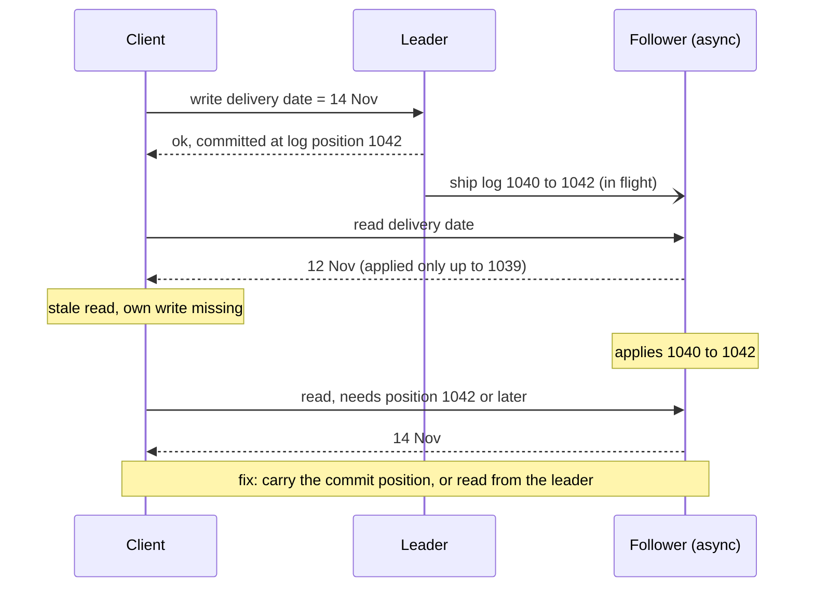
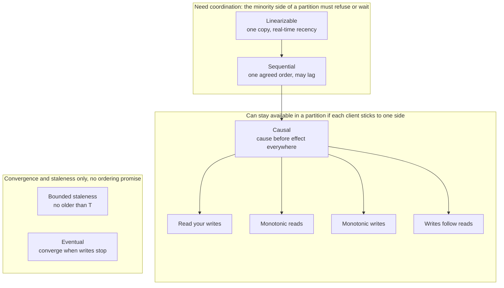
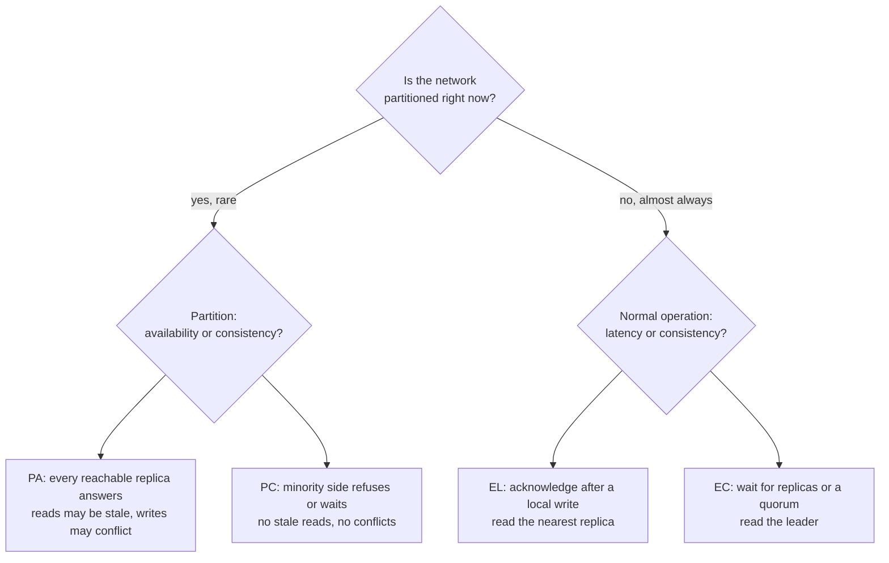

# Consistency models, CAP, and PACELC

> A consistency model is the contract that says which values a read may return once data has more
> than one copy. Choosing one per read path, not per system, is the architect's job; CAP and
> PACELC are the vocabulary for what each choice costs.

!!! abstract "Page facts"
    **Level:** Intermediate (the models and session guarantees are Level 1-2; choosing a model per
    read path and the PACELC trade-off are Level 3) · **Status:** Draft · **Time:** 60-90 minutes ·
    **Last verified:** 2026-11-20

## Learning objectives

After this page you should be able to:

- Order the common consistency models from linearizable to eventual and say what each one
  promises a reader, and what it does not.
- State the CAP theorem precisely, explain why "pick two of three" is a misreading, and use PACELC
  to reason about the latency-versus-consistency choice that applies when nothing is broken.
- Recognize the session guarantees (read-your-writes, monotonic reads, monotonic writes,
  writes-follow-reads) and name a mechanism that provides each.
- Explain replication lag, what quorum reads and writes do and do not guarantee, and how
  conflicting writes are resolved, including the data loss built into last-write-wins.
- Describe how a G-counter and an OR-set converge without coordination, then assign the weakest
  sufficient model, and a mechanism for it, to each read in a real system.

## Prerequisites

- [Distributed systems fundamentals, time, and coordination](distributed-systems-fundamentals-time-and-coordination.md)
  — partitions, logical clocks, vector clocks, and the quorum table this page builds on.
- [Caching architecture](../databases-and-storage/caching-architecture.md) — a TTL cache is the most
  common source of bounded staleness in practice.

## The problem this solves

Once data is copied (to a follower database, a cache, a second zone, an offline phone), the same
question gets different answers depending on which copy is asked. An agent changes a delivery date,
reloads, and sees the old one; a tracking status goes backwards on refresh; two customers both buy the
last unit. Teams then argue "strong" versus "eventual" without agreeing what either means, and quote
CAP for a choice it does not force. Consistency models give precise terms: what each reader is
promised, what it costs in latency and availability, and which mechanism delivers it.

## What it is

A **consistency model** is a contract between a data store and its clients that defines which
values a read may return, given the writes that have happened (and, for the stronger models, when
they happened). Stronger models allow fewer surprising results and cost more coordination; weaker
models allow more anomalies and let any nearby copy answer.

This is not the C in ACID, which means a transaction preserves the application's invariants;
consistency models are about how replicas and readers agree on order and recency. CAP's C is the
second kind, specifically linearizability.

| Model | What a reader is promised | Typical mechanism |
|---|---|---|
| Linearizable | Every operation appears to happen at one instant between its start and its end; once any read returns a value, no later read returns an older one | Single leader for the key with reads from the leader, or consensus |
| Sequential | All clients see all operations in one agreed order that respects each client's own order, but that order may lag real time | A single ordered log replayed by every replica |
| Causal | If one write could have influenced another, everyone sees them in that order; unrelated writes may be seen in different orders | Dependency tracking with vector clocks or version tokens |
| Session guarantees | Per client: read-your-writes, monotonic reads, monotonic writes, writes-follow-reads | Sticky routing, version tokens, reading from the leader |
| Bounded staleness | A read is at most T seconds (or K versions) behind | TTL caches, lag-limited followers |
| Eventual | If writes stop, all copies eventually converge to the same value; nothing is promised about reads in the meantime | Asynchronous replication plus conflict resolution |
| Weak | No promise that a read reflects any particular write; used loosely for anything weaker than strong | Best-effort caches, fire-and-forget copies |

**Strong consistency** is used loosely: usually linearizable, sometimes only "reads go to the
leader". When someone says "strong", ask which they mean.

## Mental model

Picture a company noticeboard at head office with copies in every branch, kept up to date by a
courier. **Linearizable** is everyone phoning head office and reading the one real board: always
current, but every reader pays the phone call and nobody can read when the line is down.
**Eventual** is reading the local copy: instant, but possibly out of date until the courier
arrives. **Read-your-writes** is a rule that whoever pins a notice reads from head office for the
rest of the day. **Causal** is a courier who never delivers a reply before the notice it replies to.
**Last-write-wins** is a clerk who, finding two different versions of the same notice, keeps the one
with the later date written on it and throws the other away, even if the branch that wrote it has
its calendar set wrong.

**Where the analogy breaks:** replication takes milliseconds, not hours, so anomalies are rare and
timing-dependent: they pass every test and appear under load, during failover, or across regions.
And real systems often accept writes in several places at once, which is where conflicts come from.

## Key terms

| Term | Meaning on this page |
|---|---|
| Consistency (model) | The degree to which readers see the same data at the same time, made precise as a contract on which values a read may return |
| Linearizability | The illusion of a single copy: each operation takes effect atomically at some instant between its invocation and its response |
| Causal consistency | Causally related writes are seen in causal order by everyone; concurrent writes may be seen in different orders |
| Eventual consistency | Replicas converge to the same value if no new writes arrive; a liveness promise only |
| Read-your-writes (read-after-write) | A client always sees its own earlier writes |
| Monotonic reads | A client never sees older data after having seen newer data |
| Replication lag | The delay between a write being acknowledged on the leader and being applied on a follower |
| Quorum | The minimum number of nodes that must agree for an operation to count, chosen so any two quorums overlap |
| Conflict | Two writes to the same item that are concurrent (neither happened before the other) and accepted by different replicas |
| Last-write-wins (LWW) | Resolving a conflict by keeping the write with the highest timestamp and discarding the others |
| CRDT | Conflict-free replicated data type: a data structure whose replicas can be updated independently and always merge to the same state |
| CAP theorem | When a network partition occurs, a replicated system cannot be both linearizable and available on every non-failed node |
| PACELC | If Partitioned, trade Availability against Consistency; Else, trade Latency against Consistency |

## How it works

### Step 1 — Replication lag creates the problem

Most databases replicate from a **leader** (which accepts writes) to **followers** (which apply the
leader's log). With **synchronous** replication the leader waits for a follower before acknowledging
the write; with **asynchronous** replication it acknowledges first and ships the change afterwards.
The gap between acknowledgment and a follower applying the change is **replication lag**: usually
milliseconds, but a restart, a long query holding up replay, or a write burst can push it to minutes.
Any read served by a follower, cache, or remote replica sees the world as of some moment in the past.

Even synchronous replication does not automatically make follower reads current. PostgreSQL's
synchronous replication, for example, by default waits until the standby has written the change to
durable storage, not until it has applied it; a query on the standby a moment after commit can still
miss it unless the commit also waits for the standby to apply (the `remote_apply` setting), which
costs commit latency.

**Figure 1 — A stale read caused by replication lag, and the read-your-writes fix.** The client
writes to the leader, then reads from a follower that has not yet applied the write.



How to read it: time runs downward. The first read is legal under eventual consistency and violates
read-your-writes. The second read carries the log position returned by the write; a follower that
has not reached it either waits or forwards the read to the leader.

### Step 2 — The models, from strongest to weakest

**Linearizability** makes a replicated object behave as if there were one copy. Each operation
appears to take effect at a single point between the moment the client sends it and the moment it
gets the reply. The practical consequence is a **recency guarantee**: once any client has seen a
value, every client that starts a read afterwards sees that value or a newer one. It is what you need
for a lock, a uniqueness check, a balance that must not go below zero, or a counter of remaining
stock. It is a property of single objects (one key, one register); its multi-object cousin for
transactions is **strict serializability** (serializable transactions that also respect real time).
Serializability alone is about transactions not interfering; it makes no recency promise.

**Sequential consistency** keeps one agreed order but lets it lag real time: a client may read an
already-overwritten value, as long as everyone sees the overwrites in the same order. Replicas that
replay one ordered log, read without checking how far behind they are, behave this way.

**Causal consistency** keeps only the orders that matter for meaning: if write B was made by someone
who had seen write A (a reply to a comment, a cancellation of an order), every replica shows A before
B. It is roughly the strongest model that can keep every replica answering during a partition,
provided each client stays on one side, which suits geo-replicated and offline-capable systems.
Vector clocks from the [fundamentals page](distributed-systems-fundamentals-time-and-coordination.md)
are one way to track the dependencies.

**The session guarantees** are four promises made to one client's session, often all that a user
actually notices:

| Guarantee | Anomaly it prevents | Mechanism |
|---|---|---|
| Read-your-writes | Saving a change, reloading, and seeing the old value | Read from the leader for the item (or the whole session) for a while after writing; or carry the write's log position or version and read only from a replica that has reached it |
| Monotonic reads | A status going backwards on refresh because the second read hit a staler replica | Pin the session to one replica; or carry the highest version seen and reject older answers |
| Writes-follow-reads | A reply visible before the message it answers | Attach the version that was read to the write and apply the write only after that version |

Causal consistency implies all four. They are cheap compared with linearizability because they
only constrain what one client sees, not what everyone sees at the same instant.

**Bounded staleness** limits how old a read may be (a 30-second TTL cache gives "no older than
30 seconds"); it says nothing about order. **Eventual consistency** promises only convergence, not
when, and allows every anomaly above in the meantime: it is a floor, not a design, and real systems
add session guarantees and a staleness bound on top of it.

**Figure 2 — The consistency hierarchy.** An arrow from A to B means "every system that provides A
also provides B", so A is the stronger model. The subgraphs show which models can keep answering on
both sides of a partition.



How to read it: moving down accepts more anomalies for less coordination. The bottom box has no
arrows because convergence and staleness bounds are a different kind of promise (whether and how
late, not in what order), usually added alongside the models above it.

### Step 3 — CAP, stated correctly

The **CAP theorem** (conjectured by Brewer, proved by Gilbert and Lynch) says: in a system whose
nodes communicate over a network that can lose messages, if a **partition** occurs, you cannot
provide both **consistency**, meaning linearizability, and **availability**, meaning every request to
a non-failed node eventually gets a non-error response. During the partition, a node that cannot
reach the others must either answer (and risk returning stale data or accepting a conflicting write)
or refuse or wait (and be unavailable to that client).

The popular summary "consistency, availability, partition tolerance: pick two" misleads four ways:

1. **Partitions are not optional.** Every networked system has them; "choosing" CA means running on
   one node or having no defined behavior when the network splits.
2. **The C is narrow.** It is linearizability of a single object, not ACID consistency. A system that
   gives it up may still provide causal consistency and every session guarantee.
3. **The A is extreme.** Every non-failed node must answer, including the minority side. A system
   that serves all users from the majority side, as in the zone-partition example on the
   [fundamentals page](distributed-systems-fundamentals-time-and-coordination.md), is "not available"
   in the CAP sense yet can still meet a 99.9% availability SLO.
4. **It says nothing when there is no partition,** which is almost all of the time.

The choice is also made per operation, not per system: the inventory decrement refuses during a
partition, the product page keeps serving cached stock levels. Labelling a whole database "CP" or
"AP" hides that, and many real stores are neither in the strict sense.

### Step 4 — PACELC, the everyday lens

**PACELC** (Abadi) extends CAP with the case that actually dominates: **if Partitioned, choose
Availability or Consistency; Else, choose Latency or Consistency.** Even on a healthy network,
keeping replicas in agreement costs time. A write that waits for a second zone, or a read that must
go to the leader instead of the nearest replica, pays at least one extra network round trip on every
request, not only during rare failures. So the else-branch is the choice you pay for daily.

**Figure 3 — The PACELC decision tree.** Two questions, four outcomes; most systems pick a pair.



How to read it: classify a system (or, better, an operation) by one leaf on each side. Abadi's paper
classifies the Dynamo-style stores of its time as PA/EL and fully consistent stores as PC/EC; mixed
pairs exist. A system that is PC during partitions but EL normally is consistent only when it is
least likely to matter, which is worth spotting in a design review.

The latency cost is measurable. If a write waits for one cross-zone acknowledgment and the cross-zone
round trip is 1-2 ms (an AtlasMart assumption to measure), that is 1-2 ms against a 300 ms p95 budget
(NFR-3): negligible. Across regions the round trip is tens of milliseconds, and a request with several
sequential writes spends a visible share of its budget. That arithmetic, not CAP, usually decides
between synchronous cross-region replication and a per-region leader.

### Step 5 — Quorum reads and writes, and their limits

Leaderless and some leader-based stores replicate each item to N replicas, acknowledge a write once
W have it, and read from R. The [fundamentals page](distributed-systems-fundamentals-time-and-coordination.md#step-4-use-quorums-so-copies-cannot-silently-diverge)
gives the table: when W + R > N, every read set overlaps every write set, so a read reaches at least
one replica holding the latest acknowledged write. With N = 3, W = 2, R = 2, one replica can be down
and both reads and writes still succeed (2 + 2 = 4 > 3).

Overlap is necessary but not sufficient for the stronger models. The limits an architect should know:

- **The reader must recognize the newest value.** Overlap only places it in the read set; the reader
  picks it by version. If versions are wall-clock timestamps, a skewed clock picks the wrong one.
- **A failed write is not rolled back.** A write acknowledged by one replica when W = 2 reports
  failure to the client but stays on that replica; a later read may or may not return it.
- **Concurrent reads can go backwards.** While a write is reaching replicas, one reader may see the
  new value and a later reader the old one, which violates linearizability. Fixing that requires the
  reader to write the newest value back to a quorum (read repair) before returning, at the cost of an
  extra round trip.
- **Concurrent writes still conflict.** Two clients writing the same key at the same time can each
  reach W replicas, with replicas applying them in different orders; something must resolve the
  conflict (Step 6).
- **Sloppy quorums break the overlap.** Some stores, when home replicas are unreachable, accept the
  write on substitute nodes and hand it back later. That keeps writes available but means a read
  quorum of home replicas may not overlap the write.
- **Replica replacement can lose the overlap.** A failed replica rebuilt from a stale copy counts
  toward R without holding the latest write.

So W + R > N gives "a read can find the latest acknowledged write". It does not give linearizability
on its own, and it does not order operations; that, as the fundamentals page says, is what consensus
adds.

### Step 6 — Conflicts and how they are resolved

A **conflict** exists when two writes to the same item are concurrent (neither happened before the
other) and accepted by different replicas. Single-leader systems avoid them for data the leader owns;
multi-leader, leaderless, and offline-capable systems must handle them. Detection uses version
vectors (vector clocks per item): if neither version dominates, the writes are concurrent. Resolution
options, from most to least information-preserving:

| Strategy | How it works | Cost |
|---|---|---|
| Avoid | Route every write for a key to one home replica or region | Writes to that key depend on the home being reachable |
| Keep siblings | Store both versions and let the application or user merge on next read | Every reader must handle multiple values |
| Application merge | A domain rule merges automatically (union of cart items, max of two estimates) | Rule must be correct for every concurrent case |
| CRDT | A data type whose merge is mathematically guaranteed to converge | Limited data types, metadata growth |
| Last-write-wins | Keep the value with the highest timestamp, discard the rest | Silent data loss |

**Last-write-wins** deserves a warning because many stores use it by default. It discards every
concurrent write but one, so it is safe only for write-once values or where losing a concurrent
update is acceptable. With wall-clock timestamps it can even discard the later write. In a
hypothetical multi-leader setup, agent X in zone A sets a delivery date at 10:00:05 by zone A's clock;
one second later agent Y in zone B, whose clock runs 3 s slow, changes it, stamped 10:00:03. LWW keeps
X's earlier value, drops Y's, and reports no error. Logical timestamps (Lamport or hybrid logical
clocks) fix this causal case but still drop one of two truly concurrent writes.

### Step 7 — CRDTs: G-counter and OR-set

A **conflict-free replicated data type (CRDT)** is designed so that replicas can accept updates
independently and any two replicas that have received the same updates, in any order and with any
duplicates, reach the same state. State-based CRDTs achieve this with a merge function that is
commutative, associative, and idempotent.

The **G-counter** (grow-only counter) keeps one entry per replica. Each replica increments only its
own entry; merge takes the element-wise maximum; the value is the sum of entries.

| Event | Replica A vector | Replica B vector | Value seen |
|---|---|---|---|
| A increments twice | A: [2, 0, 0] | B: [0, 0, 0] | A sees 2, B sees 0 |
| B increments once | A: [2, 0, 0] | B: [0, 1, 0] | A sees 2, B sees 1 |
| A and B exchange state and merge | A: [2, 1, 0] | B: [2, 1, 0] | Both see 3 |
| A receives B's old state again (duplicate) | A: [2, 1, 0] | B: [2, 1, 0] | Still 3: max is idempotent |

A **PN-counter** pairs two G-counters (increments and decrements) and reports their difference, so it
can go down. What no counter CRDT can do is enforce "never below zero" across replicas: two replicas
can each see 1 unit left and each decrement, and the merged value is −1. Invariants like that need
coordination.

The **OR-set** (observed-remove set) handles the hard case for sets: an add and a remove of the same
element happening concurrently. Each add attaches a fresh unique tag to the element; a remove deletes
only the tags the removing replica has observed; an element is present if it has any tag left. A
concurrent add carries a tag the remover never saw, so the add survives ("add wins"): a shopper who
removes a saved item on a phone while an offline laptop re-adds it keeps the item. The cost is
metadata: tags and tombstones (records of removals) must be kept until every replica has seen them.
CRDTs suit counters, sets, registers, collaborative text, and presence, never a global invariant such
as uniqueness or a non-negative balance.

## Worked example: choosing consistency per read in AtlasMart

The same shipment and stock data is read in several places. Each read gets the weakest model that
is still correct, because every step up costs latency, availability, or load on a single primary.

### The customer tracking view: bounded staleness plus monotonic reads

Customers read status through the Tracking API, which uses the Status Cache (cache-aside, 30 s TTL)
in front of the Tracking Event Store. NFR-1 (99% of events visible within 60 s) is a
bounded-staleness requirement, not a recency one. The Event Processor invalidates the cache key when
it commits a status change, so readers usually see it at once; if an invalidation is lost or races a
concurrent cache fill, the TTL bounds the extra staleness to 30 s. The ingestion pipeline (webhook,
queue, processor, commit) therefore has 60 − 30 = 30 s at p99 to stay within NFR-1 in the worst case.

The anomaly customers notice is a status going backwards on refresh (out for delivery, then in
transit), for example when cache nodes in two zones briefly differ. The fix is monotonic reads, made
cheap by the per-shipment sequence number the Event Processor already assigns: the API returns it,
and the Tracking Web UI never replaces a displayed status with one carrying a lower number. This path
is EL (nearest copy) and, during a partition, PA (zone C serves cache hits on the fundamentals page).

### The agent view after a delivery-date change: read-your-writes

For this page, assume AtlasMart's customer service agents use an Agent Console that calls the
Tracking API to override a shipment's estimated delivery date (an assumption; the write goes to the
Tracking Event Store primary). Customers may see the new date up to the cache bound later; the agent
must see it on the next page load, or the agent concludes the save failed, saves again, or quotes the
wrong date. That is read-your-writes for the agent's session. Two mechanisms work; AtlasMart uses
the first:

1. **Agent reads go to the primary and bypass the cache.** Agent traffic is a small fraction of the
   210 reads/s design peak (an assumption to confirm with the support team). Reads from the
   synchronous standby would not be enough unless commits wait for it to apply (Step 1).
2. **Version tokens.** The write returns the shipment's new sequence number; the next read carries it
   as "at least this version"; the API serves the cached entry only if its sequence number is at least
   that, otherwise it reads the primary. This generalizes to any client if agent traffic grows.

The write path also deletes the cache key; the TTL covers the race in which a concurrent customer
read refills the cache with the old value.

### Inventory reservation at checkout: linearizable per-SKU decrements

At checkout, the Inventory service (assumed for this page to use a PostgreSQL primary with a
synchronous standby, the same pattern as the Tracking Event Store) must not let two customers both
reserve the last unit. Every reservation is a conditional decrement executed on the primary:

```sql
UPDATE stock
SET available = available - :qty
WHERE sku = :sku AND available >= :qty;
-- 1 row updated: reserved. 0 rows: not enough stock.
```

The single statement is atomic, the row lock serializes concurrent reservations for the same SKU,
and reading and writing only on the primary makes the per-SKU count linearizable. Failover must go to
the synchronous standby; promoting an asynchronous replica could lose acknowledged decrements and
oversell. A PN-counter CRDT is the wrong tool here for the reason in Step 7: it cannot enforce
`available >= 0`. This path is PC/EC: during a partition that separates the Checkout service from the
inventory primary, reservations fail rather than oversell, and the business decides what checkout
shows ("we could not confirm stock, try again").

A single row is also a hot key on sale day: if each reservation holds the row lock for 5 ms (an
assumption to measure), one SKU takes at most 1 / 0.005 s = 200 reservations per second. Beyond that,
split the stock into several rows and reserve from any row with stock: a form of escrow that keeps
each decrement linearizable within its row and preserves the global invariant.

### Summary of the choices

| Read or write | Weakest correct model | Mechanism | PACELC |
|---|---|---|---|
| Customer tracking view | Bounded staleness (≤ 60 s, NFR-1) plus monotonic reads | Cache-aside with 30 s TTL and invalidation; sequence number checked by the UI | PA/EL |
| Agent view after an override | Read-your-writes for the agent session | Primary reads bypassing the cache (or version tokens) | PC/EC for agents only |
| "Only 3 left" on the product page | Eventual, loosely bounded | Cached stock level, a few seconds old | PA/EL |
| Stock reservation at checkout | Linearizable per SKU | Conditional decrement on the primary; failover only to a synchronous standby | PC/EC |

The product page and checkout read the same stock number with different models: the display may be
off by a unit or two because checkout checks again with the strong model.

## Real-world architecture example

Managed databases increasingly expose consistency per request: a read asks for "strong" (leader or
quorum) or "eventual" (any replica), and some issue session tokens that implement read-your-writes
across replicas exactly as in the agent example. Relational read replicas publish lag as a metric so
applications can route lag-sensitive reads to the primary; leaderless stores let each request choose
its quorum sizes; collaborative editors and offline-first apps merge edits with CRDTs; shopping carts
are the classic case where a union merge beats last-write-wins. The architect's job is the same in
each: write down, per read path, the anomaly that would hurt, and buy exactly the guarantee that
prevents it.

## Design choices and trade-offs

| Choice | Favor when | Avoid when |
|---|---|---|
| Linearizable reads and writes (leader or consensus) | Locks, uniqueness, balances, stock, anything with a global invariant | High-volume reads that tolerate seconds of staleness; cross-region users on every request |
| Session guarantees on top of replicas | Users must see their own changes and status must not regress | Several users must coordinate on the same value at the same moment |
| Bounded staleness via TTL cache | Read-heavy views with a freshness SLO in seconds | The value gates an action (payment, reservation, permission check) |
| Eventual consistency with async replicas | Analytics, search indexes, recommendation feeds, product listings | Users act on what they read and are hurt by acting on old data |
| Quorums with W + R > N | Leaderless stores needing availability with one or two replicas down | You need linearizability without read repair, or conflicts are frequent |
| Last-write-wins | Write-once data, or values where a lost concurrent update is acceptable | Values updated concurrently by different people or services |
| CRDTs | Counters, sets, collaborative and offline edits | Invariants such as non-negative stock or unique usernames |
| Synchronous cross-region replication (EC) | Data that must survive a region loss with RPO near zero | Latency budget cannot absorb tens of milliseconds per write |

## Failure modes and anti-patterns

- **Read-your-writes violation behind a load balancer.** A save goes to the primary, the redirect
  reads from a replica. Detect: "my change did not save" reports, duplicate submissions. Prevent:
  route post-write reads to the primary, or use version tokens.
- **Status regression across replicas.** Round-robin reads across replicas with different lag.
  Detect: users or monitors seeing older sequence numbers after newer ones. Prevent: sticky sessions
  or a client-side highest-version check.
- **Silent last-write-wins loss.** Concurrent updates vanish with no error. Detect: audit logs show
  writes that the current value does not reflect. Prevent: avoid conflicts by giving each key a home,
  use version checks (compare-and-set), or merge.
- **Treating quorums as linearizable.** A uniqueness check or lock built on W + R > N without read
  repair or consensus. Prevent: use a consensus-backed service or a single leader for those keys.
- **Unmonitored replication lag.** A replica falls minutes behind after a restart and serves very old
  data. Detect: a lag metric with an alert threshold. Prevent: remove lagging replicas from read
  rotation automatically.
- **Failover to an asynchronous replica.** Acknowledged writes disappear after promotion, breaking
  every guarantee at once. Prevent: synchronous standby for data that must not regress, and state the
  RPO honestly where replication is asynchronous.
- **"We are AP" as a design decision.** A system-wide CAP label replaces per-operation thinking.
  Prevent: a table like the AtlasMart one, per read and write path.

## Security considerations

- **Stale authorization data is a security bug.** A revoked permission cached or replicated with lag
  keeps working for the length of the lag; revocations need read-your-writes or a short, documented
  bound, and high-risk checks should read the source.
- **Version tokens are client input.** A forged "at least version N" with a huge N can force every
  read to the primary or make reads wait; sign or validate tokens and cap waits.
- **Merges accept data from any replica.** CRDT and application merges must validate input, or a
  compromised or buggy replica injects values that spread everywhere.
- **Last-write-wins defeats audit.** Keep an append-only log of writes apart from the resolved value.

## Performance, reliability, and cost

- **Performance:** stronger models add round trips (leader, quorum, other zones or regions) to every
  operation: the PACELC else-branch. Small within a region, dominant across regions. Weaker models
  let caches and nearby replicas absorb reads, which is where most read scalability comes from.
- **Reliability:** linearizable operations stop on the minority side of a partition and during leader
  failover; make them fail fast with a clear message. Choosing per operation keeps the weaker paths,
  usually most of the system, working through the same events.
- **Cost:** synchronous and quorum replication multiply storage and cross-zone traffic; routing reads
  to one primary concentrates load. The cheapest correct design makes only the operations that need
  strong consistency pay for it.

## Hands-on lab: replication lag and read-your-writes

The full lab is [Lab 09: eventual consistency and replication lag](../labs/lab-09-replication-lag.md).
It simulates, in Python, a leader with asynchronous followers, shows stale reads appearing as lag
grows, and removes them for one client with read-your-writes in two ways: routing that client's
reads to the leader, and waiting until a follower has applied the client's last log position. A
shorter version:

1. Model a leader holding a log and two followers that apply it with different simulated delays
   (for example 50 ms and 500 ms).
2. Write a value, then read from a random follower 1,000 times at increasing delays; record the
   fraction of stale reads at each delay.
3. Return the log position from each write and make reads wait until the follower has applied it;
   confirm the writer's stale reads drop to zero while another client still sees them.
4. Add monotonic reads by remembering the highest position each client has seen.
5. Stretch: implement a G-counter on three replicas, merge in random orders with duplicates, and
   confirm all replicas converge.

??? question "Hint: why does the other client still see stale data?"
    Read-your-writes is a session guarantee. Only the client that holds the log position waits for
    it; a second client has no token, so it is served whatever its follower has applied. To protect
    every client you need a recency guarantee for everyone, which is linearizability, and that means
    leader or quorum reads for all.

## Knowledge check

1. A colleague says "our database is CA". What would you ask, and what does CAP actually require a
   system to choose between?
2. Why is PACELC's else-branch usually the more important choice for a system's design?
3. A customer saves a new phone number, the confirmation page shows the old one, and a reload shows
   the new one. Which guarantee was violated, and name two mechanisms that provide it.
4. With N = 3, W = 2, R = 2, give two situations in which a read can still return an older value than
   a previous read did.
5. Why can a PN-counter CRDT not be used to hold remaining stock, and what can be used instead?

??? success "Answers"
    1. Ask what happens during a partition. CAP says that then a system cannot be both linearizable
       and answering on every non-failed node; "CA" means one node or undefined partition behavior.
       The real choice is refuse or wait (consistency) versus answer possibly stale (availability).
    2. Partitions are rare, but waiting for other replicas or the leader is paid on every request in
       normal operation; that latency, and the distance between replicas, usually decides the design.
    3. Read-your-writes. Route the client's reads to the leader for a period after a write, or return
       a version or log position with the write and serve the next read only from a replica that has
       reached it.
    4. A write is in progress and has reached one replica: a first read that includes it sees the new
       value, a second read that hits the other two sees the old one (no read repair). Or a write that
       failed (reached only one replica) is returned by one read and not by the next. Concurrent
       writes resolved differently on different replicas, and sloppy quorums, are further cases.
    5. Its replicas decrement independently and merge by summing, so two replicas that each see one
       unit left can both decrement and the merged value becomes −1; it cannot enforce a lower bound.
       Use a linearizable conditional decrement on a single leader (or consensus), or split the stock
       into separately owned shares (escrow) and decrement each share linearizably.

## Architecture discussion questions

1. AtlasMart plans a second region for the Tracking API to serve customers closer to home. Which reads
   on this page could be served in the remote region from an asynchronous replica, which could not,
   and what would you do about the agent console?
2. Product management wants checkout to keep working during an inventory database outage by
   accepting orders and reconciling later. Describe the PA alternative, the business process it
   requires (apology, backorder, cancellation), and how you would bound its cost.
3. A team proposes last-write-wins with wall-clock timestamps for customer address-book entries
   edited from mobile and web. Argue whether this is acceptable, and what you would choose instead.

## Summary

A consistency model is a contract about what reads may return once data is copied. From strongest to
weakest: linearizable (one copy, real-time recency), sequential (one agreed order), causal (cause
before effect), the four session guarantees, bounded staleness, and eventual (convergence only).
CAP says only that during a partition you cannot be both linearizable and answering on every node;
PACELC adds the everyday trade between latency and consistency when nothing is broken. Replication
lag causes stale reads; quorums with W + R > N let a read find the latest acknowledged write but do
not by themselves give linearizability; conflicts need avoidance, merges, CRDTs, or last-write-wins
with its silent losses. AtlasMart assigns each read the weakest correct model: bounded staleness for
customers, read-your-writes for agents, and linearizable per-SKU decrements for checkout.

## Related topics

- **Before:** [Distributed systems fundamentals, time, and coordination](distributed-systems-fundamentals-time-and-coordination.md);
  [Caching architecture](../databases-and-storage/caching-architecture.md)
- **Alongside:** [Transactions, sagas, and delivery guarantees](transactions-sagas-and-delivery-guarantees.md)
  — consistency across services rather than replicas; [Scaling, partitioning, and replication](scaling-partitioning-and-replication.md)
  — leader-follower and multi-region replication; [High availability design](../reliability-and-disaster-recovery/high-availability-design.md)
  — synchronous standbys and failover; [Lab 09](../labs/lab-09-replication-lag.md).
- **Planned:** NoSQL databases and their tunable consistency (D06-T02); event-driven architecture
  and event sourcing (D08-T02).

## References

| Source | Type | Checked |
|---|---|---|
| Seth Gilbert and Nancy Lynch, ["Perspectives on the CAP Theorem"](https://groups.csail.mit.edu/tds/papers/Gilbert/Brewer2.pdf), IEEE Computer, 2012 | Paper (authors' group copy; CAP proof and its scope) | 2026-11-20 |
| Eric Brewer, ["CAP Twelve Years Later: How the 'Rules' Have Changed"](https://www.infoq.com/articles/cap-twelve-years-later-how-the-rules-have-changed/), 2012 | Article (why "two of three" misleads) | 2026-11-20 |
| Daniel Abadi, ["Consistency Tradeoffs in Modern Distributed Database System Design"](https://www.cs.umd.edu/~abadi/papers/abadi-pacelc.pdf), IEEE Computer, 2012 | Paper (author's copy; PACELC) | 2026-11-20 |
| Maurice Herlihy and Jeannette Wing, ["Linearizability: A Correctness Condition for Concurrent Objects"](https://cs.brown.edu/~mph/HerlihyW90/p463-herlihy.pdf), ACM TOPLAS, 1990 | Paper (author's copy) | 2026-11-20 |
| [Consistency Models](https://jepsen.io/consistency) — Jepsen | Reference (hierarchy and definitions of each model) | 2026-11-20 |
| [About CRDTs](https://crdt.tech/) — crdt.tech | Reference (CRDT concepts and paper list) | 2026-11-20 |
| [Log-Shipping Standby Servers: synchronous replication](https://www.postgresql.org/docs/current/warm-standby.html) — PostgreSQL documentation | Official documentation (`remote_apply` and standby visibility) | 2026-11-20 |
| Martin Kleppmann, *Designing Data-Intensive Applications* (O'Reilly, 2017), chapters 5 "Replication" and 9 "Consistency and Consensus" | Book | 2026-11-20 |

## Review notes

- Canonical page for D04-T02. In depth: CAP, PACELC, linearizability, session guarantees
  (read-after-write treated as a synonym of read-your-writes), replication lag, quorums, conflict
  resolution, last-write-wins, CRDTs. Only defined and placed in the hierarchy: sequential, causal,
  weak (presented as an umbrella term because usage varies), and strong consistency.
- "Causal is roughly the strongest model that can stay available" rests on Mahajan, Alvisi, and
  Dahlin (UT Austin TR, 2011) and the "sticky" qualifier on Bailis et al., "Highly Available
  Transactions" (VLDB 2014); session guarantees come from Terry et al. (PDIS 1994). None is linked
  (no verifiable 200 copy found); a reviewer may add stable links.
- Re-check the PostgreSQL flush-versus-apply statement against the current `synchronous_commit`
  documentation at review.
- New AtlasMart assumptions introduced here: the Agent Console and its delivery-date override written
  through the Tracking API; agent traffic being a small fraction of the 210 reads/s peak; the
  Inventory service on a PostgreSQL primary with synchronous standby; a cross-zone round trip of
  1-2 ms; a 5 ms row-lock hold time per reservation (giving 200 reservations/s per SKU row). The 30 s
  pipeline budget is arithmetic from NFR-1 (60 s) minus the 30 s cache TTL.
- Figure 2 uses `~~~` to stack the bottom subgraph; verify it renders below the middle one.
