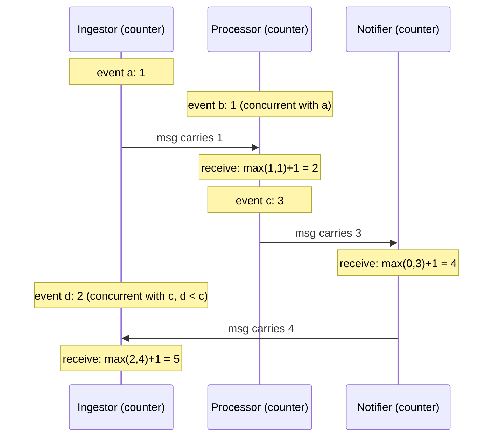
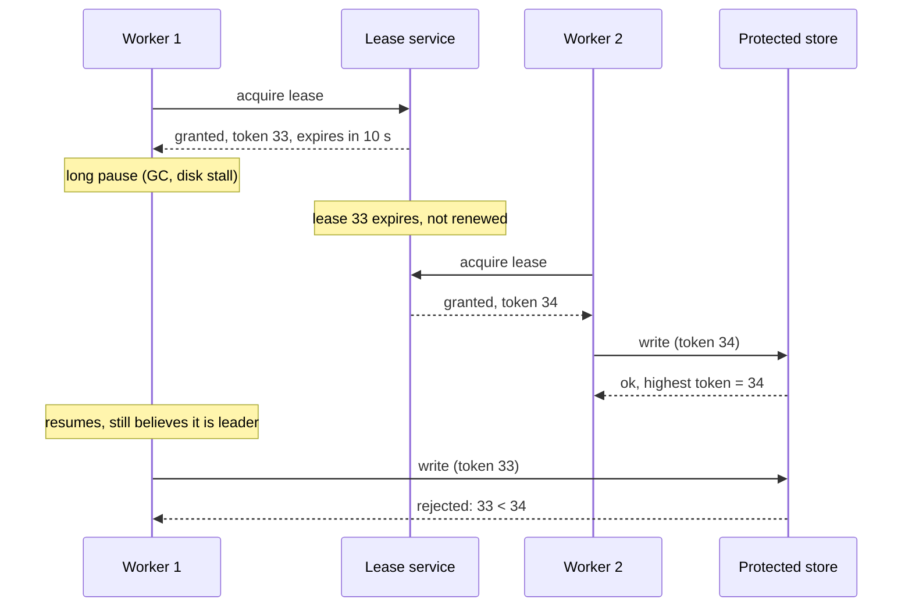
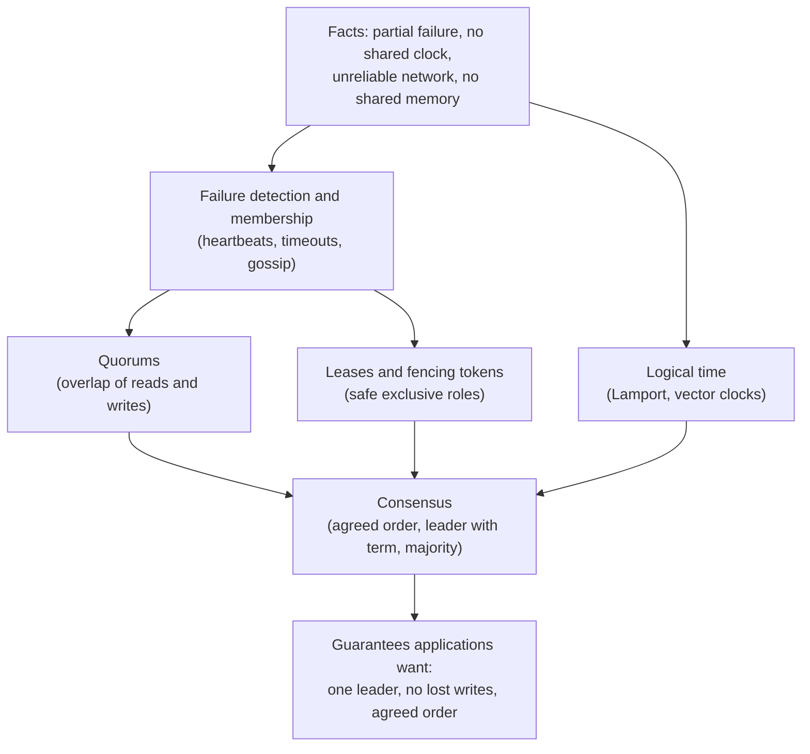
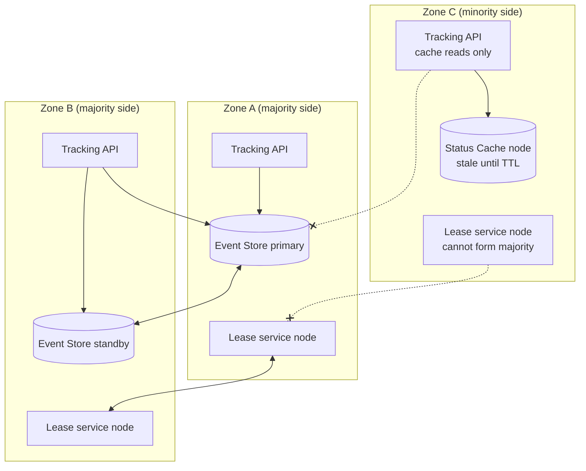

# Distributed systems fundamentals, time, and coordination

> A distributed system is one in which a machine you have never heard of can fail and make your
> program wrong. Everything on this page follows from two facts: messages can be delayed or lost,
> and no two clocks agree.

!!! abstract "Page facts"
    **Level:** Mixed (failure and clocks are Level 1-2; coordination, fencing, quorums, and consensus
    are Level 3) · **Status:** Draft · **Time:** 60-90 minutes · **Last verified:** 2026-11-15

## Learning objectives

After this page you should be able to:

- Explain how partial failure and network partitions make distributed systems different from a
  single program, and why failure detection can only be a guess.
- Describe why wall clocks cannot order events across machines, and use logical clocks (Lamport
  timestamps, vector clocks) to reason about causality.
- Design safe coordination: leader election with leases, fencing tokens for locks, and quorum reads
  and writes.
- Explain what consensus provides, why it is expensive, and when a system needs it.
- Predict what a real system (the AtlasMart tracking service) does during a zone partition and a
  clock skew incident.

## Prerequisites

- [The C4 model](../architecture-fundamentals/c4-model.md) — the Event Processor and Tracking API
  containers reappear here as processes on different machines.
- [Capacity estimation](../performance-and-scalability/capacity-estimation.md) — the three API
  instances across three zones are the deployment this page breaks.

## The problem this solves

A single program has one clock, one memory, and one failure mode: it is running or it is not. Split
it across machines and every assumption breaks. A call may succeed on the far side and still look
like a failure on the near side. Two machines can both believe they are the only leader. Event B,
caused by event A, can carry an earlier timestamp than A because its machine's clock runs slow. The
discipline of distributed systems is the set of concepts and mechanisms that let you build something
correct on top of this, and, just as important, the vocabulary to recognize when a design quietly
assumes a single machine.

## What it is

A **distributed system** is a set of independent processes on separate machines (nodes) that
communicate only by sending messages over a network and that must appear to users as one system. A
**centralized system** keeps everything on one machine; it is simpler, has a hard ceiling on size and
availability, and is the right choice far more often than fashion suggests. A **cluster** is a group
of nodes managed together to provide one service. The defining properties:

| Property | What it means | Consequence |
|---|---|---|
| Partial failure | Some nodes or links fail while others keep working | The system must keep operating (or stop safely) with an unknown subset alive |
| No shared clock | Each node has its own clock, drifting independently | "Before" and "after" need a definition that does not rely on wall time |
| Unreliable, variable-latency network | Messages may be delayed, reordered, duplicated, or lost | A missing reply does not tell you whether the request was processed |
| No shared memory | State lives on individual nodes and must be copied | Copies diverge; keeping them in agreement is the coordination problem |

## Mental model

Think of a group of people organizing a surprise party by postcard only. Nobody can see anyone
else; a postcard may take a day or a week or get lost; each person's watch is set slightly
differently. If Dana does not reply, is Dana ill, or is the post slow? (Failure detection is a
guess.) If two postcards say "I'll bring the cake", who decided first? (Clocks do not settle it.)
To avoid two cakes, the group agrees that whoever holds the "cake card" brings it, the card expires
after a week unless renewed, and it carries a number that increases each time it is reissued, so a
stale card can be recognized. (Leases and fencing tokens.) For decisions everyone must agree on, each
proposal needs replies from more than half the group before it counts. (Quorum and consensus.)

**Where the analogy breaks:** postcards take days; network messages usually take milliseconds, which
tempts designers to assume they are instant and reliable. The failure cases on this page happen
precisely when that assumption is briefly false.

## Key terms

| Term | Meaning on this page |
|---|---|
| Node | One process on one machine participating in the system |
| Network partition | A failure that splits the nodes into groups that can talk within but not across groups |
| Fault domain | A set of components that share a cause of failure (a host, a rack, a zone, a region) |
| Failure detector | A mechanism (heartbeats and timeouts) that suspects a node has failed; it can be wrong |
| Clock skew | The difference between two clocks at the same instant; drift is how fast skew grows |
| Logical clock | A counter that captures ordering of events (happened-before) without wall time |
| Lamport timestamp | A single integer per event such that if A caused B, A's timestamp is smaller |
| Vector clock | One counter per node, enabling detection of concurrent (unrelated) events |
| Lease | Time-limited permission (to be leader, to hold a lock) that expires unless renewed |
| Fencing token | A number issued with a lease that increases each time; resources reject stale tokens |
| Quorum | The minimum number of nodes that must agree for an operation to count, chosen so any two quorums overlap |
| Consensus | A protocol by which nodes agree on one value or one ordered log despite failures |
| Split brain | Two parts of a partitioned system each acting as the authority |

## How it works

### Step 1 — Accept partial failure and detect it imperfectly

A request to another node can end in four ways: processed and reply received; processed and reply
lost; not processed because the request was lost; or not processed because the node is down. From
the caller's side the last three look the same: silence. The only tool is a **timeout**, and a
timeout is a guess about latency, not a fact about the other node. **Failure detectors** send
heartbeats and declare a node suspected after a number of missed ones; the trade-off is between
detecting real failures quickly and falsely suspecting slow nodes (a long garbage-collection pause
looks exactly like a crash). Group membership protocols (including **gossip**-based ones, where
each node periodically exchanges what it knows with a few random peers) spread these suspicions so
the whole cluster converges on a view of who is alive, eventually and approximately.

**Fault domains** are how you contain partial failure: machines in the same rack share a switch,
machines in the same zone share power and cooling, zones in a region share a control plane. Placing
replicas in different fault domains means one cause of failure takes out at most one replica.

### Step 2 — Stop trusting the clock for ordering

Every node's clock drifts, and synchronization (NTP, the Network Time Protocol) corrects it only to
within some error that depends on network conditions; it can also step the clock backwards. So:

- Two events on different nodes with timestamps 10:00:00.100 and 10:00:00.120 may have happened in
  either order.
- A node can observe its own clock going backwards, making "elapsed time" negative if measured with
  the wall clock. (Use a monotonic clock for durations; use the wall clock only for display.)
- "Last writer wins" by wall-clock timestamp silently discards writes from nodes whose clocks are
  behind.

**Lamport timestamps** fix ordering for causally related events. Each node keeps a counter; it
increments the counter for each local event, attaches it to every message it sends, and on receipt
sets its counter to the maximum of its own and the received value, plus one. The result: if event A
could have influenced event B (A *happened before* B), then A's timestamp is smaller. The converse
does not hold: a smaller timestamp does not prove causation, and two events can be concurrent.

**Figure 1 — Lamport timestamps across three processes.** Each arrow carries the sender's counter;
the receiver jumps to max(own, received) + 1. Events on different lines with no path between them
are concurrent even if their numbers differ.

How to read it: follow the arrows for causality; a (1) → receive at Q (2) → c (3) → receive at R (4)
is a causal chain with increasing numbers. Event d (2) at the Ingestor is unrelated to c (3); their
numbers say nothing about real-time order.

**Vector clocks** extend this with one counter per node, so the system can tell *concurrent* from
*ordered*: if every component of A's vector is less than or equal to B's, A happened before B; if
each has some component greater than the other, they are concurrent and the application must merge
or pick. Vector clocks are what let a replicated store detect conflicting writes instead of
silently overwriting one.

### Step 3 — Coordinate with leases and fencing, not locks

Many designs want exactly one node to do something: run the scheduler, hold the primary role,
process a given key. A lock held in a coordination service seems to give that, but a node can hold a
lock, pause (garbage collection, a stalled disk, a network blip), have the lock expire and be given
to another node, and then resume believing it is still the holder. Two mechanisms make this safe:

- A **lease** is a lock with an expiry. The holder must renew it before expiry; if it cannot (because
  it is partitioned or paused), the lease lapses and another node can acquire it. This bounds how
  long a dead holder blocks progress, at the cost of a window in which a paused holder may still
  think it holds the lease.
- A **fencing token** closes that window. Every time the lease is granted, the coordination service
  issues a strictly increasing number. The holder includes the token in every operation on the
  protected resource (a database write, a file store, a downstream API), and the resource rejects any
  token smaller than the largest it has seen. A resumed stale holder is fenced out by the resource
  itself, not by its own belief.

**Figure 2 — A lease with fencing tokens.** Worker 1 pauses, its lease expires, Worker 2 gets token
34; when Worker 1 resumes and writes with token 33, the store rejects it.

How to read it: the lease service bounds the outage; the store's token check prevents the stale
write. Without the check, both writes would succeed and the store would hold Worker 1's stale state.

**Leader election** is the same mechanism applied to a role rather than a resource: nodes compete
to acquire the leadership lease; the holder does leader work and renews; followers watch and try to
acquire when it lapses. Any resource the leader touches must check the fencing token, or the election
only reduces the frequency of double leadership rather than eliminating it.

### Step 4 — Use quorums so copies cannot silently diverge

With N replicas of a value, writing to W of them and reading from R of them guarantees that a read
sees the latest acknowledged write when W + R > N, because any read set and any write set must share
at least one replica. The common configurations:

| N | W | R | W + R > N? | Behavior |
|---|---|---|---|---|
| 3 | 2 | 2 | Yes | Tolerates one replica down for both reads and writes; the usual default |
| 3 | 3 | 1 | Yes | Fast reads; a write blocks if any replica is down |
| 3 | 1 | 1 | No | Fast and available; a read may miss the latest write (eventual) |
| 5 | 3 | 3 | Yes | Tolerates two replicas down; more replicas to pay for |
| 5 | 2 | 2 | No | Two non-overlapping writes can both succeed: conflicts possible |

A **majority quorum** (more than half) has a second property: two majorities cannot exist at once,
so during a partition at most one side can make progress. That is the basis of avoiding **split
brain**: the minority side must refuse writes, not because it knows the majority is alive, but
because it cannot prove it is the majority. Quorum reads and writes give overlap; they do not by
themselves give agreement on order, which is what consensus adds.

### Step 5 — Reach consensus when order matters

**Consensus** lets a set of nodes agree on a single value (or, in practice, on the order of an
append-only log) such that all non-failed nodes decide the same thing, the decision is one that
some node proposed, and a decision is eventually reached if enough nodes are alive. Protocols such as
Paxos and Raft achieve this with majority quorums, a leader with a term number (a fencing token by
another name), and a log replicated to a majority before it is acknowledged. A classical
impossibility result shows that no deterministic protocol can guarantee both safety and progress in
an asynchronous system with even one faulty node; real protocols stay safe always and make progress
when the network is well-behaved enough, which it usually is. Consensus is what coordination
services, replicated configuration stores, and the control planes of distributed databases are
built on. It is expensive (round trips to a majority on every decision) and should be used for the
small amount of state that truly needs it: who is leader, what the membership is, where each
partition lives, not for every row of application data.

**Figure 3 — Where each mechanism sits.** From the unavoidable facts at the bottom to the
guarantees applications want at the top.

How to read it: each layer is built on the ones below; an application that skips a layer (for
example, exclusive roles without fencing) inherits the failure of the missing layer.

## Worked example: time and coordination in the AtlasMart tracking service

### Ordering scan events

A shipment's timeline is a sequence: label created, picked up, hub scan, out for delivery,
delivered. The Event Processor receives these from carrier webhooks and must show them in order and
derive the "current status". Three clocks are involved and none is trustworthy for ordering:

- The **carrier's timestamp** on each event is set by the scanner or the carrier's system, whose
  clocks are outside AtlasMart's control; an out-for-delivery scan from a van with a slow clock can
  carry a time earlier than the hub scan it followed.
- The **arrival time** at the Webhook Ingestor reflects delivery order, which after a carrier outage
  is the order of the redelivered backlog, not the order of events.
- The **Event Processor's clock** is only as good as its NTP synchronization; with two processor
  workers in different zones, each stamping events, skew between them would reorder events that
  arrived within the same second.

The design: the processor keeps a **per-shipment sequence number** assigned in the database
transaction that stores the event (the database is the single serialization point for that
shipment's events, which is cheap because each shipment has about 8 events), stores the carrier
timestamp for display only, and derives status from a **state machine** that defines which
transitions are legal rather than from "the latest timestamp". A delivered scan followed by a late
hub scan keeps the status at delivered and records the hub scan as historical. This is Lamport's
insight applied narrowly: order comes from causality and a single sequencer, not from clocks.

### One notification scheduler

FR-3 requires exactly one notification per out-for-delivery and per delivered transition. The
Notification Worker runs as two instances for availability (one per zone), but sending must not be
duplicated. Two layers make this safe:

1. **Idempotent sends.** Each notification has a deterministic identifier (shipment identifier plus
   transition); the Notification Provider's API is called with it as the idempotency key, and the
   send is recorded in the Tracking Event Store with a unique constraint. Duplicate attempts fail
   the constraint or are deduplicated by the provider.
2. **A leased scheduler role with fencing.** For batched work (the daily "still in transit"
   digest), one worker holds a lease from a coordination service with a fencing token; the digest
   run writes its progress to the store with the token, and the store rejects a stale token. If the
   leader pauses for longer than the lease (AtlasMart sets 15 seconds, an assumption), the other
   worker takes over and the paused one is fenced when it resumes.

The first layer alone would be enough for correctness of single sends; the lease exists to avoid
running an expensive batch twice, and the fencing token exists because leases alone do not prevent
the paused-leader case.

### A zone partition

The Tracking API runs three instances, one per zone, behind a load balancer; the Tracking Event
Store has a primary in zone A and a synchronous standby in zone B; the Status Cache has nodes in all
three zones. Suppose zone C loses network connectivity to zones A and B for six minutes while staying
reachable from the internet.

| Component in zone C | What it sees | What should happen |
|---|---|---|
| Tracking API instance | Cache node in C answers; database unreachable | Serve cache hits (status may be up to the cache TTL stale, within NFR-1); fail cache misses fast with a retryable error rather than hanging; load balancer health check should fail within a minute so traffic drains to A and B |
| Status Cache node | Cannot receive invalidations from processors in A and B | Serves stale data until TTL expiry; acceptable for 30 s TTL, dangerous for a long TTL |
| Event Processor worker (if one is in C) | Cannot reach the queue or database | Stops consuming; the queue holds events; the other worker continues; lag metric rises for one zone's worth of throughput |
| Notification Worker with the scheduler lease | Cannot renew the lease | Lease lapses after 15 s; the worker in A or B acquires it with a higher token; C's worker is fenced when it reconnects |

The majority (zones A and B) keeps the database and the lease service, so it keeps making progress;
zone C can only serve reads from cache and must not accept writes. If instead the database primary
were in C with the standby in A, the correct behavior is the opposite: the primary in C must stop
accepting writes once it cannot reach a majority of its coordination quorum, and the standby in A
must be promoted, which is the failover design covered on the
[high availability page](../reliability-and-disaster-recovery/high-availability-design.md).

**Figure 4 — Zone C partitioned.** Dashed links are cut; the majority side keeps the primary and
the lease service.

How to read it: the x-ended dashed arrows are the cut links; zone C has one of three lease service
nodes and cannot form a majority, so no lease can be granted or renewed from inside C.

## Real-world architecture example

The same mechanisms show up in nearly every managed platform: a coordination service running a
consensus protocol holds cluster membership, leader identity, and configuration; databases replicate
their write-ahead log to a majority of replicas before acknowledging; container orchestrators run
their control plane on a consensus-backed store and give controllers leases with resource versions
that act as fencing tokens; distributed caches and key-value stores use vector clocks or
per-partition sequence numbers to detect conflicting writes; and monitoring systems treat a missed
heartbeat as "suspected", not "dead", and require several before acting. Application teams rarely
implement these protocols, but they must know which guarantees they are relying on and which they
are not: a cache that replicates asynchronously provides no quorum; an application lock without a
fencing token provides no exclusivity.

## Design choices and trade-offs

| Choice | Favor when | Avoid when |
|---|---|---|
| Centralized (one node, replicated for failover) | Load fits one node; simplicity and strong consistency matter | A single node cannot hold the data or the load, or a single fault domain is unacceptable |
| Aggressive failure detection (short timeouts) | Fast failover matters more than occasional false alarms; operations are idempotent | False positives trigger expensive or unsafe actions (double leaders, cascading failovers) |
| Wall-clock timestamps for ordering | Display only; coarse ordering across independent systems where errors are tolerable | Correctness depends on order (balances, state transitions, conflict resolution) |
| Per-key sequencer (one writer per key) | Keys are small and independent (one shipment's events) | A single key is hot enough to need many concurrent writers |
| Leases with fencing tokens | Any exclusive role or lock whose holder can pause | The protected resource cannot check tokens (then make operations idempotent instead) |
| Majority quorums | Writes must never be lost and split brain is unacceptable | Latency across regions makes majority round trips too slow; consider per-region leaders |
| Consensus for application data | Small, critical, low-volume state (configuration, membership, leadership) | High-volume application rows; use it for metadata and partition ownership only |

**Assumption behind all of this:** nodes are honest but unreliable. Systems that must tolerate
nodes that lie (Byzantine faults) need different, more expensive protocols; most enterprise systems
do not, and treat node compromise as a security problem rather than a coordination one.

## Failure modes and anti-patterns

- **Timestamp ordering.** Sorting events by wall-clock time across machines; events appear out of
  order after clock corrections. Detect: status regressions, "delivered" then "in transit". Prevent:
  sequence numbers from a single serialization point; state machines for status.
- **Locks without fencing.** A paused lock holder resumes and writes. Detect: rare, inexplicable
  double processing. Prevent: fencing tokens checked by the resource; idempotent operations.
- **Treating timeout as failure.** Retrying a non-idempotent operation after a timeout, duplicating
  it. Prevent: idempotency keys; distinguishing "unknown outcome" from "failed".
- **Split brain by design.** Two data-center "active" primaries with no quorum; both accept writes
  during a partition. Prevent: majority quorum or an explicit single-writer rule with failover.
- **Measuring durations with the wall clock.** Negative elapsed times after NTP steps. Prevent:
  monotonic clocks for intervals.
- **Membership by assumption.** A static list of nodes that is never updated; dead nodes keep
  receiving traffic. Prevent: health-checked membership with hysteresis.
- **Consensus everywhere.** Routing every request through a consensus log "for safety"; throughput
  collapses. Prevent: consensus for metadata, per-partition leaders for data.
- **Ignoring fault domains.** Three replicas in one rack. Prevent: placement rules across zones.

## Security considerations

- Clock manipulation is an attack: certificates, tokens, and lease expiries depend on time. Secure
  NTP sources and monitor for clock jumps.
- Coordination services hold the keys to leadership and configuration; they need authentication,
  authorization, and encryption in transit like any database.
- Fencing tokens and sequence numbers must be issued by a trusted component; a client that can mint
  its own token can bypass the fence.
- Partitions can be induced by an attacker (for example, by exhausting a link); a design that fails
  safe under partition (minority refuses writes) is also a design that resists this.

## Performance, reliability, and cost

- **Performance:** every quorum or consensus round trip adds latency proportional to the distance
  between replicas; same-zone replicas are sub-millisecond, cross-region tens of milliseconds. Put
  coordination on the few decisions that need it and keep the data path local.
- **Reliability:** failure detection settings are reliability settings: too aggressive causes
  flapping and false failovers; too lax lengthens outages. Lease durations trade takeover time
  against false takeovers; AtlasMart's 15 s (an assumption) is a compromise a reviewer should
  challenge against the measured pause lengths of its workers.
- **Cost:** three replicas across three zones triple storage and add cross-zone traffic; five
  replicas tolerate two failures at a higher cost. The replication factor of 3 in the capacity
  estimate is this trade-off made explicit.

## Hands-on lab: break ordering and fix it

1. Write a small Python script with three "processes" as objects, each with a wall clock that you
   deliberately skew (for example, +0 s, −2 s, +5 s) and a Lamport counter.
2. Generate a chain of five events that cause each other across the processes (send and receive),
   recording for each event the skewed wall-clock timestamp and the Lamport timestamp.
3. Sort the events by wall-clock time and print them; observe at least one effect printed before its
   cause.
4. Sort by Lamport timestamp and print; confirm every cause precedes its effect. Add two concurrent
   events and show that Lamport numbers alone cannot tell you they were concurrent.
5. Extend each process with a vector clock and write the comparison function that returns
   "before", "after", or "concurrent". Check the two concurrent events are reported as such.
6. Stretch: simulate a lease with a token and a paused holder, and show the store rejecting the
   stale write.

??? question "Hint: the vector comparison"
    A is before B if every component of A is ≤ the corresponding component of B and at least one is
    strictly less. If neither A ≤ B nor B ≤ A holds, they are concurrent. Equal vectors mean the same
    event.

## Knowledge check

1. A call to another service times out. List the possible states of the remote operation and say why
   a retry can be dangerous.
2. Why can two events with Lamport timestamps 7 and 9 have happened in either real-time order? What
   can you conclude if 7 happened before 9 causally?
3. A lock service grants a lock with a 30-second lease. Describe a sequence of events in which two
   clients both believe they hold the lock, and name the mechanism that prevents damage.
4. With N = 5 replicas, W = 3, R = 3: how many replicas can be down while still serving reads and
   writes, and why is a read guaranteed to see the latest write?
5. During a partition, why must the minority side refuse writes even though it cannot tell whether
   the majority side is alive?

??? success "Answers"
    1. Processed with the reply lost; never received; received but not yet processed (queued);
       processed later after the timeout fired; or the node is down. A retry can execute a
       non-idempotent operation twice; use idempotency keys or make the operation idempotent.
    2. Lamport timestamps only guarantee that causally related events are ordered; concurrent events
       get arbitrary relative numbers. If 7 → 9 causally, then 7 happened first in every sense.
    3. Client 1 acquires, then pauses (for example a long garbage collection) past 30 s; the lease
       expires; client 2 acquires; client 1 resumes believing it still holds the lock. A fencing token
       that the protected resource checks rejects client 1's stale operations.
    4. Two can be down (3 of 5 remain, enough for W = 3 and R = 3). Any 3 writers and any 3 readers
       overlap in at least one replica, so the read set contains at least one replica with the latest
       acknowledged write.
    5. Two majorities cannot exist, so if the minority side writes and the majority side also writes,
       the system has diverged (split brain). The minority cannot prove it is the majority, so the
       safe action is to refuse. Availability on the minority side is sacrificed for consistency.

## Architecture discussion questions

1. AtlasMart proposes a second region for the tracking service with an active-active database. What
   coordination problems does that create for event ordering and notifications, and which of the
   mechanisms on this page would you apply, at what latency cost?
2. The platform team offers a managed coordination service with consensus-backed leases. A developer
   wants to use it for a per-shipment lock on every event write (70 per second at peak). Argue for or
   against, with numbers from the capacity estimate.
3. A regulator requires that the tracking timeline shown to a customer be "in the order the events
   occurred". Which clock, if any, satisfies that, and what would you document as the definition of
   "occurred"?

## Summary

Distributed systems differ from single programs because of partial failure, unreliable networks, and
independent clocks. Failure detection is a timeout-based guess; fault domains contain the damage.
Wall clocks cannot order events across machines; Lamport timestamps order causally related events,
vector clocks additionally detect concurrency, and a single sequencer per key is often the practical
answer. Exclusive roles need leases to bound outages and fencing tokens to make stale holders
harmless. Quorums with W + R > N keep copies from silently diverging; majority quorums prevent split
brain; consensus provides agreed order for the small set of state that needs it. The AtlasMart
example applied each: per-shipment sequences for ordering, idempotent sends plus a fenced lease for
the scheduler, and a majority side that keeps working during a zone partition.

## Related topics

- **Before:** [The C4 model](../architecture-fundamentals/c4-model.md); [Capacity estimation](../performance-and-scalability/capacity-estimation.md)
- **Alongside:** [High availability design](../reliability-and-disaster-recovery/high-availability-design.md)
  — failover and zone placement; [Message queues and brokers](../messaging-and-streaming/message-queues-and-brokers.md)
  — ordering and redelivery in practice; [Integration architecture](../application-and-api-architecture/integration-architecture.md)
  — reconciliation as the answer to partial failure across organizations.
- **Planned:** consistency models, CAP, and PACELC (D04-T02); transactions, sagas, and delivery
  guarantees (D04-T03); resilience mechanics such as timeouts, retries, and backpressure (D04-T04);
  scaling, partitioning, and replication (D04-T05).

## References

| Source | Type | Checked |
|---|---|---|
| Leslie Lamport, ["Time, Clocks, and the Ordering of Events in a Distributed System"](https://lamport.azurewebsites.net/pubs/time-clocks.pdf), Communications of the ACM 21(7), 1978 | Paper (author's copy) | 2026-11-15 |
| Martin Kleppmann, ["How to do distributed locking"](https://martin.kleppmann.com/2016/02/08/how-to-do-distributed-locking.html), 2016 | Article (leases and fencing tokens) | 2026-11-15 |
| Diego Ongaro and John Ousterhout, ["In Search of an Understandable Consensus Algorithm (Extended Version)"](https://raft.github.io/raft.pdf), 2014 | Paper (Raft) | 2026-11-15 |
| Mike Burrows, ["The Chubby lock service for loosely-coupled distributed systems"](https://research.google/pubs/the-chubby-lock-service-for-loosely-coupled-distributed-systems/), OSDI 2006 | Paper (leases, sequencers) | 2026-11-15 |
| Abhinandan Das, Indranil Gupta, and Ashish Motivala, ["SWIM: Scalable Weakly-consistent Infection-style Process Group Membership Protocol"](https://www.cs.cornell.edu/projects/Quicksilver/public_pdfs/SWIM.pdf), DSN 2002 | Paper (gossip-based membership and failure detection) | 2026-11-15 |
| [Leader election in distributed systems](https://aws.amazon.com/builders-library/leader-election-in-distributed-systems/) — Amazon Builders' Library | Vendor engineering article (cloud-neutral concepts) | 2026-11-15 |
| [RFC 5905: Network Time Protocol Version 4](https://www.rfc-editor.org/rfc/rfc5905) — IETF | Standard (clock synchronization) | 2026-11-15 |
| Martin Kleppmann, *Designing Data-Intensive Applications* (O'Reilly, 2017), chapters 8 "The Trouble with Distributed Systems" and 9 "Consistency and Consensus" | Book | 2026-11-15 |

## Review notes

- Canonical page for D04-T01. Consensus, gossip, membership, and vector clocks are explained at the
  level of what they guarantee, not how the protocols work step by step; Paxos is named but not
  described. Byzantine faults are mentioned only to exclude them.
- The impossibility result referred to in Step 5 is the Fischer-Lynch-Paterson result (1985); the
  ACM link returned 403 to the automated check, so it is described without a link. A reviewer may add
  a stable link.
- New AtlasMart assumptions introduced here: the scheduler lease duration (15 s), the Status Cache
  TTL of 30 s (consistent with the capacity page), the placement of the database primary in zone A and
  standby in zone B, and a three-node lease service with one node per zone.
- Figure 4 uses `-.-x` dashed cross-ended links; verify they render in the deployed Mermaid version.
