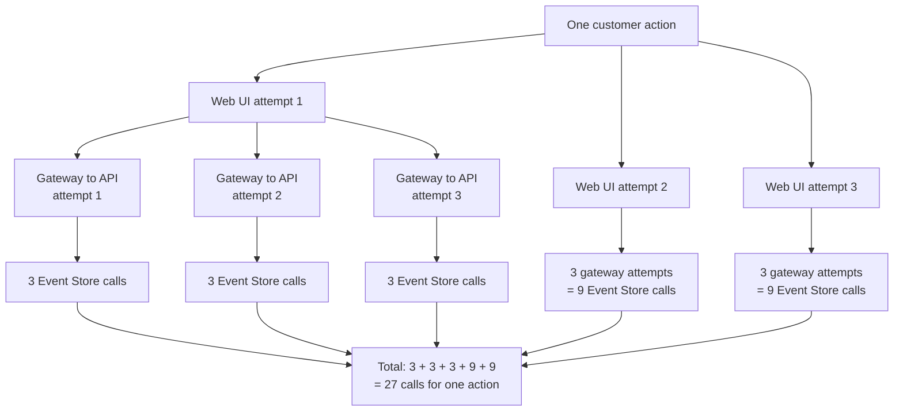
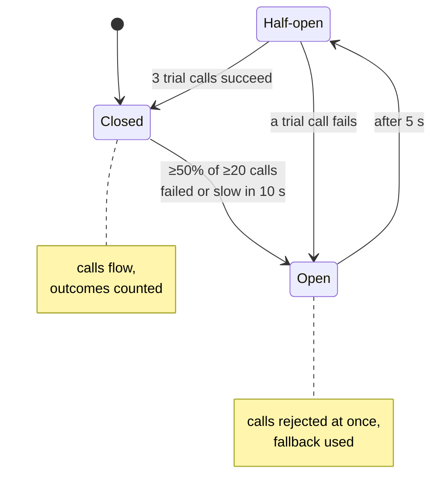
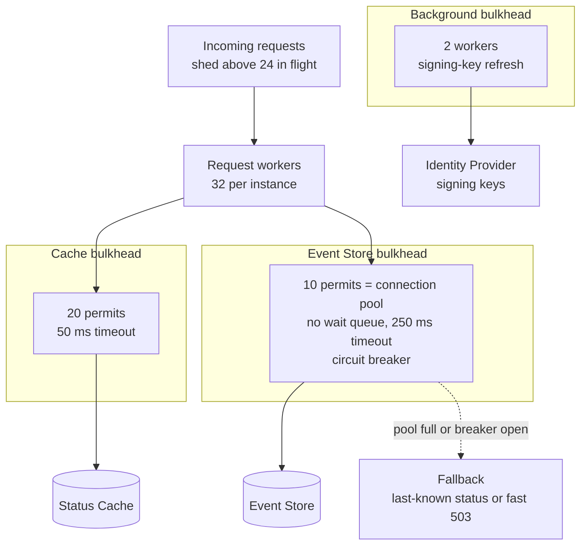
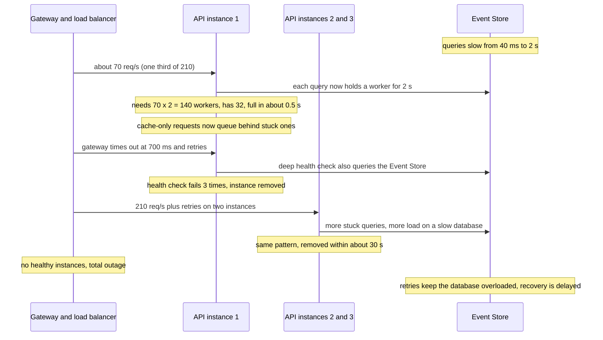

# Resilience mechanics: timeouts, retries, and backpressure

> Most outages in distributed systems are not caused by a component dying. They are caused by a
> component getting slow, and by everything around it waiting, retrying, and queueing until the
> slowness has spread to every caller.

!!! abstract "Page facts"
    **Level:** Mixed (timeouts, retries, and health checks are Level 1-2; retry budgets, breaker
    tuning, bulkheads, and the cascading-failure design are Level 3) · **Status:** Draft ·
    **Time:** 60-90 minutes · **Last verified:** 2026-11-20

## Learning objectives

After this page you should be able to:

- Choose a timeout for each hop from the dependency's latency percentiles and the caller's budget,
  so that inner timeouts always fire before outer ones.
- Design a retry policy with a retry budget, exponential backoff, and jitter, and calculate how
  retries at several layers multiply load on the bottom dependency.
- Configure a circuit breaker and bulkheads, and decide between failing fast and degrading
  gracefully for each request type.
- Explain who decides, and where, for rate limiting, throttling, load shedding, and backpressure.
- Design liveness and readiness checks that do not turn a dependency blip into a total outage, and
  handle poison messages with a dead-letter queue.
- Use Little's Law to predict how a slow dependency exhausts a service's workers, and show that a
  design prevents it.

## Prerequisites

- [Distributed systems fundamentals, time, and coordination](distributed-systems-fundamentals-time-and-coordination.md)
  — a timeout is a guess, and a missing reply does not say whether the work happened.
- [Performance fundamentals and Little's Law](../performance-and-scalability/performance-fundamentals-and-littles-law.md)
  — the Tracking API latency budget and the L = λ × W arithmetic used throughout.
- [Message queues and brokers](../messaging-and-streaming/message-queues-and-brokers.md) — retries,
  visibility timeouts, and dead-letter queues on the asynchronous side.
- [High availability design](../reliability-and-disaster-recovery/high-availability-design.md) —
  health checks, the stale-cache fallback, and the NFR-2 arithmetic.

## The problem this solves

Redundancy handles components that stop. It does little for components that slow down, and slow is
the more common and more dangerous failure. A database that answers in 2 seconds instead of 40
milliseconds is "up" by every simple check, yet each caller now holds a thread and a connection fifty
times longer. By Little's Law the requests in flight rise by the same factor, pools run out,
unrelated requests queue behind the stuck ones, and the caller becomes slow in turn. If callers
retry, the dependency receives more work exactly when it can handle less. The mechanisms on this page
bound waiting, bound retrying, isolate the damage, and give callers something useful to do instead
of waiting.

## What it is

**Resilience mechanics** are the small, local policies each component applies on every call so that
the system as a whole degrades instead of collapsing:

| Group | Mechanisms | Question it answers |
|---|---|---|
| Bound the wait | Timeouts, deadlines, fail-fast | How long am I willing to wait for this call? |
| Bound the retry | Retries, exponential backoff, jitter, retry budgets | When and how often do I try again without making things worse? |
| Contain the damage | Circuit breakers, bulkheads, fault isolation | How do I stop one bad dependency from consuming everything? |
| Match load to capacity | Rate limiting, throttling, load shedding, backpressure, graceful degradation | What do I do with work I cannot finish in time? |

Two supporting mechanisms say who is healthy (**health checks**, **heartbeats**) and where failed
asynchronous work goes (**dead-letter queues** for **poison messages**). The failure all of them
prevent is a **cascading failure**: one component's slowness or loss raises the load or latency on
others until they fail too.

## Mental model

Think of a building's electrical system. A **breaker** cuts a circuit when the current is dangerous
and is reset after the fault is cleared (circuit breaker). Each room has its **own circuit**, so a
short in the kitchen does not darken the bedroom (bulkhead). Under excess demand, a good grid **dims
the lights rather than blacking out the street** (degradation, load shedding), and the utility
**refuses to connect** more appliances than a line can carry (rate limiting).

**Where the analogy breaks:** a household breaker trips on a precise physical quantity; a software
breaker trips on a statistical sample of a noisy signal, so it can trip on noise or stay closed while
users suffer. And appliances do not retry. Software clients do, automatically and at every layer,
which is why retry amplification, the most dangerous behavior in a software outage, has no
equivalent in the building.

## Key terms

| Term | Meaning on this page |
|---|---|
| Timeout | The longest a caller waits for one attempt before treating it as failed |
| Deadline | An absolute time by which the whole request must finish, propagated to downstream calls |
| Exponential backoff | Waiting longer before each successive retry, doubling up to a cap |
| Jitter | Randomness added to backoff so that many clients do not retry at the same instant |
| Retry budget | A limit on retries as a fraction of normal traffic, so retries cannot multiply load |
| Retry storm / retry amplification | Retries at several layers multiplying the load on a struggling dependency |
| Circuit breaker | A per-dependency switch that stops calls after repeated failures and probes for recovery |
| Bulkhead | A separate, bounded pool of threads, connections, or permits per dependency or workload |
| Fail-fast | Rejecting a request at once when it cannot succeed, instead of waiting |
| Graceful degradation | Serving a reduced but useful response when a dependency is unavailable |
| Load shedding | A server rejecting excess work based on its own current state, to protect the work it keeps |
| Backpressure | A consumer slowing its producer, or a bounded queue refusing work (as in the glossary) |
| Liveness / readiness | Health checks that decide whether to restart an instance / whether to send it traffic |
| Heartbeat | A periodic "I am alive" signal pushed by a node; silence makes it suspected |
| Poison message | A message that fails every processing attempt and must be moved to a dead-letter queue |
| Cascading failure | A failure that spreads because one component's slowness or loss overloads those around it |

## How it works

### Timeouts from percentiles and the caller's budget

Every network call needs a timeout, and many client libraries default to none or to minutes. A
timeout is constrained from both sides:

- **From below, by the dependency's latency distribution.** A timeout inside the healthy tail fires
  on requests that would have succeeded, turning slowness into errors and, if retried, into extra
  load. Anchor it above a high percentile at peak load (p99.9 is common), measured, not guessed.
- **From above, by the caller's budget.** Each hop's timeout, plus any retry and backoff, must fit in
  the remaining budget of the hop above it, with a margin for the work done after the call returns.

So **timeouts shrink down the call chain**: the gateway waits longer than the API, the API longer
than any single database call. If an inner timeout is longer than an outer one, the outer caller
gives up (and perhaps retries) while the inner work still runs: wasted work and doubled load. A
**deadline** automates this: the edge stamps each request with an absolute expiry, and each hop sets
its call timeouts to the smaller of its configured value and the time remaining. Abandoned work
should also be cancelled at the server; a relational database's server-side statement timeout
(`statement_timeout` in PostgreSQL) stops it running a query whose caller has gone.

### Retries, backoff, jitter, and retry budgets

Retries mask transient failures (a dropped connection, a failover, brief overload). They are correct
only when repeating is safe (reads, idempotent writes, or writes with an idempotency key, as on the
[queue page](../messaging-and-streaming/message-queues-and-brokers.md)) and useful only for errors
that might go away. Validation, authorization, and not-found errors must never be retried.

**Exponential backoff** spaces attempts out. Retry *n* (the first retry is n = 1) waits

> delay(n) = min(cap, base × 2ⁿ)

so with base 100 ms and cap 2 s the waits are 200, 400, 800, 1,600, 2,000 ms. **Jitter** randomizes
the wait. The usual recommendation, *full jitter*, sleeps a uniformly random time up to that value:

> sleep(n) = random(0, min(cap, base × 2ⁿ))

Jitter matters because failures are correlated: when a dependency hiccups, every client fails at
nearly the same instant. Without jitter they all retry at the same instants too, so the dependency
sees synchronized spikes as large as the original load, separated by idle gaps. As an illustration,
1,000 clients failing together and retrying after exactly 200 ms put 1,000 requests on the dependency
within a millisecond or two; with full jitter over 0-200 ms they arrive at about 5 per millisecond.
Backoff reduces the retry rate; jitter removes the spikes. You need both.

Per-request attempt limits ("at most 3 attempts") are not enough: in a total outage every request
uses all its attempts, tripling load. A **retry budget** caps retries as a fraction of first
attempts in a recent window, for example 10%. A token bucket implements it: each first attempt
deposits 0.1 token, each retry spends one, and the bucket has a small cap. Occasional retries are
always allowed; during an outage retries add at most about 10% to load instead of 200%.

### Retry amplification across layers

Retries compose multiplicatively. If each of three layers makes up to three attempts, one user action
can produce up to 3 × 3 × 3 = **27 calls** to the bottom dependency, precisely when it is failing.

**Figure 1 — Retry amplification across three layers.** The Web UI, the gateway, and the Tracking
API each make up to three attempts. One branch is drawn in full; the other two have the same shape.

How to read it: each level multiplies the one below by its attempts. With *k* layers of *a*
attempts the bottom sees up to aᵏ calls; four layers of three would be 81.

At AtlasMart's sale-day peak of 210 tracking reads/s, a failing Event Store under this naive policy
would receive up to 210 × 27 = **5,670 calls/s**. The remedies, in order: **retry at one layer only**
(normally the one nearest the dependency, which knows which errors are transient; other layers pass
errors through, retrying only connection failures that never reached a server); **a retry budget**
at that layer; **deadlines**, so a retry is attempted only if it can finish; and **circuit
breakers**, which stop attempts while the dependency is known to be failing.

### Circuit breakers

A circuit breaker wraps calls to one dependency and keeps a little state about recent outcomes.

**Figure 2 — Circuit breaker states.** The thresholds are the AtlasMart settings from the worked
example: assumptions to tune, not standards.

How to read it: in **Closed**, calls flow and outcomes are counted. Past the threshold the breaker
goes **Open**: calls fail at once without touching the dependency, removing both the waiting and the
load. After the open interval it goes **Half-open** and lets a few trial calls through; success
closes it, failure reopens it.

| Parameter | Too low | Too high |
|---|---|---|
| Failure-rate threshold | Trips on normal noise | Users suffer long before it trips |
| Minimum calls in window | Trips on two unlucky calls at low traffic | Never trips for low-traffic dependencies |
| Window length | Reacts to blips | Reacts slowly to real failure |
| Slow-call threshold (slower than X counts as failure) | Healthy tail counts as failure | Slowness, the common failure, never trips it |
| Open interval | Hammers a recovering dependency with probes | Stays degraded after recovery |
| Trial calls in half-open | One lucky call closes it too soon | Probing is slow |

Two points matter more than the exact numbers: count **slow calls and timeouts** as failures, because
slowness is what cascades; and give the open state a **fallback**, or the breaker only turns slow
errors into fast ones.

### Bulkheads and fault isolation

A ship's bulkheads ensure one breach floods one compartment. In software a **bulkhead** gives each
dependency or class of work its own bounded pool (connections, permits, threads, sometimes
instances). When the Event Store is slow, only its pool fills; cache-only requests still find
workers.

**Figure 3 — Bulkhead pools inside one Tracking API instance.** A full pool or an open breaker sends
the request to the fallback instead of queueing.

How to read it: workers are shared, but no dependency can hold more of them than its permits allow,
because a request without a permit goes to the fallback at once. The background key refresh has its
own workers and never competes with customers.

Bulkheads are one form of **fault isolation and containment**: draw boundaries so a failure stays in
one compartment. At larger scales the same idea gives per-tenant or per-carrier limits (one carrier's
backlog does not starve the others), zone-at-a-time deploys, and cells, as on the
[high availability page](../reliability-and-disaster-recovery/high-availability-design.md).

### Fail fast or degrade gracefully

- **Fail fast:** return an error at once when success is impossible or unlikely (breaker open,
  bulkhead full, too little deadline left, invalid input). A fast error frees resources and lets the
  caller act. The worst answer is a slow error.
- **Degrade gracefully:** return a reduced but useful answer: the last known status with its "last
  updated" time, the status without the event history, the page without the delivery estimate. Each
  degraded mode must be designed, tested, and labelled; an unlabelled stale answer is a bug.

The choice is per request type. A read with a meaningful stale answer degrades; a payment
authorization fails fast, because there is no such thing as a degraded payment.

### Rate limiting, throttling, load shedding, and backpressure

All four leave some work undone right now. They differ in **who decides, where, and on what basis**:

| Mechanism | Who decides | Where | Based on | Typical response |
|---|---|---|---|---|
| Rate limiting | The provider, by a policy agreed in advance | At the edge (gateway, ingress) | The client's identity and quota, regardless of current health | Reject: 429 with a retry-after hint |
| Throttling | The provider | At the edge or in a client library | The same policy, delaying instead of rejecting | Slower responses, queued requests |
| Load shedding | The overloaded server itself | Inside each instance, as early as possible | Its own state: in-flight count, queue age, CPU, deadline | Cheap reject: 503 with a retry-after hint, lowest priority first |
| Backpressure | The consumer, signalling the producer | Between stages: bounded queues, flow-control windows, pull-based consumption | The consumer's capacity right now | The producer slows, blocks, or buffers |

Rate limiting protects the system from any one client but does nothing when total legitimate load
exceeds capacity; load shedding handles that by keeping the server at the throughput it can sustain
and rejecting the rest cheaply, since a server that accepts everything completes nothing within the
deadline. Backpressure is the cooperative version, possible when the producer can wait; the
[queue page](../messaging-and-streaming/message-queues-and-brokers.md) covers it for brokers. For
interactive requests, shedding and degradation are usually the only options.

### Health checks and heartbeats

A **health check** is pulled: a load balancer or orchestrator probes the instance. A **heartbeat** is
pushed: the node tells a monitor it is alive, and silence for a few intervals makes it *suspected*
(a guess, as the [fundamentals page](distributed-systems-fundamentals-time-and-coordination.md)
explains). Lease renewals and a consumer extending a message's visibility timeout are heartbeats.

Health checks come in two kinds that must not be merged:

- **Liveness:** "should this process be restarted?" It tests only the process: the server answers,
  the event loop is not stuck.
- **Readiness:** "should this instance get traffic now?" It may test what the instance owns:
  configuration loaded, signing keys fetched, warm-up done. Failing it removes the instance from the
  load balancer without a restart.

**Deep health checks cause cascading failures.** If readiness calls a shared dependency, a blip there
fails every instance's check at once; the load balancer removes them all, and a dependency problem the
instances could have survived with a fallback becomes a total outage. A deep liveness check is worse:
the orchestrator restarts every instance, discarding warm caches and pools at the worst moment.
Dependency health belongs in metrics, alerts, and breaker state. Some load balancers "fail open"
when every instance is unhealthy; check your provider's current documentation rather than relying on
it.

### Poison messages and dead-letter queues

On the asynchronous side ([queue page](../messaging-and-streaming/message-queues-and-brokers.md)),
retries happen by redelivery, backoff by delaying redelivery, and the attempt limit is the broker's
**maximum receive count**. A **poison message** fails every time; without the limit it is
redelivered forever and, in an ordered queue, blocks every message behind it. With the limit it moves
to a **dead-letter queue**, an alert fires, and a human fixes the cause and redrives it. Consumers
should classify errors: a permanent one (unknown status code, schema violation) can go to the DLQ
at once instead of using up the retries.

### Anatomy of a cascading failure

**Figure 4 — How a slow Event Store takes down the Tracking API without these mechanisms.** No
timeouts below the gateway, deep health checks, and retries at the gateway.

How to read it: time runs downward. The Event Store never failed; it got slow. Every later step is
the system's own reaction: unbounded waits fill the workers, retries add load, and the deep health
check removes every instance.

## Worked example: AtlasMart Tracking API against a slow Event Store

The Tracking API (three instances, one per zone) reads from the Status Cache and the Tracking Event
Store. Goal: a slow Event Store must not breach NFR-2 (99.9% monthly, about 43.8 minutes of budget)
or exhaust the API's workers, and responses must stay inside NFR-3 (p99 800 ms at the gateway).

### Starting numbers

From the [capacity](../performance-and-scalability/capacity-estimation.md),
[latency budget](../performance-and-scalability/performance-fundamentals-and-littles-law.md), and
[caching](../databases-and-storage/caching-architecture.md) pages, plus labelled assumptions:

| Quantity | Value | Source |
|---|---|---|
| Design peak | 210 reads/s, about 70 per instance | Capacity page |
| Workers / Event Store connections per instance | 32 / 10 (96 / 30 in total) | Capacity page |
| Gateway overhead and return path; API's own work | 15 + 10 ms; 30 ms | Latency budget page |
| Event Store read, light load / 70% utilization (mean) | 40 ms / about 133 ms | Latency budget page |
| Share of reads reaching the Event Store | Worst case: all 210/s (the caching page finds fresh-entry hit rates low for a 30 s TTL) | Caching page |
| Event Store p99.9 at design peak; Status Cache p99 | 200 ms; under 10 ms | **Assumptions** (to be measured) |
| Event Store latency in the incident | 2 s per query | Scenario |

### Step 1 — Without protection (Little's Law)

Normal: 210 reads/s × 0.04 s = **8.4 Event Store calls in flight** fleet-wide, under 3 per instance.

Slow: 210 × 2 s = **420 in flight** would be needed against 96 workers and 30 connections. Per
instance, 10 connections held for 2 s complete only 10 ÷ 2 = 5 queries/s while 70 arrive, so the wait
for a connection grows by about 65 per second and all 32 workers are blocked in roughly 32 ÷ 70 ≈
**0.5 seconds**. After that, requests that needed only the cache cannot get a worker either; Figure 4
is the rest of the story. Under the latency budget page's more optimistic 80% hit rate, 14 queries/s
per instance still outrun 5/s, and the queue fills the remaining 22 workers in about 22 ÷ 9 ≈ 2.5
seconds. An unbounded wait on a slow dependency always exhausts a fixed pool; the hit rate only
changes how fast.

### Step 2 — Timeouts that fit inside NFR-3

Work outside-in, so that every inner timeout fires before the outer one:

| Hop | Timeout | Derivation |
|---|---|---|
| Gateway → Tracking API | 700 ms | 800 ms p99 − 25 ms gateway overhead and return = 775 ms, rounded down for margin; worst case at the client 15 + 700 + 10 = 725 ms |
| Tracking API request deadline | 650 ms from arrival | 50 ms inside the gateway's timeout, so the API's degraded answer arrives before the gateway gives up |
| API → Status Cache | 50 ms | Several times the assumed p99; a timeout counts as a miss |
| API → Event Store, per attempt | 250 ms client and 250 ms `statement_timeout` | Above the assumed p99.9 of 200 ms and the 133 ms mean at 70% utilization, so a healthy store almost never trips it; the server cancels abandoned queries |
| One Event Store retry | backoff random(0, 50 ms) | Only if at least 300 ms of the deadline remain |

Worst case inside the API: 30 ms work + 50 ms cache timeout + 250 ms attempt + 50 ms backoff + 250 ms
retry = **630 ms**, inside the 650 ms deadline. After 30 + 50 + 250 = 330 ms, 320 ms remain, enough
for the retry. The latency budget page suggested 400 ms for a single attempt; two 250 ms attempts
trade some per-attempt headroom for one retry in the same budget.

### Step 3 — One retry layer, with a budget

- **Only the Tracking API retries** Event Store calls: at most once, only on timeouts, connection
  resets, and failover errors, within a **10% retry budget** per instance.
- **The gateway does not retry** a request that reached an instance; it retries once on a connection
  failure to a different instance (the request never started, so it is safe and cheap).
- **The Web UI does not retry automatically**; on a 503 it honors the retry-after hint once, then
  shows a message.

Amplification drops from up to 27× to at most 1.1×: in a total Event Store failure, 210 first
attempts plus at most 21 retries per second, before the breaker removes even those.

### Step 4 — Circuit breaker and bulkhead

Each instance has its own Event Store breaker (Figure 2 settings) and an Event Store bulkhead of
**10 permits with no wait queue**, matching the connection pool. The
[caching page](../databases-and-storage/caching-architecture.md) sketched a semaphore of about 20
database reads per instance; with 10 connections, 10 is the limit that actually binds.

During the slowdown, before the breaker opens:

- Each attempt holds a permit for at most 250 ms, so 10 permits complete at most 10 ÷ 0.25 = **40
  attempts/s** per instance. The other ~30 requests/s find no permit and go straight to the fallback.
- Workers in use per instance (Little's Law): 10 waiting on the Event Store + 70 × 0.03 s own work ≈
  2 + a little for fast fallbacks ≈ **12-13 of 32**. The cache path keeps its workers.
- At 40 timeouts per second, the breaker's minimum of 20 calls is reached about **half a second**
  after the slowdown starts, and it opens.

With the breaker open, in flight per instance ≈ 70 × (30 ms work + 3 ms cache read + about 3 ms
fallback read) ≈ 2.5, under 8 fleet-wide. Every 5 seconds, 3 trial calls per instance probe the
store; when they succeed, traffic returns.

### Step 5 — The degraded response

Returning an error on every miss would still be an outage for most customers, because with a 30 s
TTL most reads miss. So the API keeps a **last-known-good copy** of each status:

- On every successful Event Store read, the API also writes the response to
  `lkg:status:<shipment_id>` with a **24-hour expiry** (assumption). The Event Processor does not
  delete these keys; the normal `status:<shipment_id>` entry keeps its 30 s TTL and delete-on-write,
  so normal freshness is unchanged.
- The copy carries the owner's customer ID, so the ownership check (NFR-5) still runs without the
  Event Store. Degraded mode never skips authorization.
- With the breaker open or the bulkhead full, the API returns the copy with its "last updated" time
  and a "tracking is delayed" banner; with no copy, a fast 503 with a retry-after hint.
- Memory: one more copy of the in-transit working set, 300,000 × 4 KB × 1.5 ≈ **1.8 GB**, doubling
  the cache to about 3.6 GB, still small for one node.

Coverage: each in-transit shipment is viewed about 4 times a day for 5 days, about 20 views, and only
the first (plus rare views more than 24 hours apart) finds no copy. So roughly **95% of reads get a
labelled stale answer** and about 5% a fast 503. This makes concrete the stale-serving change on the
[high availability page](../reliability-and-disaster-recovery/high-availability-design.md).

### Step 6 — Health checks and shedding

- **Liveness** returns 200 if the process answers; **readiness** once configuration and signing keys
  are loaded. Neither touches the Event Store or the cache. Load balancer settings stay as on the HA
  page (every 10 s, 3 failures to remove).
- **Load shedding** above 24 requests in flight per instance (75% of 32 workers) returns an immediate
  503 before any work starts. Normal load is about 3.5 in flight per instance, so it fires only in an
  incident.

### What it buys against NFR-2

Suppose the Event Store stays slow for 20 minutes (an assumption for the comparison):

- **Without the design:** total outage within a minute; about 20 of the 43.8 budget minutes spent in
  one incident, plus the recovery delay the retry storm adds.
- **With the design:** the synthetic check that defines NFR-2 (a long-lived test session viewing a
  status every minute, per the HA page) always finds a last-known-good copy and passes. Customers see
  about 95% labelled stale answers and 5% fast errors; as a request-based measure that is 5% × 20
  minutes = **1 minute of equivalent full downtime**, with freshness (NFR-1) knowingly given up.

The honest note for the SLO owner: one synthetic check flatters partial degradation. If the 5%
matters, add a request-based availability SLI (see
[SLOs and error budgets](../architecture-fundamentals/slas-slos-slis-error-budgets-and-recovery-objectives.md)).

## Real-world architecture example

The same toolkit appears wherever services call services. Service meshes and API gateways offer
per-route timeouts, retry policies with budgets, outlier detection (a per-host breaker), and
connection-pool limits as configuration. Database clients and cloud SDKs often ship backoff with
jitter enabled, which is why application retries layered on top amplify more than teams expect. Large
operators publish the same lessons: retry at one layer, budget retries, shed load before saturation,
and keep health checks shallow. The architect's deliverable is a per-dependency table (timeout, retry
policy, breaker settings, bulkhead size, fallback) reviewed against the latency budget.

## Design choices and trade-offs

| Choice | Favor when | Avoid when |
|---|---|---|
| Short timeouts (near p99.9) | The caller has a fallback; the operation is idempotent; the budget is tight | The operation is expensive and non-idempotent; the dependency's tail is unmeasured |
| Retries with backoff and jitter | Transient errors are common; the operation is idempotent or keyed | The error is permanent; another layer already retries; the deadline cannot fit another attempt |
| Retry budget, not only fixed attempts | Many clients share one dependency (almost always) | Never avoid; at minimum pair fixed attempts with a budget |
| Circuit breaker with fallback | A meaningful degraded answer exists; the dependency fails in bursts | Traffic is too low for the statistics to mean anything |
| Bulkheads per dependency | A service calls several dependencies of differing reliability | A single dependency serves everything |
| Graceful degradation | Users prefer an older or partial answer to none, and it can be labelled | Correctness needs current data (payments, stock reservation): fail fast |
| Load shedding in the server | Demand can exceed capacity; work has deadlines | Work can wait without harm: use a queue and backpressure |
| Deep readiness checks | The dependency is private to the instance (a sidecar, a local disk) | The dependency is shared by all instances |

## Failure modes and anti-patterns

- **No timeout, or the library default.** Detect: threads stuck in socket reads; latency at a round
  number like 30 or 60 s. Prevent: an explicit timeout on every call, checked against the budget.
- **Inner timeout longer than outer.** Detect: duplicate work downstream; "successes" after the
  client saw an error. Prevent: outside-in timeouts and propagated deadlines.
- **Retries at every layer, or without jitter.** Detect: dependency load rising with its error rate;
  periodic spikes after an incident. Prevent: one retry layer, budgets, full jitter.
- **Retrying non-idempotent operations.** Detect: duplicate orders or notifications. Prevent:
  idempotency keys, or no retry.
- **Breaker that ignores slowness.** Only errors count while the dependency is slow. Prevent: count
  timeouts and slow calls.
- **Unbounded queues in front of workers.** Detect: latency climbing for minutes at flat throughput.
  Prevent: bounded queues and shedding; drop requests already past their deadline.
- **Deep health checks.** Detect: every instance leaving the load balancer during a dependency blip.
  Prevent: shallow liveness, owned-only readiness.
- **Fallback never exercised.** Prevent: inject latency (not just errors) in load tests and game days.
- **No receive limit on a queue.** Prevent: a maximum receive count and an alerted DLQ on every queue.

## Security considerations

- **Retry storms make denial of service cheap.** An attacker who can make one dependency slow gains
  amplification from every layer's retries; bound retries and shed load for the same reason you
  rate-limit.
- **Rate limit on authenticated identity**, not only IP address, and keep a coarser per-address limit
  for unauthenticated paths (login, webhooks before signature verification).
- **Degraded modes keep security checks.** Ownership (NFR-5) and webhook signatures are never skipped
  "because the dependency is down"; store what the check needs with the fallback data.
- **Health and diagnostic endpoints leak.** Keep public responses minimal; put details behind
  authentication.
- **DLQs hold real data.** Encrypt them, apply the source's retention rules, and restrict redrive.

## Performance, reliability, and cost

- **Performance:** timeouts cap the tail but do not improve the median. Hedged requests (glossary)
  shorten the tail of idempotent reads at the cost of extra load; use them only with a budget. The
  last-known-good path is faster than a normal miss, so degraded mode stays well inside NFR-3.
- **Reliability:** the mechanisms work only together. A timeout without a bulkhead still lets one
  dependency hold every worker for the timeout's length; a breaker without a fallback produces fast
  errors; an untested fallback is a hope. Test with injected 2 s latency at the design peak.
- **Cost:** mostly configuration and a little code. The real costs are fallback memory (about 1.8 GB
  here), the engineering time to design and test degraded modes, and the idle headroom implied by
  shedding thresholds. Weigh them against the error budget an uncontained slowdown would consume.

## Hands-on lab: retries, backoff, and a dead-letter queue

The full exercise is [Lab 03: queue retries and dead-letter handling](../labs/lab-03-queue-retries-and-dead-letter.md),
a Python simulation that runs locally with the standard library. In summary:

1. Run the lab's in-memory queue with several competing consumers and a processing step that fails
   transiently some of the time; confirm every message is eventually processed.
2. Switch between immediate retry, exponential backoff, and backoff with full jitter, and compare when
   retries reach the failing step.
3. Inject a poison message; watch it exhaust its attempts and land in the dead-letter queue while the
   other messages keep flowing.
4. Change the maximum attempt count and observe the trade-off between recovering transient failures
   and how long a poison message occupies a consumer.
5. Stretch: add a second retrying layer and count calls to the failing step, comparing the result with
   the aᵏ arithmetic in Figure 1.

??? question "Hint: what to look for"
    Without jitter, retries from consumers that failed together arrive together, so the per-interval
    count of calls shows spikes after each backoff step; with full jitter the same retries spread
    across the interval. A poison message's delay before reaching the DLQ is roughly the sum of its
    backoff delays, which is why the attempt limit is a few, not dozens.

## Knowledge check

1. A dependency has a p99.9 of 180 ms at peak and your handler has 400 ms left for this call. Choose
   a timeout and decide whether one retry fits.
2. Four layers each make up to two attempts. How many calls can reach the bottom dependency for one
   user action, and what is the first change you would make?
3. Why does full jitter reduce the peak load on a recovering dependency even though it does not
   reduce the number of retries?
4. A breaker counts only errors, not latency. Describe an incident it fails to stop.
5. A readiness check queries the shared database. What happens to the fleet during a 20-second
   database failover, and how would you change the check?

??? success "Answers"
    1. About 200 ms sits just above the healthy tail. A retry needs two attempts plus backoff, and
       2 × 200 ms already uses the 400 ms, so it does not fit. Either shorten attempts to about 185 ms
       with backoff up to 30 ms (2 × 185 + 30 = 400 ms) and accept more spurious timeouts, or make one
       attempt with a longer timeout (say 350 ms) and fall back when it fails.
    2. 2⁴ = 16. Retry at one layer only (nearest the dependency) with a budget; the others pass
       errors through.
    3. Without jitter, clients that failed together retry at the same instants, producing spikes as
       large as the original load. Jitter spreads the same retries across the interval, lowering the
       peak rate, which is what overloads a recovering service.
    4. The dependency becomes slow but still succeeds. Calls take seconds, the breaker sees no errors,
       and workers are exhausted. Count timeouts and slow calls as failures.
    5. Every instance fails readiness at once, the load balancer removes all of them, and a 20-second
       failover becomes a service-wide outage, longer while instances are re-added. Make readiness
       test only instance-owned state; handle the database with timeouts, a breaker, and a fallback.

## Architecture discussion questions

1. The Notification Worker calls the external Notification Provider, which sometimes slows to 10
   seconds for several minutes. Design its timeout, retry, breaker, and bulkhead policy, and say what
   "degraded" means for a notification. How does FR-3's one-notification-per-transition rule
   constrain retries?
2. The platform team proposes automatic retries (3 attempts) in the service mesh for every route.
   Argue for or against with the amplification arithmetic and the Tracking API's own retry policy.
3. A design change makes 5% of real requests fail during incidents while the one-per-minute synthetic
   check always passes. Is that acceptable? What would you change: the design, the SLI, or both?

## Summary

Slowness, not death, is the failure that spreads. Timeouts bound waiting and must shrink down the
call chain to fit the caller's budget; deadlines automate that. Retries help only for transient
errors on idempotent operations, need exponential backoff with jitter, and must be budgeted and
confined to one layer, because k layers of a attempts multiply load by aᵏ. Circuit breakers stop
calls to a failing dependency, bulkheads stop one dependency from taking every worker, and fallbacks
turn fast errors into useful degraded answers. Rate limiting, load shedding, and backpressure differ
in who decides and on what basis. Health checks stay shallow; poison messages need a receive limit
and a DLQ. For AtlasMart, these turned a 2-second Event Store from a total outage in half a second
into labelled stale answers for about 95% of customers, inside NFR-3.

## Related topics

- **Before:** [Distributed systems fundamentals](distributed-systems-fundamentals-time-and-coordination.md);
  [Performance fundamentals and Little's Law](../performance-and-scalability/performance-fundamentals-and-littles-law.md)
- **Alongside:** [Message queues and brokers](../messaging-and-streaming/message-queues-and-brokers.md);
  [High availability design](../reliability-and-disaster-recovery/high-availability-design.md);
  [Caching architecture](../databases-and-storage/caching-architecture.md);
  [Distributed system patterns](../software-architecture/distributed-system-patterns.md);
  [Transactions, sagas, and delivery guarantees](transactions-sagas-and-delivery-guarantees.md);
  [Scaling, partitioning, and replication](scaling-partitioning-and-replication.md);
  [Lab 03](../labs/lab-03-queue-retries-and-dead-letter.md); the [rate limiter exercise](../system-design-exercises/rate-limiter.md).
- **Planned:** advanced resilience and failure containment (D13-T04); reliability engineering
  (D13-T02); observability fundamentals (D15-T01); service mesh traffic policies (D11-T03).

## References

| Source | Type | Checked |
|---|---|---|
| Marc Brooker, ["Timeouts, retries, and backoff with jitter"](https://aws.amazon.com/builders-library/timeouts-retries-and-backoff-with-jitter/) — Amazon Builders' Library | Vendor engineering article (cloud-neutral concepts) | 2026-11-20 |
| Marc Brooker, ["Exponential Backoff And Jitter"](https://aws.amazon.com/blogs/architecture/exponential-backoff-and-jitter/) — AWS Architecture Blog, 2015 | Article (jitter variants compared) | 2026-11-20 |
| [Site Reliability Engineering: Handling Overload](https://sre.google/sre-book/handling-overload/) — Google | Book chapter (free online; retry budgets, load shedding) | 2026-11-20 |
| [Site Reliability Engineering: Addressing Cascading Failures](https://sre.google/sre-book/addressing-cascading-failures/) — Google | Book chapter (free online; deadlines, health checks, retries) | 2026-11-20 |
| Martin Fowler, ["CircuitBreaker"](https://martinfowler.com/bliki/CircuitBreaker.html) | Article | 2026-11-20 |
| David Yanacek, ["Implementing health checks"](https://aws.amazon.com/builders-library/implementing-health-checks/) — Amazon Builders' Library | Vendor engineering article (shallow vs deep checks, fail-open) | 2026-11-20 |
| David Yanacek, ["Using load shedding to avoid overload"](https://aws.amazon.com/builders-library/using-load-shedding-to-avoid-overload/) — Amazon Builders' Library | Vendor engineering article | 2026-11-20 |
| Michael T. Nygard, *Release It! Design and Deploy Production-Ready Software*, 2nd edition (Pragmatic Bookshelf, 2018), stability patterns | Book (circuit breaker, bulkheads, timeouts, fail fast) | 2026-11-20 |

## Review notes

- Canonical page for D04-T04. In depth: timeouts, retries, backoff, jitter, retry budgets,
  amplification, circuit breakers, bulkheads, fail-fast vs degradation, rate limiting vs load shedding
  vs backpressure, health checks vs heartbeats, cascading failures. Briefer (definition plus a
  paragraph): throttling, fault isolation and containment (cells deferred to the HA page), poison
  messages and dead-letter handling (detail on the queue page and in Lab 03).
- New AtlasMart assumptions: Event Store p99.9 200 ms at peak; cache p99 under 10 ms; gateway timeout
  700 ms; API deadline 650 ms; cache timeout 50 ms; Event Store 250 ms per attempt, one retry with
  backoff random(0, 50 ms); 10% retry budget; breaker 50% of at least 20 calls in 10 s, open 5 s, 3
  trial calls; bulkheads of 10 (Event Store), 20 (cache), and 2 (background); shedding above 24 in
  flight per instance; last-known-good copies kept 24 hours (about 1.8 GB more cache); a 20-minute
  slow incident for the comparison.
- For the coordinator: the latency budget page assumes about 80% cache hits; the caching page finds
  hit rates low for a 30 s TTL. This page uses the pessimistic case and shows the optimistic one leads
  to the same conclusion. It narrows the caching page's "semaphore of, say, 20" to 10 permits to match
  the connection pool. The last-known-good key refines the HA page's "serve stale from the cache"
  change, which otherwise rarely finds an entry when the database is down.
- Figure 4 has no semicolons; Figure 2 uses a self-transition and a state alias. Check both in the
  browser. Lab 03 is written in parallel; check the lab summary against the finished lab.
