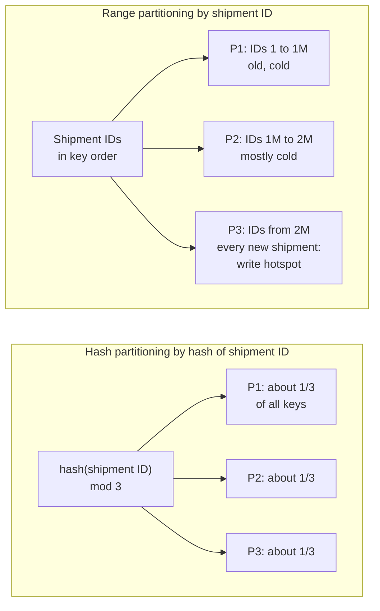
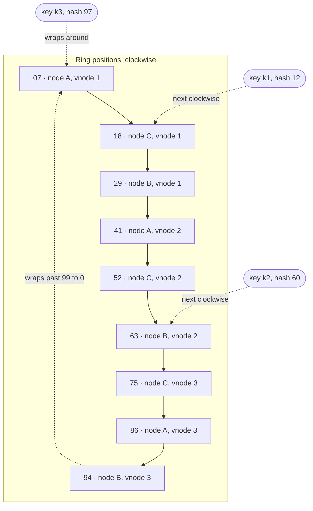
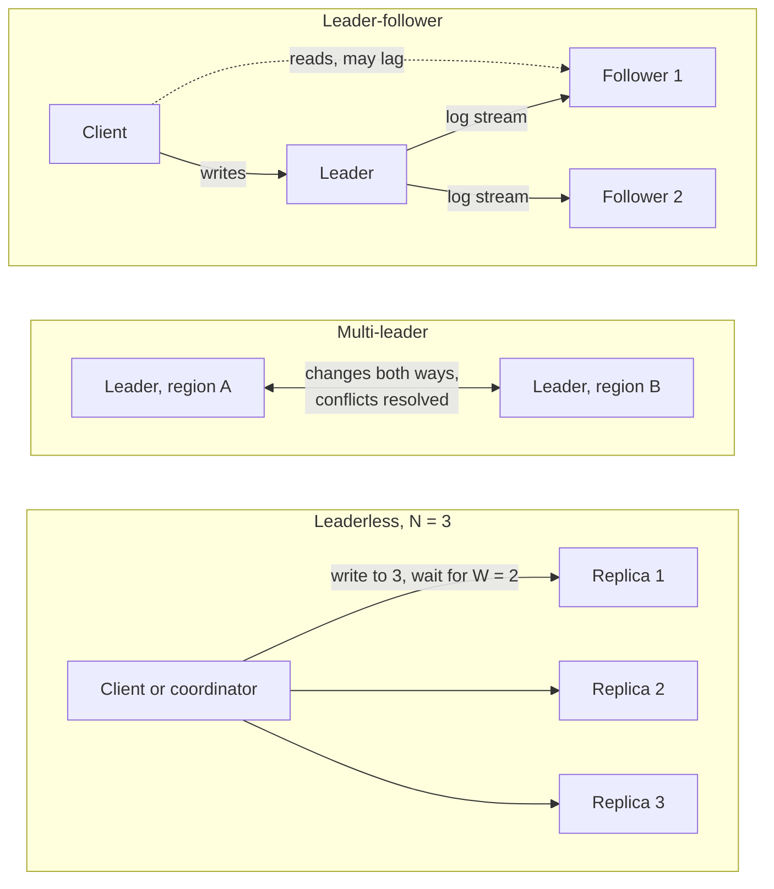
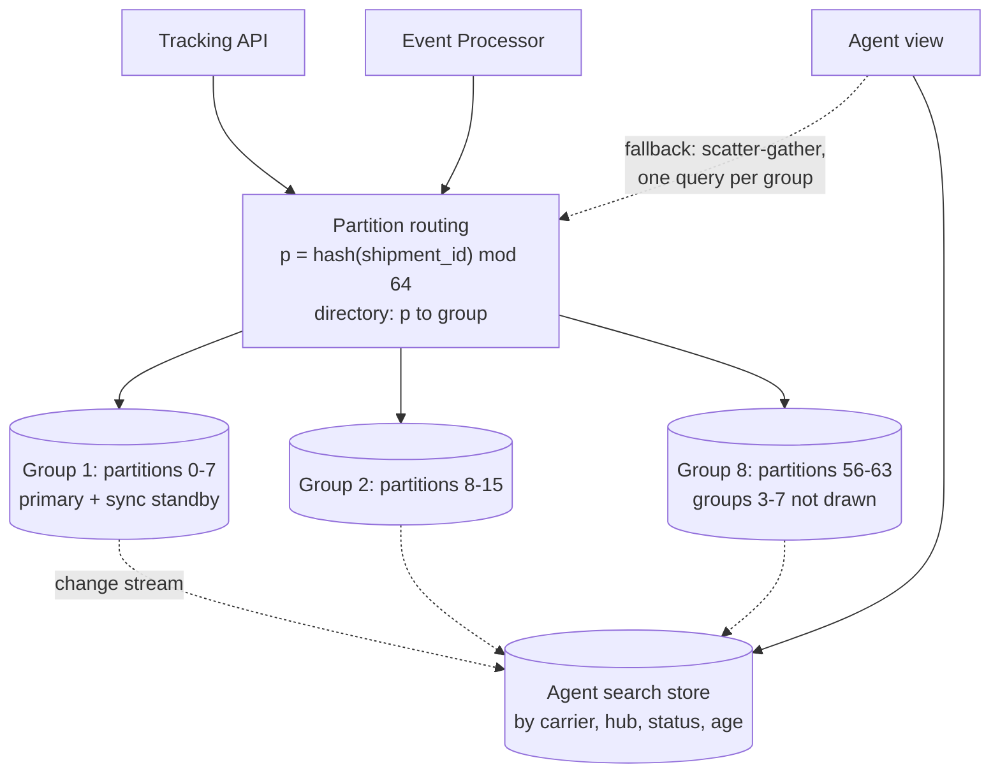

# Scaling, partitioning, and replication

> Scaling out a stateless service is a load balancer and a few more instances. Scaling out data
> means deciding which machine owns each record, how many copies exist, and what moves when the
> number of machines changes. Those three decisions are this page.

!!! abstract "Page facts"
    **Level:** Mixed (scaling and partitioning strategies are Level 1-2; partition-key design,
    rebalancing, hot-key mitigation, and replication topology are Level 3) · **Status:** Draft ·
    **Time:** 60-90 minutes · **Last verified:** 2026-11-20

## Learning objectives

After this page you should be able to:

- Explain why stateless services scale horizontally with little effort and stateful ones do not, and
  when vertical scaling is the better first move.
- Compare range, hash, and directory partitioning, predict the hotspots of each, and choose a
  partition key from a system's access patterns.
- Calculate how many keys move when a cluster grows under hash-mod-N, consistent hashing, and
  rendezvous hashing, and explain what virtual nodes add.
- Recognize hot partitions and hot keys and choose mitigations (salting, replicas, caching,
  splitting) with their costs.
- Compare leader-follower, multi-leader, and leaderless replication, and relate them to
  active-active, active-passive, data locality, and multi-region designs.
- Decide, with numbers, whether a data store needs partitioning at all.

## Prerequisites

- [Distributed systems fundamentals, time, and coordination](distributed-systems-fundamentals-time-and-coordination.md)
  — quorums, leases, and consensus are the machinery underneath replication and partition ownership.
- [Capacity estimation](../performance-and-scalability/capacity-estimation.md) — the Event Store's
  storage and write-rate numbers used in the worked example.
- [Relational databases and SQL internals](../databases-and-storage/relational-databases-and-sql-internals.md)
  — write-ahead log replication, read replicas, and partitioning inside one server.
- [High availability design](../reliability-and-disaster-recovery/high-availability-design.md) —
  failover, active-active and active-passive topologies, and multi-region trade-offs.

## The problem this solves

One machine has ceilings: CPU, memory, disk capacity, disk operations per second, and network
bandwidth. It is also one fault domain. Buying a bigger machine (vertical scaling) raises the
ceilings until the largest affordable machine is reached, and the price per unit of capacity usually
rises toward the top of the range. Beyond that, the only way forward is more machines, and for any
component that holds data, more machines raise three questions that a single machine never asks:
which machine holds a given record, how many copies of it exist and how they are kept in step, and
what happens to the data when a machine is added or removed. Answering them badly produces systems
that are slower, less available, and harder to change than the single machine they replaced, which
is why the first question on this page is always whether you need to partition at all.

## What it is

| Concept | Definition | What it buys | What it costs |
|---|---|---|---|
| Vertical scaling | A bigger machine for the same component | Simplicity: no code or data-model change | A hard ceiling, rising unit price, still one fault domain |
| Horizontal scaling | More machines sharing the work | Capacity that grows by adding nodes | Coordination, data placement, more failure cases |
| Partitioning (sharding) | Splitting a dataset so each record lives on one partition, with partitions spread over nodes | Write capacity and storage beyond one node | Cross-partition queries and transactions become expensive; rebalancing |
| Replication | Keeping copies of the same data on several nodes | Availability, durability, read capacity, locality | Copies can disagree (lag, conflicts); writes do more work |

Partitioning and replication are independent and almost always combined: each partition is
replicated, so a node typically leads some partitions and holds follower copies of others.

A note on vocabulary. In the distributed-systems literature "partition" and "shard" are used
interchangeably for a slice of data that can live on its own node. Relational database documentation
uses "partitioning" for splitting a table *inside one server* (as on the
[relational databases page](../databases-and-storage/relational-databases-and-sql-internals.md),
where the Event Store is range-partitioned by month for retention) and "sharding" for spreading data
*across servers*. This page means the distributed sense unless it says "inside one server". (A
*network* partition, from the fundamentals page, is an unrelated failure.)

## Mental model

Picture a large library that has outgrown its building. It can buy a bigger building (vertical),
or spread the collection across several (horizontal). If it shelves by author surname, A-F in
building 1 and so on, finding one author's books is easy, but a fashionable new author beginning
with M makes building 3 crowded (range partitioning and its hotspot). If it shelves by a code
computed from each title, every building is equally busy, but browsing one author's works means
visiting every building (hash partitioning). A catalogue desk that says which building holds each
book allows any arrangement, at the cost of asking the desk first (directory). Popular books get
photocopies in several buildings (replication), and a building that opens or closes means moving
shelves (rebalancing).

**Where the analogy breaks:** books do not change. Data does, so every copy must be kept in step and
copies can disagree. And a library can close for a weekend to move shelves; a production database
must move data while it is being read and written.

## Key terms

| Term | Meaning on this page |
|---|---|
| Stateless / stateful service | One that keeps no data between requests (any instance can serve any request) / one whose instances own data |
| Partition (shard) | A slice of a dataset that can be placed on its own node |
| Partition key | The attribute whose value decides a record's partition |
| Range / hash / directory partitioning | Placing records by key ranges / by a hash of the key / by looking the key up in a mapping table |
| Rebalancing | Moving partitions or keys between nodes when nodes are added, removed, or overloaded |
| Consistent hashing | Placing nodes and keys on a hash ring so a key belongs to the next node clockwise; adding a node moves only its share of keys |
| Virtual node (vnode) | One of many ring positions owned by the same physical node, used to even out load |
| Rendezvous hashing | Each key goes to the node with the highest hash of (key, node); also called highest random weight |
| Hot partition / hot key | A partition / single key receiving a disproportionate share of traffic (glossary: hot key) |
| Leader-follower replication | One leader accepts writes and streams them to followers (also single-leader, primary-replica) |
| Multi-leader replication | Several nodes accept writes and replicate to each other, resolving conflicts |
| Leaderless replication | Clients write to and read from several replicas directly, using quorums |
| Replication lag | How far a follower is behind its leader |
| Scatter-gather | Sending one query to every partition and merging the answers |
| Data locality | Keeping data near the computation and the users that need it, and related data together |

## How it works

### Stateless and stateful scaling

A **stateless** tier (the Tracking API instances, web servers, most workers) scales by adding
instances behind a load balancer. Load distribution is the only design question: round robin is
fine when requests are similar; least-outstanding-requests or "pick two at random, use the less busy"
copes better with uneven request costs and with a slow instance. The work to keep a tier stateless
is pushing state down: sessions into a shared store or a signed token, files into object storage,
caches into a shared cache.

A **stateful** tier (databases, caches, queues, search indexes) cannot just add an instance, because
the new instance owns nothing. Scaling it means placing data (partitioning), copying it
(replication), and routing each request to the instance that owns the data. Every one of those is
harder than adding a stateless instance, so the sensible order is: scale up first, add read
replicas for read load, cache, and partition only when writes or storage exceed what one primary can
hold with headroom. Many systems never reach the last step.

### Partitioning strategies

**Figure 1 — Range and hash partitioning of the same shipment IDs.** With sequential IDs, range
partitioning sends every new shipment to the last partition; hashing spreads them evenly.

How to read it: the top half keeps neighbours together (good for range scans) but concentrates
current activity; the bottom half spreads activity but scatters neighbours, so a range query must
visit every partition. The "mod 3" is over a fixed number of partitions; taking the modulus over the
number of *nodes* is the trap described under rebalancing below.

| Strategy | How a key is placed | Good at | Hotspot it creates |
|---|---|---|---|
| Range | Partition owns a contiguous key range; boundaries can be split | Range scans, ordered reads, time-series retention | Monotonic keys (timestamps, sequential IDs) send all writes to the newest range; popular ranges |
| Hash | Partition = function of hash(key) | Even spread of data and load for high-cardinality keys | Single hot keys (hashing cannot split one key); range queries become scatter-gather |
| Directory (lookup) | A mapping table says which partition holds each key or key group | Any placement: move a big tenant alone, pin data to a region | The directory itself: it must be fast, highly available, and consistent, and it is on every request's path unless cached |
| Composite | Hash on one part of the key, range on another | Spread by entity, order within it (a shipment's events by time) | Inherits the hash part's hot-key problem |
| List | Partition by an explicit value (region, tenant tier) | Data residency, isolation of large tenants | Skewed values: one region or tenant much larger than the others |

### Choosing a partition key from access patterns

The partition key is the most consequential and least reversible choice in a partitioned design.
Choose it from the queries, not from the data model:

1. **List the access patterns** with their rates and latency targets: which queries run, how often,
   and how fast they must be.
2. **Make the hottest, most latency-sensitive patterns single-partition.** The key should appear in
   every one of them, so each is answered by one partition.
3. **Keep together what is updated together.** A transaction or an ordering guarantee is cheap
   inside one partition and expensive across them.
4. **Prefer high cardinality and even load.** Many distinct values, none dominant in data size or
   traffic. Check the largest value, not the average.
5. **Check growth.** A key that is even today but skews as the business changes (one tenant grows
   100×) becomes a hot partition later.
6. **Accept that some patterns will be cross-partition** and plan for them explicitly: a secondary
   index partitioned by another key, a separate read store, or scatter-gather with its cost written
   down.

### Rebalancing, and why hash-mod-N is a trap

The obvious hash placement is `node = hash(key) mod N`. It spreads keys evenly, and it fails the
moment N changes. A key stays put only if `hash mod N` equals `hash mod (N+1)`. For uniformly
distributed hashes, that happens for only N of every N × (N+1) consecutive hash values, a fraction
of 1 ÷ (N+1). So the fraction of keys that **move** when going from N to N+1 nodes is

> moved = 1 − 1 ÷ (N+1) = N ÷ (N+1)

| Growth | Hash mod N: fraction moved | Ideal (only the new node's share): 1 ÷ (N+1) |
|---|---|---|
| 2 → 3 nodes | 2/3 ≈ 67% | 1/3 ≈ 33% |
| 4 → 5 nodes | 4/5 = 80% | 1/5 = 20% |
| 8 → 9 nodes | 8/9 ≈ 89% | 1/9 ≈ 11% |
| 10 → 11 nodes | 10/11 ≈ 91% | 1/11 ≈ 9% |

The larger the cluster, the closer to *all* keys move. For a cache that means the hit rate collapses
to near zero during a resize, sending the full read load to the database (a stampede, as on the
[caching page](../databases-and-storage/caching-architecture.md)); for a database it means copying
almost the entire dataset to add one node. Three families of placement avoid this:

- **Fixed number of partitions.** Create many more partitions than nodes (for example 64 or 256),
  compute `partition = hash(key) mod P` with P fixed forever, and assign whole partitions to nodes
  through a small directory. Adding a node moves a few whole partitions. This is mod-N done safely:
  the modulus never changes, only the partition-to-node map does.
- **Consistent hashing**, below.
- **Rendezvous hashing**, below.

### Consistent hashing with virtual nodes

Map the hash space onto a ring (for example 0 to 2³² − 1, wrapping around). Each node is hashed to a
position on the ring; each key is hashed too and belongs to the first node clockwise from it. When a
node joins, it takes over only the keys between its position and its counter-clockwise neighbour,
about 1 ÷ (N+1) of the keys; nothing else moves. When a node leaves, only its keys move, to its
clockwise neighbour.

With one position per node, the arcs between positions are very uneven, so some nodes own several
times their fair share, and a departing node dumps its whole load on a single neighbour. **Virtual
nodes** fix both: each physical node takes V positions. Its share becomes the sum of V small arcs,
which averages out; for randomly placed positions the relative spread of load across nodes is roughly
1 ÷ √V (an approximation from probability, not a guarantee), so V = 100 gives a spread of about 10%
where V = 1 gives about 100%. A departing node's V arcs go to many different neighbours, spreading
its load across the cluster. Nodes with more capacity can take more virtual nodes.

**Figure 2 — A hash ring with three nodes and three virtual nodes each.** Ring positions 0-99 are
illustrative. The ring is drawn unrolled: follow the arrows clockwise, and the last position wraps
to the first.

How to read it: a key belongs to the first position at or after its own hash. k1 (12) goes to node
C, k2 (60) to node B, and k3 (97) wraps to node A. If a node D joins with a virtual node at position
24, only keys hashing to 19-24 move (from B's vnode at 29 to D); k1, k2, and k3 stay where they are.

[Lab 08](../labs/lab-08-sharding-and-consistent-hashing.md) measures both properties (keys moved
and load spread) for mod-N and a ring with different numbers of virtual nodes. Jump consistent
hashing (Lamping and Veach, in the references) is a compact alternative when nodes are numbered
0 to N−1 and only added or removed at the end.

### Rendezvous hashing

**Rendezvous hashing** (highest random weight) needs no ring. For each key, compute a score for
every node, `score = hash(key, node)`, and place the key on the node with the highest score. Adding
a node moves a key only if the new node's score for it beats all the others, which happens for about
1 ÷ (N+1) of keys; removing a node moves only that node's keys, each to its own second-best node, so
the departing load spreads naturally across the cluster without virtual nodes. Taking the top *r*
scores gives *r* replica locations directly. The cost is computing N hashes per lookup, which is
negligible for tens or hundreds of nodes and is why it suits client-side selection of cache nodes or
storage targets; for very large node counts a ring with a sorted index is cheaper per lookup.

### Hot partitions and hot keys

Even placement of *keys* does not guarantee even *load*. A **hot partition** gets more than its share
because of skew in the key distribution (one tenant with most of the data), in time (a range
partition holding "now"), or in popularity. A **hot key** is the extreme case: one key's traffic
exceeds what one partition can serve, and no hash function can split it, because every request for
that key hashes to the same place.

| Mitigation | How it works | Cost |
|---|---|---|
| Key salting (splitting a key) | Write to `key#0` ... `key#(k−1)` chosen at random, spreading one key over k partitions | Every read of the key must fan out to k partitions and merge; ordering across salts is lost |
| Read replicas | More copies of the hot partition serve reads | Only helps reads; replicas lag |
| Caching | A cache in front absorbs repeated reads; a local in-process cache absorbs even the cache node's load | Staleness; see the viral-order case on the caching page |
| Splitting the partition | Divide a hot range at a new boundary and move half | Only helps a hot range, not a single hot key; needs a directory or range metadata update |
| Isolating the tenant | Move a large tenant to its own partition or cell via the directory | Operational overhead per isolated tenant |
| Per-key rate limiting | Cap the request rate for one key | Rejects legitimate traffic for that key |

Salting arithmetic, as an illustration: if a single key must absorb 1,000 writes/s and the team
wants no partition above 500 writes/s, salting with k = 4 puts about 250 writes/s on each of four
partitions, and every read of that key now costs four partition reads. Salting is worth it only for
keys known in advance to be hot, which is why most systems detect hot keys in metrics first and
apply it selectively.

### Replication topologies

**Figure 3 — Three replication topologies.** Leader-follower: one writer. Multi-leader: several
writers that exchange changes. Leaderless: the client (or a coordinator) talks to several replicas
directly.

How to read it: count the arrows that accept writes. One in leader-follower (no write conflicts,
but the leader is a bottleneck and needs failover); two in multi-leader (writes anywhere, conflicts
possible); in leaderless every replica accepts writes and the quorum overlap (W + R > N, as on the
[fundamentals page](distributed-systems-fundamentals-time-and-coordination.md)) is what makes reads
see recent writes.

| Topology | Writes go to | Conflicts | Failure handling | Typical use |
|---|---|---|---|---|
| Leader-follower | One leader per dataset or per partition | None (single writer orders everything) | Failover: detect, fence, promote a follower | Relational databases, most partitioned stores, AtlasMart's Event Store |
| Multi-leader | Any leader (usually one per region or site) | Yes: concurrent writes to the same record must be merged or one discarded | A leader's region can fail without stopping writes elsewhere | Multi-region writes, offline-capable clients, collaborative editing |
| Leaderless | Several replicas directly, with quorums | Yes, detected with version vectors; resolved by the application or last-writer-wins | No failover: a quorum of reachable replicas is enough; read repair and background anti-entropy fix stale replicas | Highly available key-value stores |

**Synchronous or asynchronous** is a separate choice within each topology: a synchronous follower
must confirm before the write is acknowledged (no loss on failover, slower writes, and writes stall
if it is unreachable); an asynchronous one lags and can lose the unshipped tail. **Replication lag**
is what readers of followers see: a customer who writes and then reads from a lagging follower may
not see their own write. The guarantees that tame this (read-your-writes, monotonic reads) belong to
[consistency models](consistency-models-cap-and-pacelc.md), and
[Lab 09](../labs/lab-09-replication-lag.md) makes the lag visible.

**Active-passive and active-active** (glossary terms; see the
[HA page](../reliability-and-disaster-recovery/high-availability-design.md)) describe which copies
serve traffic. Leader-follower with failover is active-passive for writes, even when followers serve
reads. Active-active for writes needs multi-leader or leaderless replication, or partitions whose
leaders are spread across sites, so that each site is active for its own share of the data.

### Distributed caching

A cache cluster is a partitioned, usually replicated, store whose data can be lost. Clients or a
proxy place keys on cache nodes by consistent or rendezvous hashing, precisely so that adding or
losing a node invalidates only that node's share rather than the whole cache; each node may have a
replica so that a node failure does not cause a miss storm. AtlasMart's Status Cache is a single
primary with a replica in another zone (HA page): its whole working set fits one node, so it is
replicated but not partitioned, which is the right answer until it no longer fits.

### Data locality and multi-region distribution

**Data locality** has two meanings, both about avoiding the network. First, keep related data in the
same partition, so the common query or transaction touches one node: all events of one shipment
together, not spread by event ID. Second, keep data near the users and the computation that use it:
same zone for the service and its database, same region for users and their data.

**Multi-region distribution** extends locality across geography. The main options:

- **One writer region, read replicas elsewhere.** Simple; remote reads are fast but stale by the
  replication lag; writes from remote users pay the cross-region round trip.
- **Geo-partitioning.** Each record has a home region (by customer or tenant) and is written and
  read there, with copies elsewhere only for disaster recovery. Fast local reads and writes, and a
  natural fit for data-residency rules; a user who travels or a query across regions is the cost.
- **Multi-leader across regions.** Writes anywhere, with conflict resolution and asynchronous
  replication between regions.

The [HA page](../reliability-and-disaster-recovery/high-availability-design.md) covers when a second
region is justified at all; for AtlasMart's 99.9% target it is not, and everything below stays in
one region.

## Worked example: when does AtlasMart partition the Tracking Event Store?

### Part 1 — Today: a single primary is fine for years

From the [capacity page](../performance-and-scalability/capacity-estimation.md) and the
[relational databases page](../databases-and-storage/relational-databases-and-sql-internals.md):

| Quantity | Value | Derivation |
|---|---|---|
| Raw events | 240 MB/day | 480,000 events/day × 500 B |
| Storage per year, all copies | about 394 GB | 240 MB × 3 copies × 1.5 index overhead × 365 |
| Per copy, 13-month retention | about 143 GB | 430 GB steady state ÷ 3 copies |
| Per copy, end of year two (30% growth) | about 200 GB | 600 GB ÷ 3 |
| Peak writes | 70 events/s (90 in year two) | NFR-4 and growth |
| Peak reads reaching the store | at most 210/s (270 in year two) | Pessimistic: every read misses the cache |

Every number is in the tens or hundreds: hundreds of writes per second at most, a few hundred
gigabytes per copy. That is comfortably inside what a single relational primary on modest hardware
handles (the exact ceiling depends on hardware and configuration and should be measured, not quoted).
Read growth has cheaper answers than partitioning: the cache and a read replica, which the support
reports already use. Retention is handled by time-range partitions *inside* the one server (monthly in
this example; AtlasMart later chose weekly partitions, see [Advanced database architecture](../databases-and-storage/advanced-database-architecture.md)).

How far away is the limit? At 30% growth a year, a 10× increase takes ln 10 ÷ ln 1.3 ≈ 8.8 years,
and a 50× increase ln 50 ÷ ln 1.3 ≈ 14.9 years. **Decision: do not partition across servers.** Write
down the triggers that would reopen it, so the decision is revisited on evidence rather than fashion:

- Peak write rate approaching an agreed fraction of the measured primary capacity after vertical
  scaling.
- Restore time for one copy approaching NFR-7's RTO of 1 hour. Restore time grows with data size and
  usually becomes the binding limit before CPU does, so measure restore throughput and recompute
  yearly.
- A new requirement that changes the shape of the data (for example, multi-region writes).

### Part 2 — A hypothetical 50× growth

Suppose AtlasMart opens its tracking platform to marketplace sellers and partner retailers and
volume grows 50× (an assumption for this exercise, not a forecast):

- Writes: 70 × 50 = **3,500 events/s** at peak.
- Reads: 210 × 50 = **10,500 reads/s** at peak, pessimistically all reaching the store.
- Storage per copy: 143 GB × 50 ≈ **7.2 TB** at 13-month retention; about 21.5 TB across three
  copies.

The team sets its own per-shard-group limits (assumptions chosen for restore time and headroom, not
product limits): at most **500 writes/s at peak** and **1 TB per copy** per shard group, each group
being a primary with a synchronous standby, as today.

- Groups for writes: 3,500 ÷ 500 = 7. Groups for storage: 7.2 ÷ 1 = 7.2, so 8.
- **8 shard groups**: about 3,500 ÷ 8 ≈ 440 writes/s and 7.2 ÷ 8 = 0.9 TB per copy each. Reads,
  about 10,500 ÷ 8 ≈ 1,300/s per group, are served by each group's primary plus asynchronous read
  replicas, sized by measurement.

**Choosing the key from access patterns:**

| Access pattern | Rate at 50× | Needs |
|---|---|---|
| Customer views one shipment's status and timeline | Up to 10,500/s | Shipment ID |
| Event Processor appends an event, in order per shipment | Up to 3,500/s | Shipment ID, with the shipment's sequence number in the same transaction |
| Customer lists their own shipments | Much lower (assumption) | Customer ID |
| Support agent searches by carrier, hub, status, and age | Low rate, heavy queries | Carrier, status, time |
| Retention: drop months older than 13 | Monthly | Time |

**Shipment ID** wins: the two highest-rate patterns become single-partition, and the per-shipment
sequence number from the [fundamentals page](distributed-systems-fundamentals-time-and-coordination.md)
stays inside one transaction on one node. The rejected candidates each create a hot partition:
customer ID concentrates a large marketplace seller on one partition; carrier ID has a handful of
values and the largest carrier dominates; time sends all current writes to the newest partition.
Inside each group, the monthly range partitions for retention remain, so the layout is composite:
hash by shipment ID across servers, range by month within each.

**Placement:** a fixed **64 logical partitions**, `partition = hash(shipment_id) mod 64`, with a
small directory mapping partitions to groups (8 per group), kept in a consensus-backed configuration
store and cached by every client. Growing from 8 to 9 groups moves about 7 whole partitions (64 ÷ 9
≈ 7.1 per group), about 7 ÷ 64 ≈ 11% of the data, or roughly 0.8 TB per copy. Had the team used
`hash(shipment_id) mod 8` on the groups directly, the same growth would move 8 ÷ 9 ≈ 89% of keys,
about 6.4 TB per copy, while serving production traffic.

**Figure 4 — The Event Store at 50×.** Services route by shipment ID through the directory; the
agent view reads a separate search store fed from every group, with scatter-gather as the fallback.

How to read it: solid arrows are the request path; dotted arrows are asynchronous feeds or the
fallback. Customer and processor traffic always reaches exactly one group.

**The cost of the cross-partition agent view.** "All shipments for carrier X at hub Y with no scan
for 48 hours" contains no shipment ID, so on the partitioned store every group must answer:

- **Work:** one query per group, 8 queries per agent search. If 300 agents (an assumption at this
  scale) each run one search a minute, that is 5 searches/s and 40 group queries/s, each an index
  scan, not a key lookup.
- **Latency:** the merged answer waits for the slowest group. If each group answers within its p99
  (assume 100 ms) 99% of the time, the chance that at least one of 8 is slower is
  1 − 0.99⁸ ≈ 7.7%, so roughly one search in 13 sees some group's tail. Querying the 64 logical
  partitions separately would make it 1 − 0.99⁶⁴ ≈ 47%, which is why the fan-out is per group, not
  per partition.
- **Paging:** "the 50 oldest stuck shipments" needs the 50 oldest from *each* group, 400 rows merged
  to return 50, and deeper pages get worse.

The design therefore moves the agent view to a **separate search store** fed by change data capture
from every group (a read model, in CQRS terms), queried once per search. It lags by seconds, which
support already accepts today ("as of a few seconds ago" on the read replica). Scatter-gather remains
as a fallback when the search store is unavailable. The customer's "my shipments" list gets the same
treatment on a smaller scale: a customer-to-shipments index partitioned by customer ID, updated
asynchronously from the events, or delegated to the Order Management System, which already owns
orders per customer.

The lesson of the example is in Part 1: the right answer for AtlasMart today is no partitioning, a
documented trigger, and a partition key chosen in advance, so that the expensive design in Part 2 is
ready if the business ever needs it.

## Real-world architecture example

Most managed distributed databases and key-value services combine the mechanisms on this page in the
same way: data is hash- or range-partitioned into many more partitions than nodes; each partition is
replicated with its own leader chosen by consensus; a metadata service (the directory) records which
nodes host which partitions and moves partitions to rebalance; and the client library caches the map
and refreshes it when it is told it reached the wrong node. Dynamo-style stores use a consistent
hashing ring with virtual nodes and leaderless quorums instead. Cache clusters place keys with
consistent hashing in the client or a proxy. Global databases add geo-partitioning so that each row
has a home region. The architect's work is rarely to implement any of this; it is to choose the
partition key, predict hot keys, and decide which queries are allowed to be cross-partition, because
those are application decisions no database makes for you.

## Design choices and trade-offs

| Choice | Favor when | Avoid when |
|---|---|---|
| Vertical scaling first | Load fits the largest affordable machine with headroom; time-to-market matters | You are near the largest size, or one fault domain is unacceptable |
| Read replicas before partitioning | Reads dominate and tolerate lag | Writes or storage are the bottleneck |
| Range partitioning | Range scans and time-based retention dominate; keys are not monotonic, or writes are spread across ranges | Keys are timestamps or sequential IDs and writes are heavy |
| Hash partitioning | Key lookups dominate; keys are high-cardinality | Range queries on the key are common |
| Directory partitioning | Tenants or keys vary widely in size; you need to move or pin individual tenants | The directory cannot be made highly available and cached |
| Fixed partitions with a directory | You expect to grow the node count; you want predictable moves | The data is small enough that one node will do for years |
| Consistent hashing with virtual nodes | Nodes join and leave often (caches, peer-to-peer stores) | A fixed partition count with a directory is simpler for your store |
| Rendezvous hashing | Clients choose among tens to hundreds of nodes; you want top-r replicas without a ring | Very large node counts per lookup |
| Leader-follower | Writes must not conflict; one region | Writes must be accepted in several regions during a partition |
| Multi-leader or leaderless | Write availability across sites matters more than a single order | The data cannot tolerate conflict resolution (balances, inventory counts) |

## Failure modes and anti-patterns

- **Partitioning too early.** A distributed store chosen "for scale" at tens of writes per second.
  Detect: cross-partition queries and operational burden with no load to justify them. Prevent: the
  Part 1 arithmetic and written triggers.
- **Hash mod N on nodes.** Detect: a resize that moves almost all data or empties a cache. Prevent:
  fixed partitions, consistent hashing, or rendezvous hashing.
- **Monotonic partition key.** Detect: one partition's write rate far above the others, always the
  newest. Prevent: hash the key, or prefix it with a hashed component.
- **Low-cardinality or skewed key.** Detect: partition size and traffic histograms with a long tail.
  Prevent: check the largest value before choosing; isolate big tenants via a directory.
- **Unplanned scatter-gather.** A frequent query without the partition key fans out to every
  partition. Detect: per-query partition counts in tracing. Prevent: a secondary index or read model
  for that pattern.
- **Cross-partition transactions by accident.** Detect: distributed locks or two-phase commits in hot
  paths. Prevent: key choice that keeps transactional units together; sagas where it cannot.
- **Reading your own write from a lagging replica.** Detect: users reporting that saved changes
  "disappear" briefly. Prevent: route read-after-write to the leader or wait for the replica to
  catch up.
- **Silent conflicts in multi-leader setups.** Last-writer-wins drops writes without error. Prevent:
  avoid multi-leader for data that cannot be merged; use version vectors and explicit merge rules.
- **Directory as a single point of failure.** Prevent: replicate it with consensus and cache it in
  clients, so data-plane requests keep working while it is briefly unavailable (static stability).

## Security considerations

- **Partitioning can enforce isolation.** Placing each large tenant in its own partition or cell
  limits the blast radius of a bug or a breach; a shared partition relies entirely on correct
  query filters.
- **Every replica and partition is a copy of the data.** Encryption at rest, access control, and
  backup policies must cover all of them, including read replicas used for reporting and the search
  store fed by change data capture, which often escape the review given to the primary.
- **Data residency.** Multi-region replication can move personal data across borders; geo-partitioning
  with a home region per customer is often the compliant design. AtlasMart's NFR-6 (no delivery
  addresses stored) keeps the tracking data low-risk, but the rule must hold in every copy.
- **The directory and partition map are high-value targets.** Whoever can change them can redirect
  traffic or data; protect them like configuration of the database itself.
- **Hot keys can be induced.** An attacker who requests one key at a high rate creates a hot key on
  purpose; per-key rate limits and caches in front of the store are defences.

## Performance, reliability, and cost

- **Performance:** single-partition operations scale almost linearly with partitions; cross-partition
  operations scale with the slowest partition and get worse as the partition count grows (the
  1 − 0.99ⁿ arithmetic). Synchronous replication adds a round trip to every write; asynchronous
  replication adds lag to every follower read.
- **Reliability:** more nodes mean more failures in absolute terms; replication per partition is what
  turns them into non-events. Rebalancing is itself a risk: throttle data movement so it does not
  starve production traffic, and prefer moving whole partitions over rehashing.
- **Cost:** every replica multiplies storage and often compute; every partition adds a primary and its
  standby. At 50× the example's 8 groups imply 16 database nodes before read replicas, against 2
  today. Partition only when the numbers require it, and spend the saved effort on the triggers that
  tell you when they will.

## Hands-on lab: compare hash-mod-N with a consistent-hash ring

The full exercise is [Lab 08: sharding and consistent hashing](../labs/lab-08-sharding-and-consistent-hashing.md),
a Python script that runs locally with the standard library. In summary:

1. Generate a large set of synthetic keys (shipment-ID-like strings) and place them on N nodes with
   `hash(key) mod N`; record each node's share.
2. Add one node and count how many keys changed node; compare with N ÷ (N+1).
3. Place the same keys on a consistent-hash ring with one virtual node per physical node; add a node
   and count keys moved; compare with 1 ÷ (N+1).
4. Repeat with more virtual nodes per physical node (for example 10, 100, 200) and record the spread
   of load between the most and least loaded nodes.
5. Stretch: implement rendezvous hashing in a few lines and measure the same two numbers.

??? question "Hint: what to expect"
    Mod-N moves close to N ÷ (N+1) of keys (about 89% going from 8 to 9 nodes); the ring moves close
    to 1 ÷ (N+1) (about 11%). With one virtual node per physical node the busiest node can own
    several times the least busy node's share; the spread narrows as virtual nodes increase, roughly
    with the square root of their number. Use a stable hash such as one from `hashlib`, not Python's
    built-in `hash()`, which is randomized per process for strings.

## Knowledge check

1. A cache cluster grows from 4 to 5 nodes. What fraction of keys move under hash mod N, and under
   consistent hashing? What does the first number mean for the database behind the cache?
2. Why does range partitioning by order creation time produce a write hotspot, and what key change
   avoids it while keeping time-based retention?
3. One key needs 2,000 writes/s and no partition should exceed 500. What salting factor do you need,
   and what does it cost readers?
4. A leaderless store uses N = 3, W = 2, R = 1. Can a read miss the latest acknowledged write? Why?
5. The Tracking API scales by adding instances; the Event Store does not. Explain the difference and
   name the first three levers you would use for the Event Store before partitioning it.

??? success "Answers"
    1. Mod-N moves 4/5 = 80%; consistent hashing about 1/5 = 20%. With mod-N, 80% of cache lookups
       miss right after the resize, so the database briefly receives most of the read load, a
       stampede.
    2. All new rows have the newest timestamps and land in the last range. Hash-partition by an entity
       key (for example shipment ID) across servers and keep time-range partitions within each server
       for retention (composite partitioning).
    3. k = 2,000 ÷ 500 = 4. Every read of that key must query 4 partitions and merge the results, and
       ordering across the salts is lost.
    4. Yes. W + R = 3, not greater than N = 3, so the single replica read may be one the write did
       not reach. R = 2 (or W = 3) restores overlap.
    5. API instances hold no data, so a new instance can serve any request at once; the Event Store
       owns data, so adding a node means placing, copying, and routing data. Levers first: scale the
       primary up, add read replicas for read load, and cache; partition only when writes or storage
       exceed one primary with headroom.

## Architecture discussion questions

1. AtlasMart's marketplace plan (Part 2) includes one seller expected to generate 20% of all
   shipments. Does shipment-ID hashing still balance load? What changes if the agent view is
   per-seller instead of per-carrier?
2. A regulator requires that tracking data for customers in a new country stay in that country.
   Compare a separate deployment, geo-partitioning with a home region per customer, and a
   multi-leader setup, with their effect on the agent view and on NFR-7.
3. The team proposes a distributed SQL database "so we never have to think about sharding". Using the
   Part 1 numbers, argue when that is a good trade and what it does not remove (key choice, hot
   keys, cross-partition queries).

## Summary

Stateless tiers scale by adding instances; stateful tiers need partitioning, replication, and
routing, so scale up, replicate for reads, and cache first. Range partitioning keeps neighbours
together and creates hotspots on monotonic keys; hash partitioning spreads load and turns range
queries into scatter-gather; directories allow any placement at the cost of a critical lookup.
Choose the partition key from access patterns so the hottest operations are single-partition.
Hash-mod-N moves about N ÷ (N+1) of keys on growth; fixed partitions, consistent hashing with
virtual nodes, and rendezvous hashing move about 1 ÷ (N+1). Hot keys need salting, replicas, caches,
or isolation. Leader-follower avoids conflicts; multi-leader and leaderless trade conflicts for write
availability across sites. For AtlasMart, the arithmetic says a single primary is fine for years,
and a shipment-ID key with 64 fixed partitions is the plan if 50× growth ever arrives.

## Related topics

- **Before:** [Distributed systems fundamentals](distributed-systems-fundamentals-time-and-coordination.md);
  [Capacity estimation](../performance-and-scalability/capacity-estimation.md);
  [Relational databases and SQL internals](../databases-and-storage/relational-databases-and-sql-internals.md)
- **Alongside:** [Consistency models, CAP, and PACELC](consistency-models-cap-and-pacelc.md) —
  what replicas promise readers; [Resilience mechanics](resilience-mechanics-timeouts-retries-and-backpressure.md)
  — keeping a slow partition from spreading; [High availability design](../reliability-and-disaster-recovery/high-availability-design.md)
  — failover and multi-region; [Caching architecture](../databases-and-storage/caching-architecture.md)
  — hot keys and cache topology; the [distributed cache exercise](../system-design-exercises/distributed-cache.md);
  [Lab 08](../labs/lab-08-sharding-and-consistent-hashing.md); [Lab 09](../labs/lab-09-replication-lag.md).
- **Planned:** advanced database architecture, including distributed SQL, change data capture, and
  low-downtime migration (D06-T03); scaling and optimization techniques (D14-T02); advanced
  resilience and failure containment (D13-T04).

## References

| Source | Type | Checked |
|---|---|---|
| David Karger, Eric Lehman, Tom Leighton, Rina Panigrahy, Matthew Levine, and Daniel Lewin, ["Consistent Hashing and Random Trees: Distributed Caching Protocols for Relieving Hot Spots on the World Wide Web"](https://www.cs.princeton.edu/courses/archive/fall09/cos518/papers/chash.pdf), STOC 1997 | Paper (university course copy) | 2026-11-20 |
| David G. Thaler and Chinya V. Ravishankar, "Using Name-Based Mappings to Increase Hit Rates", IEEE/ACM Transactions on Networking 6(1), 1998 | Paper (rendezvous hashing; cited without a link) | 2026-11-20 |
| Giuseppe DeCandia et al., ["Dynamo: Amazon's Highly Available Key-value Store"](https://www.allthingsdistributed.com/files/amazon-dynamo-sosp2007.pdf), SOSP 2007 | Paper (ring with virtual nodes, leaderless quorums) | 2026-11-20 |
| John Lamping and Eric Veach, ["A Fast, Minimal Memory, Consistent Hash Algorithm"](https://arxiv.org/abs/1406.2294), 2014 | Paper (jump consistent hash) | 2026-11-20 |
| [Sharding pattern](https://learn.microsoft.com/en-us/azure/architecture/patterns/sharding) — Microsoft Azure Architecture Center | Official documentation (lookup, range, and hash strategies) | 2026-11-20 |
| [PostgreSQL documentation: High Availability, Load Balancing, and Replication](https://www.postgresql.org/docs/current/high-availability.html) | Official documentation | 2026-11-20 |
| Colm MacCárthaigh, ["Workload isolation using shuffle-sharding"](https://aws.amazon.com/builders-library/workload-isolation-using-shuffle-sharding/) — Amazon Builders' Library | Vendor engineering article (partitioning for isolation) | 2026-11-20 |
| Martin Kleppmann, *Designing Data-Intensive Applications* (O'Reilly, 2017), chapters 5 "Replication" and 6 "Partitioning" | Book | 2026-11-20 |

## Review notes

- Canonical page for D04-T05. Covered in depth: stateless vs stateful scaling, partitioning
  strategies, partition-key choice, rebalancing and hash-mod-N, consistent hashing with virtual
  nodes, rendezvous hashing, hot partitions and hot keys, leader-follower vs multi-leader vs
  leaderless replication. Covered more briefly (definition plus a paragraph or table row):
  horizontal vs vertical scaling, load distribution (balancing algorithms named only), active-active
  and active-passive (pointed to the HA page), distributed caching (pointed to the caching page),
  data locality and multi-region distribution (options listed; the HA page owns the decision).
  Shuffle sharding appears only as a reference.
- The Thaler and Ravishankar paper is cited without a link: the university technical-report copy
  found returned HTTP 200 but its text could not be extracted to confirm it is the right document. A
  reviewer may add a stable link.
- The 1 ÷ √V load-spread figure is an approximation for randomly placed virtual nodes, stated as such;
  Lab 08 should confirm it empirically.
- New AtlasMart assumptions introduced here: the 50× marketplace scenario (3,500 events/s, 10,500
  reads/s, about 7.2 TB per copy); per-shard-group limits of 500 writes/s and 1 TB per copy; 64
  logical partitions in 8 groups; 300 agents each running one search a minute at 50×; a 100 ms p99
  per group for the agent query; the customer-to-shipments index. The derived growth horizons (8.8
  years to 10×, 14.9 years to 50× at 30% a year) follow from the capacity page's growth assumption.
- Terminology: this page uses "partition" in the distributed sense and says so explicitly, to avoid
  contradicting the relational databases page, where partitioning means inside one server.
- Figure 2 draws the ring unrolled as a vertical chain because Mermaid has no circular layout; check
  that it reads clearly in the browser. Figure 3 stacks three subgraphs with `~~~` links.
- Lab 08 and Lab 09 are being written in parallel; the lab summary describes Lab 08's intended scope
  from the batch brief and should be checked against the finished lab.
