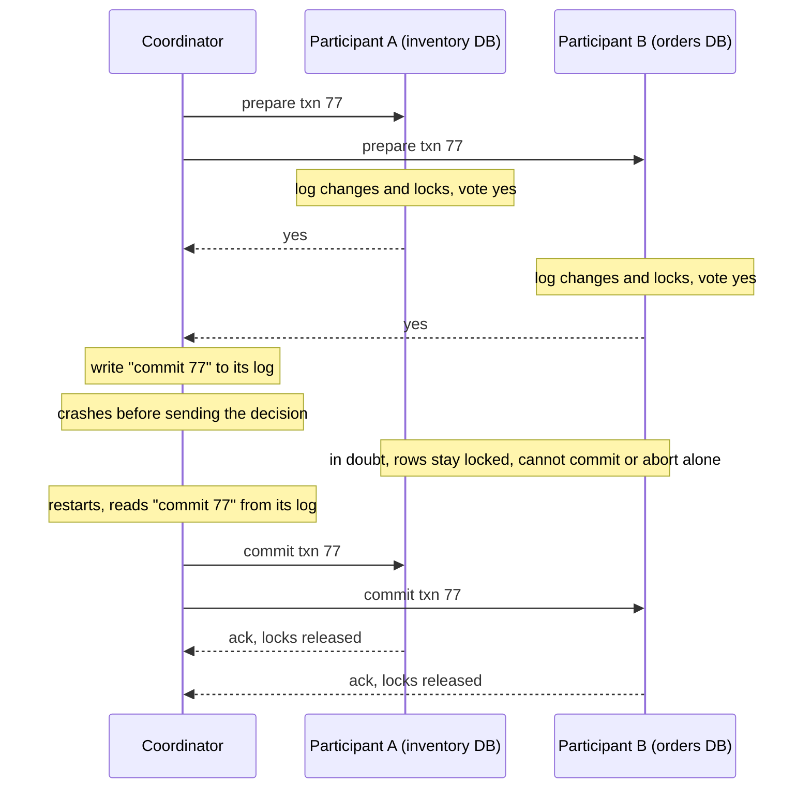
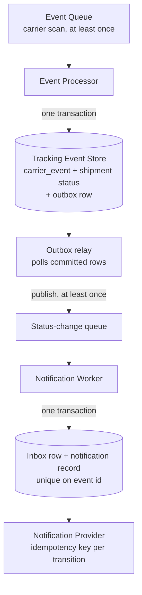
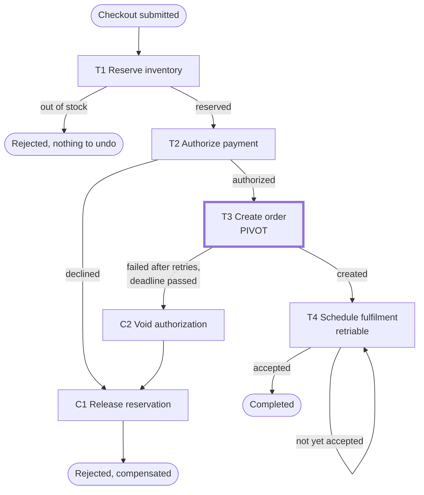

# Transactions, sagas, and delivery guarantees

> One business operation that spans several services cannot be one ACID transaction. You either
> coordinate a single commit (two-phase commit, which can block) or run a saga of local transactions
> with compensations; either way, messages move at least once and every consumer must be idempotent.

!!! abstract "Page facts"
    **Level:** Intermediate (ACID, delivery guarantees, and idempotency are Level 1-2; saga design,
    pivot placement, and isolation countermeasures are Level 3) · **Status:** Draft · **Time:** 60-90
    minutes · **Last verified:** 2026-11-20

## Learning objectives

After this page you should be able to:

- Explain what ACID guarantees inside one database and why the guarantee ends at its boundary.
- Explain why two-phase commit blocks when its coordinator fails, where it is still used, and why
  three-phase commit rarely replaces it.
- Design a saga: choose choreography or orchestration, write semantically correct compensations,
  place the pivot transaction, and counter the isolation anomalies sagas allow.
- Remove dual writes with a transactional outbox, and duplicates with an inbox or idempotent
  consumer.
- State honestly what "exactly-once" can mean, and design effectively-once processing.

## Prerequisites

- [Distributed systems fundamentals, time, and coordination](distributed-systems-fundamentals-time-and-coordination.md)
  — partial failure and "a timeout is not a failure" are the root of everything here.
- [Consistency models, CAP, and PACELC](consistency-models-cap-and-pacelc.md) — the inventory
  reservation used in the checkout saga is the linearizable decrement designed there.
- [Message queues and brokers](../messaging-and-streaming/message-queues-and-brokers.md) — acks,
  redelivery, and the delivery-guarantee table this page builds on.

## The problem this solves

An AtlasMart checkout touches four owners of data: Inventory reserves stock, Payments asks an
external payment provider to authorize the card, the Order Management System (another team's
system) creates the order, and Fulfilment schedules picking. Each has its own database; the payment
provider is another company. No single transaction wraps them, and three things go wrong.
**Partial completion:** a card authorized with no order, or an order for stock never reserved. **Dual writes:** a service saves its state and then fails to
publish the event that tells others, or publishes an event for a change it then rolls back.
**Duplicates:** a retry after a timeout charges, reserves, or notifies twice. This page is the set of
mechanisms that make each of those impossible or harmless.

## What it is

A **transaction** is a group of operations that the system treats as one unit. Inside one database
the unit has the **ACID** properties. Across services you choose between two families of mechanism,
and you always need a third:

| Mechanism | What it guarantees | What it costs |
|---|---|---|
| Local ACID transaction | All-or-nothing, isolated, durable change within one database | Nothing extra, but only within that database |
| Two-phase commit (2PC) | All participants commit or all abort | Participants block (holding locks) if the coordinator fails at the wrong moment; every participant must be up |
| Three-phase commit (3PC) | Atomic commit without blocking, under a synchronous network with no partitions | An extra round trip; unsafe under partitions |
| Saga | Every step completes, or completed steps are compensated, eventually | No isolation between sagas; compensations to design and test |
| Transactional outbox | A state change and the event announcing it are committed together | A relay process; events are published at least once |
| Inbox or idempotent consumer | Duplicate messages have no extra effect | A deduplication record per message, kept long enough |

The four ACID properties, briefly: **atomicity** (all of the transaction's changes happen or none
do), **consistency** (a transaction moves the data from one state that satisfies the application's
invariants and constraints to another; not the same "consistency" as on the consistency-models
page), **isolation** (concurrent transactions do not see each other's partial work, to the degree set
by the isolation level), and **durability** (a committed change survives a crash).

## Mental model

A travel agent books a flight, a hotel, and a car for one trip. **Two-phase commit** is asking all
three to put a hold on, then phoning back with "confirm all" or "release all". If the agent falls ill
after the holds are placed, the airline, hotel, and rental desk each sit on a held seat, room, and
car, unable to sell or release them, until the agent recovers. A **saga** books each one for real in
turn; if the car is unavailable, the agent cancels the hotel and the flight. Cancellations are not
undo (a fee, a record, an apology email): that is "semantically reversible". The **pivot** is sending
the customer the itinerary: before it, cancelling is routine; after it, problems are fixed forwards.

**Where the analogy breaks:** a crashed process remembers only what it wrote durably, so saga progress
must live in a database, not memory. And networks duplicate messages, so every booking and
cancellation must recognize a repeat.

## Key terms

| Term | Meaning on this page |
|---|---|
| ACID | Atomicity, consistency, isolation, durability: the guarantees a transactional database gives to a group of operations |
| Distributed transaction | One transaction whose changes span several independent resource managers (databases, brokers) |
| Two-phase commit (2PC) | A protocol in which a coordinator collects prepare votes from all participants, then tells all to commit or all to abort |
| Three-phase commit (3PC) | 2PC with an extra pre-commit phase so participants can decide without the coordinator, under strong timing assumptions |
| Saga | A sequence of local transactions in which each step has a compensating transaction run if a later step fails |
| Compensating transaction | A new transaction that semantically reverses an earlier step's business effect (void, release, cancel) |
| Pivot transaction | The saga step after which the saga will always complete forwards; steps before it are compensatable, steps after it retriable |
| Choreography / orchestration | Saga coordination by services reacting to each other's events, or by a central orchestrator issuing commands |
| Semantic lock | An application-level marker (a status such as PENDING) telling others a record is mid-saga |
| Dual write | Updating a database and a broker (or two stores) in separate operations, so one can succeed without the other |
| Transactional outbox | Writing an outgoing event to a table in the same transaction as the state change, with a relay publishing it afterwards |
| Inbox | A table of processed message identifiers written in the same transaction as the consumer's state change |
| Idempotency | Doing an operation more than once has the same effect as doing it once; an idempotency key identifies the operation |
| At-most-once / at-least-once / exactly-once | Delivery guarantees: may lose, may duplicate, or neither; exactly-once end to end needs idempotent or transactional consumers |

## How it works

### Step 1 — ACID inside one database, and where it stops

A relational database implements atomicity and durability with a write-ahead log: changes are
recorded in the log and flushed before the commit is acknowledged, so a crash either replays or
discards the whole transaction. Isolation comes from locks or multiversion snapshots; most databases
default to a weaker level than serializable (PostgreSQL defaults to read committed), so "inside a
transaction" does not by itself mean "no anomalies". The
[relational databases page](../databases-and-storage/relational-databases-and-sql-internals.md)
covers the mechanics.

The guarantee covers only what that database's log covers. A message broker, another service's
database, and an external API are outside it. A transaction that writes a row and then sends a
message has two separate outcomes, and a crash between them leaves one without the other. You can
either make several resource managers commit as one (2PC) or accept independent commits and design
for the intermediate states (sagas plus reliable messaging).

### Step 2 — Two-phase commit, and why it blocks

In **two-phase commit**, a **coordinator** runs the transaction across **participants**:

1. **Prepare.** The coordinator asks each participant to prepare. A participant does the work,
   durably records everything needed to commit (including that it holds the locks), and votes yes, or
   votes no and aborts. A yes vote is a promise: from now on the participant may not abort on its own.
2. **Commit or abort.** If every vote is yes, the coordinator durably records "commit" in its own log;
   that write is the moment the transaction commits. It then tells every participant to commit. Any no
   vote or timeout leads to "abort" instead. Participants apply the decision, release locks, and
   acknowledge.

The weakness is the window between a participant's yes vote and its receipt of the decision. A
participant in that state is **in doubt**: it cannot commit (others may have voted no) and cannot
abort (the coordinator may already have decided commit and told someone). If the coordinator crashes
in that window, in-doubt participants wait, holding locks on the rows involved, until it recovers.
Other transactions that need those rows wait too. That is what "2PC is a blocking protocol" means.

**Figure 1 — Two-phase commit blocking on a coordinator crash.** Both participants voted yes; the
coordinator crashes after logging its decision but before sending it.



How to read it: time runs downward. Everything between the crash and the restart is the blocking
window; its length is the coordinator's recovery time, not something the participants control.

Beyond blocking, 2PC costs two round trips and several forced log writes per transaction, holds locks
across those round trips, and makes the transaction's availability the product of its participants'
availability (three participants each available 99.9% of the time give at best
0.999 × 0.999 × 0.999 ≈ 0.997). It also needs every participant to implement prepare; an external
payment provider's API does not.

**Where 2PC is still used:** inside distributed databases that commit across shards, where the
coordinator and each participant are themselves replicated by consensus, so a "crash" becomes a
leader failover measured in seconds and the blocking window is bounded; in enterprise platforms that
run XA transactions between a database and a message broker in one data center; and in databases that
expose a prepare command for an external transaction manager (PostgreSQL's `PREPARE TRANSACTION`,
whose documentation warns that it is not meant for application code). **Not:** across teams' services,
with external partners, across regions, or on hot rows.

### Step 3 — Three-phase commit, and why it is rarely used

**Three-phase commit** inserts a **pre-commit** phase between the vote and the commit. After all
participants vote yes, the coordinator first tells them all "pre-commit" and waits for
acknowledgments; only then does it send "commit". The point is that no participant can be uncertain
while another has already committed: if any participant is in pre-commit, all voted yes. If the
coordinator fails, the remaining participants can elect a new one, compare states, and finish (commit
if anyone reached pre-commit, abort otherwise) without waiting for the old coordinator.

That reasoning depends on a **synchronous** network: bounded message delays and failure detection
that is never wrong. Real networks partition, and a timeout cannot tell a crashed coordinator from a
slow one (the [fundamentals page](distributed-systems-fundamentals-time-and-coordination.md) covers
why). Under a partition, participants on one side may have seen pre-commit and commit while the other
side, having seen nothing, aborts: atomicity, the protocol's whole purpose, is broken. Add an extra
round trip per transaction and 3PC is rarely deployed; systems instead replicate the 2PC coordinator's
decision log with consensus (Gray and Lamport's Paxos Commit) or avoid cross-service atomic commit.

### Step 4 — Sagas: local transactions plus compensation

A **saga** (named in a 1987 paper by Garcia-Molina and Salem on long-lived transactions) splits one
business operation into a sequence of local transactions T1, T2, ..., Tn, each committed in its own
service. For each step there is a **compensating transaction** Ci. If step Tk fails, the saga runs
Ck−1, ..., C1 in reverse order. The guarantee is semantic atomicity, eventually: either all steps
complete, or every completed step is compensated. There is no isolation: other transactions can see
the intermediate states.

**Compensations are semantic, not physical.** A compensation does not delete the history; it adds a
new business action whose effect the business accepts as equivalent to "it did not happen": void a
card authorization (or refund, if already captured), release a stock reservation, mark an order
cancelled (the row stays, for audit), send a correction instead of unsending an email. Every
compensation must be:

- **Idempotent**, because it will be retried and delivered more than once.
- **Retriable until it succeeds.** A compensation that can fail permanently leaves the saga stuck
  half-done; route it to a human work queue with an alert rather than giving up silently.
- **Safe when it overtakes the step it compensates.** A timed-out "reserve" may still arrive after
  "release". The participant records the release against the saga identifier and rejects a late
  reserve for a released saga.

**Step types and the pivot.** Each step is one of three kinds: **compensatable** (can be semantically
reversed), the **pivot** (the go or no-go point; once it commits, the saga will complete), and
**retriable** (after the pivot; guaranteed to succeed if retried, so it must be idempotent). Order
the steps so that those most likely to fail and cheapest to undo come first, the pivot comes next,
and only steps that cannot fail for business reasons come after it.

**Choreography or orchestration.**

| Aspect | Choreography | Orchestration |
|---|---|---|
| Who decides the next step | Each service reacts to the previous service's event | A central orchestrator sends commands and handles replies |
| Where the workflow is visible | Spread across services' event handlers | In one state machine in one place |
| Coupling | Services know each other's events | Services know only their own commands; the orchestrator knows all |
| Good for | Two or three steps, stable flow | Four or more steps, branches, timeouts, compensations |
| Main risk | Cyclic, hard-to-trace event chains | The orchestrator grows business logic that belongs in services |

An orchestrator is a durable state machine: it stores each saga's step in its own database, sends
commands through an outbox (Step 6), takes replies through an inbox, and sets a deadline per step.

**Isolation anomalies and countermeasures.** Because sagas commit step by step, the classic anomalies
reappear between sagas: a **lost update** (one saga overwrites a change another made between its
steps), a **dirty read** (something reads a value a saga wrote and later compensated), and a **fuzzy
read** (a saga reads the same data in two steps and gets different values). The standard
countermeasures:

| Countermeasure | Idea | Example |
|---|---|---|
| Semantic lock | Mark records as mid-saga with a status; others wait, reject, or treat them specially | Checkout status PENDING until the pivot |
| Commutative updates | Design updates so their order does not matter | Stock increments and decrements, rather than "set stock to 7" |
| Pessimistic view | Reorder steps so values others read are updated in retriable steps, after the pivot | Mark loyalty points as earned only after fulfilment is scheduled |
| Reread value | Re-read and compare a version before updating; abort or restart if it changed | Order total rechecked before authorization |
| Version file | Record operations as they arrive so out-of-order ones can be applied correctly | Reservation records a release even before the reserve arrives |
| By value | Choose the mechanism per request by business risk | Very large orders go through a manual or strongly consistent path |

**Eventual consistency in workflows.** While a saga runs, users can see intermediate states. Design
for them: APIs return "accepted" with a status resource, and the UI says "Order received, confirming
payment".

### Step 5 — Delivery guarantees, and the truth about exactly-once

Every arrow in a saga is a message, and the
[message queues page](../messaging-and-streaming/message-queues-and-brokers.md) explains why its
delivery guarantee depends on when the consumer acknowledges. In summary: **at-most-once** (ack before
processing) can lose messages; **at-least-once** (ack after processing) can duplicate them, because the
consumer can crash after the effect and before the ack, and producers retry after timeouts.

**Exactly-once delivery** between independent systems is not achievable: the acknowledgment that
would stop a redelivery can always be lost after the work is done, and the sender cannot tell that
from the work never happening. What is achievable is **effectively-once processing**, in one of two
ways:

1. **At-least-once delivery plus idempotent processing.** Duplicates arrive and are recognized by an
   idempotency key recorded atomically with the effect (Steps 6 and 7). This works across any
   systems, provided each side effect is either in the same transaction as the key or itself
   idempotent.
2. **Transactional processing within one system.** When the input position, the state change, and the
   output all live in one transactional store, they commit together: a consumer that reads from a log
   and writes its results and its consumer offset back to the same log in one transaction, or a job
   table in the same database as the state it changes (claim the job, do the work, delete the job, in
   one transaction). The guarantee ends at that system's edge: an email sent or a payment API called
   from inside the loop is outside it and needs its own idempotency.

Two limits apply to both. **Deduplication windows are finite:** a duplicate arriving after the broker's
window or the inbox's retention (a dead-letter replay, a backup restore) is processed again unless the
effect is naturally idempotent. And **exactly-once says nothing about order**.

### Step 6 — The transactional outbox and inbox

The **dual-write problem**: a service must change its database and publish an event. Commit first,
then publish, and a crash in between loses the event. Publish first, then commit, and a crash or
rollback leaves an event announcing a change that never happened. No ordering of two independent
writes is safe.

The **transactional outbox** removes the second write from the request path. The service inserts the
event into an `outbox` table in the same local transaction as the state change, so both commit or
neither does. A separate **relay** reads committed outbox rows and publishes them to the broker, either
by polling the table (simple, adds up to one polling interval of delay) or by tailing the database's
change log (lower latency, more infrastructure). The relay can crash after publishing and before
marking the row as published, so it publishes **at least once**; ordering is preserved per entity if
one relay (or one relay per partition of entity keys) publishes rows in commit order.

The **inbox** is the consumer's half. On receiving a message, the consumer inserts the message's
identifier into an `inbox` table with a unique constraint, in the same transaction as its own state
change. If the insert hits the constraint, the message is a duplicate: the consumer skips the work
and acknowledges it. The pair gives effectively-once processing between two services without any
distributed transaction.

**Figure 2 — Outbox and inbox in the AtlasMart tracking pipeline.** The Event Processor's state
change and outgoing event commit in one transaction; the Notification Worker deduplicates on the
event identifier.



How to read it: each arrow labelled "one transaction" is atomic; the arrows into and out of queues are
at-least-once. Duplicates introduced by the queue or the relay are absorbed by the unique constraint
on the carrier event (on the way in) and by the inbox (on the way out).

### Step 7 — Idempotent consumers and deduplication

An **idempotent consumer** produces the same result however many times a message arrives. Three ways,
from cheapest to most general:

- **Naturally idempotent operations.** "Set status to delivered if the current sequence number is
  lower" or an upsert keyed by the business identifier can be repeated safely. "Add 1 to the count"
  cannot.
- **Keyed deduplication.** Record an idempotency key with a unique constraint in the same transaction
  as the effect (an inbox table, or a unique column on the business table such as the carrier's event
  identifier). The record must be atomic with the effect, or the gap reintroduces duplicates.
- **Idempotency keys passed downstream.** For side effects outside your database (a payment provider,
  a notification provider), send the key with the request so the provider deduplicates; on a timeout,
  retry with the same key or query by it, and never assume failure.

Choose the key from the **business identity of the operation** (the carrier event identifier, the
checkout identifier plus the step), not from the transport's message identifier, which a producer that
re-creates a message after a crash may change. For a duplicate request, return the stored original
result rather than an error, so the retrying client gets the same answer it missed.

## Worked example: the AtlasMart checkout saga and the tracking outbox

### The checkout saga, orchestrated

For this page, assume the Checkout service hosts a **Checkout Orchestrator** with its own PostgreSQL
database holding a `saga` table (one row per checkout, with the current step and deadline), an outbox
for commands, and an inbox for replies. Volume, from the AtlasMart baseline of 60,000 orders per day:
60,000 / 86,400 s ≈ 0.69 sagas per second on average. Assuming a sale-day checkout peak of 20 times
the average (an assumption), that is about 0.69 × 20 ≈ 14 sagas per second. A successful saga sends 4
commands and receives 4 replies, so the peak is about 14 × 8 = 112 messages per second: modest for a
single database and queue, so the orchestrator is not a scaling concern.

| # | Step (service) | Type | Forward action | Compensation | Idempotency key |
|---|---|---|---|---|---|
| T1 | Reserve inventory (Inventory) | Compensatable | Linearizable per-SKU decrement plus a reservation row expiring after 15 minutes (an assumption) | C1: release the reservation (increment back, mark released) | checkout id + "reserve" |
| T2 | Authorize payment (Payments, via the payment provider) | Compensatable | Authorize the amount, no capture | C2: void the authorization | checkout id + "authorize", passed to the provider |
| T3 | Create order (Order Management System) | **Pivot** | Create the confirmed order; the customer sees "Order confirmed" | C3: cancel the order, used only by the separate customer-cancellation process, never as automatic rollback | checkout id + "create-order" |
| T4 | Schedule fulfilment (Fulfilment) | Retriable | Request pick and pack; payment capture happens later, at dispatch | C4: cancel the fulfilment request, again only in the cancellation process | order id + "schedule" |

**Why this order.** Stock is the step most likely to fail on a sale day and the cheapest to undo, so
it goes first, and nobody is charged for something unavailable. Authorization can be declined and is
voidable, so it is second. Creating the order is the pivot because it is the first customer-visible
promise: before it, failure means "we could not place your order, you have not been charged"; after
it, problems are fixed forwards (retry fulfilment, or a deliberate cancellation with refund and
apology). Fulfilment scheduling is retriable: the warehouse may be slow, but it is never a business
reason to undo a confirmed order.

**Figure 3 — The orchestrated checkout saga with compensations.** The orchestrator's state machine;
the thick border marks the pivot.



How to read it: paths to the left of the pivot end in compensation; once T3 succeeds, the only way
out is forwards through T4, which loops on retry until accepted.

**Failure handling, step by step:**

| Failure | Orchestrator response |
|---|---|
| Out of stock at T1 | End as rejected; no compensation needed |
| Card declined at T2 | Run C1; end as rejected; customer asked for another payment method |
| Payment provider times out at T2 (unknown outcome) | Retry the authorization with the same idempotency key, or query by it; act only on a definite answer. Treating a timeout as a decline could leave an authorization nobody voids |
| Order Management System unavailable at T3 | Retry with backoff until a 5-minute deadline (an assumption, well inside the 15-minute reservation expiry); then run C2 and C1 |
| Orchestrator crashes mid-saga | On restart, read the `saga` table and re-send the current step's command with the same key; participants' inboxes absorb the duplicate |
| Fulfilment rejects at T4 | Keep retrying; alert if not accepted within a set time; never compensate automatically |
| "Release" overtakes a delayed "reserve" | Inventory records the release against the checkout id and rejects the late reserve |

The deadlines must nest: the 15-minute reservation expiry must exceed the longest path to the pivot
(the 5-minute T3 deadline plus T1 and T2), or stock could be released under a saga that then creates
the order. Card authorizations also expire after a provider-defined period; check the provider's
current documentation and make sure capture at dispatch falls within it.

**Isolation countermeasures used.** A semantic lock: the checkout's status stays PENDING until T3, and
the customer sees "processing". Commutative updates: reservations and releases are increments and
decrements, so their order does not corrupt stock. An accepted dirty read: other shoppers briefly see
stock that a failing saga will release; the expiry bounds how long.

### The Event Processor's outbox: "shipment status changed" without dual writes

When the Event Processor applies a carrier scan that changes a shipment's status, two things must
happen: the Tracking Event Store must record the event and the new status, and the Notification
Worker (and any other subscriber) must learn of the change. Publishing directly to a queue after
commit would lose notifications whenever a worker crashed in between, which breaks FR-3's
notification-per-transition requirement and NFR-7 (no acknowledged event lost). The transaction is:

```sql
BEGIN;
-- Duplicate carrier events fail this insert's unique constraint: roll back and ack.
INSERT INTO carrier_event (carrier_id, carrier_event_id, shipment_id, event_type, carrier_time)
VALUES (:carrier_id, :carrier_event_id, :shipment_id, :event_type, :carrier_time);
UPDATE shipment SET status = :new_status, seq = seq + 1 WHERE shipment_id = :shipment_id;
INSERT INTO outbox (event_id, shipment_id, seq, event_type, payload)
VALUES (gen_random_uuid(), :shipment_id, :new_seq, 'shipment.status_changed', :payload);
COMMIT;
-- Only now acknowledge the message on the Event Queue.
```

The relay polls committed, unpublished outbox rows in order every second (an assumption), publishes
them to a status-change queue, and marks them published. Following the lease-and-fencing pattern on
the [fundamentals page](distributed-systems-fundamentals-time-and-coordination.md), one relay runs at
a time so rows publish in commit order. The numbers: outbox rows are at most one per scan event, so at
most 480,000 per day and about 70 per second at peak; at 500 B each that is at most
480,000 × 500 B = 240 MB per day. Keeping published rows 7 days for replay (an assumption) bounds the
table at 7 × 240 MB ≈ 1.7 GB, deleted by a daily job. The 1-second polling interval adds at most
1 second to the 30-second ingestion budget derived from NFR-1 on the
[consistency page](consistency-models-cap-and-pacelc.md).

On the consumer side, the Notification Worker inserts the outbox `event_id` into its inbox in the
same transaction as recording the notification to send, and passes the deterministic notification
identifier (shipment plus transition) to the Notification Provider as its idempotency key. The payload
carries the shipment identifier, new status, and sequence number, and no delivery address (NFR-6).

## Real-world architecture example

Payment provider APIs accept client-supplied idempotency keys so a retried authorization or refund
applies once. Workflow engines with durable execution are saga orchestrators that persist each step's
result and resume after a crash. Change-data-capture tools tail the write-ahead log to relay outbox
rows. Distributed SQL databases run 2PC internally across consensus-replicated shards. Log-based
brokers offer transactions that make consume-transform-produce effectively-once inside the broker
only. The pattern is the same everywhere: local atomicity, durable progress, at-least-once movement,
idempotent effects.

## Design choices and trade-offs

| Choice | Favor when | Avoid when |
|---|---|---|
| Single database transaction | The data can live in one database; the simplest correct answer | It forces unrelated services to share a schema |
| Two-phase commit | Participants are databases in one platform with a fault-tolerant coordinator, and short lock holds | Participants are other teams' services, external partners, or across regions |
| Orchestrated saga | Four or more steps, branches, deadlines, compensations; one team owns the flow | A two-step flow where an orchestrator adds a moving part |
| Choreographed saga | Two or three loosely coupled steps owned by different teams | The flow needs global deadlines or is hard to trace already |
| Outbox with polling relay | Moderate volume; one database; simplicity matters | Very low latency is required, or polling load becomes significant |
| Outbox with change-log tailing | High volume or latency-sensitive publishing | The team cannot operate the extra capture infrastructure |
| Inbox table | Effects that are not naturally idempotent | The effect is an upsert or conditional update that is already idempotent |
| At-most-once | Metrics, telemetry, data superseded within seconds | Any business event, payment, or notification |

## Failure modes and anti-patterns

- **Dual writes.** Commit then publish (or the reverse) in request code. Detect: reconciliation finds
  state without events or events without state. Prevent: outbox.
- **Compensation that can fail for good.** A refund rejected because the card was closed leaves the
  saga stuck. Detect: sagas in compensating state past a deadline. Prevent: retriable compensations,
  a human work queue, and an alert.
- **Compensating after the pivot.** Automatic rollback of an order the customer was already told about.
  Prevent: name the pivot explicitly in the design and allow only forward recovery after it.
- **Timeout treated as failure.** Compensating a payment authorization whose outcome is unknown.
  Prevent: query or retry with the same idempotency key before deciding.
- **Stuck sagas.** No per-step deadline; sagas wait forever for a lost reply. Detect: age of oldest
  in-flight saga. Prevent: deadlines in the orchestrator's state, with timeout transitions.
- **Forgotten prepared transactions.** A crashed transaction manager leaves prepared transactions in
  the database, holding locks and stopping vacuum from reclaiming space. Detect: monitor the prepared
  transactions view. Prevent: avoid application-level 2PC, or run a recovery-aware manager.
- **"Exactly-once" as a requirement.** Teams rely on a broker feature and skip idempotency. Prevent:
  require an idempotency key and dedupe record for every consumer with external side effects.
- **Dedupe outside the transaction or window too short.** Recording the key after the effect, or
  keeping it for less time than redeliveries and replays can occur. Prevent: same transaction; retention
  longer than the longest replay horizon.

## Security considerations

- **Scope idempotency keys to the caller.** Store the key with the client or tenant identity and a hash
  of the request; reject the same key with a different payload, and never return one client's stored
  response to another.
- **Compensations are privileged financial actions.** Void, refund, and release must be authorized
  service-to-service calls, audited, and impossible to trigger from outside by replaying a message.
- **Minimize event payloads.** Outbox rows and messages are copies with their own retention; carry
  identifiers and statuses, not personal data (NFR-6 forbids delivery addresses in tracking).
- **The saga log is an audit trail.** Keep it append-only, retained per financial record rules.

## Performance, reliability, and cost

- **Performance:** a saga's latency is the sum of its steps plus messaging delay; keep pre-pivot steps
  few and return "accepted" if the total is long. 2PC adds round trips and lock time to every commit.
- **Reliability:** sagas tolerate a participant being down by waiting and retrying, where 2PC would
  block or abort; the price is intermediate states and compensation code that runs rarely and must
  therefore be tested deliberately (fault injection in pre-production).
- **Cost:** outbox, inbox, and saga tables add writes and storage (about 1.7 GB for the tracking
  outbox); a relay and an orchestrator are extra processes. Small next to a double charge.

## Hands-on lab: idempotency and duplicate messages

The full lab is [Lab 04: idempotency and duplicate handling](../labs/lab-04-idempotency-and-duplicates.md).
It simulates at-least-once delivery in Python: a payment consumer double-charges on redelivery
without an idempotency key and charges once with one, then an inbox table deduplicates. A shorter
version:

1. Write a consumer that takes "charge order 1 for 100" messages and appends to a ledger list.
2. Simulate at-least-once delivery: after processing, "lose" the ack 30% of the time and redeliver.
   Count the ledger total; it exceeds the intended amount.
3. Add an idempotency key per order and a processed-keys set checked before charging; rerun and
   confirm the total is exact.
4. Replace the set with a SQLite inbox table (unique key) written in the same transaction as the
   ledger row; crash between the two writes in the earlier version to see why atomicity matters.
5. Stretch: add a producer outbox and a relay that crashes after publishing but before marking.

??? question "Hint: where exactly to crash"
    Put the crash after the side effect and before the dedupe record (in the non-transactional
    version). On restart the message is redelivered, the key is not found, and the charge repeats.
    With both writes in one transaction, the crash rolls back both, so the redelivery charges exactly
    once.

## Knowledge check

1. In two-phase commit, at which exact moment does a participant become unable to decide on its own,
   and what does it hold while it waits?
2. Why does three-phase commit not solve blocking on real networks?
3. Why is "create order" the pivot of the AtlasMart checkout saga rather than "authorize payment"?
4. The Event Processor commits the status change and then publishes to a queue. Describe both failure
   orders and the fix.
5. A broker advertises exactly-once. A consumer reads from it and sends emails. What does the
   customer actually get, and what must the consumer do?

??? success "Answers"
    1. After it votes yes in the prepare phase: it has promised not to abort, but does not yet know
       the decision. It holds the locks on the rows the transaction touched until the coordinator's
       decision arrives.
    2. Its non-blocking property assumes bounded delays and perfect failure detection. Under a
       partition, one side may commit after seeing pre-commit while the other aborts, violating
       atomicity; and it costs an extra round trip on every transaction.
    3. Authorization is voidable and invisible to the customer, so it is compensatable. Creating the
       order is the first promise the customer sees; after it, reversing requires a business
       cancellation process, so the saga must complete forwards.
    4. Commit then crash before publishing: the change is stored but no notification is ever sent.
       Publish then crash or roll back: subscribers act on a change that was never stored. Fix: insert
       an outbox row in the same transaction and let a relay publish it at least once, with consumers
       deduplicating.
    5. At least once for the email: the broker's guarantee ends at its boundary. The consumer needs an
       idempotency key (passed to the email provider, or recorded before sending), accepting that a
       crash between send and record can still rarely duplicate.

## Architecture discussion questions

1. The Order Management System team offers to join a two-phase commit with the Checkout Orchestrator
   "to keep things simple". Argue the case against, and describe what you would ask them for instead.
2. Product management wants to capture payment at checkout rather than at dispatch. How does that
   change the saga's steps, compensations, and pivot, and what new failure has to be designed?
3. The checkout saga is choreographed today with five services reacting to each other's events, and
   nobody can explain why some orders stay pending. Propose a migration path to orchestration that
   does not require a big-bang rewrite.

## Summary

ACID holds within one database's log. Two-phase commit extends atomic commit across participants but
blocks them, holding locks, if the coordinator fails after the vote; three-phase commit avoids that
only under timing assumptions real networks break. Sagas run local transactions with semantic
compensations, a deliberate pivot, retriable steps after it, and countermeasures such as semantic
locks. "Exactly-once" is at-least-once plus idempotent processing, or transactional processing inside
one system; the outbox removes dual writes and the inbox removes duplicates. AtlasMart's checkout saga
reserves, authorizes, creates the order at the pivot, and schedules fulfilment; the Event Processor
publishes status changes through an outbox.

## Related topics

- **Before:** [Distributed systems fundamentals, time, and coordination](distributed-systems-fundamentals-time-and-coordination.md);
  [Message queues and brokers](../messaging-and-streaming/message-queues-and-brokers.md)
- **Alongside:** [Consistency models, CAP, and PACELC](consistency-models-cap-and-pacelc.md);
  [Distributed system patterns](../software-architecture/distributed-system-patterns.md) — saga,
  outbox, and inbox in the pattern catalogue; [Resilience mechanics](resilience-mechanics-timeouts-retries-and-backpressure.md)
  — retries, backoff, and dead-letter handling; [Integration architecture](../application-and-api-architecture/integration-architecture.md);
  [Lab 04](../labs/lab-04-idempotency-and-duplicates.md).
- **Planned:** event-driven architecture, event sourcing, and the outbox in depth (D08-T02).

## References

| Source | Type | Checked |
|---|---|---|
| Hector Garcia-Molina and Kenneth Salem, ["Sagas"](https://www.cs.cornell.edu/andru/cs711/2002fa/reading/sagas.pdf), SIGMOD 1987 | Paper (course-site copy) | 2026-11-20 |
| Pat Helland, ["Life beyond Distributed Transactions: an Apostate's Opinion"](https://www.cidrdb.org/cidr2007/papers/cidr07p15.pdf), CIDR 2007 | Paper (idempotence and entities instead of distributed transactions) | 2026-11-20 |
| Philip Bernstein, Vassos Hadzilacos, and Nathan Goodman, *Concurrency Control and Recovery in Database Systems* (1987), [free download via the author's page](https://www.microsoft.com/en-us/research/people/philbe/book/), chapter 7 | Book (2PC, 3PC, blocking) | 2026-11-20 |
| Chris Richardson, [Pattern: Saga](https://microservices.io/patterns/data/saga.html) | Pattern description | 2026-11-20 |
| Chris Richardson, [Pattern: Transactional outbox](https://microservices.io/patterns/data/transactional-outbox.html) | Pattern description | 2026-11-20 |
| Chris Richardson, [Pattern: Idempotent Consumer](https://microservices.io/patterns/communication-style/idempotent-consumer.html) | Pattern description | 2026-11-20 |
| [Making retries safe with idempotent APIs](https://aws.amazon.com/builders-library/making-retries-safe-with-idempotent-APIs/) — Amazon Builders' Library | Vendor engineering article (cloud-neutral concepts) | 2026-11-20 |
| [PREPARE TRANSACTION](https://www.postgresql.org/docs/current/sql-prepare-transaction.html) — PostgreSQL documentation | Official documentation (2PC support and its cautions) | 2026-11-20 |

## Review notes

- Canonical page for D04-T03. In depth: distributed transactions and 2PC, sagas (choreography,
  orchestration, compensation, pivot, isolation countermeasures), transactional outbox and inbox,
  idempotent consumers and deduplication, and exactly-once limits. ACID, 3PC, at-most-once,
  at-least-once, and eventual consistency in workflows are explained more briefly; ACID mechanics are
  left to the relational databases page and delivery mechanics to the message queues page.
- Step types (compensatable, pivot, retriable) and countermeasure names follow the terminology of
  Chris Richardson's *Microservices Patterns*; wording is original. Gray and Lamport, "Consensus on
  Transaction Commit" (2006), is mentioned for Paxos Commit without a link. Check the Bernstein et
  al. chapter number (7, distributed recovery) against the downloaded copy.
- New AtlasMart assumptions introduced here: the Checkout Orchestrator and its database; a sale-day
  checkout peak of 20 times the daily average (about 14 sagas/s, 112 messages/s); a 15-minute
  reservation expiry; a 5-minute deadline for the create-order step; payment capture at dispatch; a
  status-change queue between the Event Processor's outbox relay and the Notification Worker; a 1 s
  relay polling interval; 7-day outbox retention (at most 1.7 GB). FR-3 is referenced as on the
  fundamentals page.
- Figure 3 uses a self-loop on T4 and a stroke-only `classDef`; verify both render in the browser.
