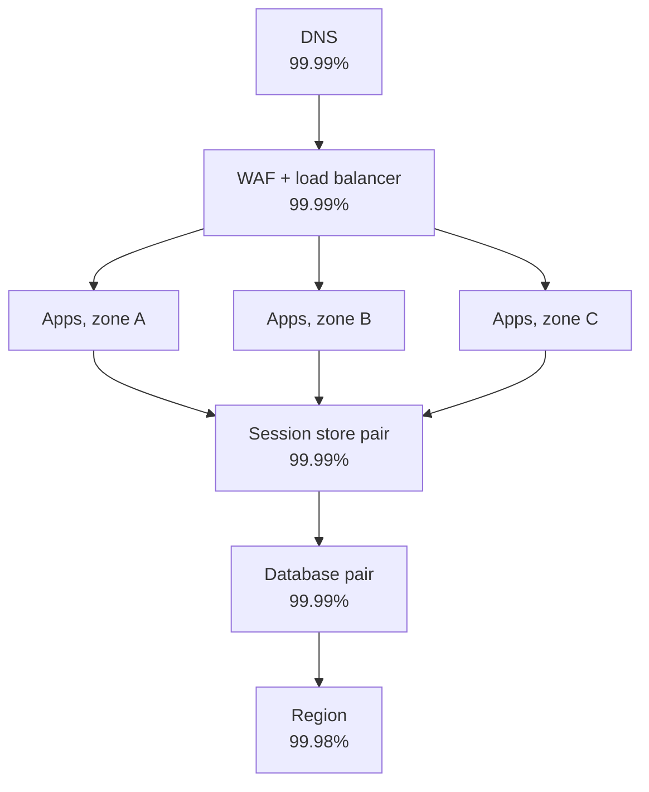
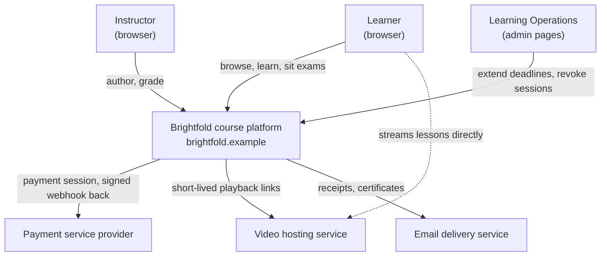
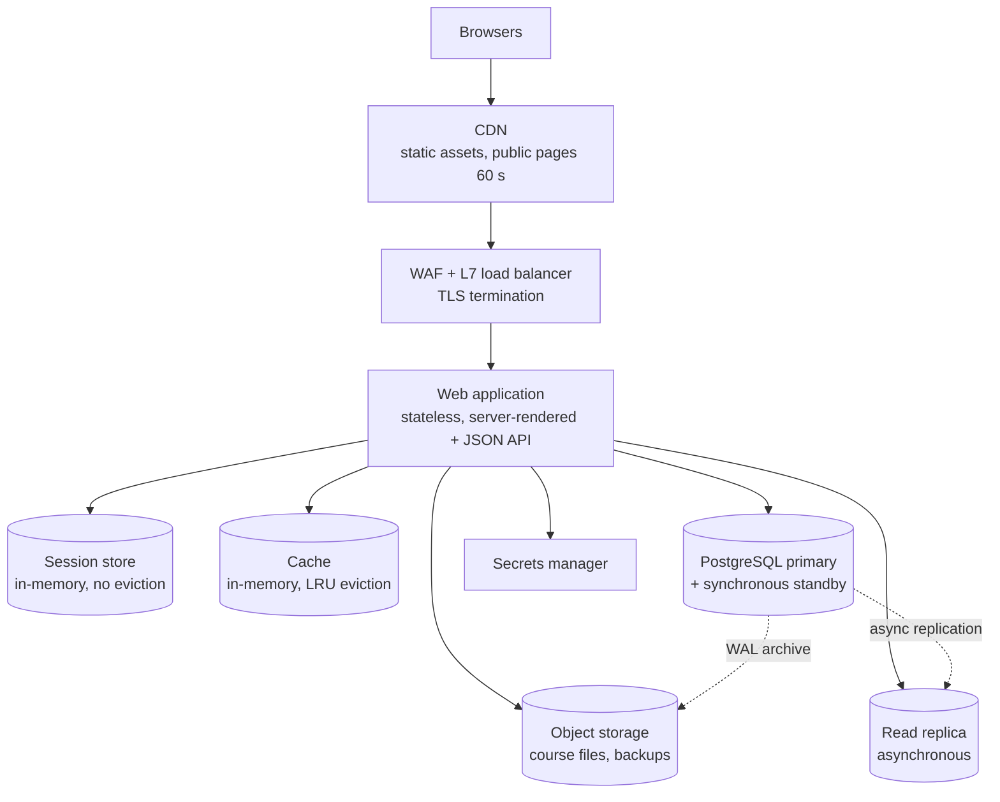
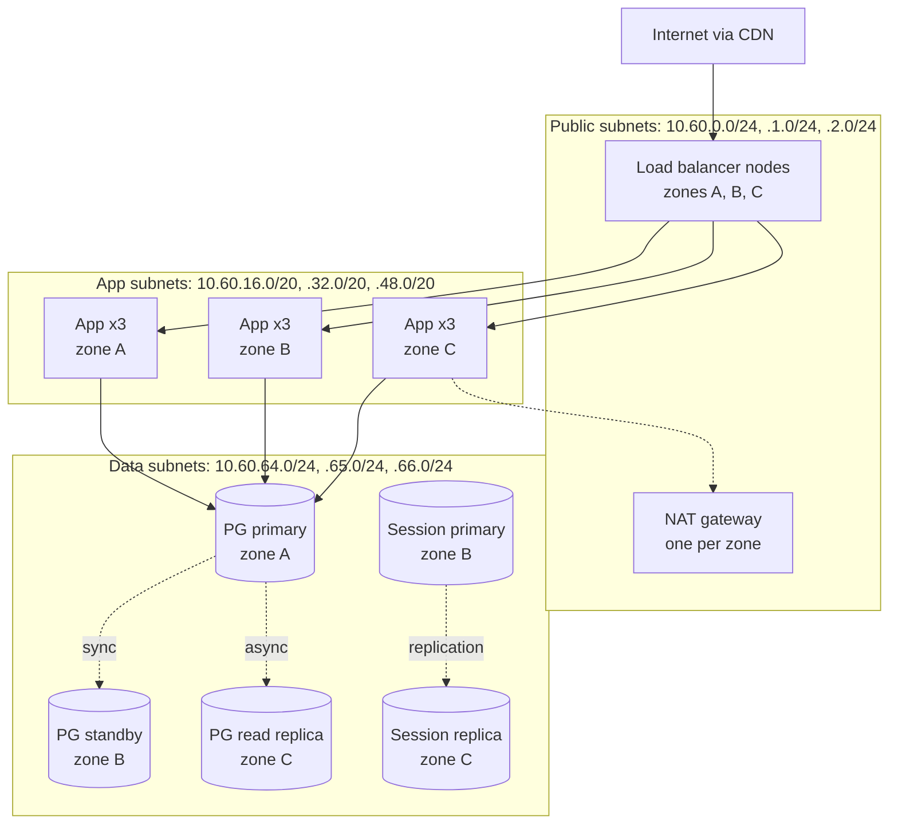
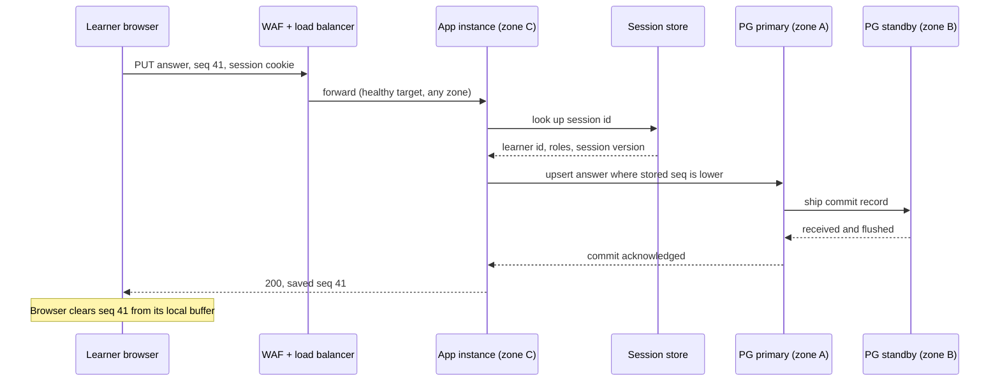
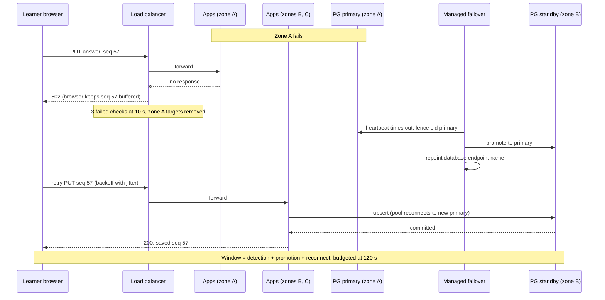
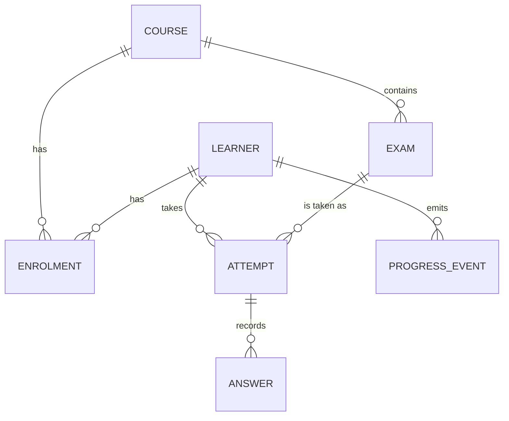
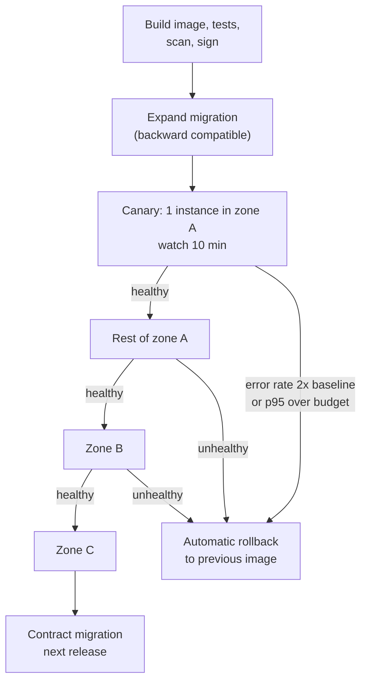

# Case study 01: Highly available three-tier web application

> A single server failed in the busiest week of the year, and "make it more reliable" became a
> number: 99.9% of requests served each month. This case shows how that number decides the zones,
> the database topology, where session state lives, how deploys roll out, and which risk the company
> knowingly keeps.

!!! abstract "Case facts"
    **Level:** Intermediate (the multi-region discussion is Level 3) · **Time:** 75-90 minutes ·
    **Status:** Draft · **Last verified:** 2026-11-21

The case follows the [design method](../system-design-exercises/design-method.md). Every number is a
labelled assumption or arithmetic from one; for prices, quotas, and limits check provider documentation.

## Business context and outcome

Brightfold Learning (fictional, `brightfold.example`) sells online professional courses. Learners
watch lessons, complete exercises, and sit timed online exams that lead to certificates, which
several partner universities accept as credit. Revenue comes from course purchases and university
contracts.

The site is one server-rendered Python application on **one large virtual machine** that also hosts
its PostgreSQL database, in one zone of one region. On the Monday of last spring's exam week, traffic
reached six times a normal day; CPU saturated, connections ran out, a restart and crash recovery kept
the site down about 2 hours 40 minutes (fictional figure), about 9,000 attempts were lost, and one
university partner asked for a written availability commitment before renewing.

"Never again" is not a requirement. The outcomes agreed with leadership:

- **O-1:** a measurable availability target for the learning experience (99.9% of requests each
  month), reported monthly.
- **O-2:** no learner loses an acknowledged exam answer because of an infrastructure failure.
- **O-3:** the site survives the loss of any one availability zone, including at exam-week peak,
  without manual action.
- **O-4:** in place before the next exam season, four months away.

## Stakeholders and users

| Stakeholder | What they need | Role in decisions |
|---|---|---|
| Learners | Pages that load, exams that keep their answers, fair extensions after incidents | Users; represented by Learning Operations |
| Instructors | Publish content and grade without downtime | Users |
| Head of Learning Operations | Exam calendar, extension policy, incident communication | Sets exam-week priorities |
| University partners | A written availability commitment and incident reports | External; drive the SLA |
| CTO | A design the team can run, with known cost and residual risk | **Decision maker** |
| Engineering team (eight engineers, one with platform focus) | Something they can operate without a 24/7 rota | Builds and operates |
| Finance | Cost change expressed as drivers before approval | Approves budget |
| Privacy and security lead | Learner data protected, access auditable | Reviews security decisions |

## Functional requirements

1. **FR-1** Anyone can browse the course catalogue and course pages without signing in.
2. **FR-2** Learners sign up, sign in, and sign out; administrators can revoke a learner's sessions
   immediately (exam-integrity cases).
3. **FR-3** Learners enrol; paid enrolments complete through an external payment service provider,
   and Brightfold stores only the provider's payment reference.
4. **FR-4** Learners watch lessons streamed by an external video hosting service, using short-lived
   playback links that Brightfold issues.
5. **FR-5** Learners take timed exams; the browser autosaves each answer at least every 60 seconds
   and on every change of question; the learner submits once, explicitly or at the deadline.
6. **FR-6** Instructors create and edit courses, upload materials, and grade free-text answers.
7. **FR-7** Learners see progress, grades, and downloadable certificates.
8. **FR-8** Learning Operations can extend an attempt's deadline for one learner or for everyone
   affected by an incident.

## Non-functional requirements (measurable targets)

| ID | Attribute | Target | How measured |
|---|---|---|---|
| NFR-1 | Availability (SLO) | 99.9% of dynamic requests per calendar month succeed (not 5xx, answered within 3 s) | Load balancer logs; synthetic sign-in, page, and autosave checks every minute from two external locations |
| NFR-2 | Latency | p95 ≤ 400 ms, p99 ≤ 1,000 ms for dynamic requests at design peak | Load balancer latency histogram per route |
| NFR-3 | Exam answer durability | Zero acknowledged autosaves lost on any single-instance or single-zone failure | Game-day test; reconcile client and server sequence numbers |
| NFR-4 | Zone loss | RTO ≤ 5 min with no manual action; RPO 0 | Zone-evacuation drill before each exam season |
| NFR-5 | Logical corruption or operator error | Restore to any point in the last 14 days; RPO ≤ 5 min; RTO ≤ 4 h | Quarterly restore test into an isolated environment |
| NFR-6 | Region loss | RTO ≤ 24 h; RPO ≤ 15 min | Yearly cross-region restore rehearsal |
| NFR-7 | Capacity | Exam-week design peak with one zone lost, app-tier CPU ≤ 70% | Load test with one zone's instances removed |
| NFR-8 | Security | TLS on every external connection; database unreachable from the internet; no long-lived secrets in code or images | Pipeline configuration scans; reachability tests |
| NFR-9 | Deployability | Releases without downtime; rollback ≤ 10 min | Pipeline metrics |

NFR-1 is request-based, so an outage at exam peak counts for more than one at 3 a.m. The SLA for
universities is looser (99.5%), so a missed SLO triggers engineering action long before a contractual
one (see [SLAs, SLOs, SLIs, and error budgets](../architecture-fundamentals/slas-slos-slis-error-budgets-and-recovery-objectives.md)).

## Workload assumptions and capacity estimates

All values are **Brightfold assumptions** to be replaced by measurements; the method is from
[Capacity estimation](../performance-and-scalability/capacity-estimation.md).

| # | Assumption | Value |
|---|---|---|
| A-1 | Registered learners | 1,200,000 |
| A-2 | Daily active learners, normal week / exam week | 150,000 / 400,000 |
| A-3 | Dynamic requests per active learner per day (static files go to the CDN), normal / exam week | 60 / 90 |
| A-4 | Share of a day's requests in the busiest hour, normal / exam week | 10% / 15% |
| A-5 | Peak concurrent exam attempts; autosave interval | 18,000; 60 s |
| A-6 | Other writes (submits, progress, enrolments) as a share of requests | 5% |
| A-7 | Growth in active learners per year; planning horizon | 40%; 2 years (1.4² = 1.96, round to 2×) |
| A-8 | One app instance (4 vCPU) serves 250 requests/s at 60% CPU | From a load test, to be repeated on the new tier |
| A-9 | Mean dynamic response; mean database bytes per dynamic request; mean service time | 20 KB; 5 KB; 150 ms |

**Request rates.** Normal day: 150,000 × 60 = 9.0 M requests, average 9.0 M ÷ 86,400 s ≈ **104/s**,
busiest hour 0.10 × 9.0 M ÷ 3,600 = **250/s**. Exam-week day: 400,000 × 90 = 36 M, average ≈
**417/s**, busiest hour 0.15 × 36 M ÷ 3,600 = **1,500/s**, six times the normal busiest hour, as in
last spring's incident. Two-year design peak: 1,500 × 2 = **3,000/s**.

**Read/write mix at exam peak.** Autosaves 18,000 ÷ 60 s = 300 writes/s; other writes
0.05 × 1,500 = 75/s. Writes 375/s (25%), reads 1,125/s (75%). A normal week is closer to 90/10.

**Database and concurrency.** If the cache answers 60% of reads (assumption), the database sees
0.4 × 1,125 = 450 reads/s + 375 writes/s ≈ 825 statements/s at exam peak, twice that at design peak:
plausible for one well-sized primary, to be load-tested. Little's Law: 1,500/s × 0.15 s = 225
requests in flight, about 25 per instance on nine instances (worker pool 32).

**App instances.** Exam peak 1,500 ÷ 250 = 6 instances. To survive a zone loss, the remaining two
zones must hold all 6, so 3 per zone and **9 in total** (1.5× the bare need: n ÷ (n − 1) for n = 3
zones). Normal busiest hour needs 1 instance, but the floor is one per zone, **3 in total**. The
two-year design peak needs 12, so 18 with zone headroom.

**Memory.** Sessions 100,000 (25% of exam-week DAU in the busiest hour) × 2 KB ≈ 200 MB; cache
5,000 courses × 50 KB ≈ 250 MB. Memory does not drive the design; availability does.

**Storage, first year.** Profiles and enrolments 1.2 M × 20 KB = 24 GB; exam attempts 2 M per year ×
30 KB = 60 GB (autosaves overwrite one row per answer); progress events 150,000 × 20 per day × 200 B
× 365 ≈ 219 GB. Total ≈ 303 GB; with indexes (× 1.5) ≈ 455 GB; with three database copies (primary,
standby, read replica) ≈ **1.4 TB provisioned**, plus backups and archived logs.

**Bandwidth.** 1,500 × 20 KB = 30 MB/s ≈ 240 Mbit/s at exam peak; video bypasses Brightfold (FR-4).

## Constraints and assumptions

- **C-1** One cloud provider, already in use, and one region near most learners. Multi-cloud is out
  of scope.
- **C-2** Eight engineers and no 24/7 on-call: business hours plus an exam-week rota. Anything that
  needs a human at 3 a.m. to stay up is a design defect.
- **C-3** Four months to the next exam season.
- **C-4** The application stays a monolith; this case changes where it runs, not how it is
  structured (see [Architecture styles](../software-architecture/architecture-styles.md)).
- **C-5** Learner personal data is processed (names, contact details, results). Which privacy laws
  apply depends on facts such as where learners live; that is for counsel, and this case is not legal
  advice. Card data never reaches Brightfold (FR-3: the payment provider tokenizes it).
- **C-6** Finance wants cost as drivers and multipliers before approving; no budget figure is given.

## Architecture options considered

| Option | Summary | Strengths | Weaknesses |
|---|---|---|---|
| A. Single VM (today) | Web, app, and database on one VM in one zone, scaled up before exam week | Simplest; cheapest; one thing to patch | Every failure is total; vertical scaling has a ceiling and needs a restart; long restore |
| B. Three-tier in one zone | Load balancer, several app instances, managed database with standby, all in one zone | Instance is no longer a SPOF; horizontal scaling | The zone is still a SPOF; the standby shares the primary's fate |
| C. Three-tier across three zones (**chosen**) | Zone-redundant load balancer, app instances in three zones, managed PostgreSQL with synchronous standby in another zone and automatic failover, replicated session store | Survives a zone loss automatically; RPO 0 for zone loss; meets NFR-1 with margin | Cross-zone latency on commits; more moving parts; some cost lines triple |
| D. Multi-region active-passive | Option C in a primary region plus a warm copy in a second region, asynchronous database replication, DNS or global-routing failover | Survives a region loss in minutes to an hour | Two environments to run and rehearse; RPO > 0; data-residency questions |

### Availability arithmetic

Series components multiply availabilities; parallel components multiply unavailabilities (method
from [High availability design](../reliability-and-disaster-recovery/high-availability-design.md)).
Per-component figures are **assumptions for this fictional example**, never provider commitments.

| Component | Assumed availability | Reasoning |
|---|---|---|
| Managed DNS | 99.99% | Provider-wide anycast service |
| Zone-redundant load balancer with WAF | 99.99% | Spans zones by construction |
| One VM or app instance | 99.5% | Patching, restarts, host failures |
| One zone as a whole | 99.9% | Zone-level incidents that affect this workload |
| Region as a whole | 99.98% | One 4.4-hour region-wide incident every 30 months: 264 min ÷ 30 ≈ 8.8 min/month |
| Database pair with automatic failover | 99.99% | About one failover a month, each up to 2 min, plus margin |
| Session store pair with automatic failover | 99.99% | Same reasoning |

- **A:** VM × DNS × region = 0.995 × 0.9999 × 0.9998 ≈ **99.47%**: about **232 min** of expected
  downtime per average month (43,830 min).
- **B:** three instances in parallel are 1 − 0.005³ = 0.999999875, effectively 1, but the zone is in
  series: DNS × LB × apps × sessions × database × zone × region
  = 0.9999 × 0.9999 × 0.999999875 × 0.9999 × 0.9999 × 0.999 × 0.9998 ≈ **99.84%**: about **70 min**.
- **C:** the zone term disappears, because a zone loss costs at most one failover window, already in
  the pairs' figures: 0.9999⁴ × 0.999999875 × 0.9998 ≈ **99.94%**: about **26 min**.
- **D:** the region term becomes one 30-minute failover (assumed RTO) every 30 months, 1 min/month or
  99.998%, but a global routing layer (99.99%) joins the chain:
  0.9999⁴ × 0.999999875 × 0.99998 × 0.9999 ≈ **99.95%**: about **23 min**.

**Figure 1 — Option C as a reliability block diagram.** A request needs every row; the app row is
three parallel paths.



How to read it: the parallel app row almost never fails; expected downtime comes from the stateful
pairs and the region.

### Error-budget view

NFR-1 allows 0.1% of requests to fail: 43.8 min per average month in time terms.

| Option | Expected infrastructure downtime per month | Left for bad deploys, bugs, and the unmodelled |
|---|---|---|
| A | 232 min | None: the budget is spent 5.3 times |
| B | 70 min | None: spent 1.6 times |
| C | 26 min | About 17.5 min (40%) |
| D | 23 min | About 21 min (48%) |

In request terms exam week is harsher. An exam-week month carries 23 normal days × 9 M + 7 exam days
× 36 M = 459 M requests, so the budget is 459,000 failed requests. A 10-minute total outage at exam
peak fails 1,500 × 600 = **900,000**: **twice the month's budget in ten minutes**. Hence the
insistence on automatic recovery at peak, and an error-budget policy that freezes risky changes in
exam week.

Option D's value is not the 3 minutes a month but the tail: a rare multi-hour regional outage
becomes a 30-minute one. ADR-01 records that business decision.

## Chosen architecture and rationale

Option C: presentation at the edge, a stateless application tier, and a stateful data tier across
three zones. It is the cheapest option meeting O-1 to O-3 with margin, leaves failover to managed
services the team need not watch at night, and keeps the monolith (C-4).

**Figure 2 — System context (C4 level 1).** The platform, its users, and the external systems it
depends on.



How to read it: the dashed arrow never touches Brightfold. No external system is on the exam path,
so their failures degrade enrolment and notifications only.

**Figure 3 — Containers (C4 level 2).** Deployable units and the data stores they use.



How to read it: below the web application everything holds state. Sessions and cache are separate
stores on purpose: a cache may evict under memory pressure, a session store must not.

- **Presentation tier.** The CDN serves versioned static files with long lifetimes and caches anonymous
  catalogue pages for 60 s; at a 95% hit ratio (assumption), one static request in twenty reaches origin.
- **Application tier.** One container image of the monolith on an autoscaling instance group across
  three zones (floor 3, exam-week floor 9). Instances hold **no** user state.
- **Data tier.** Shown in Figure 4; object storage is replicated across zones by the provider.

**Figure 4 — Deployment across zones and subnets.** One virtual network (10.60.0.0/16, assumption)
with a public, an app, and a data subnet in each of three zones.



How to read it: traffic enters only through the load balancer; app and data subnets have no route
from the internet, and outbound calls (payment, email) leave through the NAT gateway in the caller's
own zone (one arrow shown). The cache pair, omitted for space, sits in the data subnets of zones A
and C. Primaries are spread on purpose: losing zone A fails over only the database, losing zone B
only the session store, losing zone C nothing.

### Provider equivalents

Names checked against each provider's documentation on 2026-11-21; products change, so recheck.

| Generic building block | AWS | Azure | Google Cloud |
|---|---|---|---|
| Managed PostgreSQL with standby in another zone | Amazon RDS Multi-AZ DB instance deployment | Azure Database for PostgreSQL flexible server, zone-redundant high availability | Cloud SQL for PostgreSQL high availability (regional instance) |
| L7 load balancer | Application Load Balancer | Azure Application Gateway | Application Load Balancer |
| CDN | Amazon CloudFront | Azure Front Door | Cloud CDN |
| Autoscaling instance group | EC2 Auto Scaling groups | Virtual Machine Scale Sets | Managed instance groups |
| Secrets manager | AWS Secrets Manager | Azure Key Vault | Secret Manager |

## Request and data flow walkthrough

### Happy path: an exam autosave

**Figure 5 — Autosave during an exam attempt.** The write that NFR-3 protects.



How to read it: the commit is acknowledged only once the standby in another zone has it (RPO 0 for a
zone loss), at the cost of one cross-zone round trip; the browser keeps the answer until acknowledged.

### Failure path: zone A lost at exam peak

**Figure 6 — Zone A fails while 18,000 exams are in progress.** Health checks, database failover, and
client retries overlap.



How to read it: two clocks run at once. The load balancer drops zone A within about 30 s (interval
× unhealthy threshold); writes fail until promotion and reconnection finish, budgeted at 120 s
(assumption, measured in each drill). Learners see "Saving, reconnecting" but lose nothing: the
browser buffers and retries, and the server ignores older sequence numbers.

- **Retry discipline.** Instances retry at most three times within 10 s, with exponential backoff and
  jitter, and only idempotent operations; the browser retries every 10 s with jitter. Without jitter
  the new primary meets a connection storm (see
  [Resilience mechanics](../distributed-systems/resilience-mechanics-timeouts-retries-and-backpressure.md)).
- **Connection pools.** Pools validate connections and cap their lifetime, so links to the fenced
  primary are dropped. 9 instances × 20 = 180 reconnects: check the configured connection limit.
- **Static stability.** The exam-week floor of 9 leaves 6 after a zone loss, exactly the 1,500/s need
  at 60% CPU (A-8); nothing is launched mid-incident, when capacity may be contested. The runbook
  extends affected attempts by the incident's duration plus 5 minutes (FR-8).

## Data model and storage decisions

**Figure 7 — Core entities.** Only what the availability and exam-integrity decisions touch.



How to read it: an `ANSWER` is one row per attempt and question (key `attempt_id, question_id`),
overwritten on each autosave by one idempotent statement (PostgreSQL syntax); its `client_seq`
column makes the overwrite safe against retries and out-of-order arrivals:

```sql
INSERT INTO answer (attempt_id, question_id, client_seq, answer_body, saved_at)
VALUES ($1, $2, $3, $4, now())
ON CONFLICT (attempt_id, question_id) DO UPDATE
SET client_seq = EXCLUDED.client_seq,
    answer_body = EXCLUDED.answer_body,
    saved_at = EXCLUDED.saved_at
WHERE answer.client_seq < EXCLUDED.client_seq;
```

- **Read replica for staleness-tolerant reads only.** Catalogue, course outlines, and instructor
  reports read from the asynchronous replica. Lag is usually well under a second but unbounded under
  load, so the app reads from the primary when measured lag exceeds 5 s (assumption), and for 30 s
  after a learner's own write (read-your-writes). Attempts, answers, and grades always read from the
  primary. Lab 09 shows the effect: [Replication lag](../labs/lab-09-replication-lag.md).
- **Cache-aside with short TTLs.** Rendered catalogue fragments live 5 minutes and are invalidated on
  publish; on a miss or cache error the app reads the replica, so the cache is not in the
  availability chain (see [Caching architecture](../databases-and-storage/caching-architecture.md)).
- **Backups and point-in-time recovery (PITR).** Daily snapshots plus continuous write-ahead-log
  archiving, kept 14 days, restore to any moment in that window (NFR-5); copies go to a second region
  and a separate backup account the app team cannot delete from (NFR-6). PITR, not the standby,
  protects against a bad migration or accidental `DELETE`, which the standby replicates instantly.
- **Indexes** follow the hot queries: `(attempt_id, question_id)` is the key of `answer`;
  `attempt (learner_id, state)` serves "my active attempts" (see
  [Relational databases and SQL internals](../databases-and-storage/relational-databases-and-sql-internals.md)).

## API and integration contracts

| Endpoint or event | Semantics | Availability notes |
|---|---|---|
| `GET /courses/{slug}` | Public course page | CDN-cached 60 s; served stale on origin errors where the CDN supports it |
| `PUT /api/v1/attempts/{id}/answers/{question}` | Autosave; body carries `client_seq` and the answer | Idempotent by design; safe to retry |
| `POST /api/v1/attempts/{id}/submit` | Final submission; `Idempotency-Key` header required | A repeat with the same key returns the first result |
| `GET /api/v1/me/progress` | Learner dashboard | Replica allowed, with the read-your-writes window |
| `POST /webhooks/payments` | Payment result from the provider | Signature verified; deduplicated on the provider's event id |
| `POST /api/v1/admin/sessions/revoke` | Revoke a learner's sessions | Bumps the learner's session version; effective on the next request |

Versioning is by path; the real compatibility risk is a rolling deploy, when two versions serve side
by side, so every change accepts the previous version's requests (see
[API design](../application-and-api-architecture/api-design-rest-graphql-grpc-and-async-apis.md)).

## Security and trust boundaries

Four trust zones (internet, edge, app, data) and only these allowed paths; everything else is denied:

| From | To | Port and protocol | Why |
|---|---|---|---|
| Internet | CDN with WAF | 443, HTTPS | Only public entry |
| CDN | Load balancer (security group `lb`) | 443, HTTPS, with an origin header check | Load balancer accepts only CDN traffic |
| `lb` | App instances (security group `app`) | 8443, HTTPS (re-encrypted) | No direct internet path to instances |
| `app` | PostgreSQL (`db`), session store and cache (`kv`) | 5432 and 6379, TLS required | Data tier reachable only from the app |
| `app` | Payment, email, video APIs | 443 via the zone's NAT gateway | Outbound only |
| Deploy pipeline (workload identity) | PostgreSQL | 5432, migrations role | Schema changes only from the pipeline |

- **Edge.** The WAF applies the provider's managed rule sets for common web attack classes (injection,
  cross-site scripting; see the OWASP Top 10 in [Application security](../security-architecture/application-security.md))
  and rate-limits sign-in and password-reset routes per client.
- **TLS.** Managed certificates for `brightfold.example` renew automatically; an alert still fires
  21 days before expiry (assumption).
- **Sessions.** The cookie holds only a random session id, marked `HttpOnly`, `Secure`, and
  `SameSite=Lax`; the id rotates at sign-in and on privilege change; idle timeout 30 minutes,
  absolute timeout 12 hours (assumptions). Revocation (FR-2) works because the record is server-side.
- **Least-privilege database access.** The app role has DML on its own schema only (no DDL, no
  superuser); migrations use a pipeline-only role; engineers get time-limited read-only access via
  single sign-on, writes are break-glass and audited (see
  [Identity and access management](../security-architecture/identity-and-access-management.md)).
- **Secrets and keys.** Credentials live in the provider's secrets manager with automatic rotation,
  fetched at start-up via workload identity, never in images or the repository; data, snapshots,
  and archives are encrypted with keys from the key management service.
- **Personal data.** Whether the second-region backup copy is acceptable is a data-residency decision
  for the privacy lead and counsel (see [Data security and privacy](../security-architecture/data-security-and-privacy.md)).

## Reliability, failover, and disaster recovery

| Failure | Detection | What happens | User impact | Meets |
|---|---|---|---|---|
| One app instance dies | LB health check, 3 × 10 s | Removed; instance group replaces it | A few failed requests, retried by the browser | NFR-1 |
| Zone A lost (database primary) | LB checks; managed failover heartbeat | Figure 6: zone removed, standby promoted | Up to 120 s of "Saving, reconnecting"; no lost answers | NFR-3, NFR-4 |
| Zone B lost (session primary) | Session-store failover | Replica in zone C promoted | Requests fail during the window; sign-ins from the last seconds may be lost | NFR-4 |
| Zone C lost (read replica) | Replica health | Replica reads go to the primary | Higher primary load, within capacity at today's peak | NFR-4 |
| Cache unavailable | Client errors | Reads fall back to the replica | p95 rises; availability unaffected | NFR-1; strains NFR-2 |
| Bad migration or accidental delete | Alerts, user reports | PITR restore to a new instance, then cut over | Up to 4 h degraded or read-only | NFR-5 |
| Region lost | Provider status, synthetic checks | Restore from cross-region backups with infrastructure code | Up to 24 h outage | NFR-6 (accepted risk, ADR-01) |

A **shallow liveness check** (`/healthz`) decides whether the load balancer sends traffic; a
**readiness check** (`/ready`: database and session store reachable) gates new instances and feeds
dashboards but never removes running ones, or a database blip would empty the pool and turn a
60-second failover into a total outage. On deploy, connections drain for 30 s.

## Scaling and performance strategy

- **Exam week is scheduled, not discovered.** A scheduled action raises the floor to 9 the evening
  before; CPU autoscaling (target 55%) reacts in minutes and only covers surprises above it.
- **Bottlenecks at 10× normal.** At the 3,000/s design peak the app tier scales out to 18 instances
  and pressure moves to the database primary (writes and connections), then the read replica, then
  the session store. Levers in that order: a connection pooler, a larger primary in a planned window,
  a second read replica; sharding is not needed at the two-year horizon (see
  [Scaling, partitioning, and replication](../distributed-systems/scaling-partitioning-and-replication.md)).
- **Latency budget (assumptions).** Of 400 ms p95: edge and TLS 40, application 200, session 2,
  database 60 (with the synchronous commit), the rest queueing headroom (see
  [Performance fundamentals](../performance-and-scalability/performance-fundamentals-and-littles-law.md)).
- **Load shedding.** If p99 passes 2 s, non-exam routes (catalogue search, recommendations) return
  503 with a retry-after hint before exam routes are allowed to slow down.

## Observability and operations

- **Golden signals per tier,** each labelled by zone: latency (p50/p95/p99 per route), traffic,
  errors (5xx), saturation (CPU, worker pool, database connections, replication lag, session memory).
- **SLO burn-rate alerts.** The SLI is the NFR-1 ratio from load balancer logs. Page when 2% of the
  30-day budget burns in one hour, a burn rate of 0.02 × 720 h ÷ 1 h = **14.4** (about 1.4% of
  requests failing for that hour); open a ticket when 10% burns in three days, a burn rate of
  0.10 × 720 ÷ 72 = **1.0** (method from the SRE Workbook).
- **Evidence and drills.** Failover durations and reconnect errors are recorded, so every drill
  tests the 120 s assumption; traces follow a request from load balancer to query log. Zone
  evacuation two weeks before each exam season, PITR restore quarterly, region restore yearly; two
  engineers on call in exam week.
- **Error-budget policy.** More than 50% left: normal releases. Below 50% or in exam week: only
  reliability fixes and pre-approved content changes. Exhausted: feature freeze until it recovers.

## Deployment and release strategy

**Figure 8 — Rolling deployment, one zone at a time.** A bad build is caught while it serves a small
share of traffic.



How to read it: each step replaces instances with connection draining and waits for health and SLO
signals. A bad build reaches one instance for ten minutes, one-ninth of exam-week capacity. Database
changes use expand and contract (add first, use next, remove a release later) so old and new versions
run side by side and a rollback never meets a schema it does not understand.

Infrastructure is code applied through the same pipeline (see
[Multi-account strategy and infrastructure automation](../cloud-architecture/multi-account-strategy-and-infrastructure-automation.md));
staging has the same three-zone topology at smaller sizes, so failover is testable.

## Cost model

No prices: the drivers and how each changes from Option A to Option C, so Finance can price them
with the provider's current calculator.

| Driver | Option A (today) | Option C | Multiplier and why |
|---|---|---|---|
| App compute | 1 large VM (16 vCPU) shared with the database | 3 × 4 vCPU normally, 9 × 4 vCPU in exam week | 12 vCPU normally; in exam week 36, a third of it zone-loss headroom (9 versus 6) |
| Database instances | Inside the VM | Primary + standby (8 vCPU each, assumption) + replica (4 vCPU) | 3 instances; the standby is pure insurance |
| Database storage | 1 copy | 3 copies, ≈ 1.4 TB in year one | **3×** |
| Session store and cache | None | 2 pairs = 4 small nodes (2 vCPU each, assumption) | New line |
| NAT gateways | 1 | 3, one per zone, so egress survives a zone loss | **3×** |
| Load balancer, WAF, CDN | None | One of each, usage-based | New lines; the CDN cuts origin traffic |
| Cross-zone data transfer | None | About 2/3 of database traffic plus replication | New line, below |
| Backups and log archive | Ad hoc | 14 days of snapshots and WAL, copied cross-region | New line; grows with write volume |

**Cross-zone traffic.** Normal month: 104 requests/s × 5 KB of database traffic (A-9) ≈ 0.52 MB/s;
two of three app zones are remote from the primary, so ≈ 0.35 MB/s crosses zones, × 2,629,800 s
per average month ≈ **0.9 TB a month** before replication traffic.

**What triples, and what does not.** Per-zone fixed items triple; peak compute does **not**: the
peak needs 6 instances anyway and zone headroom adds 3 (1.5×). Normal-week vCPUs go from 16 to
12 + 20 + 8 = 40 (app, database, in-memory), about 2.5×: the ratio Finance approves. Biggest levers:
the read replica (removable outside exam season) and committed-use pricing for the baseline.

## Risks and mitigations

| Risk | Likelihood | Impact | Mitigation |
|---|---|---|---|
| Real failover exceeds the 120 s budget | Medium | Medium | Measure in every drill; client buffering hides minutes; redo the SLO arithmetic with measured values |
| Retry or connection storm overloads the new primary | Medium | High | Jittered backoff, retry caps, pool limits; connection pooler on the roadmap |
| Remaining zones cannot launch instances during a zone event | Low | High | Pre-scaled exam-week floor; nothing launched mid-incident |
| Replica lag shows an old grade | Medium | Medium | Grades read from the primary; lag guard; read-your-writes window |
| A bad release reaches every instance | Medium | High | Canary, zone-by-zone rollout, automatic rollback; exam-week change freeze |
| Certificate expiry, or a WAF rule blocks real users | Low | High | Managed renewal plus expiry alert; new WAF rules run count-only for a week |
| Region-wide outage in exam week | Low | Very high | Accepted (ADR-01); cross-region backups, yearly restore rehearsal, revisit triggers |
| Small team cannot sustain exam-week on-call | Medium | Medium | Automatic failover for every zone event; runbooks; rota only in exam weeks |

## Architecture Decision Records

### ADR-01: Three zones in one region, not multi-region

- **Context.** NFR-1 and O-3 must be met in four months by eight engineers without 24/7 on-call;
  Option C uses 26 of 43.8 budget minutes a month, and Option D saves only about 3 more.
- **Decision.** Three zones in one region with managed database failover. Protect against region
  loss with cross-region backups and a 24-hour restore (NFR-6), not a running second region.
- **Consequences.** Lower cost and operating load; a regional outage would last hours, an accepted
  risk recorded in the risk register and disclosed to the partners' contract owner. Revisit when a
  trigger listed under the alternative designs occurs.

### ADR-02: Stateless app tier with server-side sessions in a replicated in-memory store

- **Context.** Instances must be replaceable at any moment. Sticky sessions would tie a learner to
  one instance and lose the session with it. FR-2 requires immediate revocation.
- **Decision.** Sessions live in a dedicated in-memory store (primary and replica in different zones,
  automatic failover, eviction disabled), separate from the cache. Durable exam state goes to
  PostgreSQL, never into the session.
- **Consequences.** Any instance serves any request; revocation is one server-side update. The
  session store joins the availability chain, so its failover is drilled like the database's.
  Rejected: signed self-contained tokens in the cookie, which remove that dependency but need a
  server-side denylist for immediate revocation, reintroducing a shared lookup.

### ADR-03: Synchronous standby for failover, asynchronous replica for selected reads

- **Context.** NFR-3 and NFR-4 need RPO 0 on a zone loss; reads at the two-year peak may exceed what
  the primary should carry alone.
- **Decision.** A managed synchronous standby in a second zone, promoted automatically, plus one
  asynchronous read replica for staleness-tolerant reads, guarded as described under storage.
- **Consequences.** Every commit pays a cross-zone round trip; catalogue changes may appear seconds
  late; the standby (in most managed offerings) serves no reads, so it cannot offload the primary.

### ADR-04: Rolling deployment by zone with a canary, not blue-green

- **Context.** NFR-9 asks for zero-downtime releases and fast rollback. Blue-green needs a second full
  fleet (9 more instances in exam week) and still shares one database, so schema changes need expand
  and contract either way.
- **Decision.** Roll out zone by zone behind a canary, with automatic rollback on SLO signals.
- **Consequences.** No duplicate fleet; a release takes about 40 minutes (assumption) instead of one
  switch; two versions serve traffic for minutes, so every change must be backward compatible.
  Blue-green stays available for risky releases outside exam season.

## Alternative designs and why they were rejected

**Multi-region active-passive (Option D)** is the plausible alternative: a scaled-down app tier and a
cross-region asynchronous replica, with DNS failover or a global load balancer. It was rejected for
now: a second environment to rehearse, RPO above zero, and residency questions, for about 3 minutes a
month on average.

It becomes the better choice when any of these holds:

- A university contract or regulator requires recovery from a regional outage in minutes or an hour,
  not a day.
- Exam revenue or penalties make one multi-hour regional outage in exam week cost more than running a
  second region for years.
- The region's incident history shows region-wide events noticeably more often than ADR-01 assumed.
- The team is large enough to run quarterly regional failover drills: an untested passive region is
  a hope, not a plan.

Also set aside: **a managed application platform**, deferred until the monolith's slow start-up is
fixed, and **active-active across regions**, which needs conflict handling for answers written in two
places (see [Consistency models, CAP, and PACELC](../distributed-systems/consistency-models-cap-and-pacelc.md)).

## Questions for the learner

1. Recompute Options B and C if each managed pair is only 99.95% available. Does C still meet NFR-1,
   and which design change would you make first?
2. The primaries are spread across zones (database in A, sessions in B). Argue for co-locating them.
   Which arrangement gives fewer failovers per zone incident, and which a smaller worst case?
3. Exam-week DAU doubles next year with the same calendar. Redo the instance count with zone
   headroom. What becomes the bottleneck, and which scaling lever do you pull first?
4. A product manager wants to cache "my progress" for 5 minutes. What goes wrong for a learner who
   just finished a lesson, and how do you keep the gain without the confusion?
5. Exam-week traffic is four times normal. Should the burn-rate thresholds change for exam week, and
   why does a request-based SLO already account for most of the difference?
6. Leadership asks for 99.99% (4.4 min a month). Which three assumptions must change, at what effort?
7. Write the first ADR you would need if a trigger for Option D occurred. What does it decide?

## Related topics

- **Before:** [High availability design](../reliability-and-disaster-recovery/high-availability-design.md);
  [Capacity estimation](../performance-and-scalability/capacity-estimation.md);
  [The C4 model](../architecture-fundamentals/c4-model.md).
- **Alongside:** [Network security and load balancing](../networking/network-security-load-balancing-and-traffic-flow.md);
  [Networking fundamentals](../networking/networking-fundamentals-ip-cidr-routing-and-dns.md);
  [Cloud building blocks](../cloud-architecture/cloud-building-blocks-and-landing-zones.md);
  [Compute options and sizing](../cloud-architecture/compute-options-and-sizing.md).
- **Planned:** reliability engineering and game days (D13-T02); disaster recovery strategies,
  backups, and PITR in depth (D13-T03); observability and SRE (D15); CI/CD and deployment strategies
  (D16); FinOps (D17); case study 10, multi-region active-passive and active-active DR.

## References

| Source | Type | Checked |
|---|---|---|
| [Baseline highly available zone-redundant web application](https://learn.microsoft.com/azure/architecture/web-apps/app-service/architectures/baseline-zone-redundant) — Microsoft Azure Architecture Center | Reference architecture | 2026-11-21 |
| [Static stability using Availability Zones](https://aws.amazon.com/builders-library/static-stability-using-availability-zones/) — Amazon Builders' Library | Article | 2026-11-21 |
| [Site Reliability Engineering, chapter 6: Monitoring Distributed Systems](https://sre.google/sre-book/monitoring-distributed-systems/) and [The Site Reliability Workbook: Alerting on SLOs](https://sre.google/workbook/alerting-on-slos/) — Google | Book chapters (free online) | 2026-11-21 |
| [Continuous archiving and point-in-time recovery](https://www.postgresql.org/docs/current/continuous-archiving.html) and [High availability, load balancing, and replication](https://www.postgresql.org/docs/current/warm-standby.html) — PostgreSQL documentation | Official documentation | 2026-11-21 |
| [Session Management Cheat Sheet](https://cheatsheetseries.owasp.org/cheatsheets/Session_Management_Cheat_Sheet.html) — OWASP | Community reference | 2026-11-21 |
| [BlueGreenDeployment](https://martinfowler.com/bliki/BlueGreenDeployment.html) — Martin Fowler | Article | 2026-11-21 |
| Managed database HA, as named in the equivalence table: [Multi-AZ DB instance deployments for Amazon RDS](https://docs.aws.amazon.com/AmazonRDS/latest/UserGuide/Concepts.MultiAZSingleStandby.html), [High availability in Azure Database for PostgreSQL flexible server](https://learn.microsoft.com/azure/postgresql/high-availability/concepts-high-availability), [About high availability, Cloud SQL for PostgreSQL](https://cloud.google.com/sql/docs/postgres/high-availability) | Official documentation | 2026-11-21 |
| Other names in the equivalence table: [Application Load Balancer](https://docs.aws.amazon.com/elasticloadbalancing/latest/application/introduction.html), [Azure Application Gateway](https://learn.microsoft.com/azure/application-gateway/overview), [Google Cloud Application Load Balancer](https://cloud.google.com/load-balancing/docs/application-load-balancer), [Amazon CloudFront](https://docs.aws.amazon.com/AmazonCloudFront/latest/DeveloperGuide/Introduction.html), [Azure Front Door](https://learn.microsoft.com/azure/frontdoor/front-door-overview), [Cloud CDN](https://cloud.google.com/cdn/docs/overview), [Amazon EC2 Auto Scaling](https://docs.aws.amazon.com/autoscaling/ec2/userguide/what-is-amazon-ec2-auto-scaling.html), [Virtual Machine Scale Sets](https://learn.microsoft.com/azure/virtual-machine-scale-sets/overview), [Managed instance groups](https://cloud.google.com/compute/docs/instance-groups), [AWS Secrets Manager](https://docs.aws.amazon.com/secretsmanager/latest/userguide/intro.html), [Azure Key Vault](https://learn.microsoft.com/azure/key-vault/general/overview), [Secret Manager](https://cloud.google.com/secret-manager/docs/overview) | Official documentation | 2026-11-21 |

## Review notes

- First case study; sets the pattern (template H2s, then Related topics, References, Review notes).
  Eight Mermaid figures; trust boundaries are a table to save length. Check Figures 4 and 6 in both
  themes.
- Every number is a Brightfold assumption or arithmetic from one; the incident narrative is
  fictional. No provider price, quota, limit, or failover time is quoted.
- Reviewer: recompute A ≈ 99.47%, B ≈ 99.84%, C ≈ 99.94%, D ≈ 99.95%; the request budget
  (459 M × 0.1% = 459,000 against 900,000 failed in a 10-minute peak outage); the burn rates (14.4 and
  1.0); and the cross-zone estimate (≈ 0.9 TB a month).
- Provider names checked against the linked pages on 2026-11-21. "In most managed offerings the
  standby serves no reads" is hedged on purpose (true of the AWS single-standby page; some differ).
- OWASP Top 10 named only (depth in D12-T04); privacy defers to counsel. Lab 09 is the hands-on
  companion; no lab was written for this case.
