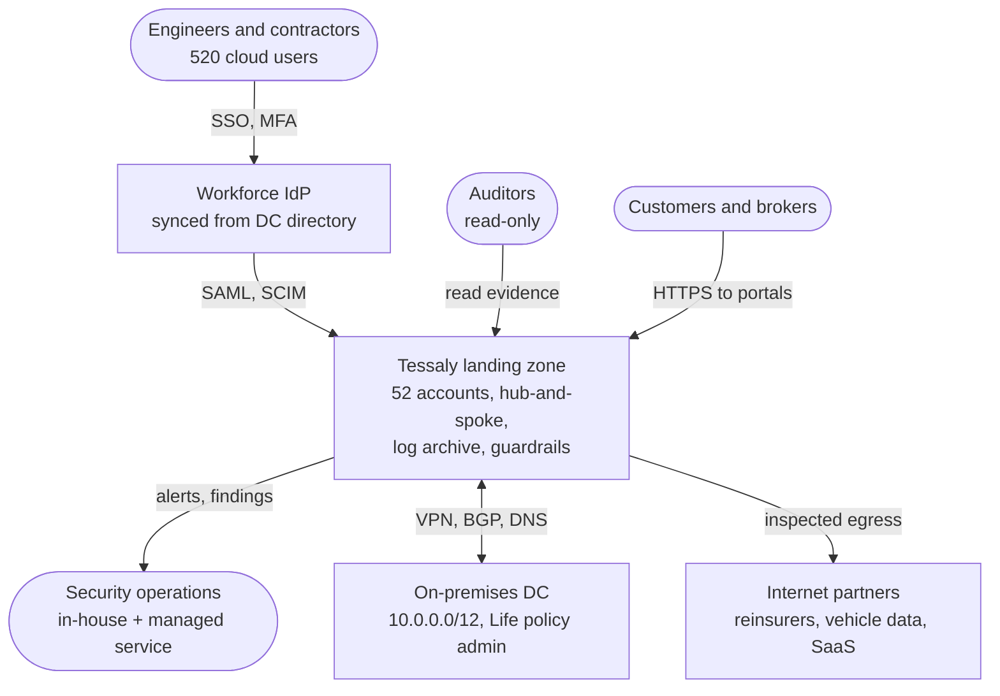
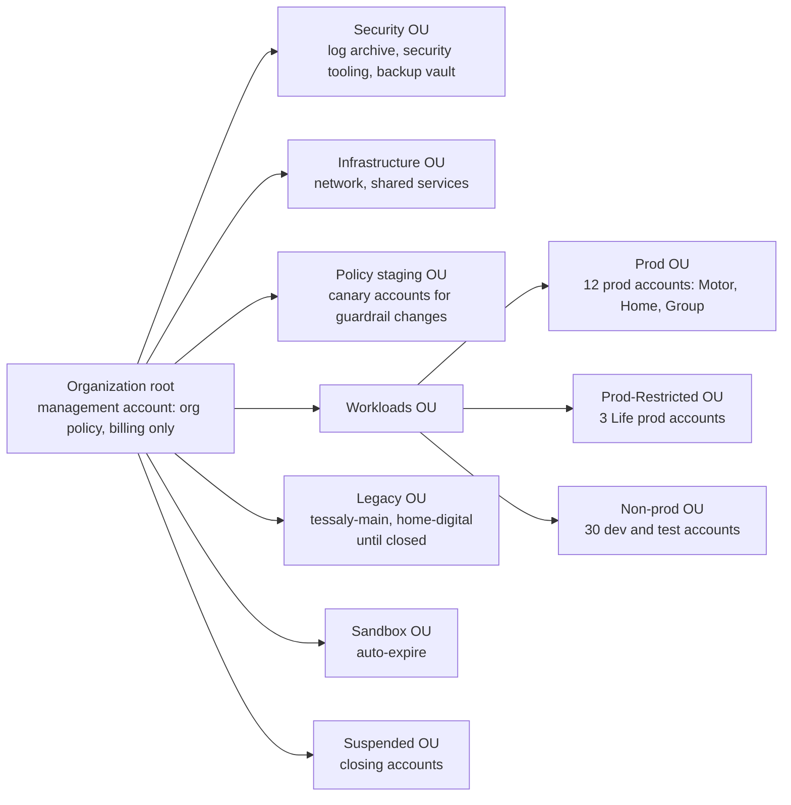
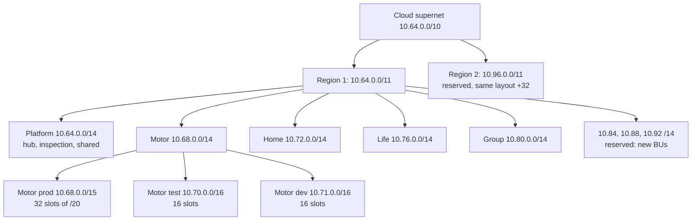
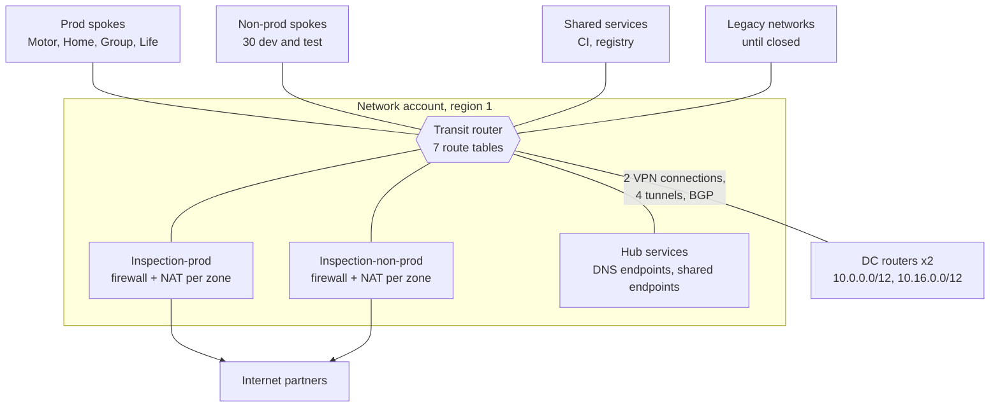
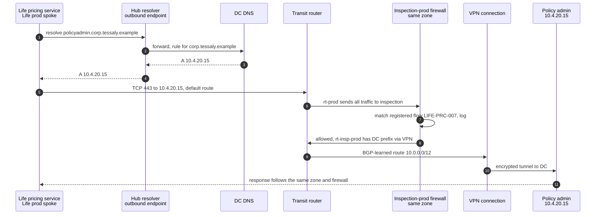
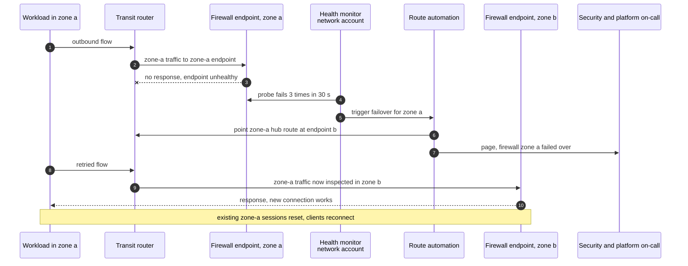
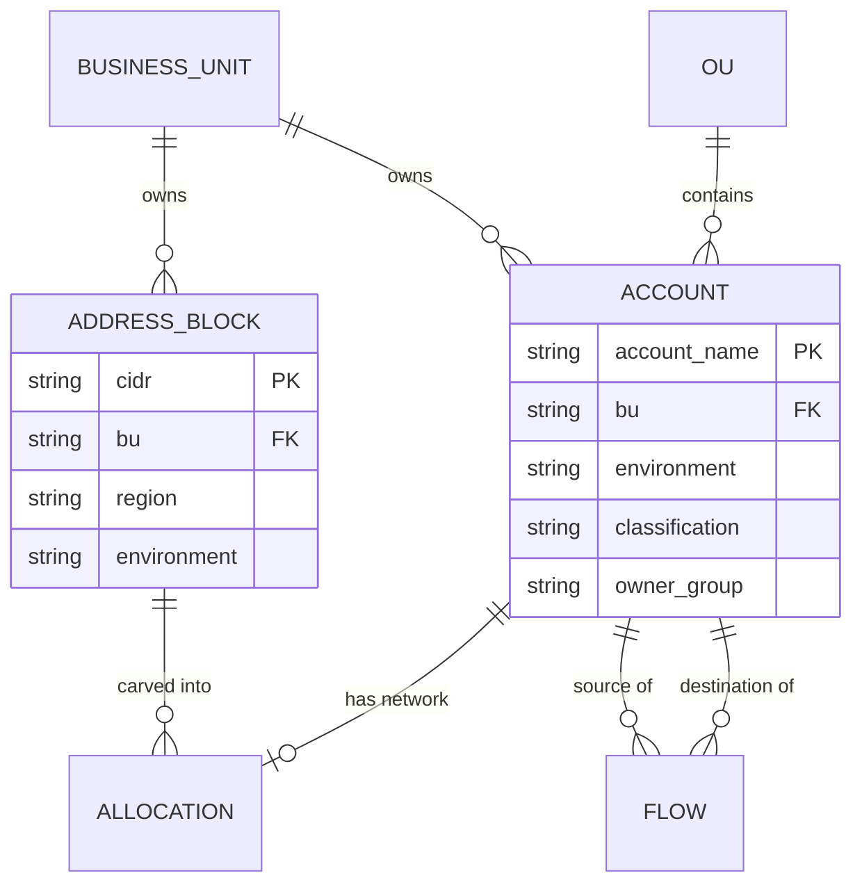
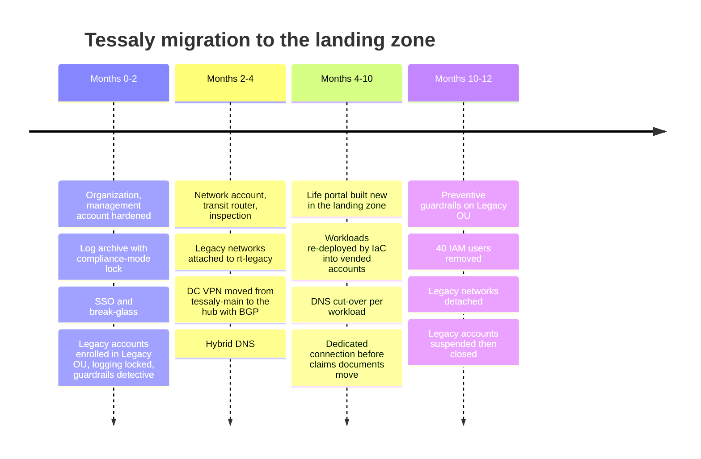

# Case study 08: Multi-account landing zone and hub-and-spoke network

> Tessaly Insurance Group runs three insurance businesses on a cloud estate that grew by accident:
> two accounts, one shared network, logs that their own administrators can delete, and a VPN that
> lets anything reach the data centre. Auditors have asked for immutable logging and separation of
> duties. This case designs the landing zone that answers them, and the network that lets three
> business units share one platform without sharing a blast radius.

!!! abstract "Case facts"
    **Level:** Advanced · **Time:** 90-120 minutes · **Status:** Draft · **Last verified:** 2026-11-21

    Tessaly and every number below are fictional assumptions for teaching. Nothing on this page is
    legal or regulatory advice.

## Business context and outcome

Tessaly Insurance Group (`tessaly.example`) is a mid-sized insurer with about 3,200 employees
(assumption) and three business units (BUs): **Motor** (car insurance sold direct and through
brokers), **Home** (buildings and contents), and **Life** (life and protection policies, whose
underwriting uses applicants' medical information). A central **Group IT** function runs shared
services: the corporate identity provider, finance and HR integrations, and the data platform.

Today's estate (the as-is, all assumptions):

- **On-premises data centre (DC)** using `10.0.0.0/12`, with offices on `10.16.0.0/12` reached over
  the corporate WAN. Life's policy administration system runs there and will stay until at least the
  DC lease ends in four years.
- **`tessaly-main` cloud account** (created six years ago) holds Motor's quote and claims systems and
  Group IT's integrations in one virtual network `10.200.0.0/16`, with dev, test, and prod in
  different subnets. A site-to-site VPN with an allow-all rule connects it to the DC.
- **`home-digital` account**, created by Home with the provider's default network `172.31.0.0/16`,
  reaches the DC only through public APIs.
- Around 40 human users with long-lived access keys, audit logs stored in each account, and
  administrators who can delete them.

Internal audit raised three findings (assumption): logs are not protected from the people they
record, developers hold standing write access to production, and nobody can list which cloud systems
reach the DC. External auditors and supervisory expectations (Tessaly's compliance team decides which
rules apply) make closing them a board-level commitment.

**Outcome the architecture must deliver within 12 months:** close the three findings with evidence,
move all 15 workloads into a governed estate, cut the time to get a new compliant environment from
about six weeks of tickets to one working day, and leave room for a second cloud region and for
acquisitions or a BU sale without renumbering networks.

## Stakeholders and users

| Stakeholder | Needs | Decides or approves |
|---|---|---|
| CIO and CISO | Findings closed, provable controls, one security view of every account | Programme scope; ADRs on guardrails and logging |
| Group IT platform team (8 engineers, assumption) | A landing zone it can run with a small team; automation over tickets | Landing-zone design, vending pipeline, hub operations |
| BU engineering leads (Motor, Home, Life) | Fast environments, autonomy inside their accounts, no dependency on other BUs' changes | Their workloads' designs; cross-BU flow requests |
| Network team (on-premises) | Predictable routing and DNS with the DC; no surprise prefixes | BGP and firewall changes on the DC side |
| Security operations (in-house team plus a 24x7 managed service, assumption) | All logs in one place, alerts on guardrail and break-glass events | Detection rules, incident response |
| Internal audit and external auditors | Immutable evidence, separation of duties they can test, read-only access | Whether findings are closed |
| Data protection officer and compliance | Know where special-category data lives (Life), retention rules | Classification and retention policy |
| Finance | Cost per BU and per workload | Chargeback model |

## Functional requirements

1. **FR-1 Account vending.** A request (BU, workload, environment, classification, internet-facing)
   returns baselined accounts with a network from the BU's block and access for the owning group.
2. **FR-2 Central logging.** Audit, flow, DNS, firewall, and load-balancer logs from every account
   reach one archive that workload and platform administrators cannot alter.
3. **FR-3 Segmentation.** No direct spoke-to-spoke paths; flows between workloads, BUs, or to the DC
   pass inspection and need a registered, owned, expiring approval.
4. **FR-4 Centralized egress.** Internet-bound traffic leaves through an inspected, allow-listed path.
5. **FR-5 Hybrid DNS and connectivity.** Cloud and DC systems resolve and reach each other's approved
   services by name.
6. **FR-6 Workforce identity.** Sign-in only through the corporate IdP with MFA; role-based access
   per account; production write access only just in time.
7. **FR-7 Break-glass.** Emergency access works with the IdP or the DC down; every use is detected.
8. **FR-8 Migration.** Workloads leave the two legacy accounts without a big bang; those accounts
   are then closed.

## Non-functional requirements (measurable targets)

| Id | Attribute | Target | How measured |
|---|---|---|---|
| NFR-1 | Onboarding speed | A compliant account set (dev, test, prod) handed over within 1 working day of approval; pipeline run under 2 hours | Vending pipeline timestamps, monthly report |
| NFR-2 | Log completeness and integrity | 100% of accounts deliver audit logs to the archive; median delivery under 15 minutes; audit logs undeletable for 7 years, flow and DNS logs for 1 year | Daily per-account delivery check; storage lock configuration check |
| NFR-3 | Separation of duties | Zero humans with standing write access to prod; nobody who can change a workload can change its logs or guardrails | Monthly export of IdP groups and permission assignments evaluated by a rule |
| NFR-4 | Hub availability | Egress and inspection path 99.95% per month (about 21.9 minutes), stricter than the 99.9% (about 43.8 minutes) of the workloads behind it | Synthetic probes from every spoke through the hub, per zone |
| NFR-5 | Segmentation | Zero reachable paths between spokes other than registered flows | Daily automated reachability analysis against the flow registry |
| NFR-6 | Detection | Guardrail-change, log-tampering, and break-glass events alerted to security operations within 15 minutes | Monthly test events, alert timestamps |
| NFR-7 | Hybrid resilience | DC connectivity 99.9% per month; loss of one path recovers within 1 minute without manual action | Path-failure tests each quarter |
| NFR-8 | Residency | All resources and logs in the two approved in-country regions | Preventive region guardrail plus a detective inventory scan |
| NFR-9 | Separability | A BU's accounts and networks can be moved to another organization without renumbering any other BU | Design review of the address plan and OU placement |

## Workload assumptions and capacity estimates

All figures are Tessaly assumptions or arithmetic from them. The landing zone's "load" is accounts,
attachments, routes, identities, traffic through the hub, and logs.

**Accounts.** Motor runs 5 workloads, Home 4, Life 3, and Group IT 3: 15 workloads × 3 environments
(dev, test, prod) = **45 workload accounts**. Platform accounts: management, log archive, security
tooling, network, shared services (CI and artifact registry), backup vault, and policy staging =
**7**. Total **52**, plus up to 20 time-limited sandboxes. Growth of 6 new workloads a year adds
18 accounts a year, so **106** accounts after three years (52 + 3 × 18).

**Network attachments.** 45 spokes + 2 inspection networks + hub services + shared services +
security tooling = 50, plus 2 legacy networks during migration and 2 VPN connections. Route tables
stay at seven because they follow segments, not accounts.

**Identities and assignments.** 520 cloud users (450 staff and 70 contractors) in 15 workload-team
groups. Developer on each team's dev and test and ReadOnly on its prod give 15 × 3 = 45 standing
assignments; SecurityAudit and AuditorReadOnly on all 52 accounts add 104, for **149 standing**.
Just-in-time: ProdOperator per team (15), PlatformAdmin (7), NetworkAdmin (1) = **23**.

**Traffic through the hub** (daily volumes are assumptions; 80% of traffic falls in the 10 business
hours, and the busiest minutes run at 2.5 × the business-hour average):

| Flow | GB/day | Business-hour average | Design peak |
|---|---|---|---|
| Prod egress to internet partners (reinsurers, vehicle data, credit reference, SaaS) | 400 | 0.8 × 400 GB ÷ 36,000 s ≈ 8.9 MB/s ≈ 71 Mbit/s | ≈ 178 Mbit/s |
| Non-prod egress | 150 | ≈ 27 Mbit/s | ≈ 67 Mbit/s |
| East-west between workloads (inspected) | 100 | ≈ 18 Mbit/s | ≈ 44 Mbit/s |
| Hybrid, cloud to and from DC | 300 | ≈ 53 Mbit/s | ≈ 133 Mbit/s |
| **Total through the inspection firewalls** | **950** | ≈ 169 Mbit/s | **≈ 422 Mbit/s** |

Sized with 2× headroom, the firewalls need about 850 Mbit/s across both inspection networks: under
1 Gbit/s, so throughput is not the constraint (check each provider's per-endpoint limits). Monthly,
950 GB × 30 ≈ **28.5 TB** crosses the hub, and every gigabyte is processed by the transit router,
the firewall, and (for internet traffic) NAT: that volume drives cost, not capacity.

**Logs** (event counts and record sizes are assumptions):

| Log | Arithmetic | Raw per day |
|---|---|---|
| Audit (control-plane) | 52 accounts × 150,000 events × 1.5 KB | ≈ 11.7 GB |
| Flow | prod 15 × 5 M records × 150 B + non-prod 30 × 1 M × 150 B + hub 20 M × 150 B | ≈ 18.8 GB |
| DNS query | 30 M queries × 200 B | ≈ 6.0 GB |
| Firewall | 25 M records × 300 B | ≈ 7.5 GB |
| **Total** | | **≈ 44 GB/day ≈ 16 TB/year raw** |

Retention: audit logs 7 years (Tessaly's records policy, assumption) = 11.7 GB × 365 × 7 ≈ 29.9 TB raw,
about 3.7 TB at an assumed 8:1 compression. Everything else 1 year ≈ 32.3 GB × 365 ≈ 11.8 TB raw,
about 1.5 TB compressed. The SIEM keeps a hot 90-day subset (audit, firewall, DNS, and the roughly
10% of flow records that are rejects): about 27 GB/day × 90 ≈ **2.4 TB**, and that hot tier, not the
archive, is the expensive one.

**Migration.** 60 TB of claims documents must move from the DC. Over the existing VPN at an assumed
200 Mbit/s usable: 60 × 10¹² × 8 ÷ (200 × 10⁶) = 2.4 × 10⁶ s ≈ **28 days** of saturated link. Over a
1 Gbit/s dedicated connection at 80% use: 4.8 × 10¹⁴ ÷ (0.8 × 10⁹) = 6 × 10⁵ s ≈ **7 days**. This
arithmetic is the input to ADR-08-05.

## Constraints and assumptions

- **C-1 One provider.** Tessaly uses a single public cloud provider; multi-cloud is out of scope.
- **C-2 In-country regions.** Two regions of that provider exist in Tessaly's country; the first is
  used now, the second must be addable later (NFR-8).
- **C-3 Regulation.** Tessaly is a supervised insurer. Which outsourcing, ICT-risk, or data-protection
  rules apply (for example EU rules such as DORA, if Tessaly were an EU financial entity) depends on
  facts; ask counsel. Life's medical underwriting data is treated as the most sensitive class.
- **C-4 Small platform team.** Eight engineers; managed services over self-run appliances.
- **C-5 DC stays for four years.** Life policy administration remains on-premises until the DC exit.
- **C-6 Identity.** The workforce IdP, synced from the DC directory, stays the only human identity source.
- **C-7 No big bang.** Motor's quote service allows one planned 30-minute window per migration step.

## Architecture options considered

The first decision is how to arrange accounts into organizational units, because guardrails attach
to OUs and everything else (addresses, routes, identity) follows the account boundary.

| Option | Summary | Strengths | Weaknesses |
|---|---|---|---|
| A. OUs by BU | Motor, Home, Life, Group OUs, each with prod and non-prod sub-OUs | Mirrors the org chart; a BU can be carved out by moving one OU; BU leads feel ownership | Prod guardrails written four times; a reorganization moves accounts; BU OUs drift apart |
| B. OUs by environment | Prod and Non-prod OUs; BU is only a tag | One copy of each guardrail; matches how risk differs (prod versus not) | BU separation rests on tags and network alone; a BU carve-out has nothing to pick up |
| C. Hybrid (chosen) | OUs by environment and sensitivity; BU expressed in account naming, address block, route segment, identity groups, and cost allocation | Guardrails once; sensitivity gets its own OU; BU still separable through address and identity design | Two dimensions to explain; BU-level policies (rare) need conditions on tags |
| D. Account per BU per environment | 12 large accounts | Few accounts | Many workloads share a blast radius and a permission boundary; the current problem, smaller |

## Chosen architecture and rationale

Option C. OUs follow policy: what differs between prod and non-prod, and between ordinary prod and
prod holding Life's medical data, is exactly what guardrails express. The BU is not lost: each BU
owns a contiguous address block, its accounts carry a `bu` tag and a naming prefix, its groups exist
in the IdP, and its spending rolls up by tag and account. A BU sale (NFR-9) therefore moves a set of
accounts and one address block, neither of which another BU uses.

**Figure 1 — System context.** The landing zone as one system, with the people and systems around it.

How to read it: the landing zone is a platform whose users are engineers, auditors, and security
operations; customers touch it only through the four internet-facing portals in spoke accounts.

### Organizational units and accounts

**Figure 2 — OUs and accounts (the landing zone's containers).** Accounts inherit their OU's guardrails.

How to read it: the BU is not an OU. Life's prod accounts sit in Prod-Restricted because their
guardrails are stricter, not because they belong to Life; an equally sensitive Motor workload would go
there too. The policy staging account (the seventh platform account) tests guardrail changes.

### Address plan

`10.0.0.0/8` is split into four `/10`s (each 4,194,304 addresses): `10.0.0.0/10` on-premises (DC
`10.0.0.0/12` and offices `10.16.0.0/12` used, `10.32.0.0/11` reserved for on-premises growth),
`10.64.0.0/10` cloud, `10.128.0.0/10` reserved for a third region or an acquisition, and
`10.192.0.0/10`, which contains the legacy `10.200.0.0/16` and is reserved after the legacy network
is retired. The legacy Home network `172.31.0.0/16` overlaps nothing Tessaly routes and is attached
only until migration ends.

**Figure 3 — Cloud address plan: region, then BU, then environment.**

How to read it: a `/11` holds eight `/14`s (262,144 addresses each), five used and three reserved.
Each BU repeats one pattern: prod `/15` (131,072 addresses = 32 standard `/20` spokes), test and dev
`/16`s (16 spokes each). Region 2 adds 32 to the second octet (Motor `10.100.0.0/14`).

**Standard spoke (`/20`, 4,096 addresses)**, for example Motor quote prod `10.68.0.0/20`: one `/22`
per zone (`10.68.0.0/22`, `10.68.4.0/22`, `10.68.8.0/22`; `10.68.12.0/22` reserved). Inside zone a:
public ingress `10.68.0.0/26` (internet-facing accounts only), transit attachment `10.68.0.64/28`,
private endpoints `10.68.0.96/27`, private-data `10.68.1.0/24`, private-app `10.68.2.0/23`. A
"large" spoke (`/18`) is available on request for workloads with network-addressed containers. The
platform `/14` holds inspection-prod `10.64.0.0/20`, inspection-non-prod `10.64.16.0/20`, hub
services `10.64.32.0/20`, shared services `10.64.48.0/20`, and security tooling `10.64.64.0/20`.

### Hub-and-spoke with centralized inspection

**Figure 4 — Deployment: transit router, two inspection networks, spokes, and the DC.**

How to read it: every line into the transit router is one attachment. A spoke's route table holds
only a default route to its environment's inspection network (plus blackholes), so every packet that
leaves a spoke meets a firewall; separate prod and non-prod firewalls let rule changes land on
non-prod first.

| Transit route table | Associated with | Routes |
|---|---|---|
| `rt-prod` | Prod and Prod-Restricted spokes | `0.0.0.0/0` → inspection-prod; blackhole the four non-prod `/15`s (`10.70`, `10.74`, `10.78`, `10.82`) |
| `rt-nonprod` | Dev and test spokes | `0.0.0.0/0` → inspection-non-prod; blackhole the four prod `/15`s (`10.68`, `10.72`, `10.76`, `10.80`) |
| `rt-insp-prod` | Inspection-prod (traffic after inspection) | Propagated prod spoke prefixes, shared services, hub services, DC prefixes via VPN |
| `rt-insp-nonprod` | Inspection-non-prod | Propagated non-prod spoke prefixes, shared services, hub services, DC prefixes |
| `rt-onprem` | VPN attachments | Prod `/15`s and platform → inspection-prod; non-prod `/15`s → inspection-non-prod |
| `rt-shared` | Shared services and hub services | `0.0.0.0/0` → inspection-prod |
| `rt-legacy` | Legacy networks | `0.0.0.0/0` → inspection-prod (legacy mixes environments, so it is treated as prod) |

**Ingress** stays in each of the four internet-facing spokes behind its own load balancer and WAF;
security pushes a mandatory base WAF rule set centrally, teams may add but not remove rules, and
customer traffic never crosses the hub.

**Trade-offs of the hub.** The hub concentrates cost (28.5 TB a month, processed at up to three
stages) and blast radius: a bad rule or a failed zone endpoint hits every workload's egress and DC
calls. Two inspection networks, per-zone firewall and NAT, and a non-prod-first policy pipeline limit
that; distributed egress is the alternative (see Alternative designs).

### Segmentation between BUs

Routing gives "no spoke-to-spoke by default"; the firewall gives "allow by registered flow". A flow
request names source, destination, port, purpose, owner, and an expiry of at most 12 months
(assumption); the pipeline generates firewall rules from approved flows, so the policy is never
hand-edited. Cross-BU flows need both BU leads' approval. Two examples:
Home claims prod → Group fraud-scoring prod on TCP 443 (approved, expires yearly); Motor dev →
Motor prod (never approvable: blackholed before the firewall).

### Hybrid DNS

| Zone | Hosted where | Resolution |
|---|---|---|
| `corp.tessaly.example` | DC directory DNS | Cloud → DC: outbound resolver endpoints in hub services (zones a and b) with a forwarding rule shared to every account |
| `cloud.tessaly.example` (parent) | Private zone in the network account | DC → cloud: conditional forwarder on DC DNS to the inbound endpoints |
| `<workload>.<bu>.cloud.tessaly.example` | Private zone in each workload account | Associated with the hub services network so the inbound endpoint can answer; created by vending |
| `tessaly.example` | Public DNS | Portals' public names only |

Each workload account owns its private zone, so a Motor team changes its records without a ticket
and cannot change Home's; the network team owns the parent zone and forwarding rules. DNS query logs
go to the log archive, and the resolver's DNS firewall blocks known-bad domains before any connection.

## Request and data flow walkthrough

**Figure 5 — Happy path: a Life prod service calls the policy administration system in the DC.**

How to read it: after resolution through the hub, the packet goes spoke → transit router → firewall
→ transit router → VPN. Replies return through the same zone's firewall because the transit router
keeps flows zone-affine (the symmetric-routing setting providers offer for inspection appliances).

**Figure 6 — Failure path: the zone-a firewall endpoint fails.**

How to read it: stateful inspection cannot carry sessions across a failover, so each affected
connection resets once. A 10-second probe with three failures gives about 30 seconds of detection,
well inside NFR-4's 21.9 minutes a month. Managed firewalls may fail over on their own; check the
provider's documentation before building this automation.

## Data model and storage decisions

**Figure 7 — Landing-zone registry.** Kept as reviewed YAML in a repository (system of record),
loaded into the provider's IP address management service for allocation checks.

How to read it: an allocation is valid only inside a block owned by the account's BU, environment,
and region, which is the rule that keeps NFR-9 true. Every flow has an owner and an expiry, so the
firewall policy shrinks unless someone renews it.

**Log archive storage.** One bucket per log type in the log archive account, prefixed by account,
region, and date; write-once retention in **compliance mode** (nobody, administrators included, can
shorten it); a key owned by that account; colder storage after 90 days. The SIEM's 90-day hot copy
can re-ingest from the archive during an investigation.

## API and integration contracts

| Contract | Form | Notes |
|---|---|---|
| Account request | YAML file in the account-definitions repository: `bu`, `workload`, `environments`, `classification` (`internal`, `confidential`, `restricted-medical`), `internet_facing`, `size` (`standard` /20, `large` /18), `owner_group`, `cost_centre` | `restricted-medical` places prod in Prod-Restricted and adds a data-protection reviewer; the pipeline is idempotent on the file |
| Flow request | YAML: `flow_id`, `source`, `destination`, `port`, `purpose`, `owner_group`, `expires` | Generates firewall rules; cross-BU flows need both BU approvals; expired flows are removed by the pipeline |
| Identity | SAML federation and SCIM group provisioning from the IdP to the provider's SSO service | Groups are named `cloud-<bu>-<workload>-<role>`; nobody is assigned as an individual |
| BGP with the DC | Cloud ASN 64512, DC routers 65101 and 65102 (private ASNs, assumptions) | Cloud advertises `10.64.0.0/10` plus the two legacy prefixes during migration; DC advertises `10.0.0.0/12` and `10.16.0.0/12`; both sides filter to exactly these |
| DNS | Forwarding rule for `corp.tessaly.example`; conditional forwarder for `cloud.tessaly.example` | Never forward the same domain both ways |
| Logs | Provider-native formats delivered to fixed prefixes | The SIEM parses into a common schema; formats are versioned with the parsers |

## Security and trust boundaries

**Workforce identity.** Humans sign in at the IdP (phishing-resistant MFA), which federates into the
provider's SSO service with permission sets per role. There are no human access keys (preventive
guardrail), and pipelines use workload identity federation instead of stored keys. External auditors
get time-limited IdP accounts in an `auditors` group with AuditorReadOnly.

**Separation of duties.** The duties that must never combine are change, approve, and observe:

| Role | Can | Cannot |
|---|---|---|
| Workload engineer | Write in own dev and test; read own prod | Write in prod; touch logs, guardrails, routes |
| BU prod operator (JIT, 1 h, approved) | Operate own prod during an incident or change | Approve own elevation; change guardrails |
| Platform engineer | Change landing-zone code through reviewed pipelines; JIT admin on platform accounts | Delete or shorten log retention; approve own guardrail change |
| Network engineer | Change routes and firewall policy through the pipeline | Change identity or logging |
| Security engineer | Detection rules, guardrail approval, read everywhere | Deploy workloads; change the network |
| Log custodian (security operations) | Read and query the archive, manage lifecycle within the lock | Shorten or remove compliance-mode retention |
| Auditor | Read evidence and configuration | Change anything |

Guardrail and firewall-policy changes need two approvals from different teams (platform plus
security). The NFR-3 rule checks monthly that no person is in two conflicting groups.

**Break-glass.** Two emergency identities in the management account, independent of the IdP and of
the DC (the IdP syncs from the DC directory, so a DC outage could also stop SSO). Their hardware MFA
devices are sealed in two different sites under dual control. Any sign-in raises a critical SIEM alert
and pages the CISO's deputy (NFR-6); each is tested quarterly, and use is reviewed after every
incident.

**Guardrails.**

| Guardrail | Type | Scope |
|---|---|---|
| Deny resources outside the two approved regions (global services excepted) | Preventive | All OUs |
| Deny leaving the organization, stopping audit logging, changing the log archive or the baseline roles | Preventive | All OUs except management |
| Deny human access keys; deny internet gateways except in ingress subnets of `internet_facing` accounts | Preventive | Workloads, Legacy (after migration phase 3) |
| Deny creating transit attachments, peerings, or VPNs from workload accounts | Preventive | Workloads, Sandbox |
| Deny interactive human writes in prod except the JIT operator role | Preventive | Prod, Prod-Restricted |
| Customer-managed keys required; no sharing of snapshots or storage outside the organization | Preventive and proactive | Prod-Restricted |
| Encryption, mandatory tags (`bu`, `workload`, `environment`, `classification`, `owner-group`), no public storage | Proactive (IaC pipeline) | Workloads |
| Public exposure, flow logs off, unused credentials, route changes, drift from baseline | Detective (hourly) | All OUs |

**Security tooling.** The security tooling account is delegated administrator for threat detection
and posture management, so nobody works in the management account; its SIEM alerts on the NFR-6
events, including route or firewall changes made by anything other than the pipeline identity.

## Reliability, failover, and disaster recovery

| Component | Failure | Effect | Design response | Target |
|---|---|---|---|---|
| Firewall endpoint, one zone | Endpoint unhealthy | Egress and DC calls from that zone stall | Health-checked route failover to another zone (Figure 6) | Under 1 minute; NFR-4 |
| NAT, one zone | Zonal outage | Internet egress from that zone fails | NAT per zone; same failover automation | Under 1 minute |
| Transit router | Regional managed service | Everything inter-network stops | Provider-managed and multi-zone; per-zone attachment subnets; static stability (no control-plane calls needed to keep routing) | Provider SLA; check it |
| VPN tunnel or DC router | One path lost | BGP withdraws the routes, the other connection carries traffic | 2 connections from 2 DC routers, 4 tunnels, BGP | Under 1 minute; NFR-7 |
| Workforce IdP | Outage | Humans cannot sign in; running workloads unaffected | Break-glass identities | 15 minutes to emergency access |
| Region | Regional disaster | All region-1 workloads down | Out of scope for the landing zone itself: region 2 has reserved addresses, and the landing-zone code is region-parameterized, so a region-2 foundation can be applied in days; workload DR is D13-T03 | Defined per workload |

The hub's target (99.95%) is stricter than the workloads' (99.9%) because a hub outage takes down
every workload's outbound path at once: the shared dependency must be more available than the
things that depend on it.

## Scaling and performance strategy

- **Accounts:** 52 → 106 in three years. Route tables stay at seven; each new spoke is one attachment
  and one propagation. Organization and transit attachment quotas are read from the provider's quota
  service and requested ahead, sized to 106 accounts and about 105 attachments.
- **Addresses:** Region 1 uses 5 of 8 `/14`s; Motor uses 5 of 32 prod slots. At 6 new workloads a
  year spread over four BUs, no BU fills its prod `/15` within a decade; acquisitions take the three
  reserved `/14`s.
- **Throughput:** at 10× (4.2 Gbit/s) centralized inspection still works by adding endpoints, but
  per-GB processing cost becomes the reason to move heavy flows to distributed egress or endpoints.
- **Hybrid and vending:** per-tunnel VPN throughput is limited (check the provider's quota page),
  hence ADR-08-05. Vending 18 accounts a year is limited by review time, so low-risk requests
  (`internal`, not internet-facing) are auto-approved.

## Observability and operations

| Signal | SLO or alert |
|---|---|
| Synthetic probe from each spoke through each zone's inspection path | NFR-4; page at 3 consecutive failures |
| Per-account log delivery lag and missing-account check | Alert if any account is silent for 60 minutes |
| Baseline version per account; drift plan non-empty | Ticket within one working day; page for prod guardrail drift |
| Firewall denies by flow and BU; expiring flows | Spike alert; owners notified 30 days before expiry |
| Break-glass, guardrail, route, and firewall changes | NFR-6 critical alerts |

Runbooks cover firewall zone failover, VPN path loss, IdP outage, account closure, and flow renewal.
The platform team keeps 24x7 on-call for the hub, every workload's dependency.

## Deployment and release strategy

**The landing zone is software.** Guardrails, baseline, routes, firewall policy, and DNS are code in
reviewed repositories. A change goes: pull request with static and policy checks → policy staging OU
→ Sandbox OU → Non-prod OU and inspection-non-prod → wait 48 hours watching denies and errors → Prod
and Prod-Restricted. Guardrails start detective and become preventive only once findings are zero.

**Migration from the flat estate.**

**Figure 8 — Migration path over 12 months.**

How to read it: logging is fixed first because evidence must exist before anything changes; the
allow-all DC VPN moves into the hub early as the riskiest path; workloads move one at a time, the
legacy copy running until DNS cut-over is confirmed (C-7's single 30-minute window).

## Cost model

No prices: the drivers, their quantities, and what moves them most.

| Driver | Quantity (assumption-based) | What changes it most |
|---|---|---|
| Per-account baseline (logging, detection, configuration recording, key, budget) | × 52, rising to 106 | Number of accounts; account-per-workload multiplies it |
| Transit attachments (hourly) | About 54 today | Spokes per account; peering heavy pairs instead |
| Data processed by transit router, firewall, NAT | 28.5 TB/month, mostly processed by 2-3 stages | Egress volume; private endpoints for provider services remove it from the hub |
| Firewall and NAT endpoints | 2 inspection networks × 3 zones = 6 of each | Splitting prod and non-prod doubles this (ADR-08-03 accepts it) |
| Private endpoints | Centralized in hub services: 8 services × 3 zones = 24, versus 45 spokes × 8 × 3 = 1,080 if per spoke | Centralizing saves endpoint-hours but adds hub processing per GB |
| Log storage | ≈ 3.7 TB (7-year audit) + 1.5 TB/year compressed | Retention length; flow-log sampling and fields |
| SIEM hot tier | ≈ 27 GB/day ingested, 2.4 TB held | Which flow records are ingested; it usually dominates logging cost |
| Hybrid links | 2 VPN connections; one dedicated connection from month 6 | Dedicated port size and redundancy level |

## Risks and mitigations

| Risk | Likelihood | Impact | Mitigation |
|---|---|---|---|
| Hub firewall rule error blocks all prod egress | Medium | High | Generated policy, non-prod first, 48-hour soak, one-click rollback to previous policy version |
| Guardrail rollout breaks legacy workloads | High | Medium | Legacy OU detective-only until month 10; policy staging OU |
| BU leads perceive the platform as a bottleneck and build outside it | Medium | High | NFR-1 one-day vending; auto-approval for low-risk requests; BU leads in the design authority |
| Flow registry grows into "allow all" through renewals | Medium | High | Expiry by default, quarterly review of cross-BU flows, deny-by-default dashboards |
| Regulator or counsel decides more is required (for example exit plans, register of ICT providers) | Medium | Medium | Compliance owns the interpretation; the landing zone produces evidence by design |

## Architecture Decision Records

**ADR-08-01 — OUs by environment and sensitivity; BU expressed elsewhere.**
*Context:* Guardrails differ between prod and non-prod and for medical data, not between BUs; BU
separability (NFR-9) is still needed. *Decision:* Workloads OU split into Prod, Prod-Restricted, and
Non-prod; BU expressed by naming, tags, address block, identity groups, and cost allocation.
*Consequences:* Each guardrail exists once; a BU carve-out moves a list of accounts rather than an
OU; BU-specific policy, if ever needed, uses tag conditions.

**ADR-08-02 — BU-first address plan inside a region, cloud `/10`, region 2 mirrored.**
*Context:* Divestment and acquisitions are plausible; a second region must fit; on-premises uses
`10.0.0.0/11`. *Decision:* `10.64.0.0/10` for cloud; one `/11` per region; one `/14` per BU;
environments inside the BU block. *Consequences:* Any BU summarizes to one prefix per region and can
leave cleanly; environment segmentation needs four blackhole routes per table instead of one.

**ADR-08-03 — Centralized egress and east-west inspection, split into prod and non-prod.**
*Context:* Auditors want one place to show what can leave and what can cross between workloads; the
platform team is small; a single shared firewall would put prod at the mercy of non-prod changes.
*Decision:* All spoke traffic leaves through a firewall in the network account; two inspection
networks, each with per-zone firewall and NAT; policy generated from the flow registry.
*Consequences:* One evidence point and simple spoke design; the hub becomes a 99.95% dependency with
24x7 on-call; per-GB processing and six firewall endpoints are the cost.

**ADR-08-04 — Log archive with compliance-mode retention and a custodian role.**
*Context:* The audit finding is that log subjects can delete logs. *Decision:* Organization-wide
delivery to a dedicated account; write-once compliance-mode retention (7 years audit, 1 year
others); custodians can read and manage lifecycle but not shorten retention. *Consequences:*
Evidence survives even a compromised platform administrator; mistakes in retention length cannot be
undone, so retention values need compliance sign-off before enabling.

**ADR-08-05 — VPN now, dedicated connection before bulk migration.**
*Context:* The VPN is sufficient for daily hybrid traffic (133 Mbit/s peak); 60 TB of documents
would take about 28 days at 200 Mbit/s. *Decision:* Move the VPN into the hub in month 3 with two
connections and BGP; order a dedicated connection to be live by month 6, keeping the VPN as backup.
*Consequences:* Bulk migration takes about a week; BGP preference must favour the dedicated path
with the same advertised prefixes (D09-T04); circuit lead time becomes a schedule risk.

## Alternative designs and why they were rejected

**Separate organizations per BU,** each with its own landing zone and hub. *Better when:* a BU sale is already announced, BUs are
separate legal entities supervised by different regulators or in different countries, or boards
refuse a shared administrator. *Rejected here because:* three copies of the foundation for an
eight-person team, three log archives for auditors, and cross-BU flows (fraud scoring) would need
inter-organization connectivity.

**Transit appliance mesh:** vendor firewalls or SD-WAN appliances replace the provider's transit
router. *Better when:* Tessaly is
multi-cloud, the network team already runs that vendor everywhere, or it needs routing features
(dynamic segmentation across clouds and branches) the provider does not offer. *Rejected here
because:* C-1 (one provider) and C-4 (small team) favour the managed transit router; appliances add
licensing, patching, and scaling work.

**Distributed egress with central policy.** Each spoke has its own NAT and a DNS-level allow-list,
with policies pushed centrally. *Better when:* egress volume is large, workloads must be fully
independent of a shared hub, or a workload needs dedicated egress addresses for partners. *Rejected
as the default because:* auditors asked for one place to evidence outbound control; available as an
exception.

## Questions for the learner

1. Tessaly will sell Home in 18 months. List what must move (accounts, address block, DNS zones,
   flows, identities, logs) and what stays behind. Which part of the design makes this hardest?
2. Life wants a data science sandbox with copies of prod medical data. Which OU, which classification,
   and which guardrails? Would you approve it?
3. The firewall policy pipeline is now the most privileged change path. Design its controls.
4. Recompute the hub cost drivers if Motor's telematics workload adds 5 TB/day of partner egress.
   Would you keep it on centralized egress?
5. Sketch region 2's foundation: which accounts are duplicated, which stay global, and what changes
   in BGP advertisements to the DC?

## Related topics

- **Before:** [Cloud building blocks and landing zones](../cloud-architecture/cloud-building-blocks-and-landing-zones.md);
  [Multi-account strategy and infrastructure automation](../cloud-architecture/multi-account-strategy-and-infrastructure-automation.md);
  [Networking fundamentals: IP, CIDR, routing, and DNS](../networking/networking-fundamentals-ip-cidr-routing-and-dns.md)
- **Alongside:** [Network security, load balancing, and traffic flow](../networking/network-security-load-balancing-and-traffic-flow.md);
  [Hybrid connectivity and VPNs](../networking/hybrid-connectivity-and-vpns.md);
  [Identity and access management](../security-architecture/identity-and-access-management.md);
  [Security operations](../security-architecture/security-operations.md);
  [Compliance and regulatory frameworks](../security-architecture/compliance-and-regulatory-frameworks.md);
  [Exercise: multi-account landing zone](../system-design-exercises/multi-account-landing-zone.md)
- **Planned:** case study 09, hybrid migration with private connectivity; disaster recovery
  (D13-T03); IaC and platform engineering (D16); FinOps (D17); Well-Architected and adoption
  frameworks (D28).

## References

| Source | Type | Checked |
|---|---|---|
| [Organizing Your AWS Environment Using Multiple Accounts](https://docs.aws.amazon.com/whitepapers/latest/organizing-your-aws-environment/organizing-your-aws-environment.html) — AWS whitepaper | Official guidance (OUs, policy staging and suspended OUs) | 2026-11-21 |
| [Building a Scalable and Secure Multi-VPC AWS Network Infrastructure: centralized egress to internet](https://docs.aws.amazon.com/whitepapers/latest/building-scalable-secure-multi-vpc-network-infrastructure/centralized-egress-to-internet.html) — AWS whitepaper | Official guidance (hub egress, inspection) | 2026-11-21 |
| [Hub-spoke network topology in Azure](https://learn.microsoft.com/azure/architecture/networking/architecture/hub-spoke) — Azure Architecture Center | Official reference architecture | 2026-11-21 |
| [Management groups design area](https://learn.microsoft.com/azure/cloud-adoption-framework/ready/landing-zone/design-area/resource-org-management-groups) — Microsoft Cloud Adoption Framework | Official guidance (grouping by policy) | 2026-11-21 |
| [Decide the network design for your Google Cloud landing zone](https://cloud.google.com/architecture/landing-zones/decide-network-design) — Google Cloud Architecture Center | Official guidance (hub-and-spoke options) | 2026-11-21 |
| [NIST SP 800-53 Rev. 5](https://csrc.nist.gov/pubs/sp/800/53/r5/upd1/final) (AC-5 separation of duties, AU family) and [SP 800-92](https://csrc.nist.gov/pubs/sp/800/92/final) — NIST | Standards and guidance (log management) | 2026-11-21 |
| [RFC 1918: Address Allocation for Private Internets](https://www.rfc-editor.org/rfc/rfc1918) — IETF | Standard (private address space) | 2026-11-21 |
| [Amazon S3 Object Lock](https://docs.aws.amazon.com/AmazonS3/latest/userguide/object-lock.html) — AWS documentation | Official documentation (write-once retention, compliance mode) | 2026-11-21 |

## Review notes

- Tessaly, its estate, and every count, volume, ASN, address, and retention period are fictional
  assumptions; recheck the arithmetic (52 accounts; 149 standing and 23 JIT assignments; 950 GB/day
  and 422 Mbit/s peak; 44 GB/day of logs; 28 versus 7 days for 60 TB).
- Vendor-neutral; the object-lock page is cited only for the "compliance mode" concept. Regulation is
  deliberately unnamed; DORA appears only as a conditional example; not legal advice. The 7-year
  retention is a Tessaly policy assumption, not a legal requirement.
- Figure 6's failover automation applies to appliances that do not fail over on their own; check
  the provider. The 10-second probe interval is an assumption.
- Differences from AtlasMart (D10-T02, D10-T04, D09-T03, D09-T04) are intentional: environment and
  sensitivity OUs with a BU dimension elsewhere, separate prod and non-prod inspection, a flow
  registry with expiry, and a legacy migration.
- Mermaid figures: 8 (context, OUs, address plan, deployment, two sequences, ER, timeline); confirm
  each renders, especially the timeline.
