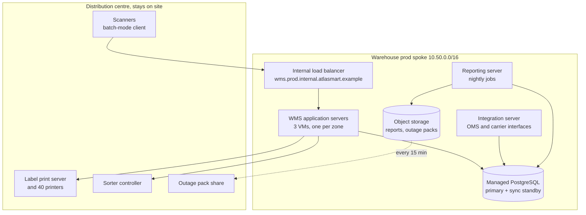
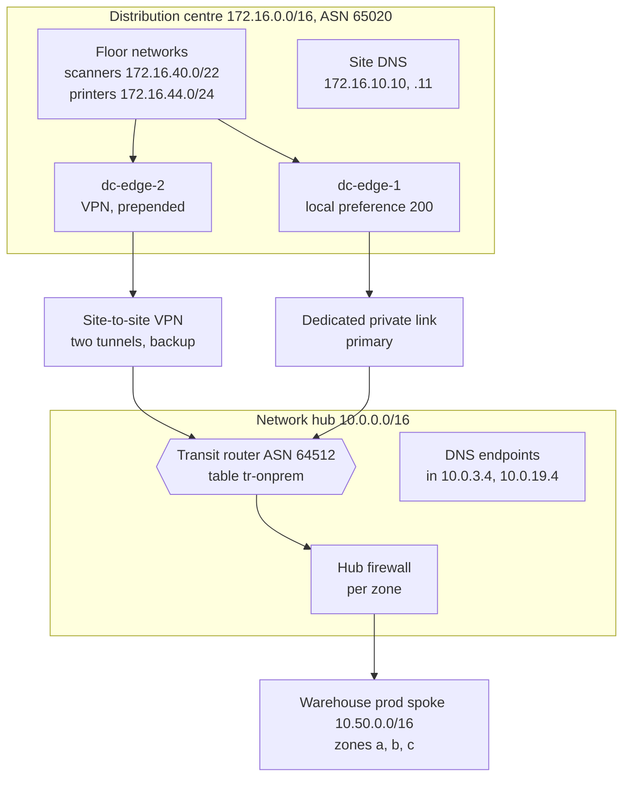
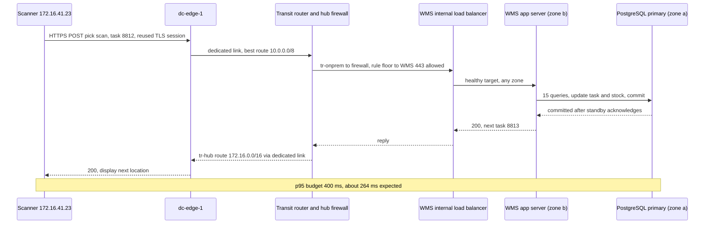
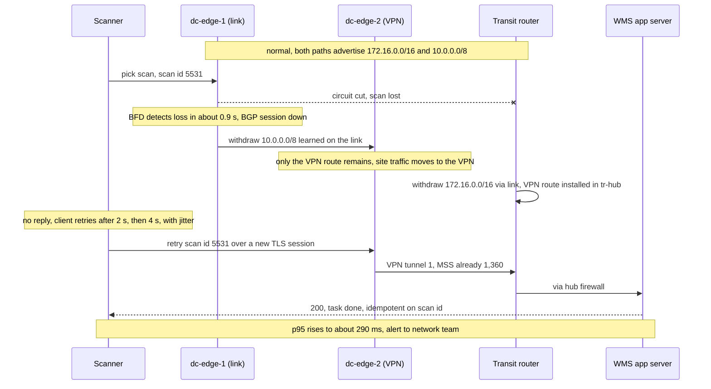
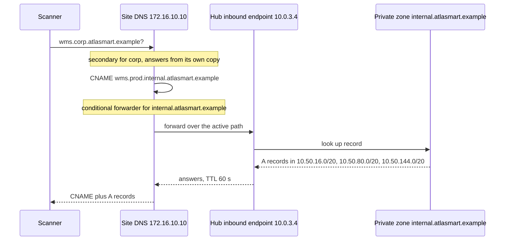
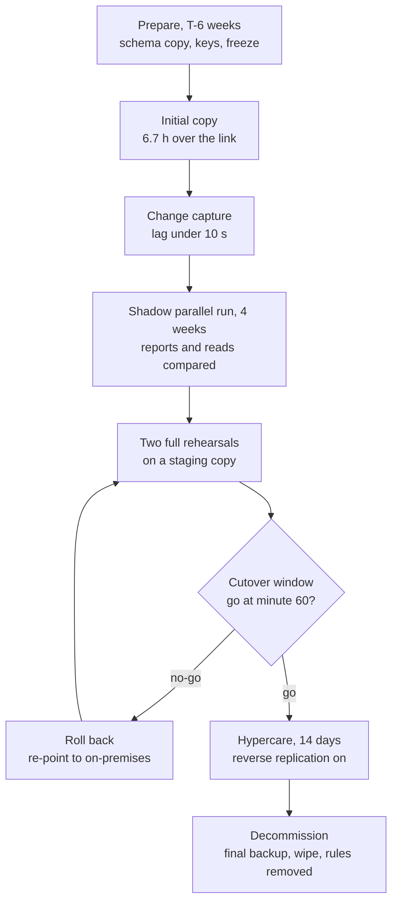

# Case study 09: Hybrid migration with private connectivity

> The warehouse never closes, the scanners never leave, and the database must move anyway. This case
> moves AtlasMart's Warehouse Management System to the cloud in one two-hour window, and shows that
> the hard parts are not the virtual machines but the link the floor now depends on, the names the
> scanners resolve, and the moment after which going back costs more than going forward.

!!! abstract "Case facts"
    **Level:** Advanced (routing, data migration, and the rollback design are Level 3) · **Time:**
    90-120 minutes · **Status:** Draft · **Last verified:** 2026-11-27

The case follows the [design method](../system-design-exercises/design-method.md) and uses AtlasMart
itself: values from [Hybrid connectivity and VPNs](../networking/hybrid-connectivity-and-vpns.md) and
[Legacy modernization and migration](../enterprise-architecture/legacy-modernization-and-migration.md)
are reused unchanged; new numbers are labelled assumptions (W-A*n*). Check provider documentation for
prices, quotas, port speeds, and limits.

## Business context and outcome

AtlasMart (fictional, `atlasmart.example`) ships its 60,000 orders a day from one distribution centre
(assumption W-A1), whose data centre (`172.16.0.0/16`) runs a packaged **Warehouse Management System
(WMS)** on out-of-support virtualization hardware. The enterprise architecture review kept the package
(good business fit) and decided to move its hosting
([enterprise architecture practice](../enterprise-architecture/enterprise-architecture-practice.md)).
The portfolio programme classifies the WMS as **replatform** and schedules it, with about ten related
applications as one move group, in **wave 8 of 10**.

Shifts run around the clock (W-A2). Scanners, label printers, the print server, and the parcel
sorter controller stay on the floor for good, so after the move every scan crosses the hybrid link,
which becomes part of warehouse operations.

Outcomes agreed with the Head of Warehouse Operations and the CIO:

- **O-1:** the WMS runs in the cloud landing zone, with floor scan times within NFR-2.
- **O-2:** cutover pauses the floor at most 2 hours (exercise brief), with no stock movement lost.
- **O-3:** dedicated-link loss moves traffic to the backup VPN without a human; loss of both paths
  leaves the floor in a rehearsed degraded mode.
- **O-4:** the on-premises WMS servers are decommissioned after hypercare.

## Stakeholders and users

| Stakeholder | What they need | Role in decisions |
|---|---|---|
| Floor operators (about 300 scanners in use per shift, W-A6) | Scans that answer as fast as today; a clear procedure when the system is away | Users; represented by shift supervisors |
| Head of Warehouse Operations | Shifts that never stop; a cutover window that avoids trucks and sales | **Business owner**; signs the business go or no-go |
| Warehouse systems team (one of the eight product teams, 6-engineer on-call rotation) | A design it can operate; a runbook it has rehearsed | Builds, migrates, operates the WMS |
| Network team | Predictable BGP, filters, and DNS on the distribution-centre side | Owns the two edge routers and on-site DNS |
| Platform team | The landing zone, hub, transit router, and hybrid link attachments | Owns the cloud side of the link |
| WMS vendor; OMS and Inventory teams | Certified platform; interfaces that keep working | Certify; agree freeze dates |
| Security and privacy lead | Encryption over the link, least privilege, EU residency (C-4) | Reviews trust boundaries |
| CIO and Finance | One decision with known risk; cost drivers and overlap in CU | **Decision maker**; budget |

## Functional requirements

1. **FR-1** Operators scan to receive, put away, pick, pack, and ship; each scan is validated and acknowledged.
2. **FR-2** On pack confirmation the label prints at that pack station within 2 seconds.
3. **FR-3** Released orders arrive from the Order Management System (OMS); shipment confirmations go
   to the OMS and the Logistics Vendor Platform.
4. **FR-4** Inventory planning reads stock through the WMS stock API.
5. **FR-5** Nightly stock and productivity reports are ready by 06:00.
6. **FR-6** Supervisors manage tasks in the WMS web console with workforce single sign-on.
7. **FR-7** When the WMS is unreachable, scanners switch to batch mode (scans queued on the device)
   and supervisors use an outage pack of open tasks on a local share, refreshed every 15 min (W-A11).
8. **FR-8** The migration loses no committed transaction and stays reversible until a named point.

## Non-functional requirements (measurable targets)

| ID | Attribute | Target | How measured |
|---|---|---|---|
| NFR-1 | Cutover downtime | Floor transactions paused at most 120 min (brief); planned 65-75 min | Runbook timestamps from pause to release |
| NFR-2 | Scan latency | p95 ≤ 400 ms and p99 ≤ 800 ms over the dedicated link; p95 ≤ 500 ms on the backup VPN; today's on-premises baseline p95 is 250 ms (W-A10) | Synthetic floor probe every 30 s plus server-side histograms |
| NFR-3 | Availability (SLO) | 99.9% of scans per calendar month succeed within 2 s | WMS load balancer logs; probe results |
| NFR-4 | Link failover | Dedicated link loss moves traffic to the VPN automatically; scans fail for at most 60 s; no acknowledged scan lost | Quarterly failover test in both directions |
| NFR-5 | Migration integrity | Zero difference in row counts and checksums; stock on hand per item and location reconciles | Validation scripts in the window; rehearsal reports |
| NFR-6 | Durability and recovery | Zone loss: RPO 0, RTO 5 min. Region loss: tier 2, RPO 1 h, RTO 4 h | Zone drill; tier 2 game day |
| NFR-7 | Floor continuity | Both paths lost: degraded mode for at least 4 h with no scan lost | Twice-yearly floor drill on a quiet shift |
| NFR-8 | Capacity | Design peak 60 scans/s at ≤ 70% CPU with one zone lost | Load test with one zone's servers removed |
| NFR-9 | Link sharing | Bulk copy and change capture use at most 50% of the dedicated link | Link throughput by traffic class |
| NFR-10 | Reversibility | Before go: rollback ≤ 15 min. During 14-day hypercare: planned rollback ≤ 2 h with RPO 0 | Rollback rehearsed in both rehearsals |
| NFR-11 | Security | TLS on every flow that crosses the link; floor networks reach only the WMS load balancer and DNS; data stays in EU regions (C-4) | Firewall policy review; reachability tests |

NFR-3 is request-based, so a peak-hour failure costs more budget than one at 03:00; paging uses the
platform's burn rates (14.4 over 1 h, 6 over 6 h).

## Workload assumptions and capacity estimates

All values are **AtlasMart assumptions** to be replaced by measurements. Warehouse scans are not the
480,000 carrier scan events a day that Order Tracking ingests.

| # | Assumption | Value |
|---|---|---|
| W-A1 | Orders shipped by the distribution centre | All 60,000 a day; 3 lines per order; 1 parcel per order |
| W-A2 | Operating hours; quietest hour | 24 × 7; Sunday 02:00-03:00 at about 2 scans/s, no truck slots |
| W-A3 | Scans per unit of work | Pick 2 per line (location, item); pack 1 per line; ship 1 per parcel; receiving 50,000 cases a day × 2 |
| W-A4 | Busiest hour share; sale-day factor | 10% of the day; 3× (as the platform's 210/70 reads) |
| W-A5 | Payloads | Scan request 2 KB, response 4 KB; shipping label 50 KB |
| W-A6 | Floor devices | 300 handheld scanners in use per shift, 40 label printers, 1 print server, 1 sorter controller |
| W-A7 | WMS database | PostgreSQL, 1.2 TB with indexes; 412 tables; WAL generated 40 GB a day |
| W-A8 | Link capacities (assumptions, not provider tiers) | Dedicated link port 1 Gbit/s; distribution-centre internet line 500 Mbit/s, of which the backup VPN sustains 200 Mbit/s |
| W-A9 | Round-trip times, distribution centre to hub | Dedicated link 4 ms; VPN 15 ms median, 30 ms p95 |
| W-A10 | Today's scan path | p95 250 ms; 15 sequential database queries per scan |
| W-A11 | Outage pack | Open tasks for the next 4 hours, exported every 15 minutes |
| W-A12 | One WMS application server (8 vCPU) | 40 scans/s at 60% CPU, from the vendor's sizing guide, to be load-tested |

**Scan rate.** Picks 180,000 lines × 2 = 360,000; packs 180,000; ship 60,000; receiving 100,000.
Total **700,000 scans a day**: average 700,000 ÷ 86,400 ≈ **8.1/s**, busiest hour 0.10 × 700,000 ÷
3,600 ≈ **19.4/s**, sale-day design peak 19.4 × 3 ≈ 58, rounded to **60 scans/s**.

**Floor traffic over the link.** Scans 60 × 6 KB = 360 KB/s. Labels: 6,000 parcels in the busiest
hour = 1.67/s, × 3 = 5/s × 50 KB = 250 KB/s. Total ≈ 610 KB/s ≈ **4.9 Mbit/s** at design peak. Floor
traffic is tiny; the link is sized by the migration and by the other 119 applications, not by scans.

**Change rate.** 40 GB of WAL a day, 10% in the busiest hour: 4,000 MB ÷ 3,600 s ≈ 1.1 MB/s ≈ 8.9
Mbit/s, × 3 on a sale day ≈ **27 Mbit/s** (an upper bound: the logical stream is smaller than WAL).

**Bulk copy time.** Migration traffic is capped at 50% of the path (NFR-9) and assumed to run at 80%
efficiency.

| Path | Effective rate | 1.2 TB initial copy | Changes accumulated meanwhile | Catch-up time |
|---|---|---|---|---|
| Dedicated link | 1,000 × 0.5 × 0.8 = 400 Mbit/s | 9.6 × 10¹² bit ÷ 4 × 10⁸ bit/s = 24,000 s ≈ **6.7 h** | 40 GB × 6.7 ÷ 24 ≈ 11 GB | 11 × 8 × 10⁹ ÷ 4 × 10⁸ ≈ 224 s |
| Backup VPN | 200 × 0.5 = 100 Mbit/s | 9.6 × 10¹² ÷ 10⁸ = 96,000 s ≈ **26.7 h** | 40 GB × 26.7 ÷ 24 ≈ 45 GB | 45 × 8 × 10⁹ ÷ 10⁸ ≈ 3,600 s |

Both paths can carry the copy and keep up with 27 Mbit/s of changes; the VPN needs a weekend instead
of a night. The copy therefore starts weeks early and the window only drains seconds of lag.

**Latency budget per scan (p95, milliseconds).**

| Segment | Today | Cloud, dedicated link | Cloud, VPN |
|---|---|---|---|
| Scanner and Wi-Fi | 60 | 60 | 60 |
| Site network and edge router | 5 | 5 | 5 |
| Link round trip (one per scan, TLS session reused) | 0 | 4 | 30 |
| Hub firewall and internal load balancer | 0 | 10 | 10 |
| WMS application processing | 150 | 150 | 150 |
| Database, 15 queries in the same region | 35 | 35 | 35 |
| **Total** | **250** | **264** | **290** |

If the application servers moved and the database stayed (a split move group), each of the 15 queries
would cross the link: 15 × 4 = 60 ms extra on the dedicated link, 15 × 30 = 450 ms at VPN p95, which
alone breaks NFR-2. The arithmetic is ADR-02.

**Application servers.** Design peak 60 ÷ 40 (W-A12) = 1.5, so 2 servers; to survive a zone loss the
remaining two zones must hold 2, so **3 servers, one per zone** (n ÷ (n − 1) for n = 3).

## Constraints and assumptions

- **C-1** Replatform is decided at portfolio level: managed database, rehosted application servers,
  floor devices retained. This case refines it; reversing it needs an ADR to the programme.
- **C-2** AtlasMart's landing zone and platform pipeline; the warehouse team's prod account gets the
  spoke `10.50.0.0/16` (assumption W-A13), inside the advertised `10.0.0.0/8`.
- **C-3** Wave 8; no cutovers in the four weeks before a sale; the dedicated link is live before
  wave 5, so it carries production traffic for three waves before the WMS uses it.
- **C-4** EU data stays in the EU. Labels contain delivery addresses, so the WMS database is
  classified `personal`; replicas and backups stay in EU regions.
- **C-5** Vendor package: configuration and vendor patches only; the vendor certifies managed
  PostgreSQL of the same major version (assumption, confirmed before the wave).
- **C-6** Hybrid values are fixed by the networking page (ASNs, advertisements, MTU, DNS endpoints).

## Architecture options considered

The strategies are defined on the [legacy modernization page](../enterprise-architecture/legacy-modernization-and-migration.md#choosing-among-the-7-rs).

| Option | Summary | Strengths | Weaknesses |
|---|---|---|---|
| A. Rehost | Application and database VMs copied to cloud VMs as they are | Least change; the vendor's current certification applies | The team keeps patching, backing up, and failing over PostgreSQL itself; carries the old HA design |
| B. Replatform (**chosen**) | Application servers rehosted; database moved to managed PostgreSQL with a synchronous standby in another zone | Removes database toil; zone-level failover and point-in-time recovery from the service; same engine, so logical replication works | Vendor must certify the managed service; extensions and parameters are limited to what it allows |
| C. Refactor or repurchase | Re-architect around the package, or replace it with a SaaS WMS | Could remove the VMs entirely | Process change on a 24 × 7 floor; a year or more of work; contradicts "move first, modernize later" |
| D. Retain with hybrid DR | Keep the WMS on premises, replace the hardware, use the cloud as its DR site | No floor dependency on the link; smallest operational change | Buys new hardware for an exit programme; on-premises skills to keep; DR still crosses the link |

Option B removes the database work the team does worst at 03:00 and keeps the engine, so migration
is continuous replication, not a long export. Option D returns as the alternative below.

## Chosen architecture and rationale

**Figure 1 — System context (C4 level 1).** The WMS, its people, the devices that stay on the floor,
and the systems it exchanges data with.

```mermaid
flowchart TB
    OP["Floor operators<br/>handheld scanners"]
    SUP["Supervisors<br/>web console"]
    DEV["On-site devices<br/>label printers, sorter"]
    WMS["Warehouse Management System<br/>(moves to the cloud)"]
    OMS["Order Management System"]
    LVP["Logistics Vendor Platform"]
    INV["Inventory planning"]
    IDP["Identity Provider"]
    OP -->|"scans"| WMS
    SUP -->|"tasks, exceptions"| WMS
    WMS -->|"labels, sort plans"| DEV
    OMS -->|"released orders"| WMS
    WMS -->|"shipment confirmations"| OMS
    WMS -->|"shipment confirmations"| LVP
    INV -->|"stock queries"| WMS
    SUP -.->|"sign-in"| IDP
```

How to read it: operators and devices stay on site, so their arrows cross the hybrid link after the
move; the OMS and inventory arrows become cloud-to-cloud calls, shorter than today.

**Figure 2 — Containers after the move (C4 level 2).** What runs in the cloud and what stays.

How to read it: one load balancer name is the only entry point from the floor. Prints and sort plans
flow outwards from the application servers; the outage pack is pushed to the site so it is there when
the cloud is not.

**Figure 3 — Deployment across the distribution centre and the cloud.** Two paths from two edge
routers, both ending on the transit router and inspected by the hub firewall.

How to read it: both edge routers are ASN 65020; each path advertises exactly `172.16.0.0/16` and
receives `10.0.0.0/8`. Both attachments use `tr-onprem` (everything to the hub firewall); `tr-hub`
prefers the dedicated link's `172.16.0.0/16`, with the VPN route as backup.

Design notes, each reusing the networking page rather than redesigning it:

| Decision | Value | Source |
|---|---|---|
| Advertisements | Cloud → site `10.0.0.0/8` (VPN prepended); site → cloud `172.16.0.0/16` on both paths (VPN prepended `65020 65020 65020`) | Hybrid connectivity page, Step 2 |
| Inbound filters | Cloud accepts exactly `172.16.0.0/16` from both sessions; site accepts exactly `10.0.0.0/8` | Same; prevents the longest-prefix trap |
| Path preference | Site: local preference 200 on dc-edge-1; cloud: platform preference for the dedicated link plus shorter AS path | Same |
| Failure detection | BFD on the dedicated link, 300 ms × 3 (assumption W-A14; check supported values) | RFC 5880 |
| MTU and MSS | Tunnel MTU 1,400; MSS clamped to 1,360 on **both** paths, so a failover does not change segment size | Same, Step 5 |
| Redundancy | Two edge routers, two paths, one site (assumption W-A15); a second dedicated link is the alternative in ADR-04 | Provider resiliency guidance |
| Backup VPN addresses | Site public `198.51.100.20`; provider endpoints `203.0.113.21`, `203.0.113.22`; tunnel inside `169.254.10.8/30` and `169.254.10.12/30` (assumptions W-A16, extending the office pattern) | RFC 5737 documentation ranges |
| Spoke layout (W-A13) | Private-app `/20`s at `10.50.16.0`, `.80.0`, `.144.0`; private-data `/22`s at `10.50.32.0`, `.96.0`, `.160.0`; no public subnets | [Address plan](../networking/networking-fundamentals-ip-cidr-routing-and-dns.md) pattern |

### Provider equivalents

Names checked against each provider's documentation on 2026-11-27; products change, so recheck.
Hybrid DNS and transit names are in the [hybrid connectivity page's table](../networking/hybrid-connectivity-and-vpns.md#provider-equivalents).

| Generic building block | AWS | Azure | Google Cloud |
|---|---|---|---|
| Dedicated private connection | AWS Direct Connect | Azure ExpressRoute | Cloud Interconnect |
| Site-to-site VPN | AWS Site-to-Site VPN | Azure VPN Gateway | Cloud VPN (HA VPN) |
| Managed PostgreSQL with standby in another zone | Amazon RDS Multi-AZ DB instance deployment | Azure Database for PostgreSQL flexible server, high availability | Cloud SQL for PostgreSQL high availability |
| Managed migration with continuous change capture | AWS Database Migration Service | Migration service in Azure Database for PostgreSQL flexible server | Database Migration Service |

## Request and data flow walkthrough

### Happy path: a pick scan after the move

**Figure 4 — One pick scan.** The request crosses the link once; the 15 database queries stay inside
the region.

How to read it: the return path matters as much as the outbound one. The reply leaves through
`tr-hub`, whose route to `172.16.0.0/16` prefers the dedicated link, so both directions pass the same
firewall zone and the stateful rule sees the whole conversation.

### Failure path: the dedicated link fails mid-shift

**Figure 5 — Dedicated link cut, BGP moves traffic to the backup VPN.** No human acts; scanners
retry.

How to read it: each side moves its own traffic, and both must, or the flow becomes asymmetric.
In-flight connections may break (the reply can reach a firewall zone without state), so the client
retries with the same scan id, which the package deduplicates (W-A17). NFR-4's 60 s covers detection,
reconvergence, and retries; when retries run out the client drops into batch mode (FR-7).

When both paths fail, scanners queue (a device holds a shift of scans), supervisors work from the
outage pack, and parcels are staged and labelled after recovery; queued scans then upload at a
throttled 30/s, half the design peak.

### Hybrid DNS during the migration

The scanners, the sorter, and the print server use the name `wms.corp.atlasmart.example`. Keeping
that name stable and moving what it points to is cheaper and safer than reconfiguring 300 scanners
(ADR-03).

| Phase | `wms.corp.atlasmart.example` | Cloud name | Resolution path |
|---|---|---|---|
| Today | A `172.16.20.10` (on-premises load balancer), TTL 3,600 s | none | Site DNS `172.16.10.10`, `.11`: secondaries of the `corp` zone whose primaries are the office servers `192.168.10.10`, `.11` (W-A18) |
| Wave 0 to wave 7 | unchanged | none | Site DNS gains a conditional forwarder for `internal.atlasmart.example` to inbound `10.0.3.4`, `10.0.19.4` |
| T-14 days | TTL lowered to 60 s | `wms.prod.internal.atlasmart.example` → internal load balancer addresses in the three app subnets | Old TTL (1 h) expires many times before the window |
| Cutover, minute 25-35 | becomes CNAME `wms.prod.internal.atlasmart.example` | unchanged | Site DNS answers the CNAME, then forwards the `internal` lookup to the hub |
| After hypercare | CNAME kept; TTL back to 300 s | unchanged | Scanner configuration never changes |

The reverse direction matters too. The WMS resolves `print01.corp.atlasmart.example` (`172.16.44.10`),
but the hub's `corp` rule (outbound `10.0.3.5`, `10.0.19.5`) targets only the office servers, so an
**office** VPN outage would stop distribution-centre printing. The rule therefore lists all four
servers (`192.168.10.10`, `.11`, `172.16.10.10`, `.11`). Discovery also found the sorter and two
interface jobs using the IP literal `172.16.20.10`; they switch to the name in wave 7 (W-A19).

**Figure 6 — A scanner resolves the WMS after cutover.** Each resolver forwards only the other
side's domain, so there is no loop.

How to read it: the `corp` half is answered on site, so it survives an office outage; the `internal`
half crosses whichever path BGP has chosen. Firewalls on both sides allow TCP and UDP 53 between the
site DNS servers and the four hub endpoint addresses only.

## Data model and storage decisions

The WMS schema belongs to the vendor; the decisions are about where data lives and how it moves.

- **Target.** Managed PostgreSQL of the same major version: primary in zone a, synchronous standby
  in zone b (RPO 0 for a zone loss), 14 days of point-in-time recovery, and an asynchronous replica
  in the second EU region for tier 2.
- **Hot and cold data.** Of 1.2 TB, about 30 GB is operational; the rest is append-only history
  partitioned by month (W-A7), which makes in-window validation feasible.
- **Mechanism.** PostgreSQL logical replication: a publication on premises, a subscription on the
  managed database, which copies each table (bulk copy) and then streams changes (CDC) from a slot.

Logical replication has documented restrictions that discovery turned into tasks (findings are
assumptions W-A19):

| Restriction (PostgreSQL docs) | Finding in the WMS | Task |
|---|---|---|
| Schema and DDL are not replicated | Vendor patches change the schema | Copy the schema once with a schema-only dump; vendor change freeze from T-6 weeks to the end of hypercare |
| Sequence values are not kept current on the subscriber | 23 sequences | Runbook sets each to max(id) + 1,000 in the window (automatic sequence refresh needs a PostgreSQL 19 publisher; the source is older) |
| Large objects are not replicated | Scanned delivery notes stored as large objects | Vendor-supported move to an ordinary table before wave 8 |
| Updates and deletes need a primary key or replica identity | 6 tables without a primary key | Replica identity set to full, with a performance test |

A replication slot keeps WAL on the source until the subscriber confirms it, so a weekend link outage
could fill the disk: `max_slot_wal_keep_size` is 200 GB (five days) and an alert fires at 80 GB.

**Figure 7 — Data migration phases.** Weeks of replication, hours of cutover, two weeks of
reversibility.

How to read it: copy and CDC finish long before the window; a no-go returns to rehearsal, not
straight to another attempt.

**Validation**, agreed before the window:

1. **Technical.** Row counts for all 412 tables; checksums (hashes over rows ordered by primary key,
   in key ranges) on closed history partitions in rehearsals and on the 30 GB of hot data in the
   window (30 GB at an assumed 500 MB/s per side, in parallel, ≈ 60 s).
2. **Business.** Stock on hand per item and location, open orders and tasks, last 24 h of shipments.
3. **Non-functional and operational.** Synthetic scan p95 against NFR-2; alerts, backups, runbooks.

**Parallel run, read-only.** A WMS has one writer at a time, so the four-week parallel run shadows
only what has no side effects: the cloud application servers run against the subscriber in the
package's read-only mode (W-A20), produce the nightly reports, and answer a 1% mirror of inventory
planning's stock queries. A comparison job diffs the outputs. Exit criterion: seven consecutive nights
with zero differences. Shipment confirmations and labels are never produced twice.

## API and integration contracts

| Interface | Direction and protocol | Migration notes |
|---|---|---|
| Scanner client | Scanner → `wms.corp.atlasmart.example` HTTPS 443 | Scan id plus device sequence makes retries safe; name stable through the move |
| Label printing | WMS → print server `print01.corp.atlasmart.example`, IPP over TLS (631) | Crosses the link outwards; print jobs retried by the WMS for 10 min, then flagged to the pack station |
| Sort plans | WMS → sorter controller, file push every 5 minutes for the next wave of parcels | Per-parcel decisions stay local on the sorter, so the sorter has no per-parcel dependency on the link |
| Released orders | OMS → WMS integration server, message queue | OMS queues during the window; ordering by order id |
| Shipment confirmations | WMS → OMS and Logistics Vendor Platform, HTTPS | Idempotent on shipment id; paused in the window, released after go |
| Stock API | Inventory planning → WMS, HTTPS, read-only | Shadow-compared during the parallel run |

Interface freezes match the six-week schema freeze, so no interface changes during replication.

## Security and trust boundaries

Three trust zones meet at the hub firewall: the floor networks, the hub, and the warehouse prod spoke.
Allowed flows only; everything else is denied and logged:

| From | To | Port | Why |
|---|---|---|---|
| Scanners `172.16.40.0/22` | WMS internal load balancer | 443 | The only floor entry point |
| WMS app subnets | Print server `172.16.44.10`, sorter controller | 631, 443 | Prints and sort plans |
| Site DNS `172.16.10.10`, `.11` | Hub inbound `10.0.3.4`, `10.0.19.4` | 53 TCP and UDP | `internal` lookups |
| Hub outbound `10.0.3.5`, `10.0.19.5` | Site DNS | 53 TCP and UDP | `corp` lookups |
| Managed PostgreSQL (subscriber) | On-premises database `172.16.30.10` (publisher); reversed in hypercare | 5432, TLS, certificate verified | Replication; the subscriber connects to the publisher; rules expire at decommission |
| Supervisor devices on site | WMS console | 443, SSO | Workforce identity |

- **The link is private, not encrypted.** Every flow that crosses it is TLS end to end, including
  replication (`sslmode=verify-full`) and printing (IPP over TLS); link-layer encryption is not
  bought (the data classification does not require it, a decision for the security lead).
- **Least privilege for migration.** The replication role has replication rights and read access to
  published tables only; its credentials live in the secrets manager and are revoked at decommission.
- **Old secrets.** Rehosted configuration is scanned in wave 7; credentials and certificates are
  rotated into the secrets manager before cutover.
- **Residency (C-4).** Database, backups, cross-region replica, and telemetry stay in EU regions;
  packet captures are time-boxed and deleted. Office-to-prod stays denied.

## Reliability, failover, and disaster recovery

| Failure | Detection | What happens | Floor impact | Meets |
|---|---|---|---|---|
| Dedicated link down | BFD, BGP | Figure 5: both sides move to the VPN | Retries for seconds; p95 about 290 ms | NFR-4 |
| dc-edge-1 router down | BGP on dc-edge-2 | Same as link down | Same | NFR-4 |
| Both paths down | Probe, BGP | Degraded mode (FR-7) | Batch scanning, outage pack, labels later | NFR-7 |
| One WMS app server or zone lost | Load balancer health checks | Two servers carry the 60/s peak | A few retried scans | NFR-3, NFR-8 |
| Database primary's zone lost | Managed failover | Standby promoted; app reconnects | Retries during the failover window | NFR-6 |
| Region lost | Provider status, probes | Tier 2 pilot light in the second EU region; incident commander decides | Degraded mode until restore, up to 4 h | NFR-6, NFR-7 |

Tier 2 is a business decision (assumption W-A21): a region loss puts the floor into degraded mode for
up to 4 hours, which Warehouse Operations accepted because the outage pack covers 4 hours. The tier is
revisited if the sale-day volume makes 4 hours of manual work unacceptable.

## Scaling and performance strategy

- **Bottleneck order at 10× the design peak.** Application servers first (scale out to more VMs behind
  the load balancer, as the package supports), then the database primary's write rate, then the
  link: 4.9 Mbit/s × 10 ≈ 49 Mbit/s of floor traffic, still far below the link and even the VPN.
- **Latency is the real limit.** One link round trip per scan, not fifteen (ADR-02).
- **Migration traffic shaping.** The edge routers mark replication traffic in a lower-priority class
  and rate-limit it to 50% of the link (NFR-9), so a sale-day bulk resync cannot delay scans.

## Observability and operations

- **Floor-to-cloud SLI.** A floor probe does a read-only scan lookup every 30 s through the real
  path; its latency and success, labelled by path, are the SLI for NFR-2 and NFR-3.
- **Link signals** (tier 1 once the WMS moves): BGP and BFD state per path, path in use, throughput
  by class, loss, round trip, and routes received per session (a changed count means a leak).
- **Migration signals:** replication lag in seconds and bytes, retained WAL on the source, apply
  errors, and the nightly parallel-run diff count.
- **Telemetry.** OpenTelemetry collectors on the WMS VMs export through the hub to the platform
  backends; flow logs on both hybrid attachments and DNS query logs go to the log archive account.
- **On-call.** The warehouse rotation pages on SLO burn and on safety alerts (both paths down,
  retained WAL above 80 GB, BGP flapping); the network team is second line for the link.

## Deployment and release strategy

The cutover is a release with a runbook, timed in two rehearsals on a staging copy (assumptions).
Before the window: TTL to 60 s at T-14 days; change freeze at T-7 days; at T-60 min both BGP sessions
up, lag under 10 s, fresh backups, outage pack current. Window: **Sunday 02:00-04:00** (W-A2).

| Minute | Step | Owner | Running total |
|---|---|---|---|
| 0-5 | Scanners to batch mode; OMS feed paused; on-premises WMS services stopped; on-premises database set read-only | Supervisors, warehouse team | 5 |
| 5-25 | Confirm final change applied (subscriber position equals source position); disable subscription; row counts and hot checksums; set 23 sequences; business reconciliation | Warehouse team, operations analyst | 25 |
| 25-35 | Cloud servers switched from read-only to read-write; reverse publication and subscription created (cloud → on premises); interfaces re-pointed; DNS CNAME applied; site DNS caches flushed | Warehouse and network teams | 35 |
| 35-60 | Smoke tests from a floor scanner over the link: receive, put away, pick, pack, ship a test order; label printed at a pack station; test order in from OMS; confirmation to the carrier test endpoint; synthetic p95 | Warehouse team, supervisors | 60 |
| 60 | **Go or no-go** against the criteria; Head of Warehouse Operations and migration lead decide | Business owner | 60 |
| 60-75 | Go: scanners leave batch mode, about 7,800 queued scans upload at 30/s in about 4.3 min, OMS feed resumes. No-go: DNS back to the A record, on-premises database read-write, services started | Warehouse team | 75 |
| 75-120 | Buffer | — | 120 |

Queued scans: 65 minutes × 60 s × 2 scans/s ≈ 7,800; at 30/s that is 260 s. Planned floor downtime is
pause to release, about 65-70 minutes, inside NFR-1's 120.

**The rollback point is the go decision at minute 60.** Before it, the on-premises database received
no writes after minute 5, so rollback is a re-point (15 minutes, rehearsed twice). After it, new
writes exist only in the cloud; reverse replication keeps the on-premises database current for the
14 days of hypercare, so a planned rollback is a second window with RPO 0 (NFR-10). The **point of no
return** is the end of hypercare, when reverse replication stops and the source is decommissioned.

## Cost model

Illustrative rates, never prices: 1 vCPU-hour = 1 CU; 1 GB-month of storage = 0.1 CU; 1 GB crossing
the link from the cloud = 0.02 CU; dedicated port-hour = 3 CU (all assumptions). Monthly, 730 hours:

| Driver | Quantity | CU per month |
|---|---|---|
| Application, integration, reporting VMs | (3 × 8 + 4 + 4) = 32 vCPU × 730 | 23,360 |
| Managed PostgreSQL primary and standby | 2 × 16 vCPU × 730 | 23,360 |
| Database storage and backups | 1.2 TB × 2 copies + 1.2 TB full + 14 × 40 GB of logs ≈ 4,160 GB × 0.1 | 416 |
| Tier 2 replica in the second EU region | 8 vCPU × 730 + 1,200 GB × 0.1 | 5,960 |
| Data crossing the link | (2.8 GB scan replies + 3 GB labels) a day × 30 ≈ 174 GB × 0.02 | 3.5 |
| **WMS total** | | **≈ 53,100** |
| Dedicated port (shared by all 120 applications, platform showback) | 730 × 3 | 2,190 |

**Unit cost:** 53,100 ÷ (60,000 × 30 = 1.8 M orders) ≈ **0.03 CU per order** for warehouse management.

**What changes the number most.** Compute, not the link (data crossing it is 0.007% of the total).
Levers: run the reporting VM only its 5 nightly hours (4 × 5 × 30 = 600 CU instead of 2,920);
right-size the database after hypercare (8 vCPU halves 23,360); commit the steady base. **The
overlap:** the on-premises WMS (assumed 30,000 CU-equivalent a month) runs about two more months,
about 60,000 CU, which is why decommissioning is a dated step.

## Risks and mitigations

| Risk | Likelihood | Impact | Mitigation |
|---|---|---|---|
| Vendor does not certify the managed service version | Low | High | Support matrix confirmed before wave 7; fallback is option A (rehost the database) on the same plan |
| Link failover slower than 60 s or asymmetric | Medium | High | Quarterly test in both directions; BFD; identical prefixes; scanner retries and batch mode |
| Both paths fail during a shift | Low | High | Degraded mode with a 4-hour outage pack; twice-yearly drill; second link revisit (ADR-04) |
| Hidden consumer of the old IP address | Medium | Medium | Flow logs over a full month; IP literals removed in wave 7; old address left answering with an error page for hypercare |
| Replication slot fills the source disk | Medium | High | `max_slot_wal_keep_size` 200 GB, alert at 80 GB |
| Sequence or large-object gap after cutover | Low | High | Runbook step with a check query; large objects moved before the wave |
| Rollback after go needed late in hypercare | Low | High | Reverse replication with monitoring; schema freeze; rehearsed reverse cutover |
| Overlap period stretches | Medium | Medium | Decommission date in the plan; overlap shown in showback monthly |

## Architecture Decision Records

### ADR-01: Replatform the WMS (rehost application servers, managed PostgreSQL)

- **Context.** The package fits; the hardware does not. The team is small and the database is the
  part it operates worst. The portfolio classification is replatform (C-1).
- **Decision.** Rehost the application, integration, and reporting servers on cloud VMs; move the
  database to managed PostgreSQL of the same major version with a synchronous standby.
- **Consequences.** Failover, backups, and PITR come from the service; vendor certification gates
  the wave; refactoring and SaaS replacement go to the debt register.

### ADR-02: Move the whole move group in one window, never split across the link

- **Context.** 15 sequential queries per scan; splitting application and database adds 60 ms on the
  link and about 450 ms at VPN p95 per scan.
- **Decision.** Application servers, integration server, reporting server, and database move in the
  same window; only the floor devices, print server, and sorter remain on site, each called at most
  once per business event.
- **Consequences.** A larger window to rehearse; one extra round trip per scan; new synchronous
  cross-link interfaces need design review.

### ADR-03: Logical replication with reverse replication through hypercare

- **Context.** NFR-1 allows 2 hours; a 1.2 TB copy takes 6.7 hours on the link. Rollback after go
  must not lose the floor's new writes.
- **Decision.** Bulk copy and CDC through PostgreSQL logical replication weeks before the window; at
  cutover, create the reverse subscription before writes start; keep the scanner-facing name and move
  it by CNAME with a 60 s TTL.
- **Consequences.** The window drains seconds of lag; DDL, sequences, and large objects are manual;
  the source runs 14 more days under a schema freeze; the managed service must allow being a logical
  replication publisher (check the provider's documentation).

### ADR-04: Dedicated link with VPN backup, not a second dedicated link

- **Context.** After cutover every scan crosses the link. Provider resiliency guidance puts a VPN
  backup at the lower-criticality end; the floor has a degraded mode.
- **Decision.** One dedicated link on dc-edge-1, the site-to-site VPN on dc-edge-2 as backup,
  identical prefixes, BFD, MSS clamped on both; degraded mode for total loss.
- **Consequences.** Failover keeps operations running at a higher latency; a single site entry or
  shared building risk remains. **Revisit** if total link loss happens more than once a year, if the
  floor's latency budget tightens, or if a second distribution centre doubles the dependency.

## Alternative designs and why they were rejected

**Keep the WMS on premises and move only reporting** (a variant of option D) is the plausible
alternative: buy new virtualization hardware for the WMS, replicate its database to the cloud with
the same CDC pipeline, and run the nightly reports, the stock API, and analytics from the cloud copy.
The floor then never depends on the link; only reporting does.

It was rejected now because it buys hardware in the middle of a data-centre exit, keeps on-premises
database skills and backups the team wants to drop, and leaves the WMS as one of the retained systems
that the programme has to justify. It would be the better choice when:

- The floor's latency budget is tighter than one link round trip can meet, for example a
  high-speed sorter that needs per-parcel decisions in a few milliseconds.
- The vendor will not certify any cloud-hosted configuration, or its licence is tied to on-premises
  hardware.
- The site cannot get a second path with real diversity, and Warehouse Operations will not accept
  degraded mode as the answer to total link loss.
- The data-centre lease or hardware refresh already runs for years, so the exit date does not drive
  the decision.

Also set aside: **a SaaS WMS** (a later modernization) and **a phased cutover by process**, which
would need two writers on one stock ledger.

## Questions for the learner

1. Redo the bulk-copy table if migration traffic may use 80% of the link. When would you still start
   the copy weeks early?
2. The vendor reports 40 sequential queries per scan in a new release. Recompute the budget on the
   VPN. What do you change?
3. A supervisor proposes a weekday cutover at 14:00 "because everyone is awake". Use the scan rates
   to estimate the queued scans and the upload time, and argue for or against.
4. Where exactly is the point of no return if reverse replication was never built?
5. Name two changes that would make you revisit ADR-04 tomorrow.
6. Which single alert would you page on first in the hour after go, and why?

## Related topics

- **Before:** [Hybrid connectivity and VPNs](../networking/hybrid-connectivity-and-vpns.md);
  [Networking fundamentals: IP, CIDR, routing, and DNS](../networking/networking-fundamentals-ip-cidr-routing-and-dns.md);
  [Legacy modernization and migration](../enterprise-architecture/legacy-modernization-and-migration.md).
- **Alongside:** [Hybrid and multi-cloud architecture](../enterprise-architecture/hybrid-and-multi-cloud-architecture.md);
  [Multi-account strategy and infrastructure automation](../cloud-architecture/multi-account-strategy-and-infrastructure-automation.md);
  [Disaster recovery strategies](../reliability-and-disaster-recovery/disaster-recovery-strategies.md);
  [Network security, load balancing, and traffic flow](../networking/network-security-load-balancing-and-traffic-flow.md);
  [Scaling, partitioning, and replication](../distributed-systems/scaling-partitioning-and-replication.md);
  [Cloud and enterprise platform exercises](../system-design-exercises/cloud-and-enterprise-platform-exercises.md)
  (hybrid network and cloud migration briefs).
- **Planned:** CDC and low-downtime database migration in depth (D06-T03); event-driven integration
  across sites (D08-T02).

## References

| Source | Type | Checked |
|---|---|---|
| PostgreSQL documentation: [Logical Replication](https://www.postgresql.org/docs/current/logical-replication.html), its [Restrictions](https://www.postgresql.org/docs/current/logical-replication-restrictions.html), and [Replication settings](https://www.postgresql.org/docs/current/runtime-config-replication.html) (`max_slot_wal_keep_size`) | Official documentation | 2026-11-27 |
| [About the migration strategies](https://docs.aws.amazon.com/prescriptive-guidance/latest/large-migration-guide/migration-strategies.html) — AWS Prescriptive Guidance | Official guidance | 2026-11-27 |
| [Plan your migration](https://learn.microsoft.com/azure/cloud-adoption-framework/migrate/plan-migration) — Microsoft Cloud Adoption Framework | Official guidance (cutover and rollback planning) | 2026-11-27 |
| [Migrate to Google Cloud: Transfer your large datasets](https://cloud.google.com/architecture/migration-to-google-cloud-transferring-your-large-datasets) — Google Cloud Architecture Center | Official guidance (transfer time and methods) | 2026-11-27 |
| [Patterns of Legacy Displacement](https://martinfowler.com/articles/patterns-legacy-displacement/) — Ian Cartwright, Rob Horn, and James Lewis | Article series (transitional architecture, dark launching) | 2026-11-27 |
| [Using S2S VPN as a backup for Azure ExpressRoute Private Peering](https://learn.microsoft.com/azure/expressroute/use-s2s-vpn-as-backup-for-expressroute-privatepeering) — Microsoft; [AWS Direct Connect Resiliency Toolkit](https://docs.aws.amazon.com/directconnect/latest/UserGuide/resiliency_toolkit.html) — AWS | Official documentation (dedicated link with VPN backup, resiliency models) | 2026-11-27 |
| [RFC 5880: Bidirectional Forwarding Detection (BFD)](https://www.rfc-editor.org/rfc/rfc5880) | Standard | 2026-11-27 |
| Names in the equivalence table: [AWS Direct Connect](https://docs.aws.amazon.com/directconnect/latest/UserGuide/Welcome.html), [AWS Site-to-Site VPN](https://docs.aws.amazon.com/vpn/latest/s2svpn/VPC_VPN.html), [Multi-AZ DB instance deployments for Amazon RDS](https://docs.aws.amazon.com/AmazonRDS/latest/UserGuide/Concepts.MultiAZSingleStandby.html), [AWS Database Migration Service](https://docs.aws.amazon.com/dms/latest/userguide/Welcome.html), [Azure ExpressRoute](https://learn.microsoft.com/azure/expressroute/expressroute-introduction), [Azure VPN Gateway](https://learn.microsoft.com/azure/vpn-gateway/vpn-gateway-about-vpngateways), [High availability in Azure Database for PostgreSQL flexible server](https://learn.microsoft.com/azure/postgresql/high-availability/concepts-high-availability), [Migration service in Azure Database for PostgreSQL](https://learn.microsoft.com/azure/postgresql/migrate/migration-service/overview-migration-service-postgresql), [Cloud Interconnect](https://cloud.google.com/network-connectivity/docs/interconnect/concepts/overview), [Cloud VPN](https://cloud.google.com/network-connectivity/docs/vpn/concepts/overview), [Cloud SQL for PostgreSQL high availability](https://cloud.google.com/sql/docs/postgres/high-availability), [Database Migration Service](https://cloud.google.com/database-migration/docs/overview) | Official documentation | 2026-11-27 |

## Review notes

- Uses AtlasMart itself. Reused unchanged: hybrid values (ASNs, `10.0.0.0/8`, exact-prefix filters,
  local preference 200 and prepending, MTU 1,400 / MSS 1,360, office DNS and hub endpoints,
  `tr-onprem`, `tr-hub`) and the portfolio facts (replatform, wave 8, move group of about ten, no
  cutovers four weeks before a sale, link live before wave 5, go at 60 / rollback 15 / buffer 45).
- New assumptions are W-A1 to W-A21 in the page (scan model, database size and WAL rate, link
  capacities and RTTs, spoke `10.50.0.0/16`, backup VPN addresses, site DNS servers, floor subnets,
  discovery findings, tier 2, Sunday window, 14-day hypercare) plus the illustrative cost rates and
  the 30,000 CU on-premises equivalent. Reviewer: recompute 700,000 scans and 60/s, 4.9 Mbit/s,
  6.7 h and 26.7 h, the 264/290 ms budgets, 7,800 queued scans, and 53,100 CU.
- Timing agrees with the legacy modernization page and the enterprise architecture roadmap: the WMS
  move group is wave 8 (about mid-2028 on the roadmap). This page states no calendar dates.
- PostgreSQL restrictions and `max_slot_wal_keep_size` were read from the linked docs on 2026-11-27;
  whether each managed service can act as a logical replication publisher is left to provider docs.
  No price, port speed, quota, or failover time is quoted. Seven figures; check Figures 3 and 5 on a
  phone and in dark mode.
