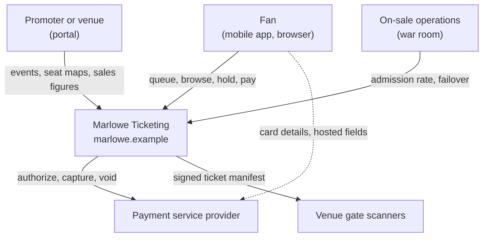
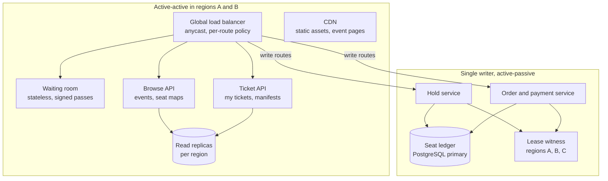
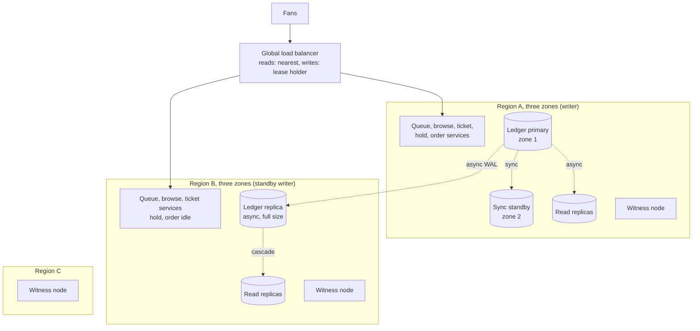
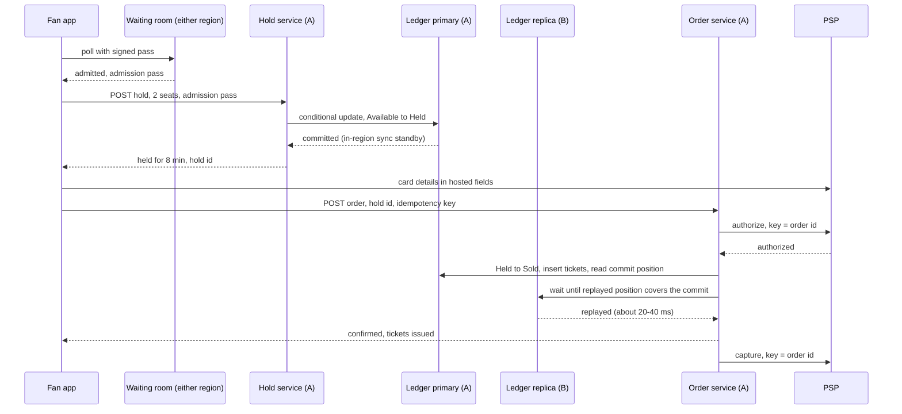
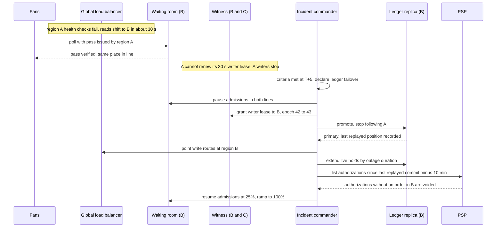
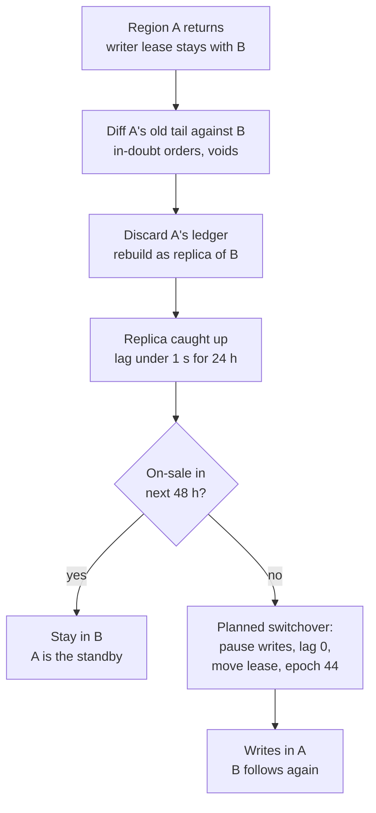

# Case study 10: Multi-region disaster recovery

> A ticketing company can lose a few seconds of seat holds in a regional outage and apologise. It
> cannot sell the same seat to two fans. This case splits one product into the parts that can run
> in two regions at once (browsing, the waiting room, static content) and the part that must have
> exactly one writer (the seat ledger and payments), then designs the failover, fencing, failback,
> and cost of each.

!!! abstract "Case facts"
    **Level:** Advanced (Level 3 throughout) · **Time:** 90-120 minutes · **Status:** Draft ·
    **Last verified:** 2026-11-27

The case follows the [design method](../system-design-exercises/design-method.md) and applies
[Disaster recovery strategies](../reliability-and-disaster-recovery/disaster-recovery-strategies.md),
[High availability design](../reliability-and-disaster-recovery/high-availability-design.md), and
[Advanced resilience and failure containment](../reliability-and-disaster-recovery/advanced-resilience-and-failure-containment.md)
without repeating them. Every number is a labelled **Marlowe assumption** or arithmetic from one;
for prices, quotas, limits, and failover times, check the provider's current documentation.

## Business context and outcome

Marlowe Ticketing (fictional, `marlowe.example`) sells tickets for concerts, theatre, and sport on
behalf of venues and promoters in one country. Most days are quiet; a few times a month a large
**on-sale** opens (a stadium tour, a cup final), and in its first fifteen minutes more people visit
than in a normal week, all wanting the same few thousand good seats.

Marlowe runs in one region across three zones, with one PostgreSQL primary holding seat inventory
and orders. Last spring a provider networking event made that region unreachable for 2 hours 50
minutes on a weekday (fictional figure), with no on-sale running. The promoter of the year's largest
tour then asked: "what happens if that happens ten minutes into my on-sale?" The honest answer was
"we stop selling until the region comes back, and we cannot say when".

The outcomes agreed with the CEO and the largest promoters:

- **O-1:** no seat is ever sold to two fans, in any failure, including a regional one.
- **O-2:** a regional outage during an on-sale stops sales for at most 20 minutes, and fans keep
  their place in the waiting room.
- **O-3:** no fan is charged without receiving a ticket; no confirmed ticket is lost.
- **O-4:** browsing, the waiting room, and "my tickets" keep working through a regional outage.
- **O-5:** recovery is rehearsed every quarter, with measured results shared with the promoters.

## Stakeholders and users

| Stakeholder | What they need | Role in decisions |
|---|---|---|
| Fans | A fair queue, a seat they chose, one charge, a ticket that scans at the gate | Users; represented by Customer Operations |
| Promoters and venues | Sell-through, no oversold seats, live sales figures, a credible outage story | External; drive O-2 and O-5 |
| On-sale operations team | A staffed war room for each large on-sale, clear go/no-go criteria | Run on-sales; the incident commander (IC) comes from here |
| CTO | A design the teams can operate and rehearse, with a known residual risk | **Decision maker** |
| Ledger and payments team (7 engineers) | One writer, provable invariants, a failover they can rehearse | Own the seat ledger and payments |
| Payment service provider (PSP) | Idempotent requests, voids for authorizations not captured | External; multi-region on its side (assumption) |
| Finance | Cost of the second region as drivers before approval | Approves budget |

## Functional requirements

1. **FR-1** Anyone can browse events, venues, and seat maps without signing in.
2. **FR-2** For a scheduled on-sale, fans arriving before opening are placed in random order; later
   arrivals join the end of the line. Admitted fans receive a time-limited admission pass.
3. **FR-3** An admitted fan holds up to 8 seats, chosen on the map or as "best available"; a hold
   lasts 8 minutes (assumption).
4. **FR-4** The fan pays through the PSP's hosted payment fields; Marlowe never sees card data.
5. **FR-5** A confirmed order issues mobile tickets with signed barcodes, scanned at the gate.
6. **FR-6** Promoters see sales per event, at most 60 seconds behind.
7. **FR-7** Customer Operations can refund an order and return its seats to sale.

## Non-functional requirements (measurable targets)

Targets are per tier of the product, because the parts fail differently. RPO is measured in data
lost, RTO from the moment of failure (not from the page) to service restored.

| ID | Part | Target | How measured |
|---|---|---|---|
| NFR-1 | Seat invariant | Zero seats with more than one valid ticket, ever | Database uniqueness constraint; audit query every minute; per game day |
| NFR-2 | Order confirmations and payments | RPO 0; no capture without a confirmed order in both regions | Game-day reconciliation: PSP captures against orders in the surviving region |
| NFR-3 | Seat holds | RPO ≤ 10 s during on-sales (lost holds are re-selectable) | Replication lag of the ledger to region B, alert above 5 s |
| NFR-4 | Sales (holds and checkout) | RTO ≤ 20 min during an on-sale; ≤ 60 min otherwise | Game day: time from fault injection to the first successful synthetic purchase |
| NFR-5 | Waiting room | RTO ≤ 2 min; zero fans lose their place | Synthetic queue clients in both regions; position before and after |
| NFR-6 | Browsing and seat maps | RTO ≤ 2 min; catalogue edits RPO ≤ 60 s | External synthetic checks every 10 s from three locations |
| NFR-7 | "My tickets" and gate scanning | RTO ≤ 2 min for the app; gates scan for 24 h with no connection | Gate devices hold the event's signed manifest |
| NFR-8 | Promoter reporting | RTO ≤ 4 h; rebuilt from the ledger | Restore drill |
| NFR-9 | Capacity | Either region alone carries a full on-sale at ≤ 70% CPU | Load test of region B alone, before each quarter |
| NFR-10 | Latency | p95 ≤ 300 ms for a hold; p95 ≤ 3 s for checkout including the PSP | Per-route histograms |

NFR-1 and NFR-2 are absolute; everything else trades against cost. That asymmetry decides the
design: anything that touches the invariant gets one writer, and everything else is allowed to be
active-active.

## Workload assumptions and capacity estimates

| # | Marlowe assumption | Value |
|---|---|---|
| A-1 | Tickets sold per year; average tickets per order | 30,000,000; 2.5 |
| A-2 | Largest on-sale: dates × seats | 10 × 60,000 = 600,000 seats |
| A-3 | Fans arriving in the first 15 minutes; share in the first minute | 2,000,000; 25% |
| A-4 | Waiting-room status poll interval per fan | 15 s |
| A-5 | Admission rate set by on-sale operations | 20,000 fans per minute |
| A-6 | Per admitted fan: hold attempts; share who buy; time from admission to leaving | 3; 70%; 8 min |
| A-7 | Ledger write-ahead log (WAL) volume per write | 1 KB |
| A-8 | Round trip between region A and region B | 20 ms |
| A-9 | Large on-sales per month; on-sale capacity window | 8; 4 h each |
| A-10 | One queue-status instance (4 vCPU) at 70% CPU | 5,000 polls/s (to be load-tested) |

**A normal day:** 30,000,000 ÷ 2.5 = 12,000,000 orders a year ÷ 365 ≈ **32,900 a day**, about 0.4/s.
Nothing about it needs a second region. **The on-sale spike:**

- **Arrivals:** 25% of 2,000,000 in the first minute is 500,000 ÷ 60 ≈ **8,300 arrivals/s**; the
  other 1,500,000 over 14 minutes ≈ 1,800/s.
- **Waiting-room polls:** 2,000,000 fans polling every 15 s = **133,000 polls/s**. That is 100 times
  any other rate in the system, and every poll is a read: this is why the queue must be stateless,
  cheap, and served from both regions.
- **Admitted fans:** 20,000 per minute = 333/s. Holds: 333 × 3 = **1,000 holds/s**. Confirmations:
  333 × 0.7 = **233 orders/s**, or 233 × 2.5 ≈ 583 tickets/s.
- **Sell-out time:** 600,000 ÷ 583 ≈ 1,030 s ≈ **17 minutes**, after about 333 × 1,030 ≈ 343,000
  admissions. The other 1.66 million fans learn "sold out" from the waiting room and never reach the
  ledger.
- **Concurrent shoppers (Little's Law):** 333/s × 480 s ≈ **160,000 fans** mid-purchase at once.
- **Ledger writes:** 1,000 holds + 233 confirmations + about 300 releases and expiries (assumption)
  ≈ **1,500 writes/s**, within reach of one well-sized primary with per-seat rows; to be load-tested.
- **Cross-region replication:** 1,500 × 1 KB = 1.5 MB/s ≈ **12 Mbit/s** during an on-sale; about
  50 KB/s on a normal day (assumption: about 50 writes/s). Bandwidth is not the problem; lag under
  burst is.
- **Queue fleet:** 133,000 ÷ 5,000 = 27 instances (108 vCPU), in *each* region (NFR-9).
- **Ledger size:** 30,000,000 tickets × 1 KB = 30 GB a year, plus seat maps and orders: under
  200 GB, small enough to re-seed a region in about an hour (failback, below).

## Constraints and assumptions

- **C-1** One cloud provider. Two full regions in the same country (residency; legal review
  confirmed both for Marlowe, which is not advice for anyone else), A-8 apart, plus a small third
  region used only for a lease witness.
- **C-2** About 40 engineers; on-call per team; a war room staffed for each large on-sale.
- **C-3** The PSP supports idempotency keys, authorization then capture, voiding uncaptured
  authorizations, and listing authorizations by time window (assumptions; confirm in the contract).
- **C-4** Large on-sales are announced at least a week ahead, so capacity can be scheduled.
- **C-5** Card data stays with the PSP (hosted fields), keeping Marlowe's card-data scope small.
- **C-6** Failover of the seat ledger is a human decision by the IC, with pre-approved criteria
  for on-sales; nothing fails the ledger over automatically.

## Architecture options considered

| Option | Summary | Strengths | Weaknesses |
|---|---|---|---|
| A. One region, three zones (today) | Everything in region A; cross-region backups | Simple; RPO 0 for zone loss | O-2 and O-4 fail: a regional outage stops everything for hours |
| B. Whole stack active-passive | A warm copy of everything in region B; DNS failover | One data model; well understood | The waiting room and browsing go dark during failover; 133,000 polls/s land on a cold region; queue positions lost |
| C. Split: active-active edges, single-writer ledger (**chosen**) | Queue, browsing, static content, and ticket access serve from both regions; the ledger has one writer, replicated to B, fenced failover | Meets O-1 to O-4; the busiest tier never fails over | Two consistency regimes to explain and test; confirmation pays a cross-region wait |
| D. Active-active partitioned ledger | Each event has a home region that is its writer; regions replicate each other's events | No idle writer; a region loss halts half the on-sales | One mega on-sale is one partition, so each region must be sized for it anyway; routing by event; more to rehearse |
| E. Multi-writer ledger with conflict resolution | Both regions accept holds and merge | Lowest latency, no failover | Violates O-1: two holds on one seat cannot be merged, only one fan can win, after both were told yes |

Option E is not a cost trade-off; it is impossible for this invariant. "At most one valid ticket per
seat" is a uniqueness constraint, and Bailis et al. show that uniqueness cannot be preserved by
replicas that accept writes independently and merge later: some coordination must happen before
the fan is told "yours". The only choices are *where* the coordination happens (one writer for
everything, or one writer per partition) and *what the fan sees while it is impossible*
(sales pause). Options C and D are the two honest answers; the PACELC reading is PC/EC for the
ledger and PA/EL for everything around it (see
[Consistency models, CAP, and PACELC](../distributed-systems/consistency-models-cap-and-pacelc.md)).

## Chosen architecture and rationale

Option C. The rule is one sentence: **if a request can change who owns a seat or who is charged, it
goes to the single writer; everything else is served by whichever region is closer and healthy.**

**Figure 1 — System context (C4 level 1).** Marlowe, its users, and the external systems on the
purchase path.



How to read it: the dashed arrow never touches Marlowe, so card data is out of scope. The PSP is the
one external system on the purchase path, and it becomes the second source of truth in the failure
path.

**Figure 2 — Containers (C4 level 2), grouped by replication regime.** The top group runs in both
regions and serves from both; the bottom group has one writer at a time.



How to read it: the global load balancer has two policies. Read routes go to the nearest healthy
region; write routes (`/v1/holds`, `/v1/orders`) go to whichever region holds the writer lease.
Read replicas are fed from the ledger, so seat maps are seconds stale by design; the hold itself
re-checks on the writer.

- **Waiting room.** Each region runs its own line per on-sale; the global load balancer splits
  arrivals. A fan's place is a **signed pass** held by the client (on-sale id, arrival time, random
  draw, position, expiry, key id), so either region honours the other's passes without shared
  state. Each region admits half of the 20,000 per minute; fairness between lines is approximate
  (within one poll interval), accepted and documented to promoters.
- **Browse and ticket APIs** read from per-region replicas and caches; catalogue edits by promoters
  write to the ledger region and appear elsewhere within NFR-6's 60 s.
- **Hold and order services** run in both regions, but only the instances in the lease holder's
  region accept write routes; the others answer `503` with a retry hint.
- **Gate scanners** download a signed manifest per event and scan offline (NFR-7): the venue's
  front door does not depend on either region being up at 7 p.m.

**Figure 3 — Deployment across two regions and a witness.** Normal state, with region A holding the
writer lease.



How to read it: dotted arrows are replication. Region B's ledger replica is full size because it
becomes the writer; its read replicas cascade from it, so B's browsing keeps working even if the
cross-region link is cut. The three witness nodes form a majority from any two regions; region C
runs nothing else.

### Provider equivalents

Names checked against each provider's documentation on 2026-11-27; products change, so recheck.

| Generic building block | AWS | Azure | Google Cloud |
|---|---|---|---|
| Global anycast front door with per-route backends | AWS Global Accelerator | Azure Front Door | Global external Application Load Balancer |
| DNS failover driven by health checks | Amazon Route 53 health checks and DNS failover | Azure Traffic Manager | Cloud DNS routing policies (failover routing policy) |

## Request and data flow walkthrough

### Happy path: hold, pay, confirm

**Figure 4 — A purchase during an on-sale.** The wait for region B is the line that buys RPO 0 for
confirmations.



How to read it: holds are acknowledged once the in-region synchronous standby has them, so only a
regional loss can lose them. Confirmations are acknowledged only after region B has replayed them:
one cross-region round trip plus replay, against a checkout already spending a second or more at
the PSP. Capture comes last, so nobody is charged for an order region B does not know.

The wait uses the database's own log position: the Order service reads its commit's position and
polls the replica until its replayed position (`pg_last_wal_replay_lsn()` in PostgreSQL) has passed
it, with a 10 s time box. If the wait times out, the order stays `pending` and the fan sees
"confirming"; a background checker finishes it when region B catches up.

### Failure path: region A lost ten minutes into an on-sale

**Figure 5 — Region A becomes unreachable at peak.** Read paths shift on their own; the writer moves
only on the IC's decision, after the old writer's lease has expired.



How to read it: time runs downward. Fans in line notice at most a slow poll; their place travels in
their pass. The ledger is promoted only after the witness majority (B and C) moves the lease, and
promotion detaches B from A's stream, so a half-alive region A can never again confirm anything.

**Fencing in four layers.** Split brain needs two writers *and* a resource that accepts both
(see [Advanced resilience](../reliability-and-disaster-recovery/advanced-resilience-and-failure-containment.md#step-5-prevent-split-brain-fencing-quorum-witness)).
Marlowe removes both, four ways:

1. **Lease.** Services write only while their region holds the writer lease from the three-region
   witness (30 s, renewed every 10 s; assumptions). A cut-off region A stops itself at expiry;
   region B is promoted no earlier than lease plus a 15 s clock-drift margin after A's last renewal.
2. **Structural.** A confirmation needs region B's acknowledgement; after promotion nothing follows
   A, so no confirmation, capture, or ticket can come out of A.
3. **Epoch.** Every hold, order, capture, and barcode carries the ledger epoch (43 now); the PSP
   adapter and ticket issuer refuse older epochs than the witness reports.
4. **Routing and credentials.** Write routes leave region A, and its database credentials are revoked
   if its control plane answers: the least reliable layer in a regional event, so last, not only.

### Loss-window arithmetic

The failure lands at the on-sale's peak write rate of 1,500 writes/s (A-7 to A-9 and the estimate).

| Data | Replication to B | Worst-case loss at failure | What the fan sees |
|---|---|---|---|
| Confirmed orders and tickets | Waited for (NFR-2) | **0** | Ticket present in region B |
| Holds | Asynchronous; lag normally ≤ 1 s, alert above 5 s | 1,000 holds/s × 1 s = **1,000** holds; at the 5 s alert threshold **5,000** | "Your selection expired, pick again"; admission pass still valid |
| Orders in flight (authorized, not yet acknowledged by B) | Not yet | 233 orders/s × about 3.5 s (PSP plus commit plus wait) ≈ **820** authorizations | "We could not confirm, you have not been charged"; the authorization is voided |
| Waiting-room places | Held by the client in the pass | **0** | Nothing |
| Catalogue edits | Asynchronous | ≤ 60 s of promoter edits | Promoter re-applies (rare during an on-sale) |

NFR-3's 10 s bound covers twice the alert threshold; if lag ever exceeds 10 s during an on-sale,
admissions are slowed automatically until it falls (lag is a capacity signal, not only a DR signal).
Holds on surviving seats are extended by the outage duration so the 160,000 fans mid-purchase do
not all race the clock when sales resume.

### Failover critical path

**Figure 6 — Sales failover during an on-sale, minutes after the failure.** The war room is already
staffed, so detection and decision are short; every bar is an assumption until a game day measures
it.

```mermaid
gantt
    title Ledger failover during an on-sale
    dateFormat HH:mm
    axisFormat %H:%M
    section Decide
    Detect, synthetic purchases fail  :d1, 00:00, 2m
    Confirm criteria and declare      :d2, after d1, 3m
    section Data
    Lease expiry already passed       :d3, after d2, 1m
    Promote ledger in B, epoch 43     :d4, after d3, 2m
    section Traffic
    Move write routes to B            :d5, after d4, 1m
    Extend holds, audit invariant     :d6, after d5, 2m
    Synthetic purchase in B           :d7, after d6, 2m
```



How to read it: sales resume at about 00:13, inside NFR-4's 20 minutes with 7 minutes of margin.
Admissions then ramp from 25% to 100% over five minutes, so the promoted ledger does not meet the
whole backlog at once. PSP reconciliation runs afterwards: confirmed orders are already in B. The
pre-approved criterion: during an on-sale, synthetic purchases from three locations fail for
3 minutes **and** region B's services cannot reach the ledger primary.

## Data model and storage decisions

The ledger is relational because the invariant is a constraint the database can enforce:

```sql
-- Hold specific seats: all or nothing (the service checks the row count).
UPDATE seat
SET state = 'held', hold_id = $1, hold_expires_at = now() + interval '8 minutes', epoch = $2
WHERE event_id = $3 AND seat_id = ANY($4) AND state = 'available';

-- "Best available": take free seats without queueing behind other fans' row locks.
SELECT seat_id FROM seat
WHERE event_id = $1 AND section_id = $2 AND state = 'available'
ORDER BY seat_rank
LIMIT $3
FOR UPDATE SKIP LOCKED;

-- The backstop for O-1: even a bug cannot issue two valid tickets for one seat.
CREATE UNIQUE INDEX one_valid_ticket_per_seat
ON ticket (event_id, seat_id) WHERE status = 'valid';
```

- **Per-seat rows** spread row locks across 60,000 seats per date; `SKIP LOCKED` lets concurrent
  best-available requests take different seats instead of waiting, which is what keeps 1,000 holds/s
  from serializing on the front rows.
- **General admission** areas are counters, not seats; they use the conditional decrement from the
  [consistency page](../distributed-systems/consistency-models-cap-and-pacelc.md#inventory-reservation-at-checkout-linearizable-per-sku-decrements),
  split into several rows per area to avoid one hot row.
- **Seat lifecycle.** `available` → `held` (holder, expiry, epoch) → `sold`, with `held` →
  `available` on expiry and `sold` → `available` on refund; no path skips `held`. A hold lost in a
  failover never existed in region B, so the seat is `available` there, which is safe because nobody
  was charged for it.
- **Read replicas** feed seat maps and "my tickets"; the map may show a seat as free for a second
  after it was held, and the hold call is the authority.
- **Backups and PITR** stay in both regions with immutable copies, because replication copies a bad
  migration to region B in milliseconds (see
  [Disaster recovery strategies](../reliability-and-disaster-recovery/disaster-recovery-strategies.md#step-5-point-in-time-recovery)).
- **Promoter reporting** is rebuilt from the ledger after a failover rather than replicated: tier 3
  data, tier 3 strategy.

## API and integration contracts

| Endpoint or event | Semantics | Multi-region notes |
|---|---|---|
| `POST /v1/onsales/{id}/queue` | Join; returns a signed pass | Either region; pass verifiable in both |
| `GET /v1/onsales/{id}/queue/status` | Position, or an admission pass | Either region; served at the edge where possible |
| `POST /v1/holds` | Hold seats; `Idempotency-Key` and admission pass required | Write route; `503` with retry hint in the non-writer region |
| `POST /v1/orders` | Pay and confirm a hold; `Idempotency-Key` required | `202 pending` if region B's acknowledgement is late; same key returns the same order |
| `GET /v1/orders/{id}` | Order status | Either region; the fan's app polls it after a failover |
| `GET /v1/me/tickets` | Tickets with signed barcodes | Either region; replica reads |
| PSP calls | Authorize, capture, void with key = order id; epoch in metadata | Idempotent, so a retried capture after failover is harmless |
| `ledger.epoch.changed` event | New epoch number and writer region | Consumed by PSP adapter, ticket issuer, and gate manifests |

Signing keys for passes and barcodes are per region (key id in each token), and both regions hold
all public verification keys, so a region can verify what it did not issue (see
[Identity and access management](../security-architecture/identity-and-access-management.md)).

## Security and trust boundaries

- **Failover is privileged.** Moving the lease and promoting need the IC plus a second engineer,
  using break-glass roles that exist outside region A, tested at every game day, and logged to the
  immutable log archive in both regions. Consumers verify `ledger.epoch.changed` against the
  witness, so a forged event cannot redirect captures.
- **Bots** target the waiting room: passes are bound to device and session, admission checks bot
  signals, holds are rate-limited per account, with identical rules in both regions.
- **Payments and residency.** Hosted fields keep card data with the PSP (C-5); PSP credentials sit
  in each region's secrets manager. Replicas, backups, and logs stay in the two in-country regions;
  region C holds only lease metadata (epochs and timestamps, no personal data).

## Reliability, failover, and disaster recovery

| Failure | Detection | What happens | Fan impact | Meets |
|---|---|---|---|---|
| One zone in region A | Health checks; managed failover | Sync standby promoted in region A | Holds pause up to 2 min | NFR-4 |
| Region A lost (Figures 5 and 6) | Synthetic purchases; witness | Reads shift automatically; IC fails the ledger over | Sales pause about 13 min; ≤ 5,000 holds and ≤ 820 in-flight orders redone | NFR-1 to NFR-5 |
| Region B lost | Health checks; lag alert | Reads shift to A; confirmations cannot be acknowledged by B | See next row | NFR-5, NFR-6 |
| Region B unreachable, A healthy | Replica-ack timeouts | Confirmations wait 10 s, then queue as `pending`; after 3 min the IC may switch to **local-confirm mode** | Checkout slows; or continues with confirmations marked `at_risk` | O-1 always; O-3 knowingly relaxed |
| Witness majority lost | Lease renewals fail | Current writer keeps its lease until expiry, then sales pause | Sales stop until two witness regions return | O-1 over availability |
| Bad migration or data corruption | Invariant audit, errors | PITR into a side instance, repair rows | Event-level pause | NFR-1 |
| PSP regional problem | Error rate on authorize | Hold extension, checkout retry with same key | Slower checkout | NFR-2 |

**Local-confirm mode** is the one deliberate step from PC to PA, and it is an IC decision, not a
timeout. Confirmations are then acknowledged by the in-region standby only and flagged `at_risk`.
If region A is lost while flags exist, region B does not reopen those events until the PSP's
captured payments for the at-risk window have been replayed into the ledger as orders, which is why
C-3's "list authorizations by time" matters. The promoter is told before the mode is entered.

### Failback

**Figure 7 — Failback as a planned switchover.** Regions are symmetric, so returning is optional and
never urgent.



How to read it: region A's old database is never merged back; what it holds that region B lacks is
evidence for reconciliation, not data to restore. Rebuilding from B takes 200 GB at an assumed
usable 500 Mbit/s = 200 × 8,000 ÷ 500 = 3,200 s ≈ **53 minutes**. The switchover itself loses
nothing (writes pause about a minute until lag is zero), so it is rehearsed every quarter.

## Scaling and performance strategy

- **Scheduled hot standby.** Region B's writer side is warm normally. Before each announced large
  on-sale (C-4) a scheduled action pre-scales its hold and order services and creates its in-region
  standby, so nothing is launched during a regional event, when everyone else is failing over too.
- **Queue at the edge.** A pass-verification function at the CDN edge (where offered) could answer
  "not yet" to most of the 133,000 polls/s without reaching either region.
- **Admission as backpressure** keeps the ledger under 1,500 writes/s; it drops automatically on
  lag above 5 s or hold p95 above 300 ms.
- **At 10×.** One on-sale ten times larger is admission-limited (fans wait longer); ten simultaneous
  on-sales are ledger-limited, the trigger for Option D.

## Observability and operations

- **On-sale dashboard,** per region: admissions per minute, queue depth, hold p95, confirmation
  p95, ledger replication lag to B, replica-ack wait p99, lease holder and epoch, PSP error rate.
- **Hard safety alerts** (page immediately): invariant audit > 0; lease holder changed; lag > 5 s
  during an on-sale; confirmations `pending` > 1% for 2 minutes.
- **SLO burn alerts** for browse, queue, and checkout, multiwindow as in the
  [monitoring page](../observability-and-sre/monitoring-alerting-and-on-call.md); runbooks are kept
  outside both regions too, and the IC's checklist is printed in the war room.

### Game days

| Game day | Cadence | Measured | Pass condition |
|---|---|---|---|
| Planned writer switchover A → B → A | Quarterly | Write pause, lag at switch | Zero loss; pause ≤ 2 min |
| Unplanned regional loss in staging under replayed on-sale load (2 million synthetic fans) | Quarterly | Recovery time achieved, holds lost, voids | Sales resume ≤ 20 min; oversell 0; voids match the arithmetic within 20% |
| Witness node loss and lease expiry | Twice a year | Writer behaviour at lease expiry | Writer stops within lease + 1 s |
| Region B unreachable during checkout | Twice a year | `pending` handling, local-confirm decision | No capture without an order |
| PSP reconciliation drill | Quarterly | Void list correctness | 100% of orphan authorizations voided |

Results go to promoters (O-5); the first game day is expected to miss NFR-4, and the fix list is the
point.

## Deployment and release strategy

- One pipeline and repository deploy both regions; GitOps reconciles each region's clusters (see
  [Lab 13](../labs/lab-13-gitops-reconciliation.md)); a weekly report diffs versions, configuration,
  and quotas between regions.
- Releases canary in region B's read-only services first, then region A; schema changes are expand
  and contract, so both regions' services work with both shapes.
- **Change freeze** from 24 h before a large on-sale until it closes, except IC-approved fixes.

## Cost model

Illustrative rate: **1 vCPU-hour = 1 CU**; 730 hours per month; vCPU counts are Marlowe assumptions.

| Line | One region today (vCPU) | Chosen design (vCPU) | Why |
|---|---|---|---|
| Stateless floor (queue, browse, ticket, hold, order) | 64 | 64 + 64 | Each region must carry everything at once if the other fails |
| Ledger | 2 × 32 (primary, standby) | 2 × 32 + 32 | Region B replica full size; B's own standby only during on-sales |
| Read replicas | 2 × 16 | 2 × 16 + 2 × 16 | Region B serves reads |
| Witness | 0 | 3 × 2 | Three small nodes, one per region |
| **Always-on total** | **160** | **294** | |

- **Always-on per month:** today 160 × 730 = 116,800 CU; chosen 294 × 730 = 214,620 CU.
- **On-sale windows:** a surge of 200 vCPU (assumption, including the 108 for the queue) for 4 h ×
  8 on-sales = 6,400 CU today; in two regions each must hold the surge: 12,800 CU; plus region B's
  standby during windows, 32 × 4 × 8 = 1,024 CU.
- **Monthly compute:** today 116,800 + 6,400 = 123,200 CU; chosen 214,620 + 12,800 + 1,024 =
  **228,444 CU, about 1.85×**.
- **Cross-region transfer** (price it with the provider's calculator): ledger WAL ≈ 50 KB/s ×
  2,629,800 s ≈ 131 GB a month, plus 1.5 MB/s × 14,400 s × 8 ≈ 173 GB in on-sales.
- **Not in CU:** two of everything to patch and deploy; game days (about 10 people × 6 hours each).

**What doubling regions really costs.** Not 2×, and not where people expect. Stateless tiers do
double, because each of two regions must hold 100% (n ÷ (n − 1) = 2 for n = 2; three regions would
need 1.5×). The ledger grows only 1.5× and the witness is a rounding error; the larger cost is people
time and keeping two regions identical. The biggest lever is the queue: edge verification would
remove most of the 108 vCPU each region holds for an on-sale.

## Risks and mitigations

| Risk | Likelihood | Impact | Mitigation |
|---|---|---|---|
| Replication lag spikes in a burst, widening the hold loss window | Medium | Medium | Admission slows on lag; NFR-3 alert; lost holds are recoverable by the fan |
| Region B capacity scarce during a provider-wide event | Low | High | Scheduled pre-scaling before on-sales; nothing launched mid-event |
| Clock drift makes lease and promotion overlap | Low | Very high | Drift margin, time sync monitoring, structural fencing as a second layer |
| PSP cannot list authorizations by time | Medium | High | Contract requirement (C-3); fallback: Marlowe's own authorization journal replicated with confirmations |
| Local-confirm mode entered too eagerly | Low | High | IC-only decision, promoter informed, flagged orders reconciled before reopening |
| Regions drift (config, quotas, secrets) | Medium | High | One pipeline; weekly drift report; quarterly writer swap |

## Architecture Decision Records

### ADR-01: Active-active for read and queue paths, one writer for the seat ledger

- **Context.** O-1 is a uniqueness invariant, which replicas cannot preserve without coordination;
  O-2 and O-4 need the busiest paths (133,000 polls/s) to survive a region without a failover.
- **Decision.** Waiting room, browsing, static content, and ticket access serve from both regions.
  Holds, orders, and payments go to one writer region at a time, chosen by a lease.
- **Consequences.** Two consistency regimes in one product: seat maps may be seconds stale, holds
  are authoritative. Write routes need a lease-aware routing policy. Sales pause for minutes in a
  regional loss; browsing and the queue do not.

### ADR-02: Confirmations wait for region B; holds do not

- **Context.** Waiting for region B on every write adds about 20 ms × 1,000 holds/s of cross-region
  waits to the most latency-sensitive call; not waiting at all lets a confirmed, charged order
  vanish (O-3).
- **Decision.** Holds commit with the in-region synchronous standby only. Confirmations commit, then
  wait until region B has replayed them (10 s time box) before the fan is told and before capture.
- **Consequences.** RPO 0 for confirmations, about 5,000 holds at risk in the worst case. Checkout
  gains 20-40 ms against a PSP step of a second or more. If region B is unreachable, checkout
  stalls until the IC chooses local-confirm mode (PC by default, PA by decision).

### ADR-03: Writer lease from a three-region witness, epoch fencing, human-declared failover

- **Context.** Two data regions cannot break a clean partition between them; a regional outage
  often leaves the failed region's control plane unreachable, so fencing must not depend on it.
- **Decision.** A three-node lease witness in regions A, B, and C. Writers self-fence at lease
  expiry; promotion waits lease plus drift margin; every downstream side effect carries the epoch.
  The IC declares failover, with pre-approved criteria during on-sales.
- **Consequences.** A third region to run (tiny). Losing two witness regions stops sales, by design.
  Failover takes minutes, not seconds; a game day measures them.

## Alternative designs and why they were rejected

**Option D: active-active seat inventory, partitioned by event home region.** Each event gets a
home region that is its single writer, with the same wait-for-replica rule; the other region holds
its replica. Each region writes about half the events, a regional loss pauses only the on-sales
homed there, each partition fails over as in Figure 5, and a home can be moved before an on-sale by
a planned switchover of one partition.

It was rejected for now because Marlowe's peak is one mega on-sale, and one event is one partition:
each region would still need a ledger sized for it, so the ledger cost doubles instead of growing
1.5×, while the blast-radius gain appears only when large on-sales overlap. Routing by event,
"my orders" across partitions, and twice the rehearsals add work.

Option D becomes the better choice when any of these holds:

- Several large on-sales regularly overlap, so a regional loss under Option C stops all of them and
  Option D stops half.
- Write load outgrows one primary (ten simultaneous on-sales, from the scaling section): partitioning
  by event is then needed for scale anyway, and homing partitions in different regions comes almost
  free.
- Marlowe expands to another continent: fans and venues there need a nearby writer for latency, and
  residency rules may require the event's data to live there.
- A promoter contract requires that one region's outage cannot affect more than a stated share of
  on-sales.

A cheaper variant for **general admission only**: split each area's capacity into per-region
allotments (escrow), so both regions sell from their own counter and rebalance unsold allotments
periodically. It keeps the invariant without cross-region coordination per sale, but it does not
work for reserved seats, where each seat is unique.

## Questions for the learner

1. Recompute the worst-case hold loss if the admission rate doubles to 40,000 per minute. Which
   NFR breaks first, and which control prevents it?
2. Why is the confirmation wait placed *after* authorization but *before* capture? What goes wrong
   with each of the other two orders?
3. Region B becomes unreachable for 20 minutes at the start of a cup-final on-sale while region A is
   healthy. Write the IC's decision options with their consequences for O-1 and O-3.
4. Show that two data regions without a witness cannot decide safely who writes after a clean
   partition. Where else could the third vote live, and what would it cost?
5. Under Option D, an on-sale's home region is lost. Which parts of Figure 5 change, and which
   become unnecessary?
6. Finance asks to drop region B's stateless floor to 50% and rely on autoscaling. Answer with the
   cost table and the static stability argument.

## Related topics

- **Before:** [Disaster recovery strategies](../reliability-and-disaster-recovery/disaster-recovery-strategies.md); [High availability design](../reliability-and-disaster-recovery/high-availability-design.md); [Consistency models, CAP, and PACELC](../distributed-systems/consistency-models-cap-and-pacelc.md); [Case study 01](cs-01-highly-available-three-tier-web-application.md) (the single-region baseline).
- **Alongside:** [Advanced resilience and failure containment](../reliability-and-disaster-recovery/advanced-resilience-and-failure-containment.md); [Scaling, partitioning, and replication](../distributed-systems/scaling-partitioning-and-replication.md); [Transactions, sagas, and delivery guarantees](../distributed-systems/transactions-sagas-and-delivery-guarantees.md); [Reliability engineering](../reliability-and-disaster-recovery/reliability-engineering.md) (game days); [Incident management and SRE practices](../observability-and-sre/incident-management-and-sre-practices.md); [Cloud cost models and FinOps](../finops-and-sustainability/cloud-cost-models-and-finops.md); [Exercise: multi-region disaster recovery](../system-design-exercises/multi-region-disaster-recovery.md) (the portfolio-wide version for AtlasMart).
- **Planned:** NoSQL and multi-region data stores (D06-T02); event-driven architecture (D08-T02).

## References

| Source | Type | Checked |
|---|---|---|
| [Disaster recovery options in the cloud](https://docs.aws.amazon.com/whitepapers/latest/disaster-recovery-workloads-on-aws/disaster-recovery-options-in-the-cloud.html) — AWS whitepaper *Disaster Recovery of Workloads on AWS* | Whitepaper (warm standby, hot standby, multi-site) | 2026-11-27 |
| [Architecture strategies for designing for redundancy](https://learn.microsoft.com/en-us/azure/well-architected/reliability/highly-available-multi-region-design) — Microsoft Azure Well-Architected Framework | Official guidance (multi-region active-active and active-passive) | 2026-11-27 |
| [Disaster recovery planning guide](https://docs.cloud.google.com/architecture/dr-scenarios-planning-guide) — Google Cloud Architecture Center | Official guidance | 2026-11-27 |
| Peter Bailis et al., [Coordination Avoidance in Database Systems](https://arxiv.org/abs/1402.2237) (VLDB 2015, extended version on arXiv) | Research paper (which invariants need coordination; uniqueness does) | 2026-11-27 |
| Martin Kleppmann, [How to do distributed locking](https://martin.kleppmann.com/2016/02/08/how-to-do-distributed-locking.html) | Article (leases, clock assumptions, fencing tokens) | 2026-11-27 |
| [Managing Critical State: Distributed Consensus for Reliability](https://sre.google/sre-book/managing-critical-state/) — Google SRE book | Book chapter (split brain, leader election across sites) | 2026-11-27 |
| PostgreSQL documentation: [SELECT, the locking clause (`SKIP LOCKED`)](https://www.postgresql.org/docs/current/sql-select.html), [system administration functions (`pg_last_wal_replay_lsn`)](https://www.postgresql.org/docs/current/functions-admin.html), [replication settings (`synchronous_commit`)](https://www.postgresql.org/docs/current/runtime-config-replication.html) | Official documentation | 2026-11-27 |
| Equivalence table: [AWS Global Accelerator](https://docs.aws.amazon.com/global-accelerator/latest/dg/what-is-global-accelerator.html), [Creating Amazon Route 53 health checks (DNS failover)](https://docs.aws.amazon.com/Route53/latest/DeveloperGuide/dns-failover.html), [Azure Front Door](https://learn.microsoft.com/en-us/azure/frontdoor/front-door-overview), [Azure Traffic Manager](https://learn.microsoft.com/en-us/azure/traffic-manager/traffic-manager-overview), [Application Load Balancer overview](https://cloud.google.com/load-balancing/docs/application-load-balancer), [Configure DNS routing policies and health checks](https://cloud.google.com/dns/docs/zones/manage-routing-policies) | Official documentation | 2026-11-27 |

## Review notes

- Template H2s in order, then Related topics, References, Review notes. Seven Mermaid figures
  (context, containers, two-region deployment, happy-path and failure-path sequences, failover
  `gantt`, failback flowchart); check Figures 3 and 6 in both themes and at phone width.
- Every number is a Marlowe assumption (A-1 to A-10; lease 30 s; drift margin 15 s; hold 8 min;
  500 Mbit/s re-seed rate; vCPU counts; 200 vCPU surge) or arithmetic from one. Recheck 8,300
  arrivals/s, 133,000 polls/s, 1,000 holds/s, 233 orders/s, the 17-minute sell-out, 160,000 shoppers,
  12 Mbit/s, 1,000 / 5,000 holds and about 820 authorizations at risk, the 13-minute critical path,
  the 53-minute re-seed, and the cost totals (123,200 → 228,444 CU a month, about 1.85×).
- "Uniqueness needs coordination" is paraphrased from Bailis et al. The PSP capabilities in C-3 and
  CDN edge verification are assumptions, not claims about any provider.
- AWS `<title>`s checked: "What is AWS Global Accelerator? - AWS Global Accelerator"; "Creating Amazon
  Route 53 health checks - Amazon Route 53" (covers DNS failover); "Disaster recovery options in the
  cloud - Disaster Recovery of Workloads on AWS: Recovery in the Cloud". The Azure multi-region URL
  resolves to "Architecture Strategies for Designing for Redundancy".
