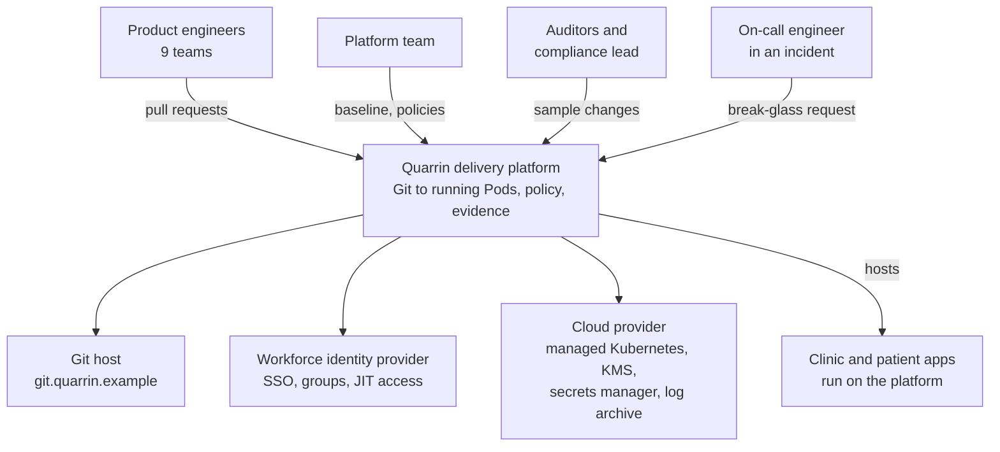
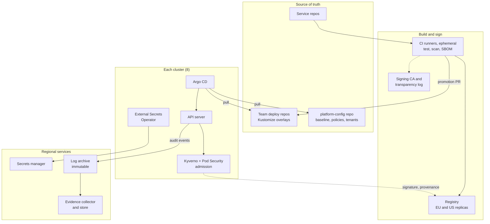
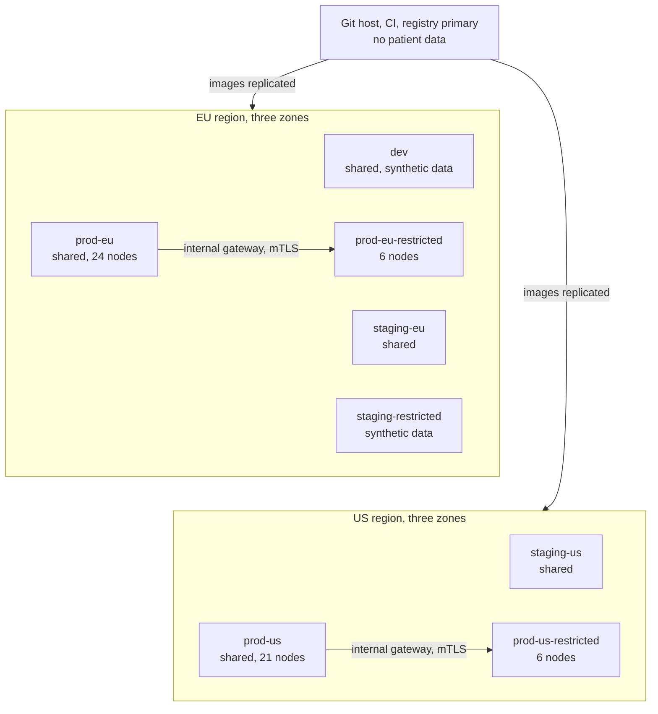
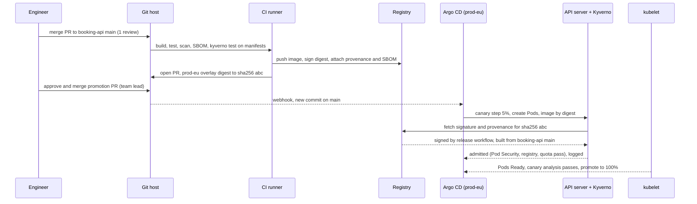
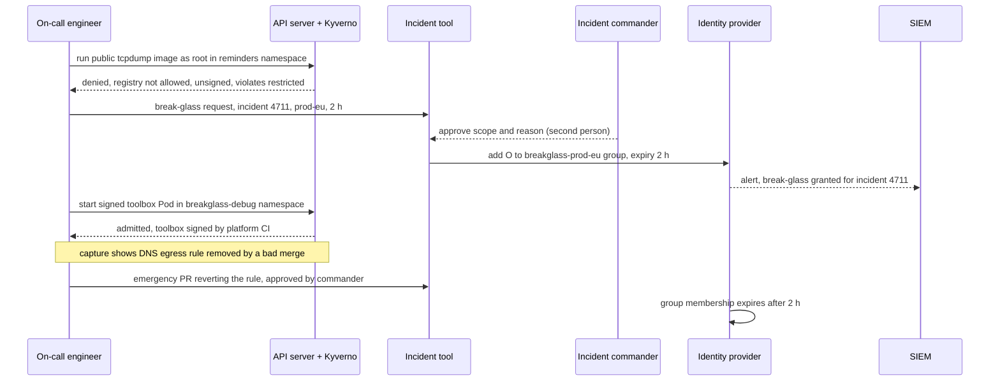
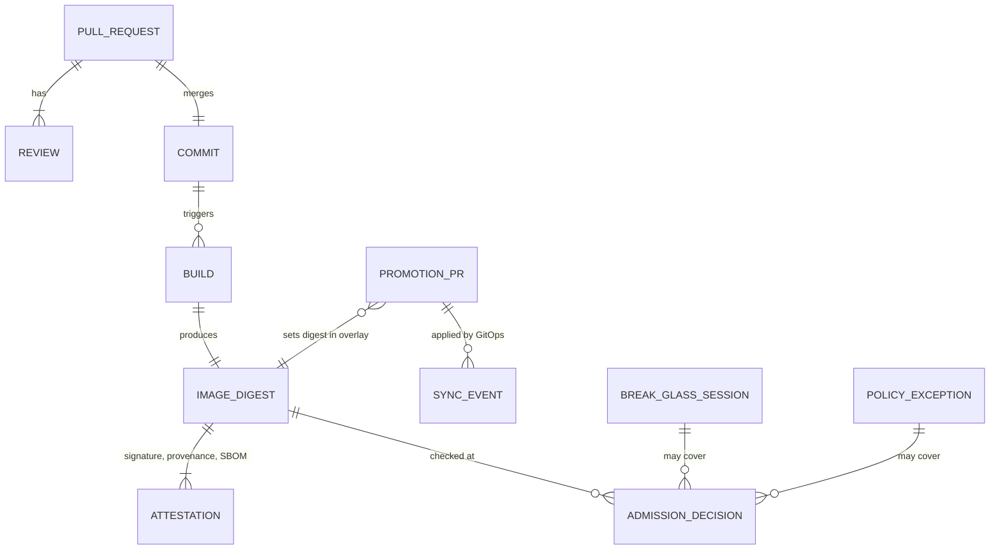
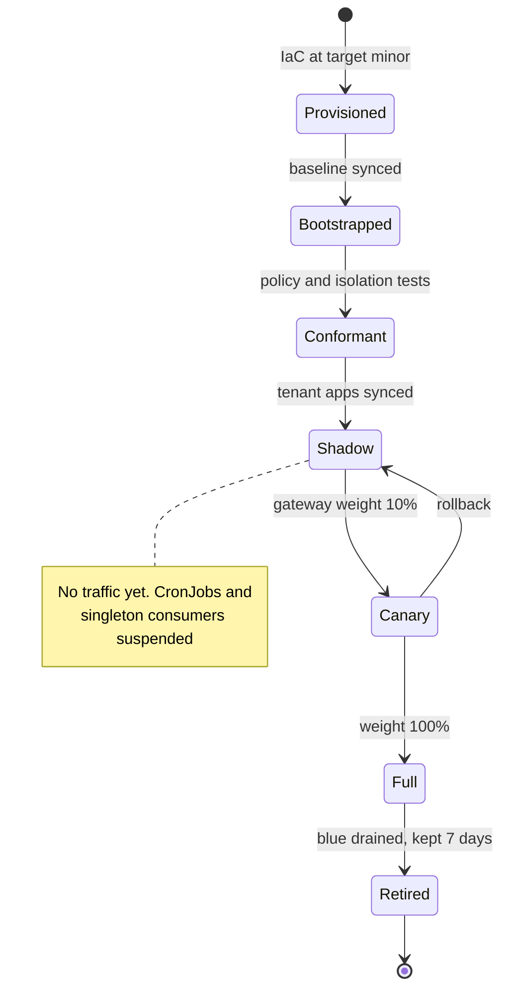

# Case study 11: Enterprise Kubernetes platform with GitOps

> Quarrin Health's auditors asked: "show us that only reviewed, signed code runs where patient data
> lives". With 14 hand-built clusters the honest answer was "mostly". This case turns it into "always,
> and here is the record": a small fleet of standard clusters, Git as the only write path, admission
> policy that refuses anything unsigned, and a break-glass path that is fast in an incident without
> becoming the real policy.

!!! abstract "Case facts"
    **Level:** Advanced · **Time:** 90-120 minutes · **Status:** Draft · **Last verified:** 2026-11-27
    · **Applies:** [Kubernetes architecture](../containers-and-kubernetes/kubernetes-architecture-and-workloads.md), [networking](../containers-and-kubernetes/kubernetes-networking-storage-and-service-mesh.md), [ecosystem tools](../containers-and-kubernetes/cloud-native-ecosystem-tools.md),
    [supply chain security](../security-architecture/infrastructure-and-supply-chain-security.md), [compliance](../security-architecture/compliance-and-regulatory-frameworks.md), [platform engineering](../devops-and-platform-engineering/platform-engineering.md)

The case follows the [design method](../system-design-exercises/design-method.md). Every number is a
labelled Quarrin assumption or arithmetic from one, independent of AtlasMart's. For prices, quotas,
limits, and support windows, check the provider's current documentation.

!!! warning "Not legal advice"
    Which health-data rules apply to Quarrin depends on jurisdiction, contracts, and Quarrin's role for
    each customer. Frameworks are named only to show what the architecture can evidence; applicability
    is a question for counsel.

## Business context and outcome

Quarrin Health (fictional, `quarrin.example`) sells a scheduling platform to 2,400 clinics and hospital
groups (assumption Q-1: 1,400 in the EU, 1,000 in the US): online booking, reminders, waitlists,
clinician calendars, integration with customers' electronic health record (EHR) systems, and
clinic-to-clinic referrals that carry clinical documents.

Over four years each product team built its own Kubernetes cluster. Today there are **14 snowflake
clusters** (Q-2) on five Kubernetes minor versions, three of them outside the supported window, each
with its own ingress, deployment method, and idea of who holds `cluster-admin`. Three events forced a
decision (all fictional): the last SOC 2 Type 2 examination sampled 25 production changes and Quarrin
could not show a review for 3 of them, applied with `kubectl` from laptops; a kernel vulnerability took
19 days to patch everywhere; and the largest hospital-group customer now asks, per change, for evidence
that "only reviewed and signed code runs in environments holding patient data".

Outcomes agreed with the CTO:

- **O-1:** every production workload traces to a reviewed commit and a signed Quarrin CI build; the
  evidence for any sampled change is produced within one business day.
- **O-2:** a standard, reproducible fleet, never on an unsupported Kubernetes version, within 12
  months and without downtime for the 54 running services.
- **O-3:** median merge-to-production time from 6 days (weekly change board) to under 4 hours.
- **O-4:** stronger isolation for clinical documents than for the rest.

## Stakeholders and users

| Stakeholder | What they need | Role in decisions |
|---|---|---|
| Product teams (9, Q-3) | Deploy several times a day without tickets; see their own telemetry | Platform customers |
| Platform team (6 engineers, Q-4) | A fleet they can upgrade and rebuild without heroics | Builds and runs the platform |
| CISO and security engineering | Signed images, least privilege, no standing admin access | Owns security policy; co-approves policy changes |
| Privacy officer and counsel | Patient data stays in its region; applicability decisions | Decide which rules apply and residency |
| Compliance lead and external auditors | Evidence per control, sampled per change, kept for the audit period | Consumers of evidence |
| Hospital-group customers; on-call engineers | Questionnaire answers; fast fixes in incidents | External contract terms; users of break-glass |
| CTO | Speed and lower audit cost for the platform spend | **Decision maker** |

## Functional requirements

1. **FR-1** A team gets a tenant (namespaces, groups, quotas, network baseline, deploy repo) from one
   pull request, ready within one business day.
2. **FR-2** Every cluster change goes through Git; no human or CI job writes to a prod cluster API.
3. **FR-3** Releases are promoted dev → staging → prod by changing an image **digest** in the next
   overlay; prod needs an approving review.
4. **FR-4** Only images from Quarrin's registry, signed by Quarrin CI with SLSA provenance, run in
   tenant namespaces; policies are tested in CI, audited before enforced, and relaxed only by dated
   exceptions.
5. **FR-5** On-call engineers have a break-glass path that two people approve, that expires on its
   own, and that alerts security.
6. **FR-6** For any running Pod or past change the platform produces an evidence pack: pull request,
   reviews, build, signature, provenance, admission decision, sync.
7. **FR-7** Cluster upgrades need no tenant work beyond fixing flagged deprecated APIs.

## Non-functional requirements (measurable targets)

| ID | Attribute | Target | How measured |
|---|---|---|---|
| NFR-1 | Delivery speed | Merge to running in both prod regions: p50 ≤ 4 h, p90 ≤ 1 business day | Merge, sync, and rollout timestamps (DORA change lead time) |
| NFR-2 | Signed workloads | 100% of Pods in prod tenant namespaces admitted with a verified Quarrin CI signature and provenance; 0 unverified Pods running | Admission decisions; daily reconciliation of running digests with signatures |
| NFR-3 | Baseline coverage | 100% of tenant namespaces have Pod Security `restricted`, default-deny NetworkPolicy, quota, and an Argo CD project; drift reported within 15 min | Policy reports; GitOps drift status |
| NFR-4 | Upgrade cadence | No cluster on a minor outside the provider's standard support; minor upgrades twice a year; node images monthly, P1 kernel fixes within 72 h | Fleet inventory exported daily |
| NFR-5 | Tenant isolation | No tenant reads another's Secrets, reaches its Pods unasked, or deploys into its namespaces; restricted data only on restricted clusters | Cross-tenant probes and RBAC analysis in CI and monthly in prod |
| NFR-6 | Deploy path | Git → GitOps → admission available 99.5% monthly (workload SLOs are per product) | Synthetic deploy every 15 min per cluster |
| NFR-7 | Cluster rebuild | Any cluster rebuilt from Git and IaC within 4 h, no data loss | Every blue-green upgrade is a rehearsal |
| NFR-8 | Evidence | Pack for a sampled change within 1 business day; retained 6 years (Q-14) | Monthly self-sample of 10 changes |
| NFR-9 | Break-glass | Two approvers, expiry ≤ 4 h, reviewed within 2 business days | Break-glass log against incident reviews |
| NFR-10 | Platform overhead | Control planes plus platform add-ons ≤ 20% of fleet cost units | Monthly showback |

NFR-2 is the auditors' question as a number. Admission alone is not enough (policies change, old Pods
predate a policy), so the daily reconciliation of running digests is the measurement that counts.

## Workload assumptions and capacity estimates

All values are **Quarrin assumptions** to be replaced by measurement.

| # | Assumption | Value |
|---|---|---|
| Q-1 | Clinics | 2,400 (1,400 EU, 1,000 US) |
| Q-2 | Clusters today | 14, on five minor versions |
| Q-3 | Product teams; services | 9 teams; 54 services, 4 of them handle clinical documents (2 teams) |
| Q-4 | Platform team | 6 engineers, 220 working days each per year |
| Q-5 | Prod replicas; requests per Pod | EU 4, US 3; shared services 0.5 vCPU / 1 GiB; restricted 1 vCPU / 2 GiB |
| Q-6 | Node shape | 8 vCPU / 32 GiB; allocatable 7.2 vCPU / 29 GiB |
| Q-7 | Per-node DaemonSets (CNI, agents, runtime sensor) | 0.4 vCPU / 1 GiB |
| Q-8 | Platform add-on Deployments per cluster | 8 vCPU shared, 6 vCPU restricted |
| Q-9 | Zone-loss rule, three zones | Requests ≤ 67% of allocatable ([workloads page](../containers-and-kubernetes/kubernetes-architecture-and-workloads.md#step-3-at-the-hpa-maximum-does-the-cluster-have-room)) |
| Q-10 | Production promotions | 36 a day (9 teams × 4), each to both regions |
| Q-11 | Pod creations per prod cluster; audit events per cluster | 1,500 a day; 1 M a day at 1 KB |
| Q-12 | CI per build (build, test, scan, SBOM, sign) | 12 min |
| Q-13 | Median wait for a prod approval | 15 min |
| Q-14 | Evidence retention | 6 years, from Quarrin's retention schedule agreed with counsel |

**Node counts.** Usable CPU per node is 7.2 − 0.4 = 6.8 vCPU; at the 67% ceiling a node carries
6.8 × 0.67 ≈ **4.56 vCPU** of requests.

| Cluster | Requests | Nodes needed | Chosen (whole zones) |
|---|---|---|---|
| prod-eu | 50 services × 4 × 0.5 = 100 + 8 add-ons = 108 vCPU | 108 ÷ 4.56 = 23.7 | **24** (8 per zone) |
| prod-us | 50 × 3 × 0.5 = 75 + 8 = 83 vCPU | 83 ÷ 4.56 = 18.2 | **21** (7 per zone) |
| prod-eu-restricted | 4 × 4 × 1 = 16 + 6 = 22 vCPU | 22 ÷ 4.56 = 4.8 | **6** (2 per zone) |
| prod-us-restricted | 4 × 3 × 1 = 12 + 6 = 18 vCPU | 18 ÷ 4.56 = 3.9 | **6** (2 per zone minimum) |

Memory does not bind: prod-eu requests 200 + 16 = 216 GiB against 24 × 28 × 0.67 ≈ 450 GiB usable.
Production totals **57 nodes**; non-production (dev, staging-eu, staging-us, staging-restricted) is
sized at 9 + 9 + 9 + 3 = **30 nodes**.

**Admission load is small; admission availability is not.** 1,500 Pod creations a day is about 0.02
per second; the risk is a fail-closed webhook that is down and stops every new Pod, node replacements
included.

**Lead time.** CI 12 min → dev sync 3 → dev checks 10 → staging sync 3 → staging tests 20 → approval
15 → prod-eu canary 5% → 25% → 100% at 10 min a step, 30 → bake 60 → prod-us canary 30 =
**183 min ≈ 3.1 h**, inside NFR-1; approval and bake are the variable parts.

**Evidence volume.** 8 clusters × 1 M × 1 KB = 8 GB a day ≈ 2.9 TB a year, × 6 years ≈ **17.5 TB**
before compression; deployment records are small (36 × 2 × 365 ≈ 26,000 a year).

## Constraints and assumptions

- **C-1** One cloud provider, an EU and a US region. Patient data stays in its clinic's region;
  images and platform configuration hold none and may be replicated.
- **C-2** Managed Kubernetes only, run by six platform engineers; teams keep their own on-call.
- **C-3** Twelve months; the 54 running services migrate without downtime.
- **C-4** Quarrin processes patient names, contact details, appointment times, and clinical documents
  in referrals. Whether HIPAA applies to US customers' data (Quarrin as a business associate) or how
  GDPR's rules for health data (a special category, Article 9) apply to EU patients depends on
  jurisdiction, contracts, and Quarrin's role; counsel decides. By policy all patient-linked data is
  **confidential** and clinical documents **restricted**, whatever the legal analysis concludes.
- **C-5** Cloud services touching patient data only where counsel confirms the provider agreement
  ([compliance page](../security-architecture/compliance-and-regulatory-frameworks.md)); Quarrin holds
  SOC 2 Type 2 and ISO/IEC 27001 (assumption), so one control set evidences both.

## Architecture options considered

| Option | Summary | Strengths | Weaknesses |
|---|---|---|---|
| A. Cluster per team (standardized) | One cluster per team per environment and region, from one template | Hard isolation by default; simple RBAC | 9 teams × 5 environment-regions = 45 clusters to run and upgrade; poor bin-packing |
| B. Shared clusters only | One cluster per environment and region (5), namespaces per team | Fewest clusters; best packing | Clinical documents share nodes, kernel, and admins with everything; every cluster is in the restricted audit scope |
| C. Hybrid (**chosen**) | Option B for confidential data, plus dedicated restricted clusters for the 4 clinical-document services | Isolation where the data warrants it; 8 clusters; restricted scope is 3 clusters | Two cluster profiles; calls into restricted services cross a cluster boundary |

**Fleet arithmetic.** Illustrative rates: 1 vCPU-hour = 1 CU; a managed control plane 2 CU/h; the
minimal add-on set 6 vCPU per team cluster.

| Measure | A. Per team | B. Shared | C. Hybrid |
|---|---|---|---|
| Clusters | 45 | 5 | 8 |
| Fixed overhead, CU/h (control plane + add-ons) | 45 × (2 + 6) = 360 | 5 × (2 + 8) = 50 | 5 × 10 + 3 × 8 = 74 |
| Replacements a year (2 per cluster) at 3 engineer-days each | 90 → 270 days ≈ 1.2 engineers | 10 → 30 days | 16 → 48 days ≈ 0.2 engineers |
| Clusters in the restricted audit scope | 2 teams × 5 = 10 | 5 (all) | 3 |

Option A spends over a fifth of the platform team (270 of 6 × 220 = 1,320 engineer-days) on upgrades;
Option C costs 74 − 50 = 24 CU/h more than B, exactly where O-4 asks for isolation.

## Chosen architecture and rationale

Option C: five shared clusters (dev, staging-eu, staging-us, prod-eu, prod-us) with soft multi-tenancy
for teams of one company that share a security standard, and three restricted clusters
(staging-restricted with synthetic data, prod-eu-restricted, prod-us-restricted) with hard isolation.
Every cluster comes from the same IaC module and GitOps baseline; only the profile differs.

**Figure 1 — System context (C4 level 1).** The delivery platform as the system.



How to read it: every human arrow enters through Git or the identity provider, never a cluster API.

**Figure 2 — Containers (C4 level 2).** The platform's deployable parts and what each talks to.



How to read it: CI writes only to the registry and to Git, by pull request; dotted arrows are
lookups. Signing CA and transparency log are Quarrin-hosted Sigstore components (assumption); the
OpenTelemetry Collector per cluster is omitted.

**Figure 3 — Deployment across environments and regions.** Eight clusters, two profiles.



How to read it: only images and configuration cross regions. Restricted clusters have their own KMS
keys, secrets paths, and operator group (Option C's hard boundary).

### Multi-tenancy controls

A **tenant** is a team. Quarrin stamps the [per-namespace stack](../devops-and-platform-engineering/platform-engineering.md#multi-tenancy-on-a-kubernetes-platform)
from one tenant file and adds what a regulated fleet needs:

| Control | Shared clusters | Restricted clusters |
|---|---|---|
| Namespaces | `<team>-<group>` per environment; labels `quarrin.example/tenant`, `owner-team`, `data-class` | Same; shared clusters reject namespaces labelled `data-class: restricted` |
| Human RBAC (SSO groups) | Read workloads and logs in own namespaces; no `exec`, no Secret read, no prod writes | Read workload status only; logs through a redacting pipeline |
| Machine RBAC | One Argo CD project per tenant: own repo, own namespaces, no cluster-scoped kinds | Same |
| Nodes | Shared pools, Pod Security `restricted` | Dedicated cluster; sandboxed runtime class for document parsers (assumption) |
| Network | Default deny; a cross-tenant flow needs the caller's egress allow and the callee's ingress allow | Ingress only from the internal gateway; egress only to the document store and KMS |
| Quota | From the tenant file; quotas may total 120% of capacity; alert when requests pass 67% | No overcommit |
| Secrets | `SecretStore` per namespace, using that namespace's workload identity, scoped to `/<region>/<env>/<team>/` | Secrets Store CSI Driver mounts, no copy in etcd |

Two details matter more than they look. Argo CD's `default` project permits any source, destination,
and kind, so Quarrin empties it. And an ESO `ClusterSecretStore` can be referenced from any namespace,
letting tenant A name tenant B's secret path, so tenants get only namespaced `SecretStore` objects.

## Request and data flow walkthrough

### Happy path: from pull request to a running Pod

**Figure 4 — A Booking API release reaches prod-eu.** Policy runs twice: in CI on rendered manifests
and at admission on the real object.



How to read it: nobody holds production credentials; merging the promotion PR is both deployment
decision and approval record; provenance ties the digest to a repository and branch.

### Failure path: policy blocks a debug Pod during an incident, then break-glass

At 02:10 the reminder workers in prod-eu stall (sev-1). The on-call engineer suspects the network and
tries to start a public packet-capture image as root.

**Figure 5 — The block and the break-glass path.** Two people approve; access expires; every step is
recorded.



How to read it: break-glass did **not** switch the policy off. It granted a time-boxed group that may
run a pre-signed toolbox image in a pre-created namespace with Pod Security `privileged`. The fix went
through Git as an emergency PR, because Argo CD's self-heal would revert a `kubectl edit`.

- **Prepare tools, not bypasses.** Rollback needs no break-glass: it redeploys a signed digest.
- **Code that cannot wait for CI** is signed on a standby runner by a two-person, KMS-held emergency
  signer (ADR-03); each admission pages security; normal CI rebuilds it within 2 business days.
- **Kyverno cannot except Pod Security** (it is built in): elevated Pods need a namespace labelled for
  a higher level, which only the platform repo creates.

## Data model and storage decisions

Workload data lives in teams' managed regional databases; the platform's own data is **evidence**.

**Figure 6 — The evidence model.** Joined by commit SHA and image digest, so an auditor can start from
a change or from a running Pod.



How to read it: from a Pod, provenance names the commit, then the PR and reviews; from a change, the
promotion PR leads to syncs and admissions. Exception and break-glass admissions are sampled first.

A read-only collector exports every source into a write-once store per region ([method](../security-architecture/compliance-and-regulatory-frameworks.md#step-4-collect-evidence-continuously)).
Tool UIs are not evidence (Argo CD keeps a bounded history; Git settings change), so the collector
snapshots them. Evidence stays in its region, 6 years (Q-14) with object lock, 13 months hot.

## API and integration contracts

The platform's API is Git; each contract is a file or object with a schema checked in CI.

| Contract | Owner | Semantics | Checks |
|---|---|---|---|
| `platform-config/tenants/<team>.yaml` | Platform (team proposes) | Renders namespaces, groups, quotas, NetworkPolicies, AppProject, SecretStore | Schema; data class allowed on target clusters; quota fits; two platform reviewers |
| `<team>-deploy/apps/<svc>/overlays/<env>/` | Team | Kustomize overlay, image only by digest | `kyverno test` and Pod Security checks on rendered output; no `replicas` when an HPA exists |
| Promotion PR | CI bot opens, team approves | Changes one digest in one environment | Digest signed and passed the previous environment |
| `platform-config/exceptions/*.yaml` | Platform and security | Kyverno `PolicyException` with owner, ticket, absolute expiry | CI rejects expired or undated files; security co-approves |

```yaml
team: reminders                   # platform-config/tenants/reminders.yaml, Quarrin's own schema
owner-group: sso:team-reminders
data-class: confidential          # restricted would place it on restricted clusters only
environments: [dev, staging-eu, staging-us, prod-eu, prod-us]
namespaces: [reminders-core, reminders-batch]
quota-per-namespace: {cpu: "12", memory: 24Gi, pods: "60"}
calls: [booking-core/booking-api]  # renders the egress allow; booking adds the ingress allow
```

## Security and trust boundaries

| From | To | Allowed how | Why |
|---|---|---|---|
| Engineers | Git host | SSO with phishing-resistant MFA; protected `main` | Git is the change-control boundary |
| CI runners | Registry, Git | Workload identity; push images, open PRs only | CI holds no cluster credentials |
| Argo CD (per cluster) | Git, own API server | Read-only repo access; own service account | Pull model; no cross-cluster credentials |
| API server | Kyverno webhook | In-cluster TLS; `failurePolicy: Fail` for tenant namespaces | Unverifiable means not admitted |
| Shared cluster | Restricted cluster | Internal gateway; mTLS plus OAuth client credentials per caller | Restricted data only via its API |
| Humans | Cluster APIs | Private endpoints; read via SSO; writes only via break-glass JIT | No standing admin access |

### Policy as code

Kyverno is the engine (ADR-03). Its v1.20 documentation (checked 2026-11-27) lists CEL policy types in
`policies.kyverno.io/v1`, including `ValidatingPolicy` and `ImageValidatingPolicy`, and marks
`ClusterPolicy`, `Policy`, and the legacy `PolicyException` deprecated since v1.19.

An image policy checks only the images it matches; an image from a public registry is simply not
matched. Quarrin therefore splits the rule. A `ValidatingPolicy` named `quarrin-registry-and-digest`
denies any tenant Pod unless every container and init container image satisfies
`c.image.startsWith('registry.quarrin.example/') && c.image.contains('@sha256:')`. Then signature and
provenance for everything in that registry:

```yaml
apiVersion: policies.kyverno.io/v1
kind: ImageValidatingPolicy
metadata: {name: quarrin-signed-with-provenance}
spec:
  validationActions: [Deny]
  failurePolicy: Fail
  matchConstraints:
    resourceRules:
      - {apiGroups: [""], apiVersions: [v1], operations: [CREATE, UPDATE], resources: [pods]}
    namespaceSelector: {matchLabels: {quarrin.example/tenant: "true"}}
  matchImageReferences: [{glob: "registry.quarrin.example/*"}]
  attestors:
    - name: ci
      cosign:
        keyless:
          identities:
            - issuer: "https://ci.quarrin.example"
              subjectRegExp: "^https://git\\.quarrin\\.example/[^/]+/[^/]+/\\.ci/release\\.yaml@refs/heads/main$"
        ctlog: {url: "https://rekor.quarrin.example"}
  attestations: [{name: provenance, intoto: {type: "https://slsa.dev/provenance/v1"}}]
  validations:
    - expression: >-
        images.containers.map(image, verifyImageSignatures(image, [attestors.ci])).all(e, e > 0)
      message: "image is not signed by a Quarrin release workflow on main"
    - expression: >-
        images.containers.map(image, verifyAttestationSignatures(image, attestations.provenance, [attestors.ci])).all(e, e > 0)
      message: "image has no signed SLSA provenance from Quarrin CI"
```

How the rules are run:

- **CI first, audit before enforce.** The Kyverno CLI runs the policies on rendered manifests in every
  deploy-repo PR; a new policy runs two weeks in `Audit` before `Deny`. CI is the early feedback,
  because the rules judge Pods: a bad Deployment is accepted and only its Pods are refused.
- **Exceptions have an end.** `PolicyException` ships disabled; Quarrin enables it for one
  platform-owned namespace. The `cleanup.kyverno.io/ttl` label with an absolute date is a backstop,
  but expiry is enforced in Git, since Argo CD would recreate a deleted object whose file remains.
- **Built-in where possible.** Lookup-free rules (such as the ban on restricted namespaces in shared
  clusters) use ValidatingAdmissionPolicy and keep working without the webhook. Tenants have no RBAC
  for `pods/ephemeralcontainers` (`kubectl debug`); break-glass uses the toolbox namespace.

### Secrets

Values live in the regional secrets manager under per-region KMS keys; Git holds only `ExternalSecret`
references. ESO copies values into KMS-encrypted Secrets on shared clusters; restricted clusters mount
them with the CSI driver, so no copy sits in etcd but Pod starts depend on the secrets manager.

## Reliability, failover, and disaster recovery

| Failure | Effect | Design response |
|---|---|---|
| Kyverno webhook down (fail closed) | No new tenant Pods: rollouts, autoscaling, and **replacements after a node failure** stop | 3 replicas across zones, PDB, platform namespaces excluded, alert on admission p99 > 2 s; scaling Kyverno is runbook step one |
| Registry, Argo CD, or Git host down | Pulls, lookups, or deploys stop; running workloads unaffected | Registry replica per region; accepted within NFR-6; break-glass for urgent access |
| Secrets manager down | ESO keeps existing Secrets; CSI-mounted Pods cannot start | Restricted services keep spare replicas in every zone |
| Cluster lost or corrupted | Its tenants down | Rebuild from IaC and Git within 4 h (NFR-7), the blue-green procedure |
| Region lost | That region's clinics down | Per-product DR within the region's rules, no cross-region move of patient data without counsel; see [disaster recovery strategies](../reliability-and-disaster-recovery/disaster-recovery-strategies.md) and [case study 10](cs-10-multi-region-disaster-recovery.md) |

### Cluster lifecycle and upgrades

Kubernetes maintains the three latest minors (1.35 to 1.37 on 2026-11-27), each with about a year of
patches; kubelets may lag the API server by three minors; providers set their own windows.

- **In place** for patches and monthly node images: prod-eu's 24 nodes at about 10 min each
  (assumption) take 4 h one by one, or 8 × 10 = 80 min draining one node per zone at a time.
- **Blue-green clusters** for minors, twice a year (ADR-04). The new cluster starts at the target
  minor, so one move can jump more than one minor if manifests avoid removed APIs (checked in CI).

**Figure 7 — Replacing prod-eu with a new cluster.** Blue serves until green has all traffic.



How to read it: until `Full`, rollback is a weight change. The move needs no state in clusters,
singletons in one colour only, stable NAT egress (EHR partners allowlist source IPs), database
connection limits for both colours, and DNS names on the regional gateway, not on a cluster.

## Scaling and performance strategy

- **More tenants.** At 200 services (≈ 3.7 times today) prod-eu needs about 24 × 3.7 ≈ 89 nodes;
  past a 120-node cap (assumption) a region gets a second shared prod cluster.
- **Packing.** Requests, not usage, fill nodes; VPA recommendations become request changes in PRs.

## Observability and operations

- **Platform SLOs:** synthetic deploy every 15 min per cluster, admission p99 and errors, sync lag,
  fleet version compliance. Teams see their own telemetry and policy reports by `owner-team` (see
  [observability fundamentals](../observability-and-sre/observability-fundamentals-logs-metrics-and-traces.md)).
- **Pages:** a running tenant Pod without a verified signature; any emergency-signer admission;
  webhook errors above 1% for 5 min; break-glass without an open incident. **Tickets:** exceptions
  within 7 days of expiry, tenants above 80% of quota.
- **DORA, monthly per team:** change lead time, deployment frequency, change fail rate, failed
  deployment recovery time, deployment rework rate, never as targets for individuals.

## Deployment and release strategy

### GitOps repository layout and promotion

```text
platform-config/                     platform team; 2 reviewers; security co-owns policies/
  baseline/                          add-ons, Kyverno policies, namespace templates
  profiles/{shared,restricted}/      what differs between the two cluster profiles
  clusters/<cluster>/                per-cluster overlay: versions, profile, AppProjects
  tenants/<team>.yaml                tenant declarations
  exceptions/                        dated PolicyExceptions
<team>-deploy/                       one per team; CODEOWNERS = team leads
  apps/<service>/base/
  apps/<service>/overlays/{dev,staging-eu,staging-us,prod-eu,prod-us}/
```

Promotion is a chain of merged pull requests carrying one digest, never a rebuild: dev auto-merges,
staging auto-merges when dev checks pass, prod-eu needs an approval (two for restricted services,
assumption), and prod-us opens after prod-eu's canary and a 1 h bake; a failed canary analysis opens
a revert PR. Canary steps use weighted Gateway API routes driven by a progressive delivery controller
([CI/CD page](../devops-and-platform-engineering/ci-cd-pipeline-design-and-deployment-strategies.md));
regions go one after the other, so a bad release reaches one region's clinics at most.

Sync windows deny automated prod syncs in clinics' busiest hours (assumption: weekdays 07:00-10:00
local), with manual override for incidents; baseline changes roll one cluster a day. **Migration
(C-3)** goes team by team: tenant file, deploy repo, images re-signed, policies audited against the
team's manifests, then traffic shifted at the gateway with the old cluster as rollback.

## Cost model

Illustrative rates: 1 vCPU-hour = 1 CU, so an 8 vCPU node is 8 CU/h; a managed control plane 2 CU/h;
a month 730 h.

| Driver | Arithmetic | CU per month |
|---|---|---|
| Prod nodes | 57 × 8 × 730 | 332,880 |
| Non-prod nodes | 30 × 8 × 730 | 175,200 |
| Control planes | 8 × 2 × 730 | 11,680 |
| **Total compute** | | **519,760** |
| Of which platform overhead | add-ons 5 × 8 + 3 × 6 = 58 vCPU, DaemonSets 87 × 0.4 ≈ 35 vCPU: 93 × 730 = 67,890, plus control planes 11,680 | 79,570 (15.3%) |

Overhead is inside NFR-10. Priced separately: evidence storage, cross-zone traffic, registry
replication, gateways. What moves the number most:

- **Zone headroom** makes about a third of prod CPU insurance against a zone loss.
- **Non-prod schedule.** Full size for 60 weekday hours and a third of the nodes for the other 108
  hours of the week: 175,200 × (60 + 108 ÷ 3) ÷ 168 ≈ 100,100 CU, saving about 75,000 CU a month.
- **Blue-green overlap.** A second prod-eu for about 3 days: 24 × 8 × 72 ≈ 13,800 CU, twice a year.
- **Requests discipline.** 0.1 vCPU over-requested on each of prod-eu's 200 Pods is 20 vCPU, about
  4 nodes.

## Risks and mitigations

| Risk | Likelihood | Impact | Mitigation |
|---|---|---|---|
| Fail-closed webhook outage blocks Pod replacement during a node or zone failure | Medium | High | Replicated Kyverno, PDB, platform namespaces excluded, admission SLO alert, runbook step one |
| Exceptions accumulate and become the real policy | Medium | High | Absolute expiry enforced in CI, security co-approval, count and age on the CISO dashboard |
| Break-glass used for routine work | Medium | Medium | Needs an open incident; every use reviewed; monthly count reported |
| Emergency signer misused or exposed | Low | Very high | KMS-held, two-person use, page per admission, quarterly rotation and drill |
| Noisy neighbour in a shared cluster | Medium | Medium | Quotas, LimitRange defaults, priority classes for tier-1 services |
| Blue-green move breaks a singleton job or partner allowlist | Medium | Medium | CronJob suspension in the runbook; stable egress; shadow-phase checks |

## Architecture Decision Records

### ADR-01: Hybrid tenancy, shared clusters plus restricted clusters

- **Context.** 54 services, 4 with clinical documents; 6 platform engineers; O-4.
- **Decision.** Five shared clusters with namespace-per-team soft multi-tenancy, three restricted
  clusters for `data-class: restricted` tenants, one IaC module with two profiles.
- **Consequences.** 8 clusters instead of 45 or 5; restricted audit scope of 3; calls into restricted
  services cross an mTLS gateway (latency budget 20 ms p95, assumption) that must be operated.

### ADR-02: Pull-based GitOps with one Argo CD per cluster

- **Context.** Every prod change must be a reviewed commit; neither CI nor a central controller
  should hold credentials to every cluster.
- **Decision.** Argo CD (v3.6.3 at the time of writing, as in [Lab 13](../labs/lab-13-gitops-reconciliation.md))
  in every cluster; automated sync with self-heal; pruning with deletion protection for namespaces;
  one AppProject per tenant; the `default` project emptied.
- **Consequences.** Nothing outside a cluster can change it; eight instances to upgrade; Flux would
  serve equally.

### ADR-03: Kyverno CEL policies, fail closed for tenants, with an emergency signer

- **Context.** NFR-2 needs signature and provenance checks at admission, which built-in
  ValidatingAdmissionPolicy cannot make (no external calls); two engines would double the webhooks.
- **Decision.** Kyverno `ImageValidatingPolicy` and `ValidatingPolicy` in `Deny` mode with
  `failurePolicy: Fail` for tenant namespaces; Pod Security `restricted` and ValidatingAdmissionPolicy
  for simple rules; no OPA Gatekeeper. An emergency signer is trusted only for
  `registry.quarrin.example/emergency/`, through a second image policy matching only that path.
- **Consequences.** The webhook is on the critical path for Pod creation (see risks); the policy
  kinds are recent, so the platform tracks Kyverno releases; emergency fixes stay signed and
  two-person reviewed, which keeps O-1 true during incidents.

### ADR-04: Blue-green cluster replacement for minor upgrades

- **Context.** Clusters drifted because risky in-place upgrades were skipped; NFR-4 and NFR-7 need
  routine upgrades and rebuilds.
- **Decision.** Minors by a new cluster and a traffic shift, twice a year; patches and node images in
  place.
- **Consequences.** About 3 days of doubled capacity per move; every upgrade proves the 4-hour rebuild;
  clusters stay stateless.

## Alternative designs and why they were rejected

**Managed serverless containers instead of Kubernetes** is the plausible alternative: each service on
a provider's serverless container platform, with the platform team building templates and a pipeline
rather than clusters.

| Generic building block | AWS | Azure | Google Cloud |
|---|---|---|---|
| Managed Kubernetes (chosen) | Amazon EKS | Azure Kubernetes Service (AKS) | Google Kubernetes Engine (GKE) |
| Serverless containers (alternative) | Amazon ECS with AWS Fargate | Azure Container Apps | Cloud Run |
| Private registry | Amazon ECR | Azure Container Registry | Artifact Registry |

Names checked against each provider's documentation on 2026-11-27; products change, so recheck.

It removes control planes, node images, and most upgrade work. It was rejected because the auditors'
controls become provider-specific: where a service cannot refuse an unsigned image at deploy time,
verification moves into the pipeline, weaker evidence than a runtime decision; Quarrin's sandboxed
parsers and per-tenant network rules are also uniform only on Kubernetes.
It wins when there are few teams and no platform team; workloads are stateless HTTP or event handlers
that gain from scaling to zero; the service enforces signature or provenance at deploy time and
exports the decisions as evidence; and portability is not required.

**Option A** wins when tenants must not trust each other, need different cluster add-ons, or a
regulator requires per-unit separation; virtual control planes per tenant are a middle ground.

## Questions for the learner

1. Kyverno is fail-closed with three replicas. Trace a zone failure when the replicas are spread one
   per zone, and when two were in the failed zone.
2. An auditor samples a Pod that has run for 400 days, admitted under a policy version that no longer
   exists. Which evidence proves it was signed and reviewed?
3. Counsel asks for appointment data, not only clinical documents, to move to restricted clusters.
   Estimate the new restricted node count and fixed overhead.
4. Write the ADR that would move Quarrin to one central Argo CD. Which credential and blast-radius
   arguments must it answer?

## Related topics

- **Before:** [Kubernetes architecture and workloads](../containers-and-kubernetes/kubernetes-architecture-and-workloads.md); [Cloud-native ecosystem tools](../containers-and-kubernetes/cloud-native-ecosystem-tools.md); [Infrastructure and supply chain security](../security-architecture/infrastructure-and-supply-chain-security.md); [Platform engineering](../devops-and-platform-engineering/platform-engineering.md).
- **Alongside:** [Kubernetes networking, storage, and service mesh](../containers-and-kubernetes/kubernetes-networking-storage-and-service-mesh.md); [Compliance and regulatory frameworks](../security-architecture/compliance-and-regulatory-frameworks.md); [DevSecOps and secure delivery](../devops-and-platform-engineering/devsecops-and-secure-delivery.md); [CI/CD pipeline design](../devops-and-platform-engineering/ci-cd-pipeline-design-and-deployment-strategies.md); [Infrastructure as Code](../devops-and-platform-engineering/infrastructure-as-code.md); [Cloud cost models and FinOps](../finops-and-sustainability/cloud-cost-models-and-finops.md); [Incident management](../observability-and-sre/incident-management-and-sre-practices.md); [Lab 13](../labs/lab-13-gitops-reconciliation.md); [Case study 08](cs-08-multi-account-landing-zone-and-hub-and-spoke-network.md).
- **Planned:** healthcare industry architecture (D26-T03); data engineering for analytics (D07).

## References

| Source | Type | Checked |
|---|---|---|
| [Multi-tenancy](https://kubernetes.io/docs/concepts/security/multi-tenancy/) and [Pod Security Admission](https://kubernetes.io/docs/concepts/security/pod-security-admission/) — Kubernetes documentation | Official documentation (tenancy models; enforce applies to Pods, not workload objects) | 2026-11-27 |
| [Releases](https://kubernetes.io/releases/) and [Version Skew Policy](https://kubernetes.io/releases/version-skew-policy/) — Kubernetes | Official documentation (three maintained minors, about a year of patches, kubelet skew) | 2026-11-27 |
| Kyverno v1.20 documentation: [Policy types](https://kyverno.io/docs/policy-types/), [ImageValidatingPolicy](https://kyverno.io/docs/policy-types/image-validating-policy/), [Policy exceptions](https://kyverno.io/docs/guides/exceptions/), [TTL cleanup](https://kyverno.io/docs/guides/ttl-cleanup/), [Migrating to CEL policies](https://kyverno.io/docs/guides/migration-to-cel/) | Official documentation (kinds, deprecations, exceptions) | 2026-11-27 |
| Argo CD: [Projects](https://argo-cd.readthedocs.io/en/stable/user-guide/projects/) and [Sync windows](https://argo-cd.readthedocs.io/en/stable/user-guide/sync_windows/) | Official documentation (permissive default project; deny windows with manual override) | 2026-11-27 |
| [OpenGitOps principles](https://opengitops.dev/) — CNCF GitOps Working Group | Principles | 2026-11-27 |
| [SLSA specification v1.2](https://slsa.dev/spec/v1.2/) — OpenSSF, and [Sigstore documentation](https://docs.sigstore.dev/) | Specification and official documentation (provenance, keyless signing) | 2026-11-27 |
| [CNCF Platforms White Paper](https://tag-app-delivery.cncf.io/whitepapers/platforms/) — CNCF TAG App Delivery | White paper | 2026-11-27 |
| Names in the equivalence table and tools: [Amazon EKS](https://docs.aws.amazon.com/eks/latest/userguide/what-is-eks.html), [AKS](https://learn.microsoft.com/en-us/azure/aks/what-is-aks), [GKE](https://cloud.google.com/kubernetes-engine/docs/concepts/kubernetes-engine-overview), [AWS Fargate for Amazon ECS](https://docs.aws.amazon.com/AmazonECS/latest/developerguide/AWS_Fargate.html), [Azure Container Apps](https://learn.microsoft.com/azure/container-apps/overview), [Cloud Run](https://cloud.google.com/run/docs/overview/what-is-cloud-run), [Amazon ECR](https://docs.aws.amazon.com/AmazonECR/latest/userguide/what-is-ecr.html), [Azure Container Registry](https://learn.microsoft.com/azure/container-registry/container-registry-intro), [Artifact Registry](https://cloud.google.com/artifact-registry/docs/overview), [External Secrets Operator](https://external-secrets.io/latest/) | Official documentation | 2026-11-27 |

## Review notes

- Seven Mermaid figures, four ADRs; check Figures 2 and 3 (`~~~` stacking) and Figure 7's note in
  both themes. Every number is a Quarrin assumption (Q-1 to Q-14 or inline) or arithmetic from one;
  the audit finding and incident are fictional.
- Recompute: 4.56 vCPU per node; nodes 24, 21, 6, 6 (57 prod, 87 total); lead time 183 min; 17.5 TB;
  360, 50, 74 CU/h and 270 versus 48 engineer-days; 519,760 CU with 15.3% overhead.
- Kyverno facts from its v1.20 docs (2026-11-27): CEL kinds in `policies.kyverno.io/v1`; legacy kinds
  deprecated in v1.19 with removal announced for v1.20; `PolicyException` off by default; the
  `cleanup.kyverno.io/ttl` label. The YAML and inline CEL follow documented examples but were **not
  executed**: check `namespaceSelector` in `matchConstraints`, the `subjectRegExp` escaping, and the
  emergency-signer policy pair (described, not shown).
- Regulation is limited to "depends on jurisdiction; ask counsel", HIPAA business associates in
  general terms, and GDPR Article 9; the 6-year retention is an assumption, not a legal claim.
  Provider support windows are not quoted. Not covered in depth: mesh, runtime detection, portal.
