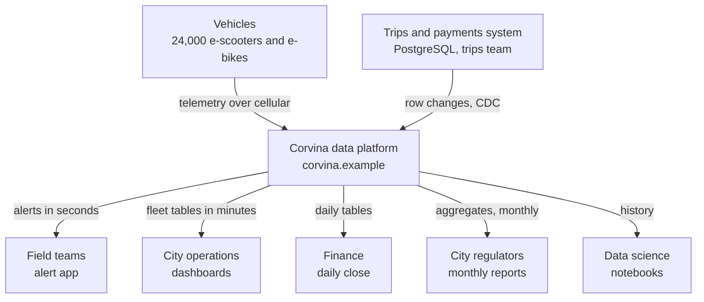
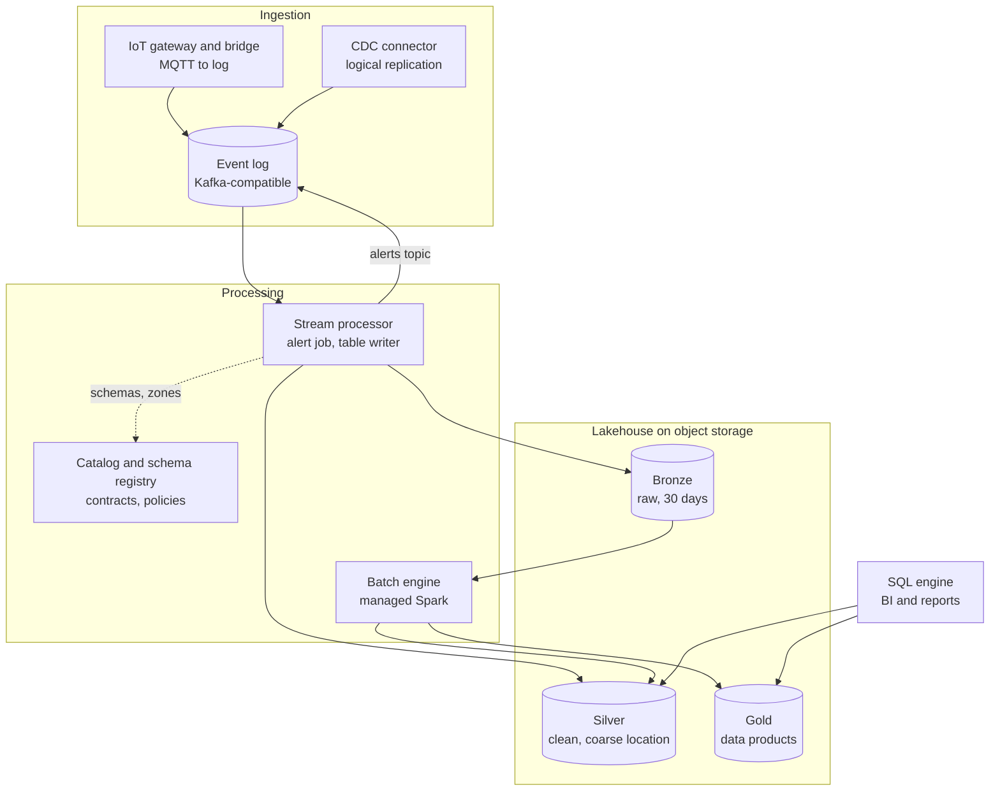
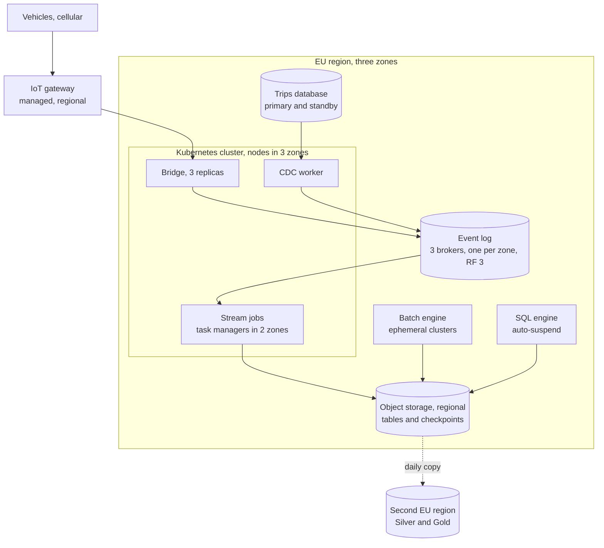
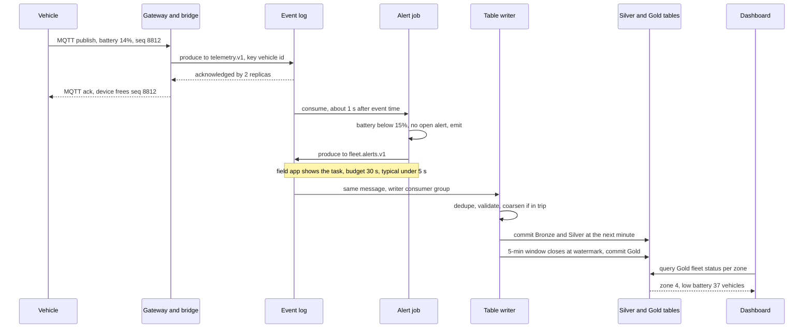
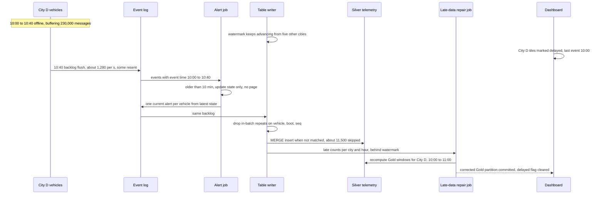

# Case study 12: Data lakehouse with batch and streaming ingestion

> One stream of scooter pings has four customers who want it at four speeds: field teams in
> seconds, operations in minutes, finance by morning, and city regulators once a month. This case
> builds one copy of the data that serves all four, keeps the rider's location out of places it does
> not need to be, and survives the day a city's mobile network goes quiet for forty minutes and then
> sends everything at once.

!!! abstract "Case facts"
    **Level:** Advanced (Level 3 throughout) · **Time:** 90-120 minutes · **Status:** Draft ·
    **Last verified:** 2026-11-27

The case follows the [design method](../system-design-exercises/design-method.md) and applies
[Warehouses, lakes, lakehouses, and data mesh](../data-engineering-and-analytics/warehouses-lakes-lakehouses-and-data-mesh.md),
[Batch, streaming, ETL/ELT, and pipelines](../data-engineering-and-analytics/batch-streaming-etl-elt-and-pipelines.md),
[Big data processing engines and table formats](../data-engineering-and-analytics/big-data-processing-engines-and-table-formats.md),
[Event streaming and log-based architecture](../messaging-and-streaming/event-streaming-and-log-based-architecture.md),
and [Data security and privacy](../security-architecture/data-security-and-privacy.md) without
repeating them. Every number is a labelled **Corvina assumption** or arithmetic from one; for prices,
quotas, and service limits, check the provider's current documentation.

## Business context and outcome

Corvina Mobility (fictional, `corvina.example`) rents shared e-scooters and e-bikes by the minute in
six EU cities. Riders unlock a vehicle in the app, ride, park inside the operating zone, and pay per
trip. Each vehicle reports its GPS position, battery level, and fault codes over a cellular modem.

Today the data lives in three places that do not meet. Telemetry lands in the IoT platform's
time-series store and is kept for 14 days. Trips and payments live in a PostgreSQL database. Finance
and the city teams export CSV files and build spreadsheets. Field teams learn about low batteries
from a list refreshed every 15 minutes, so dead scooters sit on pavements and two cities have
complained. Each monthly city report takes about 6 person-days, and two did not match the invoice
sent to the same city. Data scientists cannot see seasons in 14 days of telemetry. Nobody can say
where precise rider location is copied, or for how long.

The outcomes agreed with the COO, the CFO, and the Data Protection Officer (DPO):

- **O-1:** a field team hears about a low-battery, out-of-zone, or faulted vehicle within 30 s.
- **O-2:** operations dashboards are never more than 5 minutes behind.
- **O-3:** finance closes each day by 06:00 with numbers that reconcile exactly.
- **O-4:** each city's monthly report is produced without manual steps by the third working day.
- **O-5:** demand history covers at least 25 months.
- **O-6:** precise rider location exists outside the trips system only for a written purpose, for at
  most 30 days.

## Stakeholders and users

| Stakeholder | What they need | Role in decisions |
|---|---|---|
| Field operations (swap and rebalance crews) | Alerts on a phone in seconds; a task, not a chart | Users of the alert stream |
| City operations managers (one per city) | Fleet dashboards by zone, minutes fresh | Users; define zone rules |
| Finance | Daily revenue, refunds, and payment settlement that match the trips database | Users; own NFR-3 |
| City regulators (six city transport departments) | Monthly aggregate reports per their permit; no rider data | External; terms set by each permit |
| Data science (4 people) | Long, consistent history for forecasting and rebalancing models | Users of Silver and Gold |
| Firmware team; trips and payments team | One telemetry contract; no analytics load on the OLTP database | Producers |
| Data platform team (5 engineers) | A design they can run with one streaming specialist | Build and operate |
| DPO and counsel | Minimised location data, retention, erasure that works | Approve the privacy design |
| CTO | Fit for 3 years of growth, inside budget | **Decision maker** |

## Functional requirements

1. **FR-1** Ingest every telemetry message from every vehicle, including messages that arrive late
   or twice, and keep the raw form for investigation.
2. **FR-2** Raise alerts for battery below 15%, a parked vehicle outside its operating zone, and
   any fault code in the "immobilising" class, routed to the city's field team app.
3. **FR-3** Show per city and zone: vehicles available, low battery, out of zone, in trip, faulted.
4. **FR-4** Capture every change to trips, payments, and refunds without querying the trips database.
5. **FR-5** Produce daily finance tables (trips, revenue, refunds, settlement match) and monthly
   regulator reports per city (trips per zone and hour band, vehicles deployed, parking compliance).
6. **FR-6** Give data science governed access to history: demand per grid cell per 15 minutes,
   vehicle utilisation, weather joins.
7. **FR-7** Apply a rider's erasure request to every analytical copy within the agreed period.
8. **FR-8** Publish each table with an owner, a schema, a freshness target, and quality checks.

## Non-functional requirements (measurable targets)

Freshness is set **per use**, because the same data has four deadlines.

| ID | Attribute | Target | How measured |
|---|---|---|---|
| NFR-1 | Alert freshness | 99% of alerts within 30 s of the vehicle's event time, while the vehicle is connected | `alert.emitted_at − event_ts` histogram |
| NFR-2 | Dashboard freshness | Gold fleet tables ≤ 5 min behind, p99, 06:00-24:00 | Per city: now − max(`window_end`) committed |
| NFR-3 | Finance completeness | D-1 tables published by 06:00; trip count and revenue equal the trips database exactly | Reconciliation job; publish blocked on mismatch |
| NFR-4 | Regulator reports | Per city by the 3rd working day; totals equal the matching finance totals | Report job checks before export |
| NFR-5 | History | Gold demand 36 months; Silver telemetry 13 months | Catalog retention policy per table |
| NFR-6 | Data quality | Telemetry rejects < 0.5% per city-day; duplicates in Silver = 0; breaking schema changes reaching Silver = 0 | Check results per commit; contract checks in CI |
| NFR-7 | Location minimisation | Precise in-trip GPS only in Bronze, ≤ 30 days; Silver and Gold hold grid cells; rider ids pseudonymised before Silver | Catalog classification scan; access audit |
| NFR-8 | Durability and recovery | No telemetry lost once acknowledged by the log; alert path RTO 15 min; dashboards RTO 1 h; finance RTO 4 h | Game days per quarter |
| NFR-9 | Erasure | Rider erasure applied to Silver, including old table snapshots, within 30 days (period to be confirmed by counsel) | Erasure ledger vs snapshot expiry report |

NFR-1 and NFR-7 drive the design. NFR-1 means alerts cannot wait for anything that commits files
every few minutes; NFR-7 means the cheapest place to minimise location is at the Bronze-to-Silver
step, before the data has many readers.

## Workload assumptions and capacity estimates

| # | Corvina assumption | Value |
|---|---|---|
| A-1 | Cities; vehicles (e-scooters + e-bikes); largest and smallest city | 6; 24,000 (18,000 + 6,000); 7,000 and 2,000 |
| A-2 | Trips per vehicle per day; average trip length | 4; 12 min |
| A-3 | Telemetry interval in a trip; heartbeat when parked | 5 s; 300 s |
| A-4 | Other device events (lock, unlock, fault, swap) per vehicle per day | 50 |
| A-5 | Encoded message size on the log, with key and headers | 300 B |
| A-6 | Share of daily trips starting in the peak hour; event-message peak factor | 12%; 3× |
| A-7 | Compression from log bytes to columnar files | 4:1 (to be measured) |
| A-8 | Row changes per trip in the three contracted tables; CDC event size | 6; 1 KB |
| A-9 | Device buffer when offline; backlog send rate per vehicle after reconnect | 6 h; 10 messages/s |
| A-10 | Three-year plan: cities; in-trip interval on next-generation vehicles | 20; 1 s |

- **Trips:** 24,000 × 4 = **96,000 trips/day**, about 2.88 million a month.
- **Messages:** in trips, 96,000 × (12 × 60 ÷ 5 = 144) = 13,824,000. Parked, each vehicle spends
  1,440 − 4 × 12 = 1,392 min = 83,520 s parked, ÷ 300 ≈ 278 heartbeats × 24,000 = 6,681,600. Other
  events 50 × 24,000 = 1,200,000. Total ≈ **21.7 million/day**, 21,705,600 ÷ 86,400 ≈ **251/s**.
- **Peak hour (Little's Law):** 96,000 × 12% = 11,520 trips start in the hour; trips in progress =
  11,520 ÷ 3,600 s × 720 s = **2,304**. In-trip messages 2,304 ÷ 5 ≈ 461/s; parked
  (24,000 − 2,304) ÷ 300 ≈ 72/s; events 1,200,000 ÷ 86,400 × 3 ≈ 42/s. **Peak ≈ 575/s.**
- **On the log:** 21.7 million × 300 B ≈ **6.5 GB/day**; peak 575 × 300 B ≈ 173 KB/s ≈ 1.4 Mbit/s.
  Seven days at replication factor 3: 6.5 × 7 × 3 ≈ **137 GB** of broker storage.
- **In Bronze:** 6.5 ÷ 4 ≈ **1.6 GB/day** of columnar files; 30 days ≈ 48 GB.
- **In Silver telemetry:** similar size (coordinates replaced by cells, quality columns added):
  1.6 GB × 395 days ≈ **0.63 TB** at 13 months.
- **CDC:** 96,000 × 6 = 576,000 change events/day ≈ 6.7/s; × 1 KB ≈ 576 MB/day.
- **Gold:** aggregates, well under 20 GB a year.

**What the numbers say.** This is *small data with tight deadlines*: under 1 TB at steady state, a
peak of 575 messages/s, about 1.4 Mbit/s. A single well-sized database could hold it. The hard parts
are freshness, late and duplicate data, privacy, and four consumers with different clocks, which is
why the options below are compared on those properties, not on raw scale.

**Three-year growth (A-10):** 20 ÷ 6 ≈ 3.3× the fleet, and 1 s instead of 5 s in trips: in-trip
messages 13.8 million × 3.3 × 5 ≈ 230 million, plus about 26 million parked and event messages, so
roughly **256 million/day, about 12×**. Silver telemetry then reaches about 7.5 TB; still modest,
but large enough that storage tiers and file layout start to matter (see the cost model).

## Constraints and assumptions

- **C-1** One cloud provider, one EU region with three zones; analytical copies stay in the EU, and
  the BI tool must be hosted in the EU (a contract check, not an architecture property).
- **C-2** The data platform team is 5 engineers, one with stream-processing experience; consumers
  write SQL and Python.
- **C-3** The trips database (managed PostgreSQL, trips team) may not be queried by analytics;
  logical replication is allowed on three named tables.
- **C-4** Vehicles use an existing MQTT IoT gateway with one X.509 certificate each; firmware updates
  over the air within a quarter.
- **C-5** Device clocks come from satellite positioning time; firmware stamps each message with
  `event_ts`, a per-boot `seq_no`, and a `boot_id`.
- **C-6** Each city permit names what the regulator receives; some cities ask operators to share data
  through the Open Mobility Foundation's Mobility Data Specification (MDS). Which APIs apply is a
  permit and counsel question, out of scope here beyond the monthly report.
- **C-7** Privacy: GPS traces of a trip can reveal where a person lives, works, or worships, so the
  DPO treats trip-linked location as personal data. The legal basis, retention periods, and what
  counts as anonymous in reports are decisions for counsel; the design makes each one a setting.

## Architecture options considered

| Option | Summary | Strengths | Weaknesses |
|---|---|---|---|
| A. Warehouse only | Stream telemetry and CDC into a managed cloud warehouse; alerts from the warehouse or the IoT platform | One SQL engine; least to operate; strong governance features | Raw history and Python access priced and paced by the warehouse; alerts need a separate path anyway; data leaves Corvina's storage format |
| B. Lake plus warehouse | Raw files in object storage, curated copies loaded into a warehouse | Cheap raw history; warehouse for BI | Two copies of curated data that drift; two access models; erasure and retention twice; nightly loads miss NFR-2 |
| C. Lakehouse with an open table format (**chosen**) | One set of Bronze, Silver, Gold tables on object storage in an open table format; a stream processor and a batch engine write them; SQL engine and notebooks read them | One copy, one retention and erasure point; ACID commits and time travel on files; streaming and batch on the same tables; several engines | More moving parts to run (log, stream jobs, compaction, catalog); file layout is Corvina's problem |
| D. Stream processing only (kappa) | Every output computed by streaming jobs from the log; history kept by replaying | One code path | Seven-day log retention cannot rebuild 25 months; month-end reports and finance reconciliation are batch-shaped |

Option D fails NFR-5 unless the log keeps years of data, which turns the log into the lake. Option B
fails NFR-2 and doubles the privacy work, which is the one thing NFR-7 asks to keep single. The real
contest is A versus C; the [alternative section](#alternative-designs-and-why-they-were-rejected)
gives the conditions under which A wins.

## Chosen architecture and rationale

Option C, with one rule that keeps it simple: **alerts are computed from the log, everything else
from tables.** The stream processor reads the log once and does two jobs: it raises alerts in
seconds, and it writes Bronze and Silver tables every minute. Batch jobs build Gold and do the
reconciliation that finance and regulators need.

**Figure 1 — System context (C4 level 1).** Corvina's data platform, its producers, and its four
consumer groups.



How to read it: two producers, five consumer groups, and four freshness classes. Regulators receive
only aggregates; no arrow carries rider identity out of the platform.

**Figure 2 — Containers (C4 level 2).** Ingestion, processing, and the three table layers; the
alert path and the table path share the log and the stream processor.



How to read it: the stream processor is the only reader of telemetry on the log; it writes alerts
back to a topic the field-team app consumes, and commits Bronze and Silver files. The batch engine
turns CDC Bronze into Silver trips and builds every Gold table. The SQL engine serves BI and report
exports; data science notebooks (not drawn) read Silver and Gold through the same catalog policies.

- **Bridge and CDC.** A small bridge publishes vehicle messages to `telemetry.v1`, keyed by
  `vehicle_id` (48 partitions, assumption), with an idempotent producer so its retries add no copies.
  The CDC connector reads logical replication for `trips`, `payments`, and `refunds` into
  `trips.cdc.v1`, keyed by primary key so each row's changes stay in order.
- **Stream processor.** Two jobs, checkpointed to object storage. The **alert job** keeps state per
  vehicle (battery, position, zone, open alert) and joins each message with the city's zone polygons,
  broadcast to all tasks when operations edit them. The **table writer** deduplicates, validates,
  coarsens, commits Bronze and Silver every minute, and maintains the 5-minute Gold fleet windows.
- **Batch engine.** Ephemeral managed Spark: CDC merge into Silver trips (every 15 minutes),
  late-data repair (hourly), finance and demand (nightly), regulator reports (monthly), maintenance.
- **Catalog and SQL engine.** The catalog holds table metadata plus owners, classifications,
  contracts, and access policies; the SQL engine enforces its row and column policies.

**Figure 3 — Deployment.** One EU region, three zones; everything stateful is either replicated
across zones or lives in regional object storage.



How to read it: the log tolerates one zone loss because every partition has three replicas and
producers wait for two (assumption: minimum in-sync replicas 2). Stream jobs restart from their last
checkpoint in object storage. The daily copy to a second EU region protects history, not freshness:
the alert path is regional, and field teams fall back to the IoT platform's own vehicle console
during a regional outage (C-4).

### Provider equivalents

Names checked against each provider's documentation on 2026-11-27; recheck before use.

| Generic building block | AWS | Azure | Google Cloud |
|---|---|---|---|
| Managed Kafka-compatible log | Amazon Managed Streaming for Apache Kafka (Amazon MSK) | Azure Event Hubs (Apache Kafka protocol support) | Google Cloud Managed Service for Apache Kafka |
| Object storage tiers for lifecycle rules | Amazon S3 storage classes | Azure Blob Storage access tiers | Cloud Storage storage classes |

Open table formats are open-source projects rather than provider products: Apache Iceberg, Delta
Lake, and Apache Hudi. Corvina chose Iceberg (ADR-01); the design works with any of the three.

## Request and data flow walkthrough

### Happy path: a low-battery message becomes an alert and a dashboard tile

**Figure 4 — One telemetry message, end to end.** Times are budgets (assumptions), not measurements.



How to read it: the device frees a message only after the log has it on two replicas, which is
what NFR-8's "no acknowledged loss" rests on. The alert takes one hop after the log. The Gold
windows are 5 minutes long and slide every minute, so the newest committed window is at most
2 min (watermark) + 1 min (commit) + 1 min (slide) = **4 minutes** old, inside NFR-2's 5. Tumbling
5-minute windows would have reached 8 minutes just before each commit.

### Failure path: a city's mobile network goes down for forty minutes

At 10:00 the mobile network in City D (4,000 vehicles, assumption) fails until 10:40. Vehicles
buffer (A-9) and trips already unlocked continue. On reconnect every vehicle sends its backlog, and
some resend the last batch they never saw acknowledged.

- **Backlog:** City D's share of peak traffic is about 575 × 4,000 ÷ 24,000 ≈ 96 messages/s;
  40 minutes × 60 × 96 ≈ **230,000 messages**.
- **Flush:** if the backlog drains over about 3 minutes, that is 230,000 ÷ 180 ≈ 1,280/s on top of
  the 575/s peak: about **1,860/s**, 3.2× normal peak. The log and jobs are sized for 2× (cost
  model), so consumer lag grows for a few minutes and then drains; nothing is lost.
- **Duplicates:** assume 5% of the backlog is resent: about **11,500 duplicate messages**.

**Figure 5 — Late and duplicate telemetry after City D's outage.** Event time decides which window a
message belongs to; the merge key decides whether it is new.



How to read it: three mechanisms each take one problem. **Event time** files every message under the
minute it happened, not the minute it arrived. The **watermark** (2 minutes behind the newest event
time seen, assumption) closes windows on time for the five healthy cities and declares City D's
messages late instead of holding every dashboard back. The **idempotent merge** on
`(vehicle_id, boot_id, seq_no)` makes resent messages harmless, and the **repair job** rewrites only
the Gold partitions that late data touched.

Two design details matter more than they look:

- **Stale alerts are not pages.** Without the "older than 10 minutes" rule, the flush would page
  City D's field team with up to 4,000 outdated "out of zone" alerts. The alert job instead
  re-evaluates each vehicle's *latest* state and raises at most one current alert per vehicle.
- **Freshness is per city.** A single global watermark would either stall every city during City D's
  silence (if City D's partitions held it back) or hide City D's gap. The writer keeps a per-city
  `max(event_ts)` and the dashboard shows "delayed since 10:00" for that city alone. Partitions keyed
  by vehicle mix all cities, so none goes idle; if Corvina ever partitioned by city, idle partitions
  would need to be marked idle so the watermark can advance (Flink documents this under idle sources).

## Data model and storage decisions

Each table has one owner and one writer. Telemetry and trips meet only in Silver and Gold, after
rider ids are pseudonymised and coordinates coarsened; Gold tables are the published data products,
Silver serves the platform team and data science, and Bronze is for investigation only.

| Table | Key and partitioning | Write pattern | Notes |
|---|---|---|---|
| `bronze.telemetry_raw` | Hidden partitions `hour(ingest_ts)`, `city` | Append every minute | Exactly as received, including duplicates; the replay source |
| `silver.telemetry` | `(vehicle_id, boot_id, seq_no)`; partitions `day(event_ts)`, `city` | Idempotent merge every minute | `cell_id` replaces coordinates during trips; quality flags |
| `silver.vehicle_state` | `vehicle_id` | Merge (update) every minute | Precise parked position kept (operational, not trip-linked) |
| `silver.trips` | `trip_id`; partitions `day(start_ts)`, `city` | Merge from CDC every 15 min | `rider_pseudonym`, `start_cell`, `end_cell`, fare, status |
| `gold.fleet_status_5min` | `(city, zone, window_end)` | 5-min windows sliding each minute, repaired hourly | 7 days retained; dashboards only |
| `gold.demand_cell_15min` | `(city, cell_id, window_start)`; partition `month` | Nightly rebuild of D-1 | No rider ids; feeds forecasting |
| `gold.finance_daily` | `(city, day)` | Nightly, write-audit-publish | Blocked unless reconciled |
| `gold.regulator_monthly` | `(city, month, zone, hour_band)` | Monthly | Small-count suppression |

The Silver merge, in Spark SQL against Iceberg (a sketch; `batch_dedup` is the micro-batch after
in-batch duplicates are dropped):

```sql
MERGE INTO silver.telemetry t
USING batch_dedup s
ON  t.city = s.city
AND t.event_date = s.event_date   -- limits the merge to partitions the batch touches
AND t.vehicle_id = s.vehicle_id
AND t.boot_id = s.boot_id
AND t.seq_no = s.seq_no
WHEN NOT MATCHED THEN INSERT *;
```

- **Why `seq_no`, not a payload hash.** Two real readings from a parked vehicle can be identical;
  the sequence number tells "same message twice" from "same reading twice", and `boot_id` covers the
  counter resetting after a reboot.
- **Partition by event day, not arrival,** so late data lands where queries look for it, and the
  merge's partition predicate reads only the days in the batch.
- **Compaction and the small-files problem.** A naive writer with 48 tasks, each writing a file per
  city per one-minute commit, makes 48 × 6 × 1,440 = **414,720 files a day**, averaging
  1.6 GB ÷ 414,720 ≈ **4 KB** each. Corvina's writer shuffles by city first (one writer per city):
  6 × 1,440 = **8,640 files a day**, about 185 KB each. Hourly compaction rewrites the previous hour
  into one file per city (144 a day, about 11 MB), and a nightly pass rewrites each city-day into
  files of about 128 MB (assumption: target size). Snapshot expiry, old metadata removal, and orphan
  file deletion follow, as the Iceberg maintenance guide recommends.
- **Time travel has a privacy cost.** Old snapshots keep deleted rows readable. Silver snapshots are
  expired after 7 days (assumption), which bounds how long an erased rider's rows survive (NFR-9).

## API and integration contracts

| Contract | Producer → consumer | Semantics and versioning |
|---|---|---|
| `telemetry.v1` (schema in registry) | Firmware team → platform | Fields: `vehicle_id`, `boot_id`, `seq_no`, `event_ts`, `lat`, `lon`, `battery_pct`, `state`, `fault_codes`, `fw_version`; units and ranges documented; backward-compatible changes only; a breaking change is `telemetry.v2` on a new topic |
| `trips.cdc.v1` | Trips team → platform | Change envelopes for three named tables; column changes go through expand and contract with two weeks' notice |
| `fleet.alerts.v1` | Platform → field app | `alert_id` = hash of vehicle, rule, and episode start; consumers deduplicate on it; at-least-once |
| Gold data products | Platform → finance, operations, data science | Each has owner, schema, freshness SLO, quality checks, and classification in the catalog |
| Regulator export | Platform → each city | Monthly file or API per permit; aggregates only; suppression rule documented |

**Data quality checks and contracts.** The contract is enforced in two places: in CI (a schema change
that breaks compatibility fails the firmware or trips team's build) and at the Bronze-to-Silver step,
where each message is checked before it reaches anyone:

| Check | Rule (assumptions) | On failure |
|---|---|---|
| Schema | Required fields present, types valid | Quarantine |
| Range | `battery_pct` 0-100; position inside the city's bounding box | Quarantine |
| Plausibility | Implied speed between consecutive points ≤ 45 km/h | Keep, flag `gps_jump` |
| Time | `event_ts` not more than 2 min in the future, not older than the 6-hour device buffer | Quarantine |
| Uniqueness | `(vehicle_id, boot_id, seq_no)` unique in Silver | Merge skips |
| Reconciliation | Silver trips per day = trips database count from a CDC heartbeat row; revenue equal | Block Gold finance publish |

Gold finance and regulator tables use **write-audit-publish**: the job writes to an audit branch of
the table, checks run against it, and only then is the branch published to `main` (Iceberg documents
this branch pattern). A failed check leaves yesterday's published data in place and pages the data
platform on-call before 06:00.

## Security and trust boundaries

**Location-data privacy design.** Location is the most sensitive thing Corvina holds. The DPO's
rule of thumb, adapted from the EDPB's guidelines on connected vehicles: collect location only for a
stated purpose, at the coarsest precision that serves it, for the shortest time.

| Data | Precision | Where | Retention (assumption, counsel to confirm) | Who can read |
|---|---|---|---|---|
| In-trip GPS points | Raw (device precision) | Bronze only | 30 days, then the partition is deleted and snapshots expired | Break-glass: two data platform engineers, logged |
| In-trip points in Silver | Grid cell about 200 m across | `silver.telemetry` | 13 months | Data science, platform team |
| Trip start and end | Grid cell | `silver.trips` | 13 months | Data science, finance (no cells) |
| Parked vehicle position | Raw | `silver.vehicle_state`, Gold fleet | Latest only; Gold 7 days | City operations, field teams |
| Rider identity | Keyed-hash pseudonym | Silver only | With the trip | No analytics user can reverse it |
| Regulator and demand aggregates | Zone or cell, 15 min to monthly | Gold | 36 months | Per city; regulators see their city only |

- **Pseudonymisation** uses a keyed hash whose key lives in the trips team's KMS key ring; the
  platform can compute pseudonyms through a service but cannot read the key, so it cannot reverse
  them. Pseudonymised data is still personal data (see
  [Data security and privacy](../security-architecture/data-security-and-privacy.md#step-6-reduce-what-is-sensitive-tokenization-masking-pseudonymization-anonymization)).
- **Coarsening is not anonymisation.** A sequence of 200 m cells from the same home cell every
  morning can still single out a person. That is why Silver keeps the pseudonym away from Gold and
  why Gold aggregates suppress any cell-period with fewer than 10 trips (assumption). Whether the
  Gold aggregates count as anonymous is a judgement for counsel, not for this design.
- **Erasure.** A rider's erasure request arrives from the trips system as a CDC event. The batch
  engine deletes that pseudonym's rows from Silver, and the deletion becomes complete when snapshot
  expiry (7 days) and orphan-file removal run; Bronze ages out at 30 days. An erasure ledger is
  re-applied after any restore.
- **Access.** Catalog policies apply row filters by city (a city manager sees one city) and column
  masks (finance sees no cells). Storage buckets deny access except from the platform's workload
  identities and private endpoints; humans go through the SQL engine or notebooks, never to files.
- **Devices and keys.** Per-vehicle certificates (C-4); customer-managed keys for tables and log;
  single sign-on for the BI tool.

## Reliability, failover, and disaster recovery

| Failure | Detection | What happens | Meets |
|---|---|---|---|
| City mobile outage (Figure 5) | Per-city freshness, consumer lag | Buffer on device, flush, merge, repair | NFR-1 (connected), NFR-2 with delayed flag |
| Stream job crash | Job restarts, checkpoint age | Restart from last checkpoint; the table sink commits files with checkpoints, and the merge key absorbs replays | NFR-8 |
| One zone lost | Broker and node health | Log keeps two replicas; jobs reschedule in other zones | NFR-8 |
| CDC connector down | Replication slot lag | Changes wait in the trips database's write-ahead log; alert at 30 min, because a stuck slot makes the database keep WAL and grow its disk | NFR-3 |
| Bad Gold transform | Audit checks, consumer reports | Not published; or roll back to the previous snapshot and rerun | NFR-3, NFR-4 |
| Corrupted Silver partition | Quality checks, row counts | Rebuild from Bronze (30 days) or the log (7 days) | NFR-8 |
| Region lost | Provider health | Alerts fall back to the IoT console; Silver and Gold restored in the second EU region from the daily copy | History kept; NFR-2 waived for the outage |

**Recovery arithmetic.** One day of Bronze is about 1.6 GB; at an assumed 50 MB/s for a 32 vCPU
batch cluster that is 32 s of reading, so speed is not the constraint. Retention is: after 30 days
Bronze is gone by design, and Silver's snapshots and the second-region copy are the only history.

## Scaling and performance strategy

- **Log and jobs:** 48 partitions leave room for the 1,860/s flush and for 12× growth, where the
  first limit is consumer parallelism, not broker throughput. Stream jobs are sized at 2× peak and
  add task slots when consumer lag stays above 2 minutes.
- **Commit interval** trades freshness for files: 1 minute meets NFR-2; 30 seconds would double the
  file count for no user benefit.
- **Queries** read Gold tables shaped for the dashboard (one row per zone per window) with pruning
  by city and day; no dashboard scans Silver.

## Observability and operations

Pipelines are observed like services, with **freshness as the main SLI**:

| Data product | SLI | SLO | Alert |
|---|---|---|---|
| `fleet.alerts.v1` | `emitted_at − event_ts` for connected vehicles | 99% ≤ 30 s | Page if p99 > 30 s for 5 min |
| `gold.fleet_status_5min` | now − last committed `window_end`, per city | ≤ 5 min p99, 06:00-24:00 | Ticket at 10 min; page at 20 min |
| `silver.trips` | now − last CDC commit | ≤ 20 min | Ticket |
| `gold.finance_daily` | Published and reconciled by 06:00 | 100% of days | Page at 05:00 if not started |
| `gold.regulator_monthly` | Exported by working day 3 | 100% of months | Ticket at working day 2 |

Supporting signals: consumer lag, watermark lag, late-event and quarantine rates per city (a rise
with no outage points at clocks or firmware), checkpoint duration, files per partition, snapshot
count, and CU per job per day. Runbooks cover "city delayed", "quarantine spike after a firmware
release", "CDC slot lag", and "finance publish blocked".

## Deployment and release strategy

- Infrastructure as code for the log, buckets, catalog, and clusters; GitOps for the bridge and
  stream jobs. **Stateful jobs** upgrade from a savepoint, with the new alert job run in shadow mode
  for 30 minutes and its alert counts compared.
- **Batch transforms** are versioned SQL and Python with tests on fixture data, run against
  yesterday's data on an audit branch before merge. **Schema changes** are pull requests to the
  contract repository with a registry compatibility check; firmware rolls out city by city.

## Cost model

Illustrative Corvina rates, not prices, in the units of the
[FinOps page](../finops-and-sustainability/cloud-cost-models-and-finops.md): **1 vCPU-hour = 1 CU**;
730 hours a month; object storage 0.02 CU per GB-month (0.01 infrequent access); broker disks 0.1 CU
per GB-month; 0.005 CU per 1,000 storage requests.

| Line | Sizing (assumption) | CU per month |
|---|---|---|
| Event log | 3 brokers × 4 vCPU, always on | 12 × 730 = 8,760 |
| Stream processor | Alert job 4 vCPU + table writer 8 vCPU (2× peak) | 12 × 730 = 8,760 |
| CDC connector | 2 vCPU | 1,460 |
| Catalog and schema registry | 2 vCPU equivalent | 1,460 |
| SQL engine for dashboards | 8 vCPU, 18 h a day (auto-suspend overnight) | 8 × 18 × 30 = 4,320 |
| Batch: nightly, CDC merges, compaction, repair, monthly | 48 + 24 + 9.6 CU a day; 64 a month | 2,512 |
| Data science notebooks | 16 vCPU × 8 h × 22 days | 2,816 |
| Storage: lakehouse | Bronze 48 GB + Silver 632 GB + trips 76 GB (2 KB a trip, 13 months) + Gold 40 GB ≈ 800 GB × 0.02 | 16 |
| Storage: broker disks | 137 GB × 0.1 | 14 |
| Storage requests | 8,640 writes a day plus compaction and reads, about 2 million a month | 10 |
| **Total** | | **≈ 30,130** |

- **Unit costs:** 30,130 ÷ 2,880,000 trips ≈ **0.0105 CU per trip**; ÷ 24,000 vehicles ≈ **1.26 CU
  per vehicle-month**.
- **What drives the number:** steady compute (log, stream jobs, CDC, catalog, SQL engine) is
  24,760 CU, about **82%**; storage is about 0.1%. Levers: suspend the SQL engine when dashboards are
  idle, fold the alert job into the writer's cluster, and commit to the steady 28 vCPU.
- **Storage tiers barely matter at this size:** moving Silver older than 90 days (about 490 GB) to
  infrequent access saves 490 × 0.01 ≈ 5 CU a month, about 60 CU at 12×. Lifecycle rules here serve
  *deletion* (privacy) first and tiering second.
- **Small files are a compute cost.** The naive layout's 414,720 files a day mean 12.4 million PUTs
  a month ≈ 62 CU, but reading costs more: a monthly regulator job over 30 days of uncompacted Silver
  opens 12.4 million files; at an assumed 10 ms of task time each, 124,000 s ≈ **35 vCPU-hours per
  run** just opening files, against a few hundred compacted files that open in seconds.
- **Not in CU:** BI tool licences (per seat, priced by the vendor), cellular data plans, and people.

## Risks and mitigations

| Risk | Likelihood | Impact | Mitigation |
|---|---|---|---|
| Firmware release changes a field's meaning without a schema change | Medium | High | Contract lists units and ranges; per-city quarantine and range alerts; city-by-city rollout |
| Device clock wrong after a battery swap | Medium | Medium | Time check rejects future events; `seq_no` order checked against `event_ts` |
| CDC replication slot stalls and fills the trips database disk | Low | High | Slot lag alert at 30 min; runbook to drop and re-snapshot; trips team informed |
| Coarse cells still identify riders in rural edges of a city | Medium | High | Suppression threshold; DPO review of Gold products; larger cells at city edges |
| One streaming specialist is a single point of failure | High | Medium | Pairing, runbooks, managed services where possible, training budget |
| Regulator asks for trip-level data | Medium | Medium | Counsel decides per permit; if required, a separate, minimised export with its own retention |
| Snapshot expiry disabled during an incident and forgotten | Low | High | Policy-as-code check that every Silver table expires snapshots within 7 days |

## Architecture Decision Records

### ADR-01: A lakehouse on object storage with Apache Iceberg tables

- **Context.** Four consumers at four speeds, long history for data science in Python and SQL,
  and a privacy requirement that is easier with one copy of the data than with two.
- **Decision.** Bronze, Silver, and Gold tables in Apache Iceberg on regional object storage,
  written by a stream processor and a batch engine. Iceberg over Delta Lake and Hudi for hidden
  partitioning and branch-based write-audit-publish; all three would meet the requirements.
- **Consequences.** One retention and erasure point; several engines on one copy. Corvina owns file
  layout, compaction, snapshot expiry, and catalog operations, which a warehouse would hide.

### ADR-02: Event time, a 2-minute watermark, idempotent merge, and partition repair

- **Context.** Telemetry arrives late after coverage gaps and twice after retries; dashboards must
  be fresh for healthy cities while one city catches up.
- **Decision.** All windows use the device's `event_ts`. Watermark 2 minutes behind the newest
  event time; data behind it is not dropped but merged into Silver and repaired hourly in Gold.
  Silver uses insert-if-not-matched on `(vehicle_id, boot_id, seq_no)`.
- **Consequences.** Gold windows for a recovering city are wrong for up to an hour and marked
  delayed. Streaming state stays small (no hours of allowed lateness). The firmware contract must
  guarantee monotonic `seq_no` per boot.

### ADR-03: Alerts from the log, not from tables

- **Context.** NFR-1 asks for 30 s; table commits plus window close take minutes.
- **Decision.** A separate alert job reads `telemetry.v1`, keeps per-vehicle state, and writes
  `fleet.alerts.v1`. Events older than 10 minutes update state but do not page.
- **Consequences.** Alert logic and dashboard logic can disagree briefly; both read the same zone
  polygons from the catalog to limit drift. Two jobs to run instead of one.

### ADR-04: Minimise location at the Bronze-to-Silver step

- **Context.** Trip-linked GPS is personal data (C-7); every table reader is another place to govern.
- **Decision.** Precise in-trip coordinates exist only in Bronze, 30 days, break-glass access.
  Silver stores grid cells and keyed-hash rider pseudonyms; Gold stores aggregates with small-count
  suppression.
- **Consequences.** Some analyses (exact route choice, pavement parking studies) are impossible
  after 30 days; data science agreed in writing. The trips system keeps precise start and end points
  for billing disputes under its own retention.

## Alternative designs and why they were rejected

**Option A: a managed cloud data warehouse with streaming inserts.** Telemetry and CDC are streamed
straight into warehouse tables through the warehouse's streaming ingestion (for example Amazon
Redshift streaming ingestion, the BigQuery Storage Write API, or Snowflake's Snowpipe Streaming);
alerts run as rules in the IoT platform or a small stream job; dashboards, finance, and regulator
reports are SQL in the warehouse; retention and masking use the warehouse's own features.

At 6.5 GB a day, Option A is a close second, not a straw man. It lost because data science wanted
25+ months of history in Python without export jobs, the platform team wanted one copy in an open
format whose retention and erasure it controls, and the 12× plan favoured a format several engines
share. None of these is decisive alone.

Option A becomes the better choice when any of these holds:

- The team has no stream-processing skills and cannot hire them: a warehouse removes compaction,
  snapshot expiry, checkpoints, and catalog operations from the team's job.
- Consumers are SQL-only (BI and finance), and data science works on samples or features exported
  on a schedule.
- Freshness needs are minutes, not seconds, so alerts can live in the IoT platform's rule engine.
- Data stays small for the foreseeable future, so the warehouse's compute pricing for always-on
  dashboards is predictable; compare the vendor's pricing for streaming ingestion and continuous
  queries against the 30,130 CU above before deciding.

## Questions for the learner

1. Recompute peak messages per second and daily bytes for the three-year plan (A-10). Which
   component in Figure 2 needs to change first, and which only needs more of the same?
2. City D's outage lasts 7 hours instead of 40 minutes. Which assumption breaks, what is lost, and
   how would you change the firmware contract or the design?
3. The watermark is 2 minutes. Argue for 30 seconds and for 10 minutes, using NFR-2 and the size of
   streaming state. What would each do to Figure 5?
4. A regulator asks for every trip's start and end cell with a timestamp. Which ADR does this
   challenge, what would you ask counsel, and what minimised export could you offer?
5. Finance proposes cutting cost by running the SQL engine only 08:00-18:00. Recompute the cost
   table and name the NFR that breaks.

## Related topics

- **Before:** [Warehouses, lakes, lakehouses, and data mesh](../data-engineering-and-analytics/warehouses-lakes-lakehouses-and-data-mesh.md); [Batch, streaming, ETL/ELT, and pipelines](../data-engineering-and-analytics/batch-streaming-etl-elt-and-pipelines.md); [Event streaming and log-based architecture](../messaging-and-streaming/event-streaming-and-log-based-architecture.md); [Data security and privacy](../security-architecture/data-security-and-privacy.md).
- **Alongside:** [Big data processing engines and table formats](../data-engineering-and-analytics/big-data-processing-engines-and-table-formats.md); [Data modeling, metadata, and data governance](../data-engineering-and-analytics/data-modeling-metadata-and-data-governance.md); [OLTP vs OLAP, dimensional modeling, and BI](../data-engineering-and-analytics/oltp-vs-olap-dimensional-modeling-and-bi.md); [Storage architecture](../databases-and-storage/storage-architecture.md); [Message queues and brokers](../messaging-and-streaming/message-queues-and-brokers.md); [Transactions, sagas, and delivery guarantees](../distributed-systems/transactions-sagas-and-delivery-guarantees.md); [Monitoring, alerting, and on-call](../observability-and-sre/monitoring-alerting-and-on-call.md); [Cloud cost models and FinOps](../finops-and-sustainability/cloud-cost-models-and-finops.md); [Lab 04: idempotency and duplicates](../labs/lab-04-idempotency-and-duplicates.md); [Case study 13](cs-13-real-time-fraud-detection-pipeline.md); exercises: [data lake](../system-design-exercises/data-lake.md), [CDC pipeline](../system-design-exercises/cdc-pipeline.md), [real-time analytics](../system-design-exercises/real-time-analytics.md).
- **Planned:** feature stores and ML data pipelines (D19-D25); transportation and mobility industry architecture (D26).

## References

| Source | Type | Checked |
|---|---|---|
| Michael Armbrust, Ali Ghodsi, Reynold Xin, Matei Zaharia, [Lakehouse: A New Generation of Open Platforms that Unify Data Warehousing and Advanced Analytics](https://www.cidrdb.org/cidr2021/papers/cidr2021_paper17.pdf) (CIDR 2021) | Research paper (the lakehouse argument) | 2026-11-27 |
| Tyler Akidau et al., [The Dataflow Model](https://www.vldb.org/pvldb/vol8/p1792-Akidau.pdf) (VLDB 2015); Apache Flink, [Timely Stream Processing](https://nightlies.apache.org/flink/flink-docs-stable/docs/concepts/time/) and [Generating Watermarks](https://nightlies.apache.org/flink/flink-docs-stable/docs/dev/datastream/event-time/generating_watermarks/) | Research paper; official documentation (event time, watermarks, lateness, idle sources) | 2026-11-27 |
| Apache Iceberg documentation: [Partitioning](https://iceberg.apache.org/docs/latest/partitioning/), [Maintenance](https://iceberg.apache.org/docs/latest/maintenance/), [Branching and Tagging](https://iceberg.apache.org/docs/latest/branching/); Delta Lake, [Table deletes, updates, and merges](https://docs.delta.io/delta-update/) | Official documentation (hidden partitioning, compaction, snapshot expiry, audit branch, MERGE) | 2026-11-27 |
| [Debezium connector for PostgreSQL](https://debezium.io/documentation/reference/stable/connectors/postgresql.html); PostgreSQL, [Logical replication](https://www.postgresql.org/docs/current/logical-replication.html) | Official documentation (CDC, replication slots) | 2026-11-27 |
| European Data Protection Board, [Guidelines 01/2020 on processing personal data in the context of connected vehicles and mobility related applications](https://www.edpb.europa.eu/documents/guideline/guidelines-012020-on-processing-personal-data-in-the-context-of-connected_en) | Regulator guidance (location data minimisation) | 2026-11-27 |
| Open Mobility Foundation, [About MDS](https://www.openmobilityfoundation.org/about-mds/) | Industry specification (city and operator data sharing) | 2026-11-27 |
| Equivalence table: [Amazon MSK](https://docs.aws.amazon.com/msk/latest/developerguide/what-is-msk.html), [Apache Kafka protocol support in Azure Event Hubs](https://learn.microsoft.com/en-us/azure/event-hubs/azure-event-hubs-apache-kafka-overview), [Managed Service for Apache Kafka overview](https://docs.cloud.google.com/managed-service-for-apache-kafka/docs/overview), [Amazon S3 storage classes](https://docs.aws.amazon.com/AmazonS3/latest/userguide/storage-class-intro.html), [Azure Blob access tiers](https://learn.microsoft.com/en-us/azure/storage/blobs/access-tiers-overview), [Cloud Storage storage classes](https://docs.cloud.google.com/storage/docs/storage-classes) | Official documentation | 2026-11-27 |
| Alternative: [Amazon Redshift streaming ingestion](https://docs.aws.amazon.com/redshift/latest/dg/materialized-view-streaming-ingestion.html), [BigQuery Storage Write API](https://docs.cloud.google.com/bigquery/docs/write-api-grpc), [Snowpipe Streaming](https://docs.snowflake.com/en/user-guide/snowpipe-streaming/data-load-snowpipe-streaming-overview) | Official documentation | 2026-11-27 |

## Review notes

- Template H2s in order, then Related topics, References, Review notes. Five Mermaid figures (context,
  containers, deployment, happy-path and failure-path sequences); check Figures 2 and 3 in both
  themes and at phone width. A table-lineage figure was cut for length; the table list replaces it.
- Every number is a Corvina assumption (A-1 to A-10; 48 partitions; 2-minute watermark; 10-minute
  stale-alert rule; 200 m cells; suppression threshold 10; 7-day snapshot expiry; 128 MB files;
  50 MB/s; 10 ms per file open; vCPU sizes; CU rates) or arithmetic from one. Recheck 96,000
  trips/day, 21.7 million messages/day, 251/s, 2,304 concurrent trips, 575/s peak, 6.5 GB/day,
  137 GB, 0.63 TB Silver, 230,000 backlog, 1,860/s flush, 414,720 and 8,640 files a day, 4-minute
  dashboard lag, about 12× growth, and 30,130 CU (82% steady compute).
- Privacy statements are cautious paraphrases (EDPB guidelines; pseudonymised data remains personal
  data); retention and the anonymity of Gold aggregates are left to counsel. MDS is mentioned only as
  something some cities ask for. "The table sink commits with checkpoints" describes the Iceberg
  Flink sink in general terms; recheck against the engine version used.
- AWS `<title>`s checked: "Welcome to the Amazon MSK Developer Guide - Amazon Managed Streaming for
  Apache Kafka"; "Understanding and managing Amazon S3 storage classes - Amazon Simple Storage
  Service"; "Streaming ingestion to a materialized view - Amazon Redshift". Google Cloud links now
  live on `docs.cloud.google.com`; the BigQuery `write-api` URL redirects to `write-api-grpc`.
- Links to batch pages (D07-T01 to D07-T05, D08-T03, D06-T04, the three data exercises, case study
  13) assume their planned paths.
