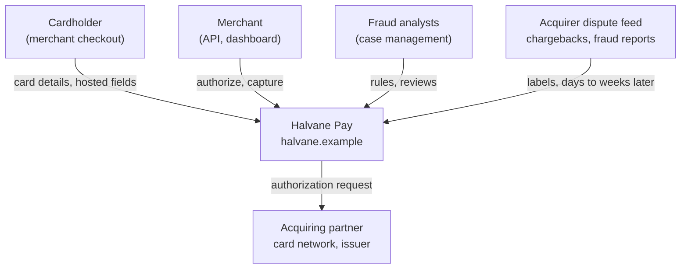
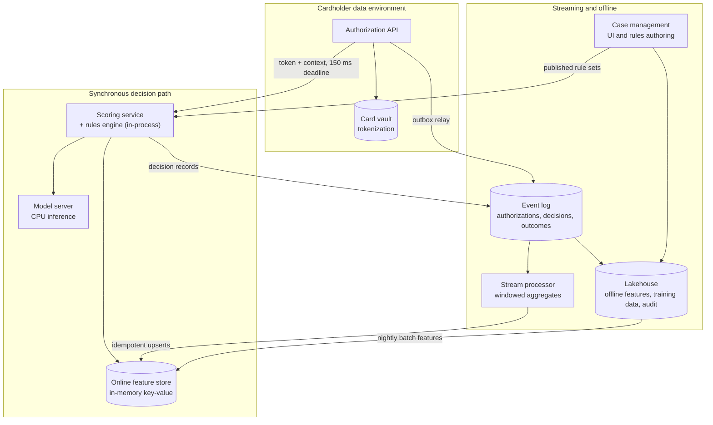
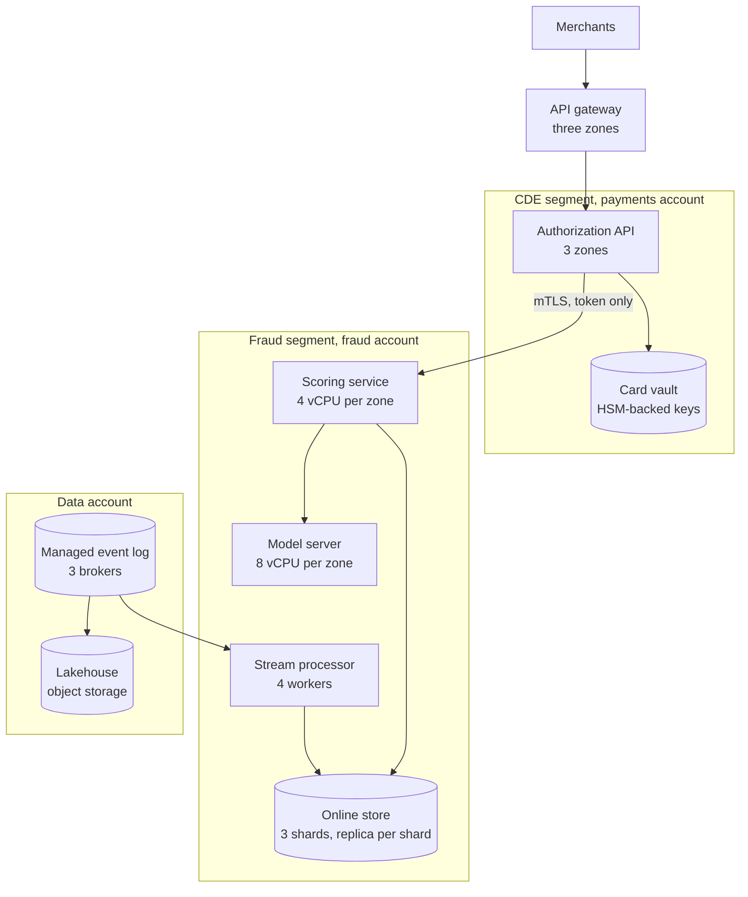
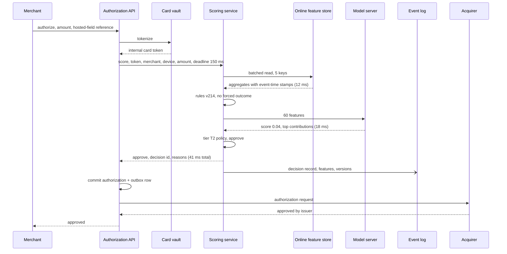
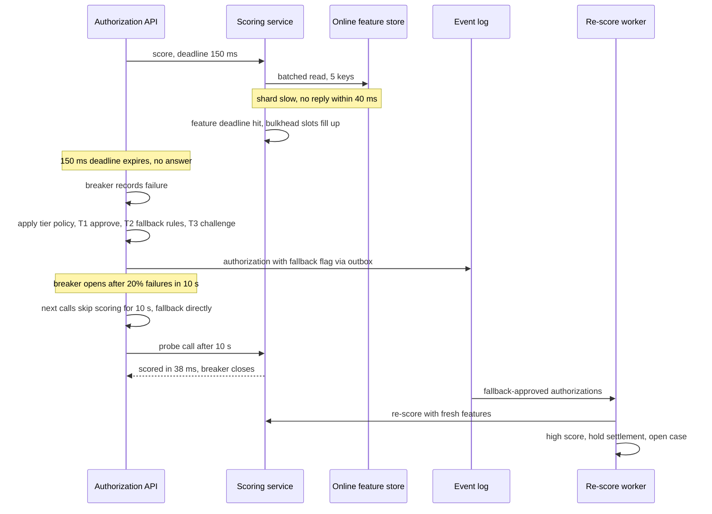
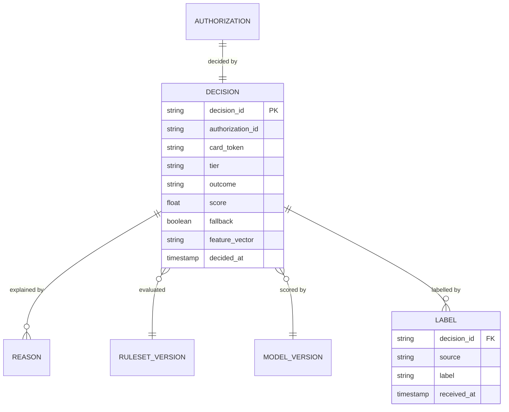
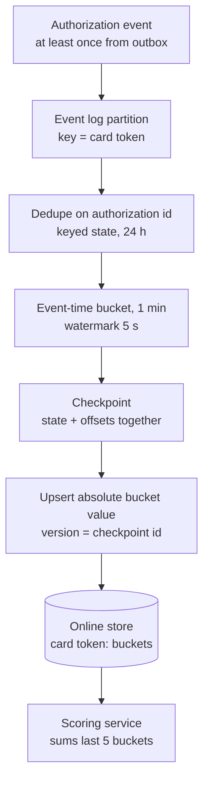

# Case study 13: Real-time fraud detection pipeline

> A payment provider has about a tenth of a second to decide whether a card payment looks like
> fraud, and it must decide every time, including when its own fraud system is slow. This case
> builds a synchronous scoring service fed by streaming features, decides in advance what happens
> when scoring fails for each kind of merchant, and closes the loop with labels that arrive weeks
> after the decision.

!!! abstract "Case facts"
    **Level:** Advanced (Level 3 throughout) · **Time:** 90-120 minutes · **Status:** Draft ·
    **Last verified:** 2026-11-27

The case follows the [design method](../system-design-exercises/design-method.md) and applies
[Message queues and brokers](../messaging-and-streaming/message-queues-and-brokers.md),
[Event streaming and log-based architecture](../messaging-and-streaming/event-streaming-and-log-based-architecture.md),
[Big data processing engines and table formats](../data-engineering-and-analytics/big-data-processing-engines-and-table-formats.md),
[Transactions, sagas, and delivery guarantees](../distributed-systems/transactions-sagas-and-delivery-guarantees.md),
and [Data security and privacy](../security-architecture/data-security-and-privacy.md). Every number
is a labelled **Halvane assumption** or arithmetic from one; no rule, threshold, score, or rate comes
from any real company. Machine learning is at definition depth only (D20 and D24 go deeper).

## Business context and outcome

Halvane Pay (fictional, `halvane.example`) is an online payment service provider (PSP) for small
merchants. Merchants embed Halvane's hosted payment fields; Halvane tokenizes the card, sends the
authorization through its acquiring partner to the card network and issuer, and settles later.

Today fraud checks are a dozen hard-coded rules in the authorization service, changed by release.
Last quarter a card-testing attack (stolen card numbers tried in small amounts) ran most of a
weekend before a deploy stopped it, while the blunt rules keep declining good customers of new
merchants, who then leave Halvane.

The outcomes agreed with the CEO, the Head of Risk, and the acquiring partner:

- **O-1:** every authorization gets a fraud decision before it leaves Halvane, within the
  authorization latency budget, and no authorization fails because the fraud system failed.
- **O-2:** fraud losses fall while fewer good customers are declined (targets in NFR-5 and NFR-6).
- **O-3:** the fraud team can deploy a new rule within an hour, safely, without an engineer.
- **O-4:** every decision can be explained and reproduced later, for a merchant, an analyst, the
  acquirer, or an auditor.
- **O-5:** card numbers never enter the fraud systems.

## Stakeholders and users

| Stakeholder | What they need | Role in decisions |
|---|---|---|
| Merchants (40,000, assumption) | Few false declines, fast checkout, a reason when a payment is stopped | Users; represented by Merchant Success |
| Head of Risk | Fraud loss and false-decline rates within appetite, per merchant tier | **Decision maker for policy** (thresholds, fallback per tier) |
| Fraud analysts (8, assumption) | A review queue, explanations, a way to write and test rules | Users of the case-management UI |
| Data scientists (3, assumption) | Clean labelled training data, no training/serving skew, safe model rollout | Own the model |
| Payments platform team | The authorization path stays fast and available | Own the authorization API; veto on its latency budget |
| Fraud platform team (6 engineers, assumption) | An operable pipeline | Build and run it |
| Compliance officer and PCI DSS assessor | Card data scope known and small; audit trail complete | Confirm scope (C-4) |
| CTO | A design the teams can run with a known residual risk | **Decision maker for architecture** |

## Functional requirements

1. **FR-1** Score every authorization before it goes to the card network: `approve`, `challenge`
   (step-up authentication, where supported), `review` (approve, hold settlement until an analyst
   decides), or `decline`.
2. **FR-2** Apply the merchant tier's policy: thresholds, and what to do when scoring is unavailable.
3. **FR-3** Analysts create, backtest, approve, publish, and retire rules without a code release.
4. **FR-4** Analysts work the review queue in a case-management UI, see why a payment was flagged,
   and record an outcome, which becomes a label.
5. **FR-5** Chargebacks and confirmed fraud reports from the acquirer are ingested as labels.
6. **FR-6** Merchants see each decision and a coarse reason code through the API and dashboard.
7. **FR-7** Data scientists release candidate models through shadow and canary stages.
8. **FR-8** Given a decision id, an authorized user sees inputs, versions, scores, reasons, and
   outcome as they were at decision time.

## Non-functional requirements (measurable targets)

Targets for fraud quality (NFR-5, NFR-6) are **Halvane assumptions set by the Head of Risk**, not
industry figures; they are measured on mature labels (H-13), so they always describe the past.

| ID | Attribute | Target | How measured |
|---|---|---|---|
| NFR-1 | Scoring latency | p99 ≤ 100 ms; hard deadline 150 ms set by the caller | Histogram at the authorization service's scoring client |
| NFR-2 | Authorization availability | 99.95% monthly, unchanged; zero authorizations fail because scoring failed | Authorization SLI; fallback decisions count as successes |
| NFR-3 | Full-score coverage | ≥ 99.5% of authorizations per month decided by full scoring, not fallback | Share of decision records with `fallback = false` |
| NFR-4 | Feature freshness | p99 ≤ 2 s from authorization event time to the updated aggregate being readable | Stream processor emits event time with each write; scoring service records feature age |
| NFR-5 | Detection rate | ≥ 70% of fraudulent authorizations stopped (declined, challenged, or reviewed) | Mature labels joined to decisions |
| NFR-6 | False-positive rate | ≤ 0.3% of legitimate authorizations declined or challenged | Same join |
| NFR-7 | Auditability | 100% of decisions have a decision record; retrievable in ≤ 1 min for 90 days, ≤ 24 h for the retention period | Daily reconciliation: authorizations vs decision records |
| NFR-8 | Rule lead time | New rule from draft to production ≤ 1 h, including backtest and second approval | Rule workflow timestamps |
| NFR-9 | Card data | Zero full card numbers outside the cardholder data environment (CDE) | DLP scans of the event log, lakehouse, and logs |
| NFR-10 | Capacity | 600 authorizations/s at NFR-1 latency with one zone lost | Load test each quarter |

NFR-2 and NFR-3 together make the authorization path **more available than the fraud system**,
possible only if a decision exists without the scoring service (ADR-01).

## Workload assumptions and capacity estimates

| # | Halvane assumption | Value |
|---|---|---|
| H-1 | Merchants; share of authorization volume by tier T1 / T2 / T3 | 40,000; 60% / 30% / 10% |
| H-2 | Authorizations on an ordinary day | 4,000,000 |
| H-3 | Share of a day's authorizations in the busiest hour | 9% |
| H-4 | Seasonal peak day (year-end sales) relative to ordinary | 3× |
| H-5 | Design capacity relative to seasonal peak | 2× |
| H-6 | Entity keys read per score (card, merchant, device, IP prefix, card-merchant pair) | 5, in one batched read |
| H-7 | Streaming aggregate writes per authorization (card, merchant, device, IP prefix) | 4 |
| H-8 | Fraud base rate (illustrative) | 0.10% of authorizations |
| H-9 | Event sizes: authorization / decision record / outcome | 1 KB / 3 KB / 0.5 KB |
| H-10 | Active keys: cards (30 days), devices, IP prefixes, card-merchant pairs (180 days) | 6M, 8M, 1M, 20M |
| H-11 | Analyst throughput | 25 cases/h, 7 productive hours/day |
| H-12 | CPU per request: scoring service / model server | 5 ms / 10 ms |
| H-13 | Label maturity: age after which a decision's label is treated as final | 120 days (card-network rules set the real dispute windows: check them) |
| H-14 | Decision record retention (sizing only; counsel and the acquirer contract decide) | 5 years |

- **Average:** 4,000,000 ÷ 86,400 ≈ **46 authorizations/s**.
- **Ordinary peak:** 9% × 4,000,000 = 360,000 in the busiest hour ÷ 3,600 = **100/s**.
- **Seasonal peak:** 3 × 100 = **300/s**. **Design capacity:** 2 × 300 = **600/s**, 13 times the
  average: the system is sized for its worst hour, which dominates the cost model.
- **Month:** 4,000,000 × 30 ≈ **120,000,000** authorizations (ordinary-day basis).
- **In flight (Little's Law):** 600/s × 0.07 s (a typical score) ≈ **42** concurrent scores.
- **Feature store:** reads 5 × 300 = **1,500 key reads/s** at seasonal peak (300 batched round
  trips), **3,000/s** at design capacity; writes 4 × 300 = **1,200 upserts/s**, 2,400/s at design.
- **Online store memory:** cards 6M × 512 B ≈ 3.1 GB; devices 8M × 256 B ≈ 2.0 GB; pairs
  20M × 64 B ≈ 1.3 GB; IP prefixes and merchants ≈ 0.2 GB. Total ≈ **6.6 GB**, 13.2 GB with one
  replica, about **20 GB** with 50% headroom: an in-memory key-value store.
- **Event log:** 4M × (1 + 3 + 0.5) KB = **18 GB/day**; × 7 days × 3 replicas = **378 GB**.
- **Lakehouse archive:** 18 GB/day at 4:1 columnar compression (assumption) = 4.5 GB/day ≈
  1.6 TB/year ≈ **8.2 TB** over H-14's five years.

**Fraud arithmetic.** 0.10% × 4,000,000 = **4,000 fraudulent authorizations/day**. NFR-5 stops
70% = **2,800**. NFR-6 allows 0.3% × 3,996,000 ≈ **11,990** good payments declined or challenged.
Even at target, only 2,800 ÷ (2,800 + 11,990) ≈ **19%** of stopped payments are fraud, which is
why `challenge` (most genuine cardholders pass it) matters more than `decline`.

**Review capacity.** An analyst handles 25 × 7 = 175 cases/day; a review band of 0.02% (800/day)
needs 800 ÷ 175 ≈ 4.6 analyst-days daily, 6.4 people on a five-day rota, 8 with leave. **Analyst
capacity, not only the model, sets the review threshold.**

## Constraints and assumptions

- **C-1** One region, three zones; a warm standby region for the authorization path exists.
- **C-2** Halvane operates in several European countries (assumption). Rules on automated
  decisions, legal basis for fraud processing, and retention depend on jurisdiction: ask counsel.
- **C-3** Halvane's own p99 budget per authorization, excluding network and issuer, is 300 ms
  (assumption); the payments team grants fraud 150 ms of it.
- **C-4** As a PSP, Halvane has a CDE; the fraud pipeline is designed to sit outside it (ADR-04).
- **C-5** Nine months to production with 6 engineers and 3 data scientists.
- **C-6** Two years of authorization history, about 18 months of chargebacks: enough for a first
  model, not a lot.

## Architecture options considered

| Option | Summary | Strengths | Weaknesses |
|---|---|---|---|
| A. Rules only, inside the authorization service | Today's design, with rules in a config file | Lowest latency; no new systems | No velocity features without querying the payments database; rules change by release (O-3 fails); little explanation |
| B. Synchronous scoring service with an online feature store fed by streaming aggregates (**chosen**) | Rules plus a model, scored in the authorization path on precomputed features | Meets O-1 to O-5; features are one batched read; rules and models deploy independently | Most moving parts; needs a fallback policy and careful stream semantics |
| C. Asynchronous post-authorization review | Approve on basic rules; score afterwards and stop settlement or refund | No latency pressure; simple to add | Fraud is approved first: the cardholder's bank sees an approval, card-testing succeeds, refunds and disputes still cost; bad for digital goods delivered instantly |
| D. Synchronous scoring that computes features at request time | Score by querying the payments database ("how many authorizations for this card in 5 minutes?") | No streaming system | 5+ aggregate queries per score on the transactional database at 600/s, competing with the authorization writes; latency grows with history |
| E. Buy a third-party scoring service | Call a vendor's API in the authorization path | Fast start; cross-merchant data Halvane lacks | Discussed under alternatives |

Option C is not discarded: it becomes the **re-score path** for authorizations approved by fallback
(Figure 5). Option D is the trap most first designs fall into: it moves analytical work onto the
OLTP database in the one request path that cannot slow down.

## Chosen architecture and rationale

Option B. The rule in one sentence: **everything slow happens before the authorization arrives**
(aggregates are precomputed by the stream processor) **or after it leaves** (audit, labels,
training), so the synchronous path is one batched key read, rule evaluation, and one inference.

**Figure 1 — System context (C4 level 1).** Halvane, its users, and its external systems.

How to read it: the decision happens between the merchant's request and the acquirer request.
The dispute feed, the only truth about fraud, arrives weeks late.

**Figure 2 — Containers (C4 level 2).** Grouped by when they run relative to the authorization.

How to read it: only the CDE group sees card numbers; the synchronous group reads only
precomputed state; arrows into the log are at-least-once, and duplicates do no harm (ADR-02).

- **Authorization API** (existing, CDE) swaps the card for Halvane's internal token at the vault,
  calls scoring with a 150 ms deadline, applies the tier fallback if no answer comes, and commits
  each authorization with an outbox row in the same transaction.
- **Scoring service** does one batched read of H-6's five keys, evaluates the published **rule
  set** in-process (a rule can force an outcome or adjust the score), calls the model server, and
  applies the tier's **decision policy**.
- **Model server** hosts the current model (for example gradient-boosted trees over about 60
  features; D19-D20) and a shadow model whose scores are only logged; stateless, CPU-only.
- **Online feature store** holds the latest aggregates per entity key: velocity from the stream
  processor, history ("first purchase at this merchant?") from a nightly batch.
- **Lakehouse** holds Bronze copies of the three topics, the **offline feature store** (the same
  features with full history), training sets, and the decision archive.

Open-source examples (names checked 2026-11-27): Apache Kafka (log), Apache Flink (processor),
Feast (feature definitions, point-in-time joins), Apache Iceberg (table format, time travel).

**Figure 3 — Deployment in one region, three zones.** Network segments match trust boundaries.

How to read it: the only flow from the CDE segment into the fraud segment is the scoring call,
carrying a token, allowed by one firewall rule and mutual TLS. Each zone holds enough scoring and
model capacity that two zones carry 600/s (NFR-10). Shard replicas sit in a different zone from
their primary.

## Request and data flow walkthrough

### Latency budget

| Step | p99 target | Own deadline |
|---|---|---|
| Authorization API to scoring service (network, serialization) | 5 ms | — |
| Feature fetch: one batched read of 5 keys | 25 ms | 40 ms |
| Rule evaluation (in-process) | 5 ms | — |
| Model inference | 30 ms | 50 ms |
| Decision policy, reasons, enqueue decision record | 5 ms | — |
| **Sum of step p99s** | **70 ms** | Caller's deadline: **150 ms** |

Summed step p99s overstate the end-to-end p99, so NFR-1's 100 ms has margin. Inner deadlines add
to 40 + 50 + 15 = 105 ms, inside the caller's 150 ms, so normally the scoring service answers
"unscored" itself before the caller gives up (see
[timeouts from the caller's budget](../distributed-systems/resilience-mechanics-timeouts-retries-and-backpressure.md#timeouts-from-percentiles-and-the-callers-budget)).
**No retries fit in the budget.**

### Happy path: an authorization scored within budget

**Figure 4 — A card authorization at seasonal peak.** Nothing waits for the event log.

How to read it: scoring takes about 41 ms here. The decision record carries the exact feature
values used, so training and audit never recompute them (ADR-03). The outbox relay later publishes
the authorization and its outcome, which the stream processor counts.

### Failure path: the feature store is slow

A shard of the online store degrades (a noisy neighbour, a long pause): reads take 300 ms. At
first the 40 ms feature deadline returns "unscored" quickly; as slow calls pile up, the scoring
service's bulkhead fills and queued requests outlive the caller's 150 ms deadline.

**Figure 5 — Slow features, timeout, and the per-tier fallback.** The breaker caps the damage.

How to read it: the first requests pay the full 150 ms, then the open breaker makes fallback
decisions take microseconds, protecting the authorization SLO. The re-score worker is Option C as
a safety net: fallback approvals are scored minutes later and suspicious ones held for review.

**The per-tier fallback policy** is a business decision by the Head of Risk, recorded in ADR-01.

| Tier | Merchants (H-1) | When scoring is unavailable | Why |
|---|---|---|---|
| T1 low risk | Established ≥ 12 months, low dispute history; 60% of volume | **Fail open:** approve, flag, re-score asynchronously within 15 min | False declines cost more than the rare fraud; settlement hold is a second chance |
| T2 standard | 30% of volume | **Fallback rules in the authorization API:** a per-tier amount ceiling, card country versus merchant country, a per-card rate limit held locally; above the ceiling, challenge | Bounded exposure without the fraud system |
| T3 high risk | New (< 90 days) or high-risk categories such as instantly delivered digital goods; 10% | **Fail closed:** challenge where the flow supports step-up, otherwise decline | Fraud here is delivered instantly and cannot be held |

**Exposure arithmetic.** NFR-3 allows 0.5% of 120,000,000 = 600,000 unscored authorizations a
month; T1's 60% is 360,000 fail-open approvals, about **360 fraudulent approvals** at H-8's rate,
caught only by re-score. Attackers who slow the fraud system get this free: fallback rate pages.

## Data model and storage decisions

**Figure 6 — The decision record.** One immutable row per decision; labels attach later.

How to read it: a decision references the exact rule-set and model versions and stores its own
feature vector, so it can be replayed. Labels are separate rows because they arrive from several
sources (analyst, chargeback, cardholder confirmation) at different times and can disagree.

### Windowed features: at-least-once delivery, idempotent results

Velocity features ("authorizations for this card in 5 minutes", "this merchant's last minute
against its usual rate for the hour", "distinct cards on this device in an hour") are computed on
**event time** (the authorization timestamp) with a 5 s watermark (assumption); see the
[event streaming page](../messaging-and-streaming/event-streaming-and-log-based-architecture.md).
Each card's state is a map of one-minute **tumbling-window buckets** (`minute → count, amount`);
the scoring service sums the last five at read time, so "last 5 minutes" needs no sliding-window
state and no decrements. The event log delivers at least once, the relay can publish twice, and
the processor replays from its last checkpoint after a crash:

| Write style | After a crash and replay of 3 events | Effect on a good customer |
|---|---|---|
| `increment count by 1` per event | Count for the bucket becomes 6 instead of 3 | A velocity rule (illustrative: "more than 5 in 5 minutes") challenges or declines them |
| `set bucket(card, 12:05) = 3, version = checkpoint id` | Recomputed from restored state, writes 3 again | None: the write is repeated, not added |

The processor's own state is exactly-once (its checkpoint captures state and input positions
together), but the **external** online store is outside that checkpoint, so writes to it are
at-least-once. Absolute values with a version (a lower version is ignored) turn that into an
effectively-once result, the first route on the
[delivery guarantees page](../distributed-systems/transactions-sagas-and-delivery-guarantees.md#step-5-delivery-guarantees-and-the-truth-about-exactly-once).
Relay duplicates are dropped earlier by keyed state on `authorization_id`, kept 24 hours.

**Figure 7 — From authorization event to online feature.** Each stage removes duplicates or disorder.

How to read it: partitioning by card token puts a card's events on one task, so buckets need no
coordination. Merchant velocity runs as a second job keyed by merchant; a very large merchant is a
hot key, pre-aggregated per task before the final sum.

**Late events** past the watermark still rewrite their bucket for 10 minutes (assumption), then
go to a counted side output. **The gap freshness cannot close:** a script firing 20 attempts per
second outruns NFR-4's 2 s, so the first 40 attempts see stale counts. A synchronous per-card
token bucket in the authorization API (as in the [rate limiter exercise](../system-design-exercises/rate-limiter.md))
covers that burst; streaming features catch slower, wider patterns.

### Online and offline consistency (training/serving skew)

Training/serving skew is a model seeing different feature values in production from those it was
trained on (different code, data, or moment). Halvane removes it three ways:

1. **Log what was served (ADR-03).** Training sets for existing features come from the feature
   vectors in decision records: exactly what serving saw, point-in-time correct by construction.
2. **One definition, two executions.** A new feature is defined once in the registry, run online
   by the stream processor and offline by a backfill over Bronze with **point-in-time joins** (the
   value as of `decided_at`, never later, which would leak the future into training).
3. **Measure the rest.** A daily job recomputes a 1% sample of served values offline; over 1%
   mismatched for any feature (assumption) blocks the next training run. Training jobs record the
   lakehouse snapshot ids they read, so any training set can be rebuilt by time travel.

### Labels and the feedback loop

Analyst outcomes arrive in hours to days; chargebacks and acquirer fraud reports in days to
weeks. Both land in a labels table joined to decision records on decision id, and only decisions
older than H-13's 120 days enter a training set, so a model trained today learns from fraud at
least four months old; earlier labels feed monitoring. Candidates then go through shadow and
canary (see Deployment). Three properties of these labels shape the design:

- **Delay.** Recent attacks have no labels yet, which is why rules (fast to write, O-3) exist
  beside the model: rules handle what happened this week, the model generalizes what happened
  last quarter.
- **Selection bias.** A declined payment never produces a chargeback, so its label is unknown.
  Analysts review a small random sample of declines to label them; whether to also approve a tiny,
  value-capped sample of T1 payments the model would decline, to measure what it misses, is a
  Head-of-Risk decision, not an engineering default.
- **Noise.** Some fraud chargebacks are disputes by the genuine cardholder; analyst outcomes win
  where both exist.

## API and integration contracts

| Contract | Semantics | Notes |
|---|---|---|
| `POST /v1/score` (internal) | Request: decision id, internal card token, merchant id, tier, amount, currency, device and network context, deadline. Response: outcome, score, reason codes, versions | Idempotent on `decision_id` (= authorization id): a repeated call returns the stored decision |
| `authorizations.v1` topic | One event per authorization, key = card token, from the outbox | Schema-registered; additive changes only |
| `decisions.v1` topic | Full decision record (Figure 6), key = decision id | At-least-once; consumers dedupe on decision id |
| `outcomes.v1`, `labels.v1` topics | Issuer response, capture, refund; label source, label, time | Labels from case management and the dispute-feed adapter |
| Rule set publication | Versioned bundle, signed, with backtest report and two approvers | Scoring service hot-loads; every decision records the version |
| Merchant reason codes | Coarse categories only ("velocity", "mismatch", "risk score") | Detailed rule ids never leave Halvane |

## Security and trust boundaries

- **Card data scope.** The vault returns an **internal card token**: stable per card so velocity
  can be counted, random so it cannot be reversed outside the vault, never given to merchants
  (they get merchant-scoped tokens). PCI DSS scope covers what stores, processes, or transmits card
  data **and what is connected to it**; the scoring call connects the segments, so whether the
  fraud segment is out of scope or "connected-to", and whether truncated card values may sit beside
  the token, is for Halvane's assessor (see the [compliance page](../security-architecture/compliance-and-regulatory-frameworks.md)).
- **Personal data.** Device identifiers and IP prefixes are pseudonymized with a keyed hash before
  Silver; retention follows C-2 (see [Data security and privacy](../security-architecture/data-security-and-privacy.md)).
- **Rules are an attack surface:** an allow-list rule written by a corrupt insider is a backdoor.
  Two approvers, an attached backtest, audit logging, and 30-day expiry for allow-lists
  (assumption).
- **Decision records are evidence:** append-only archive tables with object-lock retention;
  every analyst view of a decision is logged.
- **Explainability.** Each decision stores the rules that fired and the model's top feature
  contributions (a per-prediction attribution method; D25). Analysts see all of it, merchants see
  coarse codes, and nobody outside sees thresholds, which would teach fraudsters to stay under them.
- **Workload identity and mTLS** everywhere; the scoring service cannot call the vault, and the
  stream processor can write only the online store and its own topics.

## Reliability, failover, and disaster recovery

| Failure | Detection | What happens | Customer impact | Meets |
|---|---|---|---|---|
| Online store slow or one shard down | Feature latency, timeouts | Figure 5: deadline, breaker, tier fallback, re-score | Fallback decisions for minutes | NFR-2; NFR-3 if under 0.5% a month |
| Model server down | Error rate | Rules-only scoring with the tier's model-absent thresholds (stricter for T3) | Slightly more challenges | NFR-2 |
| Stream processor down | Freshness alert (NFR-4) | Features age; above 60 s old, velocity features are treated as missing, tier policy for missing features applies | More challenges in T3 | NFR-4 breached, NFR-2 holds |
| Event log unavailable | Producer errors | Outbox rows accumulate in the payments database; decision records spool to the scoring service's local disk, replayed later | None at decision time | NFR-7 holds after replay |
| Bad rule published | Decline-rate alert | One-click rollback to the previous rule-set version | Minutes of extra declines | NFR-8 workflow |
| Region loss | Existing regional failover for payments | Warm scoring and model servers in region B; online store rebuilt by replaying the last 24 h from the replicated log; until then features are missing and tier policy applies | Fallback for up to the 1 h rebuild (assumption) | NFR-2 |

The 24 h replay suffices because no streaming window is longer; history features reload from the
lakehouse.

## Scaling and performance strategy

- **Stateless scoring and model servers** scale out; the online store is sharded by key; reads
  are one batched round trip and never scan.
- **Merchant features are cached** in the scoring service for 1 s, since many requests a second
  read the same merchant key (see [caching architecture](../databases-and-storage/caching-architecture.md)).
- **At 10×** (6,000/s): 30,000 store reads/s and 24,000 writes/s, still a modest sharded store;
  the processor and log scale by partitions. The first limits are hot merchant keys and model CPU
  (6,000 × 10 ms = 60 vCPU busy): a smaller model or batched inference are the levers.

## Observability and operations

- **Dashboards:** outcome rates and fallback rate per tier and hour; review-queue depth against
  analyst capacity; scoring p99 per step (the budget table as live data); consumer lag; feature
  freshness; late events; skew-check results.
- **Paging alerts** (Halvane assumptions, tuned after launch): fallback rate > 1% for 5 minutes;
  any tier's decline rate above double its 7-day baseline for that hour; freshness p99 > 10 s;
  decision-record reconciliation gap > 0 after 1 hour. Runbooks map alerts to Figure 5's states
  (see the [monitoring page](../observability-and-sre/monitoring-alerting-and-on-call.md)).
- **Model monitoring** (definition depth; D25): score and feature distribution shift; detection
  and false-positive rates on early labels weekly and on mature labels monthly.

## Deployment and release strategy

- **Code** follows the platform pipeline: canary per zone, automatic rollback on latency or error
  SLO burn (see [CI/CD pipeline design](../devops-and-platform-engineering/ci-cd-pipeline-design-and-deployment-strategies.md)).
- **Rules** are data: an analyst drafts, the backtest replays 7 days of decision records (how many
  payments the rule would stop, how many of those were labelled good), a second analyst approves,
  the bundle publishes, optionally in **monitor mode** ("would have fired") first. That meets
  NFR-8's hour.
- **Models** go shadow (1 week, assumption) → canary on 5% of T1 → per tier, the previous model
  kept loaded for rollback; promotion criteria are written before the canary. Topic schema
  changes are additive.

## Cost model

Illustrative rate: **1 vCPU-hour = 1 CU**; 730 hours a month; vCPU counts are Halvane
assumptions derived from H-12.

| Line | Sizing arithmetic | vCPU |
|---|---|---|
| Scoring service | 600/s × 5 ms = 3 vCPU busy; ÷ 40% target utilization ≈ 7.5; two surviving zones carry it → 4 per zone × 3 | 12 |
| Model server | 600/s × 10 ms = 6 busy; ÷ 40% = 15; → 8 per zone × 3 | 24 |
| Online feature store | 3 shards × 2 nodes × 4 vCPU (memory-driven, about 20 GB) | 24 |
| Stream processor | 4 workers × 4 vCPU | 16 |
| Event log (managed; vCPU-equivalent for comparison) | 3 brokers × 4 vCPU | 12 |
| Case management, rules authoring, dispute adapter | | 8 |
| **Always-on total** | | **96** |

- **Always-on:** 96 × 730 = **70,080 CU a month**.
- **Batch:** weekly training 32 vCPU × 6 h × 4.3 ≈ 826 CU; nightly batch features and skew check
  16 × 1.5 h × 30 = 720 CU; rule backtests 8 × 0.25 h × 10 a day × 30 = 600 CU; total **2,146 CU**.
- **Compute total ≈ 72,226 CU a month**, or 72,226 ÷ 120,000 thousand authorizations ≈ **0.60 CU
  per 1,000 authorizations**.
- **Storage and transfer** (price with the provider's calculator): 378 GB of log, about 8.2 TB of
  lakehouse after five years, 20 GB of in-memory store.

**What drives the number:** peak headroom (sized for 600/s, averaging 46/s, about 8%
utilization; scheduled scaling can trim, never below two zones' need), model CPU per score (the
largest line), and active keys (H-10) for the store. The compute bill is small beside the
**business numbers**: 0.1 point of false-positive rate is about 4,000 good payments stopped a day,
one point of detection rate is 40 frauds a day.

## Risks and mitigations

| Risk | Likelihood | Impact | Mitigation |
|---|---|---|---|
| Training/serving skew silently degrades the model | Medium | High | Log served features (ADR-03); daily skew check; shared definitions |
| Attackers learn to trigger fallback (slow the fraud system) | Low | High | Fallback-rate paging; T3 fails closed; re-score path; per-card token bucket |
| Duplicate counting inflates velocity, declining good customers | Medium | Medium | Absolute versioned upserts, dedupe on authorization id (ADR-02) |
| Label delay hides a new attack from the model | High | Medium | Rules in one hour (NFR-8); analyst labels as early signal |
| Assessor rules the fraud segment in PCI DSS scope | Medium | Medium | Segmentation already built; budget for in-scope controls if needed (ADR-04) |
| Review queue exceeds analyst capacity in an attack | Medium | Medium | Queue depth alert; temporary tier tightening by the Head of Risk instead of a growing backlog |

## Architecture Decision Records

### ADR-01: Synchronous scoring with a hard deadline and a fallback policy per merchant tier

- **Context.** Fraud must be stopped before authorization (O-1), but the authorization path
  matters more than the fraud system (NFR-2); one fail-open or fail-closed rule is wrong for some
  merchants either way.
- **Decision.** 150 ms deadline plus circuit breaker; on no answer, the tier's fallback: T1 fail
  open with re-score, T2 local fallback rules, T3 fail closed. The Head of Risk owns the table.
- **Consequences.** The authorization API carries a small fallback rule set, tested in CI against
  the same backtest data. Fallbacks are flagged and count against NFR-3. Merchants know exactly
  what happens in an outage.

### ADR-02: Windowed features by a checkpointed stream processor, written as idempotent absolute upserts

- **Context.** Velocity features must be fresh (NFR-4) and must not overcount (NFR-6), on a log
  that delivers at least once.
- **Decision.** Event-time one-minute buckets in checkpointed keyed state; dedupe on authorization
  id; each write sets the bucket's absolute value, versioned by checkpoint id.
- **Consequences.** Replays and duplicates are harmless with no distributed transaction; reads sum
  buckets; very fast bursts are left to the synchronous per-card rate limit.

### ADR-03: Every decision record stores its served feature vector; training uses logged features

- **Context.** Training/serving skew is a common silent failure of production models, and audit
  (O-4) needs the inputs anyway.
- **Decision.** The 3 KB decision record holds all feature values, versions, and reasons; training
  uses them, and new features are backfilled with point-in-time joins from shared definitions.
- **Consequences.** About 12 GB a day (H-9 × H-2) kept for H-14's period; new features still need
  backfills until they have shadow history.

### ADR-04: The fraud pipeline sees only internal card tokens

- **Context.** PCI DSS scope grows with every system that touches card data (C-4).
- **Decision.** Only the vault's internal token crosses into the fraud segment; DLP enforces NFR-9.
- **Consequences.** Analysts search by card number through a CDE-side lookup with its own access
  control. Scope reduction is expected, not assumed, until the assessor agrees.

## Alternative designs and why they were rejected

**Option E: buy a third-party fraud scoring service.** Halvane would call a vendor's API with the
token, amount, device, and merchant context and get back a score and reasons; the vendor learns
from Halvane's chargebacks and sees patterns across all the payment companies it serves.

It was rejected for now: Halvane has labelled history and a team (C-5, C-6) and needs per-tier
policy; the external round trip eats the 150 ms budget with the same fallback problem; O-4's
explanations are only as detailed as the contract; and sharing device and transaction data needs
data-processing terms and residency review (and PCI DSS scope if card numbers ever go).

Buying wins when any of these holds:

- **Cold start:** a new PSP with no labelled history; a vendor's model works from day one.
- **No data science capacity**, or a team too small to run rules, models, and the pipeline on call.
- **Cross-merchant signal matters most:** attacks that move across many PSPs are visible only to a
  network that sees them all.
- **Volume is low enough** that the vendor's per-transaction price is below the build's fixed
  cost; at Halvane's compute of about 0.60 CU per 1,000 authorizations, people dominate the build
  cost, so the comparison is really people against the vendor's price (see
  [build vs buy](../architecture-fundamentals/as-is-and-to-be-architecture-gap-analysis-and-build-vs-buy.md)).

A common middle path, which Halvane keeps open: **use a vendor score as one feature** of its own
model, so cross-network signal is added while policy, explanation, and fallback stay in-house.

## Questions for the learner

1. Model CPU doubles to 20 ms per score. Recompute the model-server line; which NFR breaks first?
2. The Head of Risk proposes moving T2 to fail closed. Using the exposure arithmetic and NFR-6,
   argue for and against.
3. Show with a three-event example why a stream processor with exactly-once internal state can
   still overcount in the online store, and why the versioned absolute write fixes it.
4. A data scientist trains on features recomputed today from the lakehouse instead of the logged
   vectors. Name two ways the trained model can look better offline than it performs online.
5. A card-testing attack runs at 50 attempts per second across 200 merchants, 2 attempts per card.
   Which features and controls catch it, and which do not?

## Related topics

- **Before:** [Message queues and brokers](../messaging-and-streaming/message-queues-and-brokers.md); [Transactions, sagas, and delivery guarantees](../distributed-systems/transactions-sagas-and-delivery-guarantees.md); [Resilience mechanics: timeouts, retries, and backpressure](../distributed-systems/resilience-mechanics-timeouts-retries-and-backpressure.md); [Data security and privacy](../security-architecture/data-security-and-privacy.md).
- **Alongside:** [Event streaming and log-based architecture](../messaging-and-streaming/event-streaming-and-log-based-architecture.md); [Event-driven architecture](../messaging-and-streaming/event-driven-architecture.md); [Big data processing engines and table formats](../data-engineering-and-analytics/big-data-processing-engines-and-table-formats.md); [Warehouses, lakes, lakehouses, and data mesh](../data-engineering-and-analytics/warehouses-lakes-lakehouses-and-data-mesh.md); [Compliance and regulatory frameworks](../security-architecture/compliance-and-regulatory-frameworks.md); [Case study 12: data lakehouse with batch and streaming ingestion](cs-12-data-lakehouse-with-batch-and-streaming-ingestion.md); [Case study 10: multi-region disaster recovery](cs-10-multi-region-disaster-recovery.md); [Exercise: real-time analytics](../system-design-exercises/real-time-analytics.md); [Cloud cost models and FinOps](../finops-and-sustainability/cloud-cost-models-and-finops.md).
- **Planned:** ML lifecycle and MLOps (D20-T02, D20-T03); model serving and inference (D24-T02); AI evaluation and observability (D25-T01, D25-T02); banking and finance industry architecture (D26-T02).

## References

| Source | Type | Checked |
|---|---|---|
| Tyler Akidau et al., [The Dataflow Model](https://www.vldb.org/pvldb/vol8/p1792-Akidau.pdf) (VLDB 2015) | Research paper (event time, windows, watermarks, lateness) | 2026-11-27 |
| Apache Flink documentation: [Windows](https://nightlies.apache.org/flink/flink-docs-stable/docs/dev/datastream/operators/windows/), [Fault Tolerance (state and checkpoints)](https://nightlies.apache.org/flink/flink-docs-stable/docs/learn-flink/fault_tolerance/) | Official documentation | 2026-11-27 |
| Apache Kafka documentation: [Design, message delivery semantics](https://kafka.apache.org/44/design/design/#message-delivery-semantics) | Official documentation (idempotent producer, transactions, limits of exactly-once) | 2026-11-27 |
| Feast documentation: [Point-in-time joins](https://docs.feast.dev/getting-started/concepts/point-in-time-joins) | Official documentation (open-source feature store) | 2026-11-27 |
| Google for Developers, [Rules of Machine Learning](https://developers.google.com/machine-learning/guides/rules-of-ml) | Guide (training-serving skew, logging features at serving time) | 2026-11-27 |
| D. Sculley et al., [Hidden Technical Debt in Machine Learning Systems](https://papers.nips.cc/paper/2015/hash/86df7dcfd896fcaf2674f757a2463eba-Abstract.html) (NeurIPS 2015) | Research paper (feedback loops, data dependencies) | 2026-11-27 |
| Apache Iceberg documentation: [Queries (time travel)](https://iceberg.apache.org/docs/latest/spark-queries/) | Official documentation | 2026-11-27 |
| PCI Security Standards Council, [Document library](https://www.pcisecuritystandards.org/document_library/) | Standard publisher (PCI DSS and tokenization guidance) | 2026-11-27 |

## Review notes

- Template H2s in order, then Related topics, References, Review notes. Seven Mermaid figures:
  context, containers, deployment, happy-path and failure-path sequences, decision-record ER
  diagram, windowed-feature flowchart. Check Figures 2 and 3 (stacked subgraphs) at phone width.
- Every number is a Halvane assumption (H-1 to H-14 and those labelled inline) or arithmetic from
  one. Recheck 46/100/300/600 per s, 3,000 reads/s, 6.6 and 20 GB, 378 GB, 8.2 TB, 2,800 versus
  11,990 (19%), 4.6 analyst-days, 360 fallback frauds a month, and 72,226 CU (0.60 per 1,000).
- Rules, thresholds, rates, and tier policy are illustrative. Chargeback timing is an assumption.
  PCI DSS text stays at scope principles; "connected-to" status and truncated values are left to
  the assessor, automated-decision and retention rules to counsel (C-2).
- "Chargeback" here is the card dispute, not the glossary's FinOps term. ML content is at
  definition depth (D20, D24, D25 planned). Links to batch pages depend on parallel writers.
